## About this lecture

You have seen what an agent can do. Before you can try it yourself, three things must be in place: **an account that includes the agent, the agent program on your own computer, and one working conversation with it.** This is the only unit where most of the work is setting things up, and it is the one where people most often get stuck. We go slowly.

- **Claude Code** needs a paid Claude plan (Pro or higher) or API billing. **Codex** needs a ChatGPT account; Plus or higher is realistic.
- Both are installed by **pasting one line** into a terminal. The terminal is just the place where you paste it.
- The first start opens a **browser window to sign in**. After that, the agent runs in the terminal.
- Your first conversation happens in an **empty folder**, so nothing of yours is at stake.

This is a **practical** unit. The exact commands live on the exercise page, which we update before each run. Using the terminal properly comes in *Terminal survival kit*.

::: notes
Welcome to the unit everyone dreads a little: installation. The good news is that installing these tools has become much simpler. For each tool, it is one line pasted into a terminal, followed by a sign-in in the browser. The less good news is that every computer is slightly different, and university laptops in particular can have restrictions. So this unit is as much about what to do when it does not work as about the happy path. I will show you the shape of the process here. The exact commands, which change from time to time, are on the exercise page, and that page is the one you should have open when you actually install. We do not learn the terminal today. We only open it, paste, and press Enter. The next unit teaches the terminal properly.
:::

## Monday morning: you want to try this on a real task

Imagine a teacher who saw the live build in *Why agentic AI?* and wants to try it on their own course material on Monday. Between them and the first useful result stand:

- an **account**: which plan? Is the free one enough? Does the university already pay for something?
- an **install**: on a laptop where they have never opened a terminal;
- a **sign-in**: linking the program on the laptop to the account in the browser;
- a **first test**: how do they know it works?

Each step is small. Missing any one of them stops everything. This lecture walks the path once, so that you recognise each step when you do it.

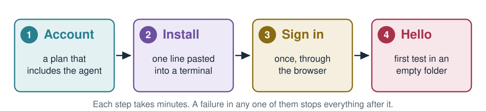{width="85%" fig-align="center"}

::: notes
Let us make it concrete. Picture a colleague who wants to try this on Monday morning. They have perhaps used ChatGPT in a browser before. What stands between them and a working agent is not one big obstacle but four small ones in a row: account, install, sign-in, first test. Each takes a few minutes when it goes right. The trouble is that when one goes wrong, the error messages are written for programmers. So the plan for today is to walk the whole path once, slowly, and to look at the typical ways each step goes wrong. When you then do it yourself in the exercise, you will know where you are on this path at every moment.
:::

## You need three things: a plan, a program and a place to type

:::: {.columns}
::: {.column width="45%"}
1. **An account with a plan that includes the agent.** This is where the AI model runs and how usage is paid for.
2. **The agent program** installed on your computer. It reads your files, runs commands and talks to the model over the internet.
3. **A terminal** to start the program and talk to it.

Each tool (Claude Code, Codex) needs its own account and its own program. The terminal is the same for both.
:::
::: {.column width="55%"}
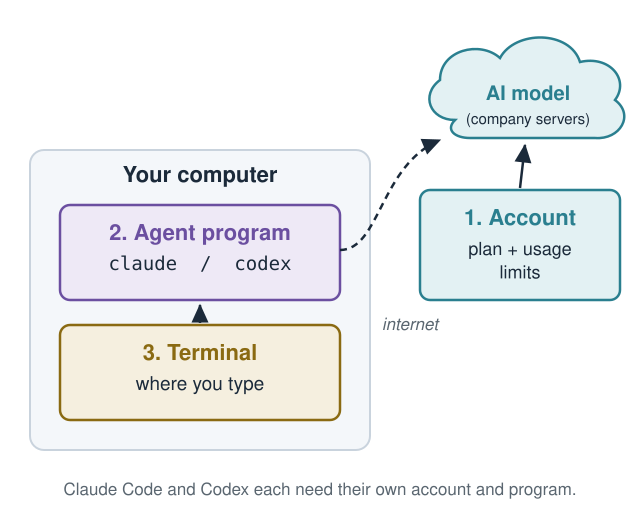{width="100%"}
:::
::::

::: notes
It helps to separate three things that are easy to mix up. First, the account. The language model itself runs on the company's servers, not on your laptop, and your plan decides how much you may use it. Second, the program. This is a small application that sits on your computer, reads your files when you ask, runs commands, and sends your requests to the model. Third, the terminal, which is simply the window where you start the program and type to it. Claude Code and Codex each need their own account and their own program, but they share the terminal. When something fails later, it helps to ask which of the three is the problem: is it my account, my installation, or my terminal?
:::

## Claude Code needs a paid Claude plan; the free plan does not include it

:::: {.columns}
::: {.column width="50%"}
- **Pro** is the entry level that includes Claude Code. **Max**, **Team** and **Enterprise** include it too, with higher limits.
- The **free** Claude plan does **not** include Claude Code.
- Alternative: **pay-as-you-go API billing** through the Claude Console. You pay per use instead of per month.
- Plans have **usage limits** that reset over time. Heavy days can hit them; the agent then tells you when you can continue.

We give **no prices**: they change. Links to the official plan pages are on the exercise page.
:::
::: {.column width="50%"}
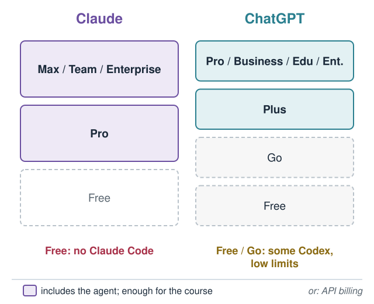{width="100%"}
:::
::::

::: notes
For Claude Code, the rule is simple. The free Claude plan, the one many of you may have used in the browser, does not include Claude Code. You need Pro or something above it: Max, Team or Enterprise. The other route is the Claude Console, where you buy API credits and pay for what you use. Every plan has usage limits that reset after some hours. On a normal day of course work, Pro is usually enough; if you use the agent for long sessions every day, you may hit the limit and have to wait. I am deliberately not giving prices, because they change between course runs. The exercise page links to the official pricing page.
:::

## Codex comes with a ChatGPT account; Plus or higher is realistic

- Codex is included across ChatGPT plans, **including Free and Go**, but with **low limits** there. On those plans, access to the terminal version may also be limited or still rolling out.
- **Plus** or higher (Pro, Business, Edu, Enterprise) is what we recommend for the course.
- You can also sign in with an **OpenAI API key** and pay per use, as with the Claude Console.
- You sign in with the **same account** you use for ChatGPT in the browser.

**Do you need both tools?** For almost every unit, **one is enough**. Having both pays off in *Parallel workers*, where we compare them and let one review the other.

::: notes
Codex is OpenAI's agent, and it is tied to your ChatGPT account. OpenAI includes Codex in all ChatGPT plans, even the free ones, but the free tiers have low limits and OpenAI's own pricing page currently lists them mainly for the desktop app. In practice, Plus or higher is what you want for this course. If you already pay for ChatGPT Plus, you already have Codex. As with Claude, there is also an API-key route where you pay per use. Do you need both? No. Every exercise gives instructions for both tools, and you can follow any of them with one. The Parallel workers unit later in the course is where having both really helps, so if you are curious, it is worth keeping the option open.
:::

## Your university may already pay for a plan: ask IT before you pay yourself

:::: {.columns}
::: {.column width="50%"}
- Institutional plans exist: **Claude for Education**, Claude **Team/Enterprise**, **ChatGPT Edu/Enterprise**.
- Whether they include **Claude Code or Codex** depends on the institution's **workspace settings**. An administrator can switch these on or off.
- An institutional plan can also come with **better data terms** (no training on your data). That matters in *Privacy, ethics and safety*.

**Ask IT:** "Do we have a Claude or ChatGPT plan, and does it include Claude Code or Codex?"
:::
::: {.column width="50%"}
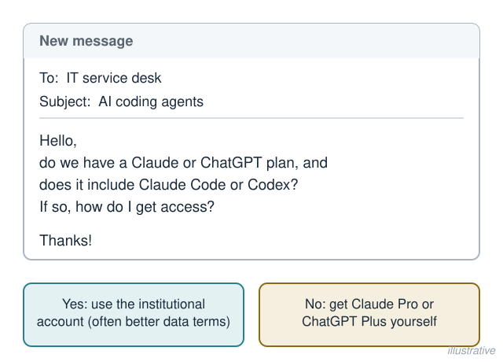{width="100%"}
:::
::::

::: notes
Before you pay out of your own pocket, find out whether your university already has an agreement. Many institutions now have Claude for Education, ChatGPT Edu or an enterprise plan. Having the plan is not the same as having the agent, though. The workspace administrator decides which features are switched on, and coding agents are sometimes switched off by default. So the question to send to IT is specific: do we have a plan, and does it include Claude Code or Codex? An institutional plan has one more advantage: the data terms are usually stricter, for example a promise not to train on your data. We come back to why that matters in the privacy unit.
:::

## A subscription has a monthly cap; an API key has a meter

:::: {.columns}
::: {.column width="55%"}
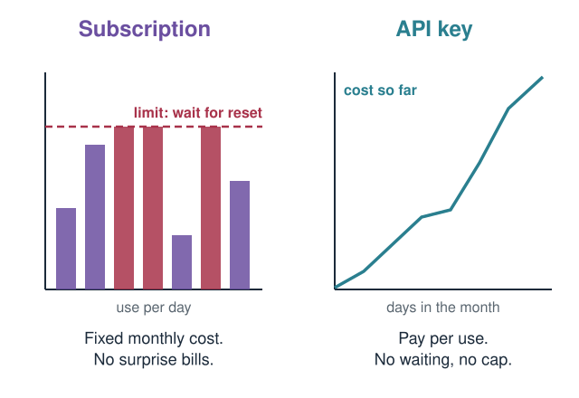{width="100%"}
:::
::: {.column width="45%"}
- **Subscription** (Pro, Plus, ...): a fixed monthly cost. When you reach the limit, you **wait** for it to reset. No surprise bills.
- **API key** (Claude Console, OpenAI Platform): you pay **per use**. No waiting, but a long session can cost more than you expect.

**For this course, use a subscription.** It makes the cost predictable while you learn. An API key is for automation or for an institution that prefers usage billing.
:::
::::

::: notes
There are two ways to pay, and it is worth understanding the difference. A subscription works like a gym card: a fixed monthly cost, and if you use it a lot, you hit a limit and have to wait a few hours. You never get a surprise bill. An API key works like a taxi meter: you pay for exactly what you use. That is good for automated jobs, but while you are learning, a long session where the agent reads many files can cost more than you would guess. So for this course we recommend a subscription. If your institution gives you an API key instead, that also works; just keep an eye on the usage page.
:::

## Create a free GitHub account now, even though we need it only in Part 3

- **GitHub** is where we will store, share and publish projects (*GitHub*, *A course or project page*).
- A **free personal account** is enough. Educators can apply for extra benefits through **GitHub Education**.
- Create it **now**: choosing a username and confirming the e-mail takes a few minutes, and it is one less thing to do later.
- Pick a **username you are happy to show colleagues**. It appears in the web address of your project pages.

You do not need to do anything on GitHub yet.

::: notes
One more account, and it is free. GitHub is the website where code and projects are stored and shared, and in Part 3 we use it to publish your project page. You will not touch it until then, but creating an account takes a few minutes and sometimes involves waiting for an e-mail, so do it now while you are setting things up anyway. One practical tip: your username becomes part of the address of your published pages, something like username dot github dot io. Choose something you would be happy to put on a slide or a CV. Teachers can also apply for GitHub Education, which gives some extra features for free.
:::

## Git, R, Python and Quarto can wait: the agent will install them with you

- Later units use free software: **git** (version history), **R** and **Python** (analysis), **Quarto** (web pages).
- You do **not** install them today.
- In *Terminal survival kit* we let the agent check what is already there and install what is missing, explaining each step before it runs it.
- On a managed laptop, some of these may need to come from IT's **software centre** instead. We will say where.

::: notes
You may have heard that you need to install a long list of programs to do data analysis: R, Python, git, and so on. We will need some of them later, but not today. In fact, installing them is a good first task for the agent itself: it can check what you already have, suggest what is missing, and explain each command before it runs it. We do that in the next unit. If your laptop is managed by the university, some programs may have to come from the IT department's software centre instead, and the agent can help you figure out which. Today, the only programs we install are the agents themselves.
:::

## The agent is a program on your computer, not a website

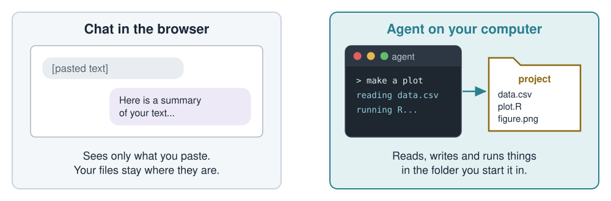{width="85%" fig-align="center"}

- A **chat** runs in the browser. It sees only what you paste in.
- An **agent** runs on **your computer**. It can read and change files in the folder where you start it, and run programs there.
- That is why it must be **installed**, and why *where* you start it matters.

::: notes
Here is why there is an install step at all. When you use ChatGPT or Claude in the browser, everything happens on a web page. The model sees only what you type or paste. A coding agent is different: it is a program that runs on your own computer, and it can open the files in a folder, write new files, and run programs such as R or Python. The thinking still happens on the company's servers, but the hands are on your machine. That is what makes it useful, and it is also why we care so much about which folder you start it in. Today we start it in an empty folder, so it has nothing to touch.
:::

## Desktop apps and editor extensions exist; we use the terminal version because it is the same everywhere

:::: {.columns}
::: {.column width="50%"}
Both tools come in several forms:

- a **terminal** program (Claude Code CLI, Codex CLI);
- a **desktop app** (the Claude desktop app, the ChatGPT desktop app with Codex);
- **editor extensions** (for example VS Code).

They share the same engine. The course uses the **terminal** version because it looks and works the same on Windows, macOS and Linux, and every feature appears there first.

The desktop app is a good **fallback** if the terminal install is blocked on your laptop.
:::
::: {.column width="50%"}
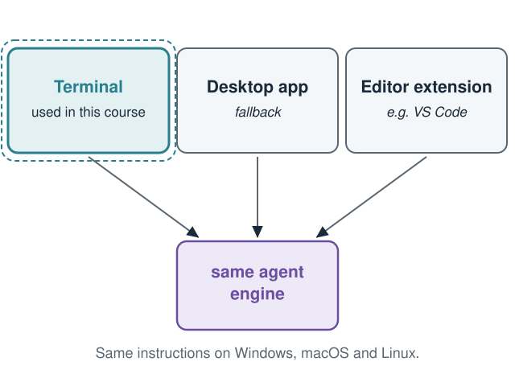{width="100%"}
:::
::::

::: notes
You may wonder why we use the terminal at all, when both companies offer desktop apps with buttons and windows. The honest answer is consistency. The terminal version is the same on every operating system, so the instructions in this course work for everyone. Desktop apps change their menus often, and they differ between Windows and Mac. The terminal version also gets new features first, and it is the version the documentation describes. That said, the engine underneath is the same. If your laptop does not let you install the terminal version, the desktop app is a perfectly fine fallback, and most of what we teach carries over.
:::

## Opening a terminal takes one shortcut on each system

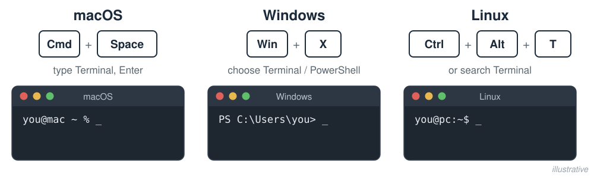{width="90%" fig-align="center"}

- **macOS:** `Cmd + Space`, type *Terminal*, press Enter.
- **Windows:** `Win + X`, choose *Terminal* or *Windows PowerShell*.
- **Linux:** `Ctrl + Alt + T`, or search for *Terminal*.

::: notes
Now the practical part. To install, you need a terminal window. On a Mac, press Command and Space to open Spotlight, type Terminal and press Enter. On Windows, press the Windows key and X together, and choose Terminal or Windows PowerShell from the menu. On most Linux systems, Control, Alt and T opens one. In each case you get a window with some text and a blinking cursor. That is all we need today: a place to paste one line and press Enter. You do not need to understand what else is in the window yet; that is the next unit.
:::

## On Windows, check that the prompt starts with PS

:::: {.columns}
::: {.column width="50%"}
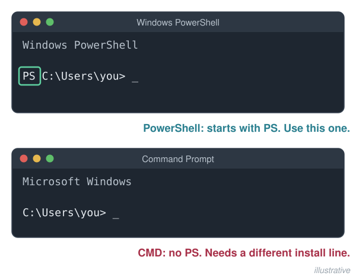{width="100%"}
:::
::: {.column width="50%"}
- Windows has two command windows: **PowerShell** and the older **Command Prompt (CMD)**. They need **different** install commands.
- **PowerShell** shows `PS C:\Users\yourname>`. **CMD** shows the same without `PS`.
- Use **PowerShell**. Do not pick the entry marked **(x86)**: that is the 32-bit version and the tools refuse to run in it.
- You do **not** need "Run as administrator".
:::
::::

::: notes
Windows has a small trap. There are two kinds of command window: PowerShell, which is the modern one, and Command Prompt, also called CMD, which is older. They look almost the same, but they understand different commands, so an install line written for one fails in the other. The quick check is the start of the line: PowerShell puts the letters PS in front. Use PowerShell. If your Start menu also shows "Windows PowerShell (x86)", avoid that one: it is the 32-bit version, and the tools do not run in it. And you do not need to run it as administrator. Both installers put the program in your own user folder.
:::

## Installing is one pasted line per tool

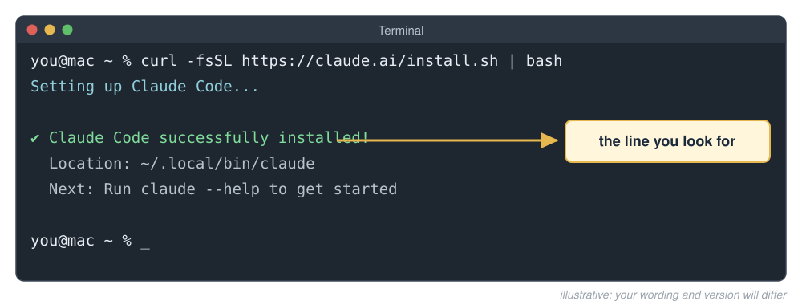{width="80%" fig-align="center"}

Paste the line, press Enter, **wait**. The download shows little or no progress. It ends with a message that the install succeeded, or with an error you can look up.

::: notes
Here is what an installation looks like. You paste one line, press Enter, and wait. For Claude Code there is often no progress bar at all for a while, which makes people think it has hung. Give it a minute or two. At the end you get a message saying the installation succeeded, sometimes with a note about something called PATH, which we come to shortly. Codex's installer behaves similarly, and it may offer to start Codex right away. Your screen will look slightly different from this picture: version numbers, colours and wording change. What matters is the last few lines: success, or an error message.
:::

## The install lines: one for macOS and Linux, one for Windows

| | macOS / Linux (Terminal) | Windows (PowerShell) |
|---|---|---|
| **Claude Code** | `curl -fsSL https://claude.ai/install.sh \| bash` | `irm https://claude.ai/install.ps1 \| iex` |
| **Codex** | `curl -fsSL https://chatgpt.com/codex/install.sh \| sh` | `powershell -ExecutionPolicy ByPass -c "irm https://chatgpt.com/codex/install.ps1 \| iex"` |

- These were the official commands when this deck was written. **Copy them from the exercise page**, which we check before each run.
- Alternatives exist: **Homebrew** on macOS, **WinGet** on Windows, **npm** (needs Node.js). Use them only if you already know them.
- Codex on Windows now runs **natively** in PowerShell. **WSL** (Linux inside Windows) also works for both tools but is not needed for this course.

::: notes
Here are the actual lines, for orientation. Each tool has one line for Mac and Linux, and one for Windows PowerShell. Please do not type these off the slide: copy them from the exercise page, which we check before every course run, because these commands do change. There are also alternative routes. If you already use Homebrew on a Mac, or WinGet on Windows, or npm, both tools can be installed that way, but they then do not always update themselves. For a beginner, the official one-line installer is the simplest. A note for Windows users who have read older guides: Codex used to require WSL, the Linux subsystem for Windows. That is no longer the case; it now runs directly in PowerShell.
:::

## The install line downloads a program and tells the terminal where it is

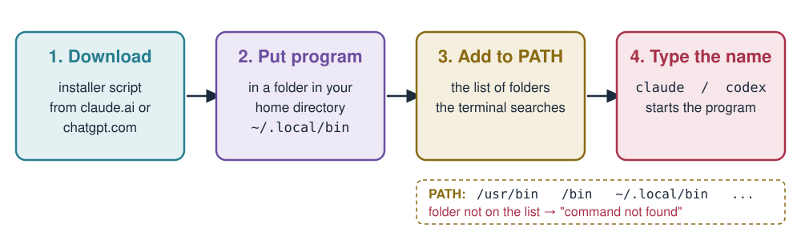{width="90%" fig-align="center"}

1. **Download** a small script from the company's site and run it.
2. The script puts the program in a folder in your home directory (often `.local/bin`).
3. It adds that folder to the **PATH**: the list of folders the terminal searches when you type a command name.

Then typing `claude` or `codex` starts the program.

::: notes
It is worth knowing roughly what that one line does, because it explains the most common problem. First, it downloads a small installer script from the company's website and runs it. Second, the script puts the actual program into a folder inside your home directory, typically a hidden folder called dot local slash bin. Third, it adds that folder to something called the PATH. The PATH is simply a list of folders where the terminal looks when you type the name of a program. If the folder is on the list, typing claude or codex starts the program. If it is not on the list, the terminal says it cannot find the command, even though the program is installed. Keep this picture in mind for the troubleshooting slides.
:::

## Pasting an install line means trusting where it comes from

- The pattern "download a script and run it" is normal for these tools, and it gives that script **your user's rights**.
- Check the address: **claude.ai** for Claude Code, **chatgpt.com** for Codex.
- Copy from the **official documentation** or the course page, never from a forum, a video comment or an e-mail.
- If a page asks you to paste a command to "fix" something urgent, stop and ask.

::: notes
A word of caution, because this is a habit worth building now. Pasting a line that downloads and runs a script is completely normal for these tools, and the official documentation tells you to do exactly that. But it means you are running whatever that script contains, with your own permissions. So check where it comes from. The address in the line should be claude dot ai for Claude Code and chatgpt dot com for Codex. Copy from the official docs or our exercise page. There are scams that ask people to paste a "fix" into their terminal; if anyone asks you to paste a command urgently, that is a reason to stop and ask a colleague.
:::

## Close the terminal and open a new one before you test

:::: {.columns}
::: {.column width="55%"}
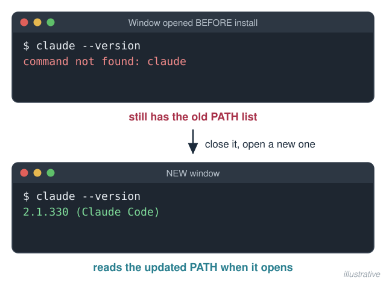{width="100%"}
:::
::: {.column width="45%"}
- A terminal reads the PATH **when it opens**. A window that was open during the install may not know about the new program yet.
- So: **close the window, open a new one**, then test.
- If you use a terminal inside an editor (VS Code), restart the editor.
:::
::::

::: notes
This one fixes more install problems than anything else. A terminal window reads the PATH list once, when it starts. If you install a program in that window, the installer updates the list for future windows, but the window you are in may still have the old list. So the very first thing to do after installing is: close the terminal window and open a new one. If you use a terminal inside an editor such as VS Code, close and reopen the whole editor, because it passes its own copy of the list to the terminals inside it.
:::

## Check the installation: the version command prints a number

```bash
claude --version
```
```
2.1.330 (Claude Code)
```

```bash
codex --version
```
```
codex-cli 0.171.0
```

- **A version number** means the program is installed and the terminal can find it.
- Your numbers will be **higher**: both tools update often.
- An error such as `command not found` or `is not recognized` means the terminal cannot find it yet. We fix that later in this lecture.

::: notes
Now we check. In the new window, type claude, space, dash dash version, and press Enter. If you see a version number, the installation worked and the terminal can find it. Do the same for codex if you installed it. The numbers on the slide are just examples from when this deck was written; yours will be higher, because both tools release new versions very often, sometimes several times a week. If instead you get "command not found" or "is not recognized", do not reinstall straight away. That almost always means the PATH problem from two slides ago, and we will fix it at the end of the lecture.
:::

## The first start opens your browser to sign in

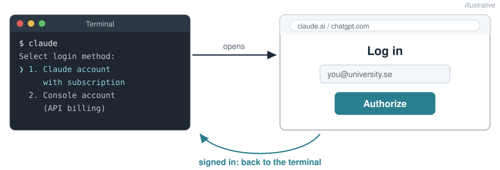{width="85%" fig-align="center"}

- Type `claude` (or `codex`) and press Enter. The first time, it asks how you want to sign in. Choose your **subscription** (Claude account / *Sign in with ChatGPT*).
- A **browser window** opens. Log in as usual, approve, and go back to the terminal.
- If no browser opens, the terminal shows a link (Claude Code: press `c` to copy it). Paste it into your browser.

::: notes
The first time you start the agent, it does not know who you are. Type claude, or codex, and press Enter. It shows a short sign-in screen and asks which kind of account you have. Choose the subscription option: your Claude account for Claude Code, or Sign in with ChatGPT for Codex. Your web browser then opens a login page. Log in the way you always do, approve the request to connect, and switch back to the terminal window: it should now say you are signed in. Claude Code may also ask a couple of small questions first, such as which colour theme you prefer; any answer is fine. If no browser window opens, which can happen on locked-down machines, the terminal shows a long link you can copy into the browser yourself. The sign-in is remembered, so you do this once per computer.
:::

## Make an empty folder for your first conversation

:::: {.columns}
::: {.column width="50%"}
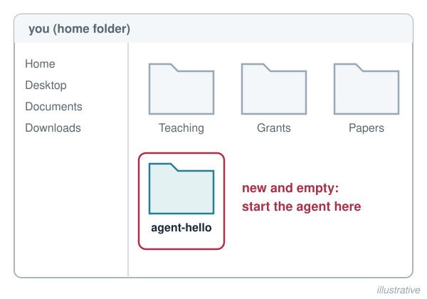{width="100%"}
:::
::: {.column width="50%"}
- The agent works in the folder where you **start** it.
- For the first test, make a **new, empty folder**, for example `agent-hello` in your home folder.
- Start the agent **inside** that folder. The exercise page gives the two commands.
- **Not** in your home folder, Desktop or Documents itself: those are full of your files.
:::
::::

::: notes
Before we say hello, we decide where. The agent works in the folder where you start it: it can read what is there and, with your permission, change it. So for the very first conversation, we use a new, empty folder. In the exercise, you make one called agent-hello inside your home folder, move the terminal into it with one command, and start the agent there. Please do not start your first session in your home folder or on your Desktop. Those are full of your own files, and we have not yet talked about permissions. A habit we keep for the whole course: one project, one folder, and the agent starts there.
:::

## The first hello: ask the agent what it can see

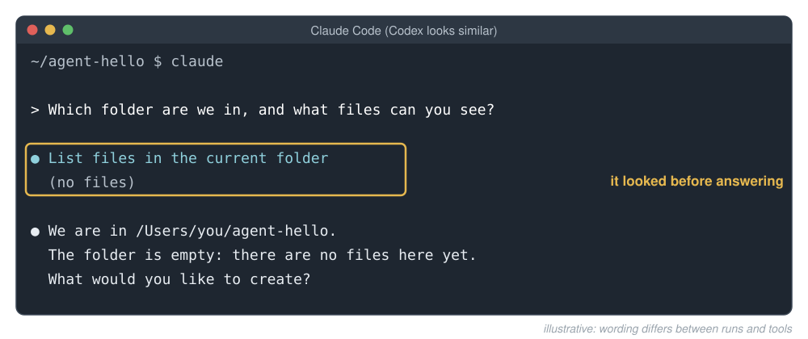{width="80%" fig-align="center"}

The folder is empty, so a good answer says so. If it **claims to see files**, something is off: you started it in the wrong folder, or it is guessing.

::: notes
And now the moment: your first conversation. Type a plain question, such as: which folder are we in, and what files can you see here? A good agent looks, rather than guesses. You will see it run a small action to list the files, and then it tells you the folder is empty. That is already a tiny verification exercise. You know the true answer, because you just made the folder. If it lists files, either you started it in the wrong folder, or it is making things up. Either way, you have learned something. Then ask it to create a small file, and approve when it asks. Finally, open the folder in your normal file browser and check that the file is really there.
:::

## The agent asks before it changes things; say yes for now, we discuss this next time

:::: {.columns}
::: {.column width="50%"}
- When the agent wants to **create or change a file** or **run a command**, it may stop and ask.
- For the test file in your empty folder, choose **Yes**.
- On first start, it may also ask whether you **trust this folder**. For your own empty folder: yes.
- Reading these questions properly, and the different **permission modes**, is the core of *Terminal survival kit*.
:::
::: {.column width="50%"}
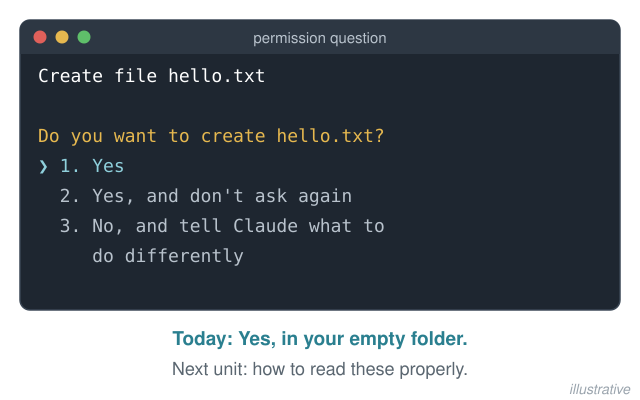{width="100%"}
:::
::::

::: notes
When you ask the agent to create a file, it will probably pause and ask whether it may. This is the agent's safety catch, and it is a good thing. Today, in an empty folder, with a file you asked for, the answer is yes. You might also be asked once whether you trust the folder; for your own empty test folder, that is fine too. Next unit we spend real time on these questions: how to read what the agent wants to do, what the options mean, and how to make it ask less or more. For today, the rule is: only say yes when you understand what it is asking and it is what you wanted.
:::

## Leave the agent with /exit; your conversation is saved

| | Claude Code | Codex |
|---|---|---|
| Leave | `/exit`, or `Ctrl + D` twice | `/exit` or `/quit`, or `Ctrl + C` |
| Stop it mid-answer | `Esc` | `Esc` |
| List commands | `/help` | type `/` |
| Continue the last conversation | `claude -c` | `codex resume` |

Commands that start with `/` are instructions to the program, not to the AI.

::: notes
A few practical keys, so you can get out again. Both tools understand commands starting with a slash; these go to the program itself rather than to the AI. Slash exit leaves. Escape stops the agent if it is in the middle of something you do not want. Your conversations are saved on your computer, and you can pick the last one up again with claude dash c, or codex resume. You do not need to memorise this table; it is on the exercise page, and the next unit uses these all the time.
:::

## Keep the tools up to date: Claude Code updates itself, Codex needs a nudge

:::: {.columns}
::: {.column width="50%"}
**Claude Code** (official installer)

- Updates itself **in the background**; the new version is used next time you start it.
- To update now: `claude update`.
- Health check: `claude doctor`.

**Codex**

- Update with `codex update`, or run the **install line again**.
- Homebrew/npm installs update through those tools.
:::
::: {.column width="50%"}
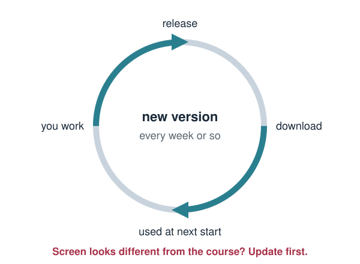{width="100%"}
:::
::::

- New versions arrive **weekly or faster**. When something in this course looks different on your screen, update first.

::: notes
Both tools change quickly. New versions come out every week, sometimes several times. Claude Code, when installed with the official installer, updates itself in the background, and the new version starts next time you open it. If you want to update right away, type claude update in the terminal. Claude doctor gives you a quick health check of the installation. For Codex, either run codex update or simply run the install line again, which also updates. One rule for the course: if what you see on screen does not match the instructions, update first, then ask.
:::

## "Command not found" means the terminal cannot find the program yet

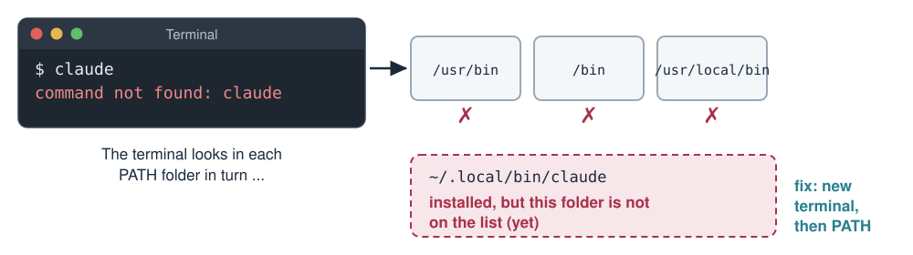{width="88%" fig-align="center"}

1. **Open a new terminal** and try again. This fixes most cases.
2. Read the end of the install output: it often prints a **"Setup notes"** line with the exact fix.
3. Still not found: the program's folder is not on the PATH. The exercise page gives the one-time fix for your system.
4. Only then reinstall.

::: notes
Now, the most common failure: you type claude and the terminal answers "command not found", or on Windows, "claude is not recognized". In nine cases out of ten, the program is installed fine, and the terminal simply does not know where it is. First fix: close the terminal, open a new one, try again. Second: scroll up in the install output. The installer often notices the problem and prints the exact fix in a section called setup notes. Third, if that does not help, the exercise page has the one-time command that adds the folder to the PATH for your system. Reinstalling is the last resort, not the first, because it rarely fixes a PATH problem.
:::

## Windows errors that mean "wrong kind of terminal"

| What you see | What it means | Fix |
|---|---|---|
| `'irm' is not recognized` | You are in **CMD**, not PowerShell | Open PowerShell (`Win + X`) |
| `The token '&&' is not a valid statement separator` | You pasted the **CMD** line into PowerShell | Use the PowerShell line |
| `'bash' is not recognized` or `parameter name 'fsSL'` | You pasted the **macOS/Linux** line | Use the Windows line |
| `does not support 32-bit Windows` | You opened **PowerShell (x86)** | Open the entry without (x86) |

::: notes
On Windows, a whole family of errors means just one thing: the command and the window do not match. If you see "irm is not recognized", you are in Command Prompt, not PowerShell. If you see a complaint about the token double ampersand, you pasted the Command Prompt version into PowerShell. If it complains about bash, or about a parameter called fsSL, you copied the Mac and Linux line by mistake. And the 32-bit message means you opened the x86 version of PowerShell. In every case the fix is to match the line to the window. None of these mean anything is broken.
:::

## On a university-managed laptop, the install may be blocked: ask IT, or use the desktop app

:::: {.columns}
::: {.column width="55%"}
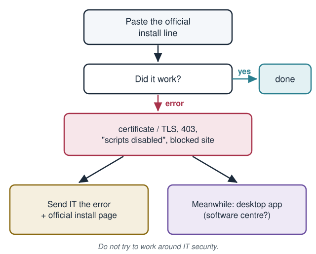{width="100%"}
:::
::: {.column width="45%"}
- Both installers put the program in **your own user folder** and do **not** need admin rights.
- But IT policy can still **block** downloads, scripts, or the companies' websites. Typical signs: certificate or TLS errors, "running scripts is disabled", or a 403 error.
- **Do not try to work around IT security.** Send them the error message and the official install page.
- Meanwhile, the **desktop app** may be available from your software centre.
:::
::::

::: notes
Many of you work on laptops managed by the university. The installers themselves do not need administrator rights: they install into your own user folder. But managed machines can block things in other ways. Script execution may be disabled, the network may route through a proxy that breaks secure connections, or the download sites may be blocked. The error messages then mention certificates, TLS, a 403 code, or scripts being disabled. Please do not try to work around these restrictions yourself; they exist for good reasons, and bypassing them can violate university policy. Instead, send IT the exact error and the link to the official install page. In the meantime, the desktop app is often easier to get approved, and it may even be in your software centre already.
:::

## Where this goes wrong

- **Wrong plan.** Signed in with a free Claude account: Claude Code will not work. Check which account the browser was logged into.
- **Wrong account.** You have both a personal and an institutional login. The browser picks the one it remembers. Log out in the browser first if needed, then use `/login` in Claude Code or `/logout` and restart in Codex.
- **Old terminal window.** The program is installed but "not found". Open a new window.
- **Copied an outdated command** from a blog or video. Use the exercise page.
- **Started in the wrong folder.** The agent sees your home folder or Desktop. Exit, move to your empty folder, start again.
- **Region.** Both services are available only in supported countries; an "unavailable in region" message is not something you can fix locally.

::: notes
Let me collect the things that typically go wrong, so you recognise them. The first is the plan: someone signs in with a free Claude account and wonders why Claude Code will not work. The second is the account: many of us have a personal and a university login, and the browser quietly uses whichever it remembers. If the agent reports the wrong account, sign out in the browser and sign in again from the agent. The third is the old terminal window we discussed. The fourth is following an old blog post; these tools change fast, so stick to the exercise page. The fifth is starting the agent in the wrong folder. And finally, both services are only available in supported countries, which is rarely an issue here but good to know when travelling.
:::

## Summary

| Concept | Key fact |
|---|---|
| Claude Code account | Pro or higher (Max, Team, Enterprise), or API billing. The free plan does not include it. |
| Codex account | Any ChatGPT plan includes some Codex; Plus or higher is realistic. |
| Institutional plans | May include the agents; ask IT whether they are switched on. |
| GitHub | Free account; create it now, use it in Part 3. |
| Install | One official line per tool, pasted into Terminal (macOS/Linux) or PowerShell (Windows). No admin rights needed. |

::: notes
To sum up. You need an account that includes the agent: Pro or higher for Claude Code, a ChatGPT plan for Codex, with Plus being realistic, and possibly your university's plan, if IT has switched the agents on. Make a free GitHub account now for later. Installing is one official line per tool. Command not found almost always means the terminal needs to be reopened. The first start signs you in through the browser, and the first hello happens in an empty folder, where you can check the answer yourself. Keep the tools updated. In the next unit, Terminal survival kit, we learn to move around in the terminal, read what the agent wants to do before approving it, and let it install the rest of our software.
:::

## Summary (continued)

| Concept | Key fact |
|---|---|
| PATH | The list of folders the terminal searches. "Command not found" usually means: open a new terminal. |
| First start | Sign in through the browser, once per computer. |
| First hello | In an empty folder: "What can you see?" Check the answer yourself. |
| Updates | Claude Code updates itself (`claude update`); Codex: `codex update` or rerun the installer. |

**Next (Terminal survival kit):** files, folders and paths; moving around in the terminal; reading and approving what the agent wants to do; permission modes; letting the agent install R, Python and git for you.

::: notes
The rest of the summary table, and where we go next.
:::
