## About this lecture

Deep learning needs many labelled examples. In research, labels are the scarce part: a pathologist's afternoon, a rare disease, a 3D volume that takes hours to outline. Agents cannot label for you, but they can attack this bottleneck from two sides.

- **Curate:** the agent writes scripts that audit the labelled data you have, and builds a gallery for a human expert to check.
- **Simulate:** the agent writes a simulator that makes images with exact labels for free, to train a network on.
- **Test on real data:** a small, hand-labelled real test set decides whether any of it works.
- **A case study:** the course author's ongoing project, where synthetic scores looked good and the real predictions were rejected.

A **concept** unit with a light exercise. It builds on *How LLMs and agents work, and how they fail* and *Privacy, ethics and safety*.

::: notes
This unit is about a use of agents that is easy to overlook: not using an AI to answer questions, but using an agent to help you train your own AI, typically a convolutional neural network for images. The hard part of training such a network in research is almost never the network. It is the labelled data. We look at two ways an agent helps: auditing and curating the data you have, and writing simulators that produce training data with perfect labels. Both come with a trap, and the case study at the end shows the trap in a real project. You will not need to understand how a neural network works inside; you need to understand what it learns from and how you check it.
:::

## Ten thousand images are easy to get; labelling them is not

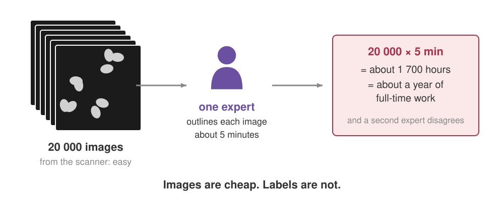{width="80%" fig-align="center" fig-alt="A stack of 20 000 microscopy images from a scanner. One expert outlines each in about 5 minutes. 20 000 times 5 minutes is about 1 700 hours, about a year of full-time work, and a second expert disagrees."}

::: notes
Here is the concrete problem. A slide scanner or an automated microscope produces tens of thousands of images over a weekend. To train a network to find, say, dividing cells or tumour regions, someone has to show it what the right answer looks like, many times. If an expert needs five minutes to outline the objects in one image, twenty thousand images is around seventeen hundred hours: roughly a year of someone's working time, and that someone is usually the most expensive person in the group. And when a second expert labels the same images, they will not agree everywhere. This is the data and data-curation bottleneck the unit is about.
:::

## Labels in research are rare, expensive, slow, inconsistent and sensitive

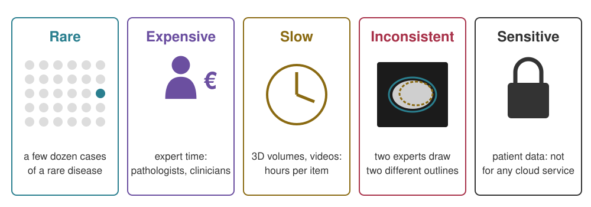{width="85%" fig-align="center" fig-alt="Five panels. Rare: a few dozen cases of a rare disease. Expensive: expert time of pathologists and clinicians. Slow: 3D volumes and videos take hours per item. Inconsistent: two experts draw two different outlines of the same nucleus. Sensitive: patient data, not for any cloud service."}

::: notes
The bottleneck has five faces. Rare: for a rare disease, a rare cell state or an unusual species, there may simply be few examples in the world. Expensive: the people who can label correctly are pathologists, clinicians, taxonomists, whose time is scarce. Slow: some data is 3D, or video, or needs several channels compared, so one item can take hours. Inconsistent: two experts outline the same nucleus differently, and the same expert differs from Monday to Friday; the network learns this disagreement as if it were truth. Sensitive: patient images and tissue from people are health data, so you cannot simply send them to a cloud labelling service or a cloud agent. Keep these five in mind; each of the techniques today addresses some of them and not others.
:::

## A network learns from labelled examples and is judged on new ones

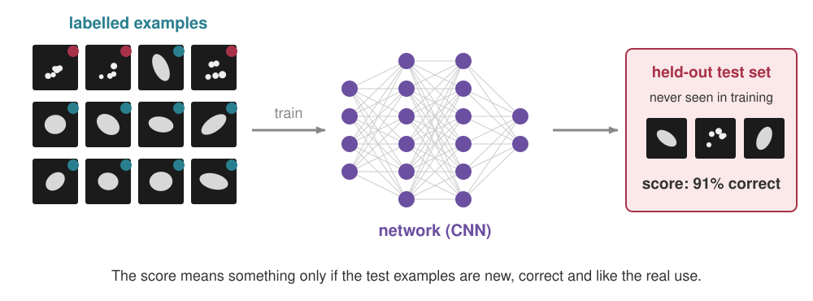{width="85%" fig-align="center" fig-alt="Labelled example tiles, intact or fragmented nuclei, feed into training a network. A held-out test set never seen in training gives a score of 91 percent correct. The score means something only if the test examples are new, correct and like the real use."}

::: notes
One picture of what training a network means, at the level we need. You give it many examples with the right answer attached, here small images of nuclei labelled intact or fragmented. Training adjusts the network until its answers match the labels. Then you score it on a test set it has never seen. Everything in this unit hangs on that last box. The score is only meaningful if the test examples are genuinely new to the network, correctly labelled, and like the images you will use it on. Bad training data makes a worse network; bad test data makes you believe in a bad network, which is worse.
:::

## Before you label or simulate anything, try a pretrained model

1. **Pretrained, as is:** does an existing model already do the job on 20 of your images? For nuclei and cells: **Cellpose** (now Cellpose-SAM) or **StarDist**.
2. **Fine-tune with few labels:** start from a model trained on many images (a domain model, or a general ImageNet-trained network) and adjust it with tens of your labels.
3. **Only then curate or simulate** to get more training data.

Check each model's licence: Cellpose's models are trained on data licensed CC BY-NC.

::: notes
Before the two routes, a decision order that saves a lot of work. First, look for a model someone has already trained. For nuclei and cells in fluorescence images, Cellpose, whose current generation is called Cellpose-SAM, and StarDist come with pretrained models; for many images they work out of the box. Try them on twenty of your images and look at the result. Second, if they are close but not right, fine-tune: start from a network already trained on many images, either such a domain model or a general network pretrained on ImageNet, the large photo collection, and adjust it with a few dozen of your own labels. That usually beats training from scratch by far. Only if neither is good enough do you need the larger amounts of data that curation and simulation provide. And check licences: the Cellpose documentation states that its models are trained on data under a non-commercial CC BY-NC licence, which matters if your work is commercial.
:::

## If you only need positions, a detector is cheaper than outlines

- **Segmentation** draws the outline of every object: needed for area and shape.
- **Detection** puts a box around each object: enough for counting and locating.
- Box labels are much faster to draw, and detectors such as **YOLO\*** are fast to train and run.
- A simulator can produce boxes as easily as outlines.

\* The common YOLO software (Ultralytics) is AGPL-3.0: the licence matters for commercial or closed-source use.

::: notes
A second way to save labels: ask for less. If your question is how many cells, or where are they, you do not need an exact outline of each one. A box around each object is enough, and a box takes a second to draw where an outline takes much longer. Object detectors of the YOLO family, short for you only look once, are trained on such boxes and are fast both to train and to run, even on video. Simulators work for detectors too: the simulator knows every box. The footnote is for later: the most widely used YOLO software, from Ultralytics, is under the AGPL-3.0 licence, which is no problem for open academic work but matters if you build it into a commercial or closed-source tool.
:::

## Agents help in two ways: curate what you have, simulate what you lack

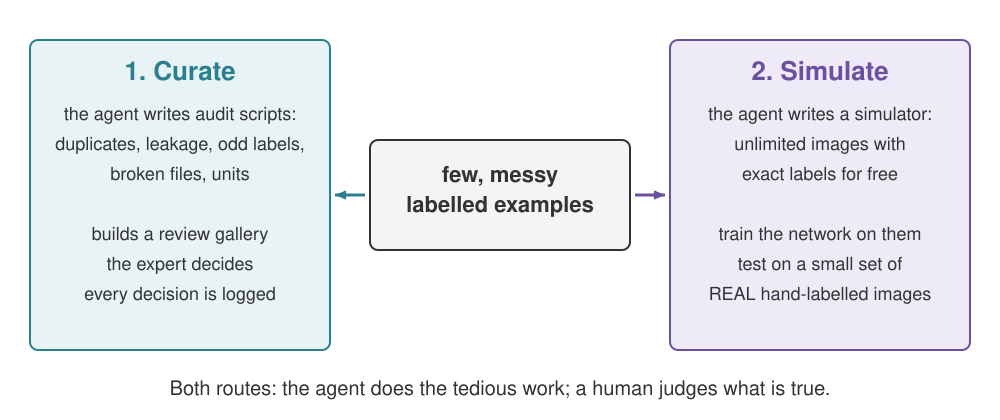{width="80%" fig-align="center" fig-alt="Centre: few, messy labelled examples. Left route, Curate: the agent writes audit scripts for duplicates, leakage, odd labels, broken files and units, builds a review gallery, the expert decides and every decision is logged. Right route, Simulate: the agent writes a simulator giving unlimited images with exact labels, trains the network on them, and tests on a small set of real hand-labelled images."}

::: notes
The two routes. Curation makes the most of the labels you already have: the agent writes the tedious checking code, and an expert's limited time goes to the cases that actually need a human. Simulation sidesteps labelling: if you can describe how your images arise, the agent can write a program that generates images together with their exact answers, as many as you like. These are not alternatives; real projects use both. And in both, the agent does the work that used to need a programmer, while a human with domain knowledge decides what is true.
:::

## Most labelled datasets have problems nobody has looked for

- **Duplicates and near-duplicates:** the same image twice, or mirrored, re-saved or cropped.
- **Leakage:** the same patient, animal or slide in both training and test data.
- **Wrong labels:** even famous benchmarks average about 3% wrong test labels (Northcutt et al. 2021).
- **Outliers and broken files:** a blank image, a truncated file, a different stain.
- **Metadata:** a pixel size in nanometres in a micrometre column; "Intact" and "intact".
- **Imbalance:** 95% of one class, so "always say normal" scores 95%.

::: notes
These problems are boring, common and invisible until someone looks. Duplicates inflate the apparent size of a dataset and, if they cross into the test set, inflate the score. Leakage, which we look at next, is the most serious. Wrong labels are everywhere: Northcutt, Athalye and Mueller checked the test sets of ten widely used machine-learning datasets and estimated an average of about 3.3 percent label errors, about 6 percent in the ImageNet validation set; a related method, confident learning, finds suspects by comparing labels with what a model predicts. Broken files and inconsistent metadata break scripts or, worse, do not. And with heavy imbalance, a useless model can look accurate. None of this needs deep learning knowledge to check. It needs patience, which is what agents have.
:::

## Leakage makes a model look better than it is

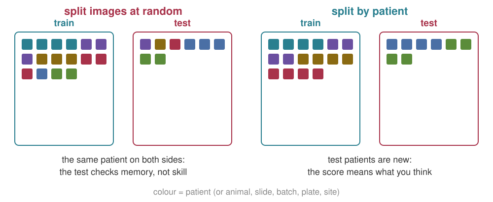{width="80%" fig-align="center" fig-alt="Left: images split at random into train and test; squares of the same colour, the same patient, appear on both sides, so the test checks memory, not skill. Right: split by patient; the test patients are new and the score means what you think. Colour equals patient, or animal, slide, batch, plate or site."}

::: notes
Leakage means that information from the test set has slipped into training. The classic case in biology and medicine: you have several images per patient and you split the images at random. Now the network has seen other images of the same patient, with the same staining, scanner and anatomy, and it can recognise the patient rather than the disease. The score goes up; the usefulness does not. Kapoor and Narayanan, in Patterns in 2023, found leakage reported in at least 294 papers across 17 fields, and in their own case study the advantage of complex models disappeared once leakage was fixed. The rule: split by the unit you want to generalise to, usually the patient, animal, slide, batch or site. An agent can check this in seconds, if you tell it what the unit is.
:::

## The agent writes the audit; it reports and changes nothing

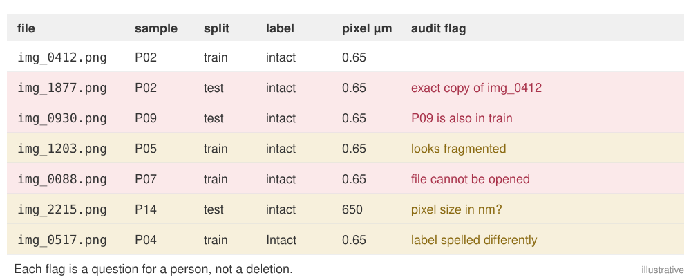{width="78%" fig-align="center" fig-alt="A manifest table with columns file, sample, split, label, pixel size and audit flag. Flags: exact copy of another image, patient also in train, looks fragmented, file cannot be opened, pixel size in nm, label spelled differently. Each flag is a question for a person, not a deletion. Illustrative."}

```text
Audit dataset/ before anyone trains on it. Report only; change nothing.
```

::: notes
In practice you ask the agent for an audit script, not for a cleaned dataset. The prompt says: check for these kinds of problems, write the script into the project so it can be rerun, report counts and examples, and change nothing. The output is a table of flags like this one. Each flag is a question: is this a real duplicate? Is this patient really in both sets? Is this label wrong, or is this an unusual but correct case? The agent finds candidates far faster than a person scrolling through folders. Deciding what they mean is not its job. And because the audit is a script, you can rerun it when new data arrives, and show it to a reviewer.
:::

## A review gallery lets an expert check a hundred images in minutes

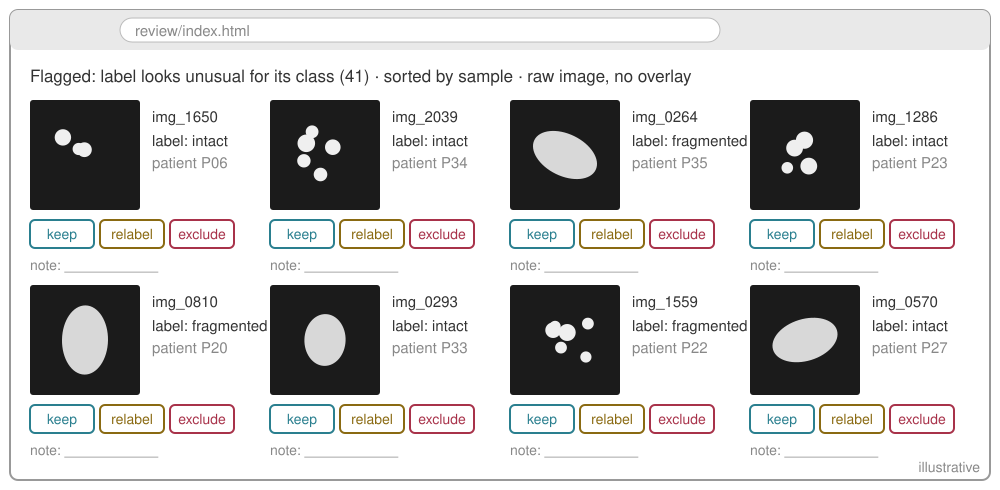{width="74%" fig-align="center" fig-alt="A browser page review/index.html listing images flagged because the label looks unusual for its class: each tile with file name, label, patient and buttons keep, relabel or exclude, plus a note field. Illustrative."}

::: notes
The most useful thing an agent builds for a busy expert is often not a model but a web page. A single HTML file, opened in a browser, that shows each flagged image large enough to judge, with its current label and a place to record a decision. The design matters: show the raw image, not the model's overlay, so the expert is not led; group or sort so that similar cases come together; record a note with each decision. A pathologist who would never open a folder of 400 files will spend twenty minutes on a page like this. The decisions come back as a file the agent can apply, which keeps the human judgement and the code separate.
:::

## Flag, do not delete: the expert decides and every decision is logged

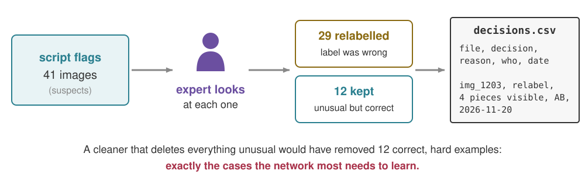{width="85%" fig-align="center" fig-alt="A script flags 41 suspect images. An expert looks at each one. 29 are relabelled because the label was wrong; 12 are kept as unusual but correct. Decisions go into decisions.csv with file, decision, reason, who and date. A cleaner that deletes everything unusual would have removed 12 correct, hard examples, exactly the cases the network most needs to learn."}

::: notes
Automatic cleaning tools, and agents left alone, tend to remove whatever looks unusual. But unusual is not the same as wrong. Some flagged images are the rare, hard, correctly labelled cases, the ones that teach the network the edge of each class. Remove them and your network gets worse exactly where it matters, and your test score gets better because the hard cases are gone. So: the script flags, a person decides, and every decision is written to a log with the reason, who decided and when. The same applies to an annotation protocol: ask the agent to draft a written definition of each class with borderline examples, then have the experts correct it, so that two annotators label the same way.
:::

## A simulator gives perfect labels for free

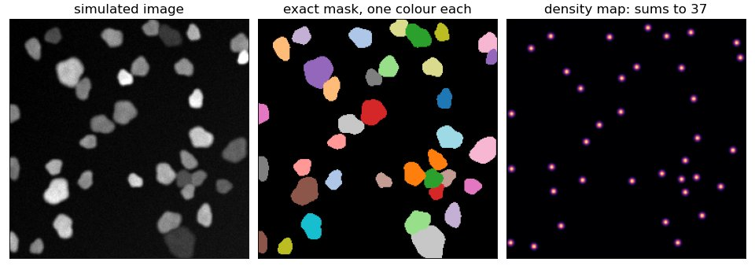{width="88%" fig-align="center" fig-alt="Three panels from a simple nucleus simulator: the simulated fluorescence image, its exact mask with one colour per nucleus, and a density map that sums to the exact count of nuclei."}

::: notes
Now the second route. A simulator is a program that draws images the way your instrument would, from a description: these objects, this size, this brightness, this blur and noise. Because the program placed every object, it knows the exact answer: the count, the outline of every nucleus, the position, for 3D data even the surface direction. These labels cost nothing and are never inconsistent. This one is a simple nucleus simulator an agent wrote for this course in a few minutes. Classic versions of this idea exist in microscopy: SIMCEP from 2007 and SimuCell from 2012 generate synthetic cell populations, and Deep-STORM in 2018 trained a super-resolution network on simulated data. What agents change is the cost: you no longer need a programmer to write a simulator for your own images.
:::

## Randomise everything that should not change the answer

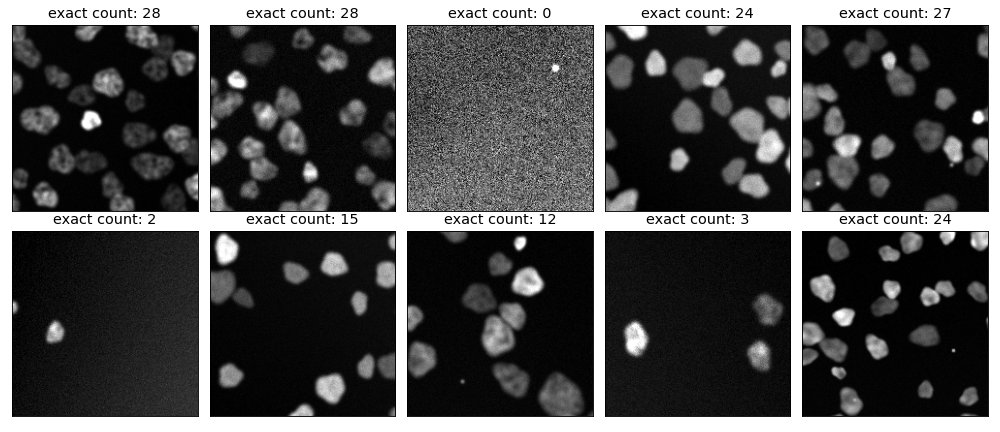{width="80%" fig-align="center" fig-alt="Ten simulated images with their exact counts, from 0 to 28 nuclei, varying in nucleus size, shape, brightness, crowding, blur, noise, background and debris."}

::: notes
A network trained on one tidy kind of simulated image learns that kind of image. The trick, called domain randomisation, is to vary everything that should not change the answer: size and shape of the nuclei, brightness, texture, crowding and touching, blur, noise, uneven background, debris that must not be counted. Tobin and colleagues showed in 2017, for a robot locating objects, that a network trained only on heavily randomised simulated images worked on real camera images: the real world becomes just one more variation. In your prompt to the agent, list what varies in your real images and ask it to vary each of these more widely than you think necessary.
:::

## The network learns your simulator, not the world

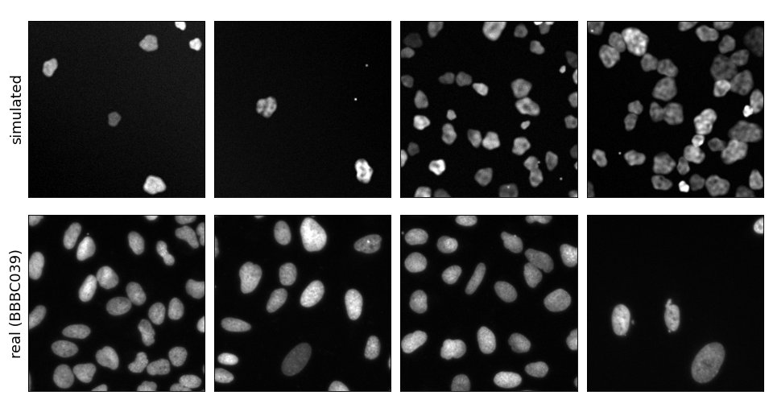{width="72%" fig-align="center" fig-alt="Top row: four simulated nucleus images. Bottom row: four real images from BBBC039. The real nuclei are larger, smoother and more elongated than the simulated ones."}

::: notes
Look closely and the difference between our simulated images, top, and real nuclei from the public BBBC039 dataset, bottom, is obvious: real nuclei are larger, smoother, more elongated, more evenly spaced. A network trained on the top row has never seen the bottom row. This difference is the sim-to-real gap. In our own quick test, a small network trained only on this simulator counted simulated images well, and its error on real images was clearly larger. A handful of real labelled images used for fine-tuning closed much of the gap, and the careful classical pipeline from the image track was still more accurate than any of our quick networks. Your numbers will differ; the direction should not.
:::

## Randomisation aims to make real images one more variation

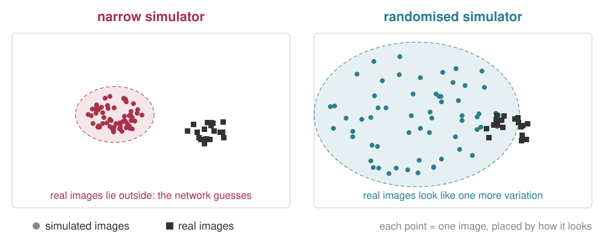{width="82%" fig-align="center" fig-alt="Left: a narrow simulator; simulated images form a tight cloud and real images lie outside it, so the network guesses. Right: a randomised simulator; simulated images form a wide cloud and real images fall at its edge, one more variation. Each point is one image, placed by how it looks."}

::: notes
A way to picture the gap. Place every image as a point by how it looks. A narrow simulator makes a tight cloud; real images lie somewhere else, and on them the network is extrapolating, which means guessing. A randomised simulator makes a wide cloud that, ideally, includes the real images. Ideally: you cannot see this space, so you cannot know from the simulated results whether the real images are inside. Only a test on real images tells you. The rest of the lecture keeps coming back to this.
:::

## Label a small real test set first, and lock it away

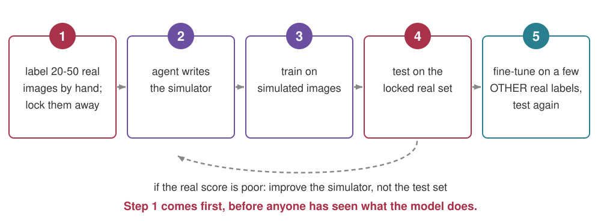{width="85%" fig-align="center" fig-alt="Five steps. 1, label 20 to 50 real images by hand and lock them away. 2, the agent writes the simulator. 3, train on simulated images. 4, test on the locked real set. 5, fine-tune on a few other real labels and test again. If the real score is poor, improve the simulator, not the test set. Step 1 comes first, before anyone has seen what the model does."}

::: notes
This is the recipe in one line: the small real test set comes first. Before anyone writes a simulator, an expert labels a few dozen real images, chosen to cover the variety you care about, and they are locked away: not used for tuning, not shown to the agent while it builds things. Then the simulator, the training, and the test on those real images. If the result is poor, you improve the simulator or add fine-tuning on a few other real labels; you never adjust the test set until the score looks better. Simulation does not remove the need for real labels. It reduces their number from thousands to dozens, and turns them from training data into a judge.
:::

## Case study: putting cut tissue pieces back together

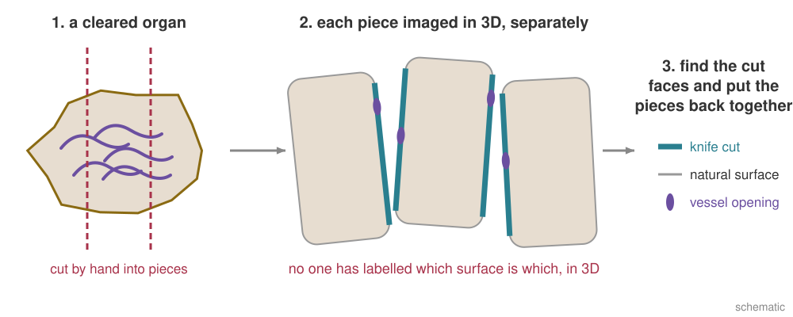{width="80%" fig-align="center" fig-alt="Schematic. 1, a cleared organ with vessels is cut by hand into pieces. 2, each piece is imaged in 3D separately; the knife-cut faces carry vessel openings. 3, find the cut faces and put the pieces back together; knife cut, natural surface and vessel opening look different. No one has labelled which surface is which, in 3D."}

**The course author's ongoing project** (unpublished; human tissue, so only schematics here).

::: notes
Now a real example, from the course author's own ongoing research, which is unpublished and uses human tissue, so you see only schematic drawings and no data. A whole organ is made transparent and cut by hand into pieces, and each piece is imaged in 3D by light-sheet microscopy. To rebuild the organ, software must recognise which surfaces of each piece are knife cuts, as opposed to the natural outer surface or the opening of a blood vessel, and then match neighbouring cut faces. No labelled training data for this exists, and labelling surfaces in large 3D volumes by hand is exactly the slow, expensive kind of work from the start of the lecture. Most of the code was written by agents, under the author's direction.
:::

## The agent built a 3D tissue simulator and audited its labels

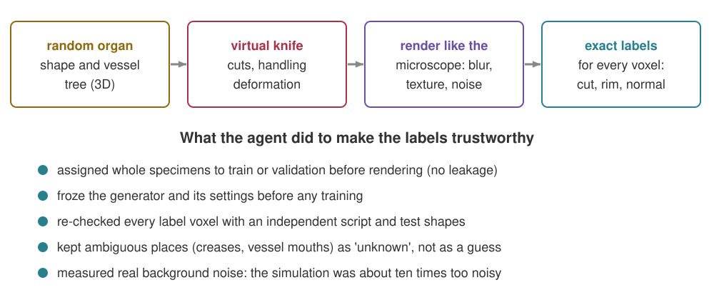{width="80%" fig-align="center" fig-alt="Pipeline: random organ shape and vessel tree in 3D, virtual knife cuts and handling deformation, rendering like the microscope with blur, texture and noise, exact labels for every voxel: cut, rim, normal. What the agent did to make the labels trustworthy: assigned whole specimens to train or validation before rendering; froze the generator before training; re-checked every label voxel with an independent script and test shapes; kept ambiguous places as unknown; measured real background noise and found the simulation about ten times too noisy."}

::: notes
The agent wrote a simulator: random organ shapes with a grown vessel tree, cut by a virtual knife, deformed a little as real handling does, and rendered with blur, texture and noise like the microscope. From the simulated cutting history it derives exact labels for every voxel: which face is a cut, where the rim of a cut face lies, which way the surface points. The careful part is what the agent did around this, much of it at the author's insistence: specimens assigned to training or validation before rendering, so no leakage; the generator frozen before training; every label re-checked by an independent script and on simple test shapes; ambiguous places such as creases marked as unknown rather than guessed. An audit of the real images found the simulated background about ten times too noisy, and this was corrected.
:::

## Synthetic scores rose; the author looked at real predictions and said no

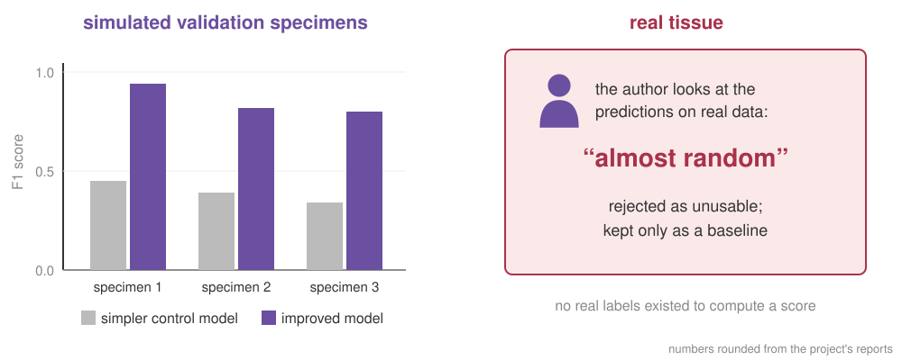{width="84%" fig-align="center" fig-alt="Left: on simulated validation specimens the F1 score of an improved model is about 0.8 to 0.94, against about 0.34 to 0.45 for a simpler control model. Right: on real tissue, the author looks at the predictions and calls them almost random; they are rejected as unusable and kept only as a baseline. No real labels existed to compute a score."}

::: notes
The results, as the agent reported them. On simulated validation specimens, an improved network found cut faces far better than a simpler control model: an F1 score, a combined measure of precision and coverage, of roughly 0.8 to 0.94 instead of roughly 0.35 to 0.45. The agent's reports were careful and full of caveats. Then the author opened the predictions on the real tissue in a 3D viewer, and described them as appearing almost random. The model was rejected as a real-data solution and kept only as a baseline. There was no real labelled test set to put a number on this, which is itself a lesson: the most important evaluation was a person looking.
:::

## Finding the gap: what the simulator got wrong

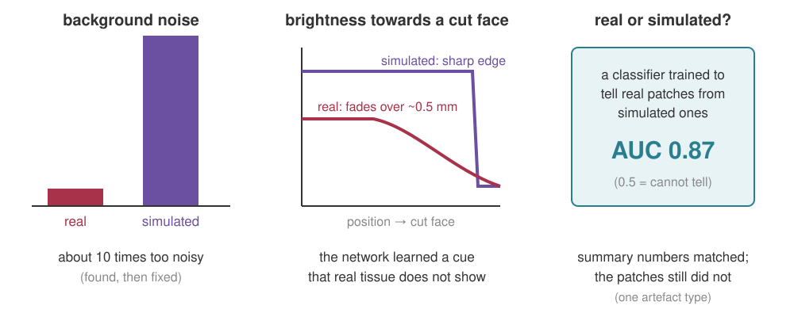{width="85%" fig-align="center" fig-alt="Three diagnoses. Background noise: simulated about 10 times too noisy, found then fixed. Brightness towards a cut face: simulated drops at a sharp edge, real fades over about 0.5 mm, so the network learned a cue that real tissue does not show. Real or simulated: a classifier trained to tell real patches from simulated ones reaches AUC 0.87, where 0.5 means it cannot tell; summary numbers matched, the patches still did not, for one artefact type."}

::: notes
What followed was detective work, again largely done by agents. Measured on real data, the simulated background was much too noisy. Real cut faces turned out to fade gradually over about half a millimetre, while simulated cut faces ended in a sharp step; a network can learn the sharp step as its cue, and real tissue never shows it. In a later test on real pieces, a network that recovered a shift perfectly on simulated data recovered almost nothing on real data. And one useful check: train a classifier to tell real patches from simulated ones. For one type of artefact the simulator's summary statistics were tuned to match the real ones, yet the classifier still told them apart, with an AUC of 0.87, where 0.5 would mean indistinguishable. Matching numbers is not the same as looking real.
:::

## Lessons from the case

- **Synthetic metrics measure the simulator.** Careful reports and good scores did not predict real usefulness.
- **A human looking at real outputs was the decisive test.** Plan it; do not wait for it.
- **Lock a small real test set early,** even for 3D data where labelling is slow.
- **Measure the gap:** compare simple statistics of real and simulated data, and ask a classifier to tell them apart.
- **Design reviews so that the expert is not led:** random choice set in advance, model answers hidden, "uncertain" allowed.
- **Keep failures as baselines.** The negative result is part of the record.

::: notes
What to take from this project. The agent's work was competent: audited labels, frozen generators, independent checks, honest caveats. It still produced a model that did not work on real tissue, and nothing in the synthetic numbers said so. The author's eye did. So plan that human check from the start, and wherever possible turn it into a locked, labelled real test set. Measure how real and simulated data differ before training, not after. When an expert reviews outputs, design the review like an experiment: in this project the review packets used a fixed random selection of both accepted and rejected items, with the model's answer hidden and an explicit "uncertain" option. And keep the failed model and its numbers; the project is ongoing, and the next attempt will be compared against it.
:::

## You learn what you simulated

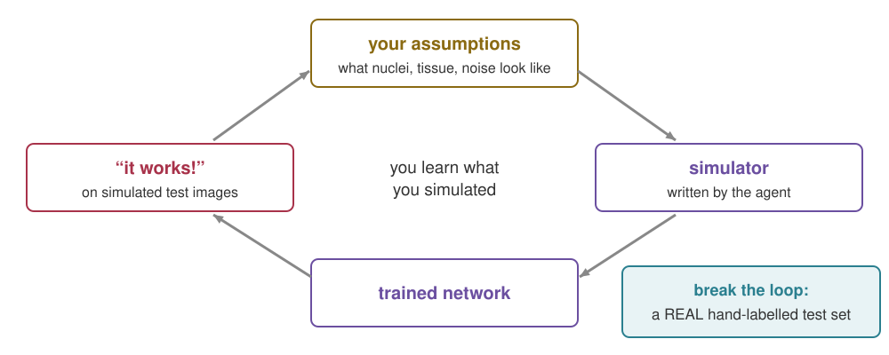{width="76%" fig-align="center" fig-alt="A loop: your assumptions about what nuclei, tissue and noise look like go into a simulator written by the agent, which trains a network, which says it works on simulated test images, which confirms your assumptions. You learn what you simulated. Break the loop with a real hand-labelled test set."}

::: notes
The deepest limit of simulation is circularity. The simulator encodes your assumptions about what the objects look like. The network learns those assumptions. A test on more simulated images confirms them. At no point did reality enter. If your assumption is wrong, say you never imagined that fragmented nuclei exist, the network will never handle them and the simulated test will never tell you. The agent makes this loop faster, not safer: it will happily write the simulator, train, test and report success. The only way out of the loop is data from the real world, labelled by someone who knows it.
:::

## Where this goes wrong

- **Circularity:** simulated tests confirm your own assumptions.
- **Cleaning removes hard cases:** label-noise tools flag rare, correct examples too.
- **Hidden bias:** a simulator of "typical" cells ignores the atypical patients.
- **Compute:** training needs time and sometimes a GPU; start small.
- **Licences:** real data used for fine-tuning must allow it; record the licence.
- **Privacy:** auditing patient data with a cloud agent sends it to the provider.

::: notes
The main risks, briefly. Circularity we have seen. Curation tools find suspects, and some suspects are innocent: the rare, hard cases. Synthetic data can hide bias: if the simulator draws only the cells you think of as typical, the network fails silently on the others, and on the patients who have them. Training costs computing time; a laptop is fine for small examples, larger 3D work needs a GPU and may need your institution's cluster. Public data used for fine-tuning has a licence; check it. And privacy: an audit script run by a cloud agent may read patient images or metadata, which then leave your computer. Use the rules in *Privacy, ethics and safety*: let the agent develop the scripts on synthetic or public look-alike data, then run them yourself on the real data, or use a local model as described in *Open-weights models and data privacy*.
:::

## What the agent does and does not do here

:::: {.columns}
::: {.column width="50%"}
**It does well**

- writes audit scripts and review galleries
- writes simulators from your description
- trains and evaluates small networks
- documents splits, settings and decisions
:::
::: {.column width="50%"}
**It does not**

- know which flagged cases are truly wrong
- know whether its simulator looks real
- choose a fair real test set for you
- see that real predictions are nonsense
:::
::::

::: notes
To sum up the division of labour. The agent writes code you could not write yourself: audit scripts, a review page, a simulator, a training script. It runs them and documents what it did. What it does not have is the knowledge of what your images really look like, which flagged cases are true errors, or whether the predictions on real data make sense. Those judgements are yours, or your expert's. In the case study, the agent's own reports were careful, and still the decisive check was a person looking at real output.
:::

## The exercise: audit a dataset, then train a counter on simulated nuclei

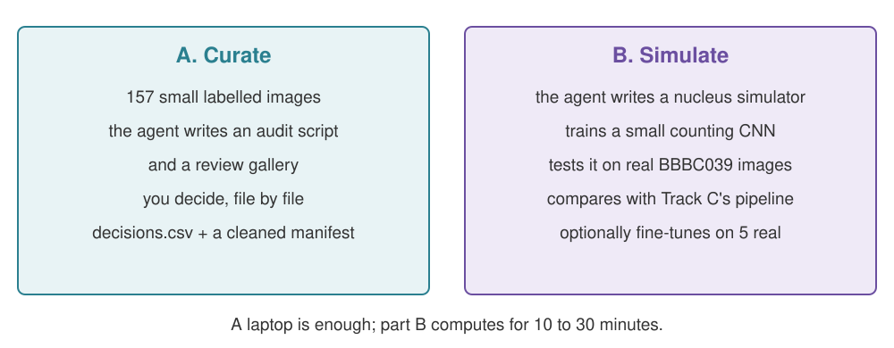{width="80%" fig-align="center" fig-alt="Part A, Curate: 157 small labelled images; the agent writes an audit script and a review gallery; you decide file by file; result decisions.csv and a cleaned manifest. Part B, Simulate: the agent writes a nucleus simulator, trains a small counting CNN, tests it on real BBBC039 images, and optionally fine-tunes on a few real images. A laptop is enough."}

::: notes
The exercise has two parts. In part A you get a small synthetic dataset of 157 nucleus images with a manifest, and a number of problems planted in it. The agent writes the audit and a review gallery, and you decide. The answer key tells you what was planted. In part B the agent writes a nucleus simulator, trains a small counting network on it, and tests it on a few real images from BBBC039, the public dataset from the image track. You compare the error on simulated and real images, and, if there is time, fine-tune on a few real images. Everything runs on a laptop. Your agent will write different code, and your numbers will differ from ours; look at the direction of the differences.
:::

## References

- Tobin J et al. (2017). Domain randomization for transferring deep neural networks from simulation to the real world. *IROS 2017*. [arXiv:1703.06907](https://arxiv.org/abs/1703.06907)
- Northcutt CG, Jiang L, Chuang IL (2021). Confident learning: estimating uncertainty in dataset labels. *J Artif Intell Res* 70. [arXiv:1911.00068](https://arxiv.org/abs/1911.00068)
- Northcutt CG, Athalye A, Mueller J (2021). Pervasive label errors in test sets destabilize machine learning benchmarks. *NeurIPS Datasets and Benchmarks*. [arXiv:2103.14749](https://arxiv.org/abs/2103.14749)
- Kapoor S, Narayanan A (2023). Leakage and the reproducibility crisis in machine-learning-based science. *Patterns* 4:100804. [doi:10.1016/j.patter.2023.100804](https://doi.org/10.1016/j.patter.2023.100804)
- Lehmussola A et al. (2007). Computational framework for simulating fluorescence microscope images with cell populations. *IEEE Trans Med Imaging* 26:1010.
- Rajaram S et al. (2012). SimuCell: a flexible framework for creating synthetic microscopy images. *Nat Methods* 9:634. [doi:10.1038/nmeth.2096](https://doi.org/10.1038/nmeth.2096)
- Nehme E et al. (2018). Deep-STORM: super-resolution single-molecule microscopy by deep learning. *Optica* 5:458. [doi:10.1364/OPTICA.5.000458](https://doi.org/10.1364/OPTICA.5.000458)

::: notes
The sources quoted in this lecture, for those who want to read further. The case study is unpublished work and has no reference yet. BBBC039, used in the exercise, is cited in the exercise page as its providers request.
:::

## Summary

| Concept | Key fact |
|---|---|
| Label bottleneck | labels are rare, expensive, slow, inconsistent and sensitive; images are cheap |
| Pretrained first | try an existing model (Cellpose, StarDist), then fine-tune; boxes (YOLO) if positions suffice |
| Curation | the agent writes audit scripts and a review gallery; flag, do not delete: hard cases look like errors |
| Leakage | split by patient, animal, slide or batch; duplicates must not cross train and test |
| Simulation | the agent writes a generator; every image comes with exact labels |

::: notes
The first half in one table. Images are cheap; labels are the bottleneck. The agent's role in curation is to find suspects and present them, while a person decides and the decisions are logged. Leakage, especially the same patient on both sides of the split, is the most common way to fool yourself. Before any of this, try a pretrained model and fine-tuning, and ask whether boxes would do instead of outlines. And a simulator gives labels for free.
:::

## Summary (continued)

| Concept | Key fact |
|---|---|
| Domain randomisation | vary everything that should not change the answer (Tobin et al. 2017) |
| Sim-to-real gap | the network learns the simulator; error on real images is larger |
| Real test set | label a few dozen real images first, lock them away, judge everything on them |
| Case study | good synthetic scores, careful reports; real predictions rejected on visual review |
| Circularity | simulated tests confirm your own assumptions; only real data breaks the loop |

**Next (Choosing a model: families, sizes and benchmarks):** which language model to run for which job, how to read model names and benchmark graphs, and why a small test on your own task beats a leaderboard.

::: notes
The second half. Randomise the simulation widely. Expect a gap between simulated and real performance, and measure it on a small real test set that you label first and keep locked away. The case study showed what happens otherwise: good numbers on simulated data, and a model that a human expert rejected on sight. This was the last unit of Part 5. Part 6 starts with a related question about the language models themselves: benchmarks and leaderboards have the same weaknesses as synthetic test sets, and the same answer applies: test on a small sample of your own real task.
:::
