## About this lecture

If you work in the life sciences or medicine, you will sooner or later meet the strictest guardrails the providers have: the ones around biology. They exist for a good reason, and they also stop some legitimate work. Separately, the model can write a lab protocol that reads well and is wrong.

- Providers block help that could make **biological weapons** easier to produce. This is the **dual-use** problem: the same knowledge protects and could harm.
- The blocks cluster around a **small core** of topics, but legitimate research in virology, toxin biology and some molecular design sits **close to it** and gets caught.
- A block can look like a **refusal**, a **vaguer answer**, a **switch to another model**, a **system message**, or an agent task that **stops partway**.
- It is a **policy limit, not a bug**. Do not reword or disguise a request to get past it. For benign requests, give honest context; for the rest, use your **biosafety officer**, colleagues, the literature and the providers' **access programmes**.
- Beyond safety guardrails: agent-written protocols contain **wrong concentrations, missing safety steps and invented details**. Check them like a new student's protocol.

This is a **concept** unit with a short exercise. The general kinds of guardrail and the safety levels behind them are in *Guardrails and safety levels*; this unit builds on it.

::: notes
This unit is a deep dive for the life sciences and medicine. In Guardrails and safety levels we named the different kinds of guardrail, saw the decision table for working out which one you hit, and looked at the safety levels the providers use, including Anthropic's AI Safety Levels, which were loosely modelled on biosafety levels. Here we zoom in on biology, because that is where the strictest classifiers sit, and where many of you work. The lecture has two halves. The first is about safety guardrails: why they exist, where they bite, what they look like, and what to do. The second is about the other limits biologists meet: protocols that look right and are not, medical questions, and the gap between plausible text and a protocol that works at the bench. One ground rule for the whole unit: we talk about the restricted topics only at the level of categories. There are no hazardous details on these slides, and there will be none in the exercise.
:::

## A virology lab's ordinary week meets a biology guardrail twice

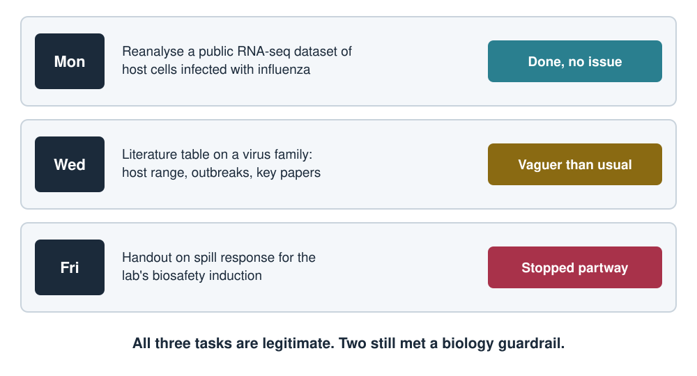{width="78%" fig-align="center"}

::: notes
Start with a concrete week in a virology group that uses an agent for routine work. On Monday, a postdoc reanalyses a public RNA-seq dataset of host cells infected with influenza: gene expression, quality control, a volcano plot. No issue at all; that is ordinary data analysis. On Wednesday, a PhD student asks for a literature table on a virus family: which hosts, which outbreaks, which key papers. The table comes back, but thinner and more general than the same request would be for, say, a plant hormone family. On Friday, the lab manager asks the agent to turn notes into a handout on spill response for the lab's biosafety induction, and the agent stops halfway with a short error message. All three tasks are legitimate. None of them asks for anything dangerous. Two still met a guardrail. By the end of this lecture you should be able to say what happened on Wednesday and Friday, and what to do about it.
:::

## The same knowledge protects people and could help someone harm them

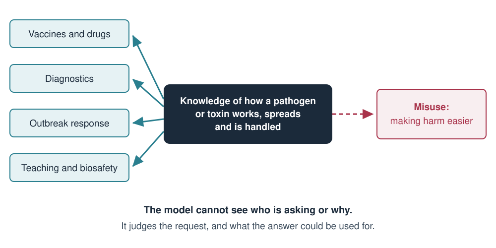{width="78%" fig-align="center"}

This is the **dual-use** problem. Biologists know it from export rules and from discussions of *dual-use research of concern*. AI providers face the same problem at scale.

::: notes
Dual use is not new to you. Knowing how a pathogen causes disease, how it spreads, and how it is handled is the basis of vaccines, diagnostics, outbreak response and biosafety teaching. A small part of that same knowledge could help someone cause harm. Research policy has dealt with this for decades: export control lists, rules on dual-use research of concern, biosafety committees. The difference with an AI model is scale and anonymity. Millions of people send it requests, and the model cannot see who is asking or why. A virologist and someone with bad intent can type the same sentence. So the provider has to judge the request and what the answer could be used for, not the person. That is why, as we will see, your credentials typed into a chat window do not unlock anything.
:::

## Providers worry about uplift: help that makes the hard steps easier

- The concern is not textbook facts. It is **uplift**: help that lets someone do what they could not do before, beyond what a search engine or a library gives.
- Anthropic's policy describes its thresholds in those terms: a model that could significantly help people **with basic technical training** to cause serious harm with biological or chemical weapons, and a higher one for models that could **substitute for rare expert knowledge**.
- OpenAI's Preparedness Framework uses the same idea: "High" biological capability means meaningful help to a **novice**.
- Both providers apply the stronger protections **as a precaution**, before they are sure a model has crossed the line.

::: notes
What exactly are the providers afraid of? Not that a model explains how the immune system works; that is in every textbook. The worry is uplift: that the model could fill in the hard, practical steps that today require years of specialist training, and so lower the barrier for someone who should not have that capability. Anthropic's Responsible Scaling Policy, version 3.4 from July 2026, describes its biology thresholds in exactly these terms, at two levels: helping people with basic technical backgrounds, such as an undergraduate science degree, and functionally substituting for the rare world-leading expertise that is now the main barrier. OpenAI's Preparedness Framework defines High biological capability as meaningful help to a novice. Note the last bullet: in 2025 both companies said openly that they could not prove their newest models crossed these thresholds, and switched on the protections anyway. That precaution is the reason you see so many blocks.
:::

## The most capable models carry the strictest biology safeguards {.smaller}

| | Anthropic (Claude) | OpenAI (ChatGPT, Codex) |
|---|---|---|
| **Framework** | Responsible Scaling Policy, now version 3.4 (July 2026) | Preparedness Framework, version 2 (April 2025) |
| **Level** | Current models deployed with **ASL-3 protections**, treated as having the first chemical and biological capability level | ChatGPT agent and GPT-5 thinking treated as **High** in biology and chemistry since 2025 |
| **What that switches on** | Classifiers on input and output for chemical and biological weapons; monitoring; access controls with exemptions for verified users | Always-on classifiers and monitors, refusal training for dual-use requests, enforcement |
| **What you notice** | Depending on model and app: a fallback to a less capable model, or a stopped answer | Refusals, partial ("safe") answers, stopped answers |
| **Usage policy** | Effective 12 November 2026 | Effective 20 November 2026 |

At the time of writing (November 2026). Model names and levels change; check the providers' pages.

::: notes
Here are the two providers this course uses, side by side, as of November 2026. Anthropic's model pages say that its current models are deployed with ASL-3 protections, and treated as having the first level of chemical and biological capability, which they call CB-1. ASL-3 protections include real-time classifiers, separate small models that watch requests and answers for chemical and biological weapons content, plus monitoring and an access-control route for verified users. OpenAI treated ChatGPT agent, and then GPT-5 thinking, as High capability in the biological and chemical category, which activated its safeguards: classifiers, monitors, and training to give partial, safe answers to dual-use questions instead of either refusing or answering everything. The usage policies of both providers were revised this month. Do not memorise the table; the names will be different next term. Remember the pattern: the stronger the model, the stricter the biology safeguards.
:::

## Blocks cluster around a small core of topics

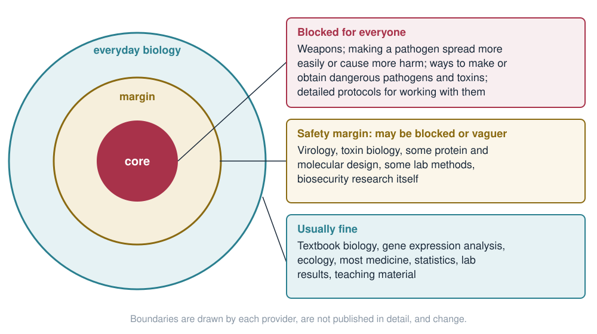{width="80%" fig-align="center"}

::: notes
Where do the blocks occur? Think of three zones. In the core are the things every provider blocks for everyone: help with weapons, making a pathogen spread more easily or cause more harm, ways to make or obtain dangerous pathogens and toxins, and detailed protocols for working with them. Anthropic's usage policy names these explicitly, including modifying agents to increase lethality or transmissibility. Around the core is a safety margin. Because classifiers cannot read intent, they are set to catch some requests that are probably fine, so that they rarely miss one that is not. Virology, toxin biology, some protein and molecular design, some lab methods, and biosecurity research itself live here. Outside is everyday biology: textbook knowledge, gene expression analysis, ecology, most of medicine, statistics, teaching material. Most of you work almost entirely in the outer zone and will rarely see a block. The boundaries are drawn by each provider, are not published in detail, and move with every update.
:::

## Legitimate research sits in the safety margin, and providers say so

- Anthropic retrained the biology classifier of its most capable model in August 2026 and reports about **85 % fewer biology-related fallbacks**. It also writes that **false positives will remain**.
- After the retraining, requests in **virology, toxicology and molecular design** still fall back, so that model "isn't yet usable for professional biology research and drug development".
- Who is most affected: virologists, microbiologists, toxinologists, protein designers, vaccine and diagnostics developers, biosafety and biosecurity staff, and teachers of those subjects.
- What is rarely affected: RNA-seq and other omics analysis, ecology, physiology, clinical statistics, most cell biology.

::: notes
The providers do not pretend this is free. In August 2026, Anthropic published a post about the biology safeguards on its most capable widely available model at the time, Claude Fable 5. When the classifier fires, the request is rerouted to a less capable model. After rewriting the classifier's rules to carve out benign uses and retraining it, Anthropic reports about 85 percent fewer biology-related fallbacks. But the same post says that false positives will remain, and that requests in virology, toxicology and molecular design still fall back, so the model is not yet usable for professional biology research and drug development. That is an unusually honest statement, and useful to you: if you work in one of those fields, expect to be blocked sometimes, and do not take it personally. If you analyse gene expression or do ecology, you will hardly ever notice the classifiers at all.
:::

## A refusal in the reply is the easiest kind to recognise

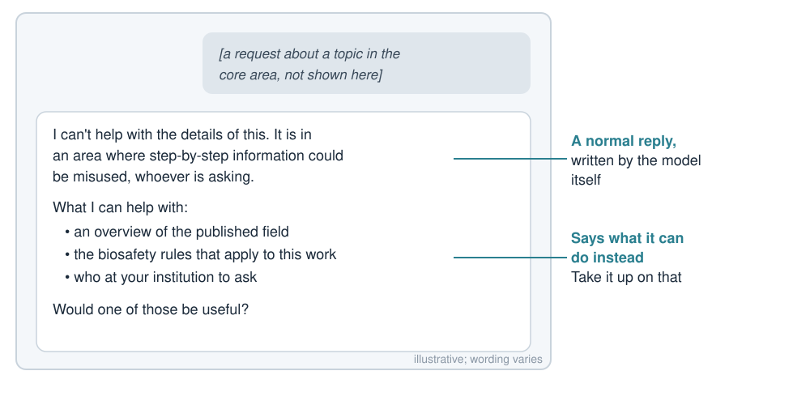{width="78%" fig-align="center"}

::: notes
Now, what does a biology guardrail look like on screen? There are four forms, and you need to recognise all of them. The first is the familiar one: the model itself declines, in a normal reply. It usually says briefly why, and often offers what it can do instead: an overview of the field, the biosafety rules, who to ask. This comes from the model's own training, not from a separate system. It is the easiest form to work with, because you can see it and you can take up the offer. If the request was benign and the refusal looks like a misunderstanding, the next slides show what to do. The wording on the slide is illustrative; real refusals vary between models and between runs.
:::

## A vaguer answer is harder to notice than a refusal

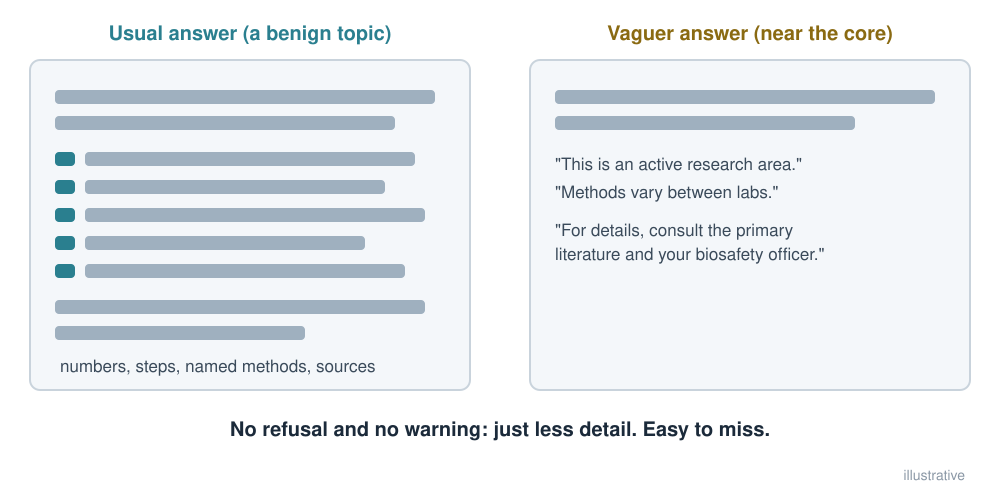{width="80%" fig-align="center"}

::: notes
The second form is the one people miss. There is no refusal and no warning, just less. You ask for a literature table on a virus family, and you get general statements, fewer numbers, fewer named methods, and a suggestion to consult the primary literature. OpenAI calls its version of this a safe completion: the model gives the safe part of an answer instead of refusing outright. That is often reasonable, but it has a consequence for research: a thin answer looks like a complete one. If you compare it with what you know about the field, you notice the gap. If you do not, you may conclude that there is little published on the topic. This is what happened on Wednesday in our example. The fix is simple: for topics near the core, treat the agent's summary as a starting point and go to the literature databases yourself, as in Literature review on a gene set.
:::

## A block can also switch you to another model, or show a system message

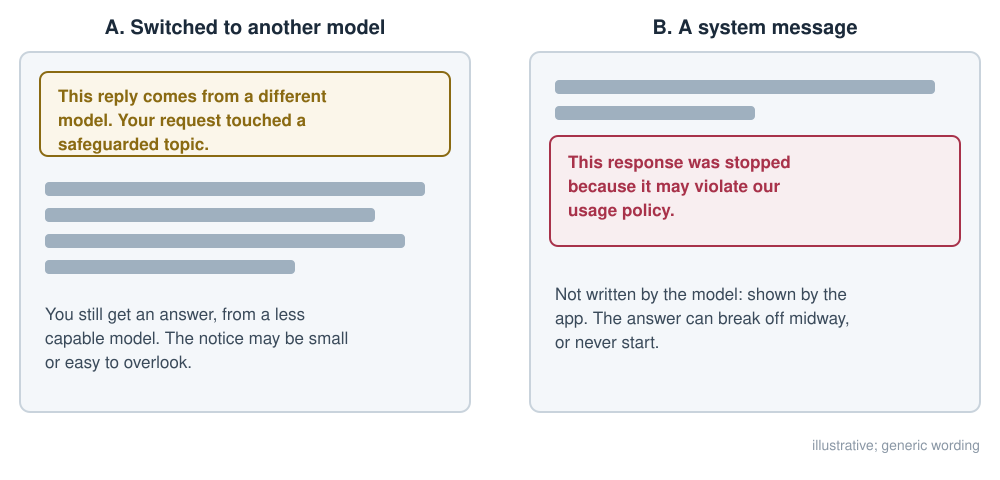{width="85%" fig-align="center"}

::: notes
The third and fourth forms come from the classifier around the model, not from the model itself. In one design, used by Anthropic for its top model at the time of writing, the blocked request is quietly sent to a less capable model, and a small notice says so. You still get an answer, but from a weaker model, and the notice is easy to overlook. In the other design, the app shows a system message: the answer stops, or never starts, and a line says it was stopped because it may violate the usage policy. That line is not written by the model; it is printed by the app. The exact wording differs between providers and versions, which is why the mock-ups are generic. The key sign that you hit a classifier and not a refusal: the message does not read like a reply, and it often appears mid-answer.
:::

## In an agent, a block can stop a task partway or end the session

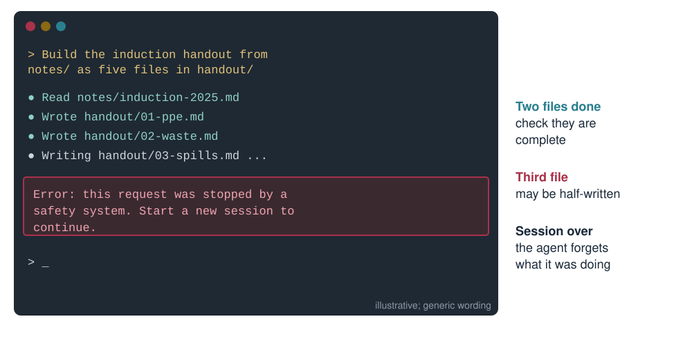{width="78%" fig-align="center"}

After a stop: **check what was already written**, and do not assume the task is half done in a tidy way.

::: notes
In an agent like Claude Code or Codex, the same classifier can stop a long task in the middle. This is what happened on Friday. The agent had read the notes, written two files of the handout, and was in the middle of the third when an error appeared saying the request was stopped by a safety system and that a new session is needed. Three things follow. First, the files already written are real and on your disk; open them and check they are complete. Second, the third file may be half written, so do not use it as it is. Third, a new session starts from nothing: the agent does not remember the plan. If you continue, you brief it again, ideally with more context, as we will see. And if you use git from Git as undo button, you can see exactly which files changed before the stop.
:::

## Each form tells you something different about what to do next {.smaller}

| What you see | Where it comes from | First thing to do |
|---|---|---|
| A polite refusal in the reply | The model's training | Read the reason; take up what it offers; add honest context if the request is benign |
| A thinner, vaguer answer | The model's training ("safe" partial answers) | Compare with what you know; go to the literature yourself |
| A notice that another model answered | Classifier with a fallback | Treat the answer as from a weaker model; check it harder |
| A system message; answer stops | Classifier around the model | Do not retry the same way; decide whether the task belongs here at all |
| Agent task stops; new session needed | Classifier, in the agent | Check which files were written; brief a new session if the task is benign |

The full "which guardrail did I hit?" table, with non-biology guardrails and usage limits, is in *Guardrails and safety levels*.

::: notes
Here are the four forms, with the agent case as a fifth row, and what each tells you. A refusal or a vaguer answer comes from the model itself, and the model can respond to context, so explaining yourself can help when the request was benign. A fallback notice means you are still getting an answer, but from a weaker model, so check it more carefully than usual. A stopped answer or a stopped agent task comes from a classifier, a separate system that does not converse with you; repeating the request will most likely trigger it again. The useful question then is whether this task belongs in an AI tool at all. In Guardrails and safety levels you saw the general version of this table, which also covers things that look like guardrails but are not, such as usage limits.
:::

## A block on a legitimate request is a policy limit, not a bug

- The provider **decided** to block this area, knowing it would catch some legitimate work. Retrying will not change that decision.
- **Do not reword or disguise a request to get past a block.** Both providers' usage policies forbid circumventing safeguards. It can lead to warnings, restrictions or a closed account.
- A blocked output on its own is **not** a violation: Anthropic's usage policy says so explicitly. You are not in trouble for having been stopped.
- Ask yourself honestly which zone the request was in. If it was in the core, the agent is the wrong tool, whoever you are.

::: notes
How should you think about a block? Not as a bug to work around, but as a decision the provider made, knowing the cost. Treat it the way you treat a locked freezer in someone else's lab. Do not reword the request to hide what you are asking, or try other tricks to get it through. Both usage policies forbid circumventing safeguards: Anthropic's says intentionally bypassing guardrails without authorisation, OpenAI's says circumventing our safeguards. The consequences range from a warning to losing access. On the other hand, do not panic if you are blocked. Anthropic's usage policy says explicitly that a blocked output alone does not count as a violation. And be honest with yourself: if the request really was in the core zone, then the problem is not the classifier. That work goes through your institution, not through an AI tool.
:::

## Honest context helps a benign request that was blocked by mistake

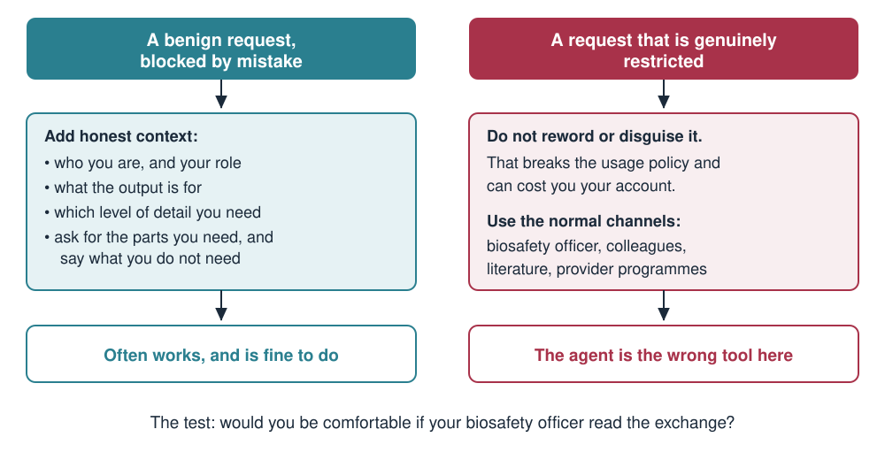{width="78%" fig-align="center"}

::: notes
There are two very different situations, and the difference matters. On the left: your request was benign, and the model or classifier misread it. A request for biosafety training material, a teaching summary, a literature overview. Here it is fine, and often effective, to add honest context: who you are, what the output is for, what level of detail you need, and what you do not need. The model's refusals respond to context; some classifiers do too, because the overall picture of the request changes. On the right: the request was genuinely restricted. Adding a cover story there is exactly the disguising the usage policies forbid. And note the word honest: context that is true about you and your task is information, a made-up role is a disguise. A simple test: would you be comfortable if your biosafety officer read the whole exchange? If yes, you are on the left.
:::

## Example: a biosafety handout, with honest context

**Before** (stopped partway):

```text
Write the spills section of the handout from notes/spills.md.
```

**After** (honest context, scope stated):

```text
I am the lab manager of a university teaching lab that works at
biosafety level 1 and 2. I am writing the induction handout that new
students read before their first lab session. Write the "spills"
section from my notes in notes/spills.md: who to tell, where the spill
kit is, protective equipment, the disinfectant and contact time we use,
and how to dispose of the waste. Keep to our notes and general good
practice; no organism-specific details are needed.
```

::: notes
Here is what that looks like for the Friday example. The first prompt is short and gives the agent almost nothing to go on: spills of what, for whom? The second says who is asking, what kind of lab it is, who will read the result, what the section should contain, and what it should not contain. Notice that nothing here is a trick. Every sentence is true and would be fine for the biosafety officer to read. Notice also the last sentence: saying what you do not need is useful, because it keeps the request clearly in the teaching zone. This does not guarantee that the classifier lets it through; classifiers are not perfectly predictable. If it still stops, write that section yourself or with your biosafety officer's template, and let the agent do the layout. In the exercise you practise exactly this.
:::

## Providers run access programmes for verified organisations {.smaller}

:::: {.columns}
::: {.column width="50%"}
**Anthropic: Life Sciences Verification Program** (beta, September 2026)

- For **teams and institutions**: academic labs, start-ups, pharma. Individual Pro and Max plans are not yet supported.
- Review of research credentials, security practices and ethical oversight.
- *Standard Use* grants for most life-science work; *High-risk Use* add-on for specific projects.
- Other safeguards, such as cyber classifiers, stay on. Data kept 30 days for monitoring.
- Expression of interest: [claude.com/form/life-sciences-verification-program](https://claude.com/form/life-sciences-verification-program)
:::
::: {.column width="50%"}
**OpenAI: trusted access for life sciences**

- **Organisation-based**: qualification and safety review of the organisation and its intended use.
- Covers its life-sciences model (GPT-Rosalind) and more detailed answers in dual-use areas for approved organisations.
- Usage policies still apply; weaponisation stays blocked.
- Ask your institution whether it has applied or plans to.
:::
::::

These are **institutional** routes. Typing "I am a virologist" in a chat does not unlock them.

::: notes
If your research genuinely needs the areas that are blocked, there is now a legitimate route, but it runs through your institution. In September 2026 Anthropic launched a Life Sciences Verification Program, in beta. Teams and institutions apply, not individuals on Pro or Max plans, at least for now. The provider reviews research credentials, security practices and ethical oversight, and grants Standard Use for most life-science work, or a High-risk Use add-on for specific projects, renewed more often. Monitoring moves from real-time blocking to review afterwards, which is why data is kept for 30 days. OpenAI has a trusted-access programme for life sciences, also organisation-based, that gives approved organisations access to its life-sciences model and more detailed answers in dual-use areas. In both, the usage policy still applies. The practical step for you: ask your research office or IT whether your university has applied, before you fill in a form yourself.
:::

## Your institution has people for exactly this

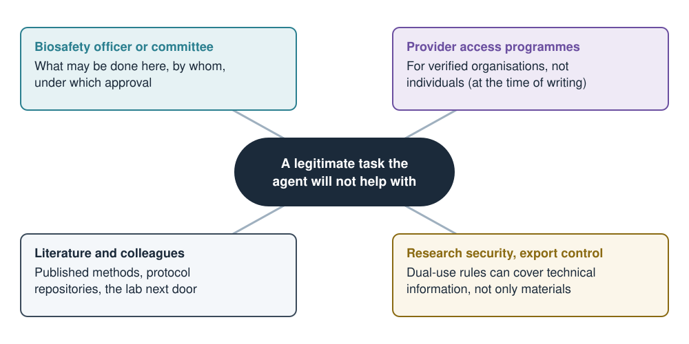{width="78%" fig-align="center"}

::: notes
Before AI tools existed, you already had people for these questions, and they are still the right first stop. The biosafety officer, or the biosafety committee, knows what may be done in your building, by whom, and under which approval. Colleagues and the published literature, including protocol repositories, are where real methods come from anyway. Research security or export control offices matter more than many biologists think: EU dual-use export rules can cover technical information, not only materials and equipment, so sending some technical details abroad, including to a cloud service, can be regulated. And the provider programmes from the last slide go through your institution. In the exercise you will find the names and links for your own university and put them in your project README.
:::

## Do not paste restricted or dual-use protocols into a chat

- A protocol for work under special approval is **your institution's** information, often under rules on who may see it.
- Pasting it sends it to the provider and into session logs (*Privacy, ethics and safety*). Export-control rules may apply to some technical details.
- It will likely **trigger the classifier**, and can stop the session or flag the account.
- The same holds for collaborators' unpublished methods and material transfer agreements: not yours to share.
- If the agent should help with the **paperwork** around such work (scheduling, formatting, a non-technical summary), describe the structure, not the content.

::: notes
A related rule, and an easy one to break by accident. Say your lab has an approved protocol for work in a containment lab, and you want the agent to reformat it, or translate it, or turn it into a checklist. Do not paste it in. The protocol is your institution's information, often with rules on who may see it. Pasting it sends it to the provider's servers and into the local session logs, as we discussed in Privacy, ethics and safety. Some technical details may fall under export control. And it will likely trigger the classifier anyway, which may stop the session. The same goes for a collaborator's unpublished method. If you want help with the paperwork around the work, such as a schedule, a form layout or a non-technical summary for a lay audience, give the agent the structure and write the technical content yourself. This is the same stand-in idea as in the privacy unit.
:::

## Beyond safety guardrails, the model also gets protocols wrong

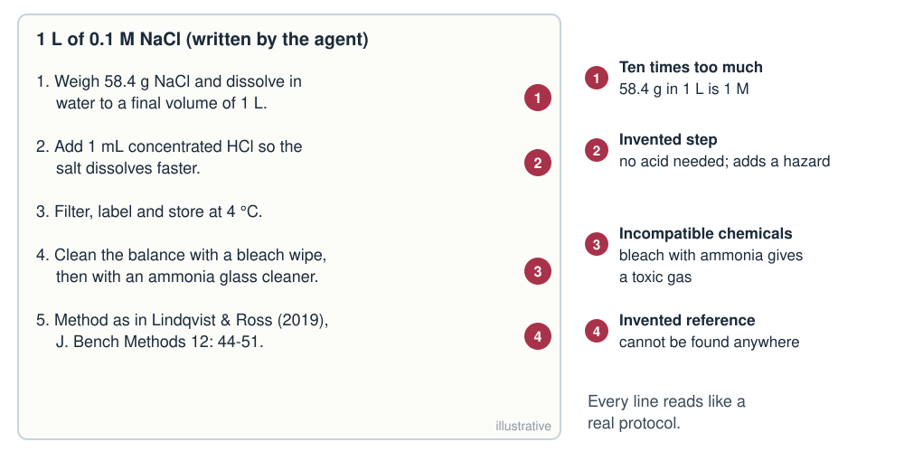{width="80%" fig-align="center"}

::: notes
Now the second half: limits that have nothing to do with safety policies, and affect every biologist. Here is a protocol the agent wrote for something completely harmless: one litre of 0.1 molar sodium chloride, and cleaning the balance afterwards. It contains four errors, and every line reads like a real protocol. Step one: 58.4 grams in a litre is one molar, ten times too much; the model knows the molar mass but slipped a decimal. Step two is invented: salt does not need acid to dissolve, and the step adds a hazard. Step four mixes bleach and an ammonia cleaner on the same surface, which releases a toxic gas; every lab safety induction warns against it. And the reference at the end does not exist. None of this is a guardrail. It is the plausible-text mechanism from How LLMs and agents work, applied to the bench.
:::

## Concentrations and units fail silently

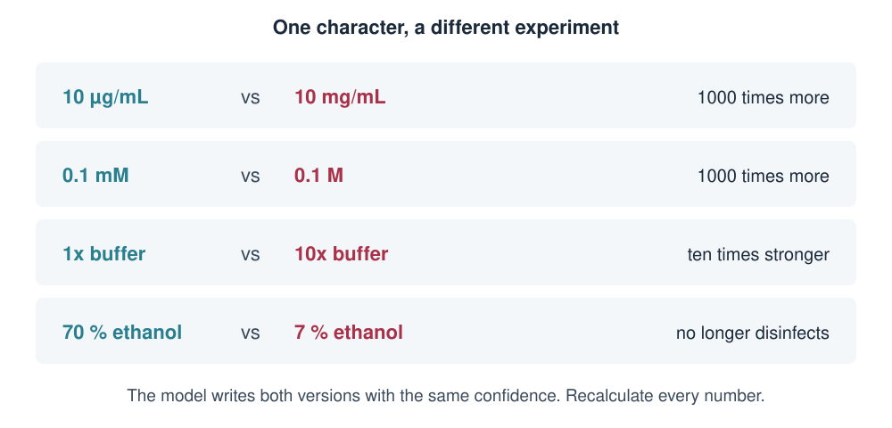{width="78%" fig-align="center"}

::: notes
Numbers deserve their own slide, because this is where plausible text fails most quietly. A microgram and a milligram per millilitre differ by one character and a factor of a thousand. A millimolar and a molar, the same. A 1x and a 10x buffer differ by a digit. And 70 percent ethanol disinfects, while 7 percent does not. The model writes each version with exactly the same confidence, and there is nothing in the text that looks wrong. In data analysis, a wrong number usually produces a strange plot that you notice. At the bench, a wrong concentration can mean a failed week, a ruined sample, or a real hazard. So the rule is simple: recalculate every amount and every concentration yourself, as you would for a student's protocol. Better still, ask the agent to show its calculation for each one, and check that.
:::

## Safety steps go missing more often than they go wrong {.smaller}

| Often missing from agent-written protocols | Where to check |
|---|---|
| Protective equipment: gloves, coat, eye or face protection, heat-resistant gloves | Your lab's risk assessment and standard procedures |
| Fume hood for volatile or toxic chemicals | The chemical's **safety data sheet** (section 8) |
| Incompatible chemicals, also in waste containers | Safety data sheet (section 10); your waste rules |
| Waste: what goes where, never "down the sink" by default | Your institution's waste guide |
| Biosafety level and approvals for the organism | Biosafety officer; local approvals |
| Who must be trained or present | Lab rules, supervisor |

The model writes the **typical** protocol. Your lab's rules are not in its training data.

::: notes
When you read agent-written protocols, safety steps go missing more often than they go wrong. The model writes the scientific steps, because that is what most published methods sections contain, and published methods sections rarely mention gloves, fume hoods or the waste container. So the agent's protocol inherits that silence. The table lists what to look for and where to check it. The safety data sheet of every chemical has sections on protection and on incompatibilities; your lab's risk assessment and your institution's waste guide say the rest. And the model cannot know local rules: which waste goes where in your building, which work needs which approval. That is why an agent-written protocol always needs a reader who knows the lab.
:::

## Medical questions need a qualified human in the loop

- Models answer medical questions fluently, and sometimes wrongly. They add caveats, but the caveats do not make the content right.
- Anthropic's usage policy treats diagnosis, treatment and dosing advice to individuals as **high-risk**: a qualified professional must review the output, and people must be told AI was used. OpenAI's policy is similar.
- For research and teaching, the model is fine for **general knowledge**, drafting and literature work. Check facts against guidelines and primary sources.
- Patient data stays out (*Privacy, ethics and safety*). A question about "a patient" with enough detail is still patient data.

::: notes
A brief word for those in medicine. Models are good at medical text and pass medical exams, and they also make confident errors, especially on doses, interactions and rare conditions. They add caveats, but a caveat is not a correction. The usage policies reflect this: Anthropic lists diagnosis, treatment and dosing advice to individuals as a high-risk use that needs review by a qualified professional before it reaches anyone, plus disclosure that AI was used. OpenAI's policy similarly prohibits tailored medical advice without appropriate professional involvement. For your research and teaching, the model is a fine drafting and literature tool, as long as you check facts against clinical guidelines and primary sources. And the privacy rule from Part 1 holds: a detailed case description is patient data, even without a name.
:::

## Plausible text is not a tested protocol

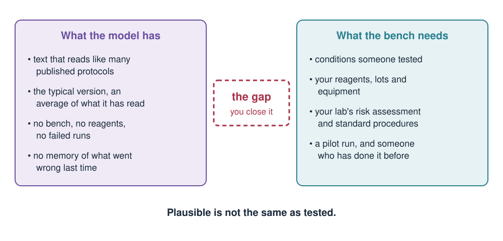{width="80%" fig-align="center"}

::: notes
The deepest limit is this gap. The model has read many protocols and writes the typical version, a kind of average of what it has seen. It has never stood at a bench, never used your reagents, never had a run fail, and does not remember what went wrong last time. A protocol that works needs things the model does not have: conditions someone actually tested, your reagents and lots and equipment, your lab's risk assessment, a pilot run, and ideally someone who has done it before. This is the same message as in How LLMs and agents work, where we said the model produces what is plausible, not what is true. At the bench, the cost of the difference is higher than in a script, because you cannot simply rerun with a fix. The gap is closed by you, and by the experiment.
:::

## Check every agent-written protocol against the same list

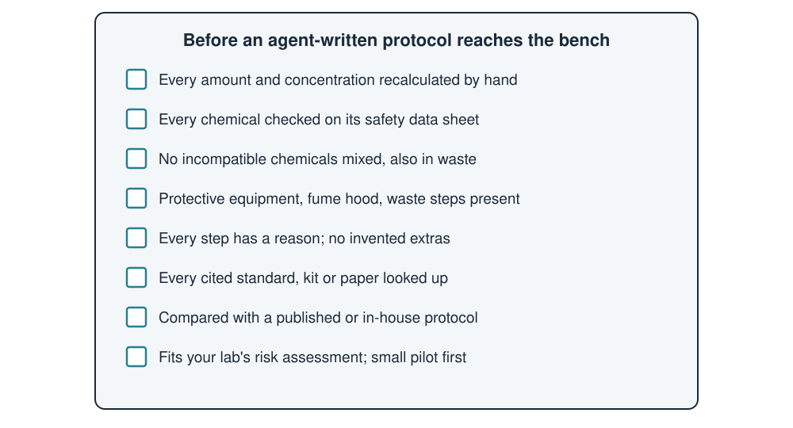{width="66%" fig-align="center"}

::: notes
Here is a checklist to use on any protocol the agent drafts, from a buffer recipe to a teaching lab handout. Recalculate every amount and concentration. Check every chemical on its safety data sheet. Make sure nothing incompatible is mixed, including in the waste. Check that protective equipment, fume hood and waste steps are present. Ask for each step what it is for; invented extras like the acid in the salt solution fail that test. Look up every cited standard, kit or paper. Compare with a published or in-house protocol. And make sure it fits your lab's risk assessment, then run a small pilot. You will use this list in the exercise on a short protocol that, like the one we just saw, has several errors planted in it.
:::

## For most biology projects in this course, the guardrails rarely matter

- **RNA-seq and other omics** (*Track: RNA-seq*): gene expression, enrichment, plots. Almost never blocked, even for host response to infection.
- **Literature work** on pathogens: expect thinner answers near the core; verify against PubMed, as you would anyway.
- **Teaching material** for microbiology and biosafety courses: occasional false positives; honest context helps.
- **Protocols** of any kind: the checklist matters far more than the guardrails.
- Put the relevant contacts and precautions in your project's README.

::: notes
To put this in proportion: most biology and medicine work in this course will never touch a biology guardrail. The RNA-seq track analyses gene expression, and that is far from the core, even if the samples were infected cells. Literature reviews on pathogens may get thinner answers, but you verify every reference in PubMed anyway, as in Literature review on a gene set. Teaching material for microbiology or biosafety courses can hit false positives, and that is where honest context helps most. And for anyone who lets the agent draft a protocol, the checklist from the last slide matters far more than the guardrails. In the exercise, you add a short section to your project README on which of these apply, and who to ask.
:::

## Where this goes wrong

- **Boundaries move.** Classifiers are retrained often; what was blocked last month may pass, and the reverse. Names and programmes on these slides will date quickly.
- **False positives are certain** near the core. They cost time, not trust: they are not an accusation.
- **A thin answer looks complete.** The vaguer-answer form is the one people miss.
- **A stopped agent leaves half-finished files.** Check before you reuse them.
- **Context is not a key.** Honest context helps benign requests; it does not make restricted work acceptable, and invented context is a policy violation.
- **Fluent protocols contain errors.** Wrong amounts, missing safety steps, invented references. You remain responsible for what happens at the bench.

::: notes
The limits of this lecture. First, the specifics date quickly: classifiers change from month to month, model names change, and the access programmes are in beta. Check the providers' pages. Second, false positives are certain if you work near the core; take them as a cost of the system, not as a judgement about you. Third, the vaguer answer is the form most people miss, so compare with what you know. Fourth, an agent stopped midway leaves half-written files. Fifth, honest context helps when the request was benign, but it is not a key, and invented context breaks the policy. And last, the limit that affects everyone: fluent protocols contain errors, and the person who runs the experiment is responsible for its safety, not the agent.
:::

## Summary {.smaller}

| Concept | Key fact |
|---|---|
| Dual use | The same biological knowledge protects and could harm; the model cannot see who asks |
| Uplift | Providers block help that makes the hard steps easier, not textbook facts |
| Who blocks most | The most capable models, with classifiers for chemical and biological weapons (Anthropic ASL-3, OpenAI "High") |
| Where | A small core (weapons, enhancing pathogens, making or obtaining them, detailed protocols) and a safety margin (virology, toxin biology, some molecular design) |
| What it looks like | Refusal, vaguer answer, switch to another model, system message, agent stopping partway |
| What to do | Policy limit, not a bug. Never reword or disguise. Benign request: honest context. Otherwise: biosafety officer, colleagues, literature |
| Access programmes | Anthropic Life Sciences Verification Program, OpenAI trusted access: for organisations |
| Other limits | Wrong concentrations, missing safety steps, invented references; medical advice needs a qualified human |
| Check | Recalculate, safety data sheets, compare with a real protocol, pilot first |

**Next (Copyright, memorisation and credit):** models can reproduce what they were trained on. What that means for copyright, for your own texts and data, and for giving credit when the agent helped.

::: notes
To sum up. Biology is dual use, and the model cannot see who is asking, so the providers block help that gives real uplift toward weapons, most strictly on their most capable models. The blocks cluster in a small core, with a safety margin where legitimate virology, toxin biology and molecular design get caught. You see them as a refusal, a vaguer answer, a switch to another model, a system message, or a stopped agent. Treat them as a policy limit: never reword or disguise; give honest context when the request was benign; otherwise go to your biosafety officer, colleagues and the literature, and ask whether your institution uses one of the providers' access programmes. Beyond guardrails, check every agent-written protocol like a student's. In the next unit, Copyright, memorisation and credit, we look at another limit of a different kind: what the model has memorised from its training data, and what that means for copyright and credit.
:::
