## About this lecture

Claude Code and Codex each let you choose **which model** does the work, and **how long it thinks**. The choice changes quality, speed and how fast you use up your plan's limits. Every few months there are new names, each launched with graphs that say it is the best. This lecture is about reading those names and graphs calmly, and deciding for **your** task.

- Models come in **families** from a few providers, and in **tiers**: large, medium, small. Bigger is more capable, slower and uses more of your limits.
- A **model name** tells you family, tier and version. Aliases move to newer models; record the exact model in your log.
- **Benchmarks** are fixed tests. Read the graphs by asking: what was measured, how was it normalised, and who chose to show it?
- The benchmark that matters most is **a small test on your own task**, with two models side by side.

This is a **concept** unit. Running models on your own computer comes in *Open-weights models and data privacy*.

::: notes
Up to now we have used whatever model the tool started with. That was deliberate: the default is a sensible choice for most tasks. But you will meet the question sooner or later. A colleague says the other model is much better. A new release comes with a graph showing it beating everything. Or your plan's limit runs out halfway through the week because a large model did hours of file renaming. This unit gives you enough to make the choice on purpose. It deliberately teaches how to read names and graphs rather than which model is best, because any list of best models is out of date within months. The specific names you will see on the slides are examples from November 2026, labelled as such. The current list lives on the course's Accounts and installation page, which we update before each run.
:::

## Two jobs this week: rename 400 images, and design a grant's analysis plan

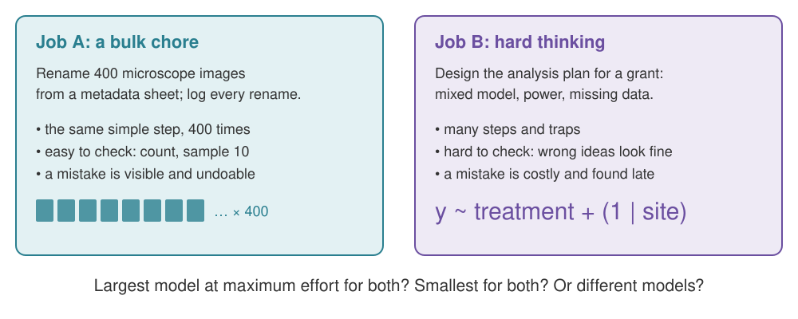{width="85%" fig-align="center"}

Should the same model, at the same effort, do both?

::: notes
Here is the concrete problem. Two jobs land on the same week. One is a bulk chore: rename 400 microscope images using a metadata sheet, check that every file is accounted for, and write a log. The other is hard thinking: design the statistical analysis for a grant application, with a mixed model, a power argument and a plan for missing data. If you use the largest model at its highest thinking setting for both, the first job takes longer than it needs to and eats into your usage limit. If you use the smallest, fastest model for both, the second job gets a plausible but shallow plan. The answer is not complicated, but it needs a picture of what the choices are. That is the first half of the lecture. The second half is about the evidence people use to argue that one model is better than another: benchmarks.
:::

## A few providers, each with a family of models

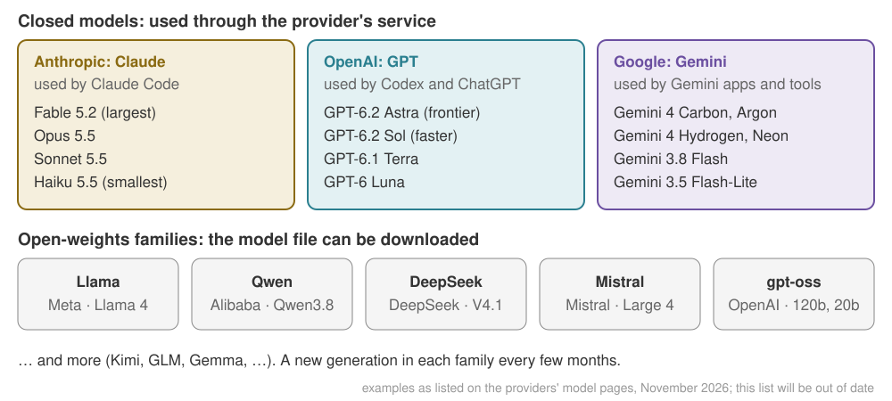{width="88%" fig-align="center"}

The names are **examples from November 2026**. The current list is on the course's *Accounts and installation* page.

::: notes
The landscape has a simple structure even though the names change constantly. A handful of companies train the most capable models. Anthropic makes the Claude family, which Claude Code uses. OpenAI makes the GPT family, which Codex uses. Google makes Gemini. These are closed models: you use them through the provider's service, and the model itself never leaves their servers. Next to them are open-weights families, such as Llama from Meta, Qwen from Alibaba, DeepSeek, Mistral and OpenAI's gpt-oss: the trained model can be downloaded and run by anyone with enough hardware. Each family has several members at a time, and a new generation every few months. Do not try to memorise the names on this slide. The point is the structure: provider, family, tier, version.
:::

## Within a family, bigger tiers think better, but are slower and use more of your limits

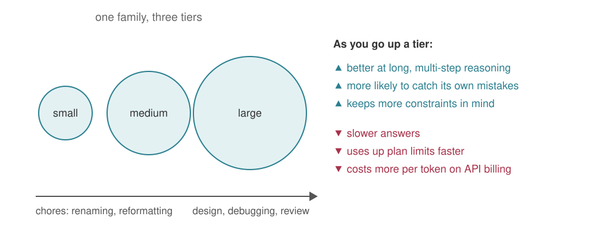{width="85%" fig-align="center"}

::: notes
Within one family, the provider usually offers models of different sizes. The largest is the most capable: better at long, multi-step reasoning, at catching its own mistakes, at keeping many constraints in mind. It is also slower, and on a subscription plan it uses up your usage limit faster; on pay-as-you-go billing it costs more per token. The smallest is fast and cheap, and perfectly good at well-defined chores: renaming, reformatting, extracting a field from many similar files. The middle tier is a compromise and is often the best value for routine work. The names of the tiers differ between providers, and some providers have recently dropped the familiar size words, which is one more reason to read the provider's own model overview page rather than guess from the name.
:::

## Closed and open-weights models differ in where the data goes

:::: {.columns}
::: {.column width="50%"}
**Closed** (Claude, GPT, Gemini)

- runs only on the provider's servers
- usually the most capable at any given time
- your prompts and files go to the provider (*Privacy, ethics and safety*)
:::
::: {.column width="50%"}
**Open-weights** (Llama, Qwen, DeepSeek, Mistral, gpt-oss, ...)

- the model file can be downloaded
- can run on a university server or your own computer
- usually some months behind the best closed models
:::
::::

More in the next unit, *Open-weights models and data privacy*.

::: notes
One distinction cuts across the whole landscape: whether you can download the model. Closed models run only at the provider. Open-weights models can be downloaded and run elsewhere, which matters enormously for privacy: sensitive data can stay inside the university. The price is capability and convenience. Open models have generally trailed the best closed ones by some months, and running them well needs serious hardware. We will see the size of that gap on a graph later in this lecture, and the whole of the next unit is about when and how to use open-weights models. For now, keep in mind that "which model" is partly a privacy question, not only a quality question.
:::

## A model name tells you family, tier and version

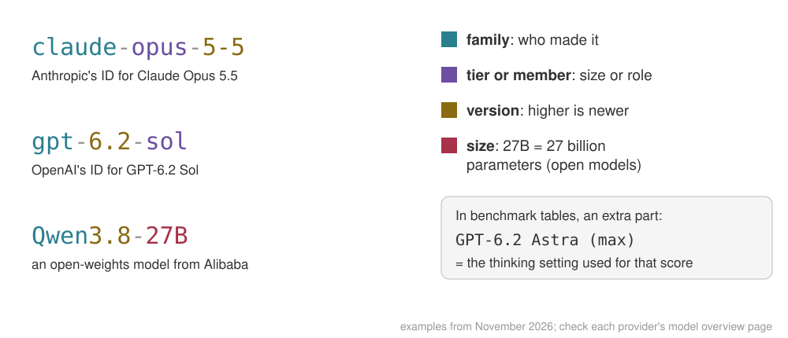{width="88%" fig-align="center"}

::: notes
Model names look like noise until you see the pattern. Most have three parts: the family, the tier or member, and a version number. Higher versions are newer within a family, though the numbering is not always tidy. Open-weights names often add the size in parameters: B for billions. A parameter is one of the numbers inside the model that training adjusts; more parameters roughly means more capacity, and more memory needed to run it. Benchmark tables add one more part in brackets: the thinking setting used, such as high or max. That matters, because the same model at a low setting can score much lower. Each provider has a page that lists the current names and what they mean: the model overview. When a new name appears, that page is where to look, not a news headline.
:::

## Aliases move to newer models; the exact ID does not

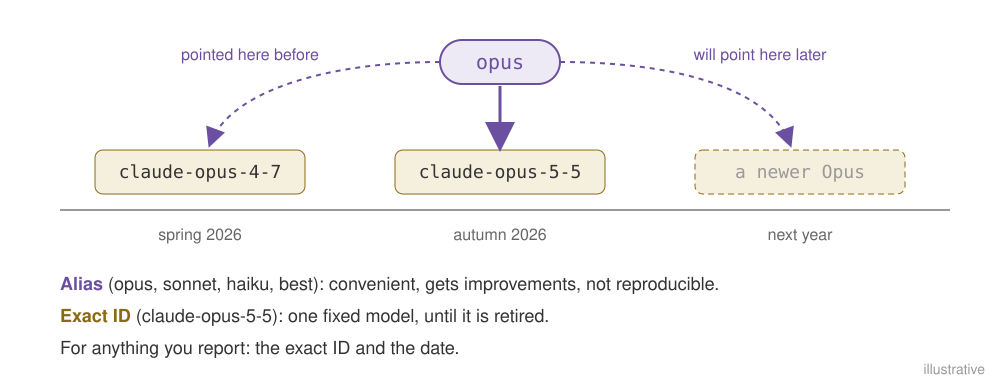{width="80%" fig-align="center"}

**Write the exact model ID in your project's Log of AI use.** "Claude" or "GPT" is not enough to reproduce anything.

::: notes
Both tools let you pick a model by a short alias, such as opus or sonnet in Claude Code. An alias is a pointer: when a new model in that tier comes out, the alias moves to it. That is convenient, because you get improvements without doing anything. It is bad for reproducibility, because the same command next year runs a different model. The full model ID, with its version number, refers to one fixed model. You do not need to pin the model for everyday work. But for anything you report, a paper's methods section, a disclosure statement, the Log of AI use in your project README, write down the exact ID and the date. Ask the agent: "which exact model are you?", and check it against what the tool shows, since a model is not always reliable about its own name.
:::

## A release note tells you more than the launch graph does

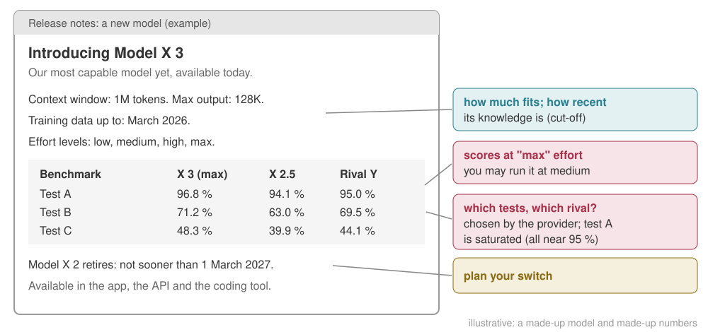{width="80%" fig-align="center"}

::: notes
When a new model is released, the provider publishes a release note or model card. It is worth five minutes, if you read it for the right things. The context window: how much it can hold at once. The knowledge cut-off: how recent its training data is. Which tools and settings it supports. Its retirement date or support policy. And the benchmark table, which you should read with the questions from the second half of this lecture: which tests did they choose to show, at which thinking setting, and compared with which competitors? Most launch graphs are honest but selected. A useful exercise is to ask the agent to fetch the release note and summarise exactly these points for you, with links.
:::

## Models are retired, so a workflow tied to one model will need rechecking

- Providers **retire** older models on a published schedule, usually with some months' notice.
- Aliases follow along automatically; **pinned IDs stop working** when their model retires.
- A newer model can behave **differently** on your task: better on average, worse on something you relied on.
- After a model change, **rerun your known-answer checks** (*How LLMs and agents work*).

Deprecation pages: [Anthropic](https://platform.claude.com/docs/en/about-claude/model-deprecations) · [OpenAI](https://developers.openai.com/api/docs/deprecations) · [Google](https://aistudio.google.com/docs/deprecations)

::: notes
Models do not live forever. Each provider has a deprecation page listing when older models will be retired, and gives notice in advance, typically some months. For you this has two consequences. If you have pinned a specific model for a reproducible pipeline, it will eventually stop working, and you will need to move to a newer one. And when the model changes, whether by an alias moving or by a forced migration, behaviour can change. A newer model is usually better on average, but not on every single thing. The checks you built in earlier units, known answers, row counts, the comparison script from Reading other people's code, are exactly what you rerun after a model change. That is how you find out in minutes rather than months.
:::

## Thinking effort: the same model can think longer before it answers

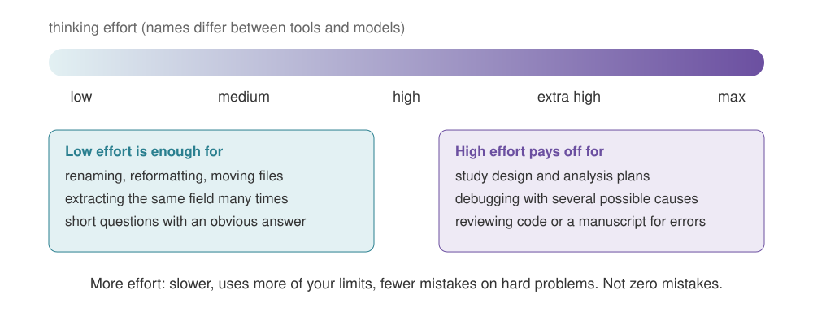{width="85%" fig-align="center"}

::: notes
Recent models can produce a stretch of hidden or visible reasoning before their answer: they work through the problem, check intermediate steps, and consider alternatives. Both tools let you set how much of this to do, with a setting usually called effort or reasoning effort, from low to high and beyond. More effort helps on problems with many steps or traps: a tricky statistical design, debugging a failure that has several possible causes, reviewing an analysis for errors. It does little for a chore with an obvious procedure, where it only makes the agent slower and uses more of your limit. Remember from How LLMs and agents work that reasoning is still generated text: more thinking makes mistakes rarer, not impossible, and it does not replace checking.
:::

## Context length: how much the model can hold at once

:::: {.columns}
::: {.column width="48%"}
- Top models hold up to about **1 million tokens**: several books' worth.
- That is the **maximum**, not the sweet spot.
- Facts at the **start** and **end** of a long context are used best; facts in the **middle** are missed more often.
- So **focus** beats size: one task per session.
:::
::: {.column width="52%"}
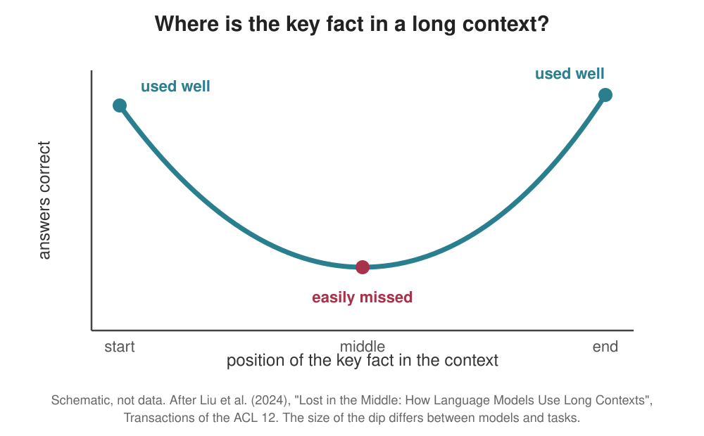{width="100%"}
:::
::::

::: notes
The context window from How LLMs and agents work is another property that differs between models and tiers. Today's largest windows are around a million tokens, roughly three-quarters of a million English words. That sounds as if size is no longer a concern, but a large window does not mean the model pays equal attention to everything in it. A well-known study by Liu and colleagues, published in 2024 under the title Lost in the Middle, hid one relevant fact at different positions in a long context and measured how often models used it. Accuracy was highest when the fact was near the beginning or the end, and dropped when it was in the middle: a U-shaped curve, which the figure sketches. Newer models are better at this, and the size of the dip differs between models and tasks, but later studies also find that performance drops as the context grows, well before the limit. And long sessions still get compacted. So the size of the window matters less than what you put in it, and where. That is the next slide.
:::

## Context engineering: what goes into the window, and where

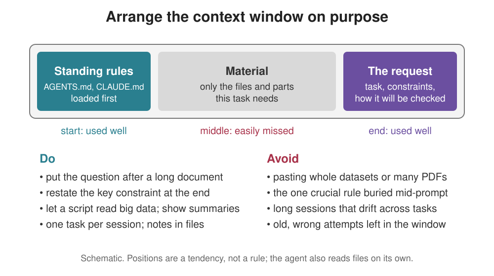{width="72%" fig-align="center"}

::: notes
Because position and clutter matter, it pays to arrange the context on purpose. People call this context engineering. The agent tools already help: your standing rules in AGENTS.md or CLAUDE.md are loaded at the very start of every session, which is one of the two strong positions; that is why the important, lasting rules belong there, as in Organising a project for an agent. The other strong position is the end, which is where your request sits. Put the task, the constraints and how you will check the result there, and if you pasted or pointed to a long document, put the question after it, not before; provider guides for long documents give the same advice. Restate the one rule that must not be broken at the end of a long prompt. In the middle goes the material, and only the material this task needs: let a script read a big data file and show you a summary, rather than pasting the whole thing. And keep sessions to one task: an old, wrong attempt left in the window is material too, and it can pull the next answer back toward the mistake. The positions are a tendency, not a law, and the agent also reads files on its own; but these habits cost nothing and make results more reliable.
:::

## Switching model and effort in Claude Code and Codex

| | Claude Code | Codex |
|---|---|---|
| **Pick a model in a session** | `/model` opens a picker; `/model sonnet` switches directly | `/model` lets you pick a model and its reasoning effort |
| **At start-up** | `claude --model opus` | `codex -m <model>` (or `--model`) |
| **Set thinking effort** | `/effort` (e.g. `/effort high`); levels from low to max | in the `/model` picker, or `model_reasoning_effort` in `config.toml` |
| **Make it the default** | the choice in `/model` can be saved as default; or `"model"` in settings | `model = "..."` in `config.toml` |
| **See model and usage** | `/usage`; the active model is shown in the session | `/status` shows the active model and, on most plans, remaining limits |

Commands as documented in November 2026 ([Claude Code model configuration](https://code.claude.com/docs/en/model-config), [Codex models](https://learn.chatgpt.com/codex/models)). Your version may differ: type `/help`.

::: notes
Here is how to actually switch. In Claude Code, the model command opens a picker, and you can also give an alias directly. The effort command sets how long it thinks. You can start Claude Code with a chosen model from the terminal too. In Codex, the model command does both: it switches the model and lets you set the reasoning effort. Codex also has a configuration file where you can set a default. Both tools show which model is active in the session. These details change between versions, which is why the table carries a date and links to the official pages. If your screen looks different, type /help or ask the agent to fetch its own documentation. As we saw in How LLMs and agents work, agents describing their own settings from memory are often out of date.
:::

## Match the model to the job, and change it when the job changes

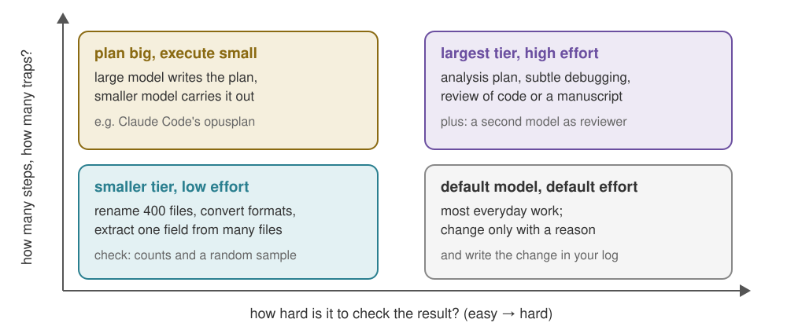{width="85%" fig-align="center"}

::: notes
Here is a rough guide. For bulk, well-defined chores with an easy check, renaming, reformatting, extracting the same field from 200 similar files, a smaller or middle tier at low or medium effort is usually enough, and it is faster and kinder to your limits. For work where a wrong idea is expensive and hard to spot, a study design, an analysis plan, debugging something subtle, reviewing a colleague's code, use the largest model at higher effort. Some tools have a mixed mode: Claude Code's opusplan, for example, uses the larger model for planning and a smaller one for carrying out the plan. And when you are not sure, start with the default. The default is chosen by the provider to be a sensible all-rounder. Change it when you have a reason, and note the change in your log.
:::

## Switching is worth it when the job is large, repetitive or hard

| Situation | Try |
|---|---|
| The same simple step on hundreds of files | a smaller tier, low effort; check a random sample |
| The usage limit runs out before the week does | a smaller tier for chores; keep the large one for planning |
| A plan or analysis that keeps missing something | the largest tier, high effort; or a second model as reviewer |
| A result you want to trust | the same task on two models, compared (*Parallel workers*) |
| Everything works fine | **nothing**: keep the default |

::: notes
In practice there are only a few situations where switching models pays off. If you are doing the same simple step hundreds of times, a smaller model is usually just as good, and you check a random sample anyway. If your limits run out, move the chores to a smaller model rather than stopping work. If a plan keeps missing things, more effort or the largest model helps, and so does a second model as reviewer, which you met in Parallel workers. And for results that matter, running the same task on two models and comparing is one of the strongest checks you have, because two different models rarely make the same mistake in the same place. If everything works, do not spend time optimising the model choice.
:::

## A benchmark is a fixed test with a score

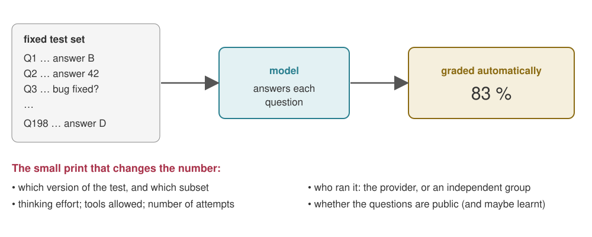{width="85%" fig-align="center"}

::: notes
Now to the evidence. A benchmark is simply a fixed test: a set of questions or tasks with known correct answers, a way of running the model on them, and a rule for scoring. The score is usually the percentage correct. Because the test is fixed, different models can be compared, and the same model can be compared over time. The important details are hidden in the small print: which version of the test, which thinking setting, whether the model could use tools, how many attempts it got, and who ran it, the provider or an independent group. Two numbers for the same model on the same benchmark can differ by many points because of these choices. That is why the sources we use in the following graphs are independent groups that run the tests themselves under fixed conditions.
:::

## Benchmark graphs come in five kinds; each normalises differently

| Kind | Example | What it tells you | Watch out for |
|---|---|---|---|
| **Score on one fixed test** | GPQA Diamond, SWE-bench Verified, Humanity's Last Exam | progress on one kind of task | saturation; leaked test questions |
| **Normalised by human task time** | METR's time horizon | how long a task (for a human) the model can do | software tasks only; 50 % success |
| **Combined over many tests** | Epoch Capabilities Index | overall level on one scale | hides strengths and weaknesses |
| **Normalised by cost** | price to reach a given score | how fast capability gets cheaper | prices change; per-token vs per-task |
| **Human preference** | LMArena | which answer people prefer, blind | rewards style and length |

The graphs on the next slides are **redrawn from the sources' own data**, with the source and date under each.

::: notes
Here is a map of the benchmark graphs you will meet in news articles and launch posts. The simplest is a score on one fixed test over time. Then there are three ways of normalising, which means putting scores on a scale that is easier to compare: by how long the tasks take a human, by combining many tests into one index, and by cost. And there is a different kind altogether: asking people which of two answers they prefer. Each answers a different question, and each has a typical blind spot, listed in the last column. We now go through one graph of each kind. All of them are redrawn by us from the data the source publishes under an open licence, with the source and download date in the corner, so you can go and check them.
:::

## Fixed tests saturate: from far below experts to near 100 % in about three years

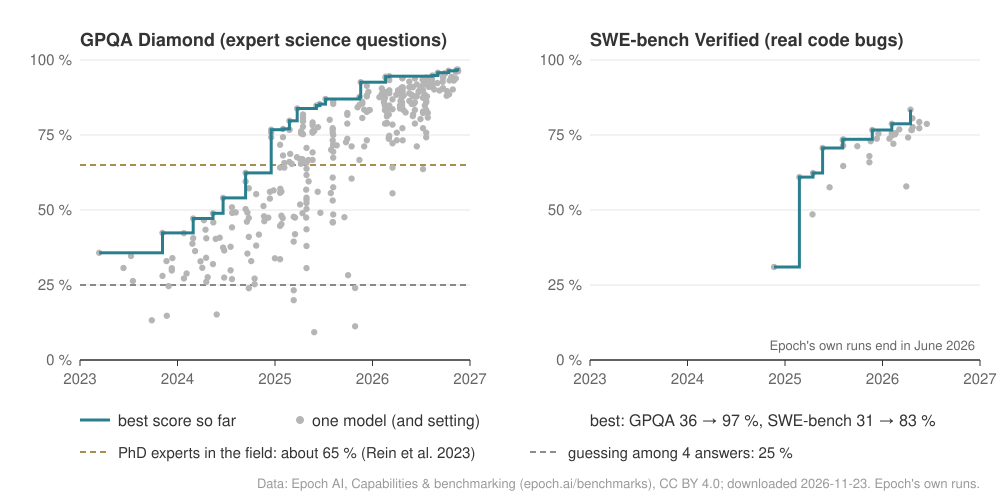{width="88%" fig-align="center"}

::: notes
Here are two fixed tests, with data from Epoch AI, an independent research group that runs benchmarks itself. On the left, GPQA Diamond: 198 multiple-choice questions in biology, physics and chemistry, written by PhD experts so that they cannot simply be looked up. Experts in the field get about 65 per cent; guessing gives 25. In early 2023 the best model scored around 36 per cent. By late 2026 the best score is about 97, which is close to what the test can measure at all, because a few of its questions are themselves disputed. On the right, SWE-bench Verified: fixing real bugs in open-source Python projects. It went from about 30 to over 80 per cent in eighteen months. Each grey dot is one model at one setting; the teal line is the best score so far. This is what saturation looks like: a test stops telling models apart.
:::

## When a test saturates, harder tests replace it

- **Humanity's Last Exam**: about 2,500 very hard questions from many fields. Best scores went from a few per cent (2024) to around half (autumn 2026), according to Epoch AI's records.
- **Terminal-Bench**: real tasks an agent does in a terminal, like those in this course.
- **FrontierMath**: unpublished research-level mathematics problems.

**Lesson:** a launch graph on a saturated test says little. Ask **which tests are still hard**, and whether they resemble your work.

::: notes
Because the old tests stop telling models apart, the field keeps making harder ones. Humanity's Last Exam was built from questions that the best models of 2024 failed; within two years the best scores reached about half, again according to the records Epoch AI collects. Terminal-Bench is closer to what this course does: agents completing real tasks in a terminal. FrontierMath uses unpublished research mathematics to reduce the chance that the answers are already in the training data. The practical lesson is to look at which tests a launch graph uses. A model scoring 96 instead of 95 on a saturated test is noise. The tests that still separate models, and that resemble your work, are the ones worth a glance. And even then, you will see at the end of this lecture why your own small test matters more.
:::

## METR measures the length of task a model can complete

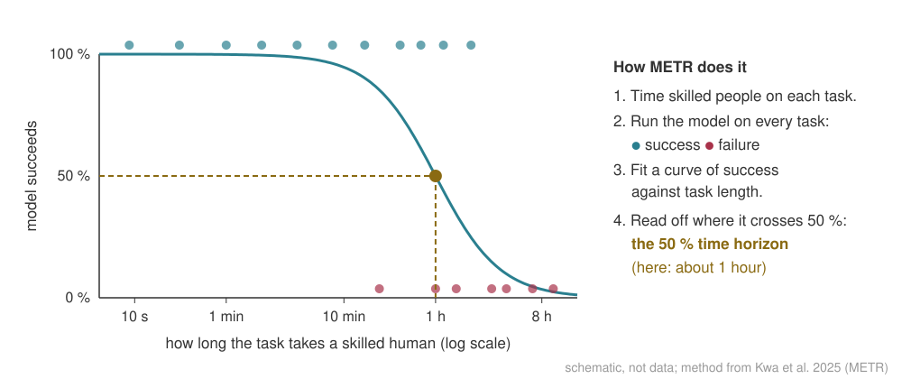{width="88%" fig-align="center"}

::: notes
The research group METR found a more intuitive way to normalise. They collected software and research tasks and measured how long each takes a skilled human: from a few seconds to many hours. Then they ran each model on all the tasks. Unsurprisingly, models succeed on short tasks and fail on long ones. In between there is a task length at which the model succeeds half the time. That length, measured in human working time, is the model's fifty per cent time horizon. The beauty of this measure is that it puts every model on the same scale, the clock, which does not saturate like a percentage score. A model with a time horizon of one hour can, half the time, complete a task that would take a skilled person about an hour.
:::

## The length of task models can do has doubled every few months since 2019

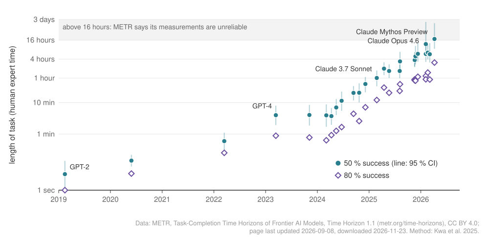{width="85%" fig-align="center"}

::: notes
This is METR's graph, redrawn from their published data. Note the vertical axis: it is logarithmic, so each step up is a multiplication. GPT-2 in 2019 could do tasks of a few seconds. GPT-4 in 2023, a few minutes. By early 2026, several hours, and the latest model measured is beyond METR's reliable range. METR's original paper in 2025 found that the time horizon doubled roughly every seven months; with their updated task set they estimate a doubling about every four months from 2023 on. The purple diamonds show the eighty per cent horizon: tasks the model completes four times out of five. They are several times shorter. That gap matters for you: a task at the edge of a model's horizon fails half the time.
:::

## How to read the time-horizon graph, and how not to

- **50 % is not reliable.** For tasks you need done right, look at the **80 %** points, which are several times shorter.
- **The tasks are software and research tasks** with clear success criteria. Your field's tasks may be easier or harder for a model.
- **Human time is not agent time.** An agent may finish a "2-hour" task in minutes, or fail it after an hour.
- **Wide uncertainty.** The vertical lines are 95 % intervals; above about 16 hours METR calls its own measurements unreliable.
- **The page is no longer updated** (since September 2026). Newer models are missing; do not extend the line by eye.

::: notes
Because this graph is so intuitive, it is also easy to over-read. The fifty per cent horizon is a coin flip, not a guarantee; the eighty per cent horizon is the better guide when a mistake would hurt. The tasks are software and research tasks with clear checks, which suits models well; tasks in your field with fuzzy criteria may be harder. A task that takes a human two hours does not take the agent two hours: it may be much faster, or it may wander. The uncertainty is large, and METR itself says that its task suite cannot measure reliably beyond about sixteen hours. And their page states that it is no longer actively updated. Extending the trend line to predict next year is tempting and risky. Use the graph for the big picture: tasks that were impossible for models a few years ago are now routine.
:::

## A combined index puts many tests on one scale; open models trail by months

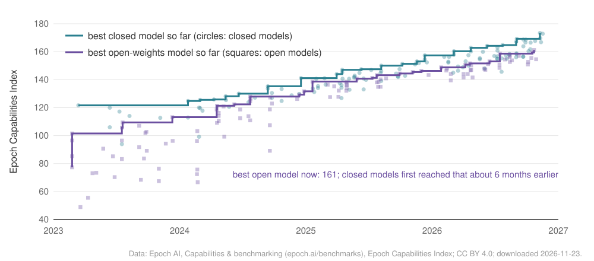{width="85%" fig-align="center"}

::: notes
A third way to normalise is to combine many benchmarks into one index. Epoch AI's Capabilities Index does this with a statistical model: harder benchmarks count for more, and models that were tested on different sets of benchmarks can still be placed on one scale. One index hides a lot, since a model can be strong at mathematics and weak at long agent tasks, but it is useful for one question in particular: how far behind are open-weights models? The teal line is the best closed model so far, the purple line the best open-weights model. The gap is real, but it is a matter of months, not years. In this data, the best open-weights model today scores about what the best closed models reached roughly half a year earlier. That is the background for the next unit.
:::

## Capability keeps getting cheaper, at very different rates for different tasks

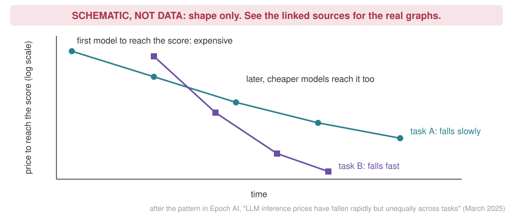{width="78%" fig-align="center"}

Epoch AI found the price to reach a fixed score fell between **9 and 900 times per year**, depending on the task ([Epoch AI, March 2025](https://epoch.ai/data-insights/llm-inference-price-trends); see also the [Stanford AI Index](https://hai.stanford.edu/ai-index)).

::: notes
A fourth normalisation is by cost: how much does it cost to reach a given score? This figure is a schematic, not data, because we could not obtain a dataset that we may redraw; the real graphs are linked below it. The pattern they show is that once some model reaches a level of capability, cheaper models reach the same level soon after. Epoch AI's analysis from March 2025 found that the price of reaching a fixed score fell between nine and nine hundred times per year, depending on the benchmark. For you this means two things. The small, cheap tier of today often matches the large tier of a year or two ago. And for a large batch job, the cheaper model is worth trying first: what was frontier capability not long ago may be all your task needs.
:::

## Human preference: people vote blind between two answers

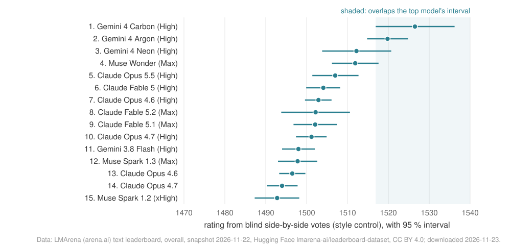{width="80%" fig-align="center"}

Most of the top models are **statistically tied**: their intervals overlap.

::: notes
The last kind of ranking does not use a fixed test at all. On LMArena, people type a question, see two anonymous answers side by side, and vote for the better one. From millions of such votes a rating is computed, similar to chess ratings. This captures something fixed tests miss: what real people find helpful across a huge range of questions. But look at the intervals. The ratings of the top models are within a few dozen points of each other, and most intervals overlap. A model ranked first and one ranked eighth may not really differ. Headlines about "the new number one" usually ignore this. Note also that most of the voters' questions are everyday questions, not your field's research tasks.
:::

## Preference votes reward style; controlling for it reorders the list

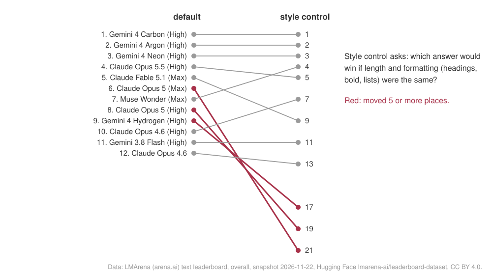{width="70%" fig-align="center"}

::: notes
People voting between two answers are influenced by how an answer looks, not just by whether it is right. Longer answers, more headings, bold text and bullet lists tend to win votes. LMArena therefore also publishes a style-controlled ranking, which estimates who would win if length and formatting were equal. On the left is the default ranking of the twelve top models, on the right their rank with style control. Most stay close. A few drop by ten places or more. Neither ranking is "the truth"; they answer different questions. But it is a useful reminder: a preference ranking tells you what people like to read. For your research tasks, a polished, confident answer that is wrong is worse than a plain one that is right, and a vote does not check that.
:::

## Three caveats apply to every benchmark graph

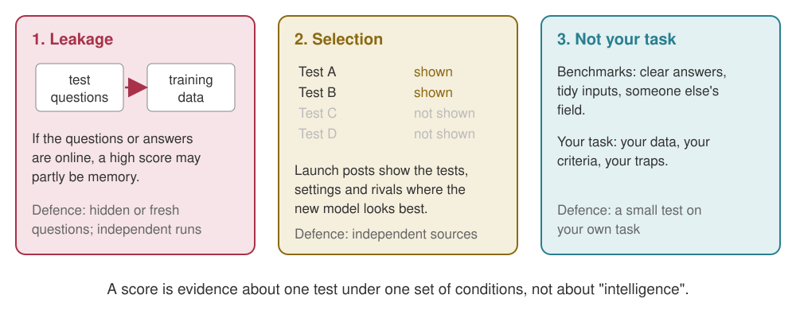{width="85%" fig-align="center"}

::: notes
Three things to keep in mind for every graph you see. First, leakage, also called contamination: if the test questions, or their answers, are on the internet, they may be in the training data, and a high score may partly be memory. Test makers fight this with hidden or freshly written questions, but it is never fully solved. Second, selection: a provider's launch post shows the benchmarks where the new model looks good, at the setting where it looks best, against the competitors it beats. That is normal marketing, not fraud, but it means launch graphs are a biased sample. Independent groups such as Epoch AI and METR are better sources. Third, and most important: a benchmark is someone else's task. Your task, with your data and your criteria, may behave quite differently.
:::

## The benchmark that matters most is a small test on your own task

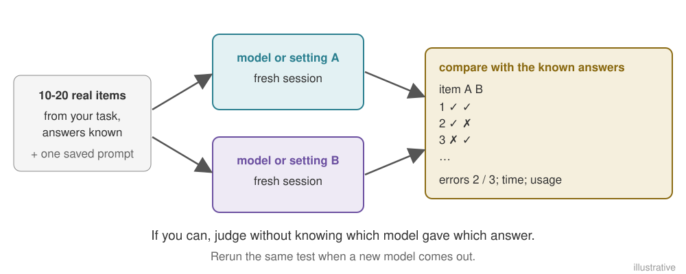{width="85%" fig-align="center"}

::: notes
So here is the conclusion for practice. When the choice of model matters, for a big batch job, a pipeline you will rerun for months, or a kind of analysis you do often, run your own small benchmark. Take ten to twenty real examples from your task, ideally ones where you know the right answer. Give exactly the same prompt to two models, or two settings, in fresh sessions. Compare the results against your known answers, and if you can, without knowing which model produced which, just as LMArena does. Count errors, note the time taken and the usage. This takes an hour and tells you more about your task than any leaderboard. It is the same idea as Parallel workers, applied to the choice of model. And it gives you a result you can write in your log: which model, which setting, how many errors on your test set.
:::

## A small model test: what to record

| Record | Example |
|---|---|
| Task and test set | extract sample size from 15 papers; correct values checked by hand |
| Models and settings | exact model IDs, effort level, date |
| Prompt | identical for both, saved in a file |
| Result per item | correct / wrong / missing, for each model |
| Totals | errors, time taken, share of usage limit used |
| Decision | "smaller model for the remaining 400 papers; spot-check 20" |

Keep it in the project's notes or README. When a new model comes out, **rerun the same test**.

::: notes
To make the small test worth keeping, record it properly. What the task and test set were, with the correct answers. The exact model IDs, effort settings and the date, because models change. The prompt, saved as a file so you can reuse it word for word. The result per item, so you can see whether the models fail on the same items or different ones. The totals, including time and usage. And the decision you made because of it. The real payoff comes later: when a new model is released and the launch graphs say it is much better, you rerun your test in half an hour and find out whether that is true for you. That is a much better basis for switching than a headline.
:::

## Where this goes wrong

- **Chasing the newest model.** Switching every month costs time and breaks reproducibility; the default is usually fine.
- **Reading one number as "intelligence".** Each benchmark measures one kind of task, under conditions someone chose.
- **Trusting a leaderboard's rank order.** Neighbouring models are often statistically tied.
- **Extrapolating a trend line.** Doubling times are estimates with wide uncertainty, from tasks unlike yours.
- **Asking the model about itself.** It may not know its own name, version or settings correctly; check the tool and the docs.
- **Forgetting to log the model.** A result without the exact model ID and date cannot be reproduced or explained later.

::: notes
To finish, the common mistakes. Constantly switching to the newest model feels productive but costs time and makes your results harder to reproduce. Treating a single benchmark number as general intelligence ignores that each test measures one narrow thing. Leaderboard positions are often within each other's uncertainty. Trend lines are estimates, and projecting them forward is guesswork. A model asked about itself answers from its training data, which predates its own release, so it often gets its own version wrong. And the simplest mistake of all: not writing down which model produced a result. All of these have the same remedy as everything else in this course: a check you control, and a record you keep.
:::

## Summary

| Concept | Key fact |
|---|---|
| Families and tiers | a few providers; within a family, larger = more capable, slower, uses more of your limits |
| Closed vs open-weights | closed run only at the provider; open can be downloaded, and trail by months |
| Model names | family + tier + version (+ size, + effort); aliases move, exact IDs do not; log the exact ID |
| Thinking effort | more effort helps multi-step, tricky work; wasted on simple chores |
| Switching | `/model`, `/effort` (Claude Code); `/model`, `-m` (Codex); the default is usually fine |

::: notes
The summary in one sentence: choose a model on purpose, write down which one you used, and trust your own small test more than anyone's leaderboard. The families and tiers give you a menu; the name tells you where on the menu you are; the effort setting trades time for depth. Benchmarks come in a few kinds, fixed tests, time horizons, combined indices, cost and human preference, and each answers a narrow question with its own blind spot. Independent sources that publish their data are better than launch posts. In the next unit we look more closely at open-weights models: what it means to run a model at a university or on your own computer, what you gain in privacy and what you give up in capability.
:::

## Summary (continued)

| Concept | Key fact |
|---|---|
| Fixed tests | saturate within a few years; harder tests replace them |
| Time horizon (METR) | length of task done half the time; doubled every few months; 80 % is much shorter |
| Combined index, cost | open models months behind; the cost of a given score falls fast |
| Preference (LMArena) | blind votes; top models tied; style affects votes |
| Your own test | 10 to 20 real items, two models, known answers; rerun when models change |

**Next (Open-weights models and data privacy):** where your data goes with closed, hosted and local models, and when an open-weights model is the right choice.

::: notes
The rest of the summary table, and where we go next.
:::
