## About this lecture {.smaller}

You now publish things made with AI: course pages, figures, slides, perhaps a news text for your department. Since **2 August 2026**, EU law has rules on telling people when content is AI-generated. At the same time, AI providers have started to hide **marks** in what their models produce, and teachers are offered "AI detectors" for student work.

- **Label, mark, detect** are three different things. The EU AI Act (Article 50) requires the first two.
- As a **deployer**, you must disclose **deepfakes** and AI-written **text that informs the public**, unless a person reviewed it and takes editorial responsibility.
- Marks come as **signed metadata** (content credentials) and **invisible watermarks** in pixels, sound and text.
- A text watermark works like a **slightly biased coin**: invisible in a sentence, clear over a page.
- "AI detectors" without a watermark **guess**, and wrongly accuse non-native writers. **A score is not evidence.**

This is a **concept** unit with a hands-on demo, no maths. It builds on disclosure in *Privacy, ethics and safety*. Guardrails come in *Guardrails and safety levels*; copyright in *Copyright, memorisation and credit*.

::: notes
This unit is about what comes out of the model, and whether anyone can tell. Two things happened in 2026. First, the transparency rules of the EU AI Act started to apply on 2 August, with a code of practice that tells providers and users how to comply. Second, as a result, the big providers now mark their output: Anthropic and OpenAI both describe text watermarks and signed metadata on their help pages. For you, as a teacher or researcher, that raises two practical questions. What do I have to label when I publish? And what does it mean when a tool says a student's essay is AI-written? We start with the rules, then look at how marking works, including a demo of a text watermark you can play with, and end with detectors, where the honest answer is that they are not evidence. Nothing here is legal advice; your university's rules come first.
:::

## A teacher publishes a course page; another gets an "87% AI" score

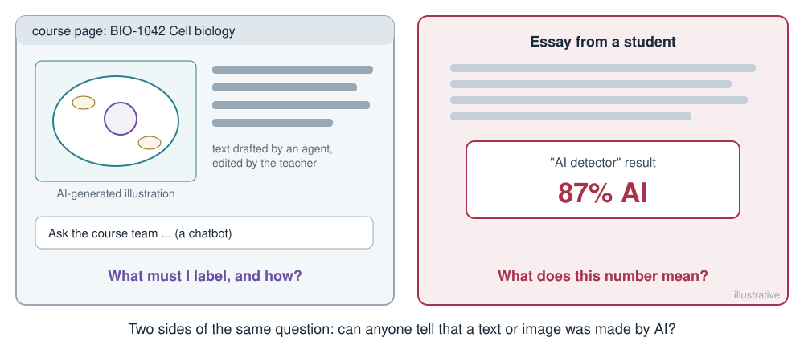{width="82%" fig-align="center"}

::: notes
Two situations from the same department. On the left, a teacher has built a course page with an agent in Part 3. The text was drafted by the agent and edited by the teacher, there is an AI-generated illustration of a cell, and a small chatbot answers questions about the course. What must be labelled, and how? On the right, a colleague has received an essay and run it through an AI detector, which says 87 percent AI. What does that number mean, and can it be used? Both questions are about the same thing: can anyone tell that a text or image was made by AI? By the end of this lecture you can answer both, and you will see why the answer to the second is "much less than the number suggests".
:::

## Labelling, marking and detecting are three different things

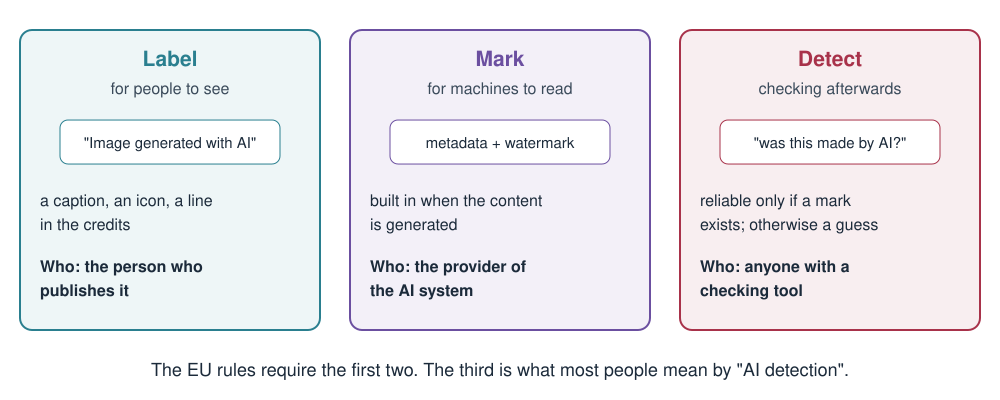{width="84%" fig-align="center"}

::: notes
Let us separate three ideas that are often mixed up. A label is for people: a caption under a figure, a line in a video, an icon. The person who publishes the content puts it there. A mark is for machines: information built into the content when it is generated, either as metadata attached to a file, or as a watermark hidden in the pixels, the sound or the choice of words. The provider of the AI system builds it in. Detection is checking afterwards whether something was made by AI. If a mark exists and you have the right tool, detection can be quite reliable. Without a mark, a detector can only guess from style. The EU rules require labels and marks. What most teachers meet as "AI detection" is the third kind, the guess.
:::

## EU AI Act Article 50 has four transparency duties {.smaller}

| Duty | Who | What |
|---|---|---|
| **50(1)** Chatbots | Provider of a system that talks with people | Tell people they are interacting with an AI, unless it is obvious |
| **50(2)** Marking | Provider of a system that generates text, images, audio or video | Mark the output in a **machine-readable** way, so it can be **detected** as AI-generated. Not for tools that only assist standard editing |
| **50(3)** Emotion recognition, biometric categorisation | Deployer | Inform the people exposed to it |
| **50(4)** Deepfakes and public-interest text | Deployer | **Disclose** that a deepfake is AI-generated or manipulated. Disclose AI-generated or manipulated **text published to inform the public on matters of public interest**, unless it had **human review or editorial control** and someone holds **editorial responsibility** |

Information must be clear and given at the latest at the **first interaction or exposure**. Rules apply from **2 August 2026**.

::: notes
Here is Article 50 in one table. The first duty concerns chatbots: if a system is built to talk with people, they must be told it is an AI unless that is obvious from the context. The second is the marking duty for providers of generative systems: Anthropic, OpenAI, Google and so on must mark the output in a machine-readable way and make it detectable. Tools that only help with standard editing, such as spelling correction, are exempt. The third is about emotion recognition and biometric categorisation, which you are unlikely to deploy. The fourth is the one for you: if you publish a deepfake, or AI-generated text meant to inform the public on matters of public interest, you must disclose it, unless the text was reviewed by a person who takes editorial responsibility. The information has to be clear and come at the latest when people first see the content. I read the article text and the Commission's pages for this; your university's lawyers may interpret details differently.
:::

## The rules started in August 2026, with a code of practice to show how

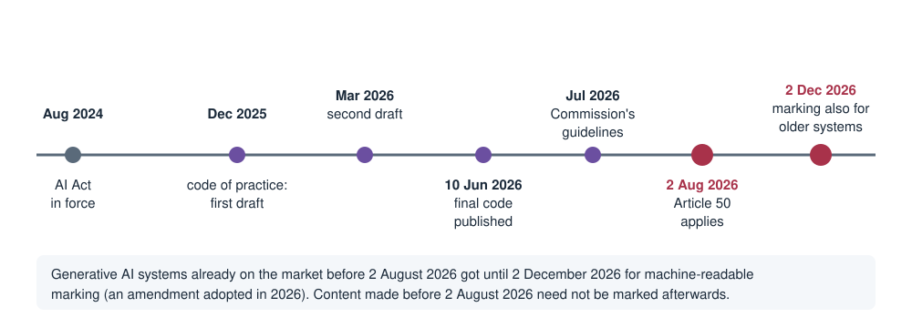{width="88%" fig-align="center"}

::: notes
The timeline. The AI Act entered into force in August 2024, with obligations phased in. For Article 50, the Commission ran a process to write a code of practice on marking and labelling AI-generated content: a first draft in December 2025, a second in March 2026, and the final code on 10 June 2026. The Commission also published guidelines on Article 50 in July 2026. The obligations apply from 2 August 2026. An amendment to the AI Act adopted in 2026, part of what was called the digital omnibus, gave generative systems that were already on the market before that date until 2 December 2026 to bring their marking into line. That is next week, counting from when I write this. Content generated before August does not need to be marked after the fact.
:::

## Providers mark; you, as the deployer, label what you publish

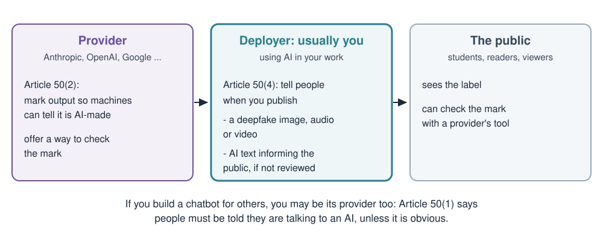{width="84%" fig-align="center"}

::: notes
Who does what? The provider is the company that makes the AI system: Anthropic, OpenAI, Google. They carry the marking duty and must offer a way to check marks. The deployer is whoever uses the system in a professional context, and that is usually you: a teacher publishing a course page, a researcher publishing a figure, a department publishing a news item. Your duty is the label, and only in the cases of Article 50 paragraph 4. Purely personal, non-professional use is outside the deployer definition, but your teaching and research are professional. One case where you may become a provider: if you build a chatbot for your students, as some of you might in Interactive demos or Shiny apps, then the people using it must be told that they are talking to an AI.
:::

## A deepfake is realistic content that could pass as real {.smaller}

- The Act's definition: AI-generated or manipulated **image, audio or video** that **resembles existing persons, objects, places, entities or events** and would **falsely appear authentic**.
- Examples close to your work:
  - a photo from the lab opening with people **added or removed** by generative fill,
  - a lecture video with an **AI copy of your voice**, or of a colleague's,
  - a **realistic** "photo" of a field site, an instrument or a patient that never existed.
- Not deepfakes: a cartoon or **schematic** of a cell, a clearly stylised illustration, a data plot drawn by your script.
- Obviously **artistic, satirical or fictional** work: the disclosure can be light, so long as it does not spoil the work.

::: notes
The word deepfake suggests political videos, but the legal definition is broader and plainer: image, audio or video, generated or manipulated by AI, that resembles real people, objects, places or events and would falsely appear authentic. So a team photo where generative fill removed one colleague and added two students is a deepfake in this sense, even if the intention is harmless. A welcome video read by a synthetic copy of your own voice is too. A photorealistic image of a field site or an instrument that does not exist could be. A schematic of a cell, a cartoon, or a plot drawn from your data by an R script is not: nobody would take it for a photograph of reality. For clearly artistic, satirical or fictional work, the Act allows a lighter disclosure that does not ruin the work. When in doubt, label: it costs one line.
:::

## AI-written text must be disclosed only in one case, but your university may ask for more {.smaller}

- **Article 50(4)** covers AI-generated or manipulated text **published to inform the public on matters of public interest**: think news items, press releases, public information.
- **Not** covered when a person **reviewed or edited** it and someone takes **editorial responsibility**. A department news item checked and published by the communications office is in that position; an unreviewed bot posting news is not.
- A course page, a lab manual or a paper is usually **not** "informing the public on matters of public interest". The AI Act then asks nothing.
- **But** journals, funders, your university and your own course rules may still ask for **disclosure** (*Privacy, ethics and safety*). Those rules apply whatever the AI Act says.

::: notes
Text is where people worry most, and where the AI Act asks least. The duty covers text published to inform the public on matters of public interest, such as news, and even then not when a human reviewed or edited it and someone takes editorial responsibility. The idea is that a newspaper with an editor is responsible for what it publishes, whoever drafted it. So for most of your text, a course page, a lab manual, a paper you wrote with an agent's help and checked, the AI Act does not require a label. That does not mean no disclosure. We saw in Privacy, ethics and safety that journals ask for an AI statement, universities have rules for theses, and you set rules for your students. Those apply on their own terms. A practical rule: the AI Act sets a minimum; your venue's rules usually ask for more.
:::

## The code of practice shows how to comply, with layers and common icons {.smaller}

:::: {.columns}
::: {.column width="50%"}
**For providers (marking, 50(2))**

- **No single technique** is enough. Signatories use **at least two layers** of machine-readable marking where needed, for example signed metadata **and** an invisible watermark.
- Offer a **detection** tool, such as a website or an API, so that others can check.
- Voluntary: providers who sign it can use it to show they comply. Others must show their own measures are adequate.
:::
::: {.column width="50%"}
**For deployers (labelling, 50(4))**

- How and where to show a label: visible at first exposure, clear, accessible (alt text for screen readers).
- **EU icons** that anyone may use freely: a **basic** icon, one for **fully AI-generated** and one for **partially AI-modified** content.
- Using the icon is **optional**; the duty to label is not. Using it does not by itself prove compliance.
:::
::::

The icons and their guidance: Commission page "EU icons for labelling AI-generated content".

::: notes
The code of practice is voluntary, but it is the practical guide, and many providers have signed it, including Anthropic, which says so on its help page. For providers, the key idea is layers: no single marking technique is robust enough, so they combine at least two where necessary, typically signed metadata and an invisible watermark, and they offer a way for others to check. For deployers, the code says how to show labels: visible, clear, early, accessible. The Commission has published a set of EU icons, free for anyone to use: a basic one, one for content that is fully AI-generated, and one for content that AI partly modified. The Commission's page is explicit that using the icon is optional, that the labelling duty is not, and that the icon alone does not make you compliant. I am not showing the official icons here; download them from the Commission's page if you want to use them.
:::

## What this means for what you publish {.smaller}

| You publish | AI Act duty for you? | What to do anyway |
|---|---|---|
| Course page text drafted by an agent, edited by you | No (reviewed, not news) | Your university's rules; a line in the page footer is good practice |
| AI-generated **schematic** illustration | No (not realistic) | Caption: "Illustration generated with an AI tool" |
| Team photo with people **added or removed** by AI | **Yes**: deepfake | Label it, or better, do not publish it |
| Video with an **AI voice** (yours or anyone's) | **Yes**: deepfake | Label it when the video starts |
| Department **news item** drafted by AI | Only if published **without** human review and editorial responsibility | Have it reviewed; follow the communications office's rules |
| **Chatbot** on your course page | Users must be told it is an AI | Say so in the chat window, before the first question |
| Figure drawn by **your script** (written by an agent) | No | Method disclosure in the paper, as the journal asks |

::: notes
Here is the table you will use in the exercise. Read it from your own point of view. Most of what you make in this course, text you edited, schematic figures, plots from scripts, carries no AI Act duty for you. But your university's rules, the journal's rules and plain honesty with your students suggest a short note anyway, and it costs nothing. Two rows are real duties: realistic manipulated images or audio of people, which are deepfakes, and chatbots, where users must be told they are talking to an AI. For the photo, the better question is whether you should publish an image of an event that did not look like that at all. For the news item, the question is whether a person reviews it and takes responsibility, which in a university usually means the communications office. The plot drawn by a script the agent wrote is not AI-generated content in this sense: the plot was drawn by R or Python from your data. Disclose the method, as you would any software.
:::

## A good label is short, visible and says what the AI did

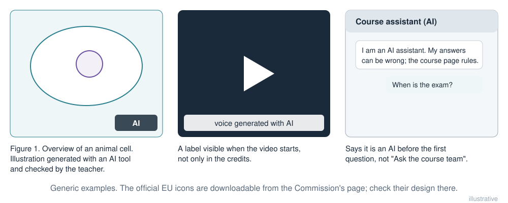{width="84%" fig-align="center"}

::: notes
What does a good label look like? Short, placed where people see the content first, and specific about what the AI did. Under a figure: "Illustration generated with an AI tool and checked by the teacher." In a video: a line on screen at the start, "voice generated with AI", not hidden in credits at the end. In a chatbot: the first message says it is an AI and that its answers can be wrong, and the heading does not suggest a person, as "Ask the course team" does. The examples on this slide are generic; the official EU icons can be downloaded from the Commission's page, and your university may have its own template. In the exercise you will write labels like these for a small course folder.
:::

## Marking, method 1: content credentials are a signed note inside the file

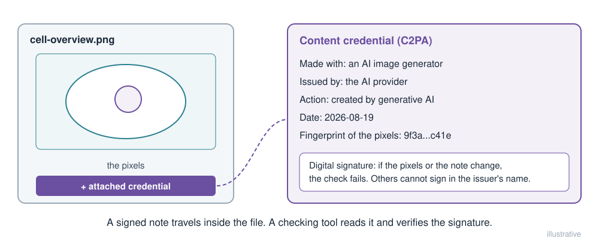{width="84%" fig-align="center"}

::: notes
Now to marking: how can a machine tell that a file was AI-generated? The first method is metadata, information stored in the file next to the pixels. The common standard is C2PA, from the Coalition for Content Provenance and Authenticity, and the result is called a content credential. It says which tool made the file, what kind of action it was, for example "created by generative AI", when, and it includes a fingerprint of the content. The whole note is digitally signed by the issuer, like a signed PDF. If someone changes the pixels or edits the note, the signature check fails, and nobody else can sign in the issuer's name. A checking tool reads the note and verifies the signature. You will do this in the exercise.
:::

## Content credentials are easy to read and easy to lose

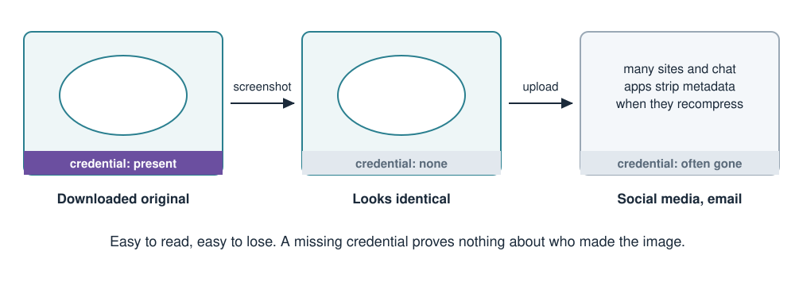{width="86%" fig-align="center"}

::: notes
The weakness of metadata is that it travels with the file, not with the picture. Take a screenshot of the image, and you have a new file with the same pixels and no credential. Many websites, chat apps and email services recompress uploaded images and strip metadata on the way. Converting from one format to another often drops it too. So content credentials are good for proving that something was made a certain way, when they are present, and almost useless for proving the opposite. A missing credential tells you nothing about who made an image. That is why the code of practice asks for a second layer.
:::

## The big providers now mark by default and offer checking tools {.smaller}

| | Anthropic (Claude) | OpenAI (ChatGPT, API) |
|---|---|---|
| **Text** | Invisible watermark in text from supported Claude models, on all surfaces including **Claude Code** | Text watermark ("textGrain") in ChatGPT in the EU; API customers can switch it on |
| **Files** | C2PA content credentials on files Claude generates in the Claude apps and the API | C2PA and SynthID watermarks on images; SynthID on audio; C2PA on PDFs |
| **Public checker** | [claude.com/check-content](https://claude.com/check-content) (files; runs in your browser) | [openai.com/verify](https://openai.com/verify) (images, audio, PDFs) |
| **Text checker** | Private preview for regulators, researchers, media and similar | By application, for research and public-interest projects |
| **Their own caveat** | A mark is a signal, not proof; no mark does not mean human-written | Same; heavy edits, translation and short texts weaken the signal |

From the providers' help pages, November 2026. Coverage varies by model and product, and changes.

::: notes
What do the providers actually do? I read both help pages in November 2026. Anthropic says supported Claude models weave an imperceptible watermark into generated text, at the model level, so it appears whichever product produced the text, including Claude Code. Files Claude generates in the Claude apps and the API carry C2PA content credentials, and there is a public checker at claude.com/check-content that runs in your browser. OpenAI calls its text watermark textGrain; it is on for ChatGPT in the EU, and API customers can turn it on. OpenAI's images carry both C2PA and Google's SynthID watermark, which OpenAI uses too. Its checker is at openai.com/verify. Neither provider offers a public text checker: both limit text detection to approved organisations, and OpenAI's page says checking student work is outside the scope of its programme. And both say the same thing about limits, which we will come back to. One curiosity: even the diagram on SciLifeLab OpenLLM's about page, from the previous unit, carries a content credential saying Claude provided the file.
:::

## Marking, method 2: invisible watermarks hide a pattern in the content itself

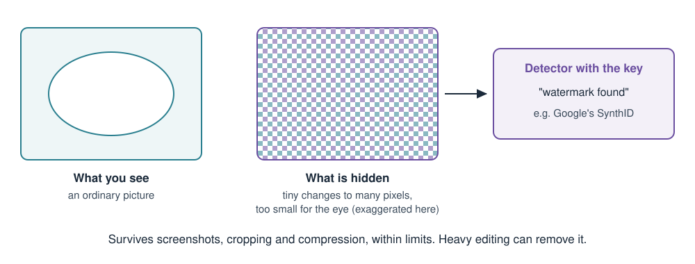{width="84%" fig-align="center"}

::: notes
The second layer is a watermark in the content itself. For images, the generator changes many pixels by tiny amounts, in a pattern that depends on a secret key. Your eye cannot see it; the picture on the slide exaggerates it enormously. A detector that knows the key looks for the pattern. Google's SynthID is the best-known example; Google uses it in its own models, and OpenAI uses it for images and audio too. Because the pattern is in the pixels, it survives a screenshot, and usually cropping, resizing and compression. It does not survive everything: heavy editing, or regenerating the image with another model, can remove it. Audio and video watermarks work on the same idea.
:::

## Marking, method 3: a text watermark nudges the choice of words

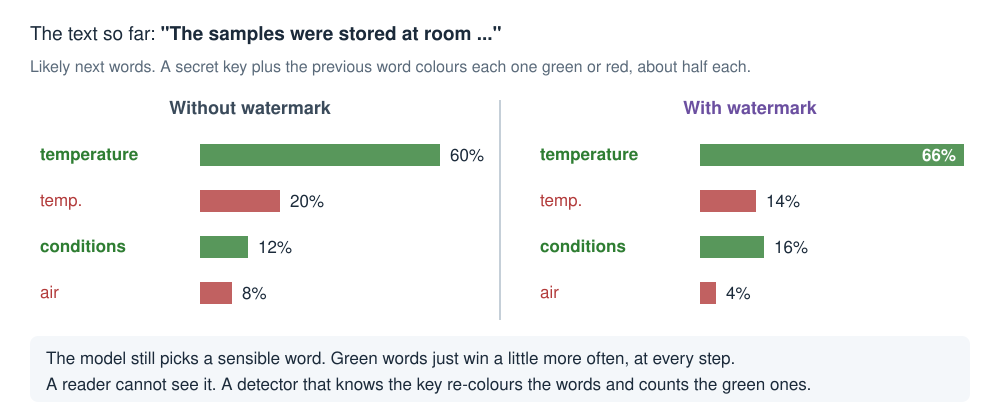{width="84%" fig-align="center"}

::: notes
How can you hide a watermark in plain text, where there are no pixels? Remember from How LLMs and agents work that the model produces a list of likely next words and picks one, with some randomness. A text watermark adds a tiny bias to that choice. A secret key, combined with the previous word, splits the possible next words into two groups, call them green and red, about half each. The model then gives green words a little extra weight. In the example, "temperature" is still the most likely word after "stored at room", with or without the watermark; green words just win slightly more often. Over a single sentence you cannot see any difference. A detector that knows the key goes through the text, colours each word green or red using the same rule, and counts. This idea was published by Kirchenbauer and colleagues in 2023; Google's SynthID Text, described in Nature in 2024, is a related, refined method built on the same principle of nudging the sampling.
:::

## Detecting it is like spotting a slightly biased coin

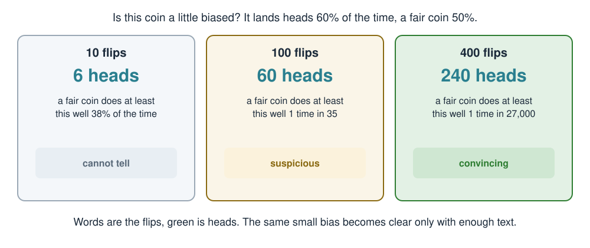{width="88%" fig-align="center"}

::: notes
Here is the intuition, with no formulas. Ordinary text is green about half the time, like a fair coin coming up heads. Watermarked text is green a bit more often, say 60 percent. Can you tell from ten words? No: six heads out of ten happens with a fair coin 38 percent of the time. From a hundred words? Sixty green out of a hundred happens by chance about once in 35 texts: suspicious, not convincing, and you would not accuse anyone on that. From four hundred words? Two hundred and forty green happens by chance about once in 27,000 texts. Now the explanation "it is just chance" becomes very hard to believe. The bias per word is the same throughout. What changes is how much evidence you have. That is the whole idea of detection, and also its main limit.
:::

## Try it: a toy watermark and a detector that counts green words {.smaller}

<iframe src="examples/watermark-demo.html" width="100%" height="560" style="border:none;" title="Text watermark demo"></iframe>

::: notes
This is a small simulation you can open yourself; it is in the exercise. A toy model writes sentences by picking words from short lists. The watermark makes it prefer green words a little. The detector on the left counts green words and says how likely ordinary text would be to score that high. Move the length slider from 10 words to 800 and watch the verdict change from "no evidence" to "detected", without changing the watermark at all. The grey band in the chart is the range ordinary text falls in; it narrows as the text grows, and the watermarked line leaves it. Tick "show the detector's view" to see the colours that only someone with the key can see. Then press the paraphrase button a few times: each press replaces about ten percent of the words, and the signal fades. Finally set the strength to "off": that is ordinary text, and it stays inside the band however long it gets.
:::

## A detector needs enough text, and the weaker the bias, the more text

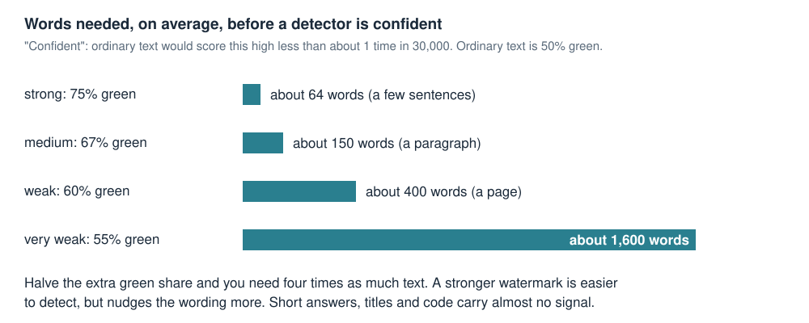{width="82%" fig-align="center"}

::: notes
This chart says the same thing with numbers. How many words does a detector need, on average, before it can say "this is very unlikely to be chance", which here means less than about one chance in thirty thousand? With a strong bias, 75 percent green words, a few sentences. With a medium bias, a paragraph. With a weak bias, about a page. With a very weak bias, over fifteen hundred words. Halve the extra share of green words, and you need four times as much text. Providers choose a bias weak enough not to harm the writing, so in practice short texts, such as a one-line answer, a title or a short email, carry too little signal to say anything. OpenAI says that short passages and code are not required to carry its watermark at all.
:::

## Paraphrasing and translating dilute the watermark {.smaller}

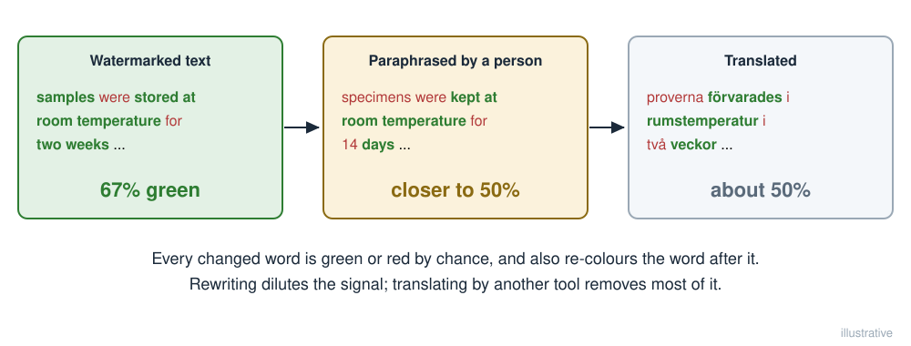{width="62%" fig-align="center"}

- Google's SynthID documentation: detection confidence drops sharply when a text is **thoroughly rewritten or translated**.
- The signal also depends on the **language**: OpenAI reports that, at a 1% false-alarm rate, its detector found the watermark in **69%** of Spanish and **42%** of Romanian test texts, and then strengthened it for weaker languages.

::: notes
The watermark lives in the choice of words, so changing the words weakens it. Each word a person replaces is green or red by chance, and since the colour of a word depends on the word before it, a change also re-colours its neighbour. Light editing leaves enough signal in a long text; heavy paraphrasing pushes the share back towards fifty percent. Translation by another tool replaces nearly every word, and removes most of it; Google's documentation for SynthID Text says exactly this. Language matters even without editing. OpenAI publishes one telling number on its help page: for texts produced in other EU languages, detection at a one percent false-alarm rate was 69 percent for Spanish and 42 percent for Romanian, after which they strengthened the watermark for languages below 60 percent. So text watermarks help with large-scale questions, such as how much AI text is circulating, more than with proving where one paragraph came from.
:::

## A mark tells you less than it seems, and no mark tells you almost nothing

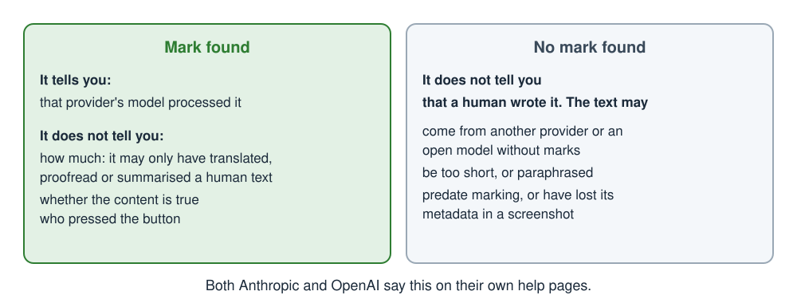{width="84%" fig-align="center"}

::: notes
Now the interpretation, and both providers say this plainly on their help pages. If a mark is found, it means that provider's model processed the content. It does not say how much: Claude or ChatGPT may only have translated, proofread or summarised a human's text. It does not say whether the content is true, or who asked for it. If no mark is found, you learn almost nothing. The text may come from another provider, or from an open-weights model that never marks anything, which you met in the previous unit. It may be too short, paraphrased, older than the marking, or a screenshot that lost its metadata. So marks are useful at the level of platforms, journalists and researchers studying the spread of AI content. They are a weak tool for judging one person.
:::

## "AI detectors" without a watermark can only guess from style

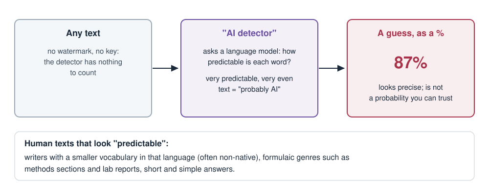{width="84%" fig-align="center"}

::: notes
Most AI detectors offered to teachers do not look for watermarks; they have no key. They guess from style. A common approach asks a language model how predictable each word of the text is. AI-generated text tends to be very predictable and very even, so very predictable text is called "probably AI". The output is a percentage that looks like a probability. It is not one you can trust. The problem is that many human texts are predictable too: text by people writing in a language they know less well, who use a smaller vocabulary and safer phrasing; formulaic genres, like methods sections and lab reports, which our own field trains people to write; and short, simple answers. And predictability is easy to change: asking a model to write in a more varied style fools these detectors.
:::

## Detectors wrongly flagged most essays by non-native writers

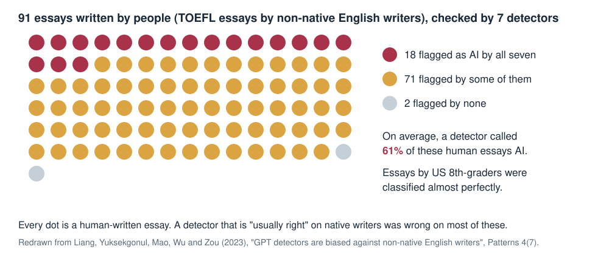{width="80%" fig-align="center"}

::: notes
Here is the study that made this concrete. Liang and colleagues at Stanford, published in Patterns in 2023, took 91 essays written by people for the TOEFL English test, by non-native writers, and ran them through seven widely used detectors. On average, a detector classified 61 percent of these human essays as AI-generated. Eighteen essays were flagged by all seven detectors; 89 of the 91 were flagged by at least one. The same detectors classified essays by US eighth-graders almost perfectly. The authors traced it to the predictability measure: a smaller vocabulary looks like AI. When they asked ChatGPT to make the non-native essays more varied, the false positives dropped. In other words, the detector penalised the students with the least fluent English and rewarded polishing with AI.
:::

## The evidence on detectors points the same way {.smaller}

- **OpenAI withdrew its own AI text classifier** in July 2023, six months after launch, citing its low accuracy.
- **Weber-Wulff and colleagues (2023)** tested 14 detection tools on human and AI texts, including paraphrased and machine-translated ones, and concluded that they are **neither accurate nor reliable**, with a bias towards calling texts human.
- **Liang and colleagues (2023)**: false accusations concentrated on **non-native writers** (previous slide).
- **The providers' own text checkers** are not open to teachers checking students: Anthropic's is in private preview for selected organisations; OpenAI's application programme says academic integrity checks are outside its scope.
- No detector can see text made by an **open-weights model** run locally, or text that was rewritten afterwards.

::: notes
That study is not alone. OpenAI itself released an AI text classifier in January 2023 and withdrew it in July the same year because of its low rate of accuracy. Weber-Wulff and colleagues, writing in the International Journal for Educational Integrity in 2023, tested fourteen tools, including commercial ones, and found them neither accurate nor reliable; paraphrasing and machine translation made them worse. Watermark checkers are more reliable, but the providers do not offer them for checking student work: Anthropic's text checker is in private preview for regulators, researchers, media and similar organisations, and OpenAI's application page puts academic integrity use outside its scope. And none of them can see text from a local open-weights model. The commercial detectors have improved since 2023, and vendors publish good numbers. But the basic problem remains: without a mark, they guess from style, and the people with the plainest style pay for the errors.
:::

## For teachers: a detector score is not evidence {.smaller}

- A score is a **guess from style**, not a finding. On its own it must **not** be the basis for a misconduct case.
- False accusations fall hardest on **non-native writers** and students who write plainly.
- Uploading student work to a third-party detector is **processing personal data**. Check your university's approved tools first (*Privacy, ethics and safety*).
- What works better:
  - **clear rules** per assignment on what AI use is allowed and how to declare it,
  - assignments that show the **process**: drafts, notes, version history, an oral follow-up,
  - **talking** with the student about the work.
- Follow your university's procedure. Many universities now advise against relying on detectors.

::: notes
For the teachers among you, this is the take-home slide. A detector score is a guess from style. It can prompt a conversation, but on its own it is not evidence, and a misconduct case built on it can harm an innocent student, most likely a non-native writer. Note also the privacy angle: pasting a student's essay into a commercial detector sends personal data to a third party, which needs the same approval as any other AI tool. What works better is boring and effective: clear rules for each assignment, assignments where the process is visible, drafts and version history, a short oral follow-up where the student explains their choices, and a conversation. Several universities have published guidance advising against relying on detectors; check what yours says. And remember your own position: you now use AI to draft course material, and so do your students.
:::

## Where this goes wrong {.smaller}

- **"It is only a schematic"**, when the image is photorealistic. If it could pass as real, label it.
- **Labels in the wrong place**: in the credits at the end, in alt text only, or after the first exposure.
- **A chatbot that sounds human**, with a heading like "Ask the course team".
- **Trusting a missing mark**: no credential or watermark proves nothing about who made something.
- **Over-reading a found mark**: it says the model processed the content, not that the person did no work.
- **Using a detector score as proof** against a student or a colleague.
- **Assuming the AI Act is the only rule**: journals, funders and your university ask for their own disclosures.
- **Facts age**: dates, the code of practice, providers' tools and coverage change. Check the sources before you rely on them.

::: notes
The usual mistakes, from most to least common in my experience. People call an image a schematic when it is in fact realistic enough to pass as a photograph; then it is a deepfake in the Act's sense. Labels appear too late or in the wrong place. Chatbots are given human-sounding names. Then the two errors of interpretation: concluding from a missing mark that a human made something, and concluding from a found mark that nobody did any work. Using a detector score as proof is the most harmful. And people forget that the AI Act sets a minimum, with other rules on top. Finally, this whole field moved fast in 2026: the code, the guidelines, the transition dates, the providers' marking. I checked everything in November 2026. Check again before you rely on it.
:::

## Summary {.smaller}

| Concept | Key fact |
|---|---|
| Label, mark, detect | Labels are for people, marks for machines; detection is checking afterwards |
| Article 50 | Applies from 2 August 2026: chatbots disclose, providers mark, deployers label deepfakes and public-interest text |
| Your duty | Label deepfakes (realistic manipulated images, audio, video) and unreviewed public-interest text; tell chatbot users it is an AI |
| Code of practice | Final 10 June 2026; voluntary; at least two marking layers; free EU icons |
| Content credentials (C2PA) | A signed note in the file; easy to check, lost by a screenshot |
| Invisible watermarks | A keyed pattern in pixels, sound or word choice; survives some editing |
| Text watermark | Green words slightly preferred; detectable over enough text, like a biased coin; paraphrase and translation weaken it |
| What a mark means | Found: the model processed it. Not found: almost nothing |
| AI detectors | Guess from style; falsely flag non-native writers; a score is not evidence |

**Next (Guardrails and safety levels):** the different kinds of guardrail you may hit when an agent refuses or stops, how to tell them apart, and the safety levels behind the strictest ones.

::: notes
To sum up. Labelling, marking and detecting are different. Article 50 of the AI Act applies from 2 August 2026: chatbots must say they are AI, providers must mark their output, and deployers like you must label deepfakes and unreviewed AI text meant to inform the public. The code of practice explains how, with marking in layers and free EU icons. Marks come as signed content credentials, which a screenshot removes, and invisible watermarks, which survive more. A text watermark is a slight preference for green words, detectable like a biased coin when there is enough text, and weakened by paraphrase and translation. A found mark means a model processed the content; a missing one means almost nothing. And detectors without a watermark guess from style and falsely accuse non-native writers, so a score is not evidence. In the exercise you check a content credential, play with the watermark demo, and decide which items in a small course folder need a label. Next we look at guardrails.
:::
