## About this lecture

You are about to publish something the agent helped make: a course page, a script, a figure, a paper. **Whose material is it, could it contain someone else's work without you knowing, and who should get credit?** Courts, researchers and the AI companies themselves are still arguing about all three.

- **Training on copyrighted material** is being decided in court, case by case and country by country. Four cases show the range.
- **Models memorise.** They can reproduce training text, code and images almost word for word, especially material that appears many times online.
- **You publish it, so you check it.** A short checklist before you publish catches most problems.
- **Credit still goes to people.** The OpenAI Navier–Stokes controversy shows why: who did the work, who checked it, and what happened to unpublished drafts.

This is a **discussion** unit with one hands-on check. It is **not legal advice**: for a real case, ask your university's legal office or library.

::: notes
This is the last unit of Part 6, and it pulls together several threads from earlier in the course. In Privacy, ethics and safety we asked what may go into the agent. Today we ask about what comes out of it, and about what you then publish. There are three questions. First, is it legal for the model to have learned from copyrighted material in the first place? That is for the courts and the companies, not for you, but it helps to know where things stand. Second, can the agent's output contain someone else's material? Yes, sometimes, and that one is your problem when you publish. Third, who gets credit when an AI was involved? We use a very recent case from mathematics to discuss that. I am not a lawyer, and nothing here is legal advice. The point is to know which questions to ask and whom to ask.
:::

## A course page is ready to publish, and nobody knows where every part came from

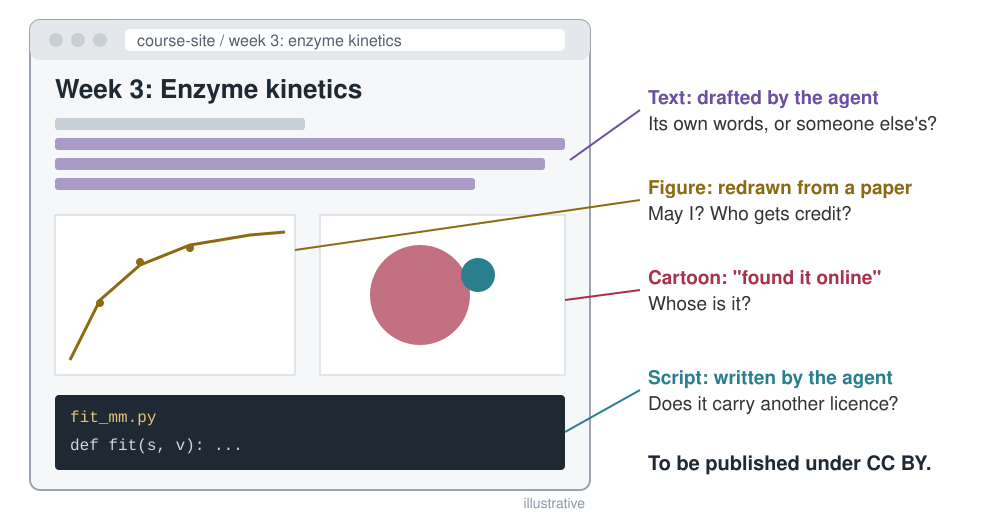{width="78%" fig-align="center"}

::: notes
Here is the concrete situation, and it is the example in today's exercise. A teacher has a draft course page on enzyme kinetics. The agent drafted a paragraph of text. The agent wrote a fitting script. A figure was redrawn by the agent from a figure in a paywalled paper. A cartoon was found online last year and nobody remembers where. The teacher plans to put the page on the public course website under an open licence. Every part of this is ordinary. Every part carries a question: is this text someone else's, does the script carry someone else's licence, may I redraw that figure, may I use that cartoon? None of these questions is new; teachers have always copied figures into slides. What is new is that the agent can bring in someone else's material without telling you, and that it all happens much faster.
:::

## Copyright questions arise at three points: training, output and credit

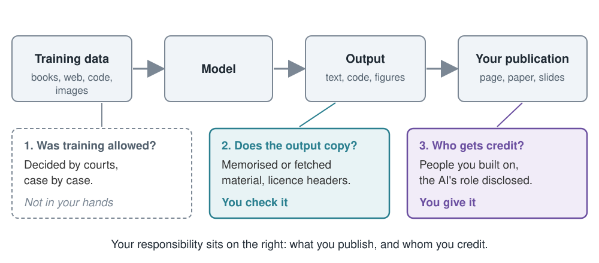{width="88%" fig-align="center"}

::: notes
It helps to separate three points in the chain. On the left is training: the provider collected a huge amount of text, code and images, much of it copyrighted, and trained the model on it. Whether that was allowed is what most of the big lawsuits are about. In the middle is output: what the model writes for you. If the output reproduces a protected work, publishing it may infringe, whatever the legality of the training. On the right is credit: when you publish, who is named, who is cited, and is the AI's role disclosed? Your responsibility is mainly on the right two. You cannot fix how the model was trained. You can check what you publish, and you can give credit properly.
:::

## Copyright protects the expression, not the idea {.smaller}

| | What it means for you |
|---|---|
| **Expression, not ideas** | The Michaelis–Menten equation is free to use. A textbook's paragraph explaining it is not. |
| **Automatic** | Text, code, figures and photos are protected from the moment they are made, with no © needed. "Found online" means "someone owns it". |
| **Licences grant permissions** | CC BY: reuse with credit. CC BY-SA: credit, and share your version under the same licence. GPL code: your program must also be GPL if you distribute it. MIT: almost anything, keep the notice. |
| **Exceptions** | Quotation with credit, teaching, research. They differ between countries. The EU has exceptions for **text and data mining**; the US has **fair use**, decided case by case. |
| **Data and facts** | Facts and measurements are not protected by copyright; databases can have other protection in the EU. |

::: notes
A one-slide refresher, because the rest of the lecture depends on it. Copyright protects the way something is expressed, not the underlying idea or fact. You may explain an equation in your own words; you may not paste someone else's explanation. Protection is automatic, so an image without a copyright notice is still owned by someone. Licences are permissions the owner grants in advance. The Creative Commons licences are common for text and figures; for code, the common ones are permissive licences like MIT and copyleft licences like the GPL, which require that derived software is shared under the same licence. Then there are exceptions written into law. In the EU, an important one for AI is text and data mining, which allows automated analysis of works you have lawful access to, unless the rights holder has opted out. In the US, the main defence is fair use, which courts weigh case by case. Facts themselves are not protected, which is why redrawing a graph from published numbers is usually different from copying the figure.
:::

## Courts in Germany, the US and the UK are deciding it case by case

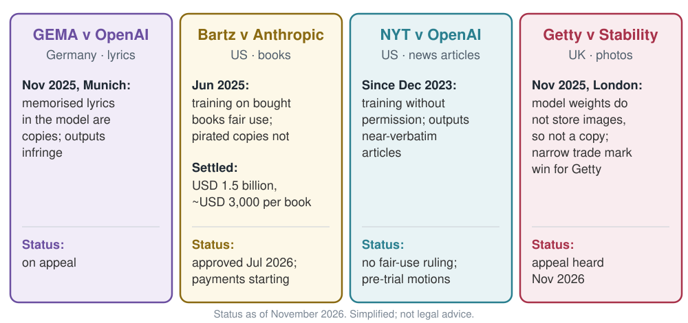{width="84%" fig-align="center"}

Status as of November 2026. Each case can still change on appeal.

::: notes
Here are four cases that show the range. They come from three legal systems, and they do not all point the same way. Two are about text, one about books bought or downloaded from pirate sites, one about images. I will take them one at a time. The status on the slide is as of November 2026, and every one of them can still change: two are on appeal, one is in the middle of motions before trial, and one is settled but still being paid out. When you teach this, check the current status yourself. The one thing they all show is that there is no single answer to "is AI training legal?". It depends on the country, on how the material was obtained, and on what the model can be made to output.
:::

## GEMA v OpenAI: a German court treated memorised lyrics as copies

- **Who:** GEMA, the German music rights society, against OpenAI, about the lyrics of nine German songs.
- **Ruling** (Regional Court Munich I, 11 November 2025): the lyrics were **memorised** in the model, which the court treated as a reproduction; ChatGPT's outputs of the lyrics also infringed. The EU text and data mining exception did not cover this.
- **Status:** OpenAI has appealed to the Higher Regional Court in Munich. The ruling is **not final**.
- **Why it matters:** the first major EU ruling. It links the legal question directly to **memorisation**, the topic of the middle part of this lecture.

::: notes
The first case is from Munich and is the most important one for us in Europe. GEMA collects royalties for songwriters. It showed that ChatGPT could reproduce the lyrics of well-known German songs almost exactly when asked. The court accepted that the lyrics were memorised in the model's parameters, and held that this memorisation was itself a reproduction under copyright law, and that the outputs were too. OpenAI argued that the text and data mining exception covers training. The court said that exception covers analysing works, not keeping copies of them in the model. OpenAI has appealed, so this is a first-instance ruling, and a higher court may see it differently. Keep the link in mind: the legal argument rests on the technical fact that models memorise, which we look at in a moment.
:::

## Bartz v Anthropic: training was fair use, pirated books were not

- **Who:** a class of authors against Anthropic, in the US.
- **Ruling** (June 2025, before trial): training on **lawfully bought** and scanned books was fair use. Keeping a library of books **downloaded from pirate sites** was not.
- **Settlement:** USD 1.5 billion for roughly half a million books, about USD 3,000 per book, split between authors and publishers. Final approval in July 2026; some objectors have appealed; first payments are planned for late 2026.
- **Why it matters:** it separates **how the material was obtained** from **what training does with it**.

::: notes
The second case is from the US and was settled. A group of authors sued Anthropic, the company behind Claude. Before trial, the judge made a split ruling. Training a model on books the company had bought and scanned was fair use, because the use was highly transformative. But the company had also downloaded millions of books from pirate libraries, and keeping those was not excused. Facing a trial over the pirated books, Anthropic settled for one and a half billion dollars, the largest copyright settlement on record, at roughly three thousand dollars per book. The court gave final approval in July 2026, and payments are starting now, although some objectors have appealed. For us, the lesson is that the source matters. The same is true for you: an openly licensed PDF and a PDF from a shadow library are not the same thing to give an agent.
:::

## The New York Times v OpenAI and Microsoft is still heading for trial

- **Who:** The New York Times against OpenAI and Microsoft, filed December 2023 in New York, now joined with similar suits by news publishers and authors.
- **Claims:** training on millions of articles without permission, and outputs that reproduce articles nearly word for word or summarise paywalled content.
- **Status:** no ruling yet on fair use. In autumn 2026 the parties filed motions asking the judge to decide parts of the case without a trial.
- **A side effect for users:** in 2025 a court order required OpenAI to keep ChatGPT conversations it would otherwise have deleted, as possible evidence. Your chats can end up in someone else's lawsuit.

::: notes
The third case is the one most people have heard of. The New York Times showed examples where ChatGPT produced long passages of its articles nearly word for word, and argued that this, and the training itself, harms its business. The case has been combined with several similar ones, and it has moved slowly. As of November 2026, there is no decision on the central fair use question; the parties have asked the judge to decide parts of it on the written record, and a trial may follow. One side effect is worth knowing as a user. In 2025, the court ordered OpenAI to preserve user conversations that would normally have been deleted, because they might be evidence. That order was later narrowed. But it shows something we discussed in the privacy unit: what you type into a cloud service can be kept for reasons you never thought of.
:::

## Getty Images v Stability AI: the UK court found the model is not a copy

- **Who:** Getty Images against Stability AI, maker of the Stable Diffusion image model, in the High Court in London.
- **Ruling** (November 2025): Getty dropped its main training claim, because the training happened outside the UK. On the remaining claim, the court held that the model's weights **do not store** the training images, so the model is **not an infringing copy**. Getty won a narrow point on Getty watermarks appearing in some generated images.
- **Status:** Getty appealed. The Court of Appeal heard the case on 11 and 12 November 2026; the judgment is pending.
- **Why it matters:** the opposite reasoning to Munich, on the same question: is a trained model a copy of what it learned from?

::: notes
The fourth case is from the UK and is about images. Getty, the photo agency, sued Stability AI over Stable Diffusion. During the trial Getty dropped its main claim about training, because it could not show the training took place in the UK, and UK copyright law applies to acts in the UK. What remained was whether the trained model itself is an infringing copy, imported into the UK. The judge said no: the model weights do not contain or store the images; they are the result of learning patterns from them. Getty did win a narrow trade mark point, because some generated images showed a distorted version of the Getty watermark. Notice the contrast with Munich. The German court said the memorised lyrics were in the model; the English court said the images were not. The facts differ, lyrics against photos, but the question is the same. The Court of Appeal heard Getty's appeal this month, and we wait for its answer.
:::

## What the four cases add up to, for now {.smaller}

| Question | Where things stand (November 2026) |
|---|---|
| Is training on copyrighted material legal? | **It depends.** US: fair use possible (Bartz). EU: text and data mining exception, with opt-outs, but not for memorised copies (GEMA, under appeal). |
| Does it matter how the material was obtained? | **Yes.** Pirated sources were the expensive part of Bartz. |
| Is a trained model a copy of its training data? | **Courts disagree.** Munich: memorised lyrics, yes. London: image model, no. Both under appeal. |
| Can outputs infringe? | **Yes**, if they reproduce protected material. This is the part that concerns you. |
| Who is liable for an infringing output you publish? | Unsettled for the provider. **You** are responsible for what you publish. |

Not legal advice. For a real question, ask your university's legal office or library.

::: notes
Let me sum up the four cases in five questions. Is training legal? It depends on the country and on the facts. Does it matter how the material was obtained? Yes, a lot. Is the model itself a copy? Courts disagree, and both of the cases that decided it are under appeal. Can an output infringe? Yes, and this is not controversial: if the agent writes out three pages of a novel and you publish them, that is a copy. And who is liable? For the provider, that is still being argued. For you, the answer from the privacy unit holds: you are responsible for what you publish in your name. That is why the second half of this lecture is about memorisation and about checking. The legal landscape will keep changing; the habit of checking what you publish will not.
:::

## The EU AI Act puts copyright duties on the model providers, not on you

- Since **2 August 2025**, providers of general-purpose models in the EU must:
  - have a **copyright policy** and respect machine-readable **opt-outs** from text and data mining,
  - publish a **summary of the content** used for training, on a template from the EU's AI Office.
- A voluntary **code of practice** (July 2025) spells this out; most large providers signed it. The Commission can enforce the rules from August 2026.
- For you as a **user**, these duties change little. Your own duties come from ordinary copyright law and your university's rules.

::: notes
A short word on the EU AI Act, which we met in the privacy unit and in Labelling AI-generated content. It has a copyright part, but it is aimed at the companies that make general-purpose models, not at people who use them. Those providers must have a policy for complying with EU copyright law, must respect it when a website or rights holder has said in a machine-readable way that their content may not be mined, and must publish a summary of what they trained on. The code of practice from July 2025 describes how to do this, and most of the large providers signed it. For you, the practical effect is small. You may find the training summaries interesting, and over time they may make it easier to know what a model has seen. But your own duties when you publish are the same as before: ordinary copyright, and your university's policy.
:::

## Models can reproduce some training text word for word

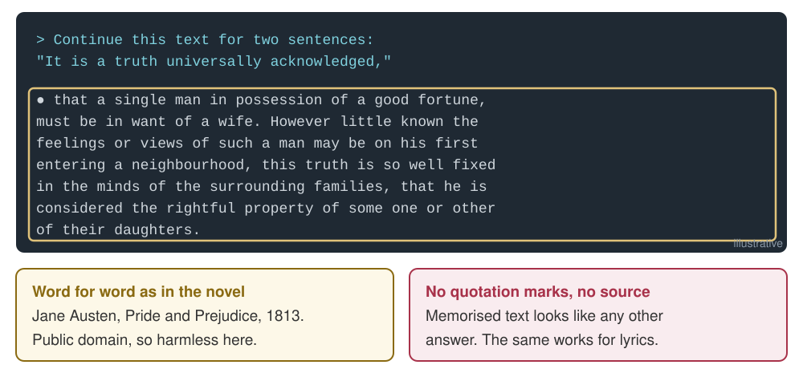{width="85%" fig-align="center"}

::: notes
Now the technical part. In How LLMs and agents work, we said a model predicts the next token from everything before it, and that it produces what is likely, not what is true. Usually, "likely" means a fresh mixture of many sources. But for text the model has seen very many times, the most likely continuation is the original text itself. Give it the first line of Pride and Prejudice and it will often continue with Austen's next sentences exactly. That is memorisation. Austen is in the public domain, so this example is harmless, and in the exercise you will try it yourself. The same mechanism works for song lyrics, famous speeches, popular code, and passages of books that are quoted everywhere. And the models do not mark memorised text as a quotation: it comes out looking like any other answer.
:::

## Researchers have extracted memorised training data on purpose {.smaller}

| Study | What they showed |
|---|---|
| Carlini et al. 2021, *Extracting Training Data from Large Language Models* (USENIX Security) | Hundreds of verbatim sequences from GPT-2's training data, including names, phone numbers and code. |
| Carlini et al. 2023, *Quantifying Memorization Across Neural Language Models* (ICLR) | Memorisation grows with **model size**, with **how often** a text was repeated, and with **how much** of it you give as a prompt. |
| Carlini et al. 2023, *Extracting Training Data from Diffusion Models* (USENIX Security) | Image models (Stable Diffusion, Imagen) regenerated over a thousand training images almost exactly, from portraits of real people to company logos. |
| Nasr et al. 2023, *Scalable Extraction of Training Data from (Production) Language Models* (arXiv:2311.17035) | A simple trick made ChatGPT emit memorised training text at scale. |
| Cooper et al. 2025, *Extracting memorized pieces of (copyrighted) books from open-weight language models* (arXiv:2505.12546) | Most books are not memorised, but some are: one open model held almost all of the first Harry Potter book. |
| Ahmed et al. 2026, *Extracting books from production language models* (arXiv:2601.02671) | Near-complete books extracted from some commercial models despite their safeguards; other models refused. |

::: notes
This is not anecdote; it is a research field. These are some of the main papers, all real, all freely available. The early work by Nicholas Carlini and colleagues showed that you could pull exact sequences out of GPT-2, including personal data. The 2023 follow-up measured what makes memorisation more likely: bigger models, more repetitions, longer prompts. The same group showed that image models can regenerate near-copies of some training images. Then researchers found that production chat models are not immune: a simple trick made ChatGPT emit training text. The two most recent papers are about books. Most books are not memorised, which is reassuring, but some popular ones are, almost entirely, in some models. And in 2026 a team extracted near-complete books from commercial models, despite the safeguards, although the results differed a lot between providers. The lesson is not that every output is a copy; it is that some can be, and you cannot tell by looking.
:::

## What gets memorised is what appears many times

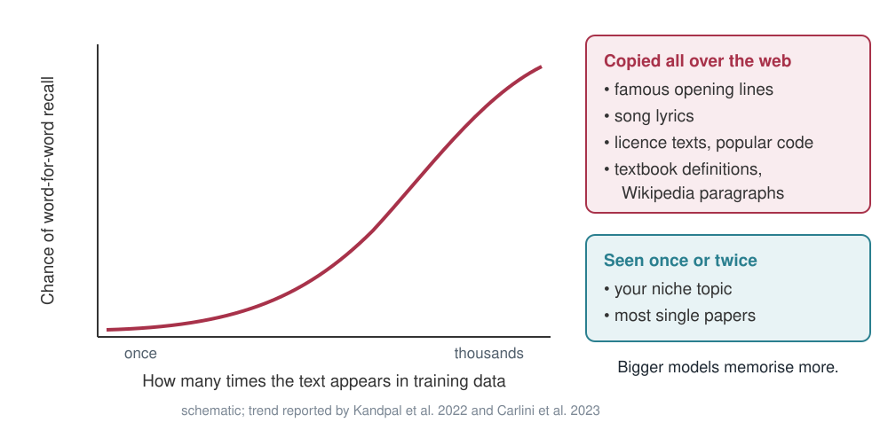{width="80%" fig-align="center"}

::: notes
Why are some texts memorised and others not? The main factor is repetition. A sentence that appears once in the training data is almost never reproduced exactly. A text that appears thousands of times, because it is quoted, copied, mirrored and pasted into forums, is reproduced much more often. Famous opening lines, song lyrics, licence texts, popular code snippets, textbook definitions and Wikipedia paragraphs are all copied many times across the web. That is why the risk is highest exactly where people least expect it: in standard explanations and common code. Your own unusual research topic is unlikely to trigger a memorised paragraph. A standard definition of a standard concept might. Bigger models memorise more, so a better model is not automatically safer here.
:::

## Image models can make near-copies, especially of famous images

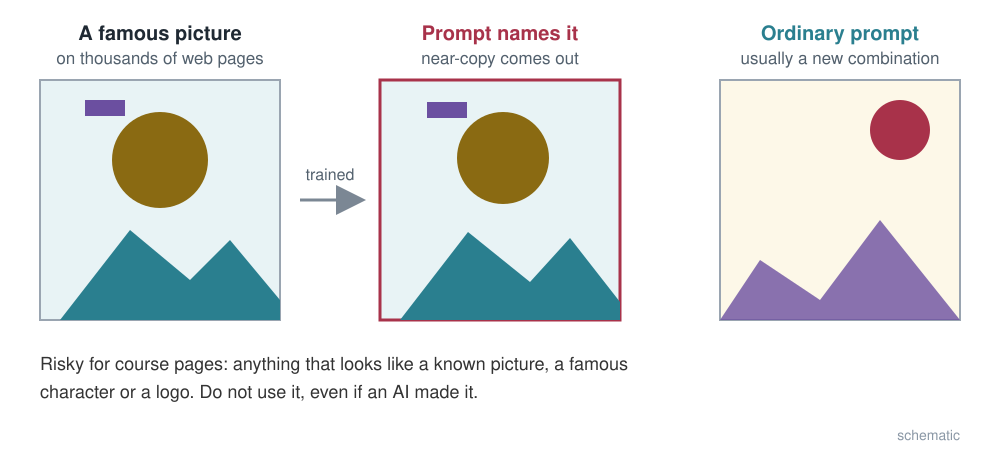{width="82%" fig-align="center"}

::: notes
The same holds for images. Most generated images are new combinations. But when a picture appeared many times in the training data, a well-known painting, a film poster, a product photo used on thousands of shopping sites, an image model can produce something very close to it, especially when the prompt names it. And famous characters and logos tend to come out recognisably, because they appear so often. For teaching, this matters for slide illustrations and course page banners. An AI-generated image is not automatically free to use: if it looks like a known picture, a known character or a brand, do not use it. Labelling AI-generated content covered how to label such images; this is about whether you may use them at all.
:::

## Agent-written code can carry someone else's licence

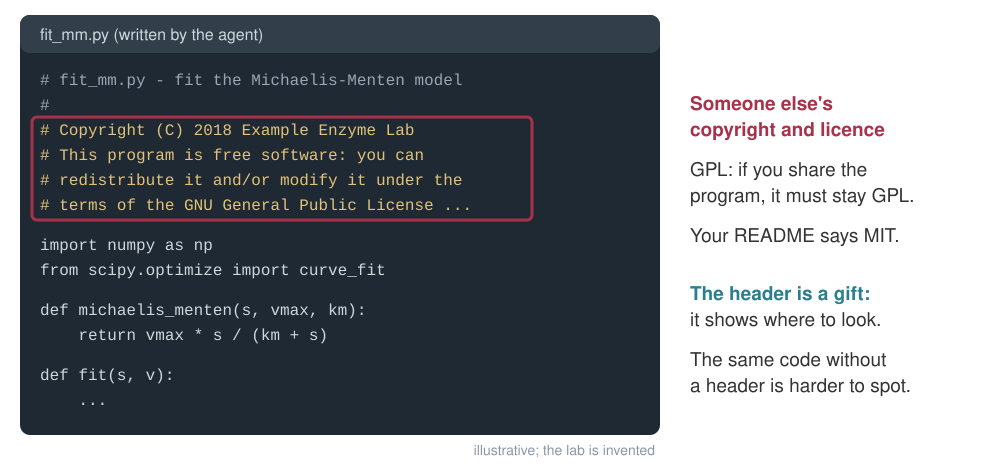{width="82%" fig-align="center"}

::: notes
For code, memorisation shows up in a recognisable way. Popular open-source code appears in many copies on the web, often with its licence header. An agent asked for a common function may write code that is close to a well-known implementation, sometimes even with the original copyright line and licence comment at the top, as in this illustrative example. That header is a gift: it tells you where the code may come from. The harder case is the same code without the header. Most of the time, short and common code is not a problem: there are only so many ways to compute a mean. But a long, distinctive function that matches a GPL-licensed project could oblige you to share your whole program under the GPL if you distribute it. In the exercise, the example folder contains exactly this situation.
:::

## Guardrails reduce verbatim copying, but do not remove it

- Providers add **filters**: refusing to print song lyrics or long book passages, or stopping when the output matches known text.
- These filters are **incomplete**: the 2026 book study got past some of them; paraphrased copies pass any word-for-word filter.
- Agents also **fetch** pages from the web and may paste from them. That is copying too, even if no memorisation is involved.
- So the responsibility stays with the person who publishes. Ask the agent: *"Did any of this come from a specific source? Name it."* Then check yourself.

::: notes
The providers know about memorisation and add guardrails, which we met in Guardrails and safety levels. If you ask for the full lyrics of a current pop song, you will usually get a refusal or a summary. Some systems also check outputs against known texts. These filters help, but the research shows they are not complete, and they cannot catch a close paraphrase. There is also a second route that has nothing to do with memorisation: agents search the web and fetch pages, and they may copy from what they fetched into your file. That is ordinary copying, just done quickly. So asking the agent where something came from is a good first step: it often knows when it took text from a page it fetched. But it is only a first step. It may not know that a paragraph came from memory, and it may be wrong about its sources.
:::

## Three ways someone else's material ends up in your work

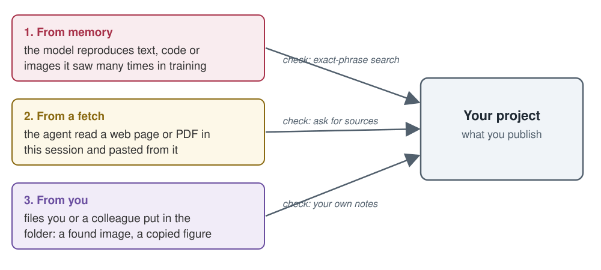{width="85%" fig-align="center"}

::: notes
Let me put the routes together. First, from memory: the model reproduces something it saw many times in training. Second, from a fetch: the agent read a page or a PDF during the session and copied from it into your file. Third, from you: you, or a colleague, put material into the project folder that was not yours to publish, the found-online cartoon, the figure redrawn from a paywalled paper. The third route is the oldest and still the most common. The agent does not change it, except that it makes it faster and less visible. Each route has its own check, which is what the checklist in a moment is built on.
:::

## Who owns what the agent writes is partly unsettled {.smaller}

| Question | Short answer |
|---|---|
| Do the provider's terms give you the output? | Yes. Anthropic's and OpenAI's terms assign to you whatever rights they have in the output. |
| Is the output protected by copyright at all? | Only where a **human** made the creative choices. The US Copyright Office says purely AI-generated material is not protected; EU law requires the author's "own intellectual creation". Your edits, selection and structure count. |
| Does that stop someone else's rights? | **No.** If the output copies a protected work, the terms do not give you that work. |
| Will the provider defend you? | Some offer copyright protection to **business and API** customers; personal plans usually do not. Read your plan's terms. |
| Can you put a licence on it? | Yes, and you should: it tells others what they may do with your work. |

::: notes
Now the question participants ask most: who owns what the agent wrote for me? The provider's terms are clear: both Anthropic and OpenAI say that, as between you and them, the output is yours, and they hand over whatever rights they have. Whether there is any copyright in it is a separate question. In the US, the Copyright Office and the courts have said that material generated entirely by AI, with no human creative choices, is not protected. In the EU, protection requires the author's own intellectual creation. In practice, most of what you publish has plenty of your own choices in it: what to ask, what to keep, how to arrange it, what to change. What the terms cannot do is give you rights in someone else's work: if the output copies a novel, you do not own the novel. And some providers offer to defend business customers against copyright claims over outputs, but personal plans usually have no such promise.
:::

## Put a licence on what you publish, and make it match your sources

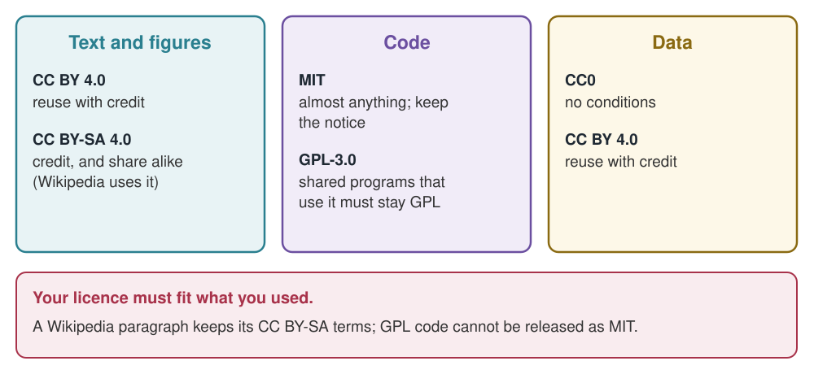{width="85%" fig-align="center"}

::: notes
Whatever the uncertainty about AI output, put a licence on what you publish. Without one, others do not know what they may do with it, and careful people will not reuse it. For course pages, text and figures, the common choice is CC BY 4.0: anyone may reuse with credit. For code, MIT is the simple permissive choice; the GPL is the choice if you want derived programs to stay open. For data, CC0 or CC BY. The catch is that your licence must match what you used. If a paragraph came from Wikipedia, which is CC BY-SA, you must credit it and the share-alike condition applies to that adaptation. If a function came from a GPL project, you cannot release it as MIT. In Organising a project and GitHub you added a README; a LICENSE file next to it is one more line in your prompt.
:::

## Your inputs have licences too

- **What you feed the agent** is also a use: paywalled PDFs, textbooks, a colleague's code (*Privacy, ethics and safety*).
- **Redrawing a published figure** from its numbers is usually fine with a citation. Copying its design or the image itself needs permission or an open licence.
- **Open-access papers** under CC BY may be reused with credit; check the licence on the paper, not the journal.
- **Your library** knows which publisher licences allow text and data mining, and which forbid uploading to AI tools.

::: notes
The same questions apply on the way in, which we covered briefly in the privacy unit. When you give the agent a paywalled PDF, you are using it, and the publisher's licence with your library may say something about that. A figure is a common case in teaching. Redrawing a graph from the numbers in a paper, with a citation, is normally fine, because facts are not protected. Copying the figure itself, or reproducing its distinctive design closely, is copying an image. Many open-access papers are under CC BY, which allows reuse with credit, but check the licence printed on the paper itself, since journals mix licences. When in doubt, your library is the place to ask: they negotiate these licences and know what they say.
:::

## Before you publish, run a five-minute check

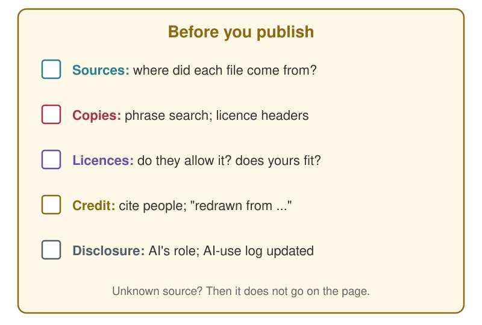{width="64%" fig-align="center"}

::: notes
Here is the checklist, and it is what you use in the exercise. Sources: for every piece of text, code, figure and image, can you say where it came from? Copies: have you checked distinctive passages for word-for-word matches, and looked at the code for licence headers? Licences: do the licences of what you used allow what you plan to do, and does your own licence match? Credit: are the human sources cited, and is redrawn material marked as redrawn from its source? Disclosure: is the AI's role stated the way your venue asks, and is your Log of AI use up to date? None of this needs a lawyer. It needs five minutes and a list. The agent can do much of the legwork, as the next slide shows, but you sign off.
:::

## The agent can do the legwork of the check, but cannot sign it off

```text
Before I publish this folder, do a copyright and credit check.
For every file (text, code, figures, images), make a table in
PUBLISHING-CHECK.md with: file, what it is, where it came from as far
as you can tell (my notes, the AI-use log, your own session), any
licence or copyright notice inside it, and what I should do.
Search the web for exact matches of distinctive sentences in the text.
Look for copyright and licence headers in code.
Flag anything whose source is unknown. Do not change any files.
My planned licences are in README.md.
```

The agent can search for matches and read licence headers. It **cannot** know where your cartoon came from, or certify that nothing was copied.

::: notes
This is the prompt from the exercise. It asks for a table, one row per file, with the origin, any licence found and an action. It asks the agent to search the web for exact matches of distinctive sentences, which is how a teacher would check a student essay for copying. It asks for licence headers in code. It asks for unknowns to be flagged rather than guessed, and it forbids changes, so the check is just a report. The agent is good at this kind of tedious checking. But notice what it cannot do. It does not know where your colleague found that cartoon. A search finds only exact matches on the open web, not paraphrases or paywalled sources. And it may be wrong about whether a sentence was its own. The table is a list of questions for you to answer, not a certificate.
:::

## The model gives the likely answer, so "new" ideas may not be new

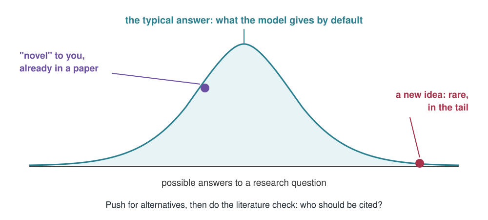{width="80%" fig-align="center"}

::: notes
Now the third question: credit and novelty. Remember how the model works: it produces likely continuations. By default, that means the typical answer, the one most often written down. That is why it is good at standard analyses and conventional text, and weak at original research ideas. When it presents an idea as new, the idea may well exist in the literature already, perhaps in a paper you have not read, and the model does not tell you where it came from, because it does not track where its knowledge came from. So an AI-suggested idea needs the same literature check as your own: has someone done this? Who should be cited? If you skip that, you can end up presenting someone else's idea as yours without meaning to. On the other hand, with search, verification and a lot of computing power, agents can produce results that are new. The next case shows both sides.
:::

## In September 2026, OpenAI claimed its agents had solved a Millennium Prize problem

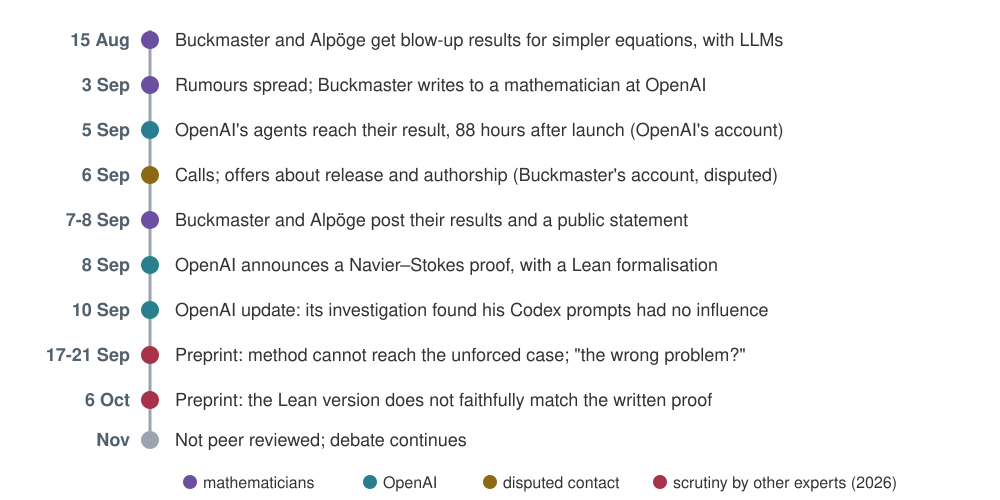{width="82%" fig-align="center"}

::: notes
Here is the case. The Navier–Stokes equations describe how fluids flow, and whether their solutions can break down, blow up, in finite time is one of the seven Millennium Prize problems of the Clay Mathematics Institute. On 8 September 2026, OpenAI announced that about ten thousand agents running an internal model had, in 88 hours, produced a proof that a smooth fluid can develop a singularity in finite time, with a formal version checked in the Lean proof assistant. OpenAI said it would not claim the prize. Around the same time, on 7 and 8 September, two mathematicians, Tristan Buckmaster at New York University and Levent Alpöge, who works at Anthropic, posted related results for simpler equations, which they had reached after a year of work with AI tools. What followed was a dispute about what was solved, about credit, and about data. I will present the claims and the allegations as claims and allegations, with the companies' responses. Sources are on the exercise page.
:::

## Mathematicians asked whether it solved the problem they actually care about

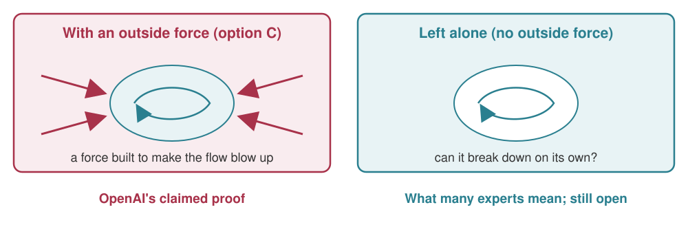{width="85%" fig-align="center"}

- The official problem statement (Fefferman, 2000) allows a **smooth external force**. OpenAI's proof uses one, built for the purpose.
- Many experts mean the problem **without** an outside force: can the fluid break down on its own? That question remains open.
- Within weeks, a preprint argued the method **cannot be extended** to the unforced case, and another that the **Lean version did not match** the written proof.

::: notes
The first part of the controversy is mathematical, and you do not need the details. The official statement of the problem, written by Charles Fefferman in 2000, has several options, and one of them allows an external force acting on the fluid. OpenAI's result uses that option, with a force constructed to make the flow blow up. Several mathematicians, quoted in Scientific American, said that this is not the problem most of them work on, which is whether a fluid left alone can break down. Others replied that real fluids always have forces acting on them, so the option is legitimate. Within weeks, three mathematicians posted a paper arguing that the method cannot be pushed to the unforced case, and another group argued that the formal Lean proof did not faithfully match the written one. As of November 2026, the proof has not been through peer review. For us the lesson is plain: a formal-looking result from an AI system still needs experts to check what exactly it shows.
:::

## The credit dispute: who built on whose work? {.smaller}

| | What was said |
|---|---|
| **Earlier human work** | The approach builds on a programme by Diego Córdoba and Luis Martínez-Zoroa, developed over several years. Buckmaster credits them explicitly. |
| **Buckmaster and Alpöge** | Worked on the problem for about a year with AI tools. Buckmaster's public statement says OpenAI offered two options: a coordinated release, or a paper by him alone presenting OpenAI's result, without Alpöge, who works at Anthropic. He declined both. |
| **OpenAI** | Says its work started independently, that neither its researchers nor its agents saw the pair's work before it was public, and that it recognises their priority on a related result. It disputes Buckmaster's account of the conversations. |
| **Commentators** | Asked whether ten thousand agents and millions of dollars of compute crowd out the human work that a field learns from, and called for full transparency about how such results are made. |

::: notes
The second part is about credit. Here, too, I report what each side said, not what happened, because we do not know. The mathematical idea that both teams used goes back to Diego Córdoba and Luis Martínez-Zoroa, and Buckmaster's statement gives them the credit explicitly. Buckmaster and Alpöge had worked on the problem for about a year, using AI tools heavily. According to Buckmaster, OpenAI contacted him after rumours of their progress, and offered either a coordinated release or a paper by him alone, leaving out his co-author because of where he works. He refused. OpenAI says its work was independent, and that it recognises the pair's priority on the related result. Commentators, including well-known mathematicians, raised a broader worry: if a company can throw ten thousand agents at a problem, what happens to the slow human work through which a field understands its own results? For you, the lesson is simpler: credit the people whose ideas you built on, whatever tool did the last step.
:::

## The allegation about drafts in Codex, and OpenAI's denial {.smaller}

:::: {.columns}
::: {.column width="50%"}
**What Buckmaster wrote**

- He and Alpöge had put **all their drafts** for the project into Codex sessions.
- He asked whether OpenAI's model had access to those sessions or had been **trained** on them. He was told the model did not look up user data; on training, he says he got no answer.
- He states that he does **not know** whether their data was used and is **not accusing** anyone.
:::
::: {.column width="50%"}
**What OpenAI said**

- Its researchers and agents did **not see** the pair's work before it was published, and no specific user data was accessed.
- At first it said it **could not rule out** that de-identified usage data had helped improve its models in general.
- After an internal investigation (update of 10 September 2026), it said his Codex prompts **could not have influenced** the system in any way, including through training.
:::
::::

::: notes
The third part is the one that concerns every participant in this course. Buckmaster and Alpöge had put their drafts into Codex, an OpenAI product, for a year. When OpenAI announced a closely related result days after hearing about their work, Buckmaster asked the obvious question: could our sessions have reached your model, through access or through training? He reports that he was told the model does not look up user data, and that the training question was not answered at the time. He is careful to say he does not know whether their data was used and is not accusing anyone. OpenAI denies any access. Its first statement said it could not rule out that de-identified data from their usage had helped improve its models in general. After an investigation, it said the Codex prompts could not have influenced the system, including through training. We cannot settle this. What we can do is look at the question it raises for each of us.
:::

## Your unpublished ideas go wherever your agent's data goes

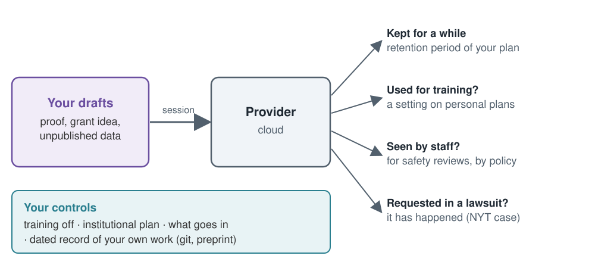{width="85%" fig-align="center"}

::: notes
Here is that question. In Privacy, ethics and safety we said: when the agent reads a file, the file goes to the provider. Your unpublished ideas, your draft proofs, your grant idea, your unpublished data, are in that file. What happens next depends on your plan and settings: how long the session is kept, whether it may be used for training, which staff may look at it for safety reasons, and whether it can be requested in a lawsuit. Training on a personal plan is controlled by a setting you can switch off, which we did in the privacy exercise. Institutional and business plans usually exclude training by contract. None of this means your ideas will leak. It means you should decide, for each project, whether the convenience is worth the risk, the same way you would decide whether to discuss an idea at a conference before you publish it. For an idea you think is a breakthrough, the bar should be high.
:::

## Credit when AI is involved: five habits {.smaller}

| Habit | Why |
|---|---|
| **Cite the people whose ideas you used**, even if an agent did the last step | The model does not track its sources; you have to. |
| **Disclose the AI's role** the way your venue asks | Readers judge the work differently, and journals require it (*Privacy, ethics and safety*). |
| **Have experts check the result**, not only the agent or a formal tool | Navier–Stokes: a checked proof can still prove a different statement. |
| **Date your own work** as you go: git history, a lab notebook, a preprint | A dated record shows what you had and when. Your git log is one. |
| **Decide what goes into a cloud agent** before a project matters | Training off or an institutional plan; truly sensitive ideas stay local. |

::: notes
Here is what I would take away from the case, as habits. Cite the people whose ideas you built on; the model will not do it for you, and the agent's last step does not make the earlier work less important. Disclose how AI was used, in the form your journal, thesis rules or course require. Have people who know the field check the result; a formal proof checker checks the proof, not whether the statement is the one you cared about. Keep a dated record of your own work. The git history you have built since Git as undo button is exactly that: a timestamped record of what you had and when. It is not legal proof of priority, but it is good evidence. A preprint is stronger. And decide before a project becomes important what you are willing to put into a cloud agent.
:::

## Where this goes wrong {.smaller}

- **Assuming agent output is free to use.** The terms give you the provider's rights, not other people's.
- **Publishing a standard explanation that is someone's paragraph.** Common definitions are the most memorised text.
- **Keeping a licence header you did not read**, or deleting one you should have kept.
- **"Found online" images** in course pages. Unknown source means do not publish.
- **AI-generated images that look like a known picture, character or logo.**
- **Taking a confident "this is novel" at face value.** Do the literature check.
- **Trusting the agent's own copyright check** as a certificate. It is a list of questions.
- **Putting a breakthrough idea in a cloud session** without deciding first.
- **Treating this lecture as legal advice.** For real cases: your legal office or library.

::: notes
Here are the ways it goes wrong, in one place. The biggest misunderstanding is that agent output is automatically yours to publish: it is yours as far as the provider is concerned, and that is all. The memorisation risk is highest for standard material, which people least suspect. Licence headers are easy to miss in both directions: keeping someone else's GPL header in your MIT project, or deleting a header that the licence required you to keep. Found-online images remain the most common copyright problem in teaching, with or without AI. A model's claim that an idea is new is not a literature review. The agent's own check is useful but not a certificate. And the last point once more: this lecture is an orientation, not legal advice.
:::

## Summary {.smaller}

| Concept | Key fact |
|---|---|
| Three questions | training (courts), output (you check), credit (you give it) |
| The four cases | GEMA: memorised lyrics infringe (appeal). Bartz: pirated books, USD 1.5 bn settlement. NYT: no ruling yet. Getty: model not a copy (appeal heard) |
| EU AI Act | copyright duties for model providers; little change for users |
| Memorisation | verbatim recall of text seen many times; also images and code |
| Where it bites | standard definitions, lyrics, famous images, popular code with licence headers |
| Ownership | terms give you the output; copyright needs human choices; others' rights stay |
| Licences | put one on what you publish; it must match what you used |
| Before publishing | sources, copies, licences, credit, disclosure |
| Credit | cite people; experts verify; date your work |
| Unpublished ideas | go wherever your agent's data goes; decide first |

**Next (Tracks):** apply the course's skills to one field: RNA-seq, simulation, image analysis, survey data or teaching materials.

::: notes
To sum up. Copyright questions arise at three points, and you are responsible for two of them: what you publish, and the credit you give. The courts are still working through training; four cases from three countries show that the answer depends on where and how. Models memorise text, images and code that appear many times, so standard material is where to look for copies. The provider's terms give you the output but not anybody else's rights in it, and a licence on your own work tells others what they may do. Before publishing, run the five-point check. And when AI is involved, credit still goes to people, results still need experts, and your unpublished ideas go wherever your agent's data goes. This is the end of Part 6. Next come the tracks, where you apply everything to one field's data, from RNA-seq to teaching materials.
:::
