## About this lecture

You have figures made by a script and a repository on GitHub. Now they should be **somewhere anyone can open with one link**: a web page for your project or your course, which you update with one prompt whenever the figures change.

- **A Quarto website is a folder of text files** that Quarto turns into web pages.
- **GitHub Pages serves the `docs/` folder** of a repository at `your-username.github.io/repository/`. This course site is built exactly that way.
- **The agent installs Quarto, scaffolds the site, renders and pushes.** You decide what goes on it and check the live page.
- **The figures from *Reproducible figures* are the first content**, with a caption that says which script made them.
- **Everything in the repository becomes public**, including its history. Decide what goes in before you switch Pages on.

This is a **hands-on** unit. Interactive pages come next (*Interactive demos*), and they will live on this site.

::: notes
In Reproducible figures you made a figure with a script, and in the GitHub unit the project went online as a private repository. Today we make a public web page. That can be a page for your research project, with the figures and a short explanation, or a page for a course you teach, with the schedule, slides and material. We use Quarto, the same tool that builds this course's site, and GitHub Pages, which serves it for free. The agent does the technical work: install, scaffold, render, push, switch on Pages. Your work is deciding what goes on the page, and checking what becomes public, because on a free GitHub account a published page means a public repository. From now on, every unit adds something to this page.
:::

## Your project's results are scattered over five places

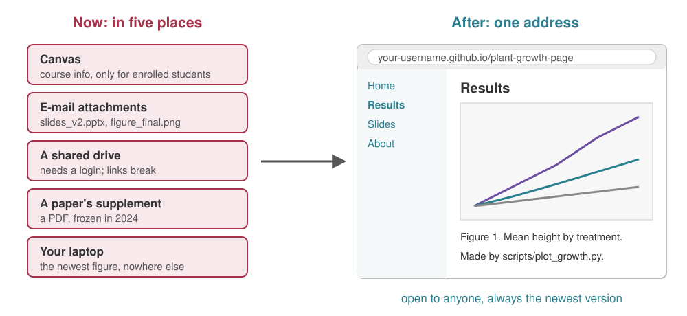{width="88%" fig-align="center"}

::: notes
Here is where course material and project results usually live. Course information in Canvas, which only enrolled students can open and which disappears into an archive after the course. Slides and figures as email attachments. Files on a shared drive behind a login, where links break when someone reorganises the folders. Results in a paper's supplement, frozen at the time of publication. And the newest version of the figure on your laptop, nowhere else. A web page with one address fixes this: anyone can open it without a login, it always shows the newest version, and you can put the link in an email signature, a CV, a course description or a grant application.
:::

## A Quarto website is a folder of text files turned into web pages

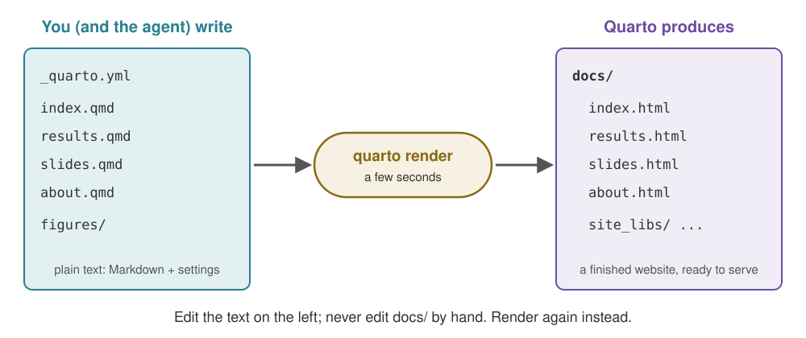{width="85%" fig-align="center"}

::: notes
Quarto is free software that turns text files into documents: web pages, slides, PDFs and Word files. A website is the simplest case. Each page is a text file ending in .qmd, Quarto Markdown, which is the Markdown you saw in the README, plus a short header. One settings file, underscore quarto dot yml, holds the title of the site, the sidebar and where to put the output. When you run quarto render, Quarto reads all of this and writes a finished website: one HTML file per page, plus some style and script files, into a folder. We call that folder docs. The rule: you edit the text files on the left. You never edit the HTML in docs by hand; you render again instead.
:::

## GitHub Pages serves the `docs/` folder of your repository as a website

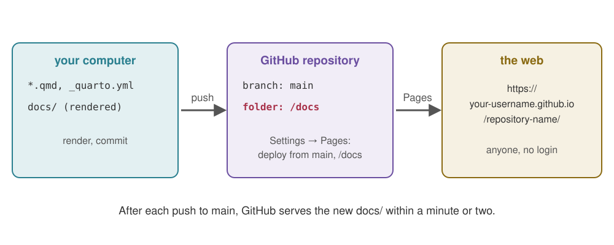{width="88%" fig-align="center"}

::: notes
GitHub Pages is a free service of GitHub that publishes the contents of a repository as a website. You tell it which branch and which folder to serve; we use the main branch and the docs folder, so the rendered site sits right next to its sources. After each push to main, GitHub picks up the new docs folder and publishes it, usually within a minute or two. The address is your username dot github dot io, slash, the name of the repository. No server to run, no hosting to pay for, no login for your readers. That is why your GitHub username matters, as we said in Accounts and installation: it is part of the address.
:::

## This course site is built exactly this way {.smaller}

The real `_quarto.yml` of this course (shortened):

```yaml
project:
  type: website
  output-dir: docs          # Quarto writes the site here; Pages serves it
  render:                   # which files become pages
    - "*/*.qmd"
    - "!contentplan.md"     # teacher-only: in the repo, not on the site
    - "!*/data/"

website:
  title: "Introduction to agentic AI"
  sidebar:
    contents:
      - section: "Part 1: Getting started"
        contents:
          - section: "Why agentic AI?"
            contents:
              - text: "Lecture (slides)"
                href: why-agentic/lec.qmd
```

::: notes
Here is the settings file of the site you are reading now, shortened. The project block says it is a website and that the output goes to docs, which GitHub Pages serves from the main branch. The render list says which files become pages. Note the lines with an exclamation mark: our planning documents are excluded from the site. They are not secret, they are in the public repository and anyone can read them there, but they are not part of the course pages. Without such a list, Quarto turns every qmd and md file in the folder into a page, except the README, so a CLAUDE.md or a notes file would quietly become a page of your site. The website block sets the title and the sidebar: sections for each part, and inside each unit a link to the lecture and one to the exercise. Each lecture is a qmd file with format revealjs, so it becomes a slide deck. Your site will be much smaller, but it is the same machinery.
:::

## The agent installs Quarto, one approved step at a time

- Ask: "Is Quarto installed? If not, install it with the official method for my system. Explain each command first."
- On a Mac the agent often proposes `brew install --cask quarto` or the installer from quarto.org; on Windows, `winget` or the installer.
- An installer may ask for your computer password in a separate window. That is you, not the agent.
- Check: `quarto --version` prints a version number. If "command not found", reopen the terminal.

::: notes
Installing Quarto follows the same pattern as installing gh in the GitHub unit. The agent checks first, then proposes the official installation method for your system: on a Mac often Homebrew or the downloadable installer, on Windows the winget package manager or the installer from quarto.org. Read the command and approve it. Some installers open a system dialog for your password; that dialog belongs to your operating system, and you type the password there, never into the agent. Afterwards quarto dash dash version should print a number. As always, a newly installed command sometimes needs a fresh terminal before it is found. If your university manages your computer, you may need IT to install it.
:::

## Describe the site; the agent scaffolds it

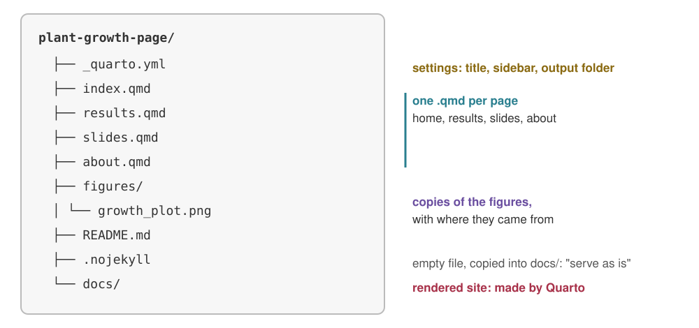{width="72%" fig-align="center"}

::: notes
You do not have to know Quarto's file layout. Describe the site you want, and the agent creates it: a settings file, one qmd file per page, a figures folder, a README, and an empty file called dot nojekyll, which tells GitHub to serve the files as they are instead of running its own site builder over them. It has to end up inside docs, so the settings file lists it as a resource that Quarto copies there at every render. Quarto also has a command, quarto create project website, that makes a minimal starting point; the agent may use it and then adapt it. Describe the result, as in First delegations: which pages, what is on each, the sidebar, the output folder docs. Then read the files it made. They are short, and after this lecture you can read all of them.
:::

## A page is a short header and Markdown

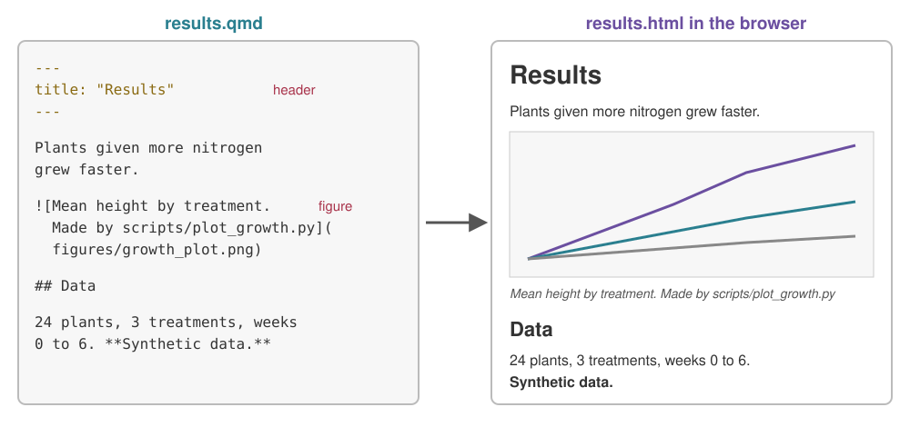{width="85%" fig-align="center"}

::: notes
Here is one page, before and after. At the top, between two lines of three dashes, is the header: here only the title. Below it is Markdown, exactly as in the README. A paragraph is just text. A figure is an exclamation mark, the caption in square brackets, and the file name in round brackets. Two hashes make a heading. Two stars make bold. Quarto turns this into the page on the right, in the style of the site, with the sidebar around it. You can ask the agent to write the page, but you should be able to read it, because the text on this page is what the world will see under your name.
:::

## Five Markdown constructs cover most pages {.smaller}

| You write | You get |
|---|---|
| `## Results` | a heading (and an entry in the page's table of contents) |
| `**important**` | **important** |
| `- first point` on separate lines | a bullet list |
| `[Course plan](plan.qmd)` or `[Quarto](https://quarto.org)` | a link to another page or another site |
| `` | a figure with a caption |

Tables, callout boxes, columns, footnotes and citations exist too. Ask the agent when you need them.

::: notes
You need very little Markdown. Headings with hashes. Bold with two stars. Lists with a dash at the start of each line. Links with the text in square brackets and the address in round brackets; the address can be another page of your site or any web address. And figures, which are links with an exclamation mark in front. That is enough for almost any project or course page. Quarto can do a lot more: tables, coloured callout boxes like the ones in our exercise pages, two-column layouts, footnotes, even citations from a BibTeX file, which comes in handy after the literature review in Part 4. You do not need to learn these. Ask the agent for them by describing the result.
:::

## The sidebar lists the pages in the order you choose

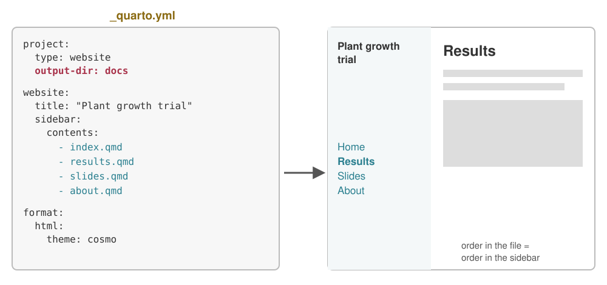{width="85%" fig-align="center"}

::: notes
The sidebar is set in the settings file. Under website, sidebar, contents, you list the pages in the order you want them. Quarto takes each page's title as the link text, or you can give your own text, as this course does with "Lecture (slides)". A new page does not appear in the sidebar until it is listed here, which is a common surprise. You can also group pages into sections, as this course does for its parts and units. Note the line in red, output-dir docs: without it, Quarto writes the site into a folder called underscore site, which GitHub Pages does not serve. If your live site shows a 404 error, this is one of the first things to check.
:::

## The figures from *Reproducible figures* are the first content

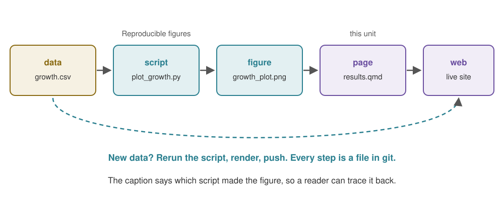{width="88%" fig-align="center"}

::: notes
The first content of the page is the figure you made in Reproducible figures. That matters because the whole chain is now in files: the data, the script that makes the figure, the figure itself, the page that shows it, and the rendered site. If new data arrives, you rerun the script, render, and push, and the page shows the new figure. Nothing is copied by hand into a web editor. Put the provenance in the caption: which script made the figure, and from which data. A reader, or you in a year, can then trace every figure on the page back to its source. That is what makes a git-based page reproducible, and it is the main reason we use it rather than a web editor.
:::

## Look at the site on your own computer before anything is public

- After `quarto render`, open `docs/index.html` in your browser: double-click it in the file browser.
- Or ask the agent to run `quarto preview`: a local preview that updates when you save. Stop it with Ctrl+C.
- Check every page, every link, every figure. Read the text as a stranger would.
- Nothing is public until you push **and** Pages is switched on.

::: notes
Before you publish, look at the site locally. The simplest way: open the file docs slash index dot html from your file browser. It opens in your web browser and works like the real site, sidebar and all. The other way is quarto preview, which starts a small local web server and refreshes the page each time a file changes; it keeps running until you stop it with Control C, so in an agent session it is easier to use it in a second terminal. Click every link and look at every figure. Read the text as if you were a stranger: a student who has never met you, or a reviewer. This is the cheapest moment to catch a mistake: nothing is public yet.
:::

## Slides are pages too: `format: revealjs`

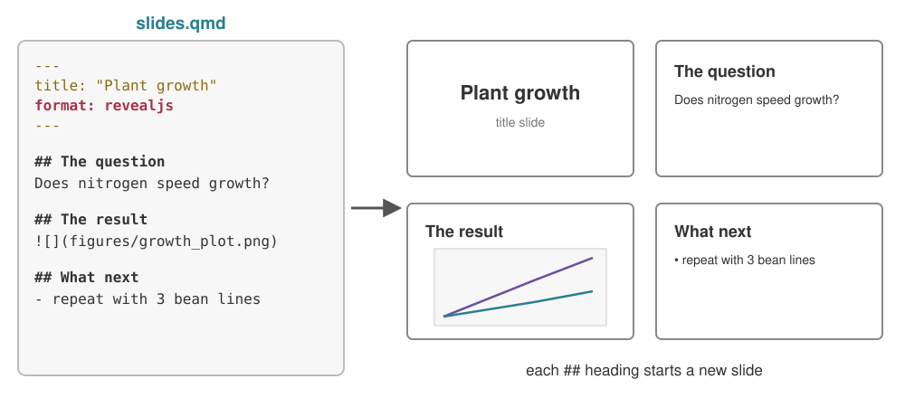{width="85%" fig-align="center"}

::: notes
One more page type, briefly. If a qmd file says format revealjs in its header, Quarto renders it as a slide deck instead of a page, using the reveal.js library that runs in any browser. Each heading with two hashes starts a new slide. These lectures are made exactly this way, including the speaker notes. For your page, this means a talk about your project, or the slides for a lecture in your course, can sit next to the figures, render with the same command and go online with the same push. Press F in the browser for full screen, and S for the speaker view. You do not have to move your slides from PowerPoint; but a short deck that uses the same figure files as the page never goes out of date.
:::

## Updating the page is the same loop every time

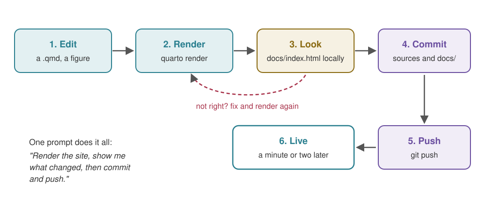{width="85%" fig-align="center"}

::: notes
Here is the loop for every change to the page, which you will repeat in every later unit. Edit a page or update a figure. Render. Look at the result locally; if it is not right, fix and render again. Commit both the sources and the docs folder, because GitHub Pages serves the rendered files, not the sources. Push. A minute or two later the live site shows the change. In practice this is one prompt: render the site, show me what changed, then commit and push. One habit to keep: do not commit a docs folder you have not looked at. The agent can render a page that is technically fine and says something you did not mean.
:::

## Switch Pages on once: Settings → Pages → main, `/docs`

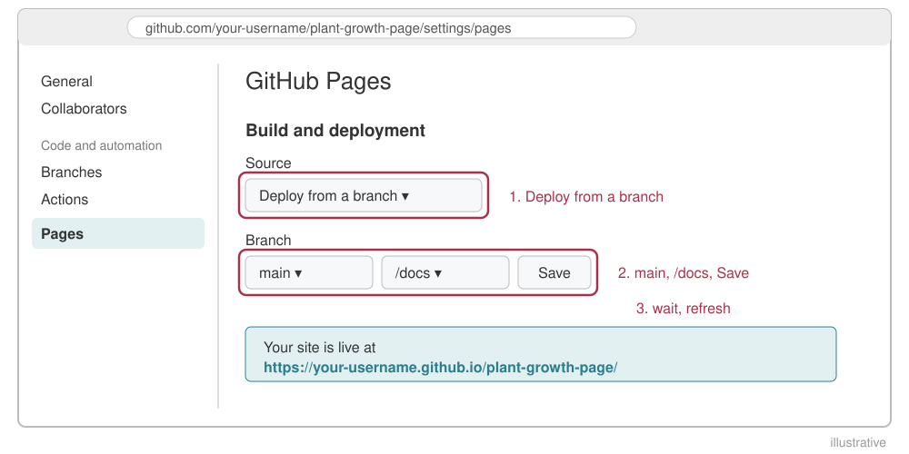{width="78%" fig-align="center"}

::: notes
GitHub Pages is switched on once per repository. On the repository page, open Settings, then Pages in the menu on the left. Under Build and deployment, set the source to Deploy from a branch. Choose the branch main and the folder slash docs, and save. After a minute or two, refresh the page: a box appears with the address of your live site. GitHub runs a small deployment job in the background each time you push; if the site does not appear, the Actions tab of the repository shows whether that job failed and why. This picture is illustrative: GitHub moves its settings around from time to time, but the words Pages, Deploy from a branch, main and docs stay.
:::

## Or let the agent switch it on with `gh api`

The agent can make the same setting with the GitHub API:

```bash
echo '{"source":{"branch":"main","path":"/docs"}}' | \
  gh api -X POST repos/OWNER/REPO/pages --input -
```

And ask for the address afterwards:

```bash
gh api repos/OWNER/REPO/pages --jq .html_url
```

- This changes a setting on GitHub. Read it: the branch is `main`, the folder is `/docs`.
- Either way works. The settings page shows you what happened; the command leaves a record in the session.

::: notes
If you prefer, the agent can switch Pages on for you. gh api sends a request to GitHub's programming interface, using the login you made in the GitHub unit. The first command creates the Pages site with the main branch and the docs folder as the source. The second asks for the address of the site. Read the first command before approving it like any other: it changes a setting on GitHub, and you want the branch and folder to be right. Both ways lead to the same result. The settings page is easier to understand the first time; the command is quicker the second time, for example when you make a page for your next course.
:::

## On a free account, Pages needs a public repository

- **GitHub Free:** Pages works only from a **public** repository.
- **Paid plans** (Pro, Team, Enterprise; some education benefits): also from a private repository, but **the site itself is still public**.
- So on a free account: switching Pages on means making the **whole repository** public.
- The page you publish is open to anyone, indexed by search engines and copied by archives.

::: notes
This is the point where the privacy questions of the GitHub unit become concrete. GitHub's documentation says that on the free plan, Pages is available only for public repositories. Paid plans can publish from a private repository, and some educators get such plans through GitHub Education, but even then the site itself is public on the internet. So on a free account, a page means a public repository: every file in it, and every old version, becomes readable by anyone. Search engines will index the page and web archives may keep copies. Treat the decision to switch on Pages as a decision to publish everything in that repository.
:::

## Three rings become public: the site, the repository and its history

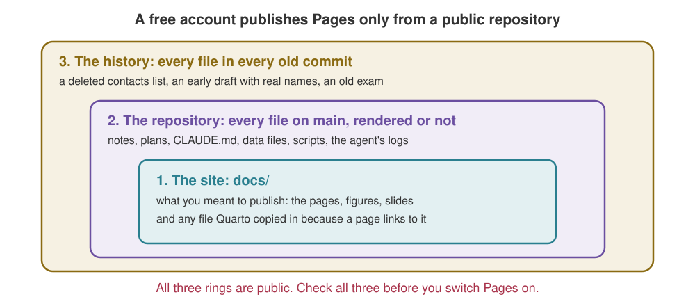{width="80%" fig-align="center"}

::: notes
Think of it as three rings. The inner ring is the site, the docs folder: what you meant to publish. Even here, check for surprises: Quarto copies any file that a page links to, so a link to a spreadsheet publishes the spreadsheet. The middle ring is the whole repository on the main branch: notes, plans, the CLAUDE.md file with its instructions, data files, scripts, all readable on GitHub, rendered or not. The outer ring is the history: every file that was ever committed, including ones you deleted later, as we saw in the GitHub exercise with the contacts file. All three rings become public together. So the check before switching on Pages covers all three.
:::

## A separate page repository keeps your project private

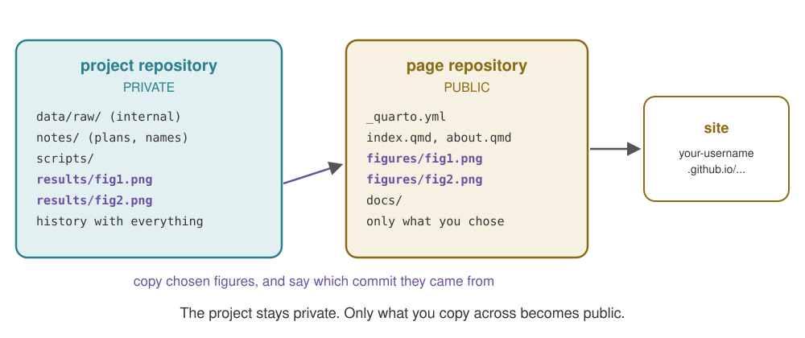{width="85%" fig-align="center"}

- **Same repository** (as this course does): only if *everything* in the project, including its history, may be public.
- **Separate page repository**: the default for your own project. Copy the chosen figures across and note the source commit.

::: notes
That gives two ways to organise a page. This course keeps the site in the same repository as everything else, because all of it is meant to be public: the plans, the data generators, the history. That works when your whole project may be public. For most own projects that is not the case: there are internal data, notes with names, plans you would rather not publish, and a history you have not checked. Then make a second, small repository that holds only the page. Copy the figures you choose into it, and write down which commit of the project they came from, so the chain back to the script is not lost. The project stays private; only what you copy across becomes public. This is the default in the exercise.
:::

## Check the live page yourself, as a stranger would

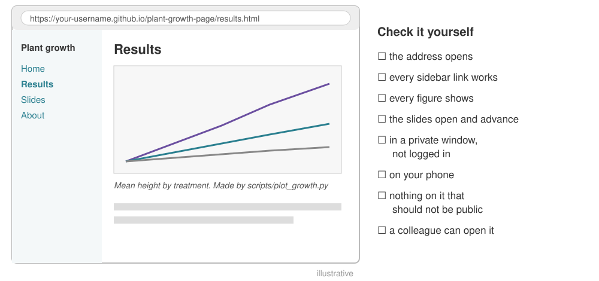{width="80%" fig-align="center"}

::: notes
When the site is live, check it yourself; the agent cannot see it the way your readers do. Open the address. Click every link in the sidebar and look at every figure: a figure that worked locally but not online usually means a file was not committed, or the file name differs in upper and lower case, which matters on the web but not on a Mac or Windows. Open the slides and advance a few. Open the site in a private browser window, where you are not logged in to GitHub, to see what the public sees. Look at it on your phone. Read it once more for anything that should not be public. Then send the link to a colleague and ask whether it opens and makes sense.
:::

## A page should say who made it, under what licence, and how AI was used {.smaller}

| On the page | Why |
|---|---|
| Your name, affiliation, a contact route (a university page, not a private phone number) | readers know whose work it is |
| What the figures show and which script and data made them | readers can trace and reuse them |
| A licence: CC BY 4.0 for text and figures, MIT for code | readers know what they may reuse (*GitHub*) |
| "Synthetic data" or "data from …, under licence …" | readers know what they are looking at |
| How AI was used, in a sentence | as you would disclose it in a paper (*Privacy, ethics and safety*) |
| The date of the last update | readers know whether it is current |

::: notes
A public page represents you, so give it the basics of any publication. Who made it, with a contact route that you are happy to make public, such as your university profile page. What the figures show and where they came from. A licence, as we discussed in the GitHub unit, so that colleagues know they may reuse your teaching material. Where the data comes from, and if it is synthetic, say so clearly. A short statement on how AI was used, in the same spirit as the disclosure we discussed in Privacy, ethics and safety: for example, "the site and the plotting script were written with the help of Claude Code; all figures and text were checked by the author". And a date, so readers can tell whether it is current.
:::

## Other ways to make a page exist; a git-based page is the reproducible one {.smaller}

| | Google Sites, Canvas pages, university CMS | Quarto + GitHub Pages |
|---|---|---|
| Making a page | click and type in a web editor | describe it; the agent writes text files |
| Updating a figure | upload the new image by hand, every time | rerun the script, render, push |
| History | limited or none | every version, with who and why |
| Moving elsewhere | copy and paste | the files go anywhere; Quarto also makes PDF and Word |
| Who can read it | often only students, or only staff | anyone |
| Works with the agent | barely: it cannot click in your browser | fully: everything is a file |

Use your university's system where it is required, for example for grades and enrolment. Link to the Quarto page from there.

::: notes
There are other ways to make a page, and some of them may be required by your university. Google Sites, Canvas pages and the university's content management system all let you click together a page in a web editor. That is fine for a notice. The differences show when the page changes often. In a web editor, every update of a figure is a manual upload, there is little or no history, and moving to another system means copying and pasting. With Quarto and GitHub Pages, everything is a file in git: the agent can write and update it, every change is recorded, and the same sources can produce a PDF or a Word document too. Use the official system for what must be there, such as grades, and put a link to your page in it.
:::

## From now on, every unit adds something to this page

- *Interactive demos* (next): a self-contained HTML page that explains a concept, embedded in this site.
- *Shiny apps*: an app for exploring your data, published next to the page where possible.
- Part 4: the verified literature table, extracted data, a grant analysis, each as a page.
- Each time: **edit, render, look, commit, push, check live.**

::: notes
This page is not a one-off. From now on, each unit ends with something that can go on it. In the next unit, Interactive demos, you make a single HTML page that explains a concept from your field, a slider that moves a curve for example, and embed it in this site. After that comes Shiny, for interactive apps on your data. In Part 4, the literature table, data extracted from PDFs and the grant analysis can each become a page. That way you practise the loop many times, and by the end of the course the page is a real record of your project. Each time, the same steps: edit, render, look, commit, push, check the live page.
:::

## Where this goes wrong {.smaller}

- **404 on the live address.** Pages not switched on, wrong folder (not `/docs`), `output-dir` missing, or the address has the wrong repository name.
- **Page looks unstyled or broken.** `docs/.nojekyll` missing, or `docs/site_libs/` not committed.
- **Figure missing online but fine locally.** File not committed, or `Growth.png` vs `growth.png`.
- **Old version still showing.** Wait a minute or two; reload without the cache (Shift+reload).
- **New page not in the sidebar.** It is not listed under `sidebar: contents`.
- **Something private became public.** Notes, data, or a file in the history. Check all three rings before Pages goes on.
- **Edited `docs/` by hand.** The next render overwrites it. Edit the `.qmd` instead.
- **The agent rendered something you did not read.** Look at the page before you push.

::: notes
Here are the problems you are most likely to meet. A 404 error on the live address almost always means a setting: Pages is off, the folder is wrong, Quarto wrote to underscore site instead of docs, or there is a typo in the address. A page without its styling means the support files were not committed or the nojekyll file is missing. A missing figure online usually means an uncommitted file or a difference in upper and lower case. If the old version is still showing, wait and reload without the cache. A page missing from the sidebar is not listed in the settings. And the serious one: something that should not be public. The agent can help you diagnose all the others; that last one is your responsibility.
:::

## Summary {.smaller}

| Concept | Key fact |
|---|---|
| Quarto website | `.qmd` text files + `_quarto.yml` → `quarto render` → HTML in `docs/` |
| GitHub Pages | serves `docs/` on `main` at `your-username.github.io/repository/` |
| This course | built exactly this way; see its `_quarto.yml` |
| Sidebar | pages listed under `website: sidebar: contents`, in order |
| Slides | `format: revealjs`; each `##` heading starts a slide |
| First content | figures from *Reproducible figures*, with the script named in the caption |
| Switch on | Settings → Pages → Deploy from a branch → `main`, `/docs` (or `gh api`) |
| Free account | Pages only from a public repository; the site is always public |
| What becomes public | the site, the repository and its whole history |
| Separate page repository | the default when the project itself must stay private |
| The loop | edit, render, look, commit, push, check live |

**Next (Interactive demos):** one self-contained HTML page that explains a concept from your own field, embedded in the page you built today.

::: notes
To sum up. A Quarto website is a folder of text files that Quarto renders into the docs folder, and GitHub Pages serves that folder at your username dot github dot io. This course is built the same way. The sidebar lists the pages; slides are pages with format revealjs. Your first content is the figure from Reproducible figures, with its source in the caption. You switch Pages on once, in the settings or with gh api. On a free account, Pages means a public repository, so the site, the repository and its history all become public; for a private project, use a separate page repository. And every update is the same loop. In the next unit we make the page interactive, with a demo that explains a concept from your own field.
:::
