## About this lecture

In *First delegations* you described the result you wanted and the agent did the rest. That worked because the jobs were small and the example data had known answers. Your own project is bigger, vaguer and has no answer key. This unit is about writing a **brief**: a short description of a job that an agent can carry out and that you can check.

- **A brief has four parts:** goal, context, constraints and acceptance criteria.
- **Acceptance criteria say how you will check**, so the agent can check too.
- **Plan mode** lets the agent read and propose before it changes anything.
- **"Interview me first"** turns a vague idea into a written brief.
- **Correct with specifics**, and know when a fresh session is the better fix.

This is a **hands-on** unit. You end with the first real brief for your own project. How to organise the project folder so that every session starts well comes next, in *Organising a project for an agent*.

::: notes
From now on we work on your own project, and the jobs get bigger. The biggest single lever you have over the quality of what an agent does is the description you give it at the start. Not clever wording, not magic phrases, but whether the description contains the information the agent cannot get anywhere else. Today we take the description apart into four pieces, look at tools that help you write it, plan mode and the interview, and then at what to do when the first result is not right. The exercise ends with a brief for your own project, which you will keep and reuse.
:::

## "Make a nice plot of this data" gives a nice plot of the wrong numbers

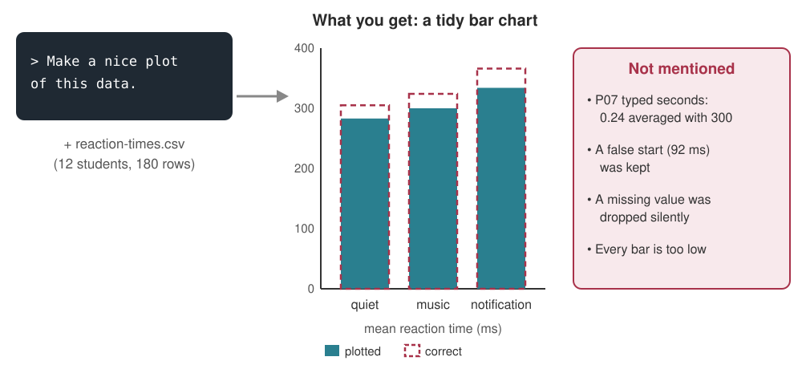{width="88%" fig-align="center"}

::: notes
Here is a real kind of situation, with made-up data. A teaching lab: twelve students measured their reaction times under three conditions, quiet, music and a phone notification, five trials each. One student typed their times in seconds instead of milliseconds. One trial was a false start, pressed before the signal. One value is missing. The prompt "make a nice plot of this data" produces exactly that: a nice plot. The bars are lower than they should be because the values in seconds were averaged together with the values in milliseconds, and the false start pulled one mean down further. Nothing in the session says so. The agent did what it was asked. It was not asked the right thing.
:::

## The agent fills every gap in your prompt with a guess

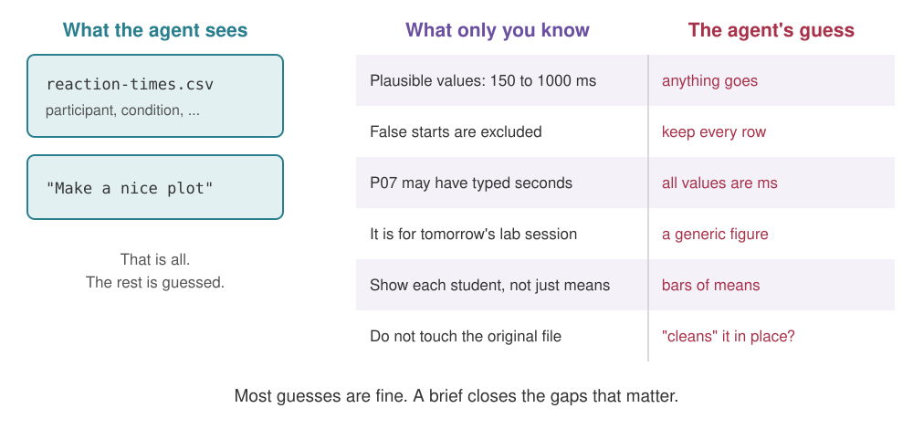{width="85%" fig-align="center"}

::: notes
Why did that happen? The agent sees the file and your sentence. Everything else, it has to guess. It does not know that reaction times below 150 milliseconds are physically implausible. It does not know that your department excludes false starts. It does not know whether you want bars, points or lines, or what the plot is for: a slide for the students tomorrow or a figure in a paper. Each of these is a gap, and the agent fills each one with the most likely guess. Most guesses are fine. Some are not, and you only find out if you look. A good brief closes the gaps that matter before the agent starts.
:::

## A good brief answers four questions

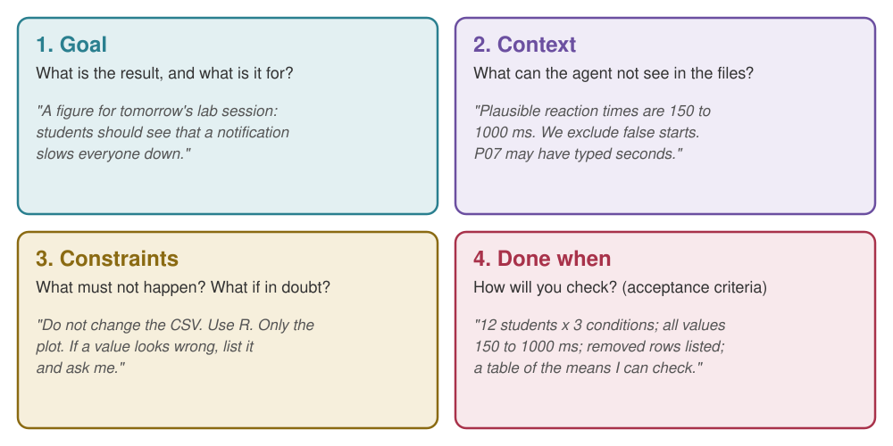{width="85%" fig-align="center"}

::: notes
A brief has four parts. The goal: what the result is and what it is for. The context: what the agent cannot see in the files, such as how the data was collected and what is normal in your field. The constraints: what must not happen, what must stay as it is, which tools or formats to use. And the acceptance criteria: how you will check the result. This is not our invention. OpenAI's Codex guide recommends the same four things under the names goal, context, constraints and "done when", and Anthropic's guide for Claude Code says much the same: give it the information it cannot see, and a way to check its work. We take the four parts one at a time.
:::

## The goal says what the result is for, not only what it is

| Weak goal | Strong goal |
|---|---|
| "Make a plot." | "A figure for tomorrow's lab session: students should see that a notification slows everyone down." |
| "Summarise these papers." | "A table I can paste into the background section of a grant, one row per paper." |
| "Write exam questions." | "Ten questions for a first-year exam that test understanding, not recall." |

The purpose decides a hundred small things you will not think to mention: scale, wording, level of detail.

::: notes
The goal is more than the name of the thing. "A plot" is a thing. "A plot that shows students in one glance that a notification slows everyone down" is a purpose. The purpose answers questions you would never think to write down: should each student be visible or only the averages? Should the axis start at zero? Should the labels be in plain words or variable names? A figure for a lab session and a figure for a paper are made differently, and if the agent knows which one it is making, it makes many of those choices right without being told.
:::

## Context is what the agent cannot read from the files

:::: {.columns}
::: {.column width="50%"}
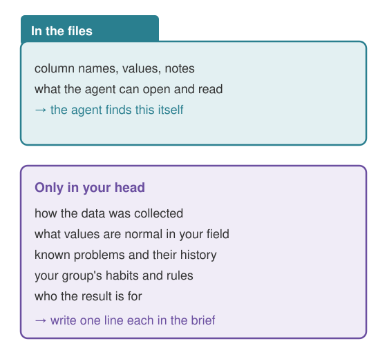{width="100%"}
:::
::: {.column width="50%"}
- How the data was collected: "students timed themselves with a web tool".
- What is normal in your field: "human reaction times are 150 to 600 ms".
- Known problems: "some students may have typed seconds".
- House rules: "we exclude false starts".
- Where things are: "the course plan is in `notes/course-plan.md`".
:::
::::

::: notes
Context is everything you know that is not in the files. You know how the data was collected and what normal values look like, because you are the expert in your field. You may know that a particular student always types things oddly, or that your group has a rule for false starts. The agent knows none of this. You do not need to write an essay: one line per fact is enough. And if the information already exists in a file, point at the file instead of retyping it. In Claude Code you can type an at sign and a file name to attach a file to your message; in both tools you can simply write "read notes/course-plan.md first".
:::

## Constraints say what must not happen

- **Keep:** "Do not change `reaction-times.csv`. Write new files only."
- **Limit:** "Use R and ggplot2, which I already have installed."
- **Format:** "Save as PNG and PDF, 16 cm wide, readable on a projector."
- **Scope:** "Only the plot. Do not write a report."
- **Doubt:** "If a value looks wrong, do not fix or drop it. List it and ask me."

The last one is the most valuable sentence in most briefs.

::: notes
Constraints are the fences. What must stay untouched, which tools to use, which format, how far the job reaches, and what to do in case of doubt. The scope constraint matters because agents tend to be helpful beyond what you asked: you ask for a plot and get a plot, a report, a README and a cleaned copy of the data. The doubt constraint is the one I would put in almost every brief. Without it, the agent resolves doubts silently, and a silent fix is a hidden decision. With it, you get a short list of questions, and those questions are often where you learn something about your data.
:::

## Acceptance criteria say how you will check, so the agent can check too

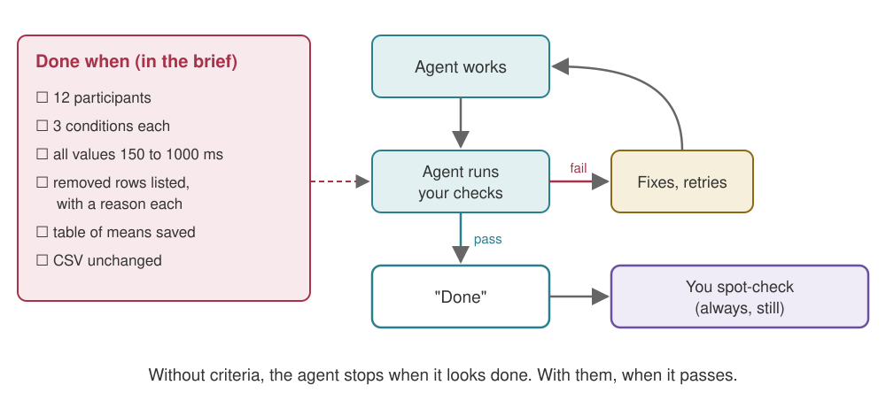{width="85%" fig-align="center"}

::: notes
The fourth part is the one most people leave out, and it is the most powerful. Write down how you will check the result. Twelve students, three conditions, every value between 150 and 1000 milliseconds after cleaning, a table of means that you can compare with your own spot check. Once these are written in the brief, the agent can run the same checks itself before it says it is done, find its own mistakes and fix them. Without criteria, the agent stops when the result looks done. With criteria, it stops when the result passes your tests. Remember from *How LLMs and agents work* that the agent's own check does not replace yours. But it catches many mistakes before you ever see them.
:::

## Good acceptance criteria can be checked by counting or looking

| Vague | Checkable |
|---|---|
| "Make sure the data is clean." | "After cleaning: 12 participants × 3 conditions; every value between 150 and 1000 ms." |
| "Check your work." | "Print the number of rows removed and the reason for each." |
| "The references should be correct." | "Every reference has a DOI that resolves; list the ones that do not." |
| "Good exam questions." | "Each question names the learning outcome it tests; no outcome is tested twice." |
| "The plot should look nice." | "All text readable at 16 cm width; axis labels in words with units." |

If you cannot say how you would check it, the agent cannot either. Then the brief is not finished.

::: notes
Here are some vague criteria and checkable versions of them. The checkable ones are things you could tick off by counting, looking or running something. Notice that writing them forces you to think about the job. "Every value between 150 and 1000 milliseconds" requires you to know what a plausible reaction time is. That is your expertise, and it is exactly what the agent lacks. If you find you cannot write a checkable criterion, that is useful information: it means you do not yet know what a good result looks like. Then the brief is not ready, and the interview technique later in this lecture can help.
:::

## A big job is several briefs, not one long one

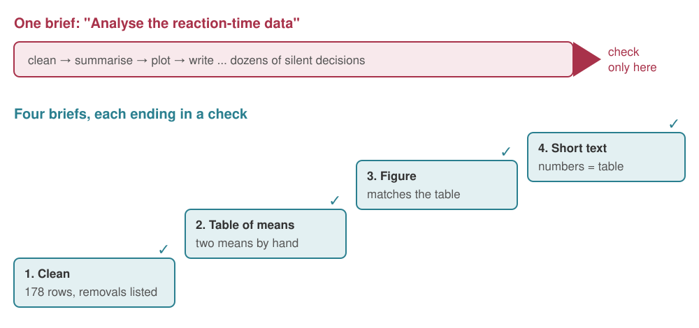{width="85%" fig-align="center"}

::: notes
A brief describes one result that you can check. "Analyse my whole project" is not one result; it is ten. If you give it as one brief, the agent makes all the decisions along the way without stopping, and you check only the end, where mistakes from step two are buried under steps three to ten. Break the job into steps that each end with something you can check: clean the data and list what was removed; then make the summary table; then the figure; then the text. Each step has its own short brief and its own check. This is slower on paper and faster in practice, because mistakes are caught where they are made.
:::

## Teaching example: from a wish to a brief

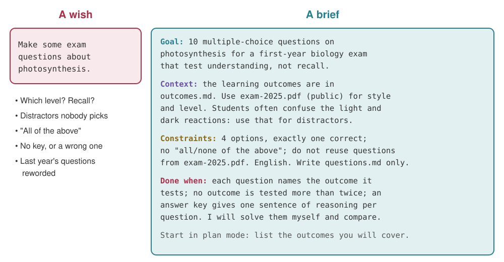{width="92%" fig-align="center"}

::: notes
Here is an example from teaching. On the left, a wish: "make some exam questions about photosynthesis". You will get ten questions, probably reasonable, probably at the wrong level, testing recall rather than understanding, with distractors no student would pick. On the right, the same request as a brief. The goal says the level and purpose. The context points at the learning outcomes and at last year's exam for style. The constraints rule out the usual weaknesses of generated questions. And the acceptance criteria say how the teacher will check: every question linked to an outcome, and an answer key with a reason, which the teacher will verify by solving the questions themself.
:::

## Research example: from a wish to a brief

**Weak:** "Find papers on microplastics in fish."

**Strong:**

```text
Goal: a table of field studies that measured microplastics in the gut of
freshwater fish, for the background section of a grant (about 15 studies).
Context: I work on Swedish lakes; marine studies and lab exposure
experiments are not relevant.
Constraints: search PubMed and Google Scholar only, 2015 to 2025.
Do not include a study you could not open. Write "not stated" for
anything the paper does not say.
Done when: microplastics-table.csv has columns doi, year, country,
species, n_fish, percent_with_plastic, page; every DOI opens the right
paper; you list the search terms you used and how many hits each gave.
```

::: notes
Here is a research example. The weak version is a topic, not a job. The strong version says what the table is for and roughly how many studies, which already tells the agent how broad to search. The context excludes two kinds of studies that a search will happily return. The constraints set the sources and years, and forbid invented values. The criteria say exactly what the table looks like and how you will check it: every DOI must open the right paper, and you want the search terms so that you can judge how thorough the search was. The full literature workflow comes in *Literature review*; here the point is the shape of the brief.
:::

## A strong brief is specific, not long

- Most good briefs are **5 to 15 lines**.
- One line per fact. No background the agent does not need.
- Leave out what the agent can see for itself: it reads the files.
- Contradictions are worse than gaps: "keep all rows" and "remove outliers" in one brief.
- No magic words. Capitals, "IMPORTANT" and "think very hard" do not make a brief better.

::: notes
A common reaction to all this is to write two pages. That does not help. A long brief buries the important lines among unimportant ones, and every extra sentence is one more thing the agent tries to honour. Write one line per fact, leave out what the agent can see by opening the files, and read the brief once for contradictions. If you say "keep all rows" and later "remove outliers", the agent picks one, and you will not know which. You may have read that some phrases make models try harder. With current tools that is mostly folklore; Anthropic's own guide says that piling on emphasis tends to make the model over-apply a rule. Plain sentences work.
:::

## Plan mode: the agent reads and proposes, but changes nothing

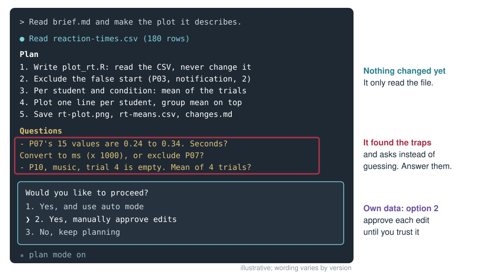{width="82%" fig-align="center"}

::: notes
Now two tools that help. The first is plan mode. In plan mode the agent can read files and look around, but it cannot change anything. Instead it writes a plan: what it found, what it intends to do, and often a few questions. You read the plan, correct it, and only then let the agent start. In *First delegations* we got a similar effect by writing "show me your plan before you change anything". Plan mode does the same with a guarantee: the tool blocks edits until you approve. This picture is a mock-up of Claude Code; the wording in your version may differ.
:::

## Plan mode in each tool

| | Claude Code | Codex |
|---|---|---|
| Switch on | **Shift+Tab** until the status line shows `⏸ plan mode on` | Type `/plan` and press Enter |
| For one prompt only | Start the prompt with `/plan` | `/plan` followed by your prompt |
| While planning | Reads files, runs harmless commands, writes a plan; no edits | Reads, may ask clarifying questions, writes a plan |
| Approve | Choose **Yes, manually approve edits** (careful) or the option that switches to auto mode | Tell it to go ahead with the plan |
| Not happy | **No, keep planning**, then say what to change | Reply with what to change |

For your own project, choose to approve edits one by one until you trust the plan.

::: notes
Here is how plan mode works in each tool. In Claude Code you press Shift+Tab until the status line says plan mode, or you start a single prompt with slash plan. When the plan is ready, Claude Code asks whether to proceed, and offers to switch to auto mode or to approve edits manually. For your own data, choose the manual option. In Codex you type slash plan, optionally followed by the prompt. Codex gathers context, may ask questions, and writes a plan; when you are happy, tell it to go ahead. Menus and wording change between versions, so look for these words rather than exact positions. In Claude Code, pressing Shift+Tab at the approval prompt approves the plan, so use Escape if you want to leave instead.
:::

## Reading a plan: five things to look for

1. **Did it understand the goal?** The first lines should say back your purpose in its own words.
2. **Which files will it change or create?** Anything outside what you expected is scope creep.
3. **What did it find?** "Participant P07's values are between 0.24 and 0.34": a good plan notices problems.
4. **Which decisions has it already made?** "I will drop values below 150 ms": is that what you want?
5. **What does it ask?** Answer every question. A plan with no questions about messy data is suspicious.

A plan costs one minute to read. A wrong result costs an hour to untangle.

::: notes
When the plan comes back, read it with these five questions. First, has it understood the goal? If it restates the job wrongly, stop there. Second, which files will it touch? Third, what did it find while looking around? A good plan for the reaction-time data mentions that one student's values look like seconds. If it does not, the agent has not looked closely, and you can ask it to. Fourth, look for decisions disguised as steps: "I will remove values below 150" is a decision about your data. Fifth, answer its questions. If the data is messy and the plan has no questions, the agent is guessing, and you may want to ask it what it assumed.
:::

## "Interview me first" when you do not yet know exactly what you want

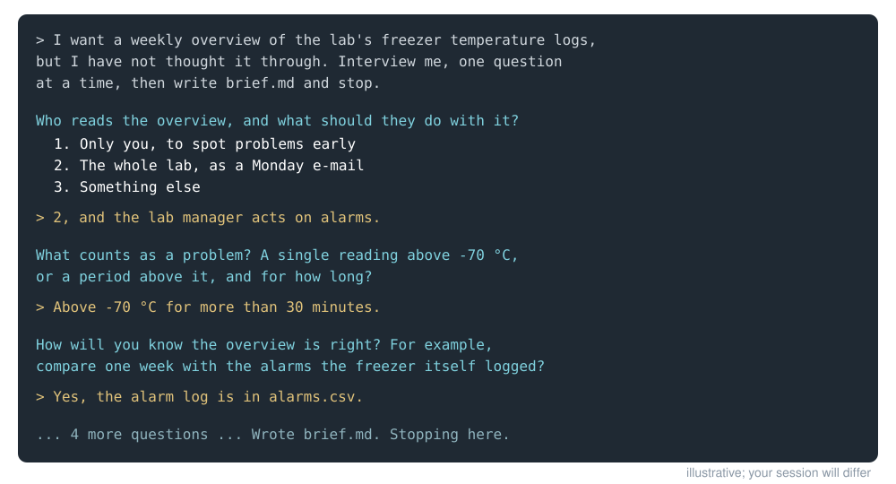{width="82%" fig-align="center"}

::: notes
The second tool is the interview. Sometimes you know roughly what you want, but not well enough to write the four parts. Then turn it around: ask the agent to interview you. It asks one question at a time, often with a few options to choose from: who the result is for, what format, what to do with odd cases. Each answer closes a gap. When it has enough, it writes the brief for you. Both Anthropic and OpenAI recommend this in their guides for exactly this situation. It is also a good test of your own thinking: the questions you cannot answer are the decisions you have not made yet.
:::

## The interview ends in a written brief, not in work

```text
I want to <rough idea>, but I have not thought it through.
Interview me, one question at a time, until you could write a brief
with four parts: goal, context, constraints and how I will check the
result. Challenge my assumptions where they seem weak.
Then write the brief to brief.md and stop. Do not start the work.
```

- Read `brief.md` and edit it yourself. It is your brief now.
- Then start a **fresh session** and give it: "Read brief.md and carry it out. Use plan mode."

::: notes
Here is a prompt for the interview. Three details matter. "One question at a time", because ten questions at once get ten rushed answers. "Challenge my assumptions", because otherwise the agent tends to agree with whatever you say. And "write the brief to a file and stop", because the interview and the work are two separate things. The brief goes into a file, which you then read and edit. Then you start a fresh session and hand it the file. The new session starts with a clean context and a written definition of done, instead of a long conversation full of abandoned ideas. The brief file is also what you check the result against at the end.
:::

## The first result is a draft: check it against the criteria

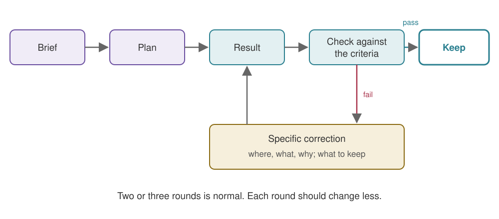{width="80%" fig-align="center"}

::: notes
Even with a good brief, the first result is rarely the final one. That is normal, and it is the same for work you hand to a person. The loop is: brief, plan, result, check against your criteria, correct, and round again. What matters is how quickly the loop closes. With checkable criteria and specific corrections, two or three rounds usually get you there. With vague criteria and vague corrections, the loop can go on all afternoon, and each round may undo something that was right.
:::

## A specific correction points, explains and fixes the cause

| Vague | Specific |
|---|---|
| "The plot is wrong." | "P07's points are near zero. Those values are in seconds; multiply them by 1000 in the script, rerun and update the list of changes." |
| "That's not what I meant." | "I want one line per student across the three conditions, not bars. Keep the colours." |
| "Try again." | "Keep the table. Only the y-axis label is wrong: it should be 'Reaction time (ms)'." |
| "Too long." | "At most 120 words. Cut the background paragraph; keep the numbers." |

Say what to **keep**, too. Otherwise the agent may change parts that were right.

::: notes
When something is wrong, say exactly what, where, what you expected, and why if you know. Ask for the cause to be fixed, not the symptom: if the conversion from seconds belongs in the script, ask for it in the script, so the fix survives the next run. And say what to keep. This is easy to forget. "That's not what I meant" invites the agent to redo everything, including the parts you liked. "Change only the y-axis label" gets you exactly one change. This is the same rule as in *First delegations*: if it is wrong, say what is wrong.
:::

## Stop it early when it goes the wrong way

- **Esc** interrupts the agent in both tools. The work so far is kept; type a correction.
- Watch the first minute: the first steps show whether it understood.
- Claude Code: **Esc twice** (or `/rewind`) goes back to an earlier point in the conversation and, if you want, the files.
- After *Git as undo button and lab notebook* you can undo any change, in any tool.

::: notes
You do not have to wait until the agent is finished to correct it. Press Escape and it stops, keeping what it has done so far, and you can type a correction. The first minute of a session tells you a lot: if the first thing the agent does is open the wrong file, or start writing a report when you asked for a plot, stop it there. Claude Code also has a rewind feature, Escape twice or slash rewind, which takes the conversation, and optionally the files, back to an earlier prompt. The general undo for any tool comes with git, two units from now.
:::

## Start a fresh session more often than you think

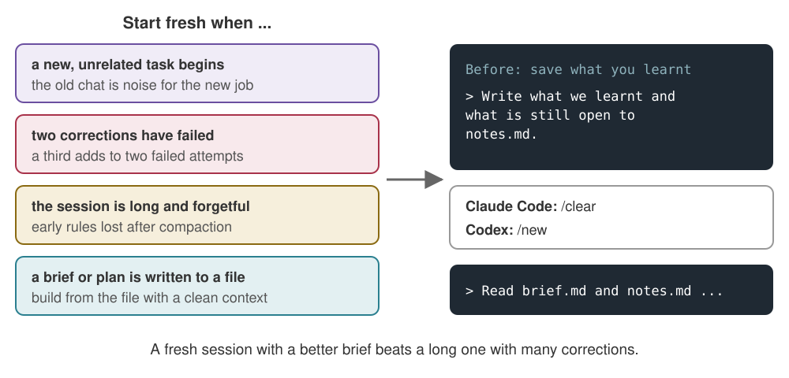{width="82%" fig-align="center"}

::: notes
When should you start over? Four situations. When you move to a new, unrelated task: the old conversation is just noise for the new one. When you have corrected the same thing twice and it is still wrong: a third correction adds to a conversation that already holds two failed attempts, and the agent keeps re-reading them. Anthropic's guide says exactly this: after two failed corrections, clear and write a better prompt. When the session has become long and the agent starts forgetting earlier instructions, which happens after the conversation has been compacted. And after an interview or a plan has been written to a file. In Claude Code you start fresh with slash clear; in Codex with slash new. Or simply quit and start the agent again.
:::

## What you learnt goes into the next brief, not into a long chat

- Before you clear, ask: *"Write what we learnt and what is still open to `notes.md`."*
- Then fix the brief: add the context or criterion that was missing.
- Start fresh: *"Read brief.md and notes.md. Then …"*
- Coming back to a task later: `claude --continue` or `/resume` (Claude Code), `codex resume` or `/resume` (Codex).

A fresh session with a better brief beats a long session with many corrections.

::: notes
Starting over does not mean losing what you learnt. Before you clear, ask the agent to write down what it learnt and what is still open. Then improve the brief: usually the reason a session went wrong is a missing piece of context or a missing criterion, and now you know which. The new session reads the improved brief and the notes and starts clean. Both tools can also resume an earlier session if you want to continue rather than start over, for example the next morning. Next unit, we turn this habit of writing things down into a structure: a project folder with a plan file and a notes file that every session reads.
:::

## A brief template that fits on one screen

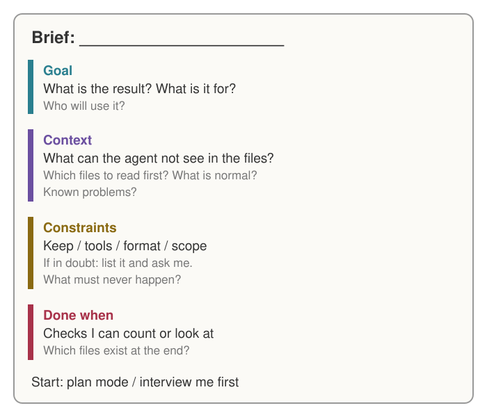{width="62%" fig-align="center"}

::: notes
Here is the template we use in the exercise. Goal, with the purpose. Context: what the agent cannot see, and which files to read. Constraints: keep, limits, scope, and what to do in doubt. Done when: the checks. And at the end, how to start: in plan mode, or with an interview. You will not need every line for every job. A two-line job needs a two-line brief. But going through the headings takes a minute and often reveals the gap that would have cost you an hour.
:::

## The same brief still gives a different session each time

- Two runs of the same brief: different steps, different wording, sometimes a different script.
- A good brief makes the **results** comparable: both must pass the same criteria.
- If two runs disagree on a number, at least one is wrong. Find out which.
- Your session will not look like the examples in this lecture or the exercise.

::: notes
A reminder you have heard before. Agents are not deterministic. The same brief, given twice, gives two different sessions, and sometimes two different results. A brief does not change that. What it does is give you a fixed yardstick: both runs must pass the same acceptance criteria. If both pass and give the same means, good. If they give different means, you have learnt that something in the job is ambiguous, and the brief needs another line. In the exercise, compare your results with the expected outcomes, not your session with the screenshots.
:::

## Where this goes wrong

- **Steps instead of a goal.** The agent follows your steps into a wall it could have walked around.
- **No acceptance criteria.** The agent stops when it looks done, not when it is done.
- **Criteria the agent checks for you.** "I verified all values are plausible" is a claim; you still spot-check.
- **One huge brief.** Mistakes from step 2 hide under steps 3 to 10.
- **Approving the plan unread.** Plan mode only helps if you read the plan.
- **Leading the interview.** If you answer every question with "whatever you think", you get the agent's project, not yours.
- **Correcting forever.** Two failed corrections: clear, improve the brief, start fresh.
- **Own data in the brief.** A brief goes to the provider like everything else. No names, no confidential details (*Privacy, ethics and safety*).

::: notes
Here is what goes wrong, collected. Most items are the reverse of a part of the brief. Two deserve a comment. The agent can run your checks, and should, but its report that the checks passed is still a claim. Spot-check yourself, as always. And the brief itself is text that goes to the provider. Describing your data in a brief is fine; pasting a list of students' names into it is not. The privacy rules from Part 1 apply to everything you type, not only to files.
:::

## Summary

| Concept | Key fact |
|---|---|
| Brief | goal, context, constraints, acceptance criteria; usually 5 to 15 lines |
| Goal | what the result is *for*; the purpose decides many small things |
| Context | what the agent cannot read from the files; point at files rather than retype |
| Constraints | what to keep, limits, scope, and "if in doubt, list it and ask" |
| Acceptance criteria | how you will check, written so the agent can check too |
| Plan mode | reads and proposes, changes nothing; Shift+Tab (Claude Code), `/plan` (Codex) |
| Interview me first | one question at a time, ends in `brief.md`, not in work |
| Specific corrections | where, what, why; fix the cause; say what to keep |
| Fresh session | new task, two failed corrections, long session, after a written brief |

**Next (Organising a project for an agent):** give your project a folder structure and an `AGENTS.md` file, so that every new session starts knowing what the project is and where things are.

::: notes
To sum up. A brief has four parts, and the one most often missing is the acceptance criteria: how you will check, written down so the agent can check too. Plan mode lets you see the agent's intentions before anything changes. The interview helps when you do not yet know what you want. Corrections should be specific and say what to keep. And a fresh session with a better brief usually beats a long session with many corrections. In the next unit we make this easier: a project folder where the context lives in files that every session reads at the start, so you do not have to repeat it in every brief.
:::
