## About this lecture

You have the agent installed and you can find your way around the terminal. Now it should do some real work. We start with three small jobs that everyone knows and nobody enjoys: **tidy a messy folder, clean a messy spreadsheet, and summarise a pile of PDFs into one table.**

- **Work in a copy.** The original stays untouched, whatever happens.
- **Describe the result, not the steps.** Say what the finished thing should look like.
- **Ask for a record.** A log of every change, a list of decisions, a list of assumptions.
- **Check by spot checks.** Count before and after, check totals, pick three things at random and look at them yourself.
- **If it is wrong, say what is wrong.** Correct the agent rather than start over.

This is a **hands-on** unit with example data only. Why the agent makes the mistakes it does comes next (*How LLMs and agents work, and how they fail*). Writing prompts in depth comes in *Delegating well* (Part 2).

::: notes
This is the first unit where the agent does something useful for you. The three jobs are deliberately boring: organising files, cleaning a spreadsheet and making a summary table. They are the kind of chores that fill a Monday morning and that you would happily hand to an assistant. The point today is not the jobs themselves but the habits around them: work in a copy, say what you want the result to look like, ask for a record of what was done, and check the result yourself. These five habits come back in every later unit. We use example data only, because we have not yet talked about what data you may send to a cloud service. That comes in the privacy unit at the end of Part 1.
:::

## Three small jobs eat a Monday morning

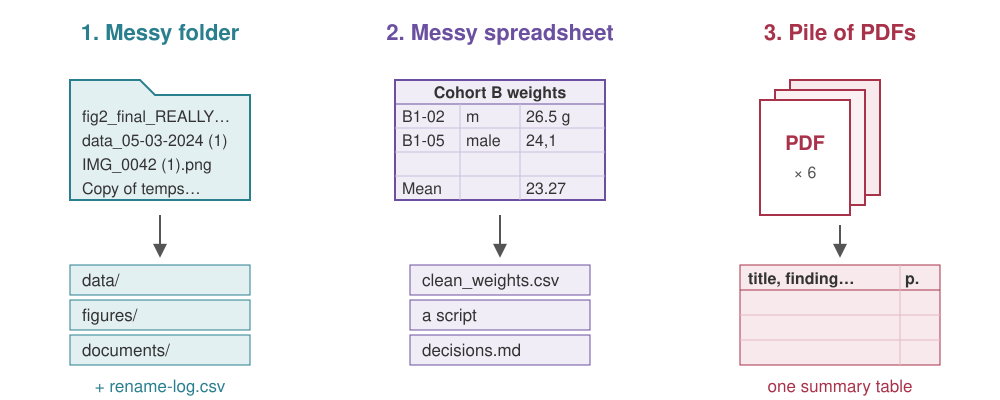{width="90%" fig-align="center"}

- A shared folder where 40 files have piled up with names like `fig2_final_REALLYfinal.png`.
- A spreadsheet from a student with merged headers, units in the cells and three spellings of "male".
- Six short reports that you need to summarise for a meeting, in one table.

::: notes
Here are the three jobs. You will recognise all of them. The first is a folder that has grown without a system: dates written in four ways, "final" versions that were not final, and a few copies of the same file. The second is a spreadsheet that a person can read without trouble, but that no analysis program can use as it is. The third is a small pile of reports where you need the title, the author, the date and the main finding of each, side by side. Each job takes an hour or two by hand. Each one is also easy to get slightly wrong, which makes them good practice for checking an agent's work.
:::

## Good first jobs are tedious, easy to check and easy to undo

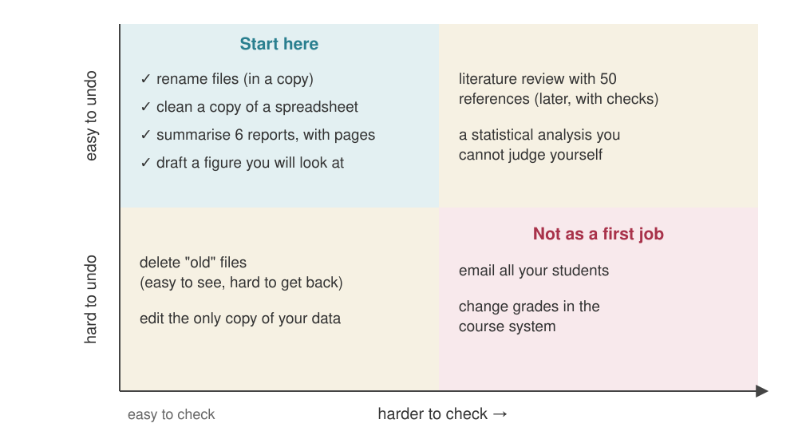{width="72%" fig-align="center"}

::: notes
Why these three jobs and not something more exciting? Because they sit in the safe corner of this picture. On the horizontal axis is how easy the result is to check. On the vertical axis is how easy it is to undo a mistake. Renaming files, cleaning a copy of a spreadsheet and making a summary table are all easy to check by looking, and easy to undo if you worked in a copy. Compare that with sending an email to all your students, which cannot be undone, or a literature review full of references, which takes real effort to check. We will get to the harder corners later in the course, with more safety nets. For a first delegation, pick something in the top-left corner.
:::

## Today we use example data, not your own

- Download one zip file per job from the exercise page: `messy-folder.zip`, `messy-sheet.zip`, `reports.zip`.
- All three are **synthetic**: invented files, invented people, invented numbers.
- Your own files wait until after *Privacy, ethics and safety*. There we look at what may be sent to a cloud service.
- The example data has **known answers**, so you can check the agent against them.

::: notes
Everything in today's exercise is made up. The mice, the reports and the authors do not exist. That has two benefits. First, nothing sensitive leaves your computer, which matters because whatever the agent reads is sent to the company that runs the model. We discuss exactly what that means in the privacy unit. Second, because we made the data, we know the right answers: how many files there are, how many rows the clean table has, what the average weight is. That lets you check the agent against a key, which is the best way to learn what checking feels like before you do it on your own data where there is no key.
:::

## Every delegation follows the same loop

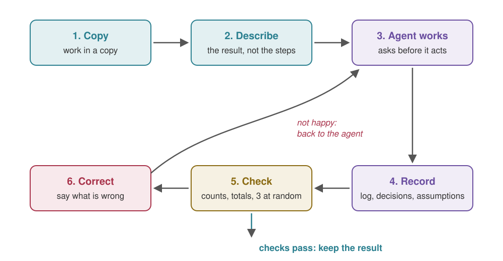{width="78%" fig-align="center"}

::: notes
This is the shape of every delegation in this course. You make a copy to work in. You describe what you want the result to look like. The agent works, and asks your permission before it changes files or runs commands. You ask it for a record: what it changed, what it decided, what it assumed. You check the result with a few quick tests. If something is wrong, you say what is wrong, and the loop goes round again. Most of the value of the agent comes from going round this loop quickly. Most of the risk comes from skipping the last two steps. The rest of this lecture takes the steps one by one, and then applies them to the three jobs.
:::

## Rule 1: always work in a copy, never in the original

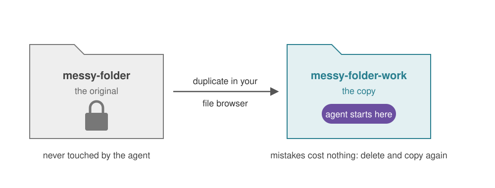{width="78%" fig-align="center"}

- The agent can rename, move and overwrite files. In a copy, every mistake is free.
- Keep the original somewhere the agent was not started from.

::: notes
The first rule is the simplest and the most important. Before you let the agent touch anything, make a copy and start the agent inside the copy. The agent only works in the folder where you start it, unless you give it permission to go elsewhere, so the original stays safe. If the result is bad, you delete the copy and make a new one. This costs ten seconds and removes almost all of the risk from today's jobs. Later, in the unit Git as undo button and lab notebook, we get a more powerful safety net that keeps every version. Until then, the copy is your undo button.
:::

## Making the copy takes ten seconds {.smaller}

1. Unzip the download. You now have, for example, a folder `messy-folder`.
2. Duplicate the folder in your file browser and rename the copy `messy-folder-work`.
3. In the terminal, go into the copy and start the agent there:

| | Claude Code | Codex |
|---|---|---|
| Go into the copy | `cd messy-folder-work` | `cd messy-folder-work` |
| Start the agent | `claude` | `codex` |

4. If the agent asks whether you trust this folder, answer yes: it is your copy of example data.

Make the copy by hand: an agent that can make the copy can also reach the original.

::: notes
Here is how the copy works in practice. Unzip the file, duplicate the folder in Finder or Explorer as you would any folder, and give the copy a name that says it is the working copy. Then, in the terminal, use cd to go into the copy, as you practised in the Terminal survival kit, and start the agent there. The first time you start the agent in a new folder it may ask whether you trust the files in it. For example data that is fine. Note the reason we make the copy by hand today: to make a copy, the agent would need access to the folder where the original lives, and that is exactly what we want to avoid.
:::

## Rule 2: describe the result you want, not the steps

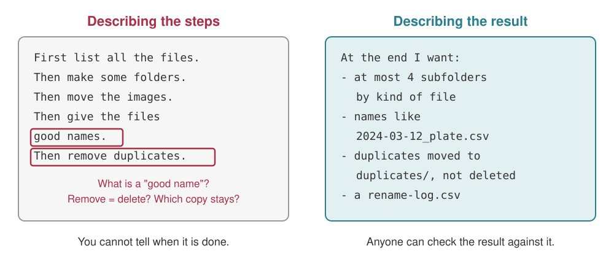{width="88%" fig-align="center"}

::: notes
The second rule surprises people. When we explain a task to a person, we often explain the steps: first do this, then that. With an agent, it works better to describe the result: what the finished folder or table looks like. The agent is good at working out the steps. It cannot guess what you consider a good result. On the left, the steps are given but the result is vague: what is "a good name"? On the right, nothing is said about how to do it, but anyone, person or agent, could tell whether the job is done. That is the test of a good description: could you check the result against it?
:::

## A description of the result answers four questions {.smaller}

- **What is there now?** "This folder holds 40 files from a small lab project."
- **What does done look like?** "Subfolders by kind of file; names like `2024-03-12_plate-reader.csv`."
- **What about odd cases?** "Exact duplicates go into a folder `duplicates`; do not delete anything."
- **What must not happen?** "Do not touch anything outside this folder."

You do not need perfect wording. A few lines in plain language are enough. More on this in *Delegating well*.

::: notes
A description of the result usually answers four questions. What is there now, so the agent knows what it is looking at. What done looks like, as concretely as you can: a folder layout, a file name pattern, the columns of a table. What to do with odd cases, which is where most of the decisions hide. And what must not happen. You do not have to write this like a contract. Plain sentences are fine, and the agent will ask if something is unclear, or you can tell it to ask. We go much deeper into this in the unit Delegating well in Part 2. Today, these four questions are enough.
:::

## Rule 3: ask for a record of every change

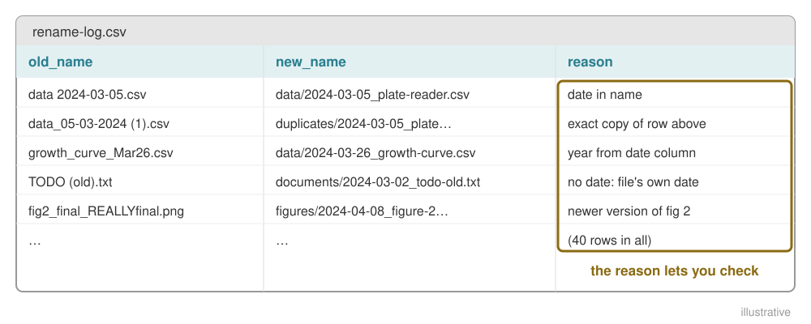{width="72%" fig-align="center"}

- A **log** makes the job checkable: you can read what happened instead of guessing.
- A log makes the job **undoable**: "use the log to put every file back" is one sentence.

::: notes
The third rule: ask for a record. For the folder job, the record is a rename log, a small table with the old name, the new name and the reason for each file. For the spreadsheet, it is a list of decisions. For the PDFs, it is the page each value came from. The record does two things. It lets you check the job by reading instead of by searching. And it makes the job reversible: if you do not like the result, you can ask the agent to use the log to undo every change. An agent will not always keep such a record unless you ask for it, so ask every time.
:::

## Rule 4: ask the agent to list its assumptions

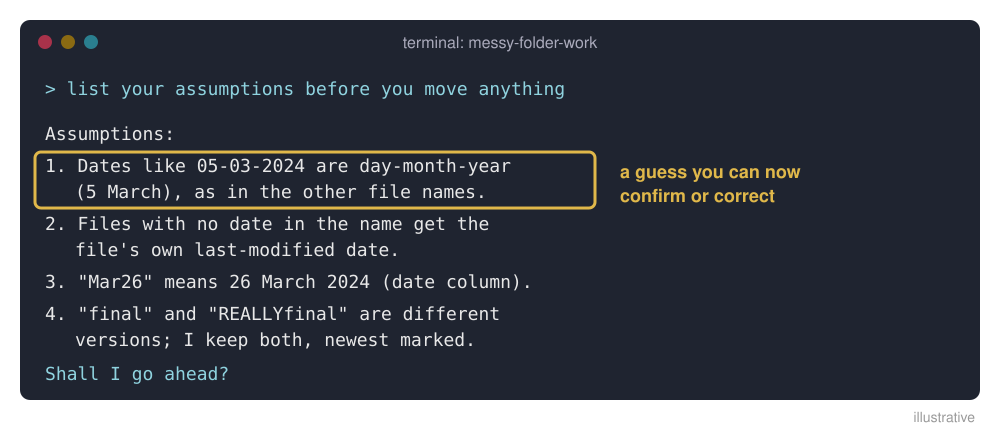{width="80%" fig-align="center"}

::: notes
The fourth rule is to ask the agent to list its assumptions. An agent fills every gap in your description with a guess, and it usually does not tell you. Is 05-03-2024 the fifth of March or the third of May? Should a file with no date get today's date or the date it was last saved? Is "ctrl" the same as "Control"? Each guess is probably reasonable, but some will be wrong for your situation, and you cannot correct a guess you do not know about. Asking for assumptions turns hidden guesses into a list you can read in a minute. It is also a good way to see whether the agent understood the task at all.
:::

## Rule 5: check with counts, totals and three random samples {.smaller}

- **Count before and after.** 40 files in, 40 files out (or 37 plus 3 duplicates). 48 animals in, 48 rows out.
- **Check a total.** If the sheet has a mean or a sum, the cleaned data should give the same number.
- **Spot-check three at random.** Pick three rows, files or cells and compare them with the original yourself.
- **Use what you know.** Mouse weights of 250 g, or a report dated 2052, are wrong whatever the agent says.

"It ran without errors" is not a check. "The agent says it checked" is not a check either.

::: notes
The fifth rule is to check, and to check in a way that takes minutes, not hours. Counting is the most powerful check: if forty files went in, forty must come out, or the difference must be explained. A total is the next best: if the student's sheet says the mean weight is 23.27 grams, your cleaned table should say the same, otherwise a value was lost or misread. Then pick three things at random and check them by hand against the original. Random matters: if you only check the first rows, you only learn about the first rows. Finally, use your own expertise. You know what a plausible mouse weight is; the agent may not care. And note the last line: an agent saying it has checked its own work is not the same as you checking it.
:::

## Job 1: the folder has 40 files and no system

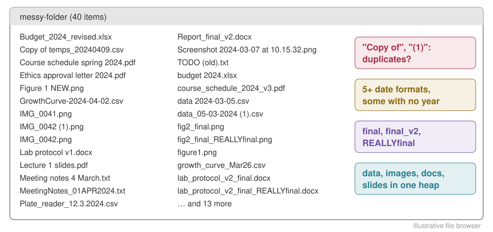{width="75%" fig-align="center"}

::: notes
Now the first job. This is the folder as you unzip it. Forty files from a small lab project. Dates in at least five formats. Several "final" versions. Files called "Copy of" and "(1)", which are often exact duplicates but not always. Screenshots and photos named by the camera. Documents, data, figures and slides all in one heap. You could sort this by hand in an hour. The agent will do it in a few minutes, but only if you say what sorted means to you.
:::

## The prompt for job 1 describes the finished folder

```text
This folder holds 40 files from a small lab project: data, images,
documents and slides. Organise it so that a colleague could find things.

What I want at the end:
- a few subfolders by kind of file (for example data, figures, documents)
- every file renamed as YYYY-MM-DD_short-description.ext, using the date
  in the name, or the file's own date if the name has none
- exact duplicates moved to a folder called duplicates, not deleted
- a file rename-log.csv with one row per file: old path, new path, reason
- nothing deleted, and nothing outside this folder touched

Before you move anything, show me your plan and list your assumptions,
for example how you read dates like 05-03-2024.
```

::: notes
Here is the prompt we use in the exercise. Notice that it says nothing about how to rename files or how to find duplicates. It describes the folder we want at the end, it says what happens to duplicates, it asks for the log, and it sets two limits: nothing deleted, nothing outside this folder. The last paragraph asks for a plan and a list of assumptions before any file is moved. That costs one extra round of conversation and saves a lot of tidying up. You may want different subfolders or a different name pattern. That is fine: the point is that you decide and write it down.
:::

## The agent shows a plan, then asks before it moves files

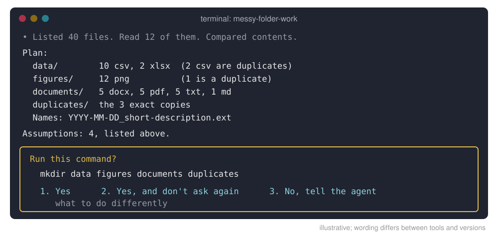{width="78%" fig-align="center"}

::: notes
This is roughly what you will see. The agent first looks around: it lists the files, opens a few to see what is inside, and compares file contents to find duplicates. Then it shows a plan and its assumptions, and stops, because we asked it to. Read the plan. If you agree, say so; if not, say what to change. Then it starts work, and each time it wants to run a command that moves or renames files it asks permission, depending on your settings. You learned to read those permission prompts in the Terminal survival kit. This picture is illustrative: your session will look different, and the agent may choose a different order of steps.
:::

## After: a structure you can explain in one sentence

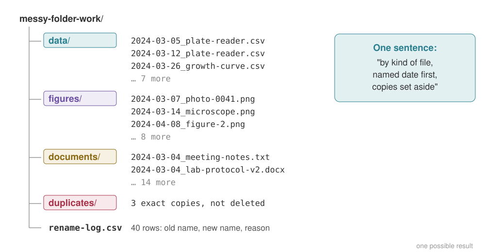{width="62%" fig-align="center"}

::: notes
Here is one sensible result. Data in one folder, figures and photos in another, documents and slides in a third, duplicates set aside, and a rename log at the top. Every name starts with a date in the same format, so files sort in time order. Your result will differ in the details, and that is fine as long as you can explain the structure in one sentence and the names follow the pattern you asked for. If the agent invented a structure with twelve subfolders, that is a sign the description was too loose, and you can simply say "use at most four subfolders".
:::

## Count before and after: every file must be accounted for

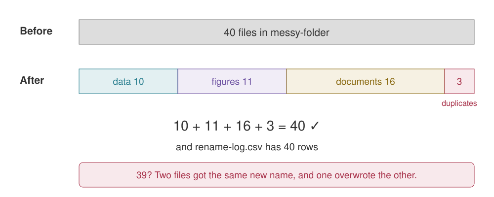{width="78%" fig-align="center"}

::: notes
The first check is a count. Forty files went in. Afterwards, the subfolders should hold thirty-seven files and the duplicates folder three, and the rename log should have forty rows. If any of these numbers is off, something was lost, overwritten or skipped, and you ask about it. Overwriting is the classic accident here: if two files get the same new name, one replaces the other and silently disappears. Counting catches it. Then open the duplicates folder and check that each file really has a twin: same size, and the same content when you open both.
:::

## Dates in file names are where the agent has to guess {.smaller}

| Original name | Possible readings | What settles it |
|---|---|---|
| `data_05-03-2024 (1).csv` | 5 March or 3 May | it is a copy of `data 2024-03-05.csv` |
| `microscope 14-03-24.png` | 14 March 2024 | there is no month 14 |
| `growth_curve_Mar26.csv` | 26 March, which year? | the date column inside the file |
| `Meeting notes 4 March.txt` | 4 March, which year? | the first line of the file |
| `TODO (old).txt` | no date in the name | the file's own date (2 March 2024) |

Check these rows in the rename log yourself. They are where a wrong guess hides.

::: notes
The trickiest part of the folder job is dates. Some names are unambiguous, some can be read two ways, some have no year and some have no date at all. A careful agent looks inside the file or at the file's own modification date to settle it, and says so in the log. A careless one picks the first reading that comes to mind. This table lists the cases in our example folder. When you check the rename log, go straight to these rows. In your own folders, the same kind of ambiguity is everywhere, and it is the single most common source of quiet mistakes when files are renamed in bulk.
:::

## Job 2: a sheet a person can read and a computer cannot

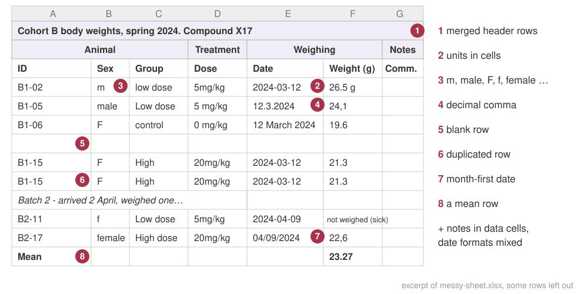{width="85%" fig-align="center"}

::: notes
The second job is a spreadsheet of body weights from a mouse study, typed in by hand over two weighing days. A person reads it without trouble: the title, the group headings, the notes. A program cannot: merged headings span several columns, weights are written as "26.5 g" or with a decimal comma, sex is written in nine different ways, there are blank rows, a note in the middle of the data, a duplicated row and a mean at the bottom. If you load this into R, Python or a statistics package as it is, you either get an error or, worse, a result that looks fine and is wrong.
:::

## Each kind of mess needs a decision {.smaller}

| Mess | Example | A decision someone has to make |
|---|---|---|
| Merged header rows | "Animal" over three columns | which row holds the column names |
| Units in cells | `26.5 g`, `5mg/kg` | strip the unit; check it is the same unit everywhere |
| Decimal commas | `24,1` | read as 24.1 |
| Several spellings | `Male`, `male`, `M`, `m` | map to one code |
| Mixed date formats | `12/03/2024`, `12.3.2024`, `12 March 2024` | day first or month first? |
| Notes in data cells | `not weighed (sick)`, `23.7 (re-weighed)` | empty, or keep the number? |
| Extra rows | blank rows, a batch note, a duplicate, a mean row | remove, and say so |

None of these is hard. Together they are about 20 small decisions, and you want to see every one.

::: notes
Each kind of mess on the sheet needs a decision, and most decisions are obvious. A decimal comma means a decimal point. "M" and "male" mean the same thing. But some are not obvious, and a few depend on knowledge only you have. Does "not weighed, sick" mean the value is missing, or that the animal should be left out? Does "minus" in the dose column mean zero, or unknown? Is a row that appears twice a duplicate, or two animals with a typo in the ID? The agent will make all of these decisions. Our job is to make sure we see each one, so we can agree or disagree.
:::

## Ask for a script, not only a clean file

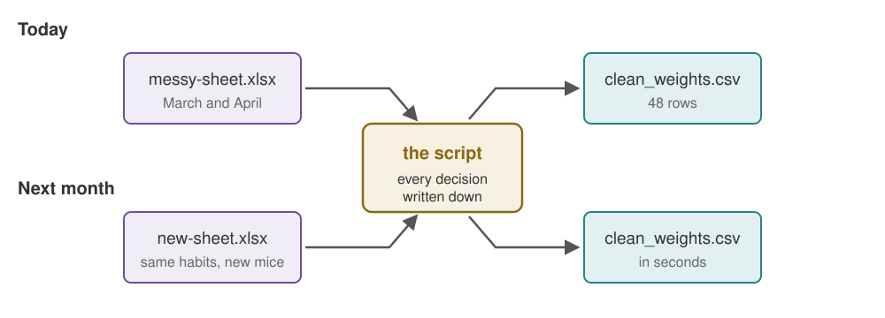{width="85%" fig-align="center"}

- Next month the student sends a new sheet with the same mess. You rerun the script.
- The script is also a record: every decision is written down in it.

::: notes
For the spreadsheet we ask for something extra: not only the clean file, but a script that produces it. A script is a small program, in Python or R, that reads the messy sheet and writes the clean table. You do not need to be able to write it, or even read all of it. But it gives you two things. First, you can rerun it next month when the same student sends a new sheet with the same habits. Second, the script is itself a record of every decision. If you ask "where do you decide what M means?", the agent can point to the line. The agent may need to install a package to read Excel files and will ask you first. That is normal.
:::

## The prompt for job 2 describes the table, the script and the record

```text
messy-sheet.xlsx holds body weights from a mouse study. I want a tidy
table I can analyse, and a way to do the same next month.

What I want at the end:
- clean_weights.csv with one row per mouse and the columns animal_id,
  sex (F or M), group (control, low or high), dose_mg_per_kg,
  date_weighed (YYYY-MM-DD), weight_g (a number), comment
- a script that makes clean_weights.csv from the .xlsx file, so I can
  rerun it on a new sheet
- decisions.md: a numbered list of every decision you made, including
  each row you removed and how you read each odd value
Do not change messy-sheet.xlsx. If a value is unclear, leave it empty
and list it, rather than guess.
```

::: notes
Here is the prompt. Again, it describes the result: the exact columns of the clean table, the allowed values for sex and group, the date format. It asks for the script and for a decision list. And it sets one important rule for unclear values: leave them empty and list them, rather than guess. That rule matters. Without it, an agent will often fill a gap with something plausible, and a plausible invented value in a data table is very hard to find later. With it, you get a short list of questions to answer yourself.
:::

## The decision list shows what the agent decided for you {.smaller}

An example of what you might get back (yours will differ):

```text
1. Used row 3 as column names; dropped rows 1-2 (title and group headings).
2. Removed 4 blank rows, the "Batch 2 - arrived 2 April" note and the "Mean" row.
3. Removed row 20: an exact copy of row 19 (B1-15).
4. Mapped Male/male/M/m to M and Female/female/F/f to F (also "F " with a space).
5. Read "24,1" as 24.1 and removed "g" from weights.
6. B1-19 "23.7 (re-weighed)": kept 23.7, moved "re-weighed" to comment.
7. B2-11 "not weighed (sick)": weight left empty, note moved to comment.
8. Dose "-" and "none" in control rows read as 0.
9. Dates: read 12/03/2024 and 12.3.2024 as day first (12 March 2024).
```

Read it line by line and ask: **would I have decided the same?**

::: notes
This is the kind of list you want back. Each line is a decision you can agree with or not. Most will be fine. Look out for the ones that change the data: removing a row, filling in a value, reading an ambiguous date. Line three, for example, removes a row because it is an exact copy. Is that right? In this example, yes, but in your own data, two identical rows might be two real measurements. Line nine is the classic: dates read day first. That is right for this sheet, except for one row, as we will see on the next slide. If you would have decided something differently, say so, and the agent changes the script.
:::

## Check rows, categories and the total

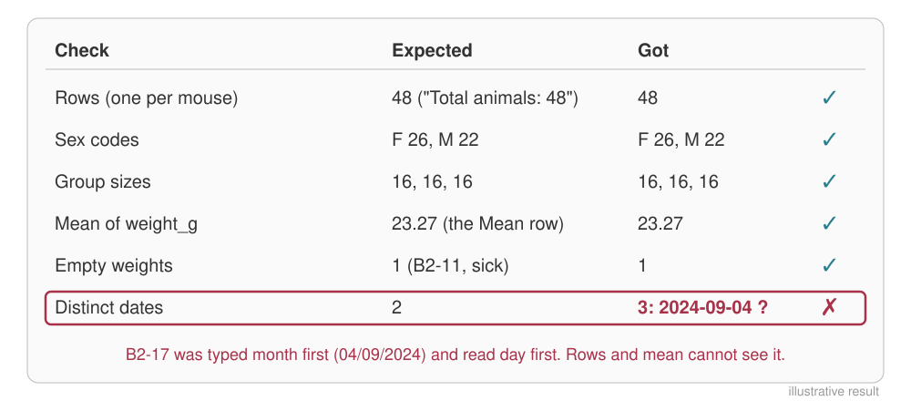{width="80%" fig-align="center"}

::: notes
Now check the result. The sheet's own note says 48 animals, so the clean table must have 48 rows. Count the values in each category: there should be exactly two codes for sex and three for group, and in this study 16 animals per group. Check the total: the sheet's mean row says 23.27 grams, and the mean of the clean weight column should match. And look at the distinct dates. There were two weighing days, so there must be exactly two dates. In this picture a third date appears: 4 September 2024. One row in the sheet was typed month first, 04/09/2024, and read day first. The total and the row count would not catch this, but the distinct dates do. This is why we use several small checks rather than one.
:::

## Job 3: six reports, one table, a page for every value

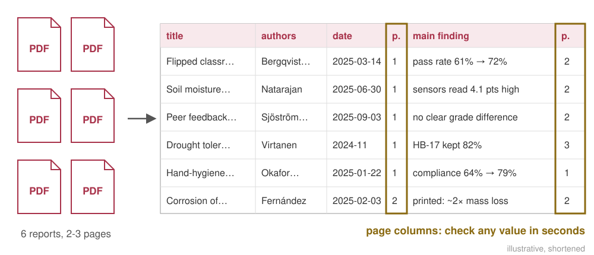{width="85%" fig-align="center"}

::: notes
The third job is the summary table. Six short reports, two or three pages each, from different fields: a teaching project, a field study, a greenhouse trial, a hospital audit, a materials test. We want one table with the title, authors, date, main finding and a one-line summary for each. And for each value, the page it came from. The page column is what makes this table checkable. Without it, checking a value means reading the whole report again. With it, it takes ten seconds. Claude Code can usually read PDF files directly. Codex usually runs a small program to pull out the text, and may ask to install one.
:::

## The prompt for job 3 asks for sources and for gaps

```text
This folder holds six short PDF reports. Make one table,
reports_summary.csv, with one row per report and these columns:
file, title, authors, date (YYYY-MM-DD), main_finding, one_line_summary,
and the page number where you found the title, the date and the
main finding.

Use only what is written in the reports. If something is missing or
unclear, write "not stated" and tell me; do not fill it in.
At the end, list every value you were unsure about.
```

::: notes
The prompt for the third job. As before, it describes the table: the columns, the date format, one row per report. It asks for the page of each important value. And it says what to do when something is missing: write "not stated" instead of filling it in. This matters a lot for summaries. One of our reports has no date on its first page. Another has a date that can be read two ways. Another gives only a month. Without the instruction, an agent may quietly invent a full date that looks right. With it, you get an honest gap that you can fill yourself.
:::

## Spot-check three random cells against the page

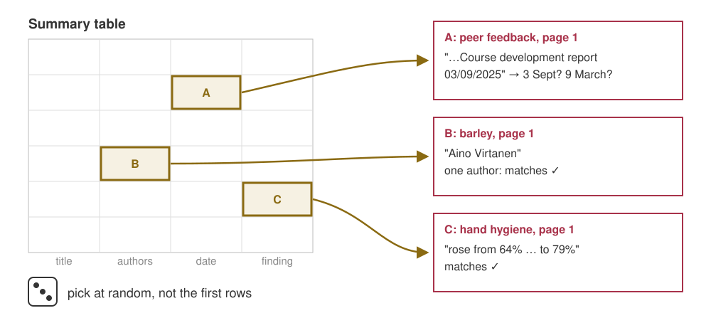{width="85%" fig-align="center"}

::: notes
Now the spot check. Pick three cells at random, for example by rolling a die for the row, or by asking a colleague to point. Open the PDF at the page the table names and check the value. Is the number right? Is the author list complete? Is the main finding really the finding of this report? If all three are right, you have some confidence in the table, though not certainty. If one is wrong, check more, and tell the agent what was wrong. With six reports, you could check everything. The habit matters for later, when you summarise sixty reports and can only check a sample.
:::

## Summaries are where plausible but wrong details creep in {.smaller}

The peer-feedback report says on page 1:

> A pilot at another department reported that peer feedback improved report grades by a full grade step.

and on page 2:

> We found no clear difference in the final report grades: the mean grade was 3.9 with peer feedback and 3.8 without.

- A quick summary may report "peer feedback improved grades by a full grade step". That is **another study's** result.
- A date `03/09/2025` may be read as 9 March instead of 3 September.
- A report dated "November 2024" may get an invented day.

These errors look exactly like correct values. Only the page reference lets you catch them quickly.

::: notes
Here is the kind of mistake to look for. Our peer-feedback report mentions an earlier pilot that found a large effect, and then reports its own result, which is no clear difference. A hurried summary can pick up the wrong one. The sentence is fluent, the number is real, it is even in the report. It just is not this report's finding. The same goes for dates: a British-style date read as American, or a month-only date given a made-up day. None of these errors look like errors. They look like a tidy table. That is why we ask for page references and do spot checks: not because the agent is usually wrong, but because when it is wrong, it looks the same as when it is right. The next unit explains why this happens.
:::

## If the result is wrong, say what is wrong

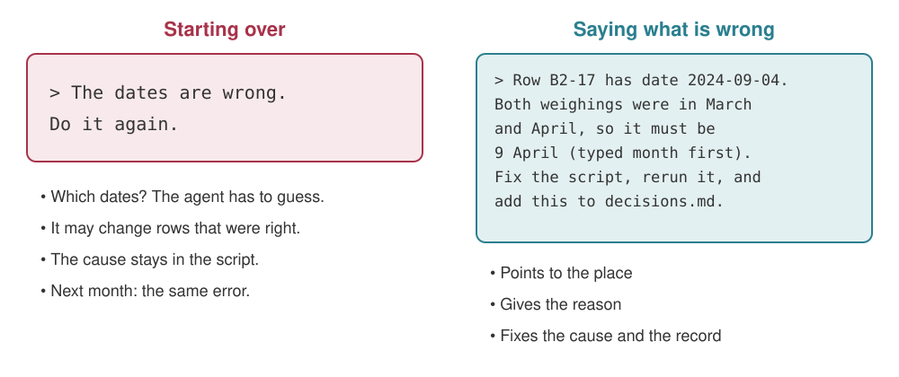{width="85%" fig-align="center"}

::: notes
Sooner or later a check fails. The natural reaction is to say "this is wrong, do it again", or to close the session and start over. Both waste the work that was right. The agent does not know which part you are unhappy with, so it may change the parts that were fine and keep the part that was wrong. Instead, say exactly what is wrong: which row, what you expected, and why. Then ask it to fix the cause, not only the symptom. For the spreadsheet, that means fixing the script, rerunning it, and updating the decision list, so that next month's run gets it right too.
:::

## Good corrections point, explain and ask for the record to be updated {.smaller}

| Instead of | Say |
|---|---|
| "The dates are wrong." | "Row B2-17 has date 2024-09-04. Both weighings were in March and April 2024, so this must be 9 April. Fix the script and add the decision to decisions.md." |
| "Do it again, the folder is a mess." | "Put all images in one folder `figures`, not three. Keep everything else. Update rename-log.csv." |
| "The table is wrong." | "The main finding for the peer-feedback report is the earlier pilot, not this study. Use the result on page 2." |

Start over only when the agent misunderstood the whole task, or the session has gone round in circles.

::: notes
Here are some examples of good corrections. Each one points to the exact place, says what you expected, gives the reason if you know it, and asks for the record to be updated. That last part is easy to forget: if the decision list or the rename log no longer matches what was done, it is no longer a record you can trust. When should you start over? When the agent misunderstood the whole task from the start, or when you have corrected the same thing three times and it keeps coming back. Even then, it often helps to start the new session with "last time, this went wrong", so the same misunderstanding does not happen again. We come back to this in Delegating well.
:::

## Your session will look different from this lecture

- The same prompt gives a different session each time: other steps, other wording, sometimes another result.
- That is normal. Language models are not deterministic.
- So we compare **results**, not sessions: the counts, the totals and the spot checks on the exercise page.
- If your result differs from the expected one, that is not a failure. It is something to find out about.

::: notes
A practical warning before you start. If you type exactly the same prompt as your neighbour, you will get a different session. The agent may look at the files in a different order, choose a different folder name, or write the script in R instead of Python. Even the same person gets different sessions on different days. That is a property of how these models work, which we explain in the next unit. For the exercise, it means you should not compare your screen with the slides. Compare your result with the expected outcomes on the exercise page. If the numbers differ, that is interesting: find out whether the agent or the key is right.
:::

## Where this goes wrong {.smaller}

- **Working in the original.** One bad rename command, and the old names are gone.
- **Vague descriptions.** "Clean this up" gets the agent's idea of clean, not yours.
- **No record.** Without a log, you cannot check and you cannot undo.
- **Checking only the first rows.** Errors hide in the odd cases: row 37, the file without a date.
- **Trusting the agent's own check.** "I verified the table" is a claim, not a check.
- **Overwritten files.** Two files renamed to the same name: one is silently lost. Count.
- **Invented values.** A gap filled with something plausible. Ask for "not stated" instead.
- **Your own data too early.** Not before *Privacy, ethics and safety*.

::: notes
Here are the ways today's jobs go wrong, collected in one place. Almost all of them are covered by the five rules. Working in a copy protects against bad commands. Describing the result protects against the agent's own idea of what you want. The record and the checks catch the rest. Two items deserve a second mention. The agent may say it checked its own work, and it may have, but you have not, and its checks have the same blind spots as its work. And invented values are the hardest error to find, because they look exactly like real ones. The fix is to make "I don't know" an allowed answer, by writing it into the prompt.
:::

## A checklist for every delegation

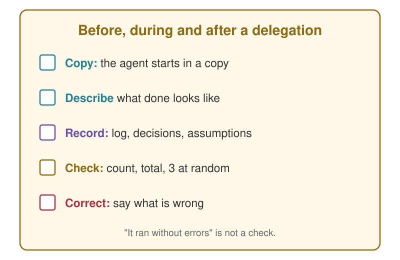{width="62%" fig-align="center"}

::: notes
Here are the five rules as a checklist that fits on a sticky note. Copy first. Describe the result. Ask for a record and a list of assumptions. Check with counts, totals and three random samples. Correct by saying what is wrong. You will use this checklist in every unit of the course, and you will find that it works for any job you give an agent, not only for files and spreadsheets. Keep it next to your screen for the exercise.
:::

## Summary {.smaller}

| Concept | Key fact |
|---|---|
| Good first jobs | tedious, easy to check, easy to undo |
| Work in a copy | start the agent in the copy; the original stays untouched |
| Describe the result | what done looks like, odd cases, what must not happen |
| Ask for a record | rename log, decision list, page references |
| List assumptions | hidden guesses become a list you can read |
| A script, not only a file | rerun next month; the script records every decision |
| Count and total | 40 files in, 40 accounted for; the mean matches the sheet |
| Spot checks | three at random, against the original, by you |
| "Not stated" | allow the agent to say it does not know |
| Correct, do not restart | point to the problem, explain, update the record |

**Next (How LLMs and agents work, and how they fail):** what is going on inside the agent, and why it misreads dates, picks up another study's result and says it has checked when it has not.

::: notes
Here is the summary. Choose jobs that are easy to check and easy to undo. Work in a copy. Describe the result you want, including the odd cases. Ask for a record and for the assumptions. Ask for a script when a job will come back. Check with counts, totals and random spot checks that you do yourself. Allow the agent to say "not stated". And when something is wrong, say what is wrong rather than starting over. In the next unit we look inside: what a language model is, how the agent loop works, and why the mistakes we saw today, misread dates, a finding from the wrong study, a confident claim of having checked, are exactly the mistakes we should expect.
:::
