## About this lecture

From now on the agent edits the files of your own project, not copies of example data. Before it does that at scale, we need a way to see exactly what it changed and to take any change back. **Git** gives both: it keeps dated snapshots of your project folder, each with a short note saying what was done and why.

- **A commit is a snapshot** of the whole folder, with a message: an entry in your lab notebook.
- **The history** shows every snapshot; **the diff** shows exactly which lines changed.
- **Going back** is one sentence to the agent: undo a bad edit, or bring back last week's version.
- **`.gitignore`** keeps secrets, personal data and huge files out of the snapshots.
- **You do not type git commands.** The agent does; you read what it proposes and check the result.

This is a **hands-on** unit. Sharing the history with others comes next, in *GitHub*. Branches get only a mention.

::: notes
This unit gives you the safety net we have promised since the first week. Until now, the rule was: work in a copy, and if things go wrong, delete the copy and start again. That works for example data, but not for a project that grows over weeks, where you want to keep the good changes and throw away only the bad one. Git is a program that keeps a history of a folder. You do not need to learn its commands; the agent knows them very well. What you need is the idea of a snapshot, the habit of taking one before and after each agent task, and the ability to ask the right questions: what changed, and can we go back. Putting the project online, on GitHub, is the next unit. Today everything stays on your own computer.
:::

## The agent changed six files, and now the figure is wrong

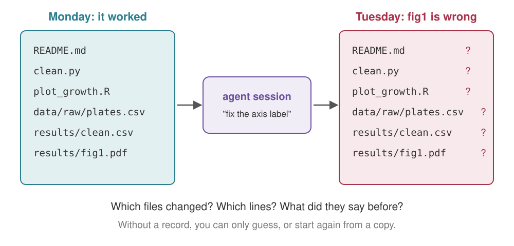{width="80%" fig-align="center"}

::: notes
Here is the situation that every regular agent user meets sooner or later. On Monday the analysis worked. You asked the agent for a small change, fix an axis label, and it did that, but it also tidied a script, regenerated a results file and, perhaps, touched a data file. On Tuesday you notice the figure is wrong. Which change caused it? What did the files say before? If you only have the current state of the folder, you are reduced to guessing, or to throwing everything away and starting again from an old copy, losing the good changes with the bad. We saw in How LLMs and agents work that scope creep is a typical agent failure. Git turns it from a disaster into a nuisance.
:::

## Copies with names do not scale; a history does

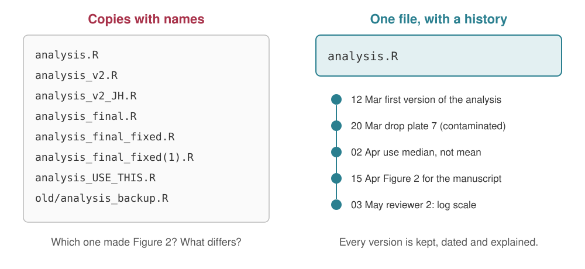{width="85%" fig-align="center"}

::: notes
Everybody already does version control, by hand. We make a copy and call it v2, then final, then final fixed. After a few months nobody knows which file made Figure 2, or what the differences between the copies are. On the right is the same work with git. There is only one file, analysis.R, and next to it a list of dated versions, each with a sentence saying what changed and why. You can open any of them, compare any two, and go back to any of them. That is all git is, at the level we need it: one folder, a list of snapshots, and a note on each.
:::

## Git takes snapshots of a whole folder

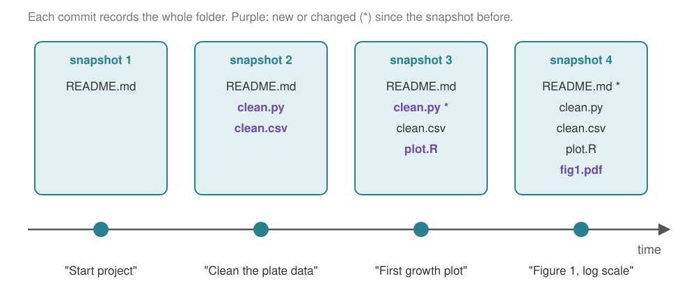{width="90%" fig-align="center"}

- A snapshot is called a **commit**. It records the state of **every file** in the folder at that moment.
- You decide when to take one. Nothing is saved in the history until you commit.

::: notes
The central idea is a snapshot. When you commit, git records the state of all files in the project folder at that moment. The next commit records the state again, and so on. Git is clever about storage, so a hundred snapshots of a folder do not take a hundred times the space; unchanged files are stored once. A few things follow from this picture. First, a snapshot is of the whole folder, so going back to Monday's snapshot means getting all files as they were on Monday, or just one of them if you prefer. Second, git only knows what you committed. Changes made since the last commit are not yet in the history. That is why the rhythm of committing matters, and we will come back to it.
:::

## A commit is a snapshot with a name, an author, a date and a message

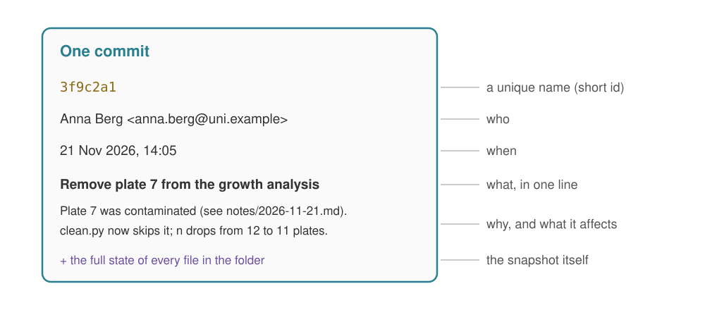{width="85%" fig-align="center"}

::: notes
Here is one commit up close. It has a unique name, a long string of letters and digits, of which the first seven are usually enough to identify it. You will see these short ids in the agent's output; you never need to remember them. It records who made it and when. And it has a message: a first line saying what was done, and, if needed, a few lines saying why and what it affects. Behind all this is the snapshot itself. Notice how this looks like an entry in a lab notebook: date, who, what, why. That is no accident, and it is how we will use it.
:::

## Git lives inside your project folder; nothing leaves your computer

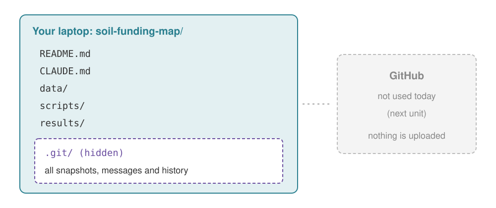{width="80%" fig-align="center"}

::: notes
Where does the history live? In a hidden folder called .git inside your project folder. Your file browser does not show it by default, and you never need to open it. Two consequences. First, git works entirely offline and nothing is uploaded anywhere: it is not a cloud service. GitHub, which many people confuse with git, is a website where you can put a copy of the history, and that is the next unit. Second, if you delete the project folder, the history goes with it. Git is an undo button and a notebook, not a backup. We will come back to that on the limits slide.
:::

## Five words cover almost everything {.smaller}

| Word | Meaning | You say to the agent |
|---|---|---|
| **repository** (repo) | a folder whose history git keeps | "Make this folder a git repository." |
| **commit** | a snapshot with a message | "Commit this with a message describing what we did." |
| **history** (log) | the list of commits | "Show me the history as a short table." |
| **diff** | the exact lines that changed between two states | "Show me what changed since yesterday." |
| **restore / revert** | go back: one file, or one whole commit | "Undo your last change to clean.py." |

Ignore the rest of git's vocabulary for now. When the agent uses a word you do not know, ask.

::: notes
Git has a reputation for being hard, and for programmers working in teams it can be. For one person keeping a project in order, five words are enough. A repository, or repo, is just a folder with a history. A commit is a snapshot. The history, which git calls the log, is the list of commits. A diff is the list of changed lines between two states, for example between now and the last commit. And restore or revert are the two main ways to go back. The right-hand column shows how you would ask for each in plain language. The agent translates that into the actual git commands.
:::

## You say what you want; the agent types the git command

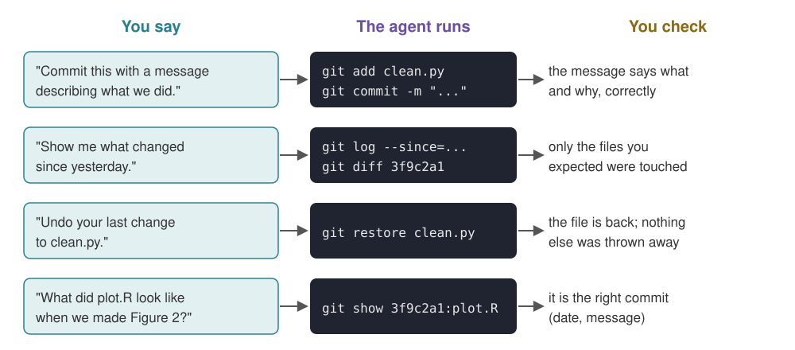{width="88%" fig-align="center"}

::: notes
This is how we use git in this course. You speak in plain language, the agent translates it into git commands, and you check the result. Look at the right column: each request has a simple check. After a commit, read the message: is it true? After asking what changed, look at the list of files: are these the files you expected? After an undo, check that the file is back and nothing else was lost. The agents are very good at git, because there is an enormous amount of git usage in their training data. The risk is not that they type the wrong command, but that they do more than you asked, so the check is still yours.
:::

## If git is missing, the agent installs it with you {.smaller}

Ask first, without installing: "**Is git installed on this computer? Only check.**" (You may have done this in *Terminal survival kit*.)

| System | Usual route | Note |
|---|---|---|
| **Mac** | Apple's Command Line Tools (`xcode-select --install`), or Homebrew | a system window asks you to confirm |
| **Windows** | Git for Windows, from git-scm.com or with `winget` | accept the default choices; also lets Claude Code use Bash |
| **Linux** | the system's package manager | needs your password |
| **Managed laptop** | the university software centre | ask IT if you cannot install |

Then git needs your **name and email** once. It writes them into every commit.

::: notes
Many Macs and most Linux machines already have git. On Windows you may have installed Git for Windows together with Claude Code in Accounts and installation. If not, this is a good job for the agent, using the routine from the Terminal survival kit: ask it to check first, then ask for a plan, then approve step by step. Some steps open a system dialog or ask for an administrator password; those you do yourself. On a university-managed laptop, the software centre or IT is often the right route. After installation, git needs to know your name and email address, because it writes them into every commit. The agent will set them with one command each, and it should ask you which name and address to use, not invent them.
:::

## Choose the name and email in your commits knowingly

- Git writes them into **every** commit. Anyone who later gets a copy of the history can read them.
- Today the history stays on your laptop. In *GitHub* it may become public.
- Your work email is usually fine. GitHub also offers a private "noreply" address, in your GitHub email settings, if you would rather not publish your email.
- The agent may add a line naming itself as co-author of a commit. That is useful: it is part of your record of AI use.

::: notes
A small privacy point, in the spirit of Privacy, ethics and safety. The name and email you give git end up in every snapshot. As long as the repository is on your laptop, that does not matter. Once it is on GitHub, and especially if the repository is public, anyone can read them. For most people, their university name and address are fine, because they are already public. If you prefer not, GitHub offers a private address, and we set that up in the GitHub unit. Some agents add a line to their commit messages saying that the agent helped, a co-author line. Keep it: it is an honest, automatic record of which changes were made with AI, which you will need for the AI-use disclosure we discussed in the privacy unit.
:::

## Making the project a repository is one prompt

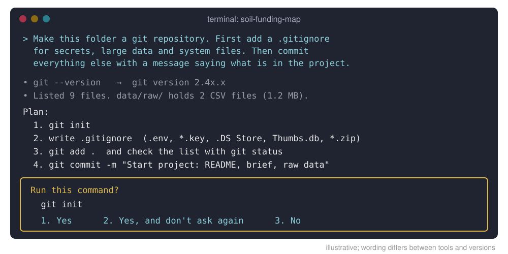{width="80%" fig-align="center"}

::: notes
Here is what the first step looks like for your own project. You start the agent in the project folder and ask it to make the folder a repository, first add a gitignore file, and then make the first commit. Order matters: the ignore list comes before the first commit, for a reason we will see in a moment. The agent checks that git is installed, looks at what is in the folder, and proposes a plan. Each command comes as a permission request, depending on your mode. git init is harmless: it creates the hidden .git folder and nothing else. Your session will look different, but these four steps, init, ignore list, add, commit, are always the same.
:::

## `.gitignore` keeps some files out of the snapshots

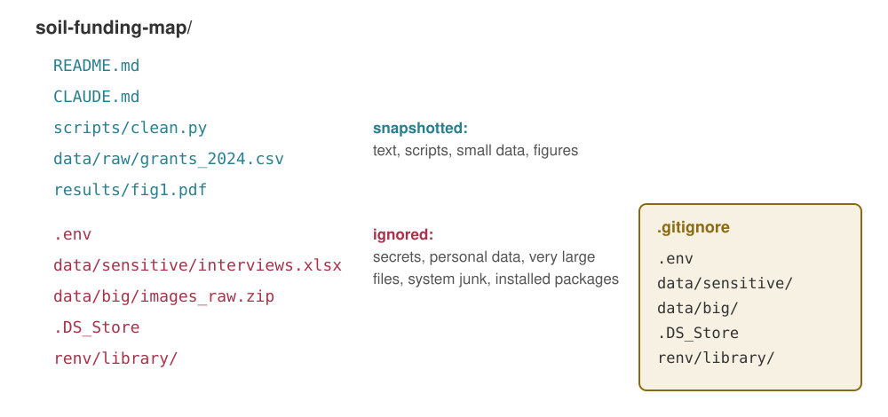{width="85%" fig-align="center"}

::: notes
Not every file belongs in the history. A file called .gitignore lists the files and folders that git should pretend do not exist. Four kinds belong there. Secrets: passwords, access keys, often kept in a file called .env. Personal or confidential data, according to the data class you wrote in your README. Very large files, such as raw images or zip archives, which make the history slow and, later, cannot go to GitHub. And system junk: the .DS_Store files a Mac sprinkles everywhere, or packages that a tool installs into the project and can reinstall at any time. Everything else, the README, scripts, notes, small data files and figures, goes in. Small, non-sensitive raw data in the history is a good thing: the snapshot then really contains everything needed to rerun the analysis.
:::

## A file once committed stays in the history

- Deleting a file later does **not** remove it from the earlier snapshots. Going back brings it back.
- So write `.gitignore` **before** the first commit, and check what is about to be committed.
- Ask: "**List every file you are about to commit, and tell me if any looks like a secret, personal data or a large file.**"
- If a secret got into a commit, treat it as leaked once the history is shared: **change the password or key**. Removing it from history is possible but fiddly; ask before anything is pushed.

::: notes
This is the one property of git that surprises people in a bad way. Because every snapshot is kept, a file you committed once is in the history forever, even after you delete it. That is exactly what makes git an undo button, and exactly what makes it dangerous for secrets and personal data. So the ignore list comes first, and before every commit it is worth a glance at the list of files. The agent is good at spotting things that look like keys or personal data if you ask it to. If a password does end up in a commit, the safe response is to change the password; cleaning history is possible, but it is easy to get wrong, and if the history has already been copied to GitHub, others may have it. In the next unit, this matters more.
:::

## A commit message is an entry in your lab notebook

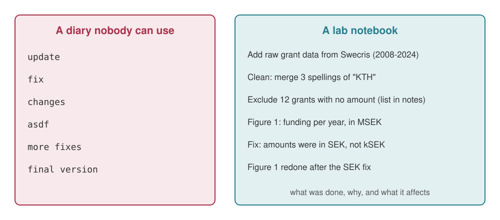{width="85%" fig-align="center"}

::: notes
On the left is the kind of history people produce when committing feels like a chore: update, fix, changes. Six months later it tells you nothing. On the right is the same work written as a lab notebook. Each line says what was done, in words a colleague would understand, and the important ones say why: twelve grants excluded, and where the list is; amounts were in the wrong unit. Imagine a reviewer asks why the numbers in Figure 1 changed between submission and revision. With the history on the right, the answer takes a minute. And the good news is that you do not have to write these yourself. The agent knows exactly what it just did, so it writes good messages if you ask for them.
:::

## Ask for the message you want: what, why, and what it affects

```text
Commit the changes with a message. First line: what we did, in plain
words. Then a few lines: why, which files and results it affects, and
any numbers that changed (rows removed, n per group).
Show me the message before you commit.
```

An example of what you might get back:

```text
Exclude grants with no amount from the funding analysis

12 of 3,481 grants have an empty amount field (listed in
notes/excluded-grants.md). clean.py now drops them; results/clean.csv
regenerated. Totals per year change by less than 0.1 %.
```

::: notes
Here is a prompt for a good commit message. It describes the message you want, as we learned to describe results in First delegations. Asking to see the message before the commit is useful at first: you learn what a good message looks like, and you catch claims that are not true. That matters, because the agent writes the message from its own picture of what it did. If it says totals change by less than 0.1 percent, did it actually check, or is that a guess? A message is a record, and a wrong record is worse than none. Once you trust the agent's messages for a kind of task, you can drop the "show me first".
:::

## Commit before and after every agent task

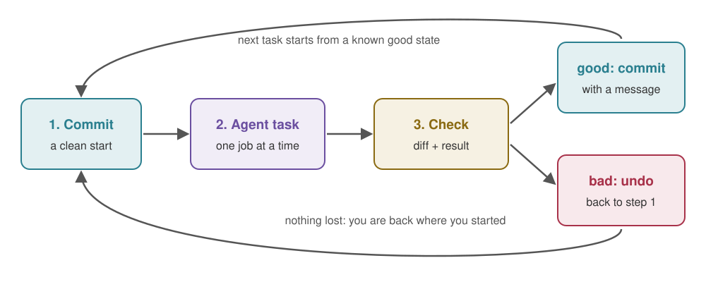{width="85%" fig-align="center"}

::: notes
When should you commit? The simplest rule for this course: before and after each agent task. Before, so the task starts from a known good state, which means "go back" has a clear meaning. After, once you have checked the result, so the good change is safe and labelled. If the check fails, you undo instead, and you are back at the clean start with nothing lost. One task per commit also makes the history readable: each entry is one thing. If you give the agent five things at once, you get one commit that mixes five changes, and you cannot undo one without the others. This loop is the delegation loop from First delegations with git added: the copy is replaced by a commit, the record by the diff.
:::

## The history is your lab notebook

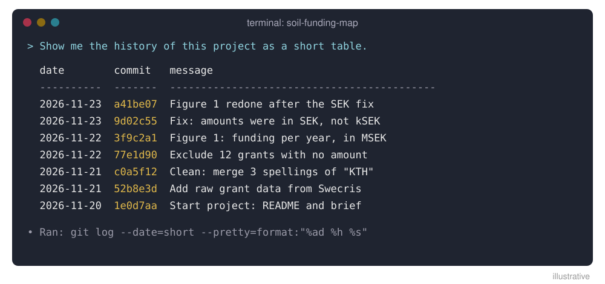{width="80%" fig-align="center"}

::: notes
Here is what you get after a few days of work. The agent turns git's history into a small table: date, short id, message. This is the lab notebook of your project, written as you went along, at almost no cost. You can ask questions of it in plain language: "when did we start excluding grants with no amount?", "what was the last change to the figure script?", "show me everything we did on Friday". The agent answers by reading the history. That is also very useful when you come back to a project after a break, and the agent can use it at the start of a new session to see where things stand. Ask it to read the last few commits before starting.
:::

## "What changed?" The diff shows every line

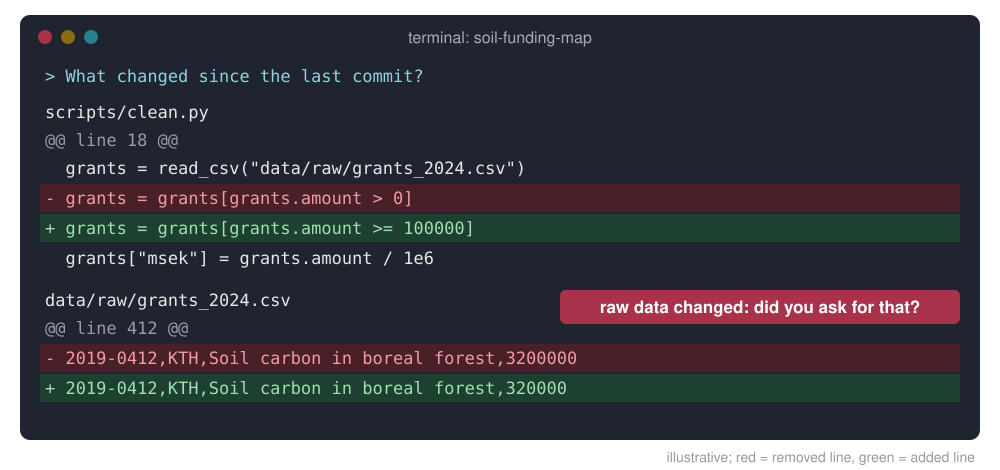{width="85%" fig-align="center"}

::: notes
The diff is the most useful thing git gives you as a checker. It lists exactly which lines changed in which files: red lines were removed, green lines added. In this example we asked for a change to the cleaning script. The first change is the one we asked for, the filter on amounts, although we should check whether 100,000 is the threshold we meant. The second is in a raw data file, which we did not ask for at all: one grant amount has lost a zero. Perhaps the agent thought it was a typo. Without the diff, this edit would have been invisible, and it would have quietly changed the results. With git, you see it at once, and one sentence undoes it.
:::

## Reading the diff is how you check the agent's work {.smaller}

- **Which files?** "List the files you changed, created or deleted since the last commit." Anything unexpected is a question.
- **Raw data changed?** That should almost never happen. Ask why, and undo it.
- **Explain it.** "Explain this diff in plain words, file by file." You do not have to read code to judge it.
- **Size.** You asked for a label change and 300 lines changed? Stop and ask.
- **Results too.** A changed script should come with changed results. A changed result with no changed script is suspicious.

The diff shows what changed. Whether the result is right is still your check, as in *First delegations*.

::: notes
You do not need to understand every line of a diff to use it. Most of the value comes from a few questions. Which files changed, and is each one expected? Did any raw data change? That should be almost never. Is the size of the change in proportion to what you asked for? And you can always ask the agent to explain the diff in plain words, file by file; it is good at that, and you then compare the explanation with what you asked for. One caution: the diff tells you what changed, not whether the result is correct. A script can change in exactly the way you asked and still produce a wrong figure. The checks from First delegations, counts, totals and spot checks, still apply.
:::

## There are three ways to go back

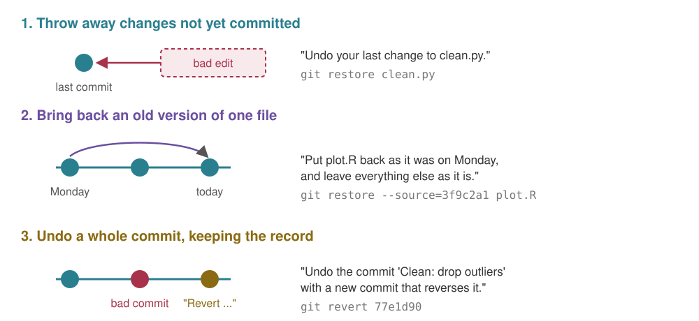{width="85%" fig-align="center"}

::: notes
Going back comes in three kinds, and the agent picks the right command if you say which kind you mean. First: throw away changes not yet committed, for example the agent's last edit to one file. The file returns to the state of the last commit. Second: bring back an older version of one file, say the plotting script as it was on Monday, while keeping everything else as it is now. Third: undo a whole earlier commit by adding a new commit that reverses it. The bad change disappears from your files, but the history keeps both the mistake and the correction, which is exactly what a lab notebook should do. You do not need to remember the commands shown in grey; they are there so you recognise them in a permission request.
:::

## "Undo your last change to clean.py" in practice

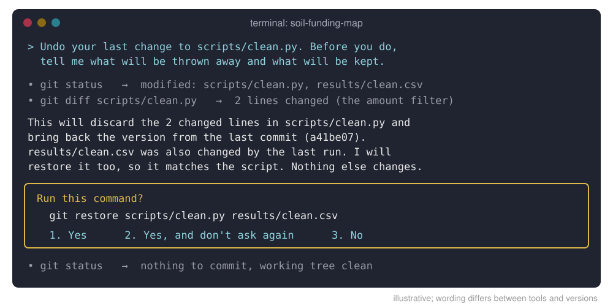{width="80%" fig-align="center"}

::: notes
Here is an undo in practice. Note the second sentence of the prompt: before you do, tell me what will be thrown away and what will be kept. This is a good habit for any undo. The agent looks at the status, sees that two files changed, and explains: the two changed lines in the script go, and the results file, which the last run also changed, goes back too, so script and results match. Then it asks permission for the command. Afterwards it checks the status again: nothing left to commit, everything matches the last snapshot. Your session will look different. What should be the same is that you know, before you approve, what will be lost.
:::

## Some git commands throw work away: read before you approve {.smaller}

| Command you may see | What it does | Risk |
|---|---|---|
| `git status`, `git log`, `git diff`, `git show` | look | none |
| `git add`, `git commit` | take a snapshot | low |
| `git restore <file>` | discard **uncommitted** changes to that file | medium: those changes are gone |
| `git revert <commit>` | add a commit that reverses an old one | low: history is kept |
| `git reset --hard` | discard **all** uncommitted changes in the folder | high |
| `git clean -f` | delete files git does not track | high: they were never in any snapshot |
| `git push --force` (next unit) | overwrite the shared history | high |

If a request contains one of the last three, say no and ask what it would delete.

::: notes
Git is an undo button, but some of its commands also discard work for good, and these are the ones to read carefully in a permission request. Looking at status, the log or a diff is always safe. Committing is safe. Restoring a file discards uncommitted changes to that file, which is usually what you want, but make sure it is only that file. The high-risk ones are reset hard, which throws away every uncommitted change in the whole folder, and clean, which deletes files that git has never seen; those are really gone, because they were never in a snapshot. Push force comes up in the GitHub unit. The agents are careful with these commands and usually ask, but approval fatigue is real. When you see one of the three, stop and ask what would be lost.
:::

## Codex treats a git folder differently

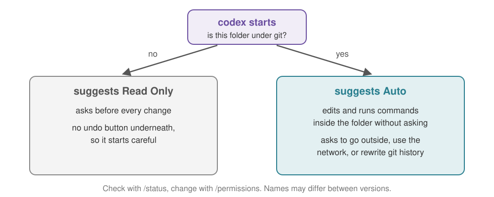{width="75%" fig-align="center"}

::: notes
A practical point for Codex users. When Codex starts, it checks whether the folder is under version control. In an ordinary folder, it suggests read-only, so it asks before every change. In a git repository, it suggests its Auto level: it edits files and runs commands inside the folder without asking, while still asking to go outside the folder, use the network, or run git commands that rewrite history. The reasoning is that a git folder has an undo button underneath. So after today, your project will feel different in Codex: fewer prompts. That is fine, provided you commit before each task and read the diff after it. You can always check the level with slash status and change it with slash permissions.
:::

## Claude Code has its own short-term undo: checkpoints and `/rewind`

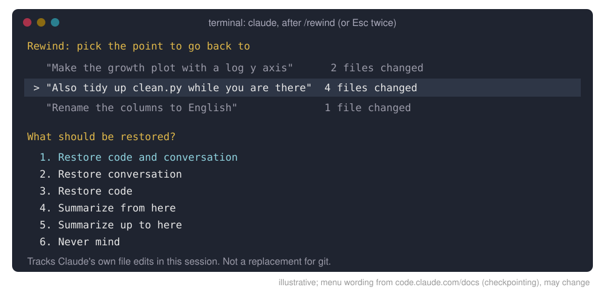{width="75%" fig-align="center"}

::: notes
Claude Code has a built-in undo of its own, called checkpoints. Before each prompt you send, it records the state of the files it edits. Typing slash rewind, or pressing Escape twice with an empty prompt, opens a menu of your earlier prompts. You choose a point and decide whether to restore the code, the conversation, or both. It is quick and needs no git at all. This picture follows the menu described in the Claude Code documentation; the wording may change between versions. Codex has its own ways to go back as well, which change between versions; git works the same in both tools.
:::

## Checkpoints and git do different jobs: use both

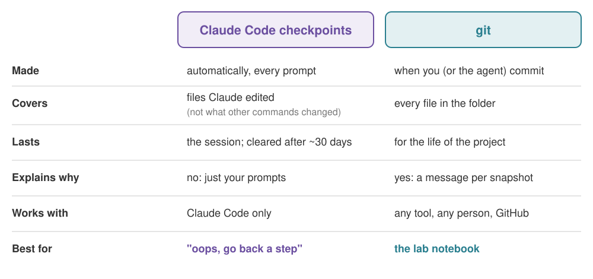{width="80%" fig-align="center"}

::: notes
So do you still need git? Yes, and the documentation says so itself: checkpoints are not a replacement for version control. Look at the differences. Checkpoints are automatic, but they only cover files that Claude edited with its own editing tools; files changed by a command it ran, for example a script that rewrites a results file, are not tracked. They belong to one session and are cleared after about a month. They carry no explanation, only your prompts. And only Claude Code knows about them. Git covers every file, keeps the history for the life of the project, has a message for every snapshot, and works with any tool and with GitHub. Use checkpoints for "oops, go back one step" within a session, and git for the lab notebook.
:::

## Branches exist; you do not need them yet

- A **branch** is a parallel line of history: try something risky without touching the main line.
- You may see the word in the agent's output, for example "on branch main". That is just the name of your one line.
- For one person and one project, **commit and undo are enough**. Branches get a brief mention again in *Parallel workers*.

::: notes
You will meet the word branch. In git, a branch is a parallel line of history: you can try something on a side line and either bring it back into the main line or throw it away. Teams of programmers use them all the time. For our purposes they add complexity without much gain, because commit-before-and-after plus undo already gives you a safe way to experiment. When the agent says you are on branch main, or master on some systems, that is simply the name of your single line of history. We come back to branches when we run several agents in parallel, where they really help.
:::

## Where this goes wrong {.smaller}

- **Committing too rarely.** One commit for a week of work cannot be partly undone. Commit per task.
- **Secrets or personal data committed.** They stay in the history. Ignore first; check the file list.
- **Approving a destructive command.** `reset --hard` and `clean -f` delete for real. Ask what will be lost.
- **Messages that lie.** The agent writes what it believes it did. Read the message against the diff.
- **Git is not a backup.** The history lives in the folder. Laptop stolen, folder gone: history gone. Backups, and GitHub next.
- **Large files.** Big images or data make the repository slow and cannot go to GitHub later. Keep them out.
- **Only the diff checked.** The diff says what changed, not whether the result is right.
- **Your session will look different.** The commands and wording vary. The checks do not.

::: notes
Here are the ways this goes wrong. Committing too rarely is the most common: if a week of work is one commit, undo is all or nothing. Committing secrets or personal data is the most serious, because they stay in the history. Approving a destructive command out of habit is the quickest way to lose work. Commit messages can be wrong, because the agent writes them from its own account of what it did, so read them against the diff now and then. Git is not a backup: if the folder is lost, the history is lost with it. Your university's backed-up drive, or GitHub from the next unit, protects against that. And as always, your session will look different from these slides, but the checks stay the same.
:::

## A routine for every session

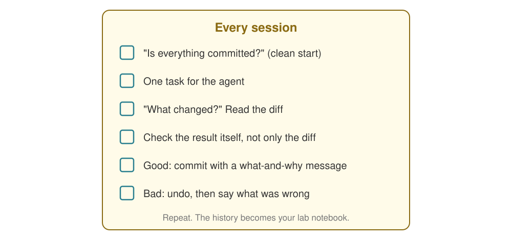{width="62%" fig-align="center"}

::: notes
Here is the routine to keep next to your screen from now on. At the start of a session, ask whether everything is committed, so you start clean. Give the agent one task. Ask what changed, and read the diff, or the agent's plain-language explanation of it. Check the result itself, with the methods from First delegations. If it is good, commit with a message that says what and why. If it is bad, undo, and then tell the agent what was wrong. Then the next task. After a week, the history is a readable notebook of your project, and every step in it can be taken back.
:::

## Summary {.smaller}

| Concept | Key fact |
|---|---|
| Commit | a snapshot of the whole folder, with author, date and message |
| History | the list of commits: your project's lab notebook |
| Diff | exactly which lines changed; the way to check what the agent did |
| Going back | discard uncommitted edits, restore an old file, or revert a commit |
| `.gitignore` | secrets, personal data, large files and junk stay out; write it first |
| Commit message | what, why, what it affects; the agent writes it, you check it |
| Rhythm | commit before and after every agent task |
| Dangerous commands | `reset --hard`, `clean -f`, `push --force`: ask what will be lost |
| Codex in a git folder | suggests Auto instead of Read Only |
| Claude Code checkpoints | `/rewind` for quick session undo; complements git, does not replace it |

**Next (Reproducible figures):** a figure made by a script, committed together with the script, that you can remake on new data in one sentence.

::: notes
Here is the summary. A commit is a snapshot of the whole folder with a message, and the history of commits is your lab notebook. The diff shows exactly what changed, which makes it the main tool for checking the agent's work. You can go back in three ways. The ignore list keeps secrets, personal data and large files out, and it comes before the first commit. The agent writes the messages and types the commands; you read and check. Commit before and after every task. Watch out for the few commands that throw work away. Codex relaxes its default in a git folder; Claude Code's checkpoints give a quick session undo next to git. In the next unit, Reproducible figures, we put this to work: a figure made by a script, both committed, so the figure can be remade at any time.
:::
