## About this lecture

Your project folder is now a git repository with a history, but it lives on one computer. **GitHub keeps a copy of that repository online**, so it survives a lost laptop, you can work on it from two computers, and a colleague can read it, comment on it and help.

- **A repository on GitHub is a copy of your git repository**, history included. Push sends commits up; pull brings them down.
- **Private or public decides who can read everything in it**, including every old version.
- **You log in once with `gh auth login`.** After that the agent can create repositories and push, and you approve each step.
- **Issues are a shared to-do list**, collaborators can read and push, pull requests propose changes.
- **A licence says what others may do**: CC BY for teaching material, MIT for code.

This is a **hands-on** unit. You put a project on GitHub and swap repositories with another participant. Publishing a web page from a repository comes next (*A course or project page*).

::: notes
In Git as undo button and lab notebook, your project folder got a history: every snapshot you or the agent committed is kept, and you can go back. That history still lives on one computer. Today we put a copy of it on GitHub. That gives you three things: a backup, a way to work from more than one computer, and a way to share with colleagues. We look at the difference between private and public, which is a privacy decision before it is a technical one. You log in once, and from then on the agent does the typing. Then issues, collaborators and pull requests, briefly, and licences. In the exercise you swap repositories with another participant and use your own agent to review theirs. That is a real test of how well you organised your project two units ago.
:::

## A colleague asks: "Can I see your project?"

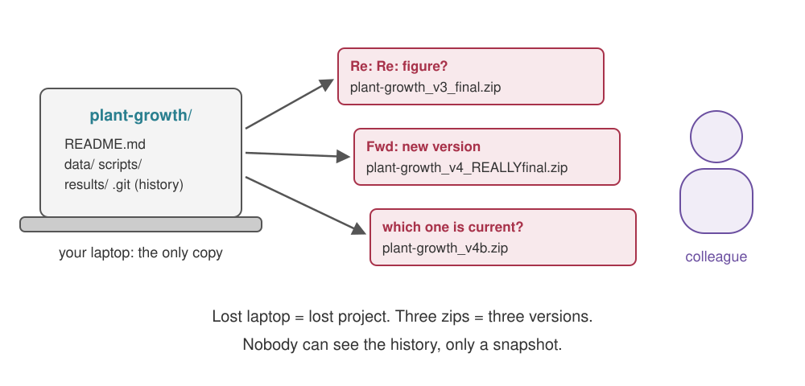{width="85%" fig-align="center"}

::: notes
Here is the situation many of us know. The project lives on your laptop. A colleague asks to see the figure, so you zip the folder and email it. A week later you have changed things, so you send another zip. Now there are three versions in three inboxes, and nobody knows which is current. Worse, the zip contains only a snapshot: the history that git keeps for you is not in it, or it is in a hidden folder nobody will look at. And if the laptop is lost or dies, the project goes with it. GitHub solves all three problems with one idea: a shared copy of the repository that everyone looks at.
:::

## GitHub keeps a copy of your repository, with its history

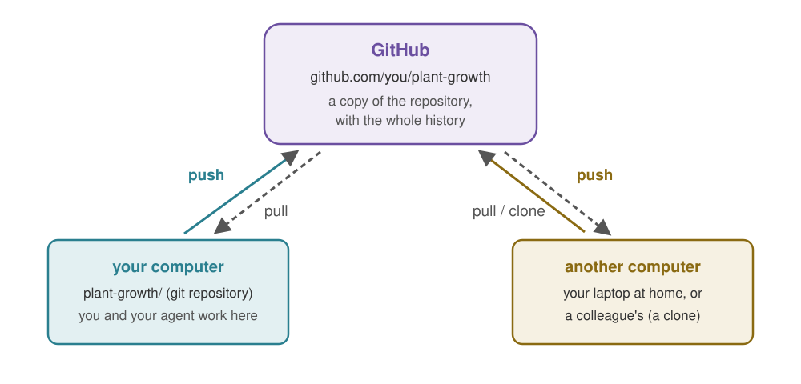{width="78%" fig-align="center"}

::: notes
GitHub is a website that stores git repositories. Your repository on GitHub is a full copy of the one on your computer, including every commit. You and your agent keep working in the folder on your computer, exactly as before. From time to time you push: that sends your new commits to GitHub. On another computer, your laptop at home or a colleague's computer, you clone the repository once, which makes a full copy, and from then on you pull to get new commits. Git is the tool on your computer. GitHub is one website that hosts repositories; GitLab, Codeberg and many universities' own GitLab servers do the same job, and everything in this unit carries over to them.
:::

## Push sends your new commits up; pull brings new commits down

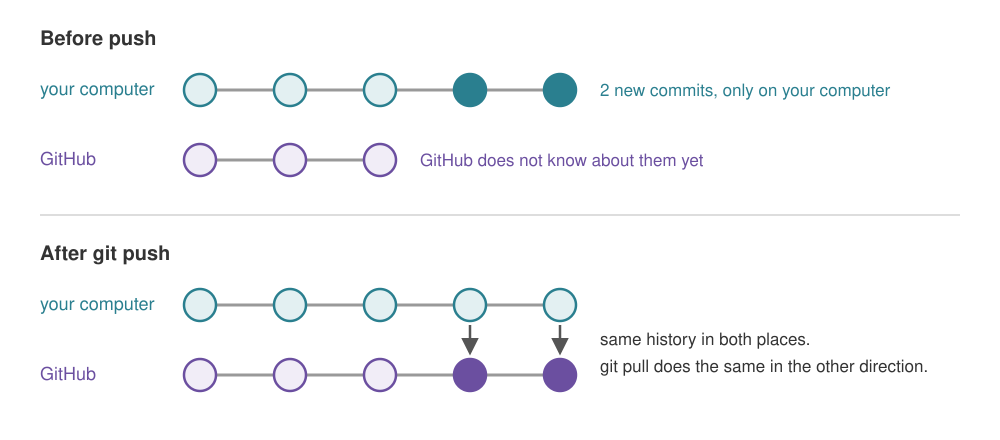{width="80%" fig-align="center"}

- A commit stays on your computer until you push. "Committed" is not "backed up".
- Before you start work on a second computer, pull. Then you start from the newest version.

::: notes
Push and pull only move commits. Here you have made two new commits on your computer. Until you push, GitHub does not know about them: if your laptop is stolen now, these two are lost, even though they are committed. After git push, both places have the same history. Pull does the same in the other direction: it fetches commits that are on GitHub but not yet on this computer. The habit is simple: pull when you sit down, commit as you work, push when you stop. The agent can do all three; you ask in plain words, "push my commits", and approve the command.
:::

## Private or public decides who can read the repository

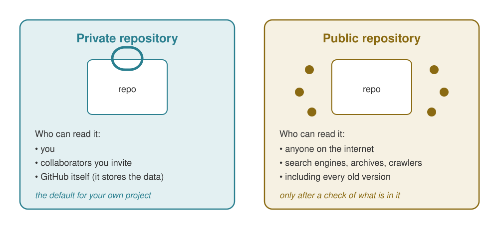{width="80%" fig-align="center"}

::: notes
Every repository on GitHub is private or public. A private repository can be read by you, by the collaborators you invite, and of course by GitHub, which stores it. A public repository can be read by anyone, including search engines and the services that archive public code, and some of those copies stay even if you later make the repository private or delete it. GitHub's free plan gives you unlimited private repositories, so cost is no reason to go public. The rule for this course: your own project starts private. Making something public is a decision you take later, after checking what is in it. We do exactly that check in the next unit, before publishing a web page.
:::

## Public means every file in every old version, not only today's files

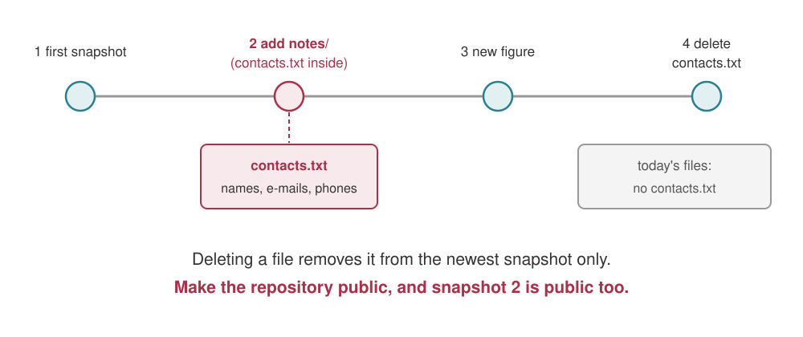{width="82%" fig-align="center"}

::: notes
This is the trap. Suppose that in your second commit a file with contact details slipped in, and in the fourth commit you deleted it. Today's folder looks clean. But git keeps every snapshot, that is the whole point, so the file is still in snapshot 2. If you make the repository public, anyone can click back to snapshot 2 and read it. Removing a file from the history is possible, but it is fiddly and does not help if someone has already copied the repository. So the check before going public covers the history, not just the current files. Ask the agent: "list every file that has ever been in this repository, and flag anything personal or confidential".
:::

## Your data class decides where the repository may live

| Data class (from *Privacy, ethics and safety*) | On GitHub? |
|---|---|
| **Public**: open data, published material, your teaching material | Private or public. Public after a check of files and history |
| **Internal**: your unpublished results, a draft course plan | Private only, and only if your university allows GitHub for this |
| **Personal data**: names, grades, e-mails of students | Not in the repository. Use a synthetic stand-in, add the real files to `.gitignore` |
| **Sensitive personal data** or material given in **confidence** | Never |
| **Exam questions** before the exam | Private only; better not on GitHub at all until after the exam |

A private repository is still on someone else's server. Your university's rules may name an approved alternative, often an internal GitLab.

::: notes
This table connects GitHub to the data classes from Privacy, ethics and safety. Public material can go anywhere, but go public only after the check of files and history. Internal material can go in a private repository if your university allows it; many do, some prefer their own GitLab server, so check. Personal data does not belong in the repository at all, even a private one: a repository is copied to every computer that clones it, and it is easy to make public by mistake. Keep real data outside, or list the files in a file called .gitignore, which tells git never to include them. Sensitive data and material you hold in confidence: never. The privacy flowchart you used in Part 1 applies unchanged.
:::

## `.gitignore` keeps files out of the repository altogether

- A text file `.gitignore` in the project folder lists files and folders git should **never** commit.
- Typical entries: `data/raw/students.xlsx`, `*.key`, `.env`, `secrets/`.
- Ignored files stay on your computer, untouched. They are just never snapshotted, never pushed.
- Add a file to `.gitignore` **before** its first commit. Once it is committed, it is in the history.

Ask the agent: "Add our real data files to .gitignore, then show me with git status that they are not tracked."

::: notes
The tool for keeping things out is a small text file called .gitignore. Each line names a file, a folder or a pattern. Git then behaves as if those files did not exist: it never offers to commit them and never pushes them. The files stay on your disk, so your scripts can still read them. This is how you keep the real student file next to the synthetic stand-in without it ever going to GitHub. The timing matters: .gitignore only works for files that have not been committed yet. If a file is already in the history, ignoring it now does not remove the old snapshots. The agent knows the syntax; your job is to check the result with git status, which lists what git is tracking.
:::

## You log in once; after that the agent can push for you

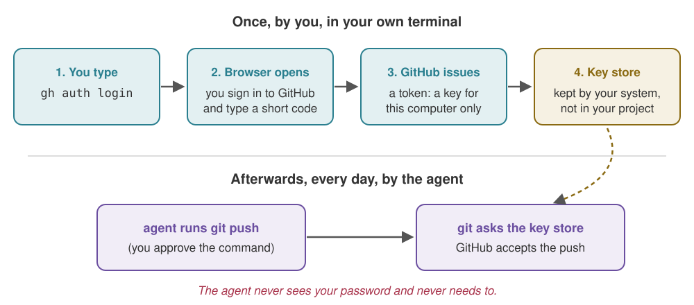{width="85%" fig-align="center"}

::: notes
To push to GitHub, git has to prove that it is you. We do this with the GitHub command-line tool, called gh. You run gh auth login once, in your own terminal. It opens your browser, you sign in to GitHub as usual and type a short code to confirm. GitHub then gives gh a token, a long key that works for this computer only, and gh stores it in your system's key store: the Keychain on a Mac, the Credential Manager on Windows. From then on, when the agent runs git push, git gets the key from the key store, and GitHub accepts the push. The agent never sees your password. You can withdraw the key at any time from GitHub's settings, under Applications.
:::

## The agent installs `gh`; you run the login yourself

1. In the agent, ask: "Install the GitHub CLI, gh, using the official method for my system. Explain each command first."
2. Approve the install command. On a Mac it is often `brew install gh`; on Windows often `winget install --id GitHub.cli`.
3. **Open a second terminal window** and type `gh auth login`. Not inside the agent.
4. Check with `gh auth status`: it should say you are logged in to github.com.

Never paste a token, password or login code into the agent's prompt.

::: notes
Installation follows the pattern from the Terminal survival kit: the agent proposes the command, explains it, and you approve. The official install pages for gh list Homebrew on the Mac and winget on Windows, and the agent will usually pick one of those. The login is different. It is interactive, it involves your password and a one-time code, and it creates a credential. That is your job, in a terminal of your own, not something to type into the agent. This follows the rule from Privacy, ethics and safety: no passwords, tokens or login links in the conversation. Afterwards, gh auth status tells you which account is logged in, which is worth checking if you have more than one GitHub account.
:::

## `gh auth login` asks four questions

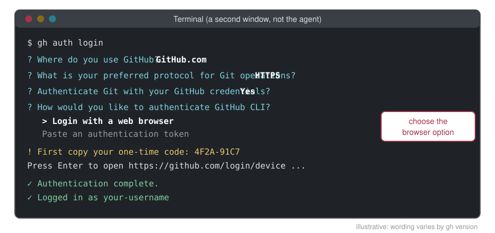{width="80%" fig-align="center"}

- GitHub.com · HTTPS · Yes, authenticate Git · Login with a web browser.

::: notes
Here is roughly what you will see. The exact wording changes between versions of gh, so read it rather than pressing Enter blindly. The answers for this course: GitHub.com, not an enterprise server, unless your university runs one and told you to use it. HTTPS as the protocol, which is the simplest; SSH also works but needs keys we do not need. Yes to authenticate git with your GitHub credentials: this is the step that lets git push without asking for a password. And log in with a web browser. gh then shows a one-time code of eight characters, opens github.com/login/device in your browser, and you type the code there and confirm. Back in the terminal it says you are logged in.
:::

## The agent creates the repository and pushes, in one approved step

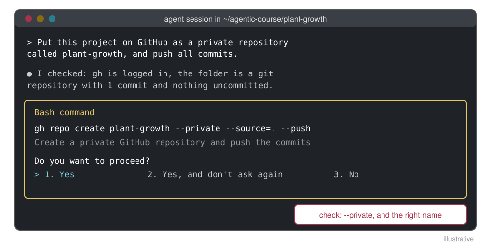{width="78%" fig-align="center"}

::: notes
Now the agent can take over. In the project folder, you ask it to put the project on GitHub as a private repository. A careful agent first checks that gh is logged in, that the folder is a git repository, and that nothing is left uncommitted. Then it proposes one command: gh repo create, with the name, the word private, source equals dot, which means this folder, and push. That single command creates the empty repository on GitHub, connects your folder to it, and pushes every commit. Before you approve, read two things: is it private, and is the name the one you want? Those are the two mistakes that are annoying to undo. This picture is illustrative; your agent's wording will differ.
:::

## Read GitHub commands before you approve them

| Command the agent proposes | What it does | Risk |
|---|---|---|
| `gh auth status`, `git remote -v`, `gh repo view` | only looks | none |
| `git push` | sends your commits to GitHub | low, if the repository is private |
| `gh repo create NAME --private --source=. --push` | new repository from this folder | check **private** and the name |
| `gh issue create`, `gh issue comment` | writes an issue or comment, in your name | check the text first |
| `gh repo edit --visibility public --accept-visibility-change-consequences` | makes the repository **public** | high: everything, with history |
| `git push --force`, `gh repo delete` | overwrites history on GitHub; deletes the repository | high: say no unless you asked for it |

::: notes
As in the Terminal survival kit, most commands you will see fall into a few groups. Commands that only look are always safe. A normal push is low risk for a private repository: it only adds commits. Creating a repository is fine once you have checked private and the name. Issue commands write text on GitHub in your name, so read the text. Then there are two commands to stop at. Changing the visibility to public publishes everything, history included; gh refuses to do it unless an extra flag, accept visibility change consequences, is added, and that flag in a proposed command is your cue to stop and think. Force-pushing rewrites the history on GitHub and can destroy other people's work; deleting a repository is final. If the agent proposes one of these and you did not ask for it, say no and ask why.
:::

## The repository page shows your files and your README

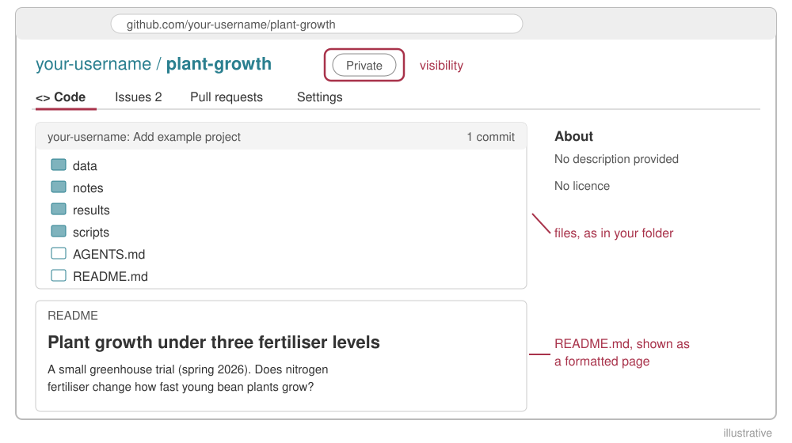{width="80%" fig-align="center"}

::: notes
After the push, open github.com, your user name, slash, the repository name. You see the same files and folders as in your project folder. Next to the name is a label, Private or Public: look at it every time you open a repository you care about. Below the files, GitHub shows your README.md as a formatted page. This is the first thing any visitor reads, including your future self and your colleague's agent. On the right, the About box is empty: no description, no licence yet. We add a licence later today. The tabs at the top lead to Issues, Pull requests and, for the owner only, Settings.
:::

## README.md is plain text that GitHub shows as a formatted page

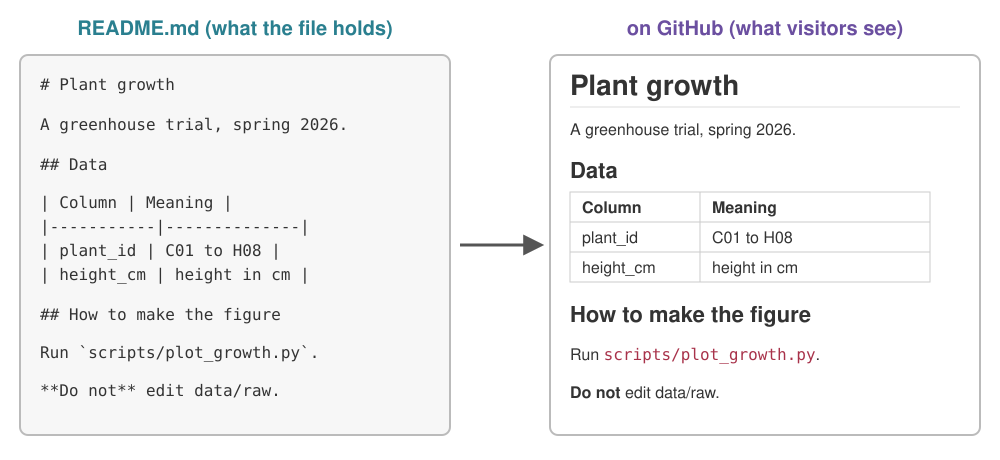{width="85%" fig-align="center"}

::: notes
The README is written in Markdown, a way of formatting plain text that you have been reading since Part 1, mostly without noticing. A hash and a space make a heading; two hashes make a smaller heading. Vertical bars make a table. Backticks mark a file name or command, and two stars make bold text. GitHub shows the file on the left as the page on the right. You do not have to write Markdown yourself: the agent writes it well. But it helps to recognise it, because the same syntax is used for Quarto web pages in the next unit, for issues, and for the CLAUDE.md or AGENTS.md file in your project.
:::

## A visitor's first questions should be answered by the README

- **What is this?** One or two sentences: the goal, in plain words.
- **What is in it?** The folder layout and a data dictionary: what each column means.
- **How do I rerun it?** The exact command, the software needed, the order of the steps.
- **Where do the results come from?** Which script makes which figure.
- **Can I reuse it?** The licence, and how to cite or credit.
- **What is not here, and why?** "The raw data is personal and not in this repository; a synthetic sample is in `data/example/`."

You wrote most of this in *Organising a project for an agent*. GitHub is where you find out whether it works for someone else.

::: notes
A good README answers the questions a visitor has in the first two minutes. What is this project. What is in it, including what the columns of the data mean. How to rerun it, with the actual command. Which script produced which figure. Whether they may reuse it. And, important for projects with personal data, what is deliberately not in the repository and why, so a reader does not think something is missing by mistake. You wrote most of this when you organised your project. Until now, the only reader was you and your agent. In the exercise, a colleague and their agent will read it with fresh eyes, and you will find out which of these questions it really answers.
:::

## Issues are a to-do list that lives next to the project

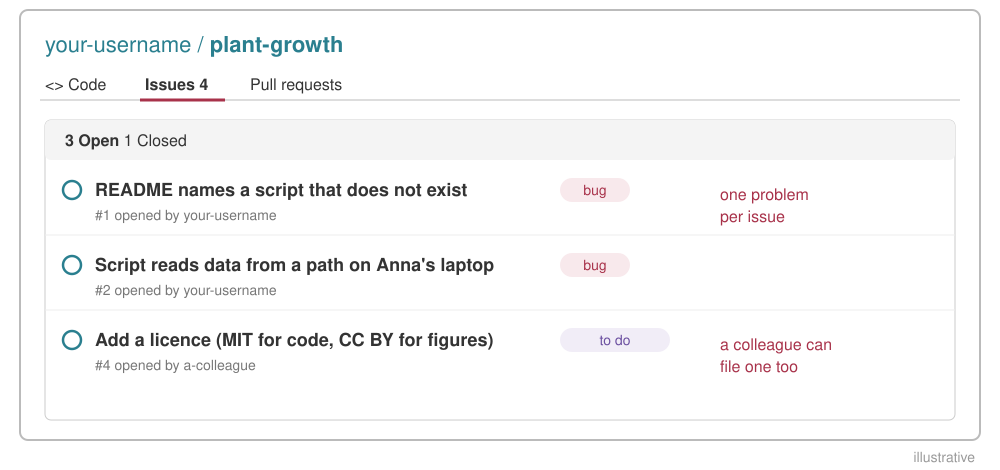{width="80%" fig-align="center"}

::: notes
Every repository on GitHub has an Issues tab. An issue is a note with a title, a description and a discussion below it. Despite the name, it does not have to be a problem: "add a licence" or "rerun with the 2026 data" are fine issues. You can label them, assign them to someone, and close them when done. What makes issues useful is that they are attached to the project. A colleague can file one without emailing you. You can refer to issue number 2 in a commit message. And the agent can read the list: "look at the open issues and suggest which one to do first". Keep one problem per issue, so that each can be closed on its own.
:::

## A useful issue says what is wrong, where, and how you know

| Not useful | Useful |
|---|---|
| "The script doesn't work." | "`scripts/plot_growth.py` stops with *FileNotFoundError*: it reads `C:/Users/anna.k/Desktop/greenhouse/growth.csv` (line 8). It should read `data/raw/growth.csv`." |
| "README is confusing." | "README says to run `scripts/make_figure.py`, but that file does not exist. I think it means `scripts/plot_growth.py`." |
| "Add more documentation." | "The README's data table lists a column `height_cm`, but `growth.csv` calls it `ht`. Rename one of them so they match." |

The same rule as in *First delegations*: point to the place, say what you expected, give the reason.

::: notes
A useful issue is written like a good correction to the agent, which we practised in First delegations. Point to the exact place: the file, the line, the command. Say what you saw and what you expected. Give the reason or the evidence. A vague issue costs the reader more time than it saves; a precise issue can often be fixed in a minute, by a person or by an agent. That last point matters: you can tell your agent, "fix issue 2", and it will read the issue with gh, make the change, and you review it. The more precise the issue, the better the agent's fix.
:::

## The agent can read, write and close issues with `gh`

- "List the open issues in this repository." → `gh issue list`
- "File an issue for the wrong file name in the README. Show me the text first." → `gh issue create`
- "Fix issue 1. Commit with the message `Fix script name in README (fixes #1)` and push."
- A commit message with **fixes #1** closes issue 1 automatically when it reaches GitHub.

You can do all of this on the website too. Use whichever is quicker.

::: notes
The agent uses gh for issues as well. Reading the list is harmless. Creating an issue writes on GitHub in your name, so ask to see the text first, and approve the command. The nice trick is the commit message: if a commit that reaches the main branch on GitHub says fixes, closes or resolves followed by a hash and a number, GitHub closes that issue and links it to the commit. So the history now says not only what changed, but why: it points to the issue that asked for it. None of this requires the terminal. On the website, the Issues tab has a green New issue button, and you can comment and close by clicking. Use whichever is quicker for you.
:::

## Collaborators can read and push, so invite only people you trust

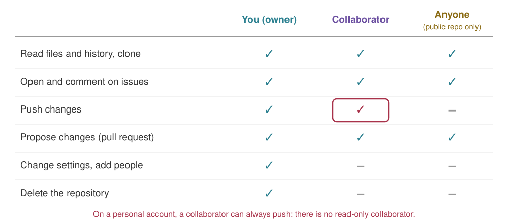{width="80%" fig-align="center"}

::: notes
To let a colleague into a private repository, you add them as a collaborator: Settings, then Collaborators, then Add people, and they accept an email invitation. Note the red box. On a personal GitHub account, a collaborator can always push: GitHub has no read-only collaborators for personal repositories. Read-only access exists only for repositories owned by an organisation, such as a research group's organisation. So invite only people you trust with your files, and remove them again when you no longer work together. For a public repository you do not need to add anyone to let them read or file issues: anyone can. In the exercise you add your swap partner as a collaborator, and remove them afterwards.
:::

## A pull request proposes a change instead of pushing it

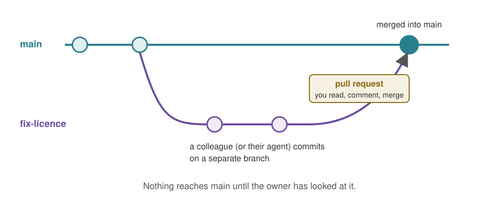{width="78%" fig-align="center"}

- Use them when several people work on one repository, or to let an agent's change wait for review.
- For your own project, working alone, committing to main is fine.

::: notes
A pull request is the polite way to change someone else's repository. The changes go on a separate branch, which is a parallel line of commits. Then you open a pull request, which says: here are my changes, please look at them and merge them into main. The owner sees exactly what changed, line by line, can comment, ask for changes, and finally merge. Nothing reaches main until then. Research groups use pull requests to review each other's code. You can also use them with an agent: let the agent work on a branch and open a pull request, and you review it on the website before it goes in. For your own project, alone, you do not need them; we mention them so you recognise the word.
:::

## Without a licence, others may look but not reuse

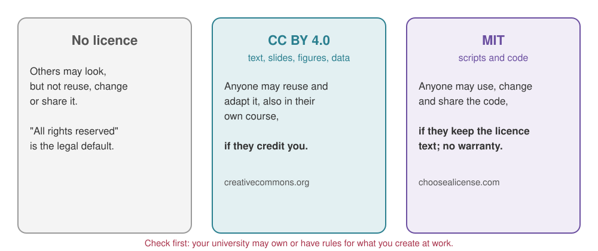{width="82%" fig-align="center"}

::: notes
A last thing every shared repository needs is a licence. Without one, copyright law applies in full: others may read what you put online, but they may not legally reuse, adapt or share it. If you want colleagues to reuse your teaching material, say so. Two licences cover most of what you will publish in this course. Creative Commons Attribution, CC BY 4.0, for text, slides, figures and data: anyone may reuse and adapt, if they credit you. And MIT for code: anyone may use and change it, if they keep the licence text, and you give no warranty. Many repositories use both, one for the code and one for the rest. Before you choose, check your university's rules: some have a policy on teaching material or on software written at work.
:::

## Adding a licence is one file and one sentence in the README

- Ask: "Add an MIT licence for the scripts and a CC BY 4.0 licence for the text and figures. Put the MIT text in LICENSE and explain the split in the README."
- GitHub recognises a `LICENSE` file and shows it in the About box.
- Fill in the copyright holder correctly: you, or your university.
- A licence only grants what is yours to give. Third-party figures and data keep their own licence.

::: notes
Adding a licence takes one prompt. The agent knows the standard texts, but do check two things. First, the copyright holder: depending on your contract and university, that is you or your employer. Second, that the licence only covers what you own. If your page shows a figure from a published paper under the publisher's copyright, your CC BY licence cannot cover it, and the README should say so. GitHub reads the LICENSE file and shows the licence name on the repository page, which is how visitors find it quickly. The sites choosealicense.com and creativecommons.org explain the options in plain words if you need something else.
:::

## Pull when you start, push when you stop

{width="45%" fig-align="center"}

| When | Ask the agent | Command it uses |
|---|---|---|
| You sit down | "Pull the newest version from GitHub." | `git pull` |
| You finish a step | "Commit this with a clear message." | `git add`, `git commit` |
| You stop for the day | "Push my commits." | `git push` |

::: notes
Here is the daily loop, which you will repeat in every unit from now on, because every later result goes on GitHub and, from the next unit, on your page. When you sit down, pull, so that you start from the newest version, especially if you also work from another computer or have a collaborator. Commit after every step that works, as you learned in the git unit. And push when you stop, so that the work is backed up and visible to your collaborators. If you forget to pull and someone else pushed in the meantime, git refuses your push and says why. The agent can sort that out, but read what it proposes: that is when force-push suggestions appear.
:::

## Peer exercise: swap repositories and review each other's with your agent

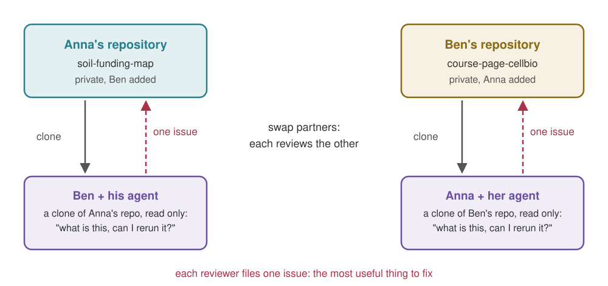{width="78%" fig-align="center"}

::: notes
The main part of the exercise is a swap. You pair up with another participant. Each of you adds the other as a collaborator on your private project repository. Each of you clones the other's repository into a separate folder and starts your own agent there, in a read-only mode, and asks it to explain the project and find the gaps. Then each of you files one issue on the other's repository: the single most useful thing to fix. This tests the unit Organising a project for an agent directly. If your partner's agent cannot work out what your project does or how to rerun it, neither could a new student or a reviewer. It is also the first time someone else reads your work through an agent, which is how many people will read it from now on.
:::

## Someone else's repository is untrusted input: read it, do not run it

- Start the agent in a **read-only** mode: plan mode in Claude Code (Shift+Tab), *Read Only* in Codex (`/permissions`).
- Clone into a **separate folder**, for example `~/agentic-course/peer-review/`, never into your own project.
- **Do not run** their scripts yet. Read them. Running comes after you trust the code.
- Files can contain instructions to the agent (*Privacy, ethics and safety*). Read what it wants to do.
- You can push to their repository, but do not. Your output is **one issue**.

::: notes
A word of care before the swap. A repository written by someone else, even a friendly colleague, is untrusted input for your agent. It could contain a script that deletes files, or a README with instructions that the agent may follow, the prompt injection we discussed in the privacy unit. In this course that is very unlikely, but the habits matter for later, when you clone repositories from strangers. So: a read-only mode, a separate folder, and no running of their scripts, only reading. And remember the collaborator table: as a collaborator you could push to your partner's repository. Do not. Your contribution is an issue, which they can decide what to do with.
:::

## A good review checks what *Organising a project* promised

| Question for your agent | What it tests |
|---|---|
| "In three sentences: what is this project and what is its current state?" | the README and the goal |
| "Which files are raw data, which are results, which are scripts?" | the folder layout |
| "What would I run to reproduce the main figure? Do not run it." | reproducibility |
| "Do the README, the agent instructions and the files agree?" | stale documentation |
| "Is there anything here that should not be in a shared repository?" | privacy |
| "What is the single most useful thing to fix?" | the issue you file |

Then check one answer yourself: open the file the agent points to.

::: notes
Here are the questions we use in the exercise, each tied to something from Organising a project for an agent. What is the project; that tests the README. Which files are which; that tests the layout. How would I reproduce the main figure; that tests whether the scripts and instructions are complete. Do the documents agree with the files; the commonest problem in real projects is a README that was true three months ago. Is there anything that should not be shared. And finally, what is the most useful fix, which becomes your issue. As always, do not pass on the agent's answer unchecked. Open the file it points to and confirm the problem is real before you file it in your name.
:::

## Where this goes wrong

- **Public by mistake.** Check the label on the repository page. Private is the default for your own project.
- **"Deleted" is still in the history.** Check the history, not only today's files, before anything goes public.
- **Personal data committed.** Use `.gitignore` before the first commit, and stand-ins for real data.
- **Login inside the agent.** Run `gh auth login` yourself, in a second terminal. Never paste tokens into a prompt.
- **Forgot to push.** Committed is not backed up. Push when you stop.
- **Force-push or delete proposed.** Say no unless you asked for it, and ask why.
- **Collaborators can push.** Invite only people you trust; remove them afterwards.
- **No licence.** Others may look but not reuse.
- **Trusting the reviewer agent blindly.** Check a finding yourself before you file it.

::: notes
Here is the list of things that go wrong, collected in one place. The first three are about privacy, and they are the ones that cannot be undone: a repository that was public for an hour may already have been copied. Check the label, check the history, keep personal data out from the first commit. The login belongs to you, not the agent. Committed but not pushed is a common surprise when a laptop dies. Two commands deserve a no by default: force-push and delete. Collaborators have write access on personal repositories. A missing licence quietly blocks the reuse you hoped for. And when your agent reviews a colleague's work, its findings are claims until you have checked them.
:::

## Summary

| Concept | Key fact |
|---|---|
| GitHub | an online copy of your git repository, with the whole history |
| Push and pull | push sends commits up, pull brings them down; committed is not backed up |
| Private vs public | private for your own project; public only after checking files and history |
| `.gitignore` | keeps files out of the repository before their first commit |
| `gh auth login` | you, once, in a second terminal; the agent then pushes with your approval |
| `gh repo create --private` | one command: new repository from this folder, pushed |

::: notes
To sum up. GitHub keeps a copy of your repository with its history. Push and pull move commits; push when you stop. Your own project stays private; anything public gets a check of the files and the history first, and .gitignore keeps real data out from the start. You log in once yourself, and after that the agent creates repositories, pushes and handles issues, with your approval. The README is your project's front page. Issues are the to-do list, and a commit can close one. Collaborators can push, and pull requests let changes wait for review. A licence makes reuse possible. In the next unit we turn a repository into a public web page, which is where the question of what becomes public gets very concrete.
:::

## Summary (continued)

| Concept | Key fact |
|---|---|
| README | rendered on the repository page; answers a visitor's first questions |
| Issues | a to-do list next to the project; "fixes #1" in a commit closes issue 1 |
| Collaborators | can read and push on a personal account; invite only people you trust |
| Pull requests | propose a change for review instead of pushing it |
| Licence | CC BY for teaching material, MIT for code; none means no reuse |

**Next (A course or project page):** turn a repository into a public web site with Quarto and GitHub Pages, with your figures from *Reproducible figures* as the first content.

::: notes
The rest of the summary table, and where we go next.
:::
