## About this lecture

Many funders publish who sits on their review panels. Before you submit, you can ask: **who is likely to read my proposal, what do they know, and what will they find thin or unclear?** An agent can collect the panel, build an expertise profile of each member from public sources, match the profiles against your draft and write mock reviews using the funder's own criteria.

- **Ethics first.** Panel members are people. Their public professional data are still personal data.
- **Profiles of expertise, not of people.** Topics, methods, recent papers. Nothing else.
- **Two kinds of reader.** The expert finds the gaps; the non-expert stumbles on the jargon.
- **Mock reviews use the funder's criteria** and are written from an expertise, never in a named person's voice.
- **You judge the reviews.** Fix, explain or ignore each point.

A **hands-on** unit. The worked example uses a synthetic proposal and a **fictional** panel; you apply it to a real call on your own computer. Builds on *Collecting and analysing grant results* and *Literature review*.

::: notes
This unit is about preparing your own application. It is the most delicate unit in Part 4, because it is about people. Funders publish their panel members for transparency, and it is legitimate to read those lists and think about who will read your proposal. It is also legitimate to ask whether your proposal makes sense both to the specialist and to the panel member from a neighbouring field. What is not legitimate is to contact reviewers, to build dossiers on them, or to treat them as targets. So we start with the ethics, and the ethics shape every step: what we collect, how we write the prompts, and where the files live. The worked example uses invented people only. You will use real panels, but on your own computer and for your own preparation.
:::

## Your proposal will be read by a panel you can look up

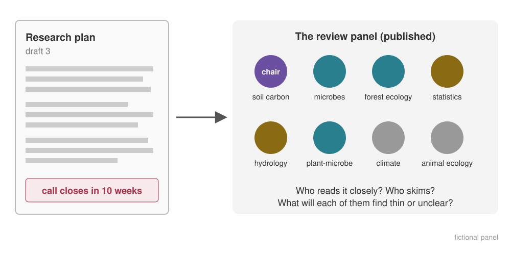{width="88%" fig-align="center"}

::: notes
Here is the concrete problem. You have a draft research plan for a call that closes in a few months. The funder has published the review panel that is likely to assess it: a chair and perhaps ten members, from your field and from neighbouring fields. Each of them will read many proposals in a short time. A few will read yours closely; the rest will skim it before the panel meeting and still give it a grade. You would like to know, before you submit, what each of these readers will make of it. Colleagues can help, but they are busy and usually know your field too well. An agent can give you a structured first pass in an afternoon.
:::

## A panel has experts and non-experts, and both grade you

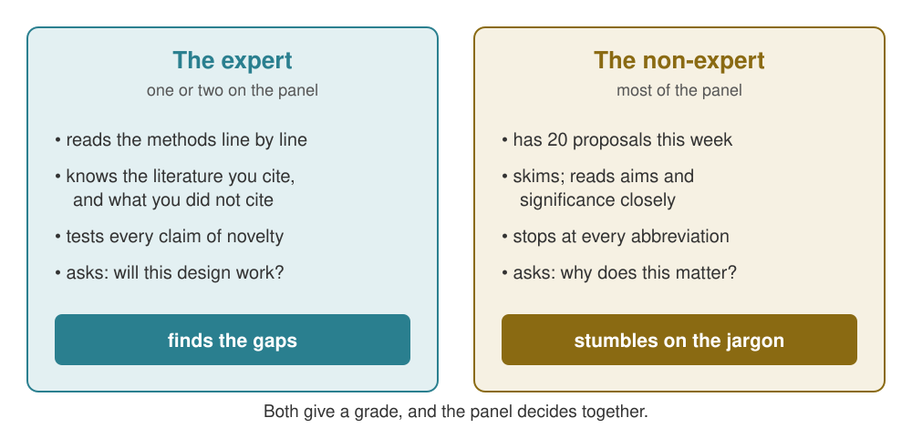{width="88%" fig-align="center"}

::: notes
Panels are broad. A panel for ecology and soil science may have one soil microbiologist, one statistician, one forest ecologist, one hydrologist and a few people from further away. For your proposal, one or two are real experts. They will look for the weak points in your methods, your design and your claims of novelty. The others are intelligent non-experts. They will not know your abbreviations, they will not see why your question matters unless you tell them, and they will judge how convincing the whole thing is. Both kinds of reader grade you, and you need both of them on your side. This picture is the reason for the rest of the unit: we look for gaps that an expert sees and for jargon that a non-expert does not know.
:::

## This is personal data, even when it is public

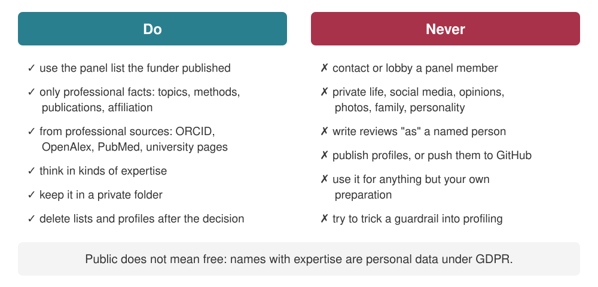{width="88%" fig-align="center"}

::: notes
Now the ethics, before any method. A list of named panel members, with their affiliations and publications, is personal data under GDPR. That it is published by the funder does not change that. It means you need a reason to process it, you should collect as little as you need, keep it secure, and not keep it longer than necessary. Preparing your own application is a reasonable purpose for a short list of professional facts. It is not a reason to collect everything that can be found about a person. So the left column is what we do: professional expertise from professional sources, kept in a private folder, deleted after the decision. The right column is what we never do. If you are unsure whether your university needs to know about such processing, ask your data protection officer. This is not legal advice; it is the cautious reading.
:::

## Never contact or lobby a reviewer; panels change {.smaller}

- The ERC is explicit: applicants, potential applicants and host institutions **must not contact reviewers**; applications may be rejected for breach of research integrity. Other funders have similar rules on conflicts of interest and influence.
- The aim is to make the proposal **clearer and stronger for any competent reader**, not to tailor it to one person's taste or to flatter their work.
- **Panels change** between rounds and are sometimes updated during a round. External reviewers may be added. Your analysis is about the kinds of expertise in the room, not about individuals.
- Keep it **private**: not on GitHub, not on your project page, not shared beyond your co-applicants.

::: notes
Three more rules. First, never contact a panel member about your application, and do not ask anyone to do it for you. The ERC states this plainly on its panel member page and says that applications may be rejected for it; every funder treats it as a breach of research integrity. Second, the purpose is a better proposal for any reader with that expertise, not flattery. Citing a panel member's paper because it is relevant is normal. Citing it because they are on the panel, when it is not relevant, is transparent and does not help. Third, panels change. Members rotate, the list on the web may be last year's, and external reviewers may be added. So the useful output is a map of expertise: there will be a statistician, a soil microbiologist and a hydrologist. And all of this stays private.
:::

## The agent may hesitate to profile named people; that is a guardrail

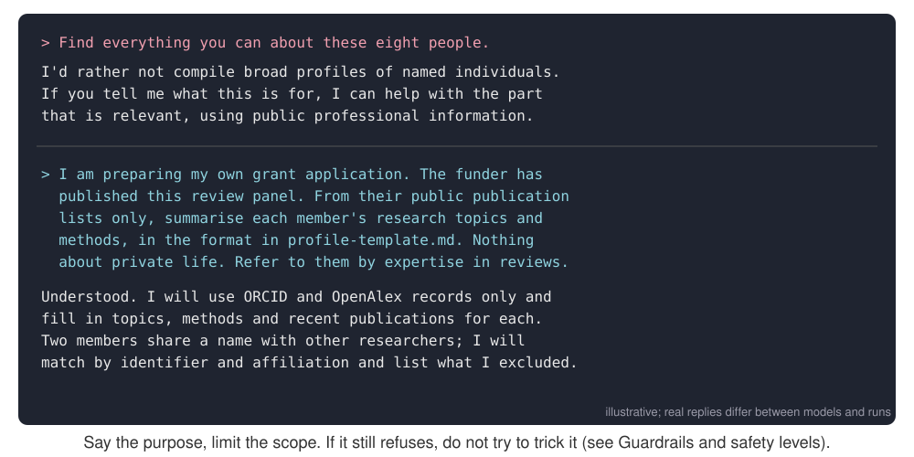{width="86%" fig-align="center"}

::: notes
You may meet a guardrail here. Models are trained to be careful about compiling profiles of named individuals, because the same request could be stalking or harassment. A prompt like "find everything about these eight people" may be refused, or answered vaguely. That is the guardrail working as intended. A request that says what you are doing and limits itself to public professional information usually goes through: summarise the research topics and methods of these panel members from their publication lists, to prepare my own application. If it still refuses, do not try to trick it: that breaks the usage policies, and the refusal may be a sign that you asked for more than you need. The unit Guardrails and safety levels in Part 6 explains the different kinds of guardrails and how to tell them apart.
:::

## The workflow has five steps, and each has a check

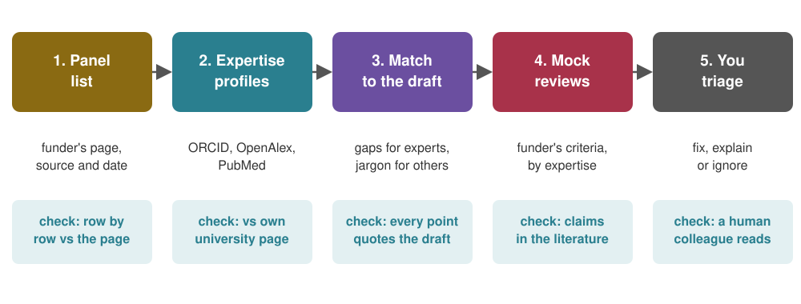{width="92%" fig-align="center"}

::: notes
Here is the whole workflow. Step one: collect the published panel into a small table, with the source and the date. Step two: for each member, build a short expertise profile from public professional sources such as ORCID, OpenAlex and PubMed. Step three: match the profiles against your draft. Which sections will the experts scrutinise, and which terms will the non-experts not know? Step four: mock reviews against the funder's own criteria, written from several kinds of expertise. Step five: you go through every point and decide what to fix, what to explain and what to ignore. Each step has a check, shown under it. The rest of the lecture goes through the steps in order.
:::

## Funders publish panels in different places and at different times {.smaller}

| Funder | What is published | Where (check the current page) |
|---|---|---|
| Swedish Research Council (VR) | Members of each review panel (*beredningsgrupp*), by subject area. Updated continuously; if a list shows last year, this year's members are not yet recruited | vr.se → Applying for funding → How applications are assessed → [Review panels](https://www.vr.se/english/applying-for-funding/how-applications-are-assessed/review-panels.html) |
| ERC | Panel members per scheme, panel and year, after the evaluation; per-call lists; current and past panel chairs | erc.europa.eu → [Panel members](https://erc.europa.eu/apply-grant/panel-members) |
| Others (Formas, Forte, foundations, NIH study sections) | Varies: some publish lists, some only the chairs, some nothing | the call text and the funder's pages on assessment |

More than 100 VR panels with around 1,000 researchers assessed about 7,400 applications in 2025.

::: notes
Where do you find the panels? The Swedish Research Council has a page called Review panels, in Swedish beredningsgrupper, where you choose a subject area and see the panels with their members. The page says it is updated continuously, and that if a panel shows an earlier year, this year's members have not been recruited yet. That is important: what you see may be last year's panel. The ERC publishes its panel members per funding scheme, panel and year, after the evaluations, and also lists of chairs. For ERC, last year's panel for your panel code is therefore the best hint you have. Other funders differ: some publish full lists, some only chairs, some nothing. If nothing is published, you can still do steps three to five with typical kinds of expertise for your field. The numbers at the bottom, from VR's own page, give a sense of scale.
:::

## Last year's panel is a hint, not a list

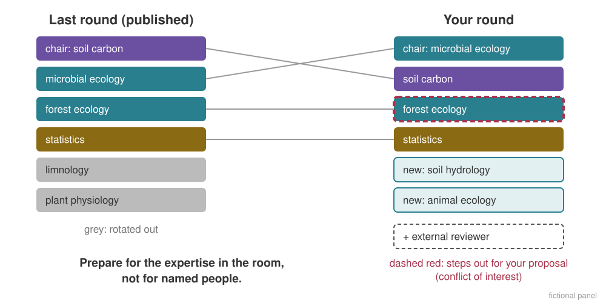{width="84%" fig-align="center"}

::: notes
This picture shows why we think in kinds of expertise rather than in names. Between two rounds, typically some members stay and some rotate out. The chair may change. During the round, external reviewers can be added for specific proposals, and members with a conflict of interest step out for your proposal. So if you prepare for eight named people, some of your preparation will hit the wrong target. If you prepare for the expertise in the room, it holds even when the names change: a panel for your area will almost always contain someone who knows statistics and someone from a neighbouring field. That is also the more ethical framing.
:::

## Step 1: the panel goes into a table, with source and date

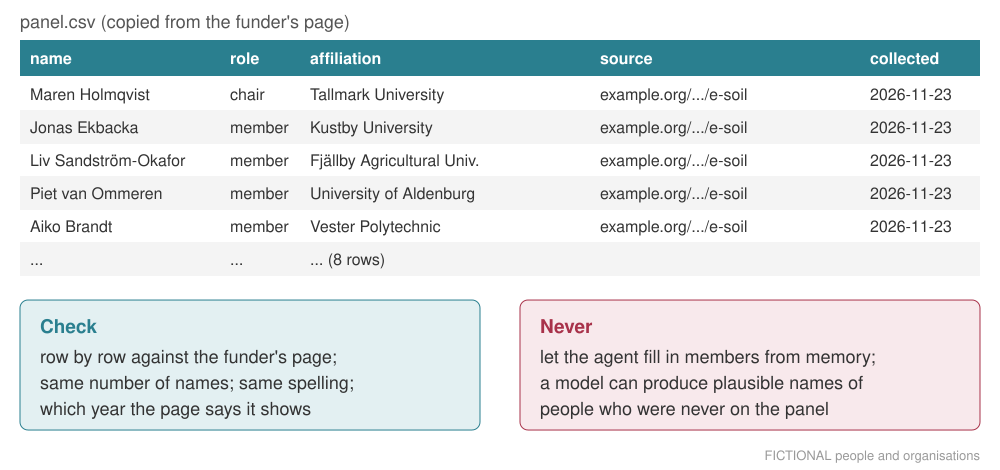{width="88%" fig-align="center"}

::: notes
Step one is simple. Copy the panel list into a table: name, role, affiliation, panel, the address of the page you took it from, and the date. On some funders' pages the list is loaded by the browser and is hard for an agent to fetch; then copy it by hand from the page or save the page and give the agent the file. Do not let the agent guess or fill in members from memory: a model may produce plausible names of people who were never on that panel. The check is to compare the table with the web page, row by row. The source and date columns matter later, when someone asks you where the list came from, or when you notice the page has changed.
:::

## Step 2: expertise profiles come from public professional sources {.smaller}

| Source | What it gives | Access |
|---|---|---|
| [ORCID](https://orcid.org) | a unique identifier; employment and the works the person lists publicly | public API, no key for public data |
| [OpenAlex](https://openalex.org) | publications, topics, co-authors, affiliations over time | API; small shared free budget without a key, a free personal key gives more |
| [PubMed](https://pubmed.ncbi.nlm.nih.gov) | biomedical papers with abstracts and MeSH terms | E-utilities API; 3 requests per second without a key, 10 with one |
| The person's own university page | current title, research description | read it yourself; it is the reference for the check |

Keys go in `.env`, exactly as in *Collecting and analysing grant results*.

::: notes
Step two uses the same kind of sources as the literature review. ORCID gives you an unambiguous identifier, which is the best defence against confusing two people with the same name, and whatever the person has chosen to make public. OpenAlex is an open catalogue of scholarly works with topics and affiliations, with an API that works without a key on a small budget shared by everyone on your network; a free key gives you your own. PubMed is the reference for biomedicine. The person's own university page is where the check happens: does your profile match how they describe their own research? If you use keys, handle them as in the previous unit: in .env, ignored by git, never in the chat.
:::

## A profile describes expertise, and nothing else

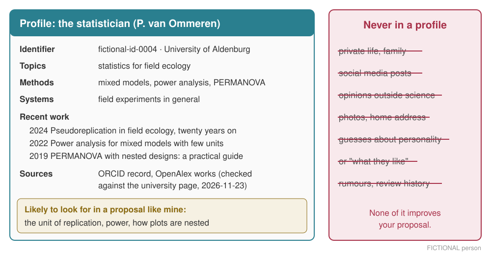{width="86%" fig-align="center"}

::: notes
Here is what a profile should look like. Main research topics, main methods, study systems, and three to five recent publications that show these, each with an identifier you can click. And then one line that matters most for you: what this person is likely to look for in a proposal like yours. A statistician looks at the design; a hydrologist at how you measure water. What the profile must not contain is on the right: anything about the person's private life, their social media, their opinions on non-scientific topics, their photo, family, or guesses about their personality. None of it helps your proposal, and all of it would make your folder a dossier. Ask for the profile in this fixed format, so the agent does not wander.
:::

## Two people can share a name; the identifier tells them apart

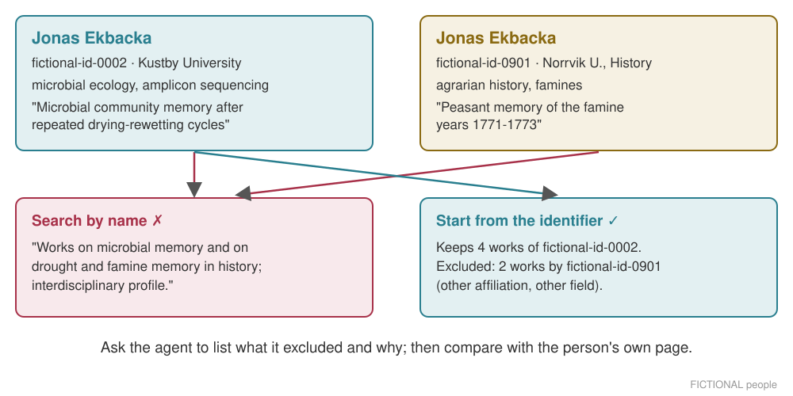{width="86%" fig-align="center"}

::: notes
The most common error in profiles is the wrong person. Names are not unique. In our fictional example there are two people called Jonas Ekbacka: a microbial ecologist on the panel and a historian who writes about eighteenth-century harvest failures and, of all things, the memory of famine. A search by name merges them, and a careless profile says that the panel member works on microbial memory and agrarian history. The defence is the identifier: start from the ORCID or OpenAlex identifier, check the affiliation, and ask the agent to list any publications it excluded and why. Then compare the profile with the person's own university page.
:::

## Step 3: match the profiles against your draft

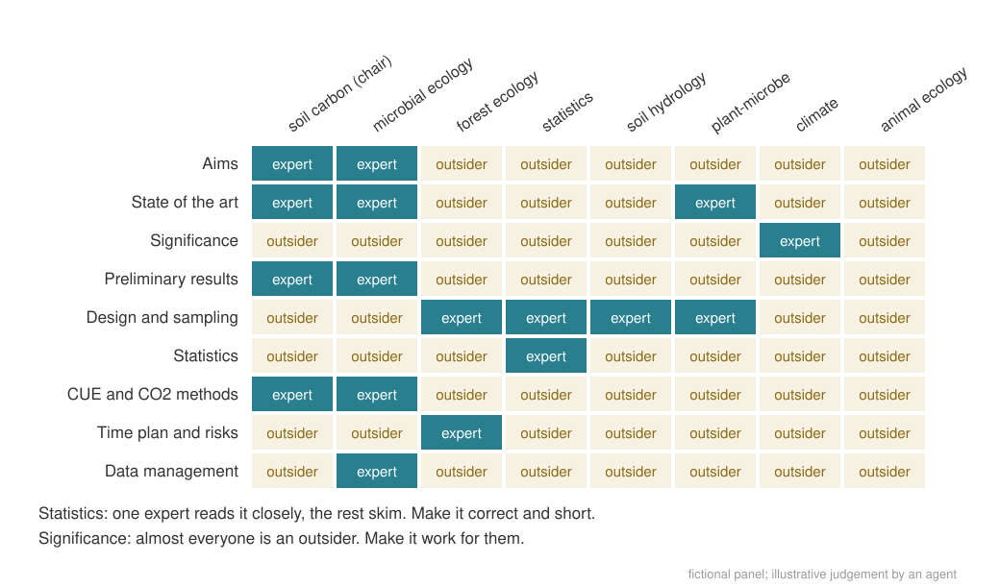{width="76%" fig-align="center"}

::: notes
Step three brings the profiles and your draft together. The result is a small matrix: the sections of your proposal down the side, the panel members, or rather the kinds of expertise, across the top. Each cell says how closely that reader will look at that section: will they scrutinise it as an expert, or read it as an intelligent outsider? The pattern tells you a lot. Here the statistics section will be read closely by one person and skimmed by everyone else, so it must be both correct and short. The significance section will be read by everyone, so it must work for the non-expert. Think of the matrix as a reading plan for your own revision, not as a prediction.
:::

## The matching prompt asks for gaps and jargon separately

```text
Here is my draft (proposal-draft.md) and expertise profiles of the panel
(profiles/). For each profile, write a short note:
1. Which sections of my draft will this person read as an expert?
2. What would this expert find thin, missing or overclaimed? Quote the
   sentence from my draft each time.
3. Which terms in my draft would this person NOT know if they are not an
   expert in it? List them with the section where they first appear.
Then make a table: draft sections x reviewers, with "expert" or "outsider".
Do not invent anything about the reviewers beyond their profiles.
Refer to them by expertise ("the statistician"), not by name.
```

::: notes
Here is the prompt for step three. It asks for gaps and for jargon as two separate lists, because they are different problems with different fixes. It insists on quotes from the draft, so every point can be found and checked. It forbids the agent to embellish the profiles. And it asks the agent to refer to reviewers by expertise rather than by name, which keeps the output about the science and is easier to share with co-applicants. The output is a set of notes and one table. You read the notes, and the table goes into your revision plan.
:::

## An expert sees what is missing

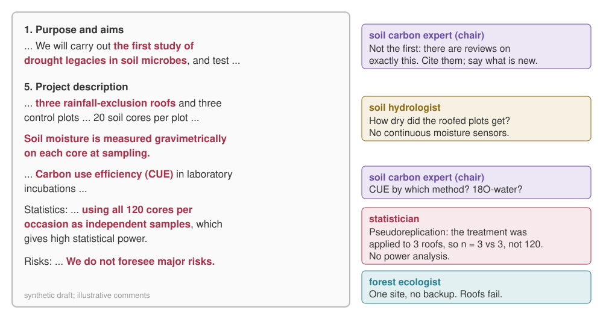{width="80%" fig-align="center"}

::: notes
Here is what the expert view produces on our synthetic draft. The statistics paragraph treats 120 soil cores as independent samples, but the treatment was applied to only three roofs. A statistician sees at once that the true sample size is three against three: this is pseudoreplication, and it is the most serious weakness in the draft. The claim to be the first study of drought legacies in soil microbes is not true, and the panel chair has written a review on exactly that. Carbon use efficiency is listed without a method. Soil moisture is measured only at sampling, so nobody can tell how dry the roofed plots actually were. Each of these is invisible to a non-expert and obvious to the right expert. That is what you want to find before submission.
:::

## A non-expert stumbles on the jargon

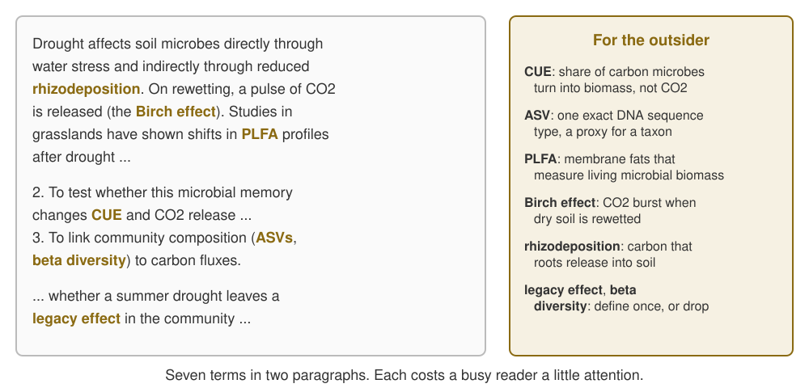{width="88%" fig-align="center"}

::: notes
And here is the other reader. The same draft is full of terms that a soil microbiologist uses every day and an animal ecologist on the same panel may not know: CUE, ASVs, PLFA, the Birch effect, rhizodeposition, legacy effect, beta diversity. Each one costs the reader a little attention, and a panel member who reads twenty proposals in a week does not look them up. The fix is cheap: spell out the abbreviation once, add a few words of explanation, or drop the term if it is not needed. The agent is good at finding these, because it can be told to read as an outsider. It is your job to decide which ones really need explaining.
:::

## Step 4: mock reviews follow the funder's own criteria

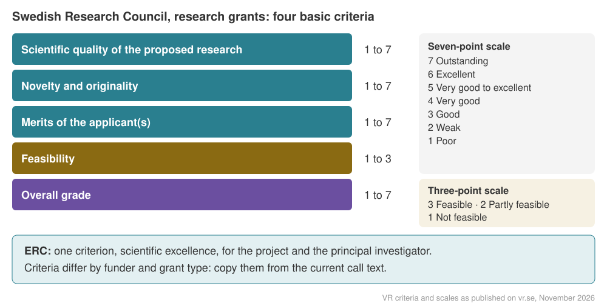{width="88%" fig-align="center"}

::: notes
Step four is the mock reviews, and the most important design choice is to use the funder's own criteria and scales. For research grants, the Swedish Research Council grades four basic criteria: scientific quality of the proposed research, novelty and originality, and merits of the applicant, each on a seven-point scale from poor to outstanding, and feasibility on a three-point scale. Then an overall grade, also one to seven. The ERC has one criterion, scientific excellence, applied to the project and to the principal investigator. Other funders add impact, relevance or ethics. Always copy the criteria from the current call text and give that text to the agent, so the reviews are structured the way the real ones will be.
:::

## Write mock reviews from an expertise, never in a named person's voice

```text
Write three mock reviews of my draft, using the criteria and grading scales
in criteria.md (copied from the call text). One review each from:
- a reviewer whose expertise is soil biogeochemistry and carbon cycling
- a reviewer whose expertise is statistics and experimental design
- a reviewer from a neighbouring field (animal ecology) who is not an expert
For each criterion: a grade, the main strengths and weaknesses, and a quote
from my draft for every weakness. Be as critical as a strict panel member.
Do not comment on the applicant's merits: there is no CV in the draft; say so.
```

::: notes
Here is the mock-review prompt. Notice who the reviews are from: kinds of expertise, taken from the profiles, not named panel members. Writing "a review as Professor So-and-so would write it" puts words in a real person's mouth, invites guesses about their opinions, and is the kind of request a guardrail may stop, rightly. Expertise is enough to produce a useful review. The prompt also asks for a grade and quotes per criterion, invites strictness, which counters the model's tendency to be kind, and forbids the agent to judge merits it cannot see. That last line is also a test: if a review praises the applicant's excellent track record, the agent invented it.
:::

## A mock review looks like the real thing; read it as a draft

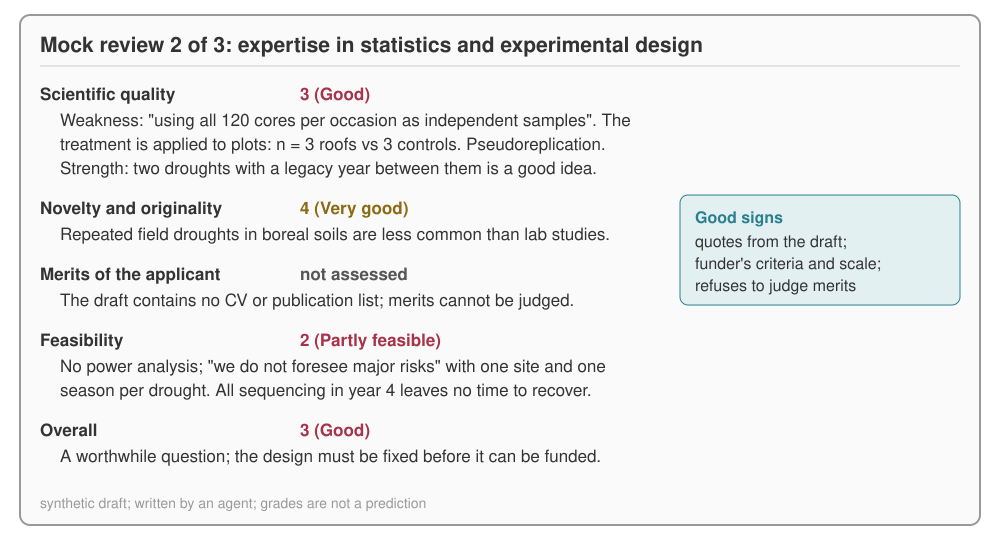{width="78%" fig-align="center"}

::: notes
This is what one mock review might look like, here from the statistics perspective. A grade per criterion, short strengths and weaknesses, quotes from the draft. It looks very much like a real review, and that is both the value and the danger. The value: it is a structured, specific list of problems you can act on. The danger: it is written with the same confidence whether it is right or wrong. A real reviewer has read the literature, knows the field station, and has their own taste. The model has read your draft and some profiles. So read a mock review the way you read a review from a colleague you do not know well: seriously, and critically.
:::

## Three reviewers disagree, and the disagreement is useful

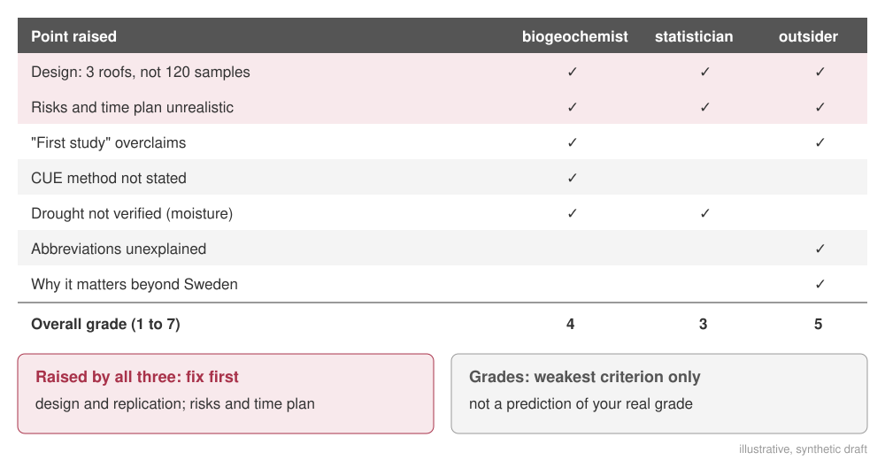{width="86%" fig-align="center"}

::: notes
When you have several reviews, put them side by side. They will disagree, as real reviews do. The biogeochemist worries about novelty and the carbon use efficiency method; the statistician about the design; the outsider about clarity and why it matters. Some points come up in all three, and those are the ones to fix first. The grades are the least useful part. A mock grade of five is not a prediction of your real grade: the agent has no idea how strong the other applications are. Use the grades only to see which criterion is weakest in the reviewers' eyes, and the comments to see why.
:::

## An agent as reviewer is too kind, too generic, or too sure {.smaller}

- **Too kind.** Models tend to agree and praise. Ask for strictness, for the three weakest points, and for what would make a panel reject it.
- **Too generic.** "The methods could be described in more detail" fits every proposal. Demand a quote from the draft for every weakness.
- **Too sure.** It may claim a method is outdated or that a study already exists. Check every such claim in the literature yourself.
- **Inventing.** Praise for a track record it has never seen; references to papers that do not exist. Strike them.
- **Not a prediction.** It does not know the competition, the panel's taste or this year's budget.

::: notes
These are the failure modes we met in How LLMs and agents work, now in a reviewer's clothes. Sycophancy makes mock reviews too kind, especially if you mention that it is your own proposal; asking explicitly for strictness and for the reasons a panel would reject it helps a lot. Generic comments are useless; insisting on quotes forces specificity. Claims about the literature need checking, exactly as in the literature review unit: a mock reviewer saying "this has been done by Smith 2021" may be inventing Smith 2021. And the agent may praise things it cannot see, like your merits. Finally, a mock review is not a forecast. Treat it as a strict, well-read but uninformed colleague.
:::

## Step 5: every point gets a decision: fix, explain or ignore

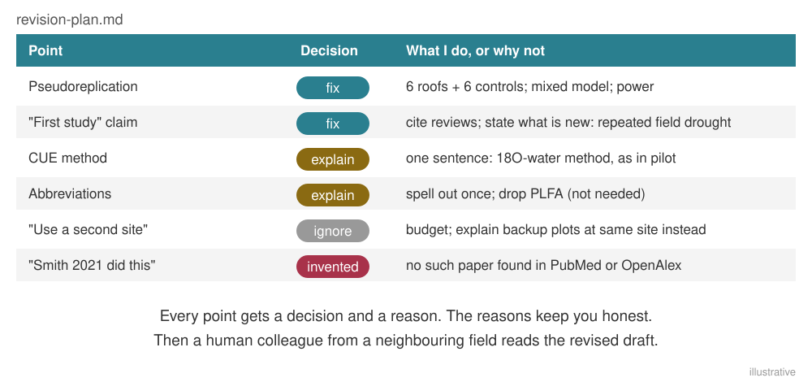{width="84%" fig-align="center"}

::: notes
The last step is yours. Go through every point from the gap list, the jargon list and the mock reviews, and give each one of three labels. Fix: the point is right and the proposal changes, for example the design gets a proper unit of replication and a power analysis. Explain: the point is a misunderstanding, but a real reviewer could misunderstand it too, so you add a sentence. Ignore: the point is wrong, irrelevant, or invented; write down why. The table becomes your revision plan, and the reasons in the last column keep you honest. Afterwards, the best check is a human one: give the revised draft to a colleague in a neighbouring field and see whether they stumble where the mock outsider did.
:::

## Your own draft is your decision; someone else's never is {.smaller}

- Your **own draft** may go to the agent if you accept the provider's terms (*Privacy, ethics and safety*). Leave out unpublished results you would not share and anything confidential.
- **Co-applicants' text and data:** ask them first.
- **A proposal you review for a funder: never.** VR does not allow generative AI in the scientific assessment; the ERC and NIH have similar rules. The same holds for mock reviews of someone else's application.
- Check the call text for rules on **AI use by applicants**. VR, for example, does not forbid it but holds you responsible for the content.

::: notes
A reminder from Privacy, ethics and safety, because this unit makes it tempting to slip. Your own draft is yours: you may send it to a cloud model if you accept the terms, with training switched off and without unpublished results you consider sensitive. Text written by your co-applicants is theirs as well, so ask. A proposal sent to you for review is never yours to put into an AI tool, not even to "test" this workflow on a real example. The Swedish Research Council does not allow generative AI in the scientific assessment, and the ERC and NIH have similar rules. And check what the call says about AI use by applicants: the Swedish Research Council currently allows it, but you are responsible for the content and for good research practice.
:::

## Keep the reviewer folder private, and delete it after the decision

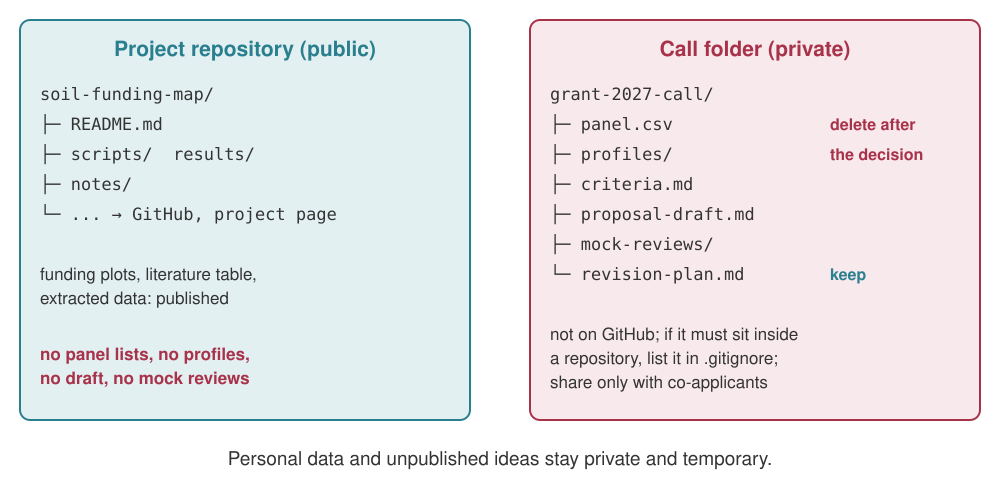{width="82%" fig-align="center"}

::: notes
Where should these files live? Not in your project repository on GitHub, and certainly not on your project page. Make a separate folder for the call, outside the published project, or add it to .gitignore if it must sit inside. The panel list and profiles contain personal data; the mock reviews and the revision plan contain your unpublished ideas. Neither belongs in public. When the decision has come, delete the panel list and the profiles: you no longer need them, and keeping personal data without a purpose is exactly what GDPR asks you not to do. Keep the revision plan and the lessons; they are yours and they help with the next application.
:::

## Where this goes wrong {.smaller}

- **Wrong people.** Last year's panel, a namesake, a member who left. Check against the funder's page and the identifier.
- **Too much about people.** Profiles that drift into private life or opinions. Keep the fixed format; delete what does not belong.
- **Writing for one reader.** Tailoring the proposal to one presumed reviewer, or citing their work for flattery.
- **Trusting the mock reviews.** Invented literature, invented merits, kind grades. Every claim checked, every point triaged.
- **Contact.** Any contact with a panel member about your application. Never.
- **Leaks.** Profiles or your draft in a public repository or on your page.

::: notes
Here is the list of what goes wrong. The first two are about the data: the wrong people, and too much about the right people. The third is a strategic mistake: a proposal bent towards one imagined reader usually gets worse for the others. The fourth is the familiar one: a mock review is text produced by a model, and it can contain invented papers, invented praise and grades that mean nothing. The fifth is the line that must never be crossed. And the last is about files: the profiles and the mock reviews are private working material and should never end up in the places where you publish the rest of your course work.
:::

## Summary

| Concept | Key fact |
|---|---|
| Why | Experts find gaps; non-experts stumble on jargon; both grade you |
| Ethics | Public professional data are still personal data: minimise, keep private, delete after the decision |
| Never | Contact or lobby reviewers; profile private life; mock reviews in a named person's voice |
| Panel lists | VR review panels (updated continuously); ERC panel members per year and scheme; panels change |
| Profiles | ORCID, OpenAlex, PubMed; start from the identifier; check against the person's own page |
| Mock reviews | Funder's own criteria and scales; reviewers by expertise; quotes for every weakness |
| Verification | You triage every point: fix, explain, ignore, with a reason |

**Next (*Parallel workers: Claude and Codex*, Part 5):** two agents at once, the same task to both, and one reviewing the other.

::: notes
To sum up. Panels mix experts and non-experts, and your proposal needs to work for both. Collecting the panel and profiling expertise is personal data processing, so keep it minimal, private and temporary, and never contact a reviewer. Panel lists come from the funders' own pages and change between rounds, so think in kinds of expertise. Build profiles from public professional sources, starting from an identifier, and check them against the person's own page. Write mock reviews with the funder's criteria, from expertise rather than in anyone's voice, and insist on quotes. Then decide on every point yourself. This also ends Part 4. In Part 5 we scale up: two agents working in parallel, and one agent reviewing the other's work, which is a natural next step after mock reviews.
:::
