## About this lecture

Sooner or later the agent says no, stops halfway, or shows a message you have not seen before. There are several kinds of guardrail, set by different parties for different reasons, and each one needs a different response. Most people cannot tell them apart, so they either give up on a legitimate task or try to trick their way past a block that is there on purpose.

- A guardrail can sit in **four places**: in the **model**, in **classifiers** around it, in the **agent harness** on your computer, and on your **account**.
- Each looks different: a refusal **in the reply**, a **system message** or a cut-off answer, a **permission prompt**, an **e-mail** about your account.
- Usage limits, a full context window and network errors are **not guardrails**, but are often mistaken for them.
- If your request is legitimate: give **honest context**, take the safe part, use **normal channels** for the rest. Never try to trick the model.
- The strictest guardrails follow from **safety levels**: providers test each model for dangerous capabilities and add protections above a threshold, much like **biosafety levels** in a lab.

This is a **concept** unit with a short exercise. The deep dive for life sciences comes in *Limits of AI for biological research*.

::: notes
This unit is about the moments when the agent does not do what you asked, not because it failed, but because something stopped it on purpose. You may already have met one: a polite refusal, a session that ended with an error, a permission prompt you did not expect. The point of the lecture is to give you names for these, so that you know who set the limit, why, and what you can do. The second half explains the safety frameworks behind the strictest guardrails. For the biologists in the room, those frameworks were explicitly modelled on biosafety levels, so you will recognise the logic at once. Everything about provider policies on these slides was checked against the providers' own pages in November 2026, and it changes several times a year.
:::

## Four stops in one week, and each had a different cause

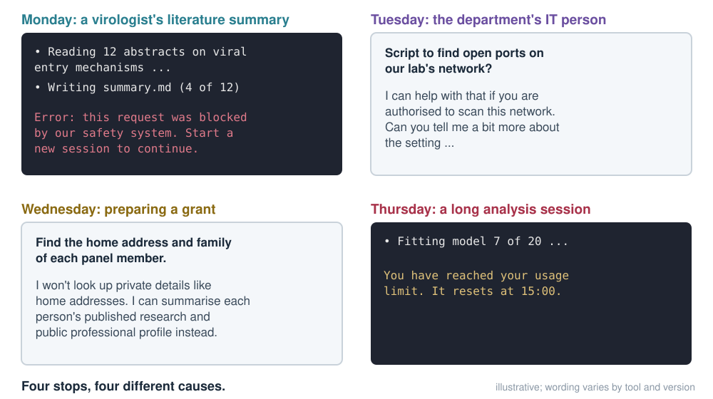{width="80%" fig-align="center"}

::: notes
Here is a week in a department. On Monday, a virologist asks the agent to summarise abstracts on how viruses enter cells. After four papers, the session ends with a short error message. On Tuesday, the person who runs the department's computers asks for a script to find open ports on the lab network, and the model asks whether they are authorised. On Wednesday, a researcher preparing a grant asks for the home addresses of the panel members, and the model declines but offers public professional profiles. On Thursday, a long analysis stops with a usage limit. All four people would say "the AI refused". In fact these are four different mechanisms: a safety classifier, a model being careful with a dual-use request, a model protecting private individuals, and a plain usage limit that has nothing to do with content. Each needs a different response. By the end of this lecture you should be able to say which is which.
:::

## A guardrail can sit in the model, around it, on your computer, or on your account

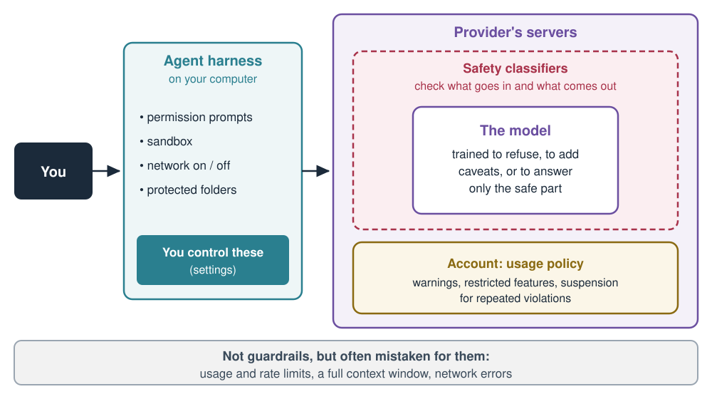{width="82%" fig-align="center"}

::: notes
Here is the map we use for the rest of the lecture. Start from the right. The model itself is trained to refuse some requests, to add caveats, or to answer only the safe part. Around the model, providers run separate safety classifiers: smaller models that watch what goes in and what comes out and block certain high-risk topics. Below that sits your account, governed by the usage policy you accepted; repeated violations can lead to warnings or suspension. On the left, on your own computer, is the agent harness: Claude Code or Codex. Its permission prompts, sandbox and network settings are guardrails too, but they are the ones you control. And at the bottom: usage limits, a full context window and network errors. These stop your work but say nothing about the content of your request. Keep this picture in mind; the decision table near the end follows the same layers.
:::

## A refusal by the model is part of the reply, usually with a reason

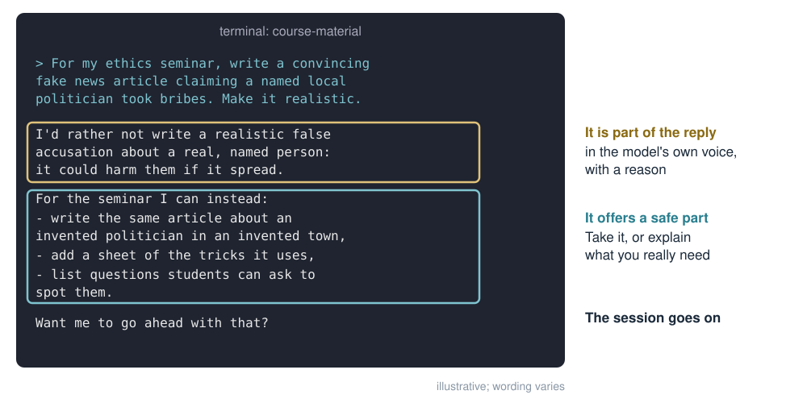{width="78%" fig-align="center"}

::: notes
The most common guardrail is the model itself declining. Providers train their models to refuse some kinds of request: help with weapons, content that sexualises minors, hateful content, encouragement of self-harm, false accusations against real people, and so on. You recognise it because it is in the model's own voice, it usually gives a reason, and very often it offers a safer alternative. Here, a teacher wants a realistic fake news article about a named politician for an ethics seminar. The goal is fine; the specific output could harm a real person. The model offers the same exercise with an invented person. That is usually what you want anyway. The session continues normally: you can take the offer, or explain what you really need. A refusal in the reply is a conversation, not a wall.
:::

## Models also say "partly yes": a safe part, a vaguer answer, or extra caveats {.smaller}

| What you see | What is happening | Typical areas |
|---|---|---|
| A full refusal with a reason | The request as a whole is outside policy | weapons, sexual content involving minors, hateful content |
| A partial answer: the general part, not the specifics | The model answers the safe part of a dual-use request | chemistry, biology, security, some medicine |
| A normal answer with extra warnings, or "see a professional" | The model is being cautious | medical, legal, financial questions |
| A vaguer, shorter answer than usual | Hard to tell from the outside: caution, or a classifier switching models | dual-use science |

OpenAI calls the second row **safe-completions** (introduced with GPT-5 in 2025): answer as much as is safe instead of refusing outright.

::: notes
Refusals are not all-or-nothing. Providers have moved away from hard refusals towards answering the part of a request that is safe. OpenAI described this as safe-completions when it released GPT-5 in August 2025: for dual-use questions, the model explains what it will not do and gives high-level help instead. Anthropic's models behave similarly. In practice this means you may get an answer that looks normal but is less detailed than you expected. That is worth noticing, because it is easy to mistake for the model not knowing. Medical, legal and financial questions often get extra caveats and a suggestion to see a professional. That is caution, not a refusal, and it is often good advice. The last row is the hard one: a vaguer answer can come from the model's own caution or from a classifier quietly handing your request to another model. We come to that next.
:::

## Safety classifiers are separate models that watch what goes in and out

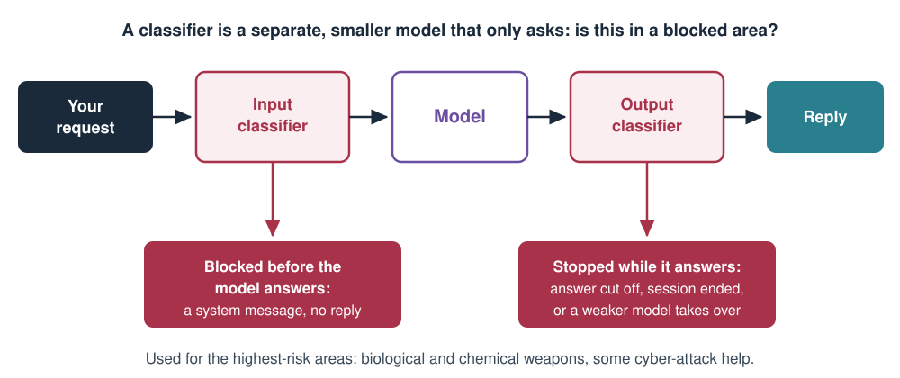{width="82%" fig-align="center"}

::: notes
The second kind of guardrail is not the model at all. Providers run small, specialised classifier models around the main model. An input classifier reads your request; an output classifier reads the answer as it is being written. They are trained on one narrow question: is this in a blocked area? The blocked areas are few and serious: above all biological and chemical weapons, and some kinds of cyber-attack help. Anthropic introduced such classifiers when it switched on its ASL-3 protections in May 2025, and both Anthropic and OpenAI now run them on their most capable models. Because the classifier is separate, the model cannot explain or negotiate. If the input classifier triggers, the model never sees your request. If the output classifier triggers, the answer can stop midway. Some products then hand the request to a less capable model instead of ending the session.
:::

## A classifier block looks like a system message, not like the model talking

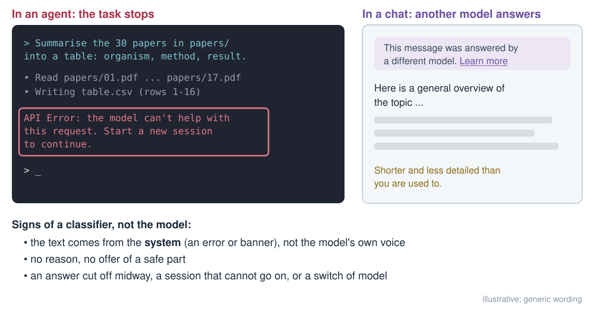{width="80%" fig-align="center"}

::: notes
Here are two typical looks, with generic wording, because the exact messages change between versions. On the left, an agent is summarising thirty papers. At paper seventeen, the session stops with an error from the system: the model cannot help with this request, start a new session. No reason, no offer, no way to continue in that session. Probably one of the papers was about a pathogen, and the classifier judged the context as too close to a blocked area. On the right, in a chat app, a small banner says the message was answered by a different model; the answer is shorter and more general than usual. Anthropic, for example, reroutes blocked requests on its most capable model to a less capable one, and says so openly. The signs on the slide are what to look for: system text instead of the model's voice, no reason, an answer that stops, or a switch of model.
:::

## Classifiers also stop legitimate research, and providers say so openly {.smaller}

- Classifiers are tuned to **err on the side of blocking**. They see words and context, not your intentions or your institution.
- Typical false alarms: **virology**, **toxin biology**, **some protein design**, **biosecurity research** itself, and lab safety material that names dangerous agents.
- Providers publish this. In August 2026 Anthropic retrained its biology classifier and reported about **85 % fewer** biology-related blocks, while saying that **false positives will remain**, and that **virology, toxicology and molecular design** still fall back to a less capable model.
- Providers run **verification programmes** for vetted research teams that loosen some blocks (details in *Limits of AI for biological research*).

**A false alarm is a policy limit, not a bug and not an accusation.** One blocked request is not a violation.

::: notes
If you work in life sciences, you will meet false positives. A classifier is built to be cautious, because the cost of letting through real help with a biological weapon is catastrophic, while the cost of a false alarm is a frustrated researcher. Providers are quite open about this trade-off. Anthropic wrote in August 2026 that after retraining its biology classifier, biology-related fallbacks dropped by about 85 percent across its products, but that false positives inevitably remain and that dual-use areas like virology, toxicology and molecular design still fall back to a less capable model. Anthropic's usage policy also says explicitly that a blocked output alone does not count as a violation. So if you are a virologist and a session ends, you have not done anything wrong. You have hit a limit set on purpose, and the next unit shows what you can do about it.
:::

## Security and computing requests can look like hacking, even when they are your job {.smaller}

:::: {.columns}
::: {.column width="50%"}
**Requests that may be refused or questioned**

- scanning a network for open ports
- testing passwords against a list
- analysing a suspicious e-mail attachment or malware sample
- writing a script that logs in to a website and scrapes it
- getting around a licence check or a paywall
:::
::: {.column width="50%"}
**What helps**

- Say whose system it is and that you are **authorised** to test it ("our lab's network, I am the IT contact").
- Ask for **defensive** framing: how to check, detect, harden.
- Respect the site's **terms**; Part 4 covers scraping politely.
- Some requests (getting around paywalls or licence checks) are refused because they **are** the problem.
:::
::::

::: notes
The third kind of guardrail is about computer security. Many ordinary IT tasks look exactly like attacks: a network scan, a password audit, a look at a suspicious attachment. Providers' usage policies forbid malware, unauthorised access and attacks on others' systems, but they allow security work on systems you own or are authorised to test. Anthropic's usage policy says this explicitly. The model cannot check your authorisation, so it may ask, or it may give a cautious, general answer. Context helps here: say whose system it is, that you are responsible for it, and what you want to protect. Asking how to detect or harden something gets further than asking how to break it. And some requests are refused because they are the problem: getting around a paywall or a licence check is not a security task, it is a breach of the terms.
:::

## Personal data, copyright and professional advice have their own limits {.smaller}

| Area | What the model tends to do | What to do instead |
|---|---|---|
| **People** | Declines to compile profiles of private individuals, find home addresses, or identify people in photos | Stay with **public professional** information (publications, institutional pages); this matters in *Likely reviewers for an upcoming grant* |
| **Copyright** | Will not reproduce long passages of books, song lyrics or paywalled articles | Ask for a summary, a short quote, or the reference; more in *Copyright, memorisation and credit* |
| **Medical** | Adds caveats, suggests a professional, avoids dosing advice for an individual | Use it for background and drafting; decisions about patients stay with qualified people |
| **Legal and financial** | Answers in general terms, adds "this is not advice" | Use it to prepare questions for the expert, not to replace them |

::: notes
Three more areas come up often in a university. People: models are reluctant to collect information about private individuals, find where someone lives, or identify a person in a photo. That is both a privacy guardrail and, under GDPR, good practice for you. When you build reviewer profiles in Part 4, you stay with public professional information, and the model will happily help with that. Copyright: models are trained not to reproduce long copyrighted texts word for word. You get a summary or a short quote instead. We come back to why in the copyright unit. Medical, legal and financial questions get caution rather than refusal. Anthropic's usage policy treats medical and legal recommendations to individuals as high-risk uses that need a qualified human to review the output. For you as a researcher or teacher, that rarely matters: background reading and drafting are fine; individual decisions stay with qualified people.
:::

## Harness guardrails run on your computer, and you control them

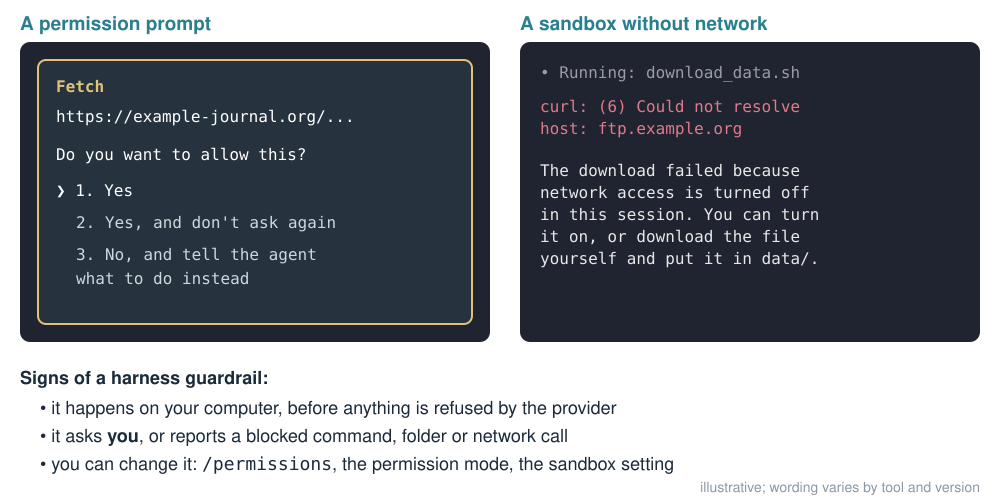{width="80%" fig-align="center"}

::: notes
The fourth kind you already know from Terminal survival kit and Privacy, ethics and safety. The agent program on your computer has its own guardrails: it asks before running commands or fetching web pages, it can run commands in a sandbox, it can have network access switched off, and it protects some folders. These are not the provider saying no; they are settings. On the left, a permission prompt before fetching a web page: read it, then decide. On the right, a download fails because network access is off in this session; Codex in its default Auto preset has no network for commands, for example. The agent usually explains what happened. You can change these settings: in Claude Code with Shift+Tab for the permission mode, slash permissions for saved rules and slash sandbox for the sandbox; in Codex with slash permissions. Change them deliberately, for one task, and switch back.
:::

## Account-level enforcement looks at patterns, not at one blocked request

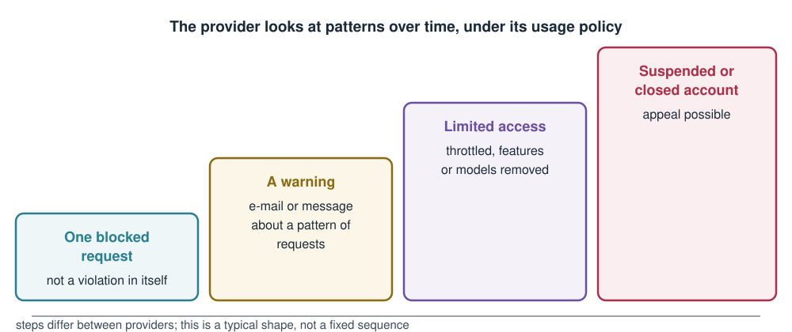{width="78%" fig-align="center"}

Both providers' usage policies allow **warnings**, **limits** and **suspension** for violations, and both forbid **intentionally getting around safeguards**. Anthropic: "a blocked output alone does not count as a violation."

::: notes
The last kind of guardrail is on your account. When you created it, you accepted a usage policy. Anthropic's current one is from November 2026; OpenAI's was updated the same month. Both list what is prohibited, and both say the provider may warn you, limit your access, suspend or close the account. Both also prohibit circumventing their safeguards: deliberately trying to get past a guardrail is itself a violation, whatever the topic. This is the main reason not to play games with a classifier. Enforcement is based on patterns: a series of requests, attempts to rephrase a blocked request again and again, accounts shared or used from where the service is not offered. One blocked request on a legitimate topic is not a violation; Anthropic's policy says so in so many words. If you receive a warning that you think is wrong, contact the provider; OpenAI's policy mentions appeals explicitly.
:::

## Usage limits, a full context and network errors stop you too, but they are not guardrails

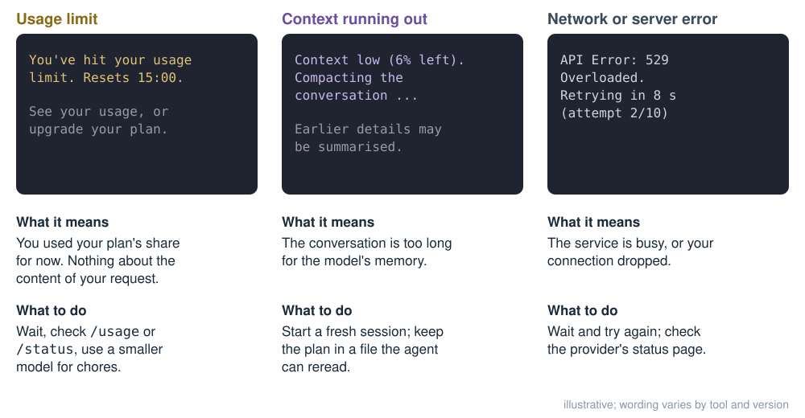{width="82%" fig-align="center"}

::: notes
Finally, three things that are often mistaken for guardrails. A usage limit: your plan gives you a certain amount of use per few hours and per week, and when it runs out the agent stops until the reset. It has nothing to do with what you asked. In Claude Code, slash usage shows your plan's limits; in Codex, slash status shows rate limits. A full context window: a very long session runs out of room; the agent compacts or summarises earlier parts, and may forget details. That is why we keep plans in files, from Organising a project for an agent. Network or server errors: the service is overloaded or your connection dropped; wait and retry. None of these calls for rewording your request, and none says anything about whether your request was acceptable. The exact wording of these messages changes between versions, so the mock-ups are illustrative.
:::

## Which guardrail did I hit? Ask four questions in order

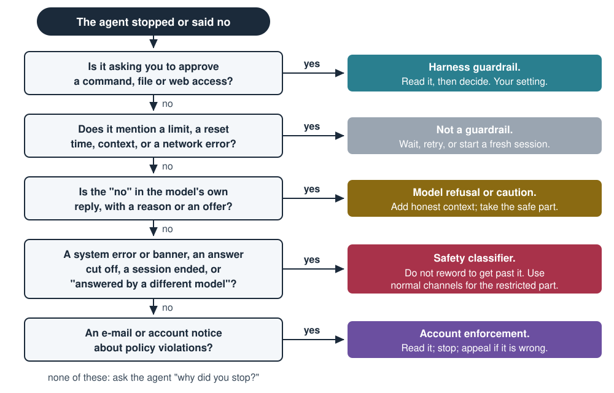{width="66%" fig-align="center"}

::: notes
Here is the whole first half as one flowchart. First: is the agent asking you to approve something? Then it is the harness; read and decide. Second: does the message mention a limit, a reset time, the context or a network error? Then it is not a guardrail at all. Third: is the no inside the model's own reply, with a reason or an offer? Then it is the model's own refusal or caution; you can give honest context or take the safe part. Fourth: is it a system error, a banner, an answer cut off, a session that ended, or a note that a different model answered? Then a safety classifier was involved; do not reword to get past it. Fifth, rarer: an e-mail or account notice is account enforcement. If none fits, simply ask the agent why it stopped; agents sometimes stop because they are unsure or think the task is done. You will practise this in the exercise.
:::

## The same question in a table {.smaller}

| What you see | Where it comes from | Who can change it | What to do |
|---|---|---|---|
| "Do you want to allow this?" | **Harness** | You | Read, then yes once, or no and say what instead |
| A blocked command or network call | **Harness** (sandbox) | You | Allow it for this task, or do that step yourself |
| "I won't ..., but I can ..." | **Model** | Nobody, but context helps | Give honest context; take the safe part |
| Extra caveats, "see a professional" | **Model** (caution) | Nobody | Fine for background; decisions stay with experts |
| System error, cut-off answer, ended session, "answered by a different model" | **Classifier** | Provider (verification programmes) | Do not reword to get past it; use normal channels |
| Warning e-mail, restricted account | **Account** | Provider | Stop; read the policy; appeal if wrong |
| "Usage limit", "context low", "overloaded" | **Not a guardrail** | You (plan, session) | Wait, start fresh, retry |

::: notes
The same content as a table, for those who prefer it, and for your notes. The useful column is "who can change it". The harness is yours to configure. The model's behaviour cannot be switched off, but it responds to context, so a clear and honest description of what you are doing often turns a refusal into an answer. Classifiers and account enforcement are set by the provider; the only legitimate ways to change them are the provider's own programmes for vetted users, and normal channels outside the AI tool. And the last row is about your plan and your session, not about content at all. The exercise starts with a set of twelve situations that you sort into these rows.
:::

## If the request is legitimate, say who you are and what it is for {.smaller}

:::: {.columns}
::: {.column width="50%"}
**Without context**

```text
Write a script that tries every
password in passwords.txt against
the login page at 10.0.4.17.
```
:::
::: {.column width="50%"}
**With honest context**

```text
I am the IT contact for our research
group and responsible for our lab
server at 10.0.4.17. Our security
office asked me to check that no
account uses a password from the
leaked-password list they gave me.
How should I run that check safely
and with their approval? Prefer
existing audit tools over a new
script, and tell me what to
document.
```
:::
::::

Context works for the **model's own** caution. It does **not** change what a classifier blocks, and it must be **true**.

::: notes
When the model is cautious, the main cause is that it cannot tell a legitimate request from a harmful one. You can help it. Say who you are, what the task is for, who asked for it or approved it, and what a good outcome is. The example on the left is exactly what an attacker would type. The one on the right describes a real, ordinary job: an IT contact asked by the security office to audit passwords on a server they are responsible for. The model can now help, and it will probably suggest existing tools and documentation, which is better advice anyway. Two warnings. First, context must be true. Inventing a cover story to get help you would not otherwise get is precisely the circumvention the usage policies forbid. Second, context helps with the model's own judgement; it is not meant to get past a classifier, and you should not use it for that.
:::

## Split the task: let the agent do the safe parts, handle the restricted part another way {.smaller}

- Most tasks that hit a guardrail are **mostly fine**. One part triggers it.
- Ask for the parts that are clearly fine: structure, background, analysis code, formatting, a reading list.
- Handle the restricted part through **normal channels**: your colleagues, the published literature, your institution's safety officers, the provider's programme for vetted researchers.
- Write down in your project notes **what** was blocked and **how** you handled it. It helps a colleague, and it helps you if anyone asks.

::: notes
The second move is to split the work. A literature summary on thirty papers stops at paper seventeen: let the agent do the other twenty-nine and read that one yourself. A lab safety handout that names dangerous agents gets blocked: let the agent do the layout and the general sections and write the agent-specific part yourself from your institution's manual. The restricted part is usually small, and it is often the part where your own expertise matters most anyway. For anything genuinely sensitive, the right channel is a human one: your colleagues, the literature, your biosafety officer or security office, and in some cases the provider's own verification programme for vetted teams. And keep a note in your project README of what was blocked and what you did. That is part of the AI-use log we started in Privacy, ethics and safety.
:::

## Do not try to trick the model past a guardrail {.smaller}

- Both providers' usage policies **prohibit** intentionally getting around safeguards. It can cost you your **account**.
- If something is blocked on purpose, a trick that "works" means you are now doing the very thing the block was for, **under your name**.
- A trick that works today breaks tomorrow, and leaves a **pattern** in the logs.
- Your institution may have rules too: research security, export control, dual-use research policies.

**Rewording honestly to explain a legitimate task is fine. Rewording to hide what you are asking is not.**

::: notes
This deserves its own slide, because it is tempting and because people share tricks online. Do not. The usage policies of both Anthropic and OpenAI explicitly prohibit circumventing safeguards, and enforcement looks at patterns of behaviour. More importantly, think about what success would mean. If a classifier blocks something because it could help make a biological weapon, a trick that gets the answer means you now hold that answer, obtained by deliberately evading a safety control, with your account attached to it. That is not a position a researcher wants to be in. Your university may also have rules on dual-use research and export control. The line is simple. Explaining honestly what you are doing and why is good practice. Disguising what you are asking, so that the system cannot see it, is not.
:::

## The strictest guardrails come from testing each model before release

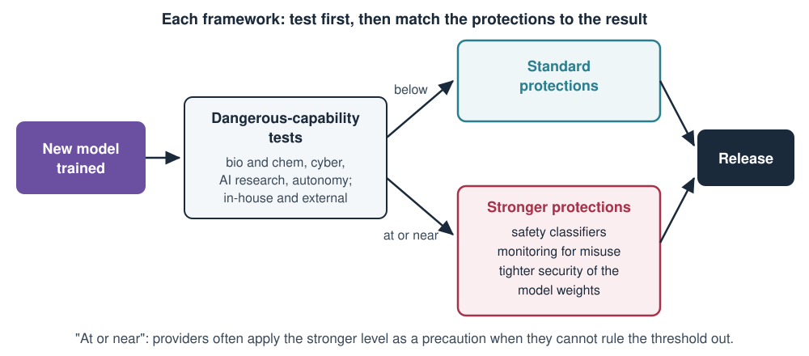{width="82%" fig-align="center"}

::: notes
Now the second half: where do the strictest guardrails come from? Each major provider has a published framework that says roughly the same thing. Before a new model is released, it is tested for dangerous capabilities: could it give real help with biological or chemical weapons, with serious cyber attacks, with automating AI research itself, or with acting autonomously in harmful ways? Testing is done in-house and, increasingly, with external testers such as government AI safety institutes. If the model is below the thresholds, standard protections apply. If it is at or near a threshold, stronger protections come on: the safety classifiers we just discussed, monitoring for misuse, and tighter security around the model's weights so they cannot be stolen. In practice, providers often switch on the stronger level as a precaution when they cannot rule out that the model has crossed the threshold. This is why the newest models carry the strictest guardrails.
:::

## Anthropic's AI Safety Levels were modelled on biosafety levels

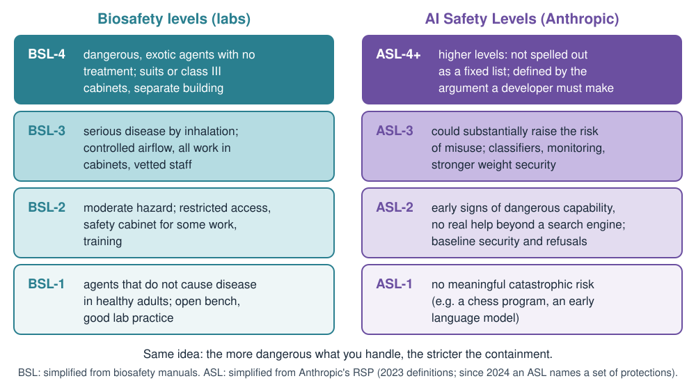{width="80%" fig-align="center"}

::: notes
For the biologists here this analogy will be immediate. When Anthropic published its Responsible Scaling Policy in September 2023, it said its AI Safety Levels were "modeled loosely after the US government's biosafety level standards for handling of dangerous biological materials." In a lab, the more dangerous the organism, the stricter the containment: from an open bench at BSL-1 to suits and a separate building at BSL-4. The ASLs work the same way. ASL-1 is a system with no meaningful catastrophic risk, like a chess program. ASL-2 shows early signs of dangerous knowledge but gives no real help beyond what a search engine does. ASL-3 could substantially raise the risk of catastrophic misuse, and requires classifiers, monitoring and stronger security. ASL-4 and above were never spelled out as a fixed list. One subtlety: since 2024, Anthropic uses ASL as the name of a set of protections, not of a model. You deploy a model "with ASL-3 protections", just as you work with an organism "at BSL-3".
:::

## Anthropic today: all current models run with ASL-3 protections {.smaller}

- **Responsible Scaling Policy**, version 3.4 (effective 8 July 2026). Version 3.0 (February 2026) was a rewrite: it adds public **Risk Reports** every 3 to 6 months and a **Frontier Safety Roadmap**.
- **ASL-3 protections** were first switched on in May 2025, with Claude Opus 4, as a precaution. They are aimed above all at **chemical and biological weapons**.
- They include **classifier guards**, **access controls** with exemptions for **trusted users**, red-teaming and bug bounties, and security controls on the model weights.
- At the time of writing (November 2026), Anthropic's model report says its current models are deployed with ASL-3 protections, treating them as reaching its first chemical and biological threshold ("CB-1").
- The policy commits to keeping **at least ASL-3** protections for models at that threshold, and to extending them at the next, higher one.

Source: [anthropic.com/responsible-scaling-policy](https://www.anthropic.com/responsible-scaling-policy), [anthropic.com/transparency](https://www.anthropic.com/transparency)

::: notes
What does this mean today? I checked the current policy and Anthropic's model report in November 2026. The Responsible Scaling Policy is at version 3.4, from July 2026. Version 3 changed the structure: instead of only listing required controls for each level, Anthropic now publishes regular Risk Reports and a roadmap of safety goals. ASL-3 protections were first switched on in May 2025, with Claude Opus 4, explicitly as a precaution because Anthropic could not rule out that the model had crossed its biological threshold. They include the classifiers you met earlier, plus access controls that let vetted, trusted users get exemptions from the classifiers, which is the basis for the verification programme we discuss in the next unit. Anthropic's model report lists its current models as deployed with ASL-3 protections. Model names and levels change, so check the transparency page rather than memorising this slide.
:::

## OpenAI's Preparedness Framework tracks three categories with "High" and "Critical" thresholds

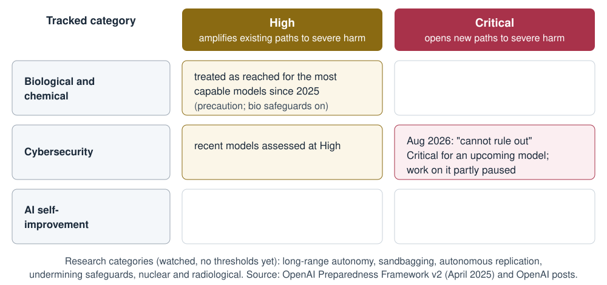{width="80%" fig-align="center"}

::: notes
OpenAI's equivalent is the Preparedness Framework. The current published version is version 2, from April 2025. It tracks three categories: biological and chemical, cybersecurity, and AI self-improvement. For each there are two thresholds. High means the model could amplify existing pathways to severe harm; it needs safeguards before deployment. Critical means it could introduce new pathways to severe harm; it then also needs safeguards during development. Since ChatGPT agent and GPT-5 in mid 2025, OpenAI has treated its most capable models as High in biology and chemistry, again as a precaution, with the matching safeguards on. In cybersecurity, OpenAI wrote in August 2026 that it could not rule out the Critical level for an upcoming model, and paused some internal work on it until stronger security was in place. There is also a list of research categories that are watched but do not yet have thresholds. OpenAI has signalled that a revised framework is coming, so check the current version.
:::

## Google DeepMind's Frontier Safety Framework uses "critical capability levels" {.smaller}

- **Frontier Safety Framework**, version 3.0 (September 2025), updated to **3.1** (April 2026).
- **Critical Capability Levels (CCLs)**: thresholds at which a model could cause severe harm without extra protections. Domains: **CBRN** (chemical, biological, radiological, nuclear), **cyber**, **harmful manipulation**, **machine-learning R&D**, and **misalignment** (a model working against its operators).
- Version 3.1 adds **Tracked Capability Levels**: lower thresholds that give an earlier warning.
- At a CCL: a response plan, a **safety case review** before release, and stronger security and deployment protections.

Source: [deepmind.google/frontier-safety](https://deepmind.google/frontier-safety/)

::: notes
Google DeepMind's version is the Frontier Safety Framework. The current version is 3.1, from April 2026, building on version 3.0 from September 2025. Its central idea is the critical capability level: a capability that, without extra protections, could cause severe harm. The domains overlap with the others: chemical, biological, radiological and nuclear; cyber; machine learning research and development; and two that are more specific to Google, harmful manipulation, meaning a model that could systematically change people's beliefs in high-stakes situations, and misalignment, a model that works against its operators. Version 3.1 added tracked capability levels, lower thresholds meant to raise a flag earlier. When a model reaches a critical level, Google commits to a safety case review before release and to stronger protections. Different words, same shape: test, compare with thresholds, add protections.
:::

## The EU AI Act now requires this kind of testing for the largest models {.smaller}

- The AI Act calls the largest models **general-purpose AI models with systemic risk**. A model trained with more than **10^25^ operations** of compute is presumed to be one.
- Their providers must: **evaluate** the model, including adversarial testing; **assess and mitigate** systemic risks (CBRN and loss of control among them); **report serious incidents**; and ensure **cybersecurity** of the model.
- Obligations apply since **2 August 2025**; the Commission's **enforcement powers** started on **2 August 2026** (fines up to 3 % of global turnover, or withdrawal of a model).
- A voluntary **Code of Practice** (July 2025) shows how to comply; most major providers have signed it.

For you as a user, the AI Act changes little directly. It is why the providers' frameworks are now **public and audited**.

::: notes
Briefly, the regulatory side. The EU AI Act has a special category for the largest general-purpose models, those with systemic risk, presumed for models trained with more than ten to the twenty-fifth operations. Their providers must evaluate the models, including adversarial testing, assess and reduce systemic risks such as help with chemical and biological weapons or loss of control, report serious incidents to the EU AI Office, and protect the model with adequate cybersecurity. These obligations have applied since August 2025, and since August 2026 the Commission can enforce them, with fines and, in the worst case, by requiring a model to be withdrawn. Most major providers have signed the Code of Practice that describes how to comply. For you as a user, this does not change much directly. But it is part of why the frameworks on the previous slides are published, kept up to date, and checked by outsiders. The content-labelling rules of the AI Act were covered in the previous unit.
:::

## Three frameworks, one shape {.smaller}

| | Anthropic | OpenAI | Google DeepMind |
|---|---|---|---|
| **Name** | Responsible Scaling Policy | Preparedness Framework | Frontier Safety Framework |
| **Current version** | 3.4 (July 2026) | 2 (April 2025) | 3.1 (April 2026) |
| **Levels** | AI Safety Levels (ASL-2, ASL-3, ...) and capability thresholds | High, Critical | Critical and Tracked Capability Levels |
| **Main risk areas** | chemical and biological weapons, AI research and development | biological and chemical, cybersecurity, AI self-improvement | CBRN, cyber, harmful manipulation, ML R&D, misalignment |
| **Where you notice it** | classifiers, rerouting to another model | refusals, safe-completions, classifiers | refusals, filters |

Versions as checked in November 2026. They change: check the provider's page.

::: notes
Here is a summary for your notes. The three frameworks have different names and different level names, but the same logic: test new models for a short list of catastrophic risks, define thresholds, and add protections when a model reaches them. Biological and chemical weapons are on every list, and that is the area where life scientists notice the effects most. Cybersecurity is the area where IT people notice them. The last row is about what you see as a user. I have kept it general, because the exact behaviour differs between products and changes with every release. The version column is as of November 2026. These documents are revised often, sometimes several times a year, so if you need to cite one, go to the provider's page and use the current version.
:::

## A stronger model may refuse what a weaker one does, and open weights shift the responsibility to you

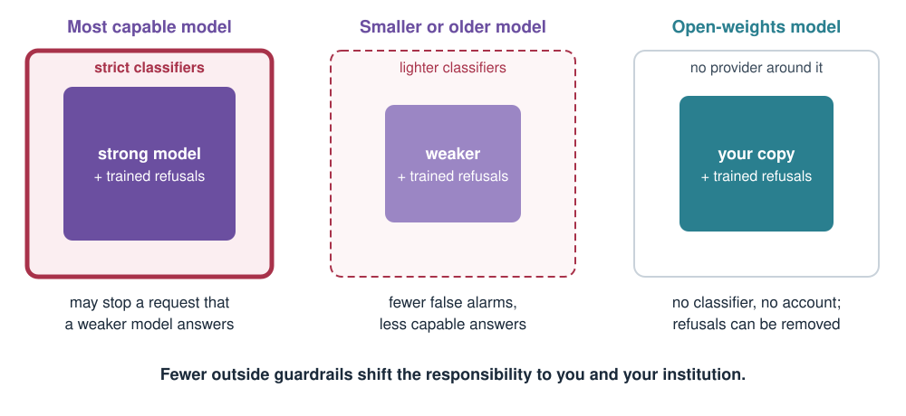{width="80%" fig-align="center"}

::: notes
Why does this matter to you in practice? Two consequences. First, the most capable models carry the strictest guardrails. A request that the newest model blocks may be answered by an older or smaller model, which has fewer classifier triggers but also gives less capable answers. Do not switch models just to get past a block on a dual-use topic; that is the same circumvention as before. But be aware that the difference exists, so a block on the strongest model does not mean you did something wrong. Second, open-weights models, which you met in Open-weights models and data privacy, run on your own computer or your institution's server. There is no classifier and no account to enforce a policy. The model still has trained refusals, but anyone can fine-tune those away. For sensitive data this is an advantage. For dual-use work, it means the responsibility moves entirely to you and your institution.
:::

## Where this goes wrong {.smaller}

- **Misreading the type.** Rewording a request that hit a **usage limit**; waiting out a **classifier** that will not change.
- **Taking a false alarm personally**, or giving up on a legitimate task that only needed honest context or splitting.
- **Inventing context** to get past a guardrail. That is circumvention, whatever the topic.
- **Treating the agent's answer as permission.** "The model helped, so it must be allowed" is wrong: the model does not know your institution's rules, your ethics approval or export control.
- **Relying on guardrails for safety.** They are coarse and they miss things; your judgement and your institution's rules come first.
- **Old facts.** Policies, levels and messages change several times a year.

::: notes
The limits slide. The first mistake is misreading the type: people reword their request when they simply hit a usage limit, or retry again and again after a classifier block, which only builds a pattern on their account. The second is overreacting to a false alarm: it is not an accusation. The third is the opposite mistake: making up context to get past a guardrail. The fourth is subtle and important: when the model does help, that is not a statement that the task is allowed. It does not know your ethics approval, your data agreement, or your institution's rules on dual-use research. The fifth: guardrails are a coarse safety net designed against catastrophic misuse, not a check of whether your work is safe or correct. And finally, everything on the policy slides has a short shelf life. Learn the shape; look up the details.
:::

## Summary {.smaller}

| Concept | Key fact |
|---|---|
| Model refusal | In the reply, with a reason and often a safe offer. Honest context helps |
| Partial answers | Safe part only, vaguer, or extra caveats; easy to mistake for "doesn't know" |
| Safety classifier | Separate model; system error, cut-off answer, ended session or a switch of model. False alarms happen |
| Harness guardrail | Permission prompts, sandbox, network: your settings |
| Account enforcement | Usage policy; looks at patterns; one block is not a violation; getting around safeguards is |
| Not guardrails | Usage limits, full context, network errors |
| What to do | Honest context; split the task; normal channels; never trick the model |
| Safety levels | Test before release; stronger protections above thresholds. ASL modelled on BSL |
| Frameworks | Anthropic RSP (ASL-3 on current models), OpenAI Preparedness (High, Critical), DeepMind FSF (CCLs), EU AI Act systemic risk |
| Consequence | Strongest models are strictest; open weights move responsibility to you |

**Next (Limits of AI for biological research):** the deep dive for life sciences and medicine: which biology triggers the classifiers, what that looks like, the programmes for vetted researchers, and the limits that are not guardrails at all, such as protocols the model gets subtly wrong.

::: notes
To sum up. When the agent stops, first ask which layer stopped it: the model, a classifier, the harness, your account, or simply a limit. The model's own refusals respond to honest context. Classifiers do not, and they produce false alarms on legitimate research; that is a policy limit, handled through normal channels. Harness guardrails are your settings. Account enforcement looks at patterns, and deliberately getting around safeguards is itself a violation. Behind the strictest guardrails stand safety frameworks that test each model and add protections above thresholds, an idea borrowed from biosafety levels. In the exercise you sort twelve situations by guardrail type, look up the current policy pages, and check your own harness settings. In the next unit, Limits of AI for biological research, we go deeper into biology and medicine.
:::
