## About this lecture

Every course has a concept that students only half understand from a figure: why growth levels off, what "95% confidence" means, how a lens forms an image. A small **interactive demo** lets them move the parameter themselves and see what happens. Until recently, writing one took a programmer days. With an agent, it takes an afternoon, and most of that afternoon is yours: deciding what the learner should discover, and checking that the model is right.

- **One HTML file.** No install, no build step, no internet; it opens in any browser and on a phone.
- **Learning goal first.** Write down what the learner should discover before anyone talks about sliders.
- **Few controls.** One or two things to move, a reset, and presets for the interesting cases.
- **Check the model against a known case.** A demo can look right and be wrong.
- **Accessible, tested on a phone, embedded in your page.**

A **hands-on** unit. It builds on *A course or project page*, where the demo ends up. Apps that explore real data come next, in *Shiny apps*.

::: notes
This unit is about one particular kind of teaching material: a small interactive page that explains one concept. You have probably seen such pages, perhaps a simulation of a pendulum or a page where you drag points and see a regression line move. They are very effective for students, and they used to be expensive to make. Coding agents change that, because writing a self-contained web page is exactly the kind of task they are good at. What the agent cannot do for you is decide what the demo should teach, and judge whether the model inside it is correct. Those two things are the core of today. We end with putting the demo on the course or project page you built in the previous unit.
:::

## Every course has a concept that a static figure does not explain

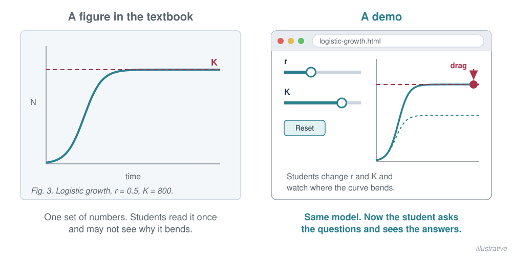{width="82%" fig-align="center"}

::: notes
Here is the concrete problem. On the left is the kind of figure every biology textbook has: logistic growth, one curve, one set of numbers. Students look at it, nod, and in the exam they cannot say why the curve bends or what happens when the carrying capacity changes. On the right is the same model as a demo. The student can change the growth rate and drag the carrying capacity up and down, and they see the curve respond. They are now asking their own questions: what if the habitat is twice as big? What if the population grows faster? Think of the concept in your own teaching that plays this role. That is the candidate for today's exercise.
:::

## Try it: a demo lets students move the parameter themselves

```{=html}
<iframe src="examples/logistic-growth.html" title="Logistic growth demo" loading="lazy" style="width:100%; height:590px; border:1px solid #ddd; border-radius:8px;"></iframe>
```

::: notes
This is a working demo, embedded in the slide. Try a few things. Drag the red line, the carrying capacity, up and down, and watch the brown marker: the steepest point of the curve is always at half of K. Turn on the comparison with unlimited growth: at first the two curves are almost identical, and then the logistic one bends away. Press one of the presets. If you are watching a recording, open the exercise page, where the same demo is embedded. One practical note: when you click inside the demo, the arrow keys move the slider, not the slides. Click outside the demo to get the slide keys back.
:::

## A demo here is one HTML file that runs anywhere, offline

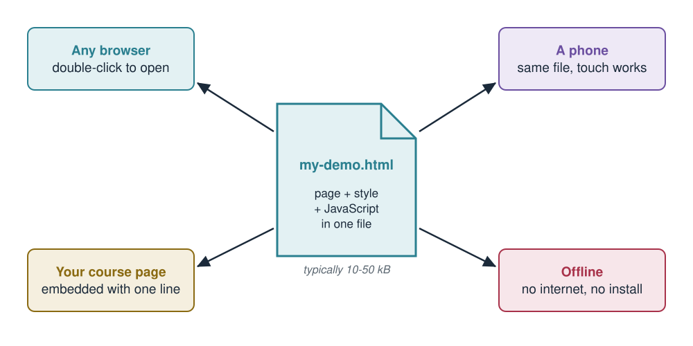{width="75%" fig-align="center"}

::: notes
In this course, a demo is a single HTML file. HTML is the language of web pages, and a single file can hold the page, its look and its behaviour, written in JavaScript. You do not have to read any of it. What matters is what this gives you. You can open the file by double-clicking it, in any browser. It works on a phone. You can embed it in your course page with one line. And it needs no internet and no installation, so it works in a lecture hall with bad wifi, and it will still work in ten years. The two example demos for this unit are about 11 and 14 kilobytes each.
:::

## One file, no build step, no internet: we insist on all three

| Rule | Why | What to tell the agent |
|---|---|---|
| **One file** | you can email it, open it, put it anywhere | "a single self-contained HTML file" |
| **No build step** | nothing to install or run before it works | "plain HTML, CSS and JavaScript, no frameworks" |
| **No internet** | works offline and on locked-down networks; nothing breaks when a website changes; no tracking of students | "do not load anything from the internet: no CDN, no fonts, no libraries" |
| **No data sent anywhere** | students' clicks stay in their browser | "no analytics, no forms that send data" |

The agent's first idea is often a plotting library loaded from the internet. It works on your laptop today and fails in a lecture hall without wifi. Say the rule in the first prompt.

::: notes
These rules are stricter than what a web developer would use, and that is on purpose. Agents like to use libraries: a charting library, a maths library, a fancy font, each loaded from a content delivery network, a CDN, on the internet. It looks fine on your laptop. Then you open it in the lecture hall without wifi, or the library changes its address in three years, and the demo is a blank page. Loading things from other websites also means those websites see your students' visits. A sister course of ours builds about thirty demos with a programming toolchain that has to be installed and run first. That is fine for a programmer, but too heavy for this course. One plain file is enough for almost every teaching demo.
:::

## A sister course uses some 30 demos; they share a shape

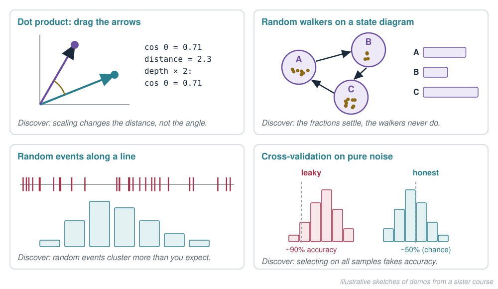{width="80%" fig-align="center"}

::: notes
To give you an idea of what is possible, here are sketches of four demos from a sister course in quantitative biology. In the first, students drag two arrows and see that scaling one of them changes the distance between them but not the angle, which is why we use correlation rather than distance for expression profiles. In the second, two hundred random walkers hop between states, and the fractions in each state settle even though no walker ever stops. The third drops random events along a line, and students see that random events cluster much more than people expect. The fourth runs cross-validation on pure noise and shows that a common mistake gives 90% accuracy on data with no signal at all. Each one has a single message that a student can discover by playing.
:::

## What those demos have in common

| Demo | What the learner moves | What the learner discovers |
|---|---|---|
| Gaussian elimination | steps through row operations one at a time | why a system has no solution or infinitely many |
| Dot product | drags two arrow tips | scaling changes the distance, not the angle |
| Random walkers | presses play, changes the rates | the fractions settle; individuals never do |
| Random events | changes the rate, switches views | counts follow one pattern, gaps another |
| Leakage | presses "run again" | a subtle mistake fakes high accuracy on noise |
| Confidence intervals (this unit) | sample size, "draw 20" | about 1 in 20 intervals misses, whatever you do |

Each demo has **one message**, **few controls**, a **reset or presets**, and something that **changes visibly** when you move a control.

::: notes
If we put the demos side by side, a pattern appears. Each demo has one message, which you could write as a single sentence. Each has only a few controls: one or two sliders, a play button, a button to run again. Each has a reset or a set of presets that put the demo into an interesting state, so the teacher can say "press the outlier preset" in a lecture. And in each, something changes visibly and immediately when you move a control. That last point matters more than it seems: if students have to press "compute" and wait, they explore much less. We will use these four properties as a checklist for your own demo.
:::

## Start with what the learner should discover, not with the sliders

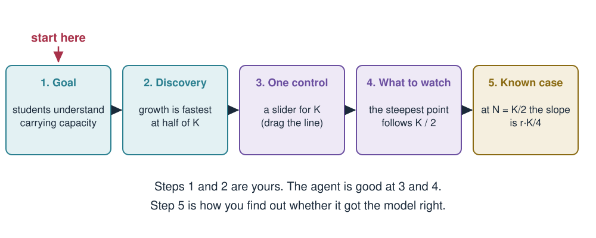{width="88%" fig-align="center"}

::: notes
This is the most important slide of the unit. The natural way to start is to think about the widgets: I want a slider for this and a plot of that. Do not start there. Start with the learning goal, and then with the discovery: the one sentence that the student should be able to say after five minutes with the demo. "Growth is fastest at half of the carrying capacity." Only then decide which control lets them find it, and what they should watch while they move it. Steps one and two are yours: they need your teaching experience, and the agent cannot guess them. The agent is good at three and four. Step five, a known case, is how you check the model, and we come back to it in a few slides.
:::

## Write the discovery as one sentence you could test

| Too vague | A discovery you can test |
|---|---|
| "Understand logistic growth" | "Growth is fastest when the population is at half of K, whatever r is." |
| "Show confidence intervals" | "About 1 in 20 of the 95% intervals misses the true mean, and you cannot tell which." |
| "Explain drug dosing" | "With a dose every half-life, the level settles at about twice a single dose." |
| "Visualise diffusion" | "Spreading distance grows with the square root of time: four times as long, twice as far." |
| "Interactive Fourier" | "A square wave needs many odd harmonics; the corners never get perfectly sharp." |

Test it on a colleague: give them the demo and no explanation. Can they say the sentence after five minutes?

::: notes
A useful habit is to write the discovery as a sentence that could be true or false, and that a student could say out loud. The left column has typical descriptions of a demo; they say what the demo is about but not what it teaches. The right column says what the student should find. These sentences also give you a test. Give the finished demo to a colleague or a student, without explaining anything, and after five minutes ask what they noticed. If they say your sentence, the demo works. If they say "it has nice sliders", it does not, and the fix is usually in the design, not in the code. The discovery sentence also goes into your prompt to the agent, and it helps the agent make better choices.
:::

## Fewer controls teach more

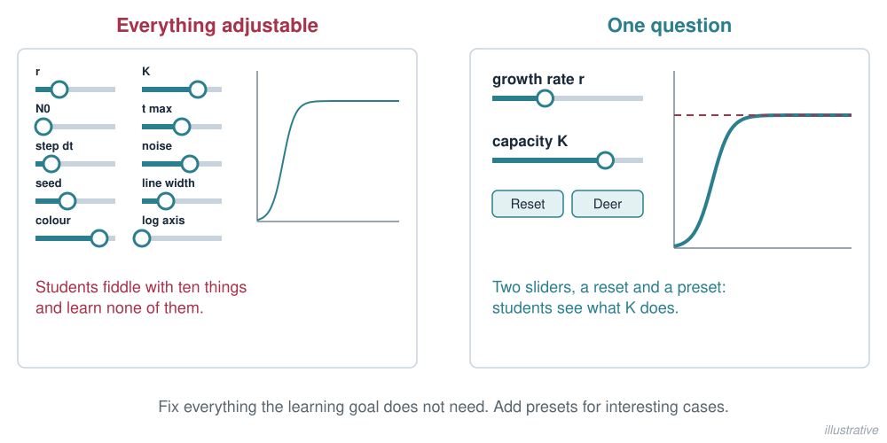{width="82%" fig-align="center"}

::: notes
Agents, like enthusiastic programmers, tend to make everything adjustable. The left demo has ten sliders, including step size, random seed and line colour. Students will move all of them and learn none of them. The right demo has two sliders, a reset and a preset. Everything that the learning goal does not need is fixed. If the discovery is about the carrying capacity, the student needs K, and perhaps r to see that the result holds whatever r is. They do not need the number of time steps. Presets are a very good tool: a button called "bacteria in a flask" or "deer on an island" puts the demo in an interesting state and gives the student a story. If the agent adds controls you did not ask for, ask it to remove them.
:::

## The prompt describes the learner, the discovery and the controls

```text
Make a single self-contained HTML file, logistic-growth.html, that teaches
first-year biology students about logistic population growth.

What students should discover: growth looks exponential at first, then slows,
and it is fastest when N is half of the carrying capacity K.

Controls: sliders for growth rate r (0.1-1.5 per day), K (100-1000) and start
population N0 (1-100); let students drag a horizontal line for K. A reset button
and two presets ("bacteria in a flask", "deer on an island").
Show: N over 40 days, a marker at the steepest point, and the key numbers as text.

Rules: plain HTML, CSS and JavaScript in one file; nothing loaded from the
internet; works on a phone; labelled controls that work with the keyboard;
text at least 16 px. Tell me the formula you use and one known case I can
check by hand.
```

::: notes
Here is the prompt for the example. It has four parts. First, who the demo is for and what it is about. Second, the discovery, word for word. Third, the controls, with ranges in sensible units, because the agent cannot know that a growth rate of 50 per day is silly. Fourth, the rules: one file, nothing from the internet, works on a phone, accessible. The last sentence is important: ask the agent to tell you the formula it used and a known case. That turns the hidden model into something you can check. You do not need to know JavaScript to write this prompt. You need to know your subject and your students, which you do.
:::

## The agent writes one file and tells you what is inside

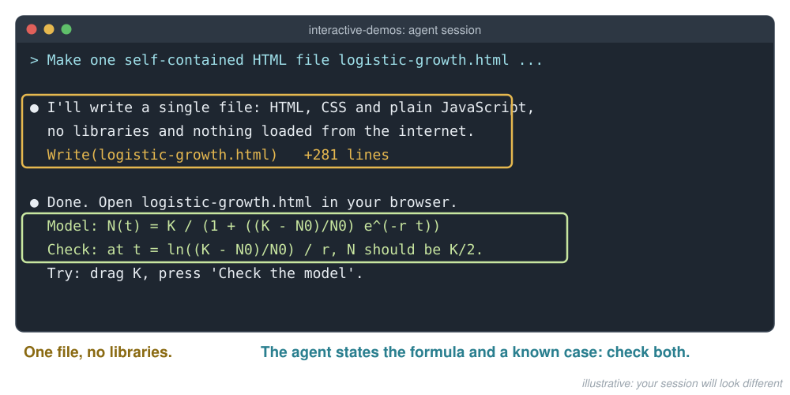{width="80%" fig-align="center"}

::: notes
This is roughly what the session looks like. The agent may ask a question or two first. Then it writes one file and reports back. Look for two things. First, that it really wrote one file with no libraries; if it says it uses a charting library from the internet, tell it not to. Second, that it states the formula and a known case, as we asked. Write the formula down; you will check it. A demo of this size is a few hundred lines. You do not need to read them. Your session will look different; the agent may choose another layout or ask about details first.
:::

## Opening the demo is a double-click

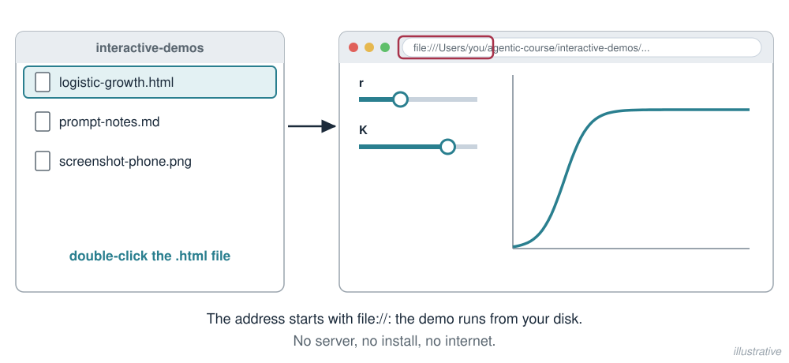{width="80%" fig-align="center"}

::: notes
To try the demo, find the file in your file browser and double-click it. It opens in your web browser. Look at the address bar: it starts with file colon slash slash and the path on your disk. Nothing is on the internet yet; you are the only person who can see it. You can also ask the agent to open it for you. Keep the browser window open next to the terminal. Every time the agent changes the file, reload the page with F5 on Windows or Command R on a Mac, and try again. This short loop, change, reload, try, is where most of the work of making a good demo happens.
:::

## Say what a student would see, not what to change in the code

Good feedback describes the experience:

```text
When I drag K below the current population, the curve jumps. A student
would think that is a mistake in the demo. Make the population fall
smoothly towards K instead.
```

```text
The numbers under the plot change too fast to read while I drag.
Round them to one decimal and keep their position fixed.
```

```text
A student will not know what "N0" means. Use "start population" and
show the unit (individuals) next to every number.
```

Change **one thing per round**, reload, and try again. If the demo gets worse, `git` gets you back (*Git as undo button and lab notebook*).

::: notes
You will iterate a few times. The best feedback describes what a student would experience, not how to change the code. You know what confuses students; you do not need to know which line causes it. Notice that the first example is about the model as well as the look: if the population starts above K, the logistic model says it should fall smoothly, so a jump is a real bug. Change one thing per round, so you can tell which change made things better or worse. And commit good versions in git, as you learned in Part 2. If a change goes wrong, you can go back with one sentence to the agent.
:::

## A demo that looks right can still be wrong

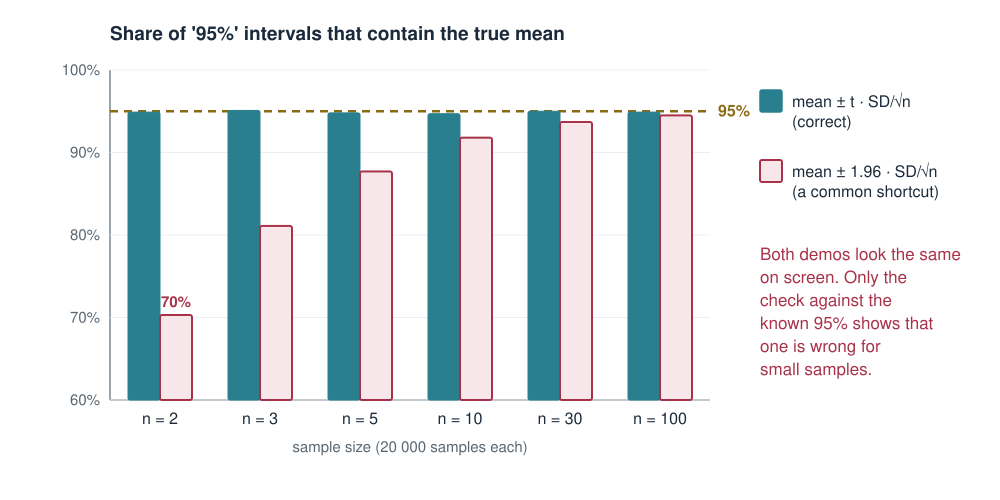{width="80%" fig-align="center"}

::: notes
Now the uncomfortable part. A demo shows a model, and if the model is wrong, the demo teaches the wrong thing, convincingly. Here is a real example from making the second example demo for this unit. A confidence interval for a mean can be computed with the t value, which is correct, or with the number 1.96, a common shortcut that is only right for large samples. Both versions look identical on screen. Lines, a red line here and there, nothing suspicious. But if you count, the shortcut covers the true mean only 70% of the time with two observations, and 92% with ten. A student would learn that 95% intervals are fine for tiny samples. Agents write such shortcuts all the time, because they are common in the text they learned from.
:::

## Try it: what does "95% confidence" mean?

```{=html}
<iframe src="examples/confidence-intervals.html" title="Confidence interval demo" loading="lazy" style="width:100%; height:590px; border:1px solid #ddd; border-radius:8px;"></iframe>
```

::: notes
Here is the second example demo. Each line is a 95% confidence interval from one random sample of heights; the true mean is 170. Press "Draw 20" a few times. Most lines cross the brown line, and now and then one misses, drawn in red and dashed. Then press "Draw 1000" and read the percentage: it should be close to 95. Now tick the box for the 1.96 shortcut and set the sample size to 3. Draw 1000 again, and you see the coverage drop to around 80%. Finally, move the sample size from 10 to 40 and watch the average width: four times the sample, about half the width. That is three discoveries in one demo, which is about the upper limit.
:::

## Check the model against a case where you know the answer

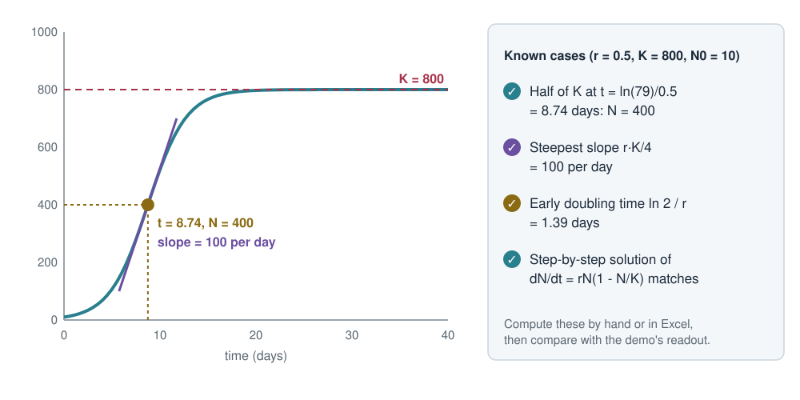{width="85%" fig-align="center"}

::: notes
How do you catch a wrong model? Not by reading the code. You compare the demo with a case where you know the answer from theory, from a textbook, or from a hand calculation. For logistic growth there are several. The population reaches half of K at a time you can compute with a calculator: for these settings, 8.74 days. The steepest slope is r times K divided by 4, here 100 per day. Early on, the population doubles every ln 2 divided by r days. And a step-by-step numerical solution of the differential equation must agree with the formula the demo uses. Our example has a "Check the model" button that does the last two automatically. Compute at least one known case yourself, by hand or in Excel. The agent's own check is useful, but it is not your check.
:::

## Known cases exist in every field

| Demo | A known case to check |
|---|---|
| Logistic growth | N = K/2 at t = ln((K - N0)/N0) / r |
| Confidence intervals | about 95% of 1000 intervals contain the true mean |
| Drug dosing (one compartment) | after one half-life, half the drug is left |
| Michaelis-Menten kinetics | at substrate concentration Km, the rate is Vmax/2 |
| Diffusion | mean squared distance = 2Dt in one dimension |
| RC circuit / cooling | after one time constant, 63% of the way there |
| Projectile without air resistance | the longest throw is at 45 degrees |
| Hardy-Weinberg | p² + 2pq + q² = 1; with p = 0.5, half are heterozygous |
| Compound interest | at 7% a year, money doubles in about 10 years |

Ask for a **check mode** that prints these values next to the expected ones. Then do one by hand.

::: notes
Every field has such cases. A pharmacologist knows that after one half-life, half the drug is left. A chemist knows that at Km the rate is half of Vmax. An engineer knows that a capacitor reaches 63% of its final voltage after one time constant. These are the checks to ask for. A good way to use the agent is to ask it to build a check mode into the demo, a button or a hidden panel that computes these known values and shows them next to the expected numbers. Then you check at least one of them yourself, and you try an extreme setting: zero, very large, equal values. Models often break at the edges, for example when the start population is above K.
:::

## Ask for a check mode, fixed random numbers and a formula in the file

- **Check mode:** a button that compares the demo's numbers with known cases and says "agrees" or "does not agree".
- **Fixed random seed:** "Start again" gives the same random numbers every time. Then 1000 draws at n = 10 give the same result in every lecture (in our demo, 940 of 1000, 94.0%) and you can write it in the exercise.
- **The model in words at the top of the file:** formula, units, assumptions, known cases. Anyone can open the file in a text editor and read it.
- **Extreme settings:** try the smallest and largest value of every slider. Nothing should jump, freeze or show `NaN`.
- **A second opinion:** ask a fresh agent session (or the other agent) "Is the model in this file correct for teaching X? Compare it with a textbook formula."

::: notes
Here are five habits that make a demo checkable. A check mode, which we have seen. A fixed random seed: demos with randomness should give the same sequence after pressing "Start again", so that you can say in a lecture "press draw 1000 and you should see 94.0%", and so that a strange result can be reproduced. The model written in plain words at the top of the file, so that a colleague can check it without reading code. Extreme settings, because that is where formulas divide by zero. And a second opinion from a fresh session, which has not seen the conversation and does not share the first session's assumptions. In the unit Parallel workers we use the other agent for exactly this.
:::

## Accessible demos work for everyone, including on a projector

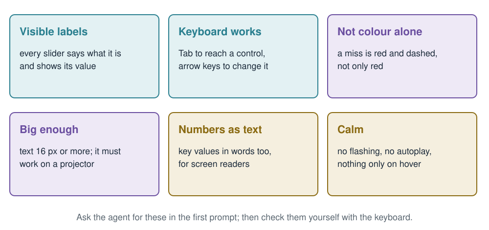{width="80%" fig-align="center"}

::: notes
Accessibility is not an extra. Some of your students use a screen reader, some cannot use a mouse, some are colour blind, and all of them will at some point see the demo on a projector at the back of a lecture hall. Six things cover most of it. Every control has a visible label and shows its value. Everything works with the keyboard: Tab to move between controls, arrow keys to change a slider. Colour is never the only signal: in our demo, an interval that misses is red and dashed. Text is at least 16 pixels. Key numbers are also written as text, so a screen reader can read them. And nothing flashes or depends on hovering with a mouse, which does not exist on a phone. Put these in the first prompt, and test the keyboard yourself: put the mouse away and try to use the demo.
:::

## Test on a phone before your students do

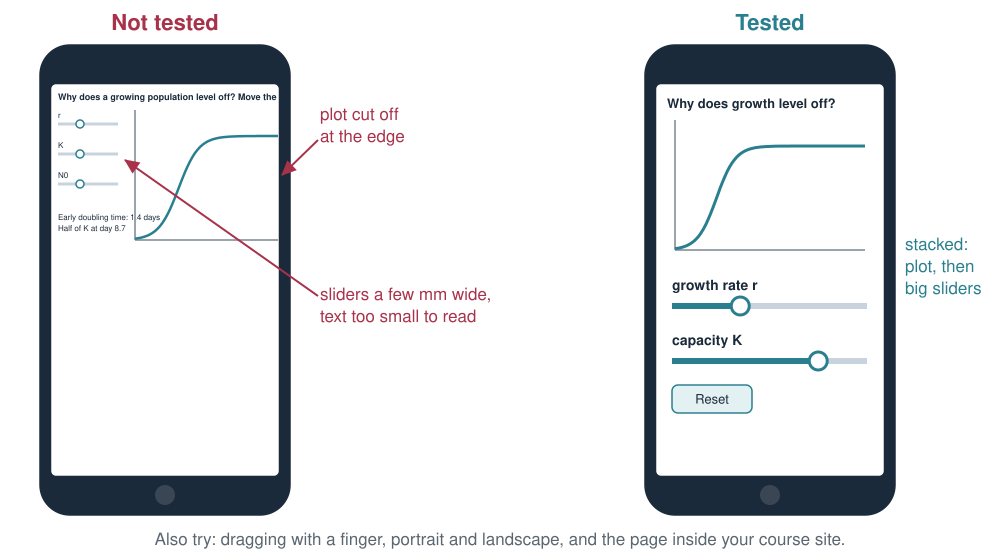{width="78%" fig-align="center"}

::: notes
Many students will open your demo on a phone, often on the bus. A layout that looks fine on a wide screen can be unusable on a narrow one: the plot is cut off at the edge, the sliders are a few millimetres wide, the text is tiny. The fix is a layout that stacks on narrow screens, with the plot first and big controls under it. Agents can do this well if you ask. To test before publishing, most browsers have a phone view: in Firefox and Chrome, open the developer tools and switch on the device or responsive mode. After publishing, open the real page on your own phone and try to drag things with your finger. Also check the demo inside your course page, because the page gives it less width than a full browser window.
:::

## Embed the demo in your course page with one line

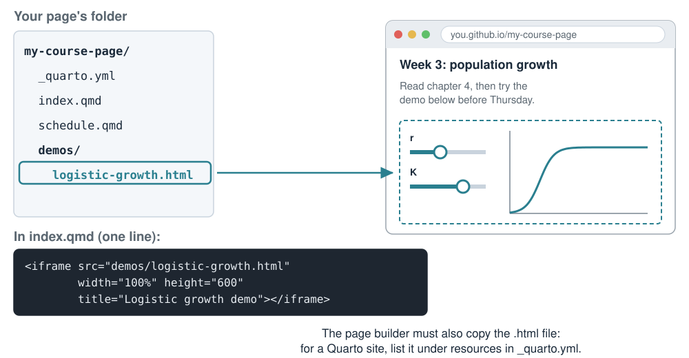{width="85%" fig-align="center"}

::: notes
In the unit A course or project page you built a Quarto website in its own page folder, published on GitHub Pages from the docs folder. The demo goes into that page folder as a file in a subfolder, for example demos. On any page, a single line, an iframe, shows the demo inside the page, at the size you choose. Iframe is HTML for "a window to another page". The agent writes that line for you. One detail often goes wrong: Quarto must copy the demo file into the docs folder when it renders the site. The agent does that by listing the demo under resources in the project file, next to the .nojekyll file you already have there. Check the published page, not only your local copy: if the demo box is empty or says "not found", the file was not copied.
:::

## Publishing is the git loop you already know

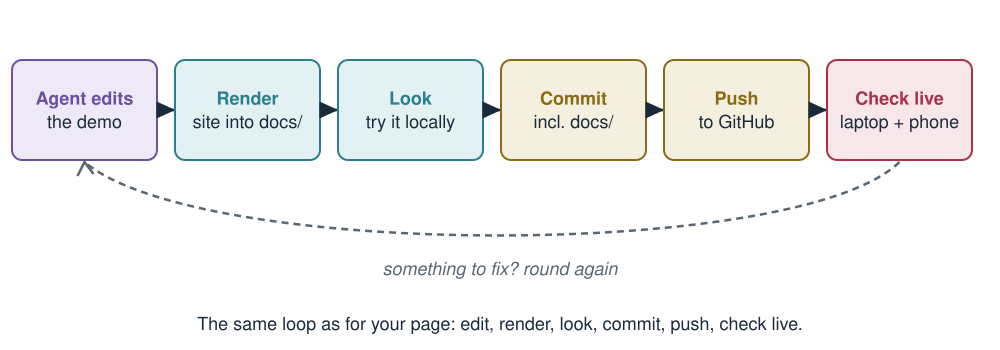{width="85%" fig-align="center"}

::: notes
From here on it is the same loop as for the rest of your page. The agent edits the demo, Quarto renders the site into the docs folder, you open it and try the demo locally, you commit, including docs, and push, and after a minute or two GitHub Pages serves the new version. Then you check the live page on a laptop and on a phone. If something needs fixing, go round again. Nothing new here, which is the point: the course page from the previous unit is the place where every later result goes, and today a demo joins it.
:::

## Topic ideas: life sciences and medicine

| Topic | What the learner discovers |
|---|---|
| Logistic growth | growth is fastest at half of the carrying capacity |
| Enzyme kinetics (Michaelis-Menten) | doubling the substrate does not double the rate near saturation |
| Genetic drift | small populations lose alleles by chance alone |
| Predator-prey (Lotka-Volterra) | the predator peak comes after the prey peak |
| Repeated drug doses | the level settles; the dosing interval sets the swings |
| Epidemic (SIR model) | an epidemic stops before everyone is infected |
| Screening test | with a rare disease, most positive results are false |
| Dose-response and EC50 | the curve shape depends on the Hill coefficient |

::: notes
Here are topic ideas from the life sciences and medicine, each with its discovery sentence. Several of them are classics where students hold a wrong intuition: that an epidemic only stops when everyone has been infected, or that a positive test with 99% specificity means the patient is probably ill. Demos are best exactly where intuition is wrong, because the student can see their prediction fail. Pick a topic from your own teaching rather than from this list, if you can: you know where your students get stuck.
:::

## Topic ideas: physical sciences, engineering, social sciences

| Topic | What the learner discovers |
|---|---|
| Diffusion of particles | four times as long, twice as far |
| Damped spring or pendulum | one damping value settles fastest; more damping is slower again |
| RC circuit, heating and cooling | one time constant gets you 63% of the way |
| Fourier series | a few sine waves already make a square wave; the corners overshoot |
| Projectile with air drag | with drag, the best angle is below 45 degrees |
| Sampling and polls | the margin of error depends on the sample size, not the population size |
| Regression and outliers | one point far out can turn a slope around |
| Compound interest and loans | small rate differences become large over decades |
| Segregation model (Schelling) | mild individual preferences produce strong segregation |

::: notes
And some ideas from the physical sciences, engineering and the social sciences. The sampling one is a favourite in the social sciences: students expect that a poll of a country of ten million needs a much larger sample than a poll of a town, and it does not. Regression with a draggable outlier works in any field that fits lines. The segregation model is a striking example of how simple individual rules give strong collective patterns. Notice that almost every row has a known case you could check. If you cannot think of a known case for your topic, that is a warning sign: you will not be able to check the demo.
:::

## Where this goes wrong

- **A plausible but wrong model.** The demo looks fine and teaches a mistake (the 1.96 shortcut, a wrong unit, a formula that only holds for small values). Check a known case.
- **Too many controls.** The demo becomes a toy without a message. Remove what the discovery does not need.
- **Loaded from the internet.** It works at home and shows a blank page in the lecture hall. One file, nothing external.
- **Silent edge cases.** Sliders at zero or at the maximum give `NaN`, a frozen page or a jump. Try every extreme.
- **Inaccessible.** Mouse only, colour only, tiny text. Test with the keyboard and on a phone.
- **Not your material.** A figure or photo pasted in from a textbook or a website may not be yours to publish. Use your own drawings or openly licensed material, and say where it comes from.
- **Nobody tested it on a student.** Five minutes with one student finds more than an hour of your own clicking.

::: notes
Let us collect what goes wrong. The worst failure is a model that is plausible but wrong, because neither you nor the students notice. The fix is always a known case. Too many controls make a toy without a message. Anything loaded from the internet breaks sooner or later. Edge cases, a slider at zero, often show "NaN", not a number, or a page that stops responding. Accessibility is easy to forget and easy to test. If the agent pastes in a figure from a textbook or a website, you may not have the right to publish it; we discuss copyright and credit properly in Part 6. And finally, the most useful test of all is one student using the demo for five minutes while you watch silently.
:::

## What the agent does and does not do here

| The agent does | You do |
|---|---|
| writes the HTML, CSS and JavaScript | choose the concept and the discovery sentence |
| lays out controls and plots, phone layout | decide which controls the goal needs |
| implements the model you describe | check the model against known cases, by hand |
| adds a check mode, a seed, labels | test with the keyboard, on a phone, on a student |
| writes the embed line for your page | check the published page, not only the preview |

::: notes
To sum up the division of labour. The agent does the programming: the page, the layout, the model as code, the check mode and the embed line. It is fast and usually good at this. You do the parts that need a teacher and a subject expert: what the demo teaches, which controls that needs, whether the model is right, and whether a real student understands it. None of your parts requires reading code. All of them require your judgement, and they are what makes the difference between a demo that teaches and one that merely moves.
:::

## Summary

| Concept | Key fact |
|---|---|
| Demo | one self-contained HTML file: no install, no build step, no internet |
| Learning goal | write the discovery as one sentence before any sliders |
| Controls | one or two sliders, a reset, presets; fix everything else |
| Correctness | compare with a known case by hand; ask for a check mode and a fixed seed |
| Accessibility | labels, keyboard, not colour alone, text ≥ 16 px, numbers as text |
| Phone | stacked layout; test in the browser's phone view and on a real phone |
| Publishing | file in your page folder, one iframe line, listed under resources; render, commit, push, check live |

**Next (*Shiny apps*):** from a demo that explains a model to an app that explores your own data, published next to your course page.

::: notes
Here is the summary. A demo is one file that runs anywhere. Start from the discovery sentence. Keep the controls few. Check the model against a known case, because a demo can look right and be wrong. Make it accessible and test it on a phone. Publish it on your course page with one line and the usual git loop. In the next unit we move from models to data: a Shiny app lets your colleagues or students explore a dataset with filters, plots and tables. It also raises a new question, which we did not have today: what happens to the data when you publish the app.
:::
