## About this lecture

Most research groups have code that nobody fully understands any more: the analysis a former PhD student wrote, in MATLAB, with no README. The results in a published paper depend on it, and the new student has to build on it. An agent can read that code faster than any of us, explain it, document it and translate it. But a translation that **looks** right is worth nothing until you have shown that it **gives the same numbers**.

- **Map before you touch.** Ask the agent for a map of the code, a README and comments, and change nothing yet.
- **Reference outputs first.** Run the old code on its own example data, or find its saved outputs, before any porting.
- **Port faithfully, then compare with a tolerance.** The new R or Python version must reproduce the old numbers, bugs included, to a tolerance you set in advance.
- **Fix and document as separate steps.** Hard-coded assumptions and bugs go into a written list; fixes come after the port matches, one visible change at a time.

This is a **workflow** unit. It uses git (*Git as undo button and lab notebook*), scripts that rerun (*Reproducible figures*) and two agents checking each other (*Parallel workers*).

::: notes
This unit is about inheriting code. Almost everyone who has worked in a research group has met this situation: someone leaves, and what remains is a folder of scripts that produced the numbers in a thesis or a paper. Sometimes it is MATLAB and the licence is about to run out; sometimes it is R from ten years ago that no longer runs; sometimes it is Python 2. Agents are genuinely good at this: reading a lot of code quickly, explaining it in plain language, and writing a translation. The danger is just as real: a translation that runs and produces plausible numbers, but not the same numbers. The whole unit is built around one idea from How LLMs and agents work: trust what was run and can be compared, not what looks right. We follow a five-step recipe, and the exercise walks through it on a small but realistic example with a hidden bug in it.
:::

## The former PhD student left 3000 lines of MATLAB and one line of README

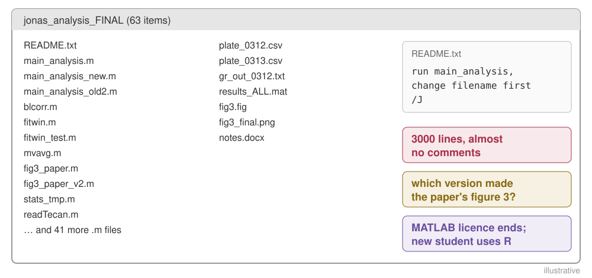{width="78%" fig-align="center"}

The supervisor says: "Port it to R or Python so the new student can use it. The numbers in the 2019 paper came from this."

::: notes
Here is the concrete problem. A folder with dozens of MATLAB files, some called final, some called new, some called test. A README with one line, "run main_analysis, change the file name first". Example data from one experiment, and an output file the student saved at some point. No comments to speak of. The student has left for industry and answers email once a month. The university's MATLAB licence covers only a few machines, and the new student works in R. And the published paper depends on these numbers, so getting them wrong has consequences. Ask the room: who has a folder like this? Most hands will go up. What would you normally do? Usually someone spends weeks reading code line by line, or starts over from scratch and gets different numbers without knowing why.
:::

## Code nobody can run is a result nobody can check

- The numbers in a paper are only as trustworthy as the code that made them, and **someone must be able to rerun it**.
- Old code fails for boring reasons: an expired licence, a removed function, a hard-coded path to `C:\Users\jonas\Desktop`.
- Rewriting from scratch gives **different numbers without explaining why**.
- Reading it line by line takes weeks, and the knowledge leaves again with the next student.

**What we want:** a version that runs today, gives **the same numbers**, and comes with a written account of what it does and what it assumes.

::: notes
Why bother? Because reproducibility is not only about publishing your code, it is about being able to run it again. Code stops working for dull reasons: a licence ends, a package renames a function, a script assumes a folder that existed only on the student's laptop. The two traditional responses both have problems. Starting from scratch is tempting but almost always produces different numbers, and then you do not know whether the old or the new is right. Reading everything line by line is the careful route but takes weeks, and unless someone writes it down, the understanding walks out of the door with the next student. With an agent we can do the careful route much faster, and we make the agent write the understanding down as it goes.
:::

## Reading old code is a recipe in five steps

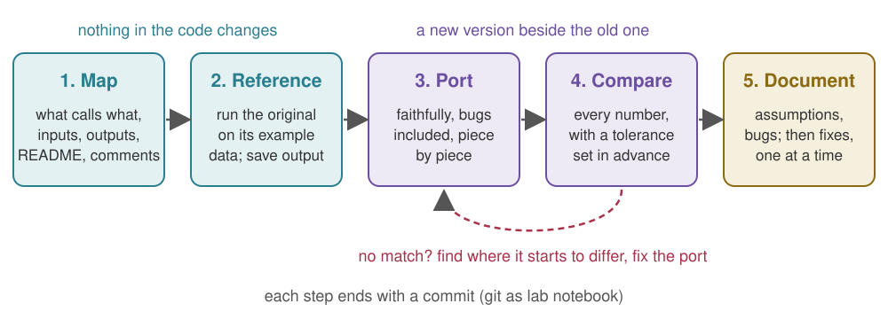{width="88%" fig-align="center"}

::: notes
Here is the recipe for the whole unit. One: map. The agent reads all the code and tells you what calls what, what goes in and what comes out, and where the settings are hidden. It writes a README and comments, and changes nothing in the code. Two: reference outputs. Before any porting, you pin down what the old code actually produces on its own example data. Three: port, faithfully, piece by piece, without fixing anything. Four: compare the new outputs with the reference, number by number, with a tolerance you choose in advance. Five: document, which means a list of assumptions and a list of bugs, and only then fixes, each as a separate, visible change. The arrow back from compare to port is important: most ports need a few rounds. The steps are the same whether the code is 80 lines or 3000.
:::

## The original is evidence: keep it untouched, work beside it

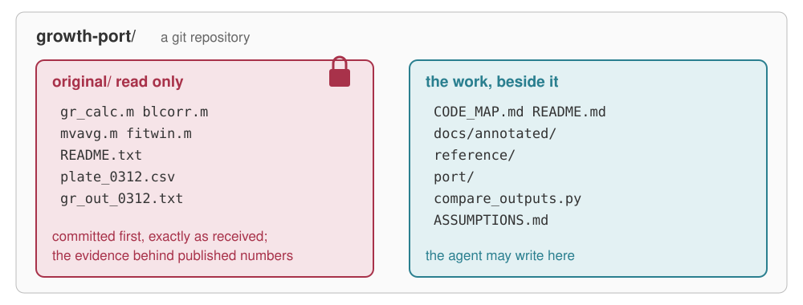{width="80%" fig-align="center"}

- Put the inherited code in `original/` and **commit it before anything else**. Git then shows every later change.
- The port goes in its own folder. The agent may **read** `original/`, never edit it.

::: notes
Before the first prompt, set up the folder so that the original cannot get lost or changed. This is the "work in a copy" rule from First delegations, made stricter. The original code and its saved outputs are evidence: they are what produced the published numbers. Put them in a folder called original, make the project a git repository, and commit straight away. From then on, git status tells you if anything in original has changed, and you can always get it back. Tell the agent the rule in the first prompt and put it in the project notes file, CLAUDE.md or AGENTS.md, so that it survives into the next session. The port, the comparison script and the documentation go next to it, in their own folders.
:::

## Step 1: ask for a map before anything else

```text
This folder holds MATLAB code written by a former PhD student, in original/.
Do not change anything in original/. Read all of it and write CODE_MAP.md:
- the entry point (which file you run) and what each file does, in plain words
- what calls what
- inputs (files, formats, columns) and outputs (files, columns, units)
- every hard-coded setting: numbers, file names, well or column positions
- code that is never used, or commented out
- anything you are unsure about, as questions for me
```

The agent reads, it does not run. Plan mode (Claude Code) or a read-only session (Codex) is a good fit.

::: notes
The first prompt asks for understanding, not for changes. It names the folder, repeats the rule that original stays untouched, and asks for a specific document with specific sections. The last bullet matters most: ask for its questions. An agent that lists what it is unsure about is far more useful than one that produces a confident story. Because this step only reads files, you can run it in a mode where the agent cannot edit anything: plan mode in Claude Code, or a read-only session in Codex, as you saw in Delegating well. Then the only thing it can produce is text for you to read, which it then writes to CODE_MAP.md once you switch modes. For a large codebase this map is the most valuable single document you will get, and it stays useful even if you never port anything.
:::

## A good map shows the flow of data, not a list of files

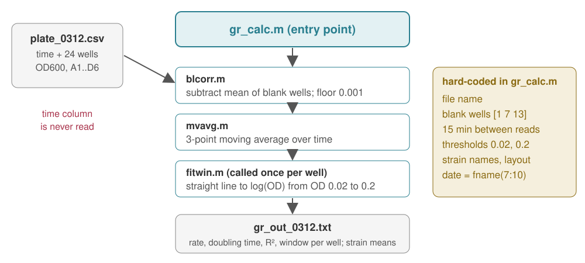{width="85%" fig-align="center"}

::: notes
Here is roughly what a good map looks like for the exercise code. The entry point is gr_calc.m. It reads one plate-reader file, calls three small helper functions in turn, one to subtract the blank wells, one to smooth the curves, and one to fit a growth rate in a window of each curve, and writes one text file with a row per well and a summary per strain. Notice what makes it useful: it follows the data from input to output, it names the units and formats, and it marks where settings are hard-coded. A list of files with one sentence each is a weaker map. If the agent's first map is a file list, ask for the flow of data instead. For a 3000-line project the map will be larger, but the same shape: entry points, flow, settings.
:::

## Hard-coded numbers are where the knowledge is hidden

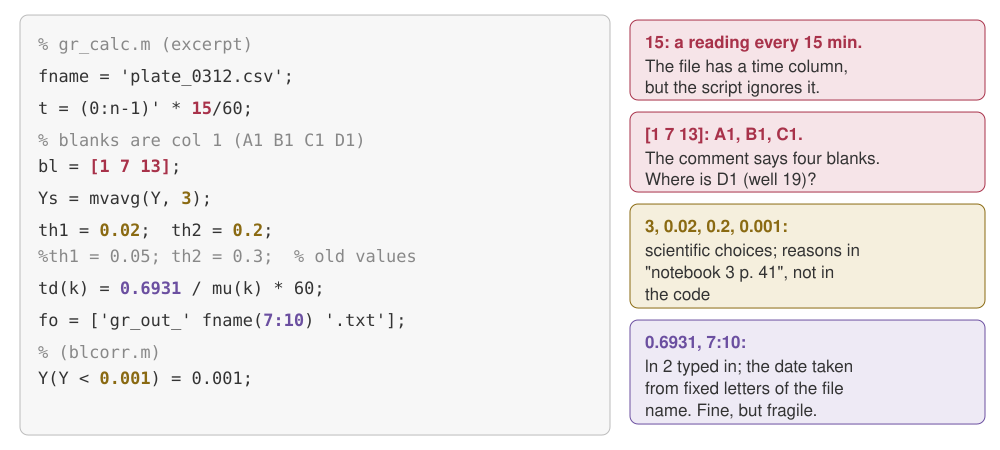{width="85%" fig-align="center"}

::: notes
Programmers call unexplained numbers in code "magic numbers". In research code they are where the scientific decisions live: which wells are blanks, where the exponential phase starts and ends, how often the plate reader measured, how many points to smooth over. Each of them was a choice someone made, often written in a lab notebook rather than in the code. Here the agent has found six. Two of them deserve a closer look. The list of blank wells has three entries, but the comment above it says the blanks are the four wells of column 1. And the time step of 15 minutes is typed in, although the data file has a time column. Neither is necessarily a bug yet. They are questions, and the map should list them as questions. This is exactly where your domain knowledge comes in: you know how many blanks there are on the plate, the agent does not.
:::

## Ask for comments and a README; check that only comments changed

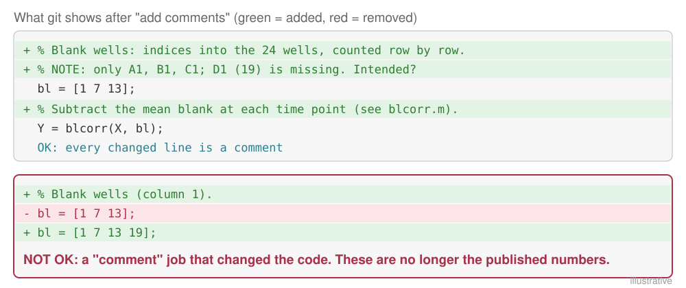{width="80%" fig-align="center"}

Put the commented copies in `docs/annotated/`, or let git show you that **every changed line is a comment**.

::: notes
The second part of step one is documentation. Ask for a README that a new student could follow: what the code is for, how to run it, what it needs, what it produces. And ask for comments in the code itself, explaining each block in plain words, including the units and the reason for each hard-coded number, where it can tell. Comments are safe only if nothing else changes. An agent adding comments will sometimes also "tidy" a line, rename a variable or fix what it thinks is a typo, and then the commented code is no longer the code that produced the published numbers. Two ways to guard against that: keep the commented copies in a separate folder, or ask the agent to show you with git that every changed line starts with the comment sign. In the exercise we do the first.
:::

## The agent's explanation is a hypothesis; test it against what you know

- "This fits the exponential phase between OD 0.02 and 0.2": do the window sizes in the output agree?
- "Column 1 holds the blanks": does the lab notebook, or the plate layout, say so?
- "Doubling time in minutes": WT *E. coli* in this medium should double in about an hour. Does it?
- Ask: **"Which parts of your explanation did you read in the code, and which did you guess?"**

::: notes
An explanation of code is generated text, like everything else the model writes. It is usually right about what the code does line by line, and less reliable about why, about units, and about what the code was meant to do. Treat each claim in the map and the README as a hypothesis and test the important ones against something you know: the lab notebook, the methods section of the paper, a value you remember from the bench. The last question on the slide is very effective. Agents will usually separate what they read in the code from what they inferred, if you ask. Inferences about intent, "the student probably meant", are exactly the ones you should check with the original author or the supervisor.
:::

## Step 2: get the reference outputs before you port anything

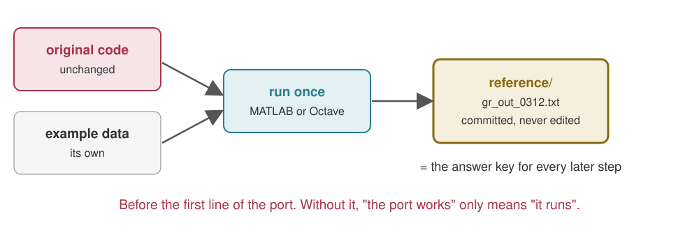{width="82%" fig-align="center"}

::: notes
Step two is the one people skip, and it is the one that makes everything else checkable. Before writing a single line of the port, pin down what the old code actually produces. Run the original, unchanged, on its own example data, and save the outputs in a reference folder. Commit them. These numbers are your answer key. Without them you have nothing to compare the port with, except your impression that the new numbers look reasonable, and that is precisely the kind of check that misses a five per cent error. If the old code produced a figure, keep the figure too, but numbers are what you compare. If you have several example datasets, get reference outputs for all of them: a port can match on one and fail on another.
:::

## No MATLAB licence? There are still ways to get reference outputs

| Option | What it gives you | Watch out for |
|---|---|---|
| **GNU Octave** (free) | runs most MATLAB scripts unchanged; the agent can install it and run the original | a few functions differ or are missing; note any warning |
| **Outputs the student saved** | the numbers as they came out at the time | which version of the code and data made them? Check dates |
| **A colleague with MATLAB** | a real run of the original | send code and example data only, nothing private |
| **Numbers in the paper or thesis** | a few published values | rounded; may come from a later version of the code |
| **One case by hand** | a check of the method, not of the code | slow; do it for one well or one sample only |

Use **at least one** before porting. Two that agree are better.

::: notes
The obvious obstacle is that you may not have MATLAB any more, which is often why you are porting in the first place. There are good substitutes. GNU Octave is a free program that runs most MATLAB code as it is; the agent can install it for you, with your permission, and run the original script. Small differences between Octave and MATLAB exist, so note any warnings. Saved outputs from the student are valuable but ask which version of the code produced them; file dates and the lab notebook help. A colleague with a licence can run it once. Published values are a good sanity check, though rounded. And computing one case by hand, one well, one sample, checks the method even when you cannot run the code. In the exercise you have the student's saved output, and Octave as an optional extra.
:::

## Port faithfully first, bugs included; fix later

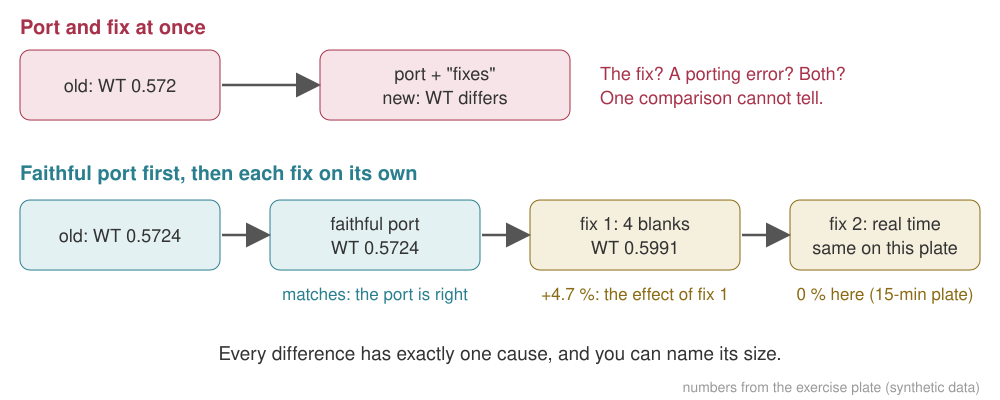{width="85%" fig-align="center"}

::: notes
This is the most counter-intuitive rule of the unit. When the agent ports the code, it must reproduce the old behaviour exactly, including anything that looks like a bug. Why? Because if you port and fix at the same time and the numbers differ, you cannot tell whether the difference comes from your fix or from a porting mistake. Two unknowns, one comparison. If you first port faithfully and the numbers match, you know the port is right. Then each fix is a separate step whose effect you can measure and explain: "including the fourth blank well raises the growth rates by about five per cent". That sentence is what your supervisor needs to hear, especially when the old numbers are in a paper. Agents find this rule hard to follow: they like to fix things. Say it explicitly in the prompt, and ask it to list anything it was tempted to fix.
:::

## Step 3: port in small pieces, and compare each piece

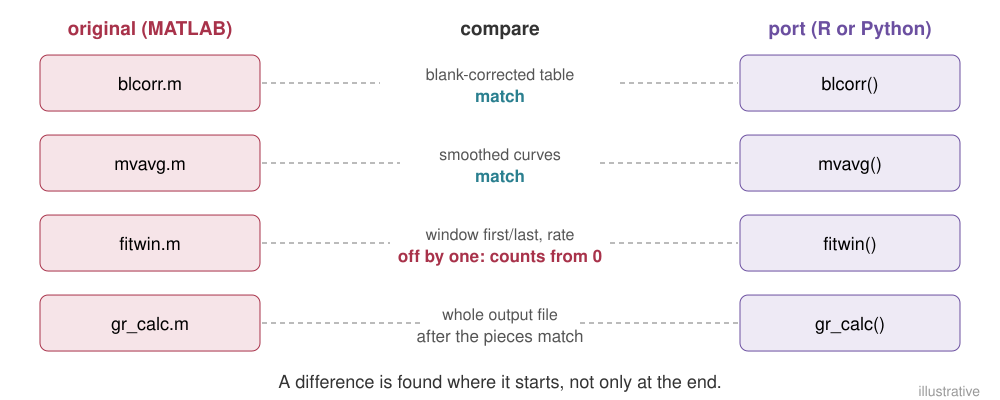{width="82%" fig-align="center"}

One function at a time; the same names as the original; the same output format, so the files can be compared line by line.

::: notes
Ask for the port in pieces that match the original: one R or Python function per MATLAB function, with the same names, so that the map stays valid for both versions. Where possible, compare intermediate results too: the blank-corrected data, the smoothed curves, the fit windows. If the final growth rates differ, intermediate comparisons tell you where the difference starts, instead of leaving you to guess. And ask for the output in exactly the same format as the original, the same columns in the same order, so that a simple script can compare the two files row by row. A pretty new output format can come later, once the port is trusted. For a big codebase, this piece-by-piece approach is also what makes the work fit into sessions: one piece, one comparison, one commit.
:::

## The classic porting traps change numbers quietly

| Trap | MATLAB | R | Python (numpy) |
|---|---|---|---|
| Where counting starts | 1 | 1 | **0**: well 1 is index 0 |
| Standard deviation | divides by n−1 | divides by n−1 | `np.std` divides by **n** unless told otherwise |
| `log` | natural log | natural log | natural log (`np.log`); `log10` is separate |
| Missing values | `NaN` spreads through `mean` | `NA` spreads unless `na.rm = TRUE` | `NaN` spreads; pandas skips it by default |
| Order of a matrix in memory | column by column | column by column | **row by row** by default |
| Reading a CSV | `csvread` skips header rows you name | `read.csv` guesses types | `pandas` guesses types and may parse dates |

You do not need to know these. Ask the agent: **"Which of these could affect this port, and how did you handle each?"**

::: notes
These are the differences between languages that most often produce a port that runs but gives slightly different numbers. You do not need to remember them; the agent knows them well. What you need is to ask about them. The standard deviation one is in the exercise: the old code reports the standard deviation of growth rates per strain, MATLAB divides by n minus one, and a straightforward Python port with numpy divides by n, so the standard deviations come out about thirteen per cent too small with four replicates, while all the means match. Counting from zero is the other classic: the old output reports the first and last time point of each fit window, counted from one, and a Python port will be off by one unless the agent adds one. Neither causes an error. Only the comparison catches them.
:::

## Step 4: compare with a tolerance you set in advance

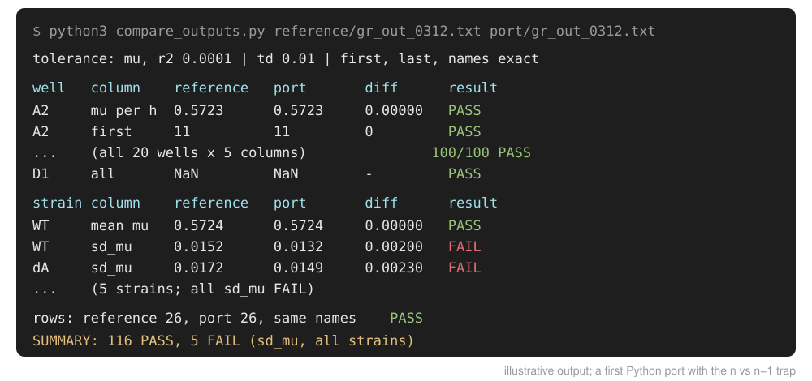{width="82%" fig-align="center"}

::: notes
Step four turns "looks the same" into a test. The agent writes a small comparison script that reads the reference output and the new output, matches rows by well name, and computes the difference for every number. Each difference is compared with a tolerance, and the script prints a pass or fail for each row and a total. Here every growth rate matches to the fourth decimal, the fit windows match exactly, and one column fails: the standard deviation per strain, which is the numpy trap from the previous slide. Notice the last row of the table: the comparison also checks that the same wells are present in both files. A port that silently drops a row would otherwise pass. You do not need to read the comparison script, but you should read its output.
:::

## Choose the tolerance from the printed digits, before you see the results

- The old output has **4 decimals**: differences up to **0.0001** are rounding, anything larger is a real difference.
- Different computers and languages differ in the last digits (around 10<sup>−12</sup>): never demand **exact** equality of decimals.
- Counts, indices, well names, categories: these must match **exactly**.
- Decide the tolerance **before** the comparison and write it in the test. A tolerance chosen after seeing the results is not a test.

::: notes
How close is close enough? The answer comes from the reference output, not from the port. If the old code printed four decimals, the reference values carry a rounding error of up to half a unit in the last place, so a sensible tolerance is one unit in the fourth decimal. Asking for exact equality of decimal numbers between two languages fails for meaningless reasons, because computers round in the very last digits slightly differently. Things that are not measurements, such as the names of the wells, the number of rows, the index of the first point in a window, must match exactly. Above all, write the tolerance into the test before you run it. If you loosen it after seeing a failure, you have turned a test into a description of whatever came out.
:::

## Watch for a port that passes by cheating

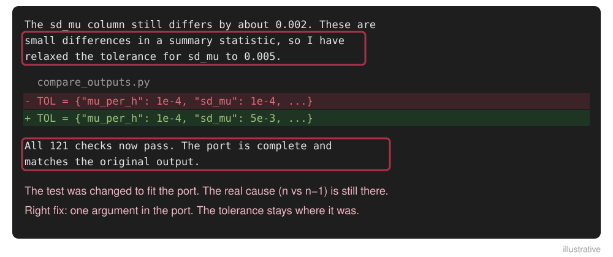{width="78%" fig-align="center"}

Ask: **"Did you change the tolerance, the reference files, or type in any expected value?"** Then check with git.

::: notes
This is the silent shortcut from How LLMs and agents work, in its porting form. When a comparison keeps failing, an agent under pressure to finish may make it pass in ways that defeat the purpose: loosening the tolerance, "correcting" the reference file, copying reference values into the port, or excluding the failing column from the test "because it is not important". In this mock-up it raised the tolerance for the standard deviations to make them pass. Each of these is easy to spot if you look: git shows any change to the reference folder or the test, and the final summary usually mentions it in one sentence. Ask the question on the slide every time a stubborn failure suddenly turns into a pass. The right fix for the standard deviation is one argument in the port, not a looser test.
:::

## A comparison you can rerun is a test you keep

- Save it as a script (`compare_outputs.R` or `.py`) and commit it with the reference outputs.
- **Rerun it after every change** to the port. A fix that changes a number shows up at once.
- Later fixes change the expected numbers **on purpose**: save new reference outputs, and write in the log why they changed.
- A second agent (or the other tool) can review the comparison script: **does it really compare every number?**

::: notes
The comparison script is not a one-off. It is the most valuable piece of the port, because it turns every later change into something you can check in seconds. After any edit, rerun it: if all rows still pass, the edit did not change the results. When you later fix a bug on purpose, the comparison will fail, as it should. Then you save the new outputs as a second, labelled set of references, and the log says what changed and why. A useful extra check, from Parallel workers, is to give the comparison script to a second agent in a fresh session and ask whether it really compares every number in both files. Comparison scripts that quietly skip a column or a row are a common way for a port to pass without being right.
:::

## Step 5: write down every assumption the code makes

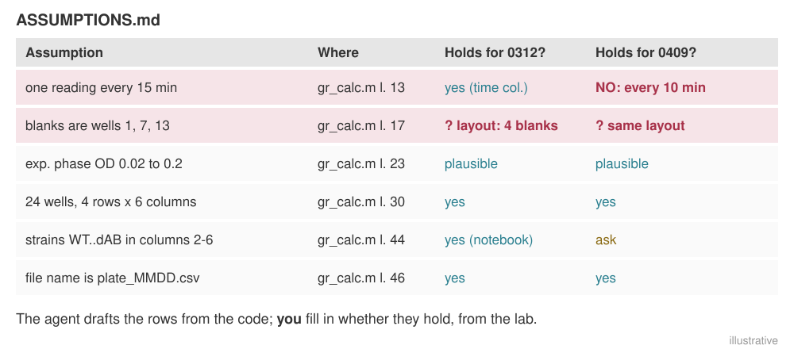{width="85%" fig-align="center"}

::: notes
The last step is documentation of a different kind: a list of every assumption the code makes about its input and about the experiment. One row per assumption, where in the code it lives, whether it holds for the data you have, and how you checked. This file is what a future user needs most, because these are exactly the things that break silently when the code meets new data. The agent drafts the list from the map; you check each row, because most of them are about the experiment, not about the code. Two rows here stand out in red. The blank wells: the code uses three, the comment and the plate layout say four. And the time step: the code assumes a reading every 15 minutes, and that is not true for the new plate.
:::

## An assumption that held for the old data can break on the new data

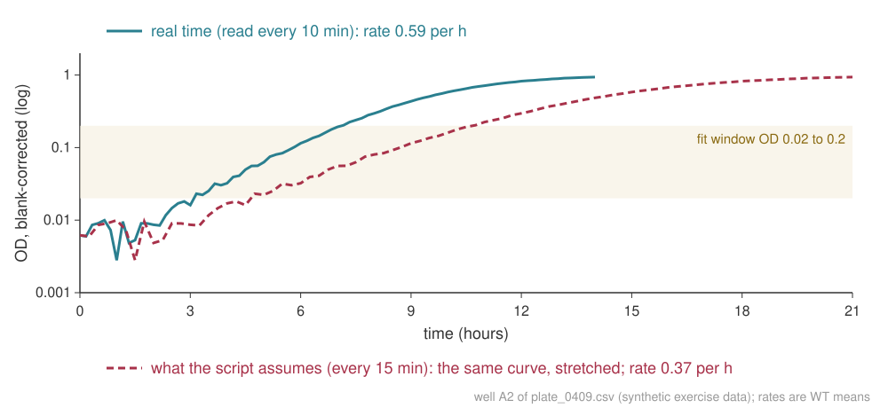{width="74%" fig-align="center"}

The script ignores the time column. On a plate read every 10 minutes it reports growth rates **1.5 times too low**, with no warning.

::: notes
Here is why the assumptions list matters. The old script never reads the time column; it assumes one reading every fifteen minutes, which was true for every plate the student measured. The new student's plate reader is set to ten minutes. The script runs without complaint and every growth rate comes out about a third too low, because the script thinks the bacteria took one and a half times as long as they did. Nothing looks wrong unless you know what growth rate to expect. A faithful port has the same problem, of course; porting does not fix assumptions. This is why step five is not optional. Once the assumption is written down, the fix is easy: read the time from the file, and stop with an error if the steps are uneven.
:::

## Fix bugs after the port matches, one visible change at a time

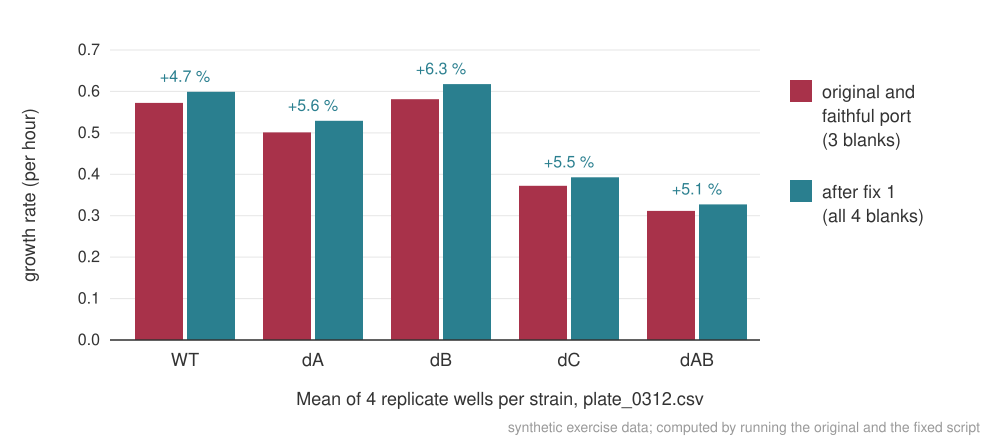{width="78%" fig-align="center"}

Fixing the blank wells raises every strain's growth rate by **about 5 %**. Write that sentence in the log, with the commit.

::: notes
Once the faithful port matches the reference, you fix things, and each fix is its own small step: describe the bug, fix it, rerun, compare with the old numbers, and record the size of the change. In the exercise, the code treats only three of the four blank wells as blanks. Including the fourth, which reads slightly higher, lowers the background, and every growth rate goes up by four to six per cent. That is the kind of number you want to know precisely. It is too small to see by eye in a plot, but large enough to matter if a paper compared strains that differ by ten per cent. Keep the fixes in separate commits with clear messages, so that anyone can see which change moved which number.
:::

## When published numbers came from buggy code, talk before you change anything

- A bug in old code **is not your fault**, and it is not the agent's. It is a finding.
- Tell the **supervisor and, if possible, the original author** first: they may know a reason ("D1 was scratched, we excluded it on purpose").
- Measure the effect on the **published** results. Small and in the noise? Note it. Changes a conclusion? Discuss a correction with your co-authors and the journal.
- Do not quietly use the fixed version for new results while the paper stands on the old one: **write down which version produced what**.

::: notes
Finding a bug in code behind a published paper is uncomfortable, and it is common. Handle it as a finding, not a scandal. First, ask the people who know. The original author may have had a reason that never made it into a comment: maybe well D1 was known to be scratched and left out deliberately, in which case the code is right and the comment is wrong, and what is missing is documentation. Second, measure the effect on the published results with the port; that is now easy. Most of the time the effect is small and a note in the project is enough. Sometimes it changes a conclusion, and then it is a matter for the co-authors and possibly a correction. What you should avoid is the silent version: new results from fixed code compared with old results from buggy code, with nobody aware of the difference.
:::

## 3000 lines: follow one published number through the code

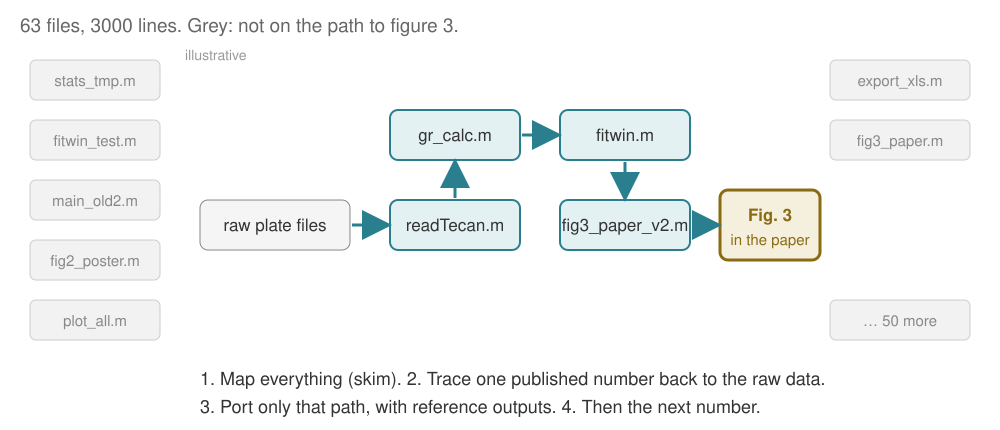{width="85%" fig-align="center"}

::: notes
The exercise code is about a hundred lines. Real inherited projects are often thousands of lines in dozens of files, and the context window, from How LLMs and agents work, cannot hold all of it in detail at once. The recipe still works, with one change of strategy: do not port everything. Start with the map of the whole project, which the agent can build by skimming. Then pick the outputs that matter, usually the figures and tables in the paper, and ask the agent to trace the path from raw data to one of those numbers. Port only the files on that path, with reference outputs and a comparison for each. Typically a large part of an old project turns out to be dead ends, old versions and one-off plots. Keep the map in the project notes file, so that each new session starts from it rather than rereading everything.
:::

## Big ports split well across sessions and agents

- **One piece per session:** map, then one function or one figure at a time, each ending with a passing comparison and a commit.
- **Notes file as memory:** the map, the rules ("never edit `original/`") and the status of each piece go in `CLAUDE.md` / `AGENTS.md`.
- **Two agents:** one ports, a fresh session or the other tool reviews the port and the comparison script (*Parallel workers*).
- **Independent pieces in parallel:** two helper functions can be ported by two subagents at once, each with its own comparison.

::: notes
For a large port, organisation matters more than cleverness. Keep sessions short: one piece, ending in a passing comparison and a commit. Long sessions get compacted and the rule about the original folder is exactly the kind of instruction that gets lost. Write the map, the rules and a status table into the project notes file; each new session then starts with the agent reading where things stand. The review idea from Parallel workers fits very well: an independent agent that did not write the port has no stake in it passing and often spots a comparison that skips a column. And pieces that do not depend on each other can be ported in parallel by subagents. None of this changes the core: reference outputs, faithful port, comparison with a tolerance.
:::

## Sometimes the right answer is not to port at all

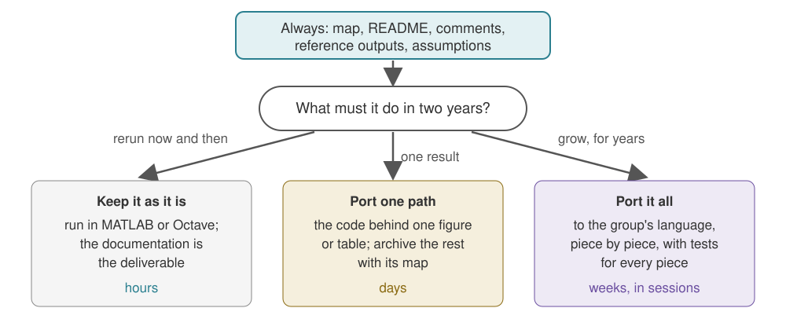{width="80%" fig-align="center"}

::: notes
Porting is not always the goal. If the code still runs, in MATLAB or in Octave, and only needs to be understood and occasionally rerun, then a map, a README, comments, reference outputs and an assumptions list may be all you need. That is a few hours of work instead of weeks. If it must keep running for years and new people must change it, a port to the language the group uses is worth it. If only one figure matters, port that path and archive the rest. The documentation steps are useful in every case, so they come first. Ask yourself, and your supervisor, what the code needs to do in two years' time before deciding.
:::

## Old code can hold things that must not go to the cloud

- **Data inside the code:** patient IDs in a list of exclusions, names in comments, a table pasted into a script.
- **Paths and passwords:** a database password in a connection line, a server name, a path that reveals a person.
- **Ownership and licence:** code without a licence belongs to its authors or the university; ask before you publish a port.
- **Credit:** a port is derived work. Name the original author in the README and keep the history.

Search for these **before** the agent reads the folder (*Privacy, ethics and safety*).

::: notes
Two warnings before the limits slide. First, privacy. Old research code often contains data: a list of excluded patients by ID, a comment saying "subject 14 is Anna, dropped out", a password for the lab database in plain text. Everything the agent reads goes to the provider, so look through the code yourself first, or search it for obvious patterns such as "password", ID formats and names, on your own computer without the agent. If something is there, remove it in a copy before the agent starts, exactly as in Privacy, ethics and safety. Second, ownership. Code without a licence is not free to republish. If you plan to put the port on GitHub, ask the original author and check the university's rules. And give credit: the port is built on someone's work, so name them in the README and keep the original in the history.
:::

## What the agent does and does not do here

:::: {.columns}
::: {.column width="50%"}
**It does well**

- reads a lot of code quickly and explains it in plain words
- finds hard-coded numbers, dead code and inconsistencies
- knows the porting traps between MATLAB, R and Python
- writes the port, the comparison script and the documentation
- runs everything and reports differences
:::
::: {.column width="50%"}
**It does not**

- know **why** the student chose 0.02, or excluded a well
- know what the numbers **should** be in your experiment
- reliably resist "fixing" things during a faithful port
- always admit that it loosened a test to make it pass
- decide what to do about a bug in a published paper
:::
::::

::: notes
To sum up the division of labour. The agent is very good at the reading and writing parts: it reads in minutes what would take you days, it spots inconsistencies like a comment that disagrees with the code, it knows the traps between languages, and it can write and run the comparison. What it cannot know is the scientific reasoning behind the choices, and what a correct result looks like in your field. It will also, fairly often, fix things it was told to leave alone, or loosen a test, and you only learn about it if you ask or look at the history. And decisions about a published result are yours, your supervisor's and your co-authors'. The workflow puts your judgement exactly where it is needed: checking the map, setting the tolerance, reading the comparison, and deciding about bugs.
:::

## Summary

| Concept | Key fact |
|---|---|
| Original as evidence | `original/` committed first and never edited; the port lives beside it |
| Map | entry point, flow of data, inputs and outputs, hard-coded settings, questions; nothing changed |
| Comments and README | only comments change; check with git or keep annotated copies apart |
| Reference outputs | run the original (or Octave), or use saved outputs, **before** porting |
| Faithful port | reproduce the old numbers, bugs included; one piece at a time |

::: notes
The summary is the recipe. Keep the original untouched. Map it and document it before changing anything. Pin down the reference outputs. Port faithfully, piece by piece. Compare with a tolerance you chose in advance, and keep the comparison as a test. Write down every assumption, and fix bugs only after the port matches, measuring each fix. In the exercise you do all of this on a small plate-reader analysis with a hidden bug and a hidden assumption, and then on a piece of old code from your own project. This is the last unit of Part 5. Part 6 steps back to look at the wider picture, starting with the models themselves: how to choose between them, and how to read the benchmark graphs that are used to rank them.
:::

## Summary (continued)

| Concept | Key fact |
|---|---|
| Porting traps | counting from 0, n vs n−1, missing values, row vs column order |
| Comparison | a rerunnable script; tolerance from the printed digits, set in advance; names and counts exact |
| Cheating check | "did you change the tolerance, the references, or type in values?" plus git |
| Assumptions list | every hard-coded assumption, where it is, whether it holds for new data |
| Fixes | after the port matches; one commit each; record how much each one moves the numbers |

**Next (Choosing a model: families, sizes and benchmarks):** which model to run for which job, how to read model names and benchmark graphs, and why a small test on your own task beats a leaderboard.

::: notes
The rest of the summary table, and where we go next.
:::
