## About this lecture

A table of what the literature says about a set of things (ten genes, eight teaching methods, a family of materials) is one of the most useful things an agent can build for you. It is also the place where language models fail most visibly: **references that look right and do not exist.** This unit is about building such a table so that every row can be trusted.

- **Look papers up, do not remember them.** The agent writes a script that asks literature databases through their APIs.
- **Keep what came back.** Raw downloads are saved, dated and never edited.
- **Every claim carries a quote** from the abstract, so it can be checked.
- **Verify in layers:** a script resolves every PMID and DOI and compares titles; you read a random sample.
- **Export and publish:** BibTeX, Zotero, and the table on your page.

A **hands-on** unit. Pulling numbers out of the full-text papers comes next (*Extracting data from PDFs*). Search connectors that plug PubMed straight into the agent come in *Making the agent yours*.

::: notes
This unit starts Part 4, where the agent works with the literature, with documents and with the web. We begin with the most common request researchers have for an AI tool: tell me what is known about these genes, these materials, these methods, with references. It is also the request where chat models have the worst reputation, because they write references that look perfect and do not exist. The answer is not to avoid the task but to change how it is done. The agent does not recall papers; it writes a small program that asks real databases, keeps what they return, and builds the table from that. Then we check the table in layers, partly by script and partly by reading. At the end, the table becomes a BibTeX file, a Zotero library and a page on your project site.
:::

## Ten genes, one week, and a reader who will check every reference

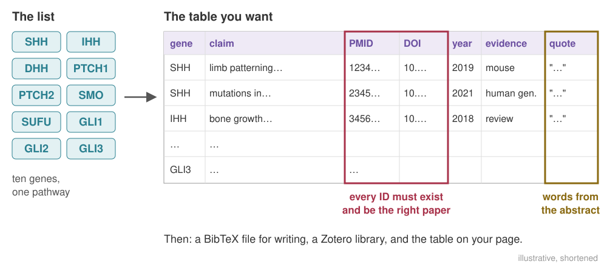{width="90%" fig-align="center"}

::: notes
Here is the concrete task. You have ten genes from one pathway, perhaps from a screen or an RNA-seq result, and you need a short overview: for each gene, a few key findings, each with a reference, the year, and what kind of evidence it is. A reviewer, a co-author or a student will rely on it. Done by hand, this is a week of PubMed searches and copying. An agent can do the searching and the first draft in an afternoon. But look at the two framed columns. The identifiers must exist and lead to the right paper, and the quote column holds the words from the abstract that support each claim. Those two columns are what make the table checkable, and most of this unit is about them.
:::

## The same job exists in every field: what is known about each item in a set?

| Field | The set | What you want per item |
|---|---|---|
| Molecular biology | 10 genes from one pathway | function, disease links, model organisms |
| Materials science | 8 electrolyte materials | conductivity, stability, how measured |
| Education | 8 teaching methods | effect on learning, level, kind of study |
| Ecology | 12 invasive species | spread, impact, control methods |
| Public health | 6 screening programmes | uptake, outcome, country |

The worked example uses genes; a teaching-methods version runs alongside it. The method is the same.

::: notes
This is not only a biology task. Any field has the same shape: a set of items, and for each item a few claims from the literature with sources. A materials scientist wants the measured property of each material and how it was measured. A teacher wants to know which teaching methods have good evidence behind them. An ecologist wants the impact of each invasive species. The exercise uses a gene set as the worked example, because PubMed makes it easy to show every step, and runs a teaching-methods version alongside it for those outside the life sciences. Pick whichever is closer to you. The steps, the checks and the files are the same.
:::

## Looking papers up beats remembering them

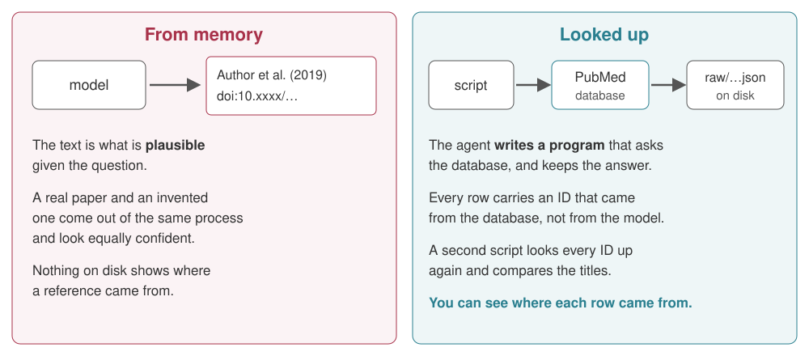{width="90%" fig-align="center"}

::: notes
In How LLMs and agents work you saw why a model invents references. It produces what is plausible given the question. A real reference and an invented one come out of the same process, and they look equally confident. On the left is what happens when you ask any model, chat or agent, to list papers from memory. On the right is what an agent can do instead. It writes a small program that sends the question to a literature database, saves the answer on disk, and builds the table from that file. Every identifier in the table then came from the database, not from the model. And because the answers are saved, a second program can look every identifier up again. This is the single most important idea in the unit.
:::

## A literature table is built in six steps, and two of them are yours

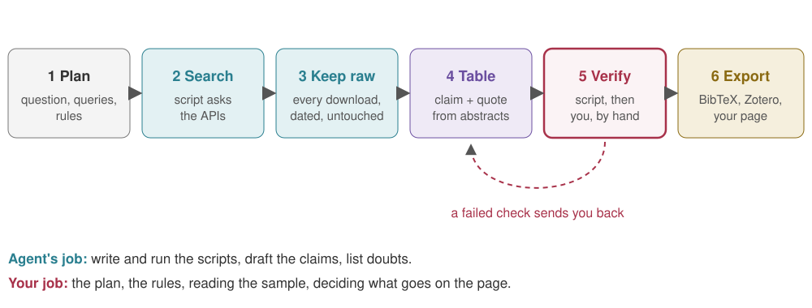{width="95%" fig-align="center"}

::: notes
Here are the six steps we will follow. First a plan: the question, the databases, the exact queries and the rules for what goes in. Then the search, done by a script that calls the database APIs. The raw results are kept in their own folder, untouched. From them, the agent drafts the table: one claim per row, with the quote that supports it. Then verification, first by a script and then by you. Finally, export to BibTeX and Zotero and publication on your page. The agent does most of the typing. You own the plan, because only you know what question matters, and the final judgement, because only you can tell whether a claim is a fair reading of a paper in your field. A failed check sends you back a step, which is normal.
:::

## An API is a web address that returns data instead of a page

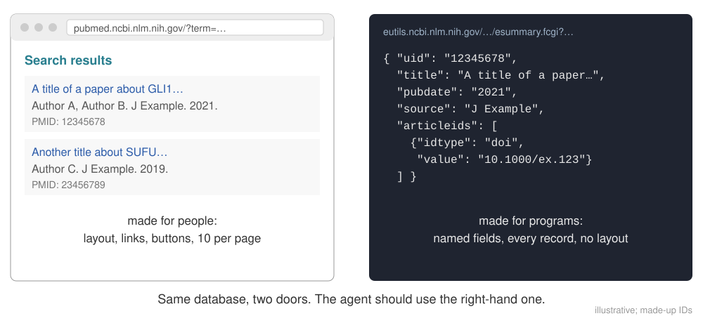{width="88%" fig-align="center"}

::: notes
A word you will hear all through Part 4 is API, application programming interface. For our purposes it is simple: a web address that returns data for a program rather than a page for a person. On the left is the PubMed web page you know, built for reading: ten results per page, links and buttons. On the right is what the same database returns through its API: named fields, such as the PubMed ID, the title, the year and the DOI, in a format a program can read. You never have to read this yourself. But it explains why the agent uses the API: it gets exact identifiers in named fields, every result rather than the first page, and the same answer every time it asks the same question on the same day.
:::

## Five free literature APIs cover most needs

| Database | Covers | Identifiers | Key needed? |
|---|---|---|---|
| **PubMed** (NCBI E-utilities) | biomedicine and life sciences | PMID, often DOI | no; a free key raises the speed limit |
| **Europe PMC** REST API | PubMed plus preprints and open-access full text | PMID, PMCID, DOI | no |
| **OpenAlex** | all fields, very large | DOI, OpenAlex ID | no for small searches; a free key for more |
| **Semantic Scholar** | all fields, citation links | DOI, S2 ID | no; a key can be requested |
| **Crossref** | metadata of every DOI registered there | DOI | no; add your e-mail to get better service |

All five are free to use for this kind of work. Each has a **rate limit** (for example PubMed: 3 requests per second without a key, 10 with one). Limits and terms change: the agent should read the current documentation page, and so should you.

::: notes
Here are the five databases we use in this part of the course. All five are free for this kind of use. PubMed, through NCBI's E-utilities, is the place for biomedicine. Europe PMC covers PubMed too, adds preprints and gives the full text of open-access papers, which we need in the next unit. OpenAlex and Semantic Scholar cover all fields, which makes them the choice for the teaching-methods example. Crossref is the registry behind most DOIs, so it is the place to check that a DOI exists and what it points to. Each one limits how fast you may ask, typically a few requests per second. A small script for forty papers stays far below that. Access rules change, and OpenAlex changed its rules several times in 2026, so ask the agent to check the current documentation before it writes the script.
:::

## Web search is fine for exploring; the table comes from the APIs

:::: {.columns}
::: {.column width="50%"}
**The agent's web search**

- quick overview, finding the right words
- results depend on the search engine and the day
- returns pages, not records
- easy to pick up a blog, a news story or a predatory journal
:::
::: {.column width="50%"}
**A script that calls the APIs**

- one query per item, written down
- every hit counted, not only the top ten
- returns records with IDs
- reruns next year with the same query
:::
::::

Use web search to learn the vocabulary of a new topic. Build the table from the database records.

::: notes
Both Claude Code and Codex can search the web, if that is switched on. Web search is useful at the start: to learn the terms people use, to find a recent review, to see what the main questions are. But it is a poor base for a table. The results depend on the search engine, the ranking changes from day to day, and what comes back is web pages, which may be news stories, blog posts or a journal you would not cite. A script that calls a literature API runs a query you can read, counts every hit, returns records with identifiers, and can be run again next year. So: explore with web search if you like, then write the plan and build the table from the APIs.
:::

## Be polite to the APIs, and keep keys out of prompts and git

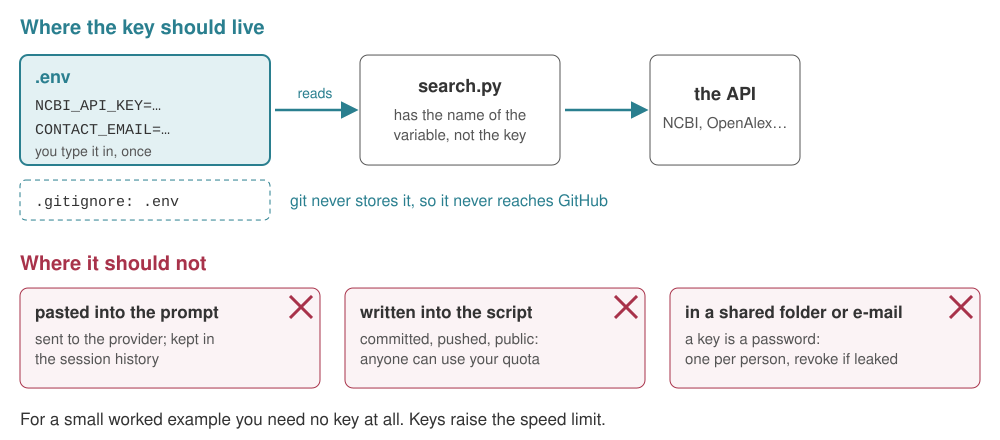{width="85%" fig-align="center"}

::: notes
Two practical points. First, politeness. A script can send hundreds of requests a second; the databases ask you not to. Tell the agent to respect the documented limit, to wait between requests and to give a contact e-mail where the database asks for one, such as NCBI's tool and email fields or Crossref's mailto. Second, keys. You do not need a key for this unit, but you may want one later. A key is a password. Put it in a file called .env in the project folder, list that file in .gitignore so git never stores it, and let the script read it from there. Do not paste the key into the prompt, because then it is sent to the provider and sits in the session history. And check that the agent does not write the key into the script itself, because the script goes to GitHub. If a key leaks, revoke it and make a new one.
:::

## Worked example: ten genes of the Hedgehog signalling pathway

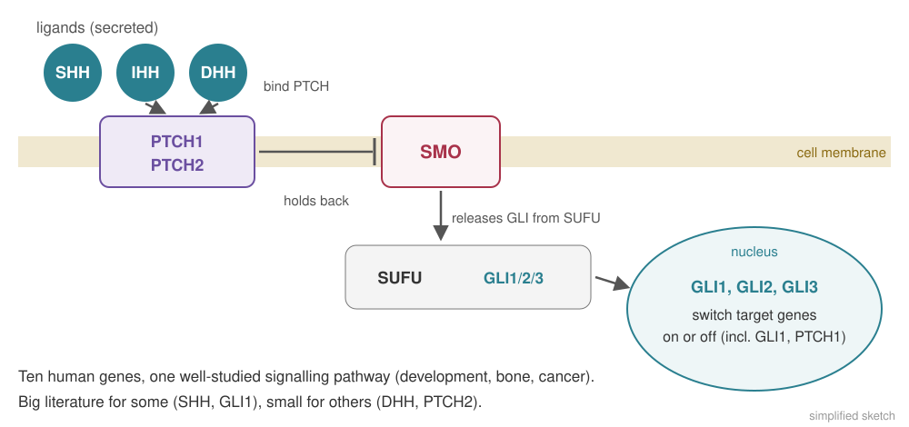{width="80%" fig-align="center"}

::: notes
Our worked example is the Hedgehog signalling pathway, a classic pathway in development and cancer. It has a neat set of ten human genes: three ligands, SHH, IHH and DHH; two receptors, PTCH1 and PTCH2; the signal transducer SMO; the inhibitor SUFU; and three transcription factors, GLI1, GLI2 and GLI3. We chose it because it is well studied, because it is not sensitive, and because the literature is uneven. SHH and GLI1 have thousands of papers; DHH and PTCH2 have few. That unevenness is realistic and tests whether the agent's search handles both. If you are not a biologist, you do not need to know what these genes do. The exercise checks only things you can see in the records: identifiers, titles, quotes.
:::

## The non-biology version: eight teaching methods, searched in OpenAlex

The set: **flipped classroom, peer instruction, retrieval practice, spaced practice, worked examples, problem-based learning, team-based learning, think-pair-share.**

- The question: *what evidence is there that each method improves learning in higher education?*
- Databases: **OpenAlex** for search, **Crossref** to check DOIs. PubMed covers little of education research.
- Identifiers: **DOI** only. No PMIDs.
- Evidence types: meta-analysis, randomised trial, quasi-experiment, survey, case report from one course.
- Watch out for: method names that are also everyday words ("worked examples", "spaced"), and many small single-course reports.

::: notes
For participants outside the life sciences, the exercise runs a parallel example with eight teaching methods that many of you will have tried or heard of. The question is what evidence there is that each one improves learning in higher education. PubMed covers little of this, so we search OpenAlex, which covers all fields, and check DOIs against Crossref. There are no PubMed IDs, so the DOI is the identifier. The evidence types are different too: meta-analyses and randomised trials at one end, a report from a single course at the other. And the vocabulary problem is different: method names are often ordinary words. The rest of the workflow is identical, and the exercise gives you the changed prompts.
:::

## Step 1: write the search plan before you search

```text
# search-plan.md
Question: For each of the ten Hedgehog pathway genes, what are the main
findings on its role in human development and disease?

Database:   PubMed (E-utilities); Europe PMC for open-access status
Query:      (<SYMBOL>[tiab] OR <full name>[tiab]) AND hedgehog[tiab]
            Full names: SMO = smoothened, SUFU = suppressor of fused, ...
Limits:     2010 onwards; English; humans or mouse models
Per gene:   top 20 by relevance -> keep at most 4 papers
Keep:       primary studies and reviews; at most 1 review per gene
Exclude:    papers where the gene is only mentioned in passing
Date run:   2026-11-23
```

Writing it first means you decide what counts, not the search engine. It also goes into your README as the method.

::: notes
The first step happens before any search. Write down the question, the database, the exact query for each item, any limits on years or species, how many papers you keep per item, and the rules for including or excluding a paper. You can write it yourself or ask the agent to draft it from a few sentences and then correct it. The point is that you make these decisions, consciously, rather than letting whatever the search engine ranks first decide. It is also the method section of your table: when a reader asks how you chose the papers, you point to this file. Note the date: databases grow every week, and the same query next month will give different numbers.
:::

## Gene symbols are ambiguous, so the query must handle it

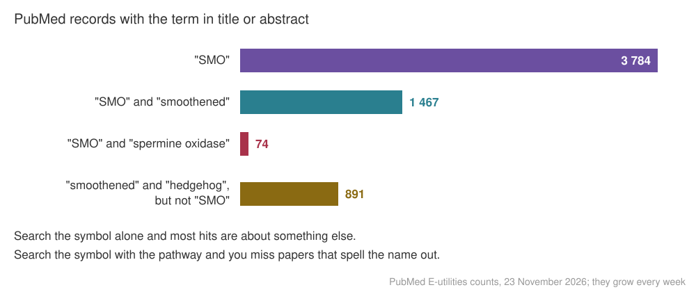{width="85%" fig-align="center"}

::: notes
Here is a concrete reason why the plan matters. The symbol SMO appears in the title or abstract of almost four thousand PubMed records. Fewer than half of them also mention smoothened, the gene we want. Others are about spermine oxidase, or use SMO as an abbreviation for something else entirely. So a search on the symbol alone fills your table with the wrong biology. But adding the pathway name is not enough either: almost nine hundred papers about smoothened and Hedgehog never use the abbreviation SMO. The query needs both the symbol and the full name. These numbers are from the day this slide was made and will have grown by the time you read it. In other fields the same problem appears as acronyms, trade names or everyday words used as technical terms.
:::

## Step 2: the prompt asks for a script, raw downloads and a log

```text
Read search-plan.md. Write a Python script scripts/search.py that runs
the PubMed query in the plan for each of the ten genes, using the NCBI
E-utilities API. Check the current E-utilities documentation first.

- stay under 3 requests per second; set tool and email (read the email
  from the file .env, which is already listed in .gitignore)
- save every raw response under raw/pubmed/<today's date>/, one file per
  gene, plus the abstracts of the top 20 records per gene
- write raw/pubmed/<today's date>/log.txt: query, number of hits and
  number saved for each gene
- never edit files in raw/ after they are written

Do not add any paper from memory. Every record must come from the API.
Show me the log when done.
```

::: notes
Here is the prompt for the search. It refers to the plan rather than repeating it, so there is one place where the queries live. It asks the agent to check the current documentation first, because rate limits and parameters change. It sets the politeness rules and says where the contact e-mail comes from. It says exactly where the raw results go, in a dated folder, and asks for a log with the number of hits per gene. And it states the rule that matters most: no papers from memory. Without that sentence, an agent may helpfully add a famous paper it knows about, without an identifier from the database. With it, any such paper is a rule broken, and easy to spot.
:::

## The agent writes the script, runs it and reports what it found

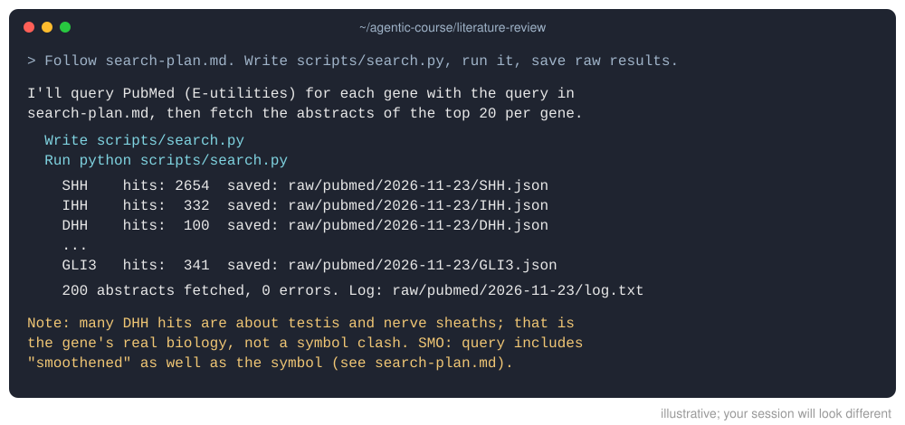{width="85%" fig-align="center"}

::: notes
This is roughly what you will see. The agent reads the plan, writes the script, and asks permission to run it. In Codex, commands that need the network ask for approval, because its sandbox keeps the network off by default; approve it for this folder. The script prints the number of hits per gene and where it saved them. Look at the numbers. Do they fit what you expected? A gene with zero hits means a typo or a too-narrow query. A gene with ten thousand hits means the query is too broad. Good agents also report surprises, like the note at the bottom. Your session will differ in every detail: other wording, maybe another file layout. Compare the log, not the screen.
:::

## Raw downloads are kept and never edited

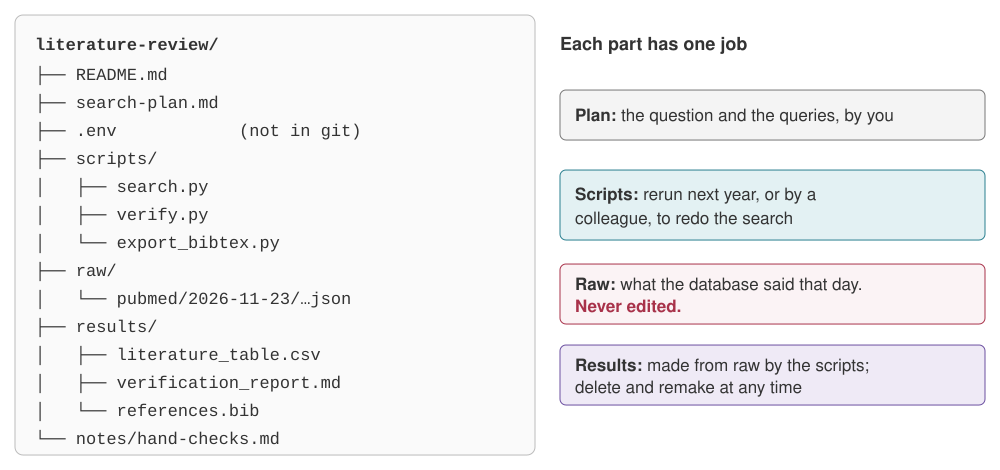{width="85%" fig-align="center"}

::: notes
This is the folder layout we ask for, and it applies the ideas from Organising a project for an agent. The plan is yours. The scripts can be rerun by you next year or by a colleague. The raw folder holds exactly what the database said on that day, and nothing ever edits it. The results folder holds everything the scripts make from the raw data: the table, the verification report, the BibTeX file. You can delete the results at any time and remake them. This separation matters for trust. If a claim in the table is questioned, you can go back to the raw record from that day and see what the database actually returned. Commit all of it to git, except the .env file.
:::

## Step 3: each claim comes with the words that support it

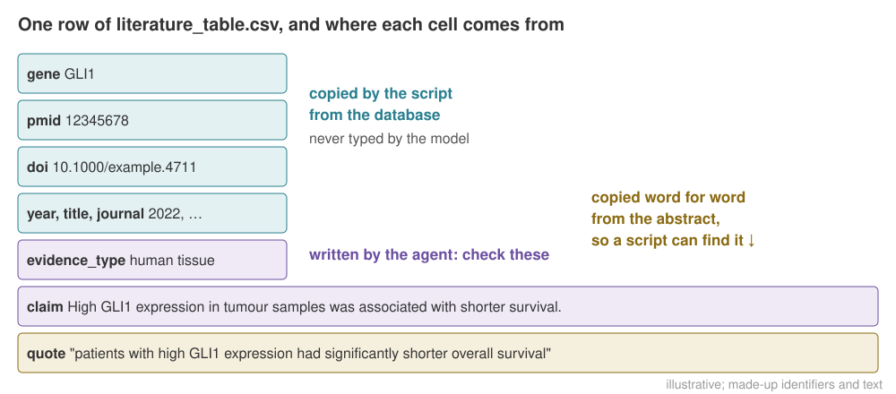{width="88%" fig-align="center"}

::: notes
Now the table. Here is one row, with made-up identifiers. Look at where each cell comes from. The gene, the PubMed ID, the DOI, the year, the title and the journal are copied by the script from the saved records; the model never types them. The evidence type and the claim are written by the agent, so those are what you check. And the quote is copied word for word from the abstract. That last column is the trick that makes the table checkable at scale: because the quote must appear exactly in the abstract, a script can confirm that it does, and you can compare the claim with the quote in seconds without opening the paper.
:::

## Evidence types tell a reader how much a claim can carry

| Evidence type | Example | What it can support |
|---|---|---|
| review | a narrative review of GLI proteins | what the field believes; not new evidence |
| human genetics | variants found in patients with a syndrome | a link in people |
| human tissue or cohort | expression in tumour samples and survival | association, not cause |
| animal model | knock-out mouse with a bone defect | cause, in that animal |
| cell experiment | knock-down in a cell line | mechanism, in that system |
| computational | database or network analysis | a hypothesis |

Agree the categories with the agent before it fills the column. Then check a few: the agent guesses this from the abstract.

::: notes
The evidence type column tells a reader how much weight a claim can bear. A review summarises what the field thinks; it adds no new evidence. A study of patient tissue shows an association; it does not show that the gene causes anything. A knock-out mouse can show cause, but in a mouse. A cell line shows mechanism in that system. Give the agent a fixed list of categories, like this one or your own, so it does not invent new ones for each row. Then check a few. The agent decides the category from the abstract, and abstracts do not always say clearly what was done. For teaching methods, the list would be meta-analysis, randomised trial, quasi-experiment, survey and single-course report.
:::

## The prompt for the table forbids claims without a quote

```text
Build results/literature_table.csv from the saved records in raw/ only.
Columns: gene, claim, pmid, doi, year, title, journal, evidence_type, quote.

- at most 4 papers per gene, following the rules in search-plan.md
- claim: one sentence, no stronger than the abstract (keep "associated",
  "may", "in mice")
- quote: the sentence(s) from the abstract that support the claim,
  copied exactly, character for character
- evidence_type: one of review, human genetics, human tissue or cohort,
  animal model, cell experiment, computational
- pmid, doi, year, title, journal: copied from the record, never typed
If no abstract supports a useful claim, leave the gene with fewer rows
and say so. List every row you were unsure about.
```

::: notes
Here is the prompt for the table. It names the source, the raw folder only, and the columns. Then it sets the rules that protect you. The claim must be no stronger than the abstract, and the prompt names the hedging words that tend to get lost. The quote must be exact, so a script can find it. The evidence type comes from a fixed list. The bibliographic fields are copied, never typed. And, as in First delegations, the prompt allows an honest gap: if the abstracts do not support a useful claim, fewer rows are better than invented ones. The list of uncertain rows at the end tells you where to look first.
:::

## Verification has five layers, and a script can do three of them

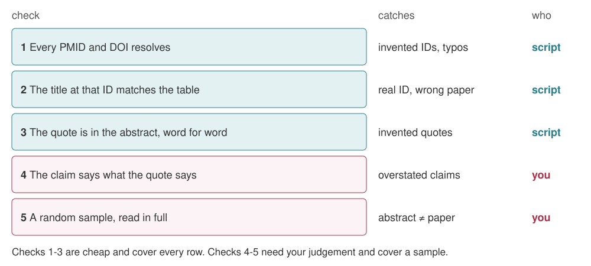{width="85%" fig-align="center"}

::: notes
Now the heart of the unit. Checking a literature table has five layers. The first three are mechanical and a script does them for every row. Does each PubMed ID and DOI exist? Is the title at that identifier the title in the table, so the ID is not a real ID for the wrong paper? Is the quote really in the abstract? These catch invented identifiers, mixed-up papers and invented quotes. The last two need judgement. Does the claim say what the quote says, or more? And for a random sample, does the paper itself support the claim, beyond the abstract? Those are yours. The script makes the human part small enough to do.
:::

## The verification script resolves every ID and compares titles

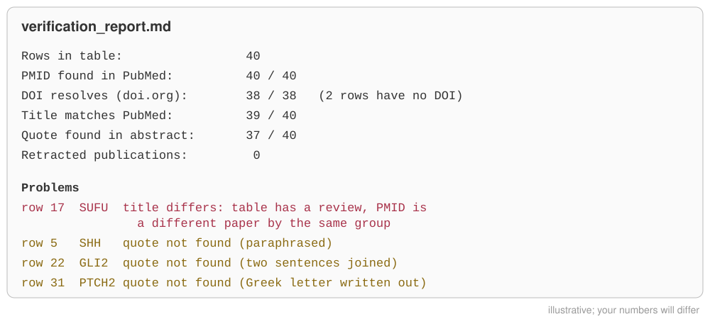{width="82%" fig-align="center"}

::: notes
Ask the agent for a separate verification script, written after the table, that looks every identifier up again: the PubMed ID in PubMed, the DOI at doi.org or Crossref. It compares the title it gets back with the title in the table, allowing for small differences in punctuation and capitals. It searches the abstract for the quote. It also checks the publication type for retractions. The output is a short report like this one. Most rows pass. The rows that do not are where you look. In this illustrative report, one row had a real PubMed ID for a different paper by the same group, which is exactly the error a reader would never spot by eye. The paraphrased quotes are not lies, but they break the rule, so the agent should replace them with exact sentences.
:::

## A real quote can still carry a wrong claim

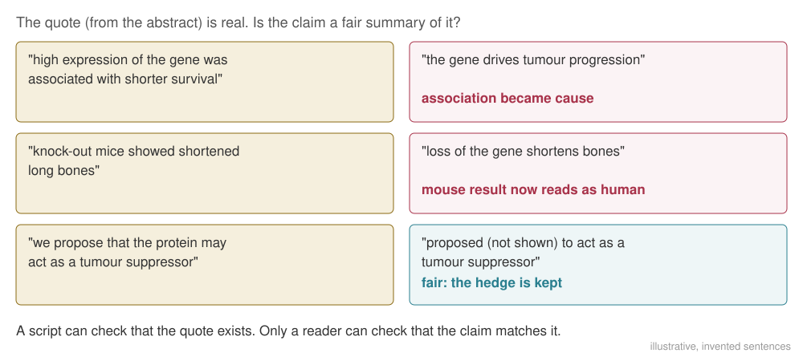{width="88%" fig-align="center"}

::: notes
Passing the script does not make a row right. Here are three invented examples of what the script cannot see. In the first, the abstract reports an association with survival, and the claim says the gene drives tumour progression: an association has become a cause. In the second, a mouse result is written as if it held in people. In the third, the hedge is kept: the authors propose, and the claim says proposed. That one is fair. You catch the first two by putting the claim and the quote side by side, which takes seconds per row. You know the difference between association and cause, and between mouse and human, better than any agent. This is where your expertise does the checking.
:::

## Read a random sample yourself, and act on what you find

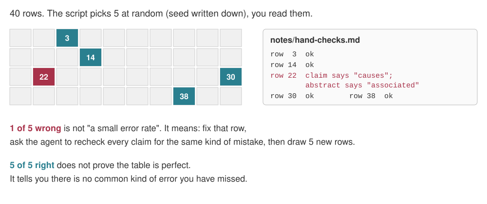{width="85%" fig-align="center"}

::: notes
For the fifth layer, take a random sample, five rows out of forty is enough to start. Let the script pick them with a fixed random seed, written in the notes, so nobody can say you picked the easy ones. For each, open the PubMed page, read the abstract, and if it is open access, skim the paper. Write down what you found in notes/hand-checks.md. What you do next depends on the result. One wrong row in five is not a small error rate to accept: it tells you there is a kind of mistake in the table. Fix the row, ask the agent to recheck every row for the same kind of mistake, and draw five new rows. Five out of five right does not prove the table is perfect. It tells you there is no common error you have missed.
:::

## Retracted papers and preprints need a flag

- **Retractions.** PubMed marks retracted papers with the publication type *Retracted Publication*, and the retraction notice as *Retraction of Publication*. The verification script should flag both.
- **Corrections and expressions of concern** are linked from the PubMed record. Worth a look for any paper the table leans on.
- **Preprints** (bioRxiv, medRxiv, and in Europe PMC and OpenAlex) are not peer-reviewed. Mark them in their own column, or leave them out by rule in the search plan.
- **Predatory journals** turn up in OpenAlex and web search more than in PubMed. If you do not know a journal, look it up before you cite it.

The agent can check flags in the records. Whether a journal is trustworthy is your call.

::: notes
A few more things to check, mostly by script. Retracted papers stay in PubMed, marked as retracted, and an agent will happily cite them if nobody asks. Ask the verification script to flag any record with the publication type Retracted Publication. Corrections and expressions of concern are also linked from the PubMed record; look at those for papers that carry a lot of weight in your table. Preprints are useful and often recent, but not peer-reviewed; decide in the search plan whether they are in, and if so, mark them. Finally, OpenAlex and web search include journals you would never cite. The agent can list the journals in the table; deciding which ones you trust is part of your expertise.
:::

## Step 5: BibTeX for writing, Zotero for keeping

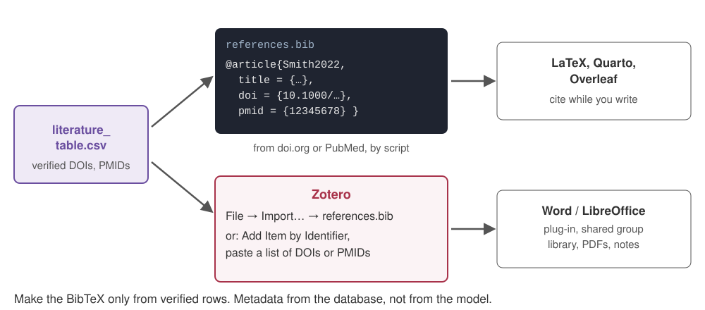{width="85%" fig-align="center"}

::: notes
Once the table is verified, it becomes references you can use. The agent writes a small script that fetches a BibTeX entry for each DOI. The DOI system itself can return BibTeX, and PubMed records can be converted too. The point, again, is that the metadata comes from the database, not from the model. The BibTeX file works directly in LaTeX, Overleaf and Quarto, so you can cite these papers in the page you build later. For Zotero, there are two easy routes: import the BibTeX file through the File menu, or paste the list of DOIs or PMIDs into Zotero's Add Item by Identifier, which accepts several at once and fetches the metadata itself. That second route is a nice independent check: if Zotero cannot find an identifier, neither should you trust it.
:::

## Step 6: the table goes on your page, with a link to every source

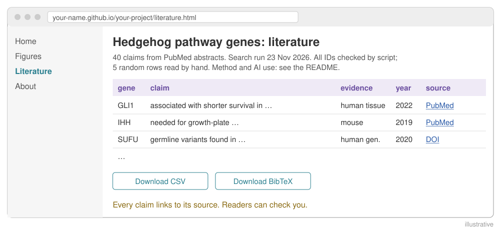{width="85%" fig-align="center"}

::: notes
The last step is publishing. Your project page from A course or project page gets a new page, literature, that shows the table with a link from every row to PubMed or the DOI. At the top, two lines of method: where the papers came from, when the search ran, how the table was checked, and a pointer to the README where your log of AI use lives. Add download links for the CSV and the BibTeX file. Then commit and push, as you have practised: the page rebuilds and the table is public. Publishing a table of claims with sources is fine: you are citing, not copying. Do not publish the PDFs themselves; that is a copyright question we come back to in the next unit.
:::

## The teaching-methods version: same steps, other database, other evidence

| Step | Hedgehog genes | Teaching methods |
|---|---|---|
| Plan | one query per gene, symbol and full name | one query per method, with synonyms ("flipped classroom" OR "inverted classroom") and "higher education" |
| Search | PubMed E-utilities | OpenAlex works search |
| Raw | `raw/pubmed/<date>/` | `raw/openalex/<date>/` |
| Abstracts | in the PubMed record | in OpenAlex for many, not all papers; the rest have none |
| Identifier | PMID and DOI | DOI (check it at Crossref) |
| Evidence types | review, human genetics, ... | meta-analysis, randomised trial, quasi-experiment, survey, single-course report |
| Typical trap | symbol clash (SMO) | everyday words, single-course reports presented as general findings |

::: notes
Here is the teaching-methods version side by side. The plan has one query per method, with synonyms, because the same method has several names, and a restriction to higher education. The search goes to OpenAlex, with the raw results in their own dated folder. One difference: OpenAlex has abstracts for many papers but not all, because some publishers do not allow it. Rows without an abstract cannot have a quote, so they either drop out or get a claim from the title only, clearly marked. The identifier is the DOI, checked at Crossref. And the typical trap is different: a glowing report from one course, written up as if the method works everywhere. The evidence type column is what protects you from that.
:::

## Connectors and skills can do the searching later

- An **MCP connector** gives the agent a ready-made tool, for example "search PubMed", without a script.
- A **skill** stores your search-and-verify workflow, so the next gene set takes one sentence.
- Both come in *Making the agent yours* (Part 5).
- They change **how** the agent searches, not **whether** you check. The verification script and the random sample stay.

Today we use scripts, because a script shows every step and leaves a record you can read and rerun.

::: notes
You may have heard that agents can be connected to PubMed directly, through so-called MCP connectors, or that you can save a whole workflow as a skill. Both are true and both come in Making the agent yours, in Part 5. A connector replaces the search script with a ready-made tool. A skill would let you say "do the literature table for these twelve genes" and have the agent follow today's steps. We start with scripts on purpose: a script shows every step, leaves a file you can read, and can be rerun by anyone. And whatever tool does the searching, the verification stays. A connector can return a wrong paper too, and a model can still overstate a claim.
:::

## Your session will look different, and so will the database next month

- The agent may write the script in Python or R, name things differently, choose other papers.
- The same query gives **more hits next month**: databases grow every day.
- "Reproducible" here means: **the query, the date, the raw records and the scripts are saved**, so anyone can see what you did and rerun it.
- Compare your table with a neighbour's: overlapping papers, different claims? That is a good discussion, not an error.

::: notes
As always, your session will differ from these slides and from your neighbour's. The script may be in R instead of Python. The agent may choose different papers among equally relevant ones. And the database itself changes: a query run next month returns more hits. So reproducible here does not mean identical. It means that the query, the date, the raw records and the scripts are all saved, so anyone can see exactly what you did and run it again. In the exercise, if you work next to someone, compare tables. Where you chose the same paper, did you write the same claim? Where you chose different papers, why? That conversation is a good test of the search plan.
:::

## This is a structured search, not a systematic review

| | This unit | A systematic review |
|---|---|---|
| Protocol | search-plan.md | registered in advance (e.g. PROSPERO) |
| Databases | one or two | several, chosen for coverage |
| Screening | agent drafts, you check a sample | two people independently, every record |
| Reporting | README and method lines on the page | PRISMA flow diagram and checklist |
| Good for | an overview, a grant background, a teaching page | clinical guidance, a publishable review |

The agent can help with a systematic review, but the rules of that method still apply.

::: notes
Be honest about what this is. A well-documented, verified, structured search is a big step up from a list of references typed from memory, and good enough for a grant background, a teaching page or getting into a new topic. It is not a systematic review. A systematic review registers its protocol in advance, searches several databases, has two people screen every record independently, and reports by the PRISMA standard. An agent can help with each of those steps, and some groups already use agents that way. But the method's own rules apply: if you publish a systematic review, the screening must be done the way the method requires, and your use of AI must be reported.
:::

## Where this goes wrong

- **Papers from memory.** One famous paper "added for completeness" without a database record. Forbid it; the verification script finds it.
- **Real ID, wrong paper.** The ID exists, the title does not match. Only a title check catches it.
- **Overstated claims.** "Associated" becomes "causes"; "in mice" disappears. Compare claim with quote.
- **Abstract ≠ paper.** Abstracts oversell. Read the sample in full when you can.
- **Bad query.** Symbol clashes, missing synonyms, a too-narrow filter. Read the hit counts.
- **Silent gaps.** A gene with no rows, not reported. Count rows per item.
- **Keys in the wrong place.** In the prompt, in the script, on GitHub.
- **Trusting the agent's own check.** "All references verified" is a claim. Read the report and the sample yourself.

::: notes
Here is what goes wrong, collected in one place. The worst error is still the invented paper, and in an agent workflow it usually comes as a helpful extra: a classic paper the model knows, added without a record. The rule in the prompt and the verification script catch it. Real identifiers for the wrong paper are only caught by comparing titles. Overstated claims are caught by you, comparing claim and quote. Abstracts oversell, so read the sample in full when you can. A bad query fills the table with the wrong biology, so read the hit counts. Count rows per item to find silent gaps. Keep keys in .env. And, as always, an agent saying it verified everything is a claim to check, not a check.
:::

## Summary

| Concept | Key fact |
|---|---|
| Look up, do not remember | every row comes from a database record, via a script |
| API | a web address that returns data for programs; PubMed, Europe PMC, OpenAlex, Semantic Scholar, Crossref are free |
| Politeness and keys | respect rate limits; keys in `.env`, never in prompts, scripts or git |
| Search plan | question, queries (symbol and full name), limits, rules, date, written first |
| Raw folder | what the database said that day; never edited |

::: notes
To sum up. The agent looks papers up with a script instead of remembering them, using free literature APIs, politely and with keys kept out of prompts and git. You write the search plan first. The raw downloads are kept as they came. Every claim carries an exact quote and an evidence type from a fixed list. Verification has layers: a script checks every identifier, title and quote, and you compare claims with quotes and read a random sample. Then the verified table becomes BibTeX, a Zotero library and a page on your site. In the next unit we go from abstracts to the papers themselves: we take the open-access papers from this table and extract one number from each, with the page it came from.
:::

## Summary (continued)

| Concept | Key fact |
|---|---|
| Claim + quote | the quote is copied exactly, so a script can find it |
| Evidence type | a fixed list; tells the reader how much a claim can carry |
| Verification | script: IDs resolve, titles match, quotes found, retractions flagged; you: claims vs quotes, random sample |
| Export | BibTeX from the DOIs; Zotero by import or by identifier |
| Publish | the table on your page, a link per row, method and AI use stated |

**Next (Extracting data from PDFs):** from abstracts to full text: pull one number out of the open-access papers you just found, with the page it came from, and check it with a second agent.

::: notes
The rest of the summary table, and where we go next.
:::
