## About this lecture {.smaller}

So far every prompt and every file the agent read went to Anthropic or OpenAI. For much of your work that is fine. For some it is not: patient data, interview transcripts, data under a contract. **Open-weights models** can run somewhere else: on a service your university or a national infrastructure runs, or on your own computer.

- **Closed** models (Claude, GPT) run only on the provider's servers. **Open-weights** models (Llama, Qwen, Mistral, Gemma, gpt-oss) are files anyone can download and run.
- What matters for privacy is **where the model runs**: the provider's cloud, a hosted service, or your own computer.
- **SciLifeLab OpenLLM** is a Swedish example of a hosted service for research.
- Open models cost you something: **weaker results**, especially as agents, **hardware**, and **your time**.
- "Open" does not always mean open source: **read the licence**.

This is a **concept and decision** unit with a hands-on comparison. It builds on *Privacy, ethics and safety* and *Choosing a model*. Guardrails, which open models have fewer of, come in *Guardrails and safety levels*.

::: notes
This unit answers a question that many of you asked during Privacy, ethics and safety: what if my data may not go to a cloud AI provider at all? The answer is not "then you cannot use AI". There is a whole class of models whose weights, the big file of numbers that is the model, are published. Those models can run on hardware your university controls, or on your own laptop. That changes the privacy picture completely, but it comes at a price, and the price is highest for agent work, which is what this course is about. We go through where data goes in each case, look at one concrete Swedish service, SciLifeLab OpenLLM, see what you can run yourself and on what hardware, how to connect Claude Code or Codex to an open model, and what the licences say. In the exercise you run the same small task on a closed model and on an open one, and note both the quality and where the data went.
:::

## A researcher has 40 interview transcripts that may not leave the university

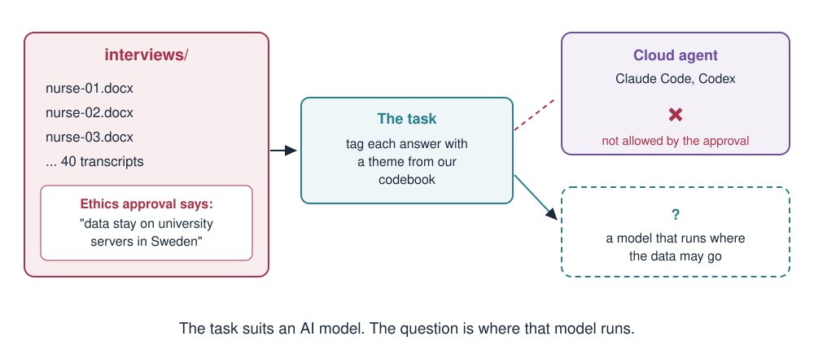{width="80%" fig-align="center"}

Tagging interview answers against a codebook is a good task for an AI model. The ethics approval says the transcripts stay on university servers. A cloud agent is out. **Is there a model that runs where the data may go?**

::: notes
Here is a typical case. A nursing researcher has forty interview transcripts. They want each answer tagged with a theme from their codebook, a slow manual job that a language model does reasonably well. But the participants were promised that their data stays on university servers in Sweden, and that is written into the ethics approval. In Privacy, ethics and safety we said: sensitive personal data does not go to a general cloud AI tool. So Claude Code and Codex, in their normal set-up, are out. The question of this lecture is whether a model can run where the data is allowed to be. Sometimes yes. But as we will see, "runs in Sweden" is not the same as "approved for this data", and the models you can run there are not as good as the ones you are used to.
:::

## Closed models are a service; open-weights models are a file you can copy

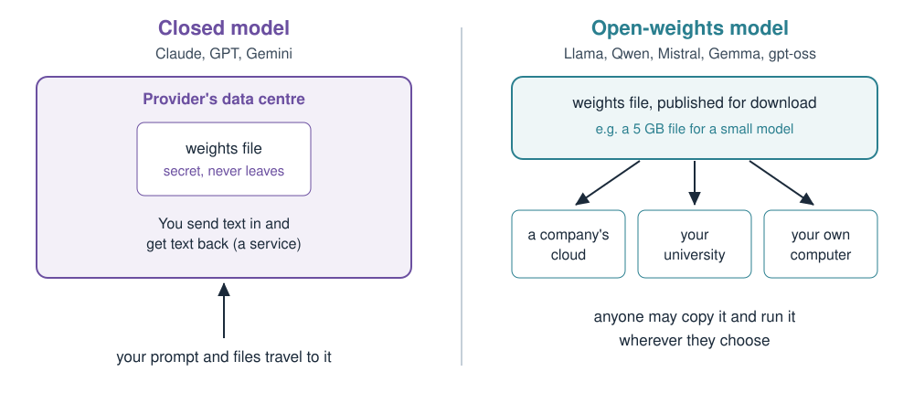{width="82%" fig-align="center"}

::: notes
Recall from How LLMs and agents work that a trained model is, in the end, a very large file of numbers, the weights, plus a program that runs it. For closed models such as Claude, GPT and Gemini, that file never leaves the company. You can only use the model as a service: you send text in, you get text back, and your text travels to their data centre. For open-weights models, the company publishes the file. Meta's Llama, Alibaba's Qwen, Mistral's models, Google's Gemma, DeepSeek, and OpenAI's gpt-oss are the best known. Anyone may download the file and run it: a cloud company, your university, or you on your own laptop. A small model is a few gigabytes; the largest open models are hundreds of gigabytes and need data-centre hardware. The model is the same wherever it runs. What changes is who handles your text.
:::

## Where the model runs decides who sees your data

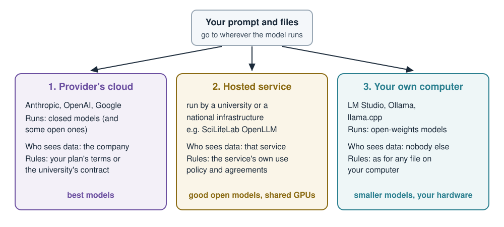{width="84%" fig-align="center"}

::: notes
This is the main slide of the lecture. There are three places a model can run, and your prompt and files go wherever it runs. First, the provider's cloud: this is what you have used all course. The company sees your data, under the terms of your plan or your university's contract. Note that cloud companies also host open models; an open model in someone else's cloud is no more private than a closed one. Second, a hosted service run by a university or a national infrastructure. The data goes to that service, under its own policy and agreements. Third, your own computer. The model is downloaded once, and after that nothing leaves your machine. The trade-off runs the other way for quality: the best models are only in the provider's cloud, a hosted service can run large open models on shared GPUs, and your own computer runs the smaller ones.
:::

## "Hosted in Sweden" is not the same as "approved for your data" {.smaller}

| Question to ask | Why it matters |
|---|---|
| **Who runs it**, and under which agreement? | Decides whether your university can treat it as an approved tool |
| **What is it approved for?** Public, internal, personal, sensitive data? | A service can run locally and still ask you to send only public data |
| **What is logged and kept?** Chat history, files, prompts? | Logs are data too, and may hold your text for a long time |
| **Is it a pilot or a production service?** | Pilots can change rules, models and uptime, or close |
| **Does your ethics approval or contract name it?** | If not, ask before you use it with that data |

::: notes
Before we look at an example, here are the questions to ask about any hosted service. The location of the servers is only one of them. Who runs it and under what agreement decides whether your university can treat it as an approved tool. What it is approved for is the most important: a service can run entirely in Sweden and still say "send only public data", as we will see in a minute. Logs matter, because a chat interface usually stores your conversation history. A pilot is a test, with no promises about the future. And for sensitive personal data, the ethics approval or the data management plan should name where processing happens. These are the same questions as in Privacy, ethics and safety, applied to a different kind of service. Your data protection officer knows how to answer them.
:::

## SciLifeLab OpenLLM runs open models on Swedish infrastructure for research

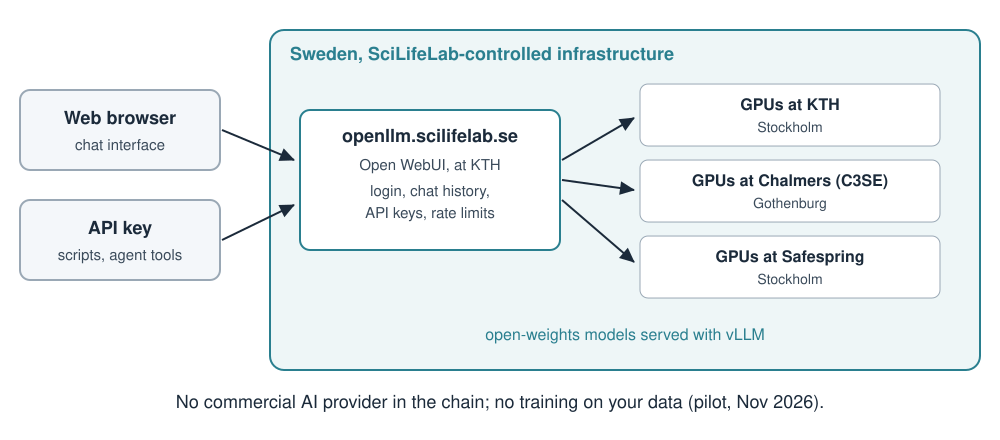{width="80%" fig-align="center"}

A pilot service from the **SciLifeLab Data Centre** ([openllm.scilifelab.se](https://openllm.scilifelab.se/about/)). Main use: **API access** from scripts, pipelines and agent tools. A basic **web chat** also exists.

::: notes
Here is the Swedish example. SciLifeLab, the national infrastructure for life sciences, runs a pilot called SciLifeLab OpenLLM through its Data Centre. Everything I say here comes from its own pages, read in November 2026, and it is a pilot, so details will change. The front end at openllm.scilifelab.se runs Open WebUI, an open-source chat interface, on a cluster at KTH. It handles login, chat history, API keys and rate limits. The models run on GPUs at KTH and Safespring in Stockholm and at Chalmers in Gothenburg, served with vLLM, an open-source program for running models. The service says that prompts and answers are not sent to any commercial AI provider, and that it does not train models on your data. Its main purpose is API access, meaning that scripts, data pipelines and agent tools talk to the models directly. The web chat is described as basic. The API is compatible with OpenAI's, so most tools that talk to OpenAI can be pointed at it instead.
:::

## SciLifeLab OpenLLM is for the SciLifeLab community, with manual approval

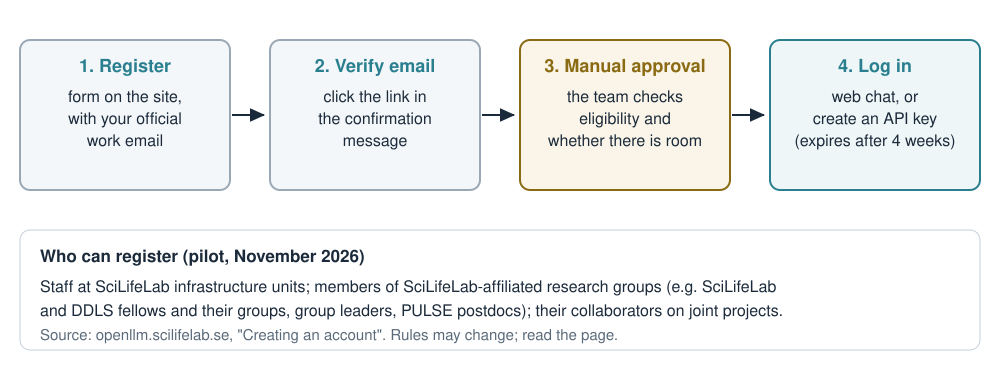{width="82%" fig-align="center"}

Questions: **openllm@scilifelab.se**, or the `#openllm_pilot_users` channel on SciLifeLab Slack.

::: notes
Who can use it? According to the registration page, staff at all SciLifeLab infrastructure units, and members of research groups affiliated with SciLifeLab, such as SciLifeLab and DDLS fellows and their groups, group leaders and PULSE postdocs. Collaborators on joint projects may also register. You register with your official work email, verify it, and then a person from the team approves the account if there is room. The pilot is about learning what capacity is needed, so they say plainly that they cannot guarantee a place for everyone. Once approved, you log in to the web interface, or create an API key under Settings, Account, API Keys. Keys expire after four weeks. If you are not in the SciLifeLab community, this service is not for you, but the questions you would ask about it are the same for any service your own university offers.
:::

## It offers large open models, and the list changes during the pilot {.smaller}

| Model (as listed, Nov 2026) | Family | Service's recommendation |
|---|---|---|
| `Mistral-Large-3-675B-Instruct-2512-NVFP4` | Mistral | advanced chat and long documents; can read images |
| `Qwen3.8-27B` | Qwen | AI-assisted coding |
| `Qwen3-235B-A22B` | Qwen | research and reasoning |
| `gemma3-27b` | Gemma (Google) | multilingual tasks |
| `bge-m3` | BAAI | embeddings for search (not for chat) |

- These are **large** models, beyond what a laptop runs. Several are in the hundreds of billions of parameters.
- The web interface can open a web page from a link you give it, but it **cannot search the web**.
- **Check the Models page** before you start: models are added and replaced as the pilot learns what users need.

::: notes
Here is the model list from the service's Models page in November 2026. Do not memorise it; the service says it will add and replace models during the pilot. What matters is the size. Mistral Large 3 has 675 billion parameters in total, Qwen3 235 billion. Neither would run on anything you have at home; they need data-centre GPUs. That is the main advantage of a hosted service over your own laptop: much larger, better open models, with the data still staying in Sweden. Two practical notes. The web interface does not search the web, so asking it about the latest literature will fail or produce invented answers. And bge-m3 is not a chat model at all: it turns text into numbers for search systems, which is useful for people who build such systems.
:::

## Its own policy says: send only public information for now {.smaller}

> *"Do not send any text, data, or code that requires any level of confidentiality above publicly available information."*
> SciLifeLab OpenLLM, use policy page (pilot), November 2026

- The pilot **has not yet** set its confidentiality, integrity and availability levels. A use policy will come before any production service.
- The registration announcement adds: **avoid sending any human sensitive data**.
- So today it is a place to **learn and test open models**, not a place for the transcripts from the start of this lecture.

**The lesson for any service:** read its policy, not its location.

::: notes
This is the most important slide about SciLifeLab OpenLLM, and the reason I wanted to show you a real example rather than an ideal one. The infrastructure is in Sweden, run by a national research infrastructure, with no commercial provider involved. You might think it is perfect for sensitive data. But its own use policy page says that, as a pilot, it has not yet assessed the confidentiality it can promise, and asks users not to send anything above publicly available information. The announcement of the pilot also says to avoid human sensitive data. That is responsible: they promise only what they have checked. For you it means: today, use it to try open models on public or test data, for example in this unit's exercise. If it becomes a production service with a policy that covers your data class, that changes. The general lesson holds for any service, inside or outside Sweden: the policy decides, not the address of the data centre.
:::

## On your own computer, nothing leaves the machine once the model is downloaded

:::: {.columns}
::: {.column width="58%"}
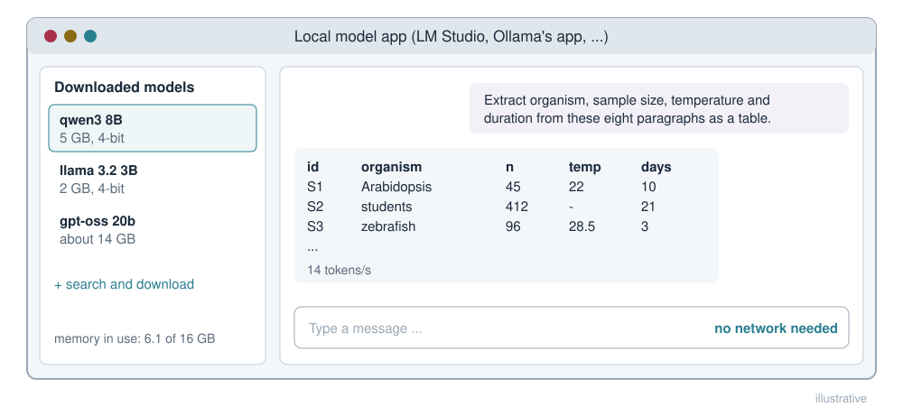{width="100%"}
:::
::: {.column width="42%"}
- **LM Studio**: a desktop app with a model browser and a chat window. No command line. Free for home and work use.
- **Ollama**: an app plus a command line; also a local server that agents can talk to.
- **llama.cpp**: the open-source engine many of these build on.

You download a model once, often from **Hugging Face**. Then chat and processing run offline.
:::
::::

::: notes
The third place a model can run is your own computer, and the tools for this have become easy. LM Studio is a desktop app for Windows, Mac and Linux: you search for a model, click download, and chat with it in a window that looks like any chat app. It has been free for use at work since mid-2025. Ollama is another popular option; it has an app too, but it shines as a small local server that other programs, including agents, can talk to. Both build on, or resemble, llama.cpp, an open-source engine that runs models efficiently on ordinary hardware. Models come mostly from Hugging Face, a website that hosts open models. The download needs the internet; after that, the model runs without any network. Your text never leaves the machine. That is as private as it gets, as private as a Word document on the same laptop. The mock-up is illustrative; real windows look a bit different.
:::

## Your computer's memory decides how large a model it can run

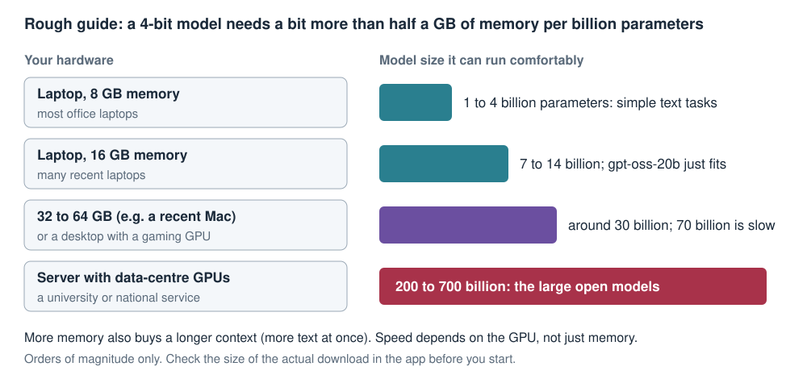{width="80%" fig-align="center"}

::: notes
How large a model can you run? The main limit is memory: the whole model has to fit, plus room for the text it works on. Downloaded models are usually compressed by storing each number with fewer digits, called quantisation; a "4-bit" model is roughly a quarter of the original size and only a little worse. As a rough rule, a 4-bit model needs a bit more than half a gigabyte per billion parameters. An office laptop with 8 gigabytes runs a model of a few billion parameters. A laptop with 16 gigabytes runs models up to about 14 billion, and OpenAI says its gpt-oss-20b fits in 16 gigabytes. A recent Mac with 32 or 64 gigabytes of shared memory, or a desktop with a gaming graphics card, runs models around 30 billion parameters comfortably. The large models from the previous slide need servers. These are orders of magnitude, not promises: the app shows the size of each download, and that is the number to compare with your memory.
:::

## Open models trail the best closed models, and small ones trail by far

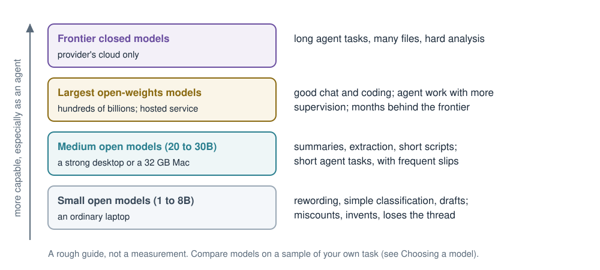{width="80%" fig-align="center"}

::: notes
Now the cost. In Choosing a model we saw that the best open-weights models are behind the best closed models, and that comparisons such as Epoch AI's put the gap at months rather than years, depending on the benchmark. That gap concerns the largest open models, the ones running on a hosted service. The models you can run on a laptop are much smaller and much further behind. Roughly: frontier closed models do long agent tasks over many files; the largest open models are good at chat and coding and can do agent work with more supervision; medium models of 20 to 30 billion handle summaries, extraction and short scripts; small models are fine for rewording and simple classification but miscount, invent values and lose the thread. This is a rough guide, not a measurement. The only test that counts is your own task, which is exactly the exercise.
:::

## Agents need more from a model than chat does

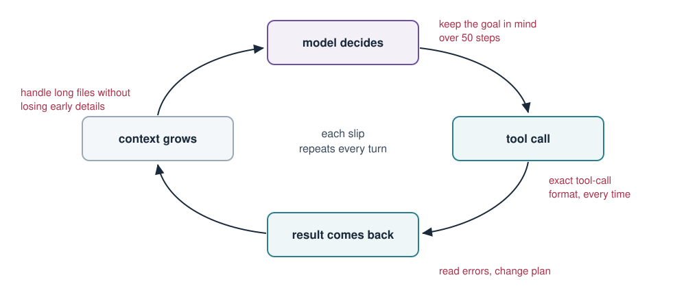{width="62%" fig-align="center"}

A chat answer that is 90% right is useful. An agent that makes a small mistake at every step of a 50-step loop **drifts off course**. Small models struggle most with tool calls, long context and recovery from errors.

::: notes
Why does the gap matter more for agents than for chat? Remember the agent loop from How LLMs and agents work. At every turn the model must remember the goal, write a tool call in exactly the right format, read the result, notice errors and change plan, while the context grows with every file read. A chat answer that is mostly right is still useful; you fix the rest. In an agent, a small error rate per step compounds over fifty steps. A model that writes a malformed tool call one time in twenty breaks the loop; a model that forgets the constraint from your prompt after a long file read starts doing the wrong task. That is why the agent harnesses work best with the models they were built for, and why an open model that looks fine in chat can be frustrating in an agent. Set your expectations accordingly: smaller, well-defined tasks, more checking.
:::

## The harness and the model are separate, so you can point the harness at an open model

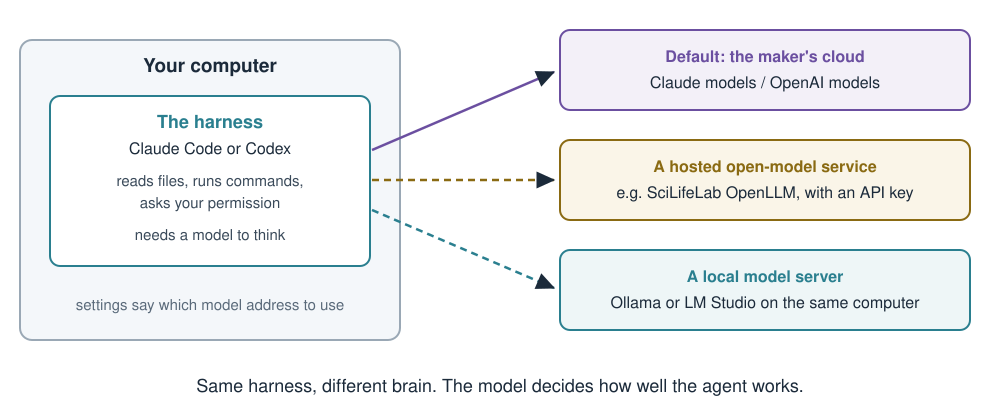{width="80%" fig-align="center"}

::: notes
Recall that the agent is two things: the harness on your computer, Claude Code or Codex, which reads files, runs commands and asks your permission; and the model, which does the thinking. The harness reaches the model at an address, normally the maker's cloud. Many harnesses let you change that address. Then the same harness, with the same permission prompts and the same tools, talks to a different brain: a hosted open-model service such as SciLifeLab OpenLLM, or a model server running on your own computer, such as Ollama or LM Studio. The permission prompts still protect you; the file tools work the same way. What changes is how well the agent works, because that depends on the model.
:::

## Codex supports local models; Claude Code can be pointed elsewhere, unsupported {.smaller}

:::: {.columns}
::: {.column width="50%"}
**Codex**

- Built-in option for local models: `codex --oss`.
- Talks to **Ollama** or **LM Studio** on the same computer; it asks which, or you set `--local-provider`.
- The app must be running with a model downloaded.
- Hosted services can be added in Codex's configuration file (advanced).
:::
::: {.column width="50%"}
**Claude Code**

- The setting `ANTHROPIC_BASE_URL` points it at another address that speaks Anthropic's format.
- **Ollama** offers this (`ollama launch claude`); **SciLifeLab OpenLLM** documents a set-up.
- Anthropic **does not support** routing Claude Code to non-Claude models. It may work; if not, you are on your own.
- It may still send some traffic to Anthropic unless switched off.
:::
::::

Both: the harness was tuned for its maker's models. Expect slower, less reliable sessions, and check more.

::: notes
How does this look in practice? I checked both tools' documentation in November 2026. Codex has an option built in: start it with codex dash dash oss, and it talks to a local model server, either Ollama or LM Studio, instead of OpenAI. You must have the app running and a model downloaded. Codex's command reference lists exactly those two local providers. Adding a remote service, such as a hosted OpenAI-compatible endpoint, means editing Codex's configuration file, which we will not do in this course. Claude Code has no such option for local models, but it reads a setting called ANTHROPIC_BASE_URL that changes the address it sends requests to. Ollama now speaks Anthropic's message format and even has a command that sets it up, and SciLifeLab OpenLLM's documentation has a page on connecting Claude Code. However, Anthropic's own gateway documentation says plainly that it does not support routing Claude Code to non-Claude models. So treat it as an experiment. One more point: a harness may still contact its maker for updates or usage statistics. If the point is that nothing leaves, check that too; SciLifeLab's guide shows settings that turn non-essential traffic off.
:::

## Open-weights is not the same as open source: read the licence

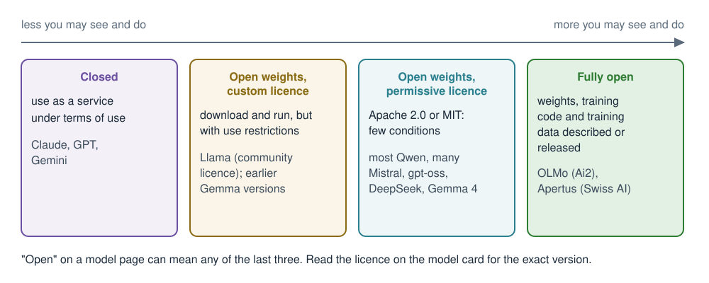{width="82%" fig-align="center"}

::: notes
A word on licences, because "open" is used loosely. A closed model you use under terms of service. An open-weights model comes with a licence, and licences differ a lot. Meta's Llama models use a custom community licence: you may run them, but there is an acceptable use policy, companies with more than 700 million monthly users need a special licence, and for Llama 4 the rights to the multimodal models are not granted to individuals or companies based in the EU, with some exceptions for end users. Earlier Gemma versions also had Google's own terms. Many other models use standard permissive licences: most Qwen models, many Mistral models, gpt-oss and, since April 2026, Gemma 4 use Apache 2.0; DeepSeek uses MIT. Those allow almost any use, including commercial. Finally, a few models are fully open: the weights, the training code and a description or release of the training data, such as OLMo from the Allen Institute and the Swiss Apertus. The Open Source Initiative's definition of open-source AI asks for that kind of openness. For you: the model card on Hugging Face names the licence, for the exact version you download. Read it before you build something others will use.
:::

## Open models have fewer outside guardrails, so more responsibility falls on you {.smaller}

- Cloud providers run **safety classifiers and usage policies** around their models. A downloaded model has only what was trained into it, and some published versions have had even that removed.
- Nobody **monitors** what you do with a local model. That is the privacy benefit, and also the responsibility.
- Open models can be **wrong in the same ways** as closed ones, often more: invented references, confident wrong numbers. Every check from *How LLMs and agents work* still applies.
- Your university's **AI policy** still applies to a local model: disclosure, authorship, how results are checked.

More on guardrails and the safety levels behind them in *Guardrails and safety levels*.

::: notes
A short slide on safety. When you use Claude or ChatGPT, there is more than the model: the provider runs classifiers that block some requests and enforces a usage policy. A downloaded open model has only the refusals trained into it, and modified versions with those removed circulate on the internet. Nobody watches what you do with it. For privacy, that is the point. But it also means the checks are yours. The model is just as able to invent a reference or miscount a table as a closed one, and smaller models do it more often. And moving to a local model does not exempt you from your university's AI policy: disclosure in papers and theses, responsibility for results, and the rules on assessment of students all still hold. The next unit, Guardrails and safety levels, looks at what the providers' guardrails are and why they exist.
:::

## Match the route to the data class, then check with your university

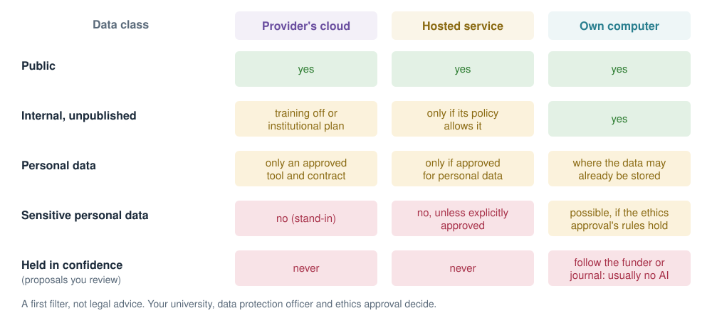{width="80%" fig-align="center"}

::: notes
Here is the flowchart from Privacy, ethics and safety, extended with the three routes. For public data, any route works; use the best model. For internal or unpublished material, a cloud plan with training off or an institutional plan is usually fine, a hosted service only if its policy allows it, and your own computer always. For personal data, a cloud tool only if your university approved it, a hosted service only if it is approved for personal data, and on your own computer, only where that data is already allowed to be: running a local model adds no third party, but it does not make a laptop an approved storage place. For sensitive personal data, the cloud is out, a hosted service only with explicit approval, and your own computer is possible if the ethics approval's rules on storage and security are met, which often means a secure university server, not a laptop. Material held in confidence, such as proposals you review, follows the funder's rules, which usually forbid AI tools altogether. This is a first filter. Your university decides.
:::

## Compare on your own task: same prompt, two models, one answer key

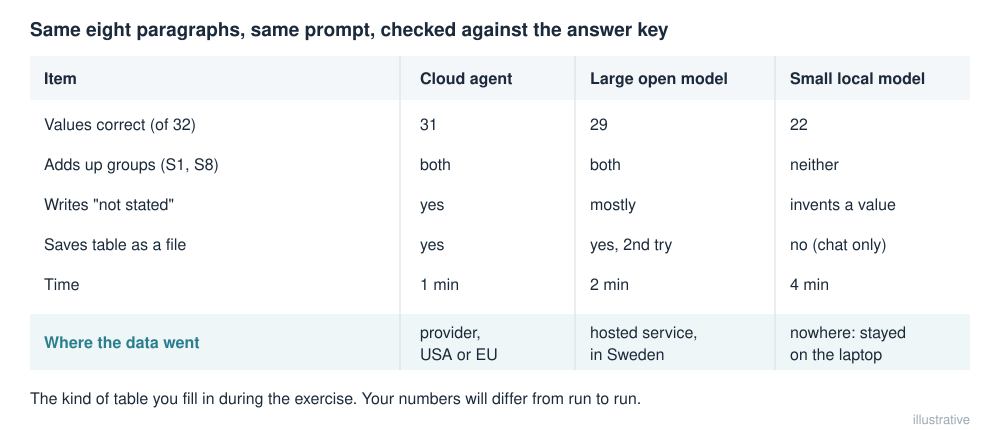{width="78%" fig-align="center"}

::: notes
How do you decide whether an open model is good enough? The same way as in Choosing a model: run the same small task on two models and compare against an answer you know. In the exercise, the task is to extract four values from eight short methods paragraphs into a table. The paragraphs have small traps: groups to add up, units to convert, values that are not stated. You run it with your usual agent, then with an open model, via SciLifeLab OpenLLM if you are eligible or on your own laptop if not, and fill in a table like this one. The numbers on the slide are illustrative. The typical pattern is: the large open model is close to the cloud agent, the small local model misses the traps and invents values where the text says nothing. But note the last row: where the data went. That row is the reason to accept a weaker model, when the data needs it.
:::

## Running models yourself costs time, hardware and attention

| Cost | What it means in practice |
|---|---|
| **Quality** | More errors, more checking, smaller tasks |
| **Hardware** | Enough memory; a fast GPU for anything beyond a small model |
| **Speed** | A laptop may produce a few words per second; long files take minutes |
| **Set-up** | Download, pick a version, keep it up to date; connecting an agent is extra work |
| **Your judgement** | You choose the model and version, and you own the result |

A hosted service takes most of these off you, but keeps one: the quality of open models.

::: notes
Let me be honest about the costs, because the privacy benefit is real but so are these. Quality: you will check more and break tasks into smaller pieces. Hardware: a small model runs on a normal laptop; anything larger needs memory most office machines do not have. Speed: on a laptop, a model may write a few words per second, so a long transcript takes minutes, and an agent session, which processes the whole context again and again, can be painfully slow. Set-up: choosing among the many versions on Hugging Face, keeping things updated, and configuring an agent to talk to it is real work, and the kind of work this course mostly avoids. A hosted service, like SciLifeLab OpenLLM, handles hardware, speed and set-up for you. What it cannot change is that the best open models still trail the best closed ones.
:::

## Where this goes wrong {.smaller}

- **Local is assumed to mean approved.** A model on your laptop does not make the laptop an approved place for sensitive data.
- **Hosted is assumed to mean private.** Read the service's policy; a pilot may ask for public data only.
- **An open model in someone's cloud** is as private as that cloud, not more.
- **The harness phones home.** An agent pointed at a local model may still send usage data to its maker unless that is switched off.
- **A weaker model, checked less.** People trust a local model more because it feels private, and check it less. Check it more.
- **The licence is skipped.** Some open-weights licences restrict use, users or regions.
- **Facts here age fast.** Model lists, tool options and the pilot's rules change; check the pages before you rely on them.

::: notes
Here is how this goes wrong in practice. The first two are mirror images: assuming that a local model is automatically allowed for sensitive data, and assuming that a hosted service is private because it is in Sweden. In both cases, the policy and the approval decide. Third, open models are offered by many cloud companies too, and then you are back in someone else's cloud. Fourth, the harness may send telemetry or update checks even when the model is local; for the strictest cases, check that, or ask IT to check. Fifth, and most common: people feel safer with a local model and check its output less, when it is weaker and needs more checking. Sixth, licences. And finally, everything on these slides about specific tools, models and the SciLifeLab pilot was checked in November 2026 and will change.
:::

## Summary {.smaller}

| Concept | Key fact |
|---|---|
| Closed vs open weights | Closed models are a service; open-weights models are files anyone can download and run |
| Where data goes | Wherever the model runs: the provider's cloud, a hosted service, or your own computer |
| Hosted services | Ask who runs it, what it is approved for, what it logs, and whether it is a pilot |
| SciLifeLab OpenLLM | Pilot for the SciLifeLab community; open models on Swedish infrastructure; for now, public information only |
| Running locally | LM Studio, Ollama, llama.cpp; memory decides model size (about half a GB per billion parameters at 4-bit) |
| Quality | Large open models trail the frontier; small local models trail by far, most of all as agents |
| Connecting an agent | Codex: `--oss` with Ollama or LM Studio. Claude Code: `ANTHROPIC_BASE_URL`, not supported by Anthropic for non-Claude models |
| Licences | Open weights is not open source; read the licence on the model card |
| Decision | Match the route to the data class; your university and ethics approval decide |

**Next (Labelling AI-generated content: the EU rules, watermarks and detection):** what you must label when you publish AI-generated text and images, how watermarks work, and why "AI detectors" are not evidence.

::: notes
To sum up. Closed models are a service; open-weights models are files that can run anywhere. Privacy follows the place where the model runs: the provider's cloud, a hosted service, or your own computer. For a hosted service, ask who runs it, what it is approved for, what it keeps, and whether it is a pilot. SciLifeLab OpenLLM is a good Swedish example, for the SciLifeLab community, and in its pilot phase it asks for public information only. On your own computer, LM Studio or Ollama run models up to the size your memory allows. Open models are weaker, especially as agents, and small ones much weaker. Codex has a built-in local option; Claude Code can be pointed elsewhere but Anthropic does not support it. Read the licence. And match the route to the data class, with your university having the last word. In the exercise you compare a closed and an open model on the same task. Next we turn from what goes into the model to what comes out: labelling AI-generated content.
:::
