## About this lecture

So far you have worked with one agent at a time: one prompt, one session, one result, and you wait while it works. This unit is about using **two agents**, or one agent with helpers, so that you wait less and, more importantly, **check better**.

- **Side by side.** Two agents can work at once on different jobs, as long as they never edit the same files.
- **Same task twice.** Give Claude Code and Codex the same prompt and data. Where their results differ is where to look.
- **One checks the other.** A second agent reviews the first one's script. Its findings are claims to check, not verdicts.
- **Helpers inside one session.** An agent can start subagents of its own and run long jobs in the background.
- **It costs.** Every extra agent and helper uses your plan's limits.

This is a **hands-on** unit and the only one that works best with both tools. If you have only one, you can run two sessions of it instead. Saving your own working style as skills comes next, in *Making the agent yours*.

::: notes
Up to now the picture has been simple: you, one agent, one folder. You write a prompt, the agent works for a few minutes, and you check the result. In this unit we add a second worker. That can save time, but the main reason to do it is a different one: two independent attempts at the same task give you a very cheap way to find the places where a result is shaky. We look at three patterns: two agents side by side on different jobs, the same job given to both, and one agent reviewing the other. Then we look at subagents, which are helpers that one agent starts inside its own session, and at background tasks. We finish with what all this costs in plan usage. This unit works best if you have both Claude Code and Codex. If you only have one, two separate sessions of the same tool also work, with a caveat we will discuss.
:::

## A second opinion is cheap; a wrong summary table is not

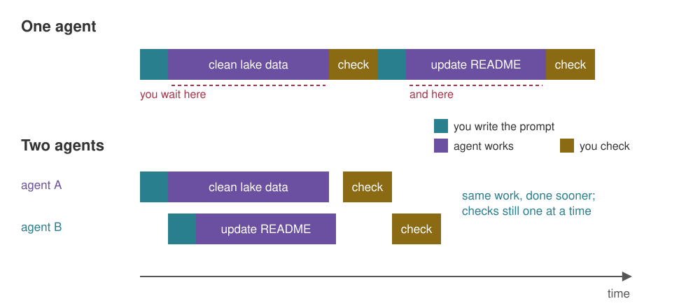{width="80%" fig-align="center"}

- Two years of lake samples need a summary table and a figure for the annual report. The README also needs updating.
- With one agent you wait, then check, then wait again.
- And the table looks fine. Is it right?

::: notes
Here is a concrete situation. You have a monitoring file with two years of lake samples, and you need a summary table and a figure for an annual report. You also want the project README brought up to date. With one agent, the jobs happen one after the other, and much of the time you are waiting. With two agents, the jobs overlap. Note what does not change: you still check each result yourself, one at a time. But there is a second, quieter problem in this slide. The summary table will look perfectly reasonable. Means with two decimals, one row per lake and year. Whether it is right depends on a handful of decisions about the data that the agent made without telling you. A second agent is one of the best ways to bring those decisions into the open.
:::

## There are three ways to use two agents

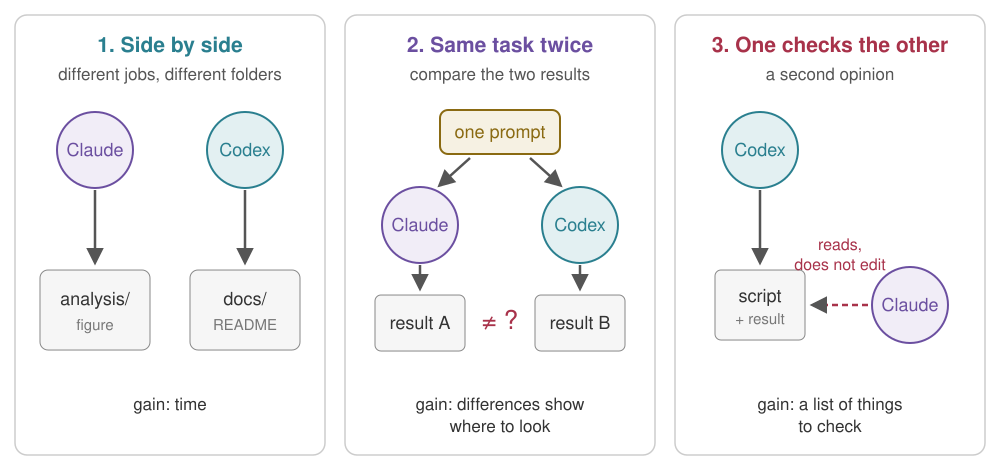{width="92%" fig-align="center"}

::: notes
There are three patterns, and they have different purposes. Side by side is about time: two different jobs in two different places, at the same time. Same task twice is about finding problems: you give both agents exactly the same prompt and the same data, and compare. Where the results agree, you have fewer places to look. Where they differ, one of them made a decision the other did not, and you need to find out which is right. One checks the other is about a second opinion: one agent reads the other's script and result and lists what may be wrong, without changing anything. We take them in this order. Most of the lecture is about the second and third, because that is where the value for checking lies.
:::

## Two agents can work at the same time in two terminal windows

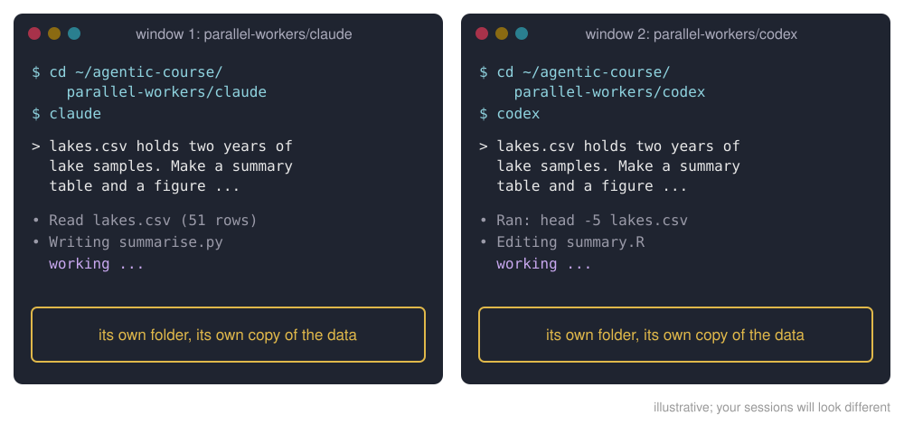{width="85%" fig-align="center"}

::: notes
Running two agents needs nothing new. You open a second terminal window, or a second tab in the same terminal, go into a folder there and start the agent, exactly as you have done all along. Each window is a separate session with its own conversation. They do not know about each other. In this picture Claude Code runs on the left in one folder and Codex on the right in another, both with the same lake data. You switch between the windows to answer questions and approve actions. The picture is illustrative: your sessions will look different, and one agent may choose Python while the other chooses R.
:::

## Never let two agents edit the same files

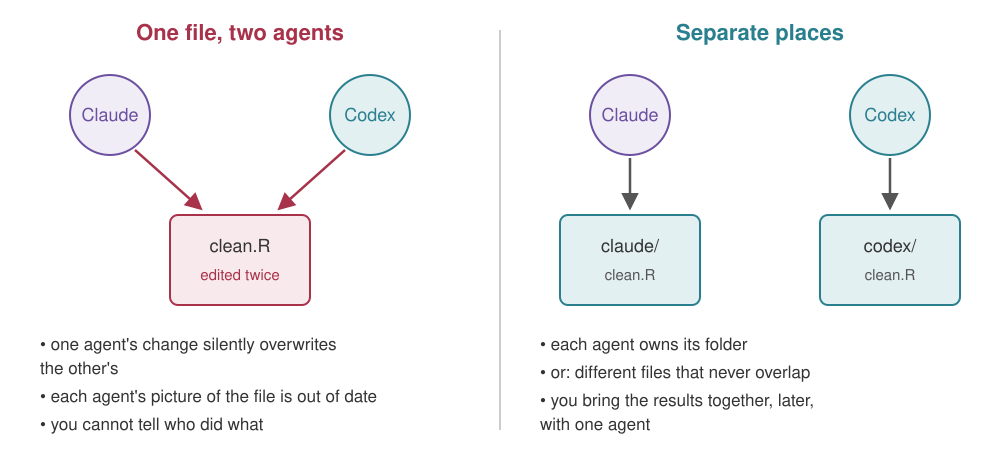{width="85%" fig-align="center"}

::: notes
There is one hard rule. Two agents must never edit the same files at the same time. Each agent reads a file, decides on a change and writes it back. If another agent changed the file in between, one of the two changes is lost, and neither agent notices, because each one's picture of the file is now out of date. You also lose track of who did what. The fix is simple: give each agent its own place. That can be its own folder, its own copy of the data, or at least a set of files that the other agent never touches. When you want to bring the results together, do that afterwards, with one agent only.
:::

## Good pairs of jobs do not touch each other's files

| Pair well | Why |
|---|---|
| A figure script in `analysis/` and a README draft in `docs/` | different folders, different files |
| Cleaning data set A and data set B | separate input and output files |
| The same task in `claude/` and `codex/` copies | made for comparison |
| An agent working and another one **reading** (review, questions) | the reader changes nothing |

| Do not pair | Why |
|---|---|
| Two agents "improving" the same script | changes overwrite each other |
| One agent renaming files while another reads them | the reader sees a half-finished state |
| Two agents both committing to the same git repository | commits and changes interleave |

::: notes
Which jobs make a good pair? Jobs that touch different files. A figure script and a README draft. Two data sets that are cleaned independently. Two copies of the same task, which is what we will do in the exercise. And one agent that only reads, for example to review or to answer your questions about the project, while the other works. Bad pairs are anything where both agents write to the same thing. That includes git: if two agents both make commits in the same project folder at the same time, their changes interleave and the history stops making sense. In your own project, the safest habit is one agent writing at a time per project folder.
:::

## Git worktrees give each agent its own copy of a repository

- A **worktree** is a second working folder of the same git repository, on its own branch.
- Each agent works in its own worktree; later you merge the branches, as in *Git as undo button and lab notebook*.
- Claude Code can start in a new worktree: `claude --worktree <name>`. The Codex app can give each thread its own worktree.
- For this course, **separate folders or copies are enough**. Worktrees are worth learning once you run parallel agents on one project often.

::: notes
You may read about git worktrees in connection with parallel agents. A worktree is a second working folder that belongs to the same git repository, checked out on its own branch. Two agents can then work on the same project, each in its own worktree, without touching each other's files, and you merge the results afterwards. Claude Code has an option to start a session in a new worktree, and the Codex desktop app can create one per thread. This is how software developers run many agents on one code base. For us it is a mention only. Merging branches is a step beyond what we did in the git unit, and separate folders or copies give you the same protection for the jobs in this course.
:::

## Your attention is the bottleneck, not the agents

- Each agent stops to ask permission, asks questions and needs its result checked. **You** do all of that.
- Two agents is plenty. With more, prompts wait unanswered and checks get skipped.
- Give each window a clear name or folder, so that you approve the right thing in the right place.
- Pair one long job with one short one: check the short one while the long one runs.

::: notes
A practical point before we go on. Agents can work in parallel, but you cannot. Each one stops to ask for permission, sometimes asks a question, and at the end its result needs checking, by you. With two agents this is manageable. With five, permission prompts sit unanswered, you approve something in the wrong window, and checking gets rushed. So keep it to two, make it obvious which window is which, and pair a long job with a short one. While the long job runs, you check the short one. That is where the time saving actually comes from.
:::

## The same task given to two agents shows where the task was ambiguous

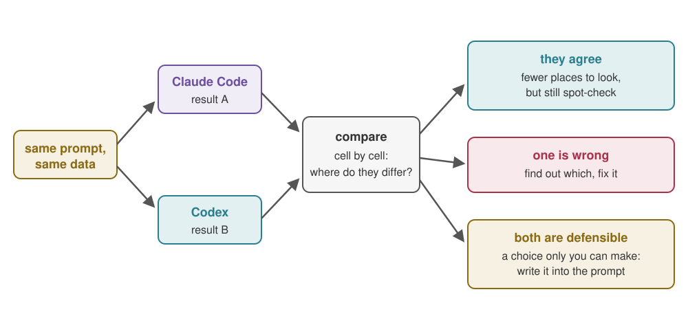{width="85%" fig-align="center"}

::: notes
Now the second pattern, and the main one in this unit. You give Claude Code and Codex exactly the same prompt and their own copy of the same data. Then you compare the results, cell by cell. Three things can happen at each place. They agree: good, although agreement is not proof, as we will see. One is wrong: find out which and fix it. Or both are defensible: the data allowed two reasonable choices and your prompt did not say which one you wanted. That last case is the most valuable. It shows you a decision you did not know you had to make. Once you have made it, it goes into the prompt, or into the project's instruction file, so that it is made the same way every time.
:::

## The lake data has five traps that need decisions

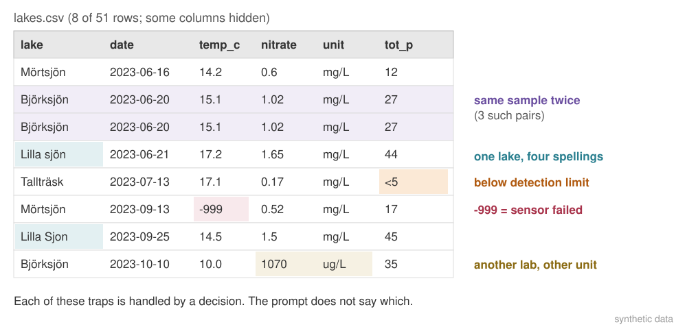{width="82%" fig-align="center"}

::: notes
This is the example data for the exercise. It is synthetic: four invented lakes, monthly samples from May to October over two years, so 48 samples. The file has 51 rows, because three samples were pasted twice. One lake is spelled four ways. Two temperature readings are minus 999, which is how this sensor records a failure. Three nitrate values came from another lab that reports in micrograms per litre instead of milligrams. And four phosphorus values in the clearest lake are below the detection limit, written as "less than 5". Every one of these needs a decision. Some decisions have a right answer: -999 is not a temperature. One does not: what number to use for "less than 5" depends on your field's convention.
:::

## The prompt is short on purpose

```text
lakes.csv holds two years of water samples from four lakes.
Make lake_summary.csv with one row per lake and year: the number of
samples and the mean temperature, nitrate (mg/L) and total phosphorus.
Also make a figure, nitrate.png, of nitrate over time for each lake.
Save the script you use, so I can rerun it, and write decisions.md:
every decision you made about the data, one line each.
Do not change lakes.csv.
```

- The prompt does not mention any of the traps. A real first prompt rarely does.
- Both agents get exactly this text and their own copy of the data.

::: notes
Here is the prompt we give both agents. It is a reasonable first prompt: it says what the result should look like, asks for a script and a list of decisions, and protects the original. What it does not do is mention any of the five traps. That is deliberate, and it is realistic: when you first write a prompt for your own data, you do not know all the traps either. In Delegating well you learned to describe the result and the odd cases. Here we see what happens to the odd cases you did not know about. Both agents get exactly this text, word for word, and each works on its own copy of the file.
:::

## Each agent gets its own copy of the data

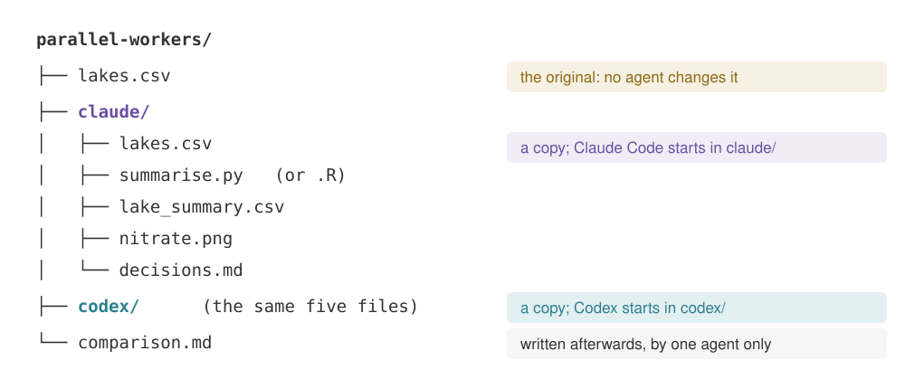{width="78%" fig-align="center"}

::: notes
This is the folder layout for the exercise. The original data sits at the top and no agent changes it. There is one subfolder for Claude Code and one for Codex, each with its own copy of the file. You start each agent inside its own subfolder, so each one can only see and change its own copy. When both are done, you start one agent in the top folder to compare the two results. That agent writes one new file, comparison.md, and changes nothing else. If you only have one of the two tools, make the second folder anyway and run a second, fresh session of the same tool in it.
:::

## Compare results, not sessions: the two tables side by side

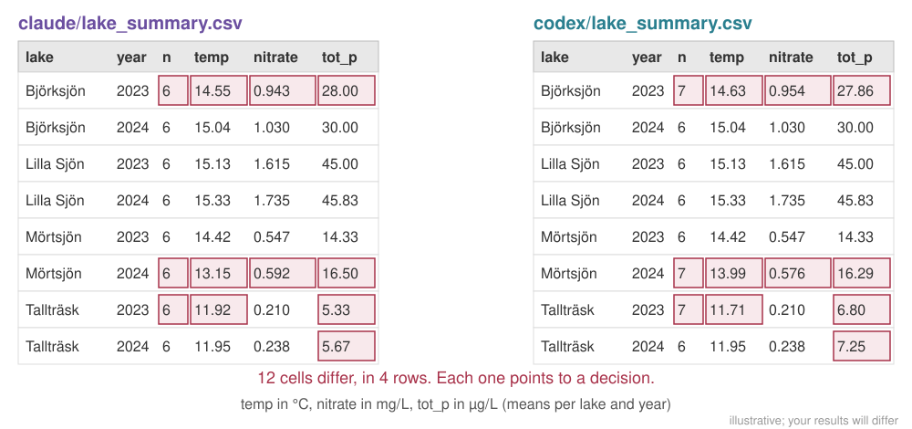{width="88%" fig-align="center"}

::: notes
Here is what the comparison might show. This is an illustration; your two results will differ in other places. On the left the result from one agent, on the right from the other. Most cells agree. Twelve cells differ, in four rows. Three rows have seven samples instead of six on the right: that agent kept the duplicated rows. And the phosphorus values for Tallträsk differ in both years, even where the number of samples is the same. That is the detection-limit question. Notice what this gives you: instead of checking 48 cells, you have four rows to look into. That is the practical value of the comparison.
:::

## Each difference leads back to a decision

| What differs | Cause | Who is right? |
|---|---|---|
| n = 7 instead of 6 in three lake-years | duplicate rows kept | an error: same sample twice |
| more than 8 rows, extra "lakes" | spellings not merged | an error: one lake |
| a temperature mean far below zero | -999 averaged as a number | an error: a missing value |
| a nitrate mean in the hundreds | µg/L not converted | an error: wrong unit |
| Tallträsk phosphorus differs | "<5" read as 0, 2.5, 5 or missing | **a choice**: your field decides |

To find the cause, ask: "For this cell, show me the rows of lakes.csv that went into it, in both versions."

::: notes
Each difference leads back to a decision in one of the two scripts. This table lists the ones that the traps can cause. The first four are plain errors: a duplicate is the same sample counted twice, the four spellings are one lake, -999 is a missing value, and a nitrate value in micrograms has to be divided by a thousand. Some of these errors are glaring, like a mean temperature of minus 150 degrees. Others are subtle, like a sample counted twice. The last row is different. Both agents may have handled "less than 5" sensibly and still got different numbers. To find the cause of any difference, ask an agent to show you the rows of the raw file that went into that cell, in both versions. Then the cause is usually obvious.
:::

## Some differences are not errors but choices only you can make

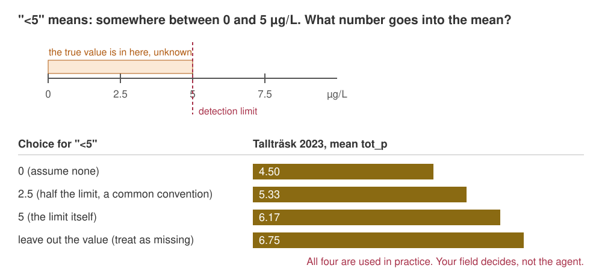{width="82%" fig-align="center"}

::: notes
Here is the choice in detail. "Less than 5" means the true value is somewhere between 0 and 5, and the lab cannot say where. To compute a mean, you must put in something. Zero, half the detection limit, the limit itself, or leave the value out. All four are used in practice, and they give means from 4.5 to 6.75 for this lake and year. That is a big spread for a lake whose values are mostly between 5 and 9. Which one is right depends on your field's convention, and sometimes on a guideline you must follow. The agent cannot know that. What the comparison did for you is to show that this decision exists. Once you have made it, write it into the prompt, or better, into the project's instruction file, so the next session makes the same choice.
:::

## Agreement is not proof: shared mistakes stay invisible

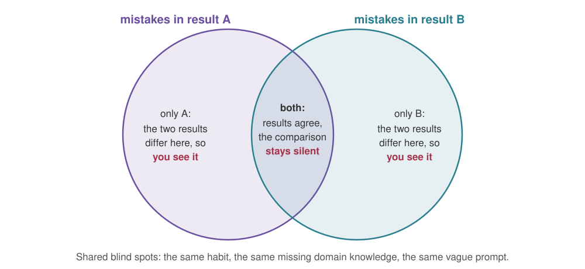{width="78%" fig-align="center"}

::: notes
A warning about what comparison cannot do. It only shows you places where the two results differ. If both agents make the same mistake, the results agree and the comparison says nothing. And this happens more often than you might hope. Both models learned from much of the same code and text, so they share habits. Both may silently treat "less than 5" as missing because that is what a common function does by default. Both lack your domain knowledge. And both got the same prompt, so if the prompt was misleading, both were misled. So the comparison reduces the work of checking; it does not replace it. You still do the counts and spot checks from the earlier units, especially on the cells where the two agree.
:::

## Ask one agent to compare; then check the key cells yourself

```text
claude/ and codex/ each hold a lake_summary.csv made from the same
lakes.csv. Do not change any file except the one you create.
Compare the two tables cell by cell. Write comparison.md with a table
of every cell that differs, and for each one: the value in each
version, and the reason, found by reading each folder's script and
decisions.md. Then list any decision that only one of the two
decisions.md files mentions.
```

- Start this agent in the **top folder**, so it can read both subfolders.
- Then open the differing cells yourself and check two of them against `lakes.csv`.

::: notes
You do not need to compare the tables by eye. One agent can do that, and it can also go and find the reason for each difference in the two scripts. Start it in the top folder, so that it can see both subfolders, and tell it that the only file it may create is comparison.md. Ask for the reason behind each difference, not only the numbers, and ask it to compare the two decision lists. Decisions that only one agent wrote down are often the interesting ones. Then do your part: take two of the differing cells and check them against the raw file yourself. The comparing agent can make mistakes too.
:::

## One agent can review the other's script without changing it

```text
Review codex/summary.R (or whichever script is in codex/).
Do not change any file. List:
1. every decision the script makes about the data,
2. anything that would give a wrong number, most serious first,
   each with the line and the rows of lakes.csv that show the problem,
3. what you checked and found to be fine.
```

- The reviewer is the **other** tool: Claude Code reviews Codex's script, and Codex reviews Claude's.
- Ask for evidence: a line number and the data rows. A claim without evidence is a guess.

::: notes
The third pattern is a review. One agent reads the other's script and lists what may be wrong. Use the other tool as the reviewer, so that Claude Code reviews what Codex wrote and the other way round. A model reviewing its own kind of output is more likely to share its blind spots. Tell the reviewer not to change anything: a review is a list for you, not an edit. And ask for evidence with every finding: the line in the script and the rows of the data that show the problem. That makes each finding checkable in a minute. Asking for what it checked and found fine is also useful. It tells you what the review covered.
:::

## A review gives you claims to check, not verdicts

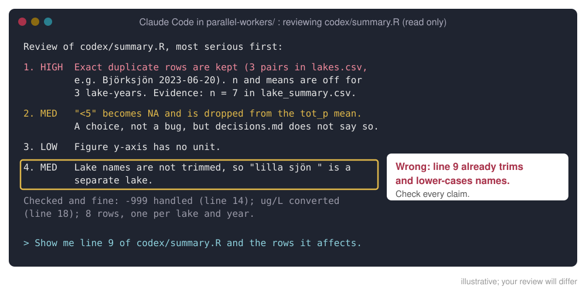{width="85%" fig-align="center"}

::: notes
Here is what a review might look like. It is illustrative, but the pattern is typical. The first finding is real and serious: duplicates were kept, with evidence. The second is a choice, which the reviewer correctly calls a choice. The third is minor. The fourth, highlighted, is wrong: the script does trim the lake names, on line 9. Reviewers do this. Asked to find problems, a model will find some, and some of them will not be real. So treat every finding as a claim. Ask to see the line, look at the rows, and decide. This takes a few minutes and is much faster than reading the whole script yourself, which is the point.
:::

## Reviews share blind spots too

- A reviewer finds **some** real problems, **invents** some, and **misses** what it would also have done itself.
- It cannot see what is not in the files: your field's convention, what the samples mean, what the report is for.
- It may go easy on work it is told is good. Ask for problems, ranked, with evidence.
- The strongest check is an **independent recomputation**: a fresh agent computes one number from the raw data without reading either script.

::: notes
Reviews have the same limit as comparisons. A reviewer misses mistakes it would have made itself. It cannot see what is not in the files: it does not know your field's convention for detection limits, or that the third lake was sampled from a different depth in the second year. And models tend to agree with how you frame things, which we called sycophancy in How LLMs and agents work. If you say "my colleague wrote this excellent script", you get a gentler review. So ask plainly for problems, ranked, with evidence. The strongest check of all is independent recomputation: a fresh session computes one or two numbers straight from the raw data, without reading either script, and you compare those numbers with the tables.
:::

## Inside one session, an agent can start helpers: subagents

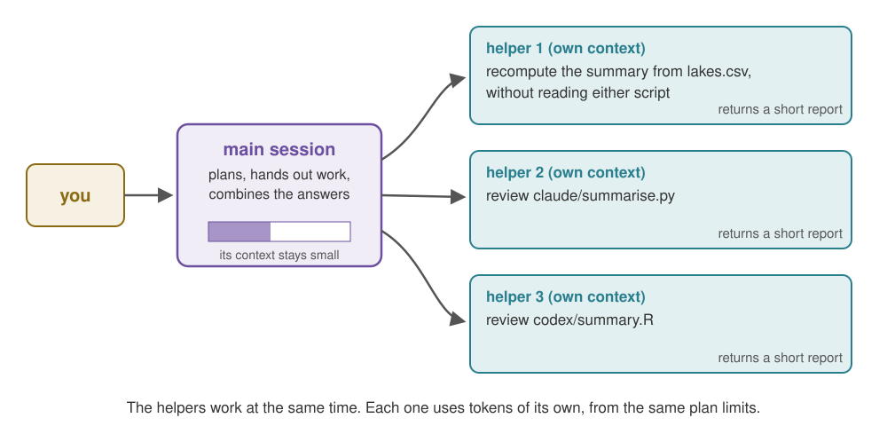{width="85%" fig-align="center"}

::: notes
So far we have had two separate sessions. An agent can also start helpers inside its own session. These are called subagents. Each subagent gets a task from the main session, works in a fresh context of its own, and returns a short report. The main session never sees all the files the helper read, only its answer, so its own context stays small and focused. Helpers can run at the same time. In this picture, one helper recomputes the summary from the raw data without looking at either script, which is exactly the independent recomputation from the last slide, and two others review the two scripts. The main session then puts the three reports together for you.
:::

## You ask for subagents in plain words

```text
Use three subagents in parallel. One recomputes the number of samples
and the mean phosphorus per lake and year straight from lakes.csv,
without reading any script. The other two review claude/ and codex/.
Then give me one table that puts the three answers side by side.
```

| | Claude Code | Codex |
|---|---|---|
| Subagents | Built in. The agent can use them on its own (for example to search files) or when you ask. Ready-made types include **Explore** (read-only search) and **Plan**. | Built in and on by default in current releases. Ask in plain words ("spawn agents in parallel"). |
| Your own helper types | Files in `.claude/agents/` (project) or `~/.claude/agents/` (personal) | Files in `.codex/agents/` (project) or `~/.codex/agents/` (personal) |
| See them | they show up in the session as they run | type `/` to find the command that lists agent threads |

::: notes
You do not need any setup to use subagents. You ask for them in plain words, as in this prompt. Both tools support them. Claude Code also uses them on its own, for example a read-only Explore helper to search through a large folder. In Codex they are on by default in current releases; older documentation calls them experimental. Both tools let you define your own helper types as small files in the project, for example a reviewer with fixed instructions. We do not need that here, but the idea is close to the skills in the next unit. One thing to remember: helpers do not make the result more trustworthy by themselves. A recomputation by a helper is still an agent's number. It is useful because it was made independently, not because a helper made it.
:::

## Subagents suit independent pieces of work

- **Good:** search a large folder; check each of 12 data files the same way; review from several angles; recompute a number independently.
- **Poor:** steps that depend on each other; anything where helpers would write to the same files.
- Each helper reports back only a **summary**. If you need the detail, ask for it to be written to a file.
- Each helper spends **tokens of its own**: five helpers cost roughly five times one.

::: notes
When are subagents worth it? When the work splits into independent pieces. Searching through a large folder for something. Running the same check on each of twelve files. Looking at a result from several angles. Recomputing something without being influenced by the existing script. They are a poor fit for steps that depend on each other, like cleaning and then plotting the cleaned data, and for anything where several helpers would write the same files. That is the same rule as for two agents. Remember also that you only see each helper's summary. If you want the detail, ask the helper to write it to a file you can open. And each helper uses tokens of its own, which we come back to in a moment.
:::

## Long jobs can run in the background while you keep talking

- A long command (a big download, a slow analysis) can be moved to the **background**; the session stays free for questions.
- Claude Code: press **Ctrl+B** while a command or helper runs; `/tasks` lists what runs in the background.
- Codex: helpers run in their own threads, and you can switch between them.
- Background work still asks for permission and still needs checking. In Claude Code it stops when you close the session.

::: notes
A related feature is background tasks. Some steps take a long time: downloading a large public dataset, running a slow model, rendering a whole website. Instead of waiting, you can move the job to the background and keep talking to the agent about something else. In Claude Code you press Control-B while the command or helper is running, and the slash command tasks lists what is running in the background. In Codex, helpers run in their own threads that you can switch between. Two cautions. Background work is not unsupervised work: the same permissions apply, and the result still needs checking. And in Claude Code, background work belongs to the session: close the session and it stops.
:::

## The two tools differ more in defaults than in what they can do

| | Claude Code | Codex |
|---|---|---|
| Models | Anthropic's Claude models | OpenAI's models |
| Instruction file | `CLAUDE.md` (can import `AGENTS.md`) | `AGENTS.md` |
| Asking before acting | permission modes, cycled with Shift+Tab | approval modes and a sandbox, set with `/permissions` |
| Helpers | subagents, background tasks | subagents, threads |
| Plan usage | `/usage` | `/status` |
| Plans | paid Claude plan (Pro or higher) or API billing | any ChatGPT plan; Plus or higher is realistic |

Both read your files, run commands, write scripts and search the web. Which one does a given task better changes from release to release.

::: notes
A word on how the two tools compare. Today they can do largely the same things: read files, run commands, write and run scripts, search the web, use helpers. They differ in the models behind them, in their defaults and in their names for things. Claude Code reads CLAUDE.md and Codex reads AGENTS.md; in Organising a project for an agent we set up one file that both use. They ask permission in different ways, which you have seen since the Terminal survival kit. They show plan usage with different commands. Claims about which tool is better go out of date with every release, so we do not make any here. What matters is that they are made by different companies, trained differently, and so make partly different mistakes. That is exactly what makes them useful as a pair.
:::

## Which tool is better changes with every release: test on your own task

- Published comparisons age within months. Your own task is the benchmark that matters.
- Run the **same task to both** on a small, typical piece of your work, a few times.
- Look at: how many checks pass, how often you had to correct, how clear the decision list is.
- One run proves little: the same agent differs from run to run. Choosing models in general comes in *Choosing a model* (Part 6).

::: notes
So how do you choose? Not from blog posts or leaderboards, which age within months. Use the comparison pattern from this unit on a small, typical piece of your own work. Give both tools the same task, check both results with the same checks, and note how often you had to correct each one and how clear their decision lists were. Do it more than once, because the same agent gives different results on different runs, and a single good or bad session tells you little. Many people end up using both: one as the main worker and the other as reviewer. The general question of choosing between models, sizes and benchmarks comes in the unit Choosing a model in Part 6.
:::

## Every extra agent and helper uses your plan's limits

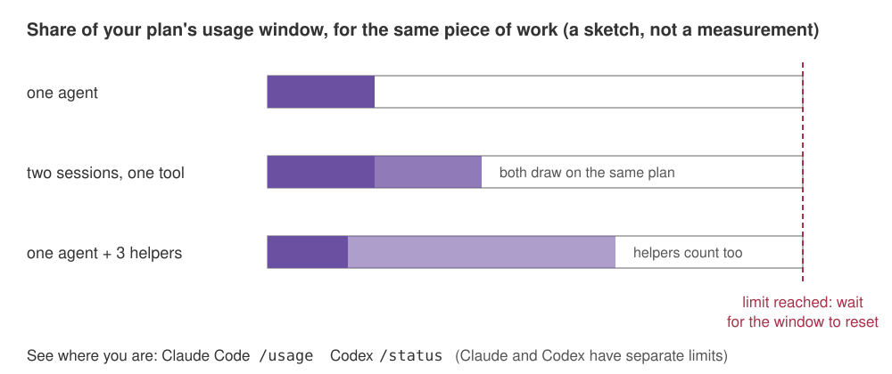{width="80%" fig-align="center"}

::: notes
Now the cost. Your plan gives you a certain amount of use per time window, and when it is used up, you wait for the window to reset. Every session uses some of it. Two sessions of the same tool use roughly twice as much, from the same plan. Helpers also count: each subagent sends its own requests and spends its own tokens, from the same limits as your main conversation. Claude Code and Codex have separate plans and separate limits, so the same-task comparison costs one share from each. In Claude Code, the usage slash command shows where you are; in Codex, the status slash command. Check it before you start a big parallel job, not in the middle of one.
:::

## Spend parallel work where checking matters most

- Compare and cross-review the steps whose numbers end up in a report, a paper or a grant.
- Do not run two agents on routine chores you can check in a minute.
- Use a small **sample** of the data for a first comparison; run the full job once you have settled the decisions.
- Write each settled decision into `CLAUDE.md`/`AGENTS.md`, so you do not pay to rediscover it.

::: notes
Given the cost, use parallel work where it pays. That is the steps whose numbers end up somewhere that matters: a report, a paper, a grant application. Renaming files or drafting an email does not need two agents. A good habit is to run the first comparison on a small sample of the data, settle the decisions, and only then run the full job once. And when a comparison has shown you a decision, write it into the project's instruction file. Then every later session makes that decision your way from the start, and you do not pay twice to discover the same thing.
:::

## Where this goes wrong

- **Two agents, one file.** Changes overwrite each other without warning. One writer per file, always.
- **Comparing sessions instead of results.** Different words and steps are normal; compare the tables.
- **Agreement taken as proof.** Shared mistakes are invisible to a comparison. Still spot-check.
- **Review findings taken as facts.** Some are invented. Ask for the line and the rows.
- **Letting an agent settle a choice.** Detection limits, outlier rules, units: your field decides.
- **Too many windows.** Unanswered prompts, approvals in the wrong place, skipped checks.
- **Running out of usage** in the middle of a job. Check first; start small.
- **Same tool, same blind spots.** Two sessions of one tool disagree less than two tools; do not read much into their agreement.

::: notes
Here is what goes wrong, collected in one place. Two agents in one file is the one rule that must never be broken. Comparing how the sessions went instead of what they produced wastes time, because sessions always differ. Agreement between the two results is reassuring but not proof. Review findings are claims, and some are wrong. Choices like detection limits belong to you and your field, not to whichever agent got there first. Too many windows lead to mistakes of your own. Usage runs out, so check before you start and start small. And if you use two sessions of the same tool, remember that they share more blind spots than two different tools, so their agreement means even less.
:::

## A checklist for working with two agents

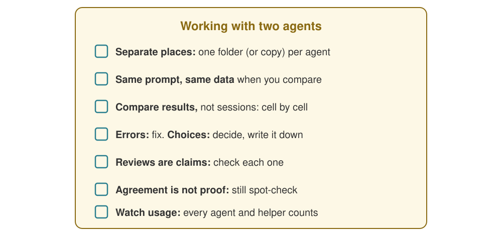{width="72%" fig-align="center"}

::: notes
Here is the unit as a checklist. Separate places for each agent. The same prompt and the same data when you compare. Compare results, not sessions, cell by cell. Fix the errors; decide the choices and write them down. Treat review findings as claims, each one checked. Remember that agreement is not proof. And keep an eye on usage, because every agent and every helper counts. You will use the whole list in the exercise, and the first three items whenever you run a second agent on your own project.
:::

## Summary

| Concept | Key fact |
|---|---|
| Side by side | two agents, two folders, two different jobs; one writer per file |
| Worktrees | a second working folder of one repository; a mention only |
| Same task twice | identical prompt and data; differences show where to look |
| Errors and choices | fix the errors; decide the choices, write them into the instruction file |
| Agreement | not proof: shared mistakes stay invisible |

::: notes
To sum up. Two agents can work side by side if each has its own place. Giving both the same task and comparing the results is a cheap way to find the shaky parts of a result. Some differences are errors to fix; others are choices you must make, and once made they belong in the project's instruction file. Agreement between agents is not proof. A cross-review by the other tool gives you a list of claims to check, each with evidence. The strongest check is an independent recomputation. Subagents are helpers inside one session, good for independent pieces of work, and long jobs can run in the background. And all of it uses your plan's limits. In the next unit, Making the agent yours, we take the decisions and the style instructions you keep repeating and turn them into skills and slash commands, and we connect the agent to outside services such as PubMed and Zotero.
:::

## Summary (continued)

| Concept | Key fact |
|---|---|
| Cross-review | the other tool reviews; findings are claims with line and rows |
| Independent recomputation | a fresh agent computes a number from raw data without the script |
| Subagents | helpers with their own context, inside one session, for independent pieces |
| Background tasks | long jobs run while you keep talking; Ctrl+B and `/tasks` in Claude Code |
| Usage | every agent and helper counts: `/usage` (Claude Code), `/status` (Codex) |

**Next (Making the agent yours):** save the decisions and the style you keep repeating as skills and slash commands, and connect the agent to PubMed or Zotero.

::: notes
The rest of the summary table, and where we go next.
:::
