## About this lecture

The numbers you need are often locked in PDFs: sample sizes and effect sizes in papers, measured values in old reports, concentrations in lab protocols. Copying them by hand is slow and error-prone. An agent can pull them out in minutes, but **a PDF is a picture of a page, not a table of data**, and the errors it makes look exactly like correct values.

- **Know what kind of PDF you have:** real text, a scan, or a mix. Each needs a different tool.
- **Define the quantity exactly** before extracting: which number, which group, which unit.
- **Record where every value came from:** file, page, table, the value as printed, and how it was read.
- **Verify three ways:** an answer key on practice data, random hand checks, and a second agent extracting independently.
- **Share numbers, not PDFs,** unless the licence allows it.

A **hands-on** unit. It uses the papers found in *Literature review on a gene (or topic) set*. Getting data from websites and APIs at scale comes next (*Collecting and analysing grant results*).

::: notes
In the last unit we found papers and read their abstracts. This unit goes one level deeper: into the papers themselves, to pull out one number from each. This is one of the most common jobs researchers do by hand: building a table of sample sizes for a meta-analysis, collecting a material property from twenty papers, or getting values out of old reports. The agent is fast at this, but PDFs are awkward. They were made to be printed and read, not to be taken apart, and the errors an agent makes, a wrong column, a misread digit, the wrong group, look exactly like right values. So, as in every unit, most of our time goes on how to check. We practise first on six synthetic papers where we know the answers, and then on real open-access papers from your literature table.
:::

## The number you need is on page 2 of forty PDFs

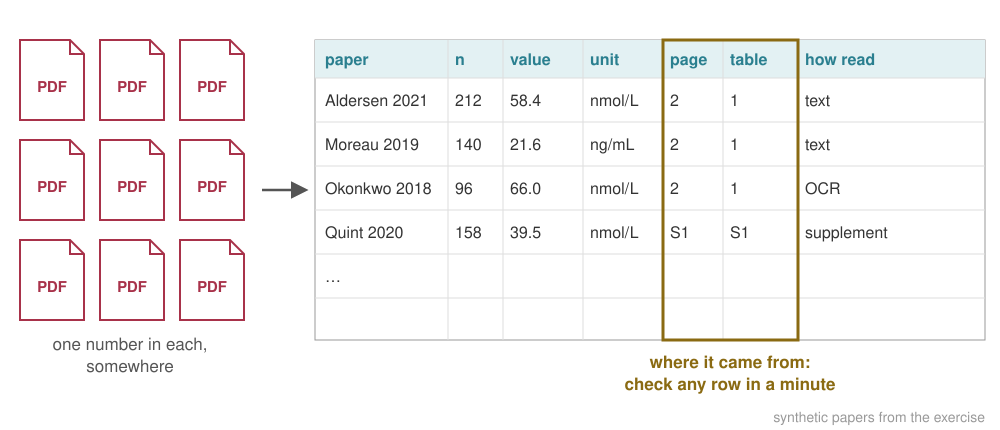{width="90%" fig-align="center"}

::: notes
Here is the task. You have a folder of PDFs, and each one reports a number you need, perhaps the number of participants and the mean of some measurement. You want one table with a row per paper. And, as in First delegations, you want a page and table column, so that anyone can check any row in a minute. The last column, how the value was read, is new. It records whether the value came from the PDF's text, from optical character recognition of a scan, or from the agent looking at a page image. That turns out to matter a lot for how much you trust it. The rows in this picture are from the practice papers in the exercise.
:::

## A PDF stores where letters go, not what a table is

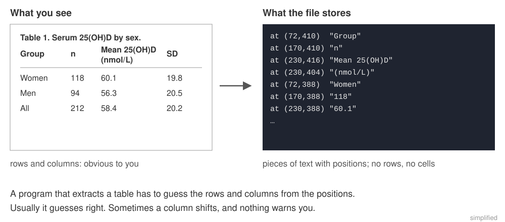{width="90%" fig-align="center"}

::: notes
To understand why PDFs are hard, look at what is inside one. On the left is what you see: a table with rows and columns. On the right is, roughly, what the file stores: pieces of text, each with a position on the page. There are no rows and no cells, just the instruction "put the word Women here, put 118 there". To get a table back, a program has to guess from the positions which pieces belong in the same row and the same column. Usually it guesses right. But a header that wraps over two lines, a column that is slightly out of line, or a cell that is empty can shift everything by one, and the program does not warn you. That is the root of most PDF extraction errors.
:::

## PDFs come in three kinds, and each needs a different tool

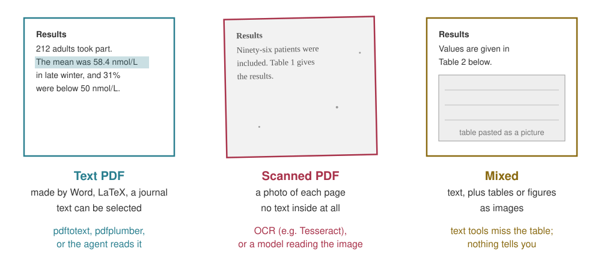{width="92%" fig-align="center"}

::: notes
There are three kinds of PDF in practice. A text PDF is made by Word, LaTeX or a journal's production system; the text is in the file, and simple tools can pull it out. A scanned PDF is a photograph of each page: there is no text inside at all, only an image. To read it, a program must recognise the letters in the image, which is called optical character recognition, OCR, or a model must look at the image. Old reports, theses and lab protocols are often scanned. The third kind is the treacherous one: a text PDF where a table or a figure was pasted in as a picture. Text tools read the paragraphs fine and silently skip the table. You need to know which kind you have before you trust an extraction.
:::

## Two quick tests tell you which kind you have

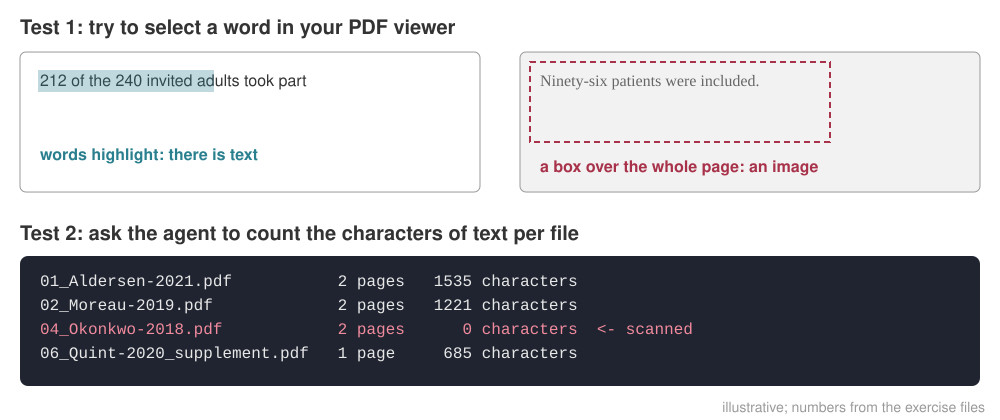{width="85%" fig-align="center"}

::: notes
Telling them apart is easy. The first test you can do yourself: open the PDF and try to select a word. If the words highlight one by one, there is text. If you get a box over the whole page, or nothing, it is an image. The second test is to ask the agent to extract the text of each file and count the characters. A file with pages but zero characters is a scan. A file with far fewer characters than its pages suggest has parts that are images. This takes the agent seconds and should be the first step of every PDF job. In the exercise, one of the six papers has zero characters, and the agent should notice before it tries to extract anything.
:::

## Prefer a structured version of the paper when one exists

- **Open-access papers** in Europe PMC and PubMed Central also exist as **full-text XML**: tables are real tables, with rows and cells. Europe PMC's API serves it.
- **Supplementary files** are often spreadsheets (CSV, XLSX). Get the numbers from there.
- **Data repositories** (Zenodo, Dryad, GEO, institutional archives) may hold the raw data behind the table.
- **The PDF is the last resort**, and the usual case for old reports, theses and your own archive.

Ask the agent: "Is there a structured version of this paper or its data?" before it opens a single PDF.

::: notes
Before we go into PDF techniques, a shortcut that saves a lot of trouble. Many open-access papers also exist in a structured form. Europe PMC and PubMed Central keep the full text as XML, where a table is stored as a real table with rows and cells, and Europe PMC's API, which you used in the last unit, can return it. Supplementary material is often a spreadsheet. And the data behind a paper may be in a repository. Any of these is far more reliable than taking a PDF apart. So the first question is always whether a better source exists. For old reports, theses, protocols and most of your own archive, there is no alternative, and then the rest of this lecture applies.
:::

## The agent has several ways to read a PDF {.smaller}

| | Claude Code | Codex |
|---|---|---|
| Read the PDF directly | yes: its Read tool opens PDFs; longer PDFs (over 10 pages) are read in page ranges, which needs `pdftoppm` from *poppler* | not described in the documentation; in practice it runs a program to extract the text |
| Extract text with a program | `pdftotext` (poppler), Python `pdfplumber`, `pypdf` or `PyMuPDF` | the same tools; it may ask to install one |
| Scanned pages | Claude models read PDF pages both as text and as images, so they can often read a scan directly; or OCR with Tesseract | renders pages to images and looks at them, or OCR with Tesseract |
| Record of how it read | ask for it | ask for it |

Installing poppler or Tesseract is a normal install: the agent asks first (*Terminal survival kit*). Python packages go into the project's own environment.

::: notes
How the agent actually reads a PDF depends on the tool. Claude Code has a built-in way to open a PDF; for long documents it reads a range of pages at a time, and for that it needs a small program called pdftoppm, part of the poppler tools. Claude models read PDF pages both as text and as page images, which is why they can often read a scanned page without separate OCR. Codex's documentation does not describe reading PDFs directly; in practice it writes and runs a small program that extracts the text, using tools like pdftotext, pdfplumber or pypdf, and renders pages to images when it needs to look at them. Both may ask to install something. That is fine; read the request as you learned in the Terminal survival kit. And neither will tell you how it read each value unless you ask.
:::

## Reading the page and running a script fail in different ways

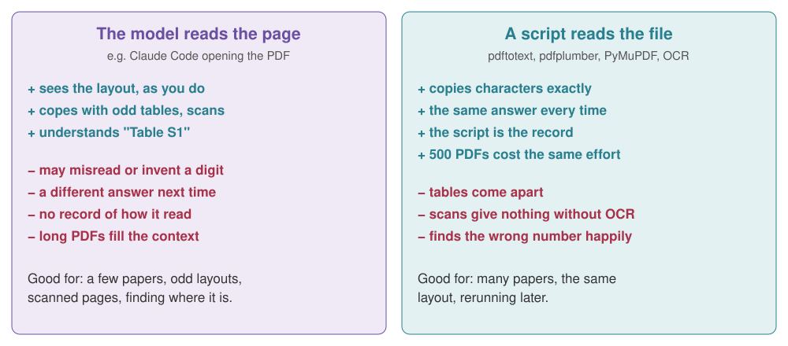{width="88%" fig-align="center"}

::: notes
The two ways of reading have different strengths and different failures. When the model reads the page, it sees the layout as you do. It copes with odd tables and scans, and it understands a reference like "see Table S1". But it can misread a digit or produce one that is not there, it may answer differently next time, and it leaves no record of how it read. A script copies characters exactly, gives the same answer every time, and is its own record. But tables come apart, scans give nothing without OCR, and a script will happily find the wrong number if you told it where to look in the wrong way. In practice you often combine them: the model finds where the value is, a script copies it. And the difference between them is useful for checking, as we will see.
:::

## Tables come apart when the text is pulled out

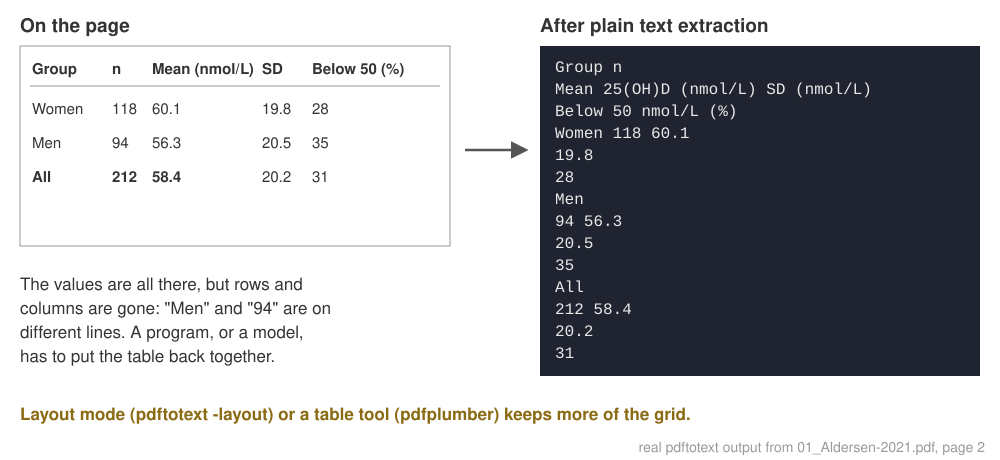{width="90%" fig-align="center"}

::: notes
Here is a real example from one of the practice papers. On the left is the table as it appears on the page. On the right is what the most basic extraction tool, pdftotext, returns for it. All the values are there. But the rows and columns are gone: the header is split over three lines, "Men" and its number 94 are on different lines, and the standard deviations float on their own. A human can put it back together, and so can a model, but each step is a guess. Tools that keep the layout, like pdftotext in layout mode or pdfplumber's table finder, keep more of the grid. The lesson is not that one tool is right, but that every value from a table needs a check against the page.
:::

## A table that runs over a page break loses its header

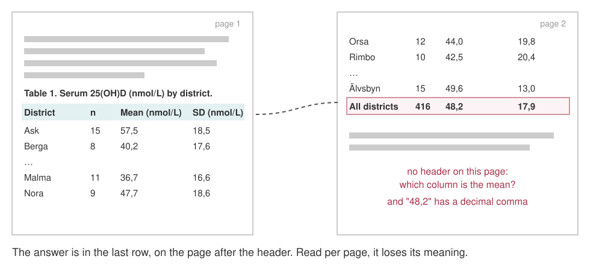{width="90%" fig-align="center"}

::: notes
Long tables bring a second problem. In this practice paper, a table of districts starts at the bottom of page 1 and runs on to page 2, and the header is not repeated. The number we want is in the last row, "All districts", on page 2. If the agent reads page by page, page 2 is a list of numbers without column names. Which one is the mean, and which the standard deviation? On top of that, this paper uses decimal commas, so 48,2 means 48.2. A careless reader turns it into 482, or into two numbers. Ask the agent to treat a table that crosses a page as one table, and check the last row of long tables by hand.
:::

## The same quantity comes in different units, and the unit hides in a header

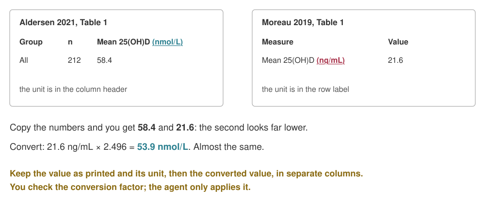{width="88%" fig-align="center"}

::: notes
Units are the next trap. Vitamin D in blood is reported in nanomoles per litre in most of Europe and in nanograms per millilitre in the US and elsewhere. One paper puts the unit in the column header, another in the row label. If the agent copies the numbers, you get 58.4 and 21.6 side by side, and the second population looks badly deficient. Converted with the standard factor of 2.496, it is 53.9 nanomoles per litre, almost the same as the first. Every field has this: concentrations, temperatures, megapascals and gigapascals, per cent and fractions. The rule: keep the value as printed with its unit in one pair of columns, the converted value in another, and check the conversion factor yourself. The agent applies it; you vouch for it.
:::

## OCR turns a picture into text, with errors that look like data

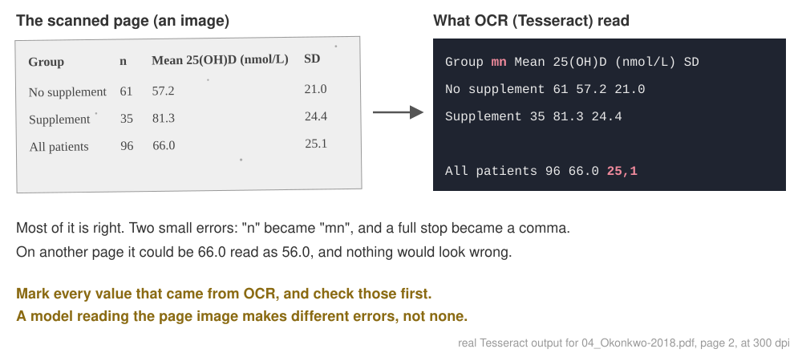{width="88%" fig-align="center"}

::: notes
For scanned pages there are two routes: OCR, or letting a model read the page image. Here is real output from Tesseract, a free OCR program, on the scanned practice paper. Most of it is right, which is the danger. Two characters are wrong: the column header "n" became "mn", and a decimal point became a comma. Those are harmless here. But the same process can read 66.0 as 56.0 or a 1 as a 7, and the result looks like a perfectly good number. A model reading the image makes errors too, just different ones. So mark every value that came from a scan, and put those rows at the top of your hand-check list.
:::

## Supplementary files hold the numbers more often than you think

- The main paper says "see Supplementary Table S1", and the PDF has no numbers at all.
- Supplements are separate files: a PDF, a spreadsheet, a Word file, a zip.
- They are not always open access, even when the paper is.
- They have their own pages and table numbers: record the file name, not only "p. 1".

Tell the agent where to look: "if the value is in a supplement, use it and name the file." Otherwise it may give up, or fill the gap from the abstract.

::: notes
A practical point that costs a lot of time in real work: the number you want is often not in the paper at all, but in a supplement. In one of our practice papers, the main text says only that most students were below a threshold, and the actual numbers are in Supplementary Table S1, in a separate file. Supplements come in every format and are not always open, even for open-access papers. When you collect papers, collect the supplements too. In the prompt, say what to do if the value is in a supplement, and ask for the file name in the source column. Otherwise an agent may report "not found", or worse, use a rounded number from the abstract instead.
:::

## Papers contain several numbers that look like the answer

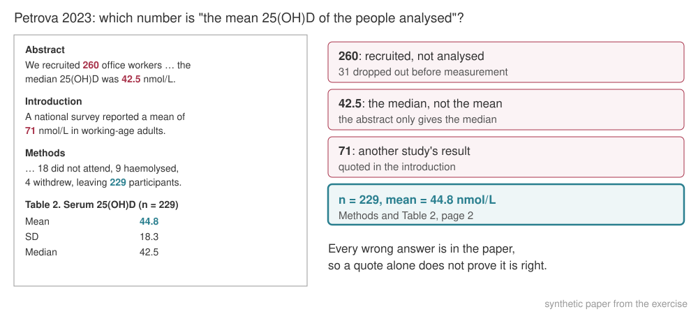{width="90%" fig-align="center"}

::: notes
This is the hardest kind of error, because the agent reads correctly and still gets it wrong. A paper mentions many numbers that look like the answer. Here, 260 people were recruited, but only 229 were analysed. The abstract gives the median, 42.5, while we want the mean, 44.8, which is only in the table. The introduction quotes another survey's mean of 71. Every one of these numbers is in the paper, so a quote will not prove it is the right one. You saw the same thing in First delegations, where a report quoted another study's result. The defence is a precise definition of what you want, and checks that look at the context, not only at the number.
:::

## Define the quantity exactly before you extract {.smaller}

```text
# extraction-definition.md
For each study, extract:
n_analysed    number of participants in the analysis of 25(OH)D
              (not invited, not recruited)
mean_value    mean serum 25(OH)D for ALL analysed participants
              (not a subgroup, not the median)
unit          as printed; then mean_nmol_per_L, converting ng/mL or
              ug/L x 2.496
source        file, page, table (or "text"), and the exact words or row
method        text / layout text / OCR / page image
If the whole-sample mean is not reported: write "not reported", do not
compute it from subgroups. If unsure: say why in a note column.
```

This file is the brief for both agents, and the standard you check against.

::: notes
So before extracting anything, write down exactly what you want. Which number: analysed, not recruited. Which statistic: the mean, not the median, for everyone, not a subgroup. Which unit, and the conversion you accept. What to record as the source. How the value was read. And what to do when the value is not there: in this case, write "not reported" rather than let the agent compute a mean from subgroups, which is a judgement call you want to make yourself. Writing this takes ten minutes, and it does three jobs. It is the brief for the agent. It is the same brief for the second agent, so their results can be compared. And it is the standard you check against.
:::

## Worked example 1: six synthetic papers, each with one trap

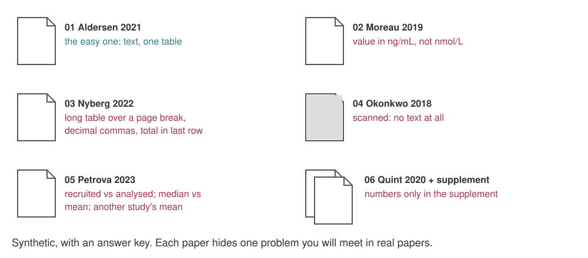{width="85%" fig-align="center"}

::: notes
The first worked example uses six short synthetic papers that we made for this course, plus one supplement. They are invented studies of vitamin D in different groups of people, and each hides one problem you will meet in real papers: units in a header, a table over a page break with decimal commas, a scanned paper with no text, a paper full of tempting wrong numbers, and a paper whose numbers are only in the supplement. The first one is easy, as a baseline. Because we made them, there is an answer key. That lets you see which traps your agent falls into, before you work on real papers where nobody knows the answers.
:::

## The prompt asks for the value as printed, the unit, the page and a quote {.smaller}

```text
The folder papers/ holds seven PDFs (six studies and one supplement).
Follow extraction-definition.md exactly.

1. First check each PDF: number of pages, and whether it has a text
   layer. Tell me before extracting anything.
2. Then make results/extraction_A.csv with one row per study and the
   columns in the definition, plus a quote column with the exact words
   or table row you took each value from.
3. A table that continues on the next page is one table. Decimal commas
   are decimal points. A supplement counts as a source; name the file.
4. If a value is not reported, write "not reported". Never compute,
   estimate or take a value from another study.
At the end, list every value you were unsure about and why.
```

::: notes
Here is the prompt for the practice set. It points to the definition rather than repeating it. It asks for an inventory of the PDFs first, so you learn about the scanned one before any extraction. It asks for the quote or table row each value came from. It names the three traps we know are common: tables over page breaks, decimal commas and supplements. It forbids computing or borrowing values. And it asks for a list of doubts. Notice what it does not say: it does not tell the agent which tool to use. We want to see what it chooses, and the method column will tell us.
:::

## First, the agent should check what kind of PDFs it has

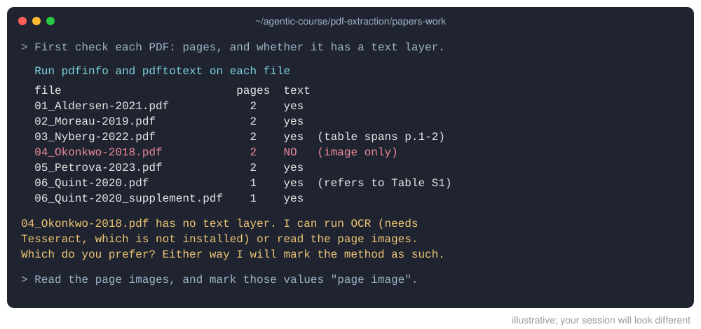{width="85%" fig-align="center"}

::: notes
This is roughly what the first step looks like. The agent checks each file: how many pages, and whether there is text. It finds that one file has no text layer and stops to ask how to handle it: install Tesseract for OCR, or read the page images. Either is fine for the exercise; what matters is that the method is recorded. It also notices that the long table crosses pages and that one paper refers to a supplement. If your agent skips this step and goes straight to a finished table, that is a warning sign: ask it what it did with the scanned paper. Your session will look different; the inventory is what to compare.
:::

## The extraction table keeps the raw value next to the cleaned one

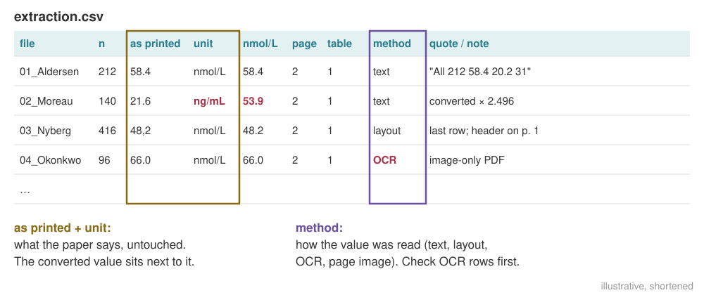{width="90%" fig-align="center"}

::: notes
Here is what the result should look like. The value as printed and its unit, untouched, then the converted value, then the source: page and table, then the method, then the quote or note. Two columns deserve attention. The as-printed pair lets you check the conversion: you can see at once that 21.6 was in ng/mL and became 53.9. It also catches decimal-comma errors, because 48,2 stands next to 48.2. The method column tells you where to look first: values that came from OCR or from a page image are the least certain, so check those first. This layout costs the agent nothing and saves you a lot of time.
:::

## Check 1: on practice data, compare with the answer key

- **Count:** six studies, six rows. None missing, none doubled (the supplement is not a seventh study).
- **Compare each value** with the key. Where it differs, which trap was it?
- **Look at the doubts list:** did the agent flag the values it got wrong? An agent that is wrong *and* sure is the case to remember.
- **Then tell it what was wrong,** with the page, and ask it to update the method so the mistake cannot recur.

The key exists only for practice. On real papers, checks 2 and 3 are all you have.

::: notes
The first check is only possible on practice data: compare with the answer key. Count rows first. Then compare each value, and for each difference ask which trap caused it. The most informative part is the agent's list of doubts. If it got the ng/mL paper wrong but flagged it as uncertain, that is a useful agent: you would have caught it. If it got it wrong and was sure, remember that: it tells you which errors this agent will not warn you about. Then correct it, as in First delegations, by pointing to the page and saying what is wrong. On real papers there is no key, so the next two checks are what you rely on.
:::

## Check 2: random hand checks, with the PDF open at the named page

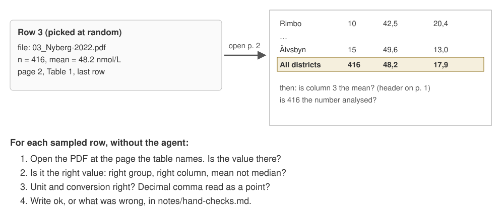{width="85%" fig-align="center"}

::: notes
The second check is the one from every unit: a random sample, checked by you. Let a script pick the rows, with a recorded seed. For each, open the PDF at the page the table names. Is the value there? Is it the right value: the right group, the right column, the mean and not the median? Is the unit right, and the conversion? Was a decimal comma read as a point? Write ok or the problem in your notes. The page column makes each check take a minute. Pick OCR and page-image rows on purpose as well as the random ones, because that is where the errors cluster. With forty papers you might check eight; with six, check them all.
:::

## Check 3: a second agent extracts independently, and you compare

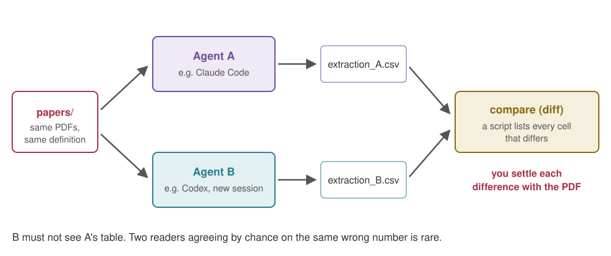{width="88%" fig-align="center"}

::: notes
The third check is new in this unit and very effective. Give the same PDFs and the same definition to a second agent: Codex if you used Claude Code, or the other way round. If you have only one, start a fresh session and tell it to use a different method, for example only scripts instead of reading the pages. The second agent must not see the first agent's table. Then a small script compares the two tables cell by cell and lists every difference. This mirrors double data extraction in systematic reviews, where two people extract independently and a third settles disagreements. Two independent readers rarely make the same mistake on the same number, so agreement is reassuring and disagreement shows you exactly where to look.
:::

## The differences show you where to look, and what each agent gets wrong

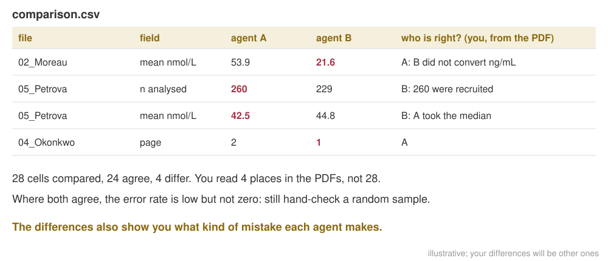{width="88%" fig-align="center"}

::: notes
Here is what the comparison might look like. Out of all the cells, a few differ. For each, you open the PDF and decide who is right. In this illustrative case, one agent forgot to convert ng/mL, the other took the recruited number and the median. So instead of checking every cell, you check four places. Where both agents agree, they can still both be wrong, for example if the definition itself was unclear, so the random hand check still matters. The differences also teach you something about each agent: which traps it falls into. That is useful knowledge for Parallel workers in Part 5, where you will use two agents together routinely.
:::

## Worked example 2: real open-access papers from your literature table {.smaller}

- Take the papers in your literature table that are **open access with a CC BY licence**. Europe PMC's API returns the licence and the PMCID.
- Choose **five** that report a human cohort or patient samples (Hedgehog) or a study with students (teaching methods).
- The quantity: **number of patients or samples analysed** (or students), with page and table, and one main result as reported.
- Write `extraction-definition.md` for it first. Real papers are messier than the practice set: expect "not reported".
- Same checks: hand-check every row (there are only five), second agent, compare.

::: notes
The second worked example uses real papers: the ones in your literature table from the last unit. The agent can ask Europe PMC which of them are open access and under which licence. Pick five that report human data. For the Hedgehog genes, those are the papers with patients or tumour samples; for teaching methods, studies with students. Extract the number analysed, with the page, and one main result as the authors report it. Real papers are messier than our practice set: the number analysed may differ between the methods and a table, or not be stated at all. Write the definition first, then the same two-agent extraction and comparison. With only five papers, check every row by hand.
:::

## Get the papers through official routes, not by scraping {.smaller}

- **A handful of papers:** download the PDF yourself from the article page in Europe PMC, PMC or the journal.
- **Structured full text:** Europe PMC's API serves the XML of open-access papers; no scraping needed.
- **Many papers:** PMC offers bulk routes for its open-access subset (its cloud service and OAI-PMH). Its terms do not allow bulk downloading from the main website.
- **Paywalled papers:** through your library, by hand, for your own use.

Keep the downloaded PDFs in `papers/` (read-only), and their licences in a small list.

::: notes
How do you get the PDFs? For five papers, the simplest and most robust way is by hand: open the article page and click download. Article websites often block scripts, and they are right to. For the structured version, the API serves it directly. If you ever need hundreds of open-access papers, PubMed Central provides official bulk routes, and its terms say that bulk downloading from the main website is not allowed. Respect that: an agent can write a scraper in a minute, and that is exactly why you need to say no. Paywalled papers come through your library, for your own use. Keep the PDFs in a folder the agent treats as read-only, with a small list of each paper's licence.
:::

## Copyright: extracted facts are yours to share; PDFs only as the licence allows

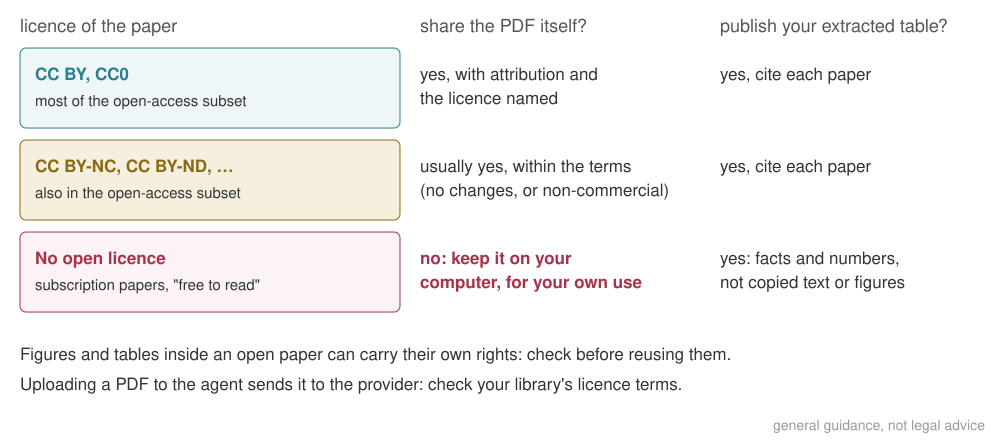{width="88%" fig-align="center"}

::: notes
Copyright decides what you may do with the papers. Under the most common open licence, CC BY, you may share the PDF itself, with attribution. The open-access subset also holds papers under more restrictive licences, such as non-commercial or no-derivatives, so check each one. Papers without an open licence, including many that are free to read on a publisher's site, must stay on your own computer. What you can publish in all cases is your extracted table: numbers and facts, each row citing its source. Two cautions. Figures and tables inside an open paper can carry their own rights. And uploading a PDF to a cloud agent sends it to the provider, which some library licences do not allow; check your library's terms. This is general guidance, not legal advice. Copyright and AI is the topic of a later unit.
:::

## Your own PDFs: reports, protocols, theses, archives

- **Old reports and protocols** are often scanned. Expect OCR, and check more rows.
- **Internal documents** may be confidential: check the data class (*Privacy, ethics and safety*) before the agent opens them.
- **Theses and reports with personal data** (names, patient details, student results) do not go to a cloud agent.
- **Start with five documents,** write the definition, check by hand, then scale up.

::: notes
The same workflow applies to your own documents: a folder of old lab protocols with concentrations to collect, reports with yearly measurements, theses with tables of results. Two extra cautions. Old documents are often scanned, so expect OCR and check more rows than you would for text PDFs. And your own documents are not necessarily public. Run them through the data classification from Privacy, ethics and safety before the agent reads them: whatever the agent reads is sent to the provider. Documents with personal data, such as names, patient details or student results, do not go to a cloud agent. Start small, five documents, and scale up only when the checks pass.
:::

## Where this goes wrong {.smaller}

- **Scanned pages skipped silently.** The text tool returns nothing, the row says "not reported". Check text per file first.
- **Shifted columns.** The SD read as the mean; the header two lines up. Check against the page.
- **Units.** ng/mL copied as nmol/L. Keep the value as printed and its unit.
- **Decimal commas.** 48,2 read as 482 or as two numbers.
- **The wrong number.** Recruited instead of analysed, median instead of mean, another study's value.
- **Computed values.** A mean averaged from subgroups, without telling you. Forbid it.
- **Missing supplements.** The value was in Table S1 all along.
- **Both agents wrong the same way,** because the definition was unclear. Keep the hand checks.
- **PDFs shared or scraped** against their licence or the site's terms.

::: notes
Here is what goes wrong, in one list. Scanned pages that a text tool skips without complaint, so a value becomes "not reported". Columns that shift, so the standard deviation becomes the mean. Units copied without conversion. Decimal commas misread. The right paper but the wrong number. Values the agent computed rather than found. Supplements nobody opened. A subtle one: both agents wrong in the same way, which happens when your definition was ambiguous, so they both made the same reasonable guess. That is why the hand checks stay even when the agents agree. And last, the legal side: PDFs shared or downloaded in ways their licence or the website's terms do not allow.
:::

## Summary {.smaller}

| Concept | Key fact |
|---|---|
| A PDF | text with positions on a page, not a table; extraction guesses rows and columns |
| Three kinds | text, scanned (image only), mixed; test by selecting text or counting characters |
| Structured first | full-text XML, supplementary spreadsheets, data repositories before the PDF |
| Reading methods | model reads the page (flexible, no record) or a script (exact, repeatable); OCR for scans |
| Typical traps | tables apart, page breaks, units in headers, decimal commas, supplements, the wrong number |
| Definition | which number, which group, which unit, what if missing; the brief for both agents |
| Extraction table | value as printed + unit, converted value, file, page, table, quote, method |
| Verification | answer key (practice), random hand checks, a second agent and a diff |
| Copyright | share facts and your table; share PDFs only as the licence allows; no scraping |

**Next (Collecting and analysing grant results):** from documents to databases on the web: APIs versus scraping, terms of use, and storing raw downloads apart from the analysis.

::: notes
To sum up. A PDF stores text at positions, not tables, so every extraction involves guesses. Find out first whether each PDF has text, is a scan, or is a mix, and look for a structured version before you open a PDF at all. The model reading the page and a script reading the file have different strengths; record which was used for each value. Define the quantity exactly, and keep the value as printed next to the converted one, with page, table and quote. Verify with an answer key while practising, then with random hand checks and a second, independent agent. And share your table freely, but PDFs only as their licence allows. In the next unit we move from documents to web data at scale: grant databases, their APIs, and the rules for collecting from the web.
:::
