## About this lecture

Every agent session starts from a blank slate. Whatever the agent learnt about your project yesterday is gone today, unless it is written down in the folder. A project that lasts needs a folder that explains itself: to the agent at the start of every session, to a colleague, and to you in six months.

- **`AGENTS.md`** tells the agent what the project is and what the rules are. One file serves Claude Code and Codex.
- **`README.md`** tells people the same, in their terms.
- **A fixed layout:** `data/raw` (never edited), `data/processed`, `scripts`, `results`, `notes`.
- **Notes files** carry the project between sessions: a plan, a decision log, a log of AI use.
- **What stays out:** secrets, sensitive raw data, things that belong elsewhere.

This is a **hands-on** unit. Your own-project folder gets this structure today. The safety net that records every change comes next, in *Git as undo button and lab notebook*.

::: notes
Many people consider this the most important unit in the course, and the reason is simple. An agent is very good inside one session and has no memory between sessions. Everything that makes it useful on day ten rather than day one has to live in the folder: what the project is for, where the data is, what has been decided and why, what must never be done. The good news is that the same things make the project understandable to a colleague and to yourself later. Today we give your own project a structure and a set of files that do this, and we test that a fresh session can find its way around.
:::

## Three weeks later, nobody knows which file is the real one

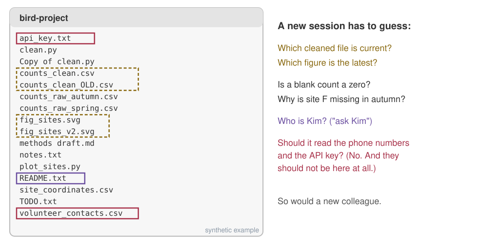{width="85%" fig-align="center"}

::: notes
Here is a typical project folder after a few months. It is a volunteer bird-count project, made up, but you will recognise the pattern from your own work. Raw data, a cleaned file and an old cleaned file side by side. A script and a copy of the script. Two versions of a figure. Notes in a text file, a to-do list, a draft. And two files that should not be there at all: a list of volunteers with phone numbers, and a key for an online service. Now start a new agent session and ask it to add a plot. It has to guess which cleaned file is current, whether blanks are zeros, and whether site F should be in the autumn data. It will guess, and it may guess wrong. So would a new colleague.
:::

## A new session is a new colleague who has never seen the project

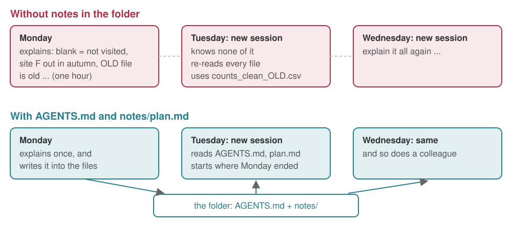{width="85%" fig-align="center"}

::: notes
You saw this in *How LLMs and agents work*. Each session starts with an empty context window, apart from the tool's built-in instructions and any instruction file it reads at the start. On Monday you spent an hour explaining that blanks mean "not visited" and that site F is out in autumn. On Tuesday, the new session knows none of it. It rediscovers some things by reading files, which takes time and tokens, and it misses the things that are not written anywhere. The fix is not a better memory in the agent. The fix is to write the important things in a file that every session reads first.
:::

## The folder has to say what the files cannot

| The agent can work out by reading | Only a written note can say |
|---|---|
| which files exist and what columns they have | what the project is **for** |
| what a script does | which file is **current**, which is old |
| that a column has blanks | that blank means **"not visited"**, not zero |
| that site F is missing in autumn | **why**, and that it was decided on purpose |
| that there is a contact list | that it **must not** be read or shared |

::: notes
An agent is good at reading files. It will find out which files exist, what the columns are, and what a script does. What it cannot find out is meaning and intent: what the project is for, which version is the one that counts, what a blank cell means, why something was left out, and what is forbidden. These are exactly the things a new colleague would ask you about on their first day. So that is what we write down. Note what is not on the right-hand side: we do not need to describe every file. The agent can look. We write what looking does not reveal.
:::

## Two readers, two files: README.md for people, AGENTS.md for agents

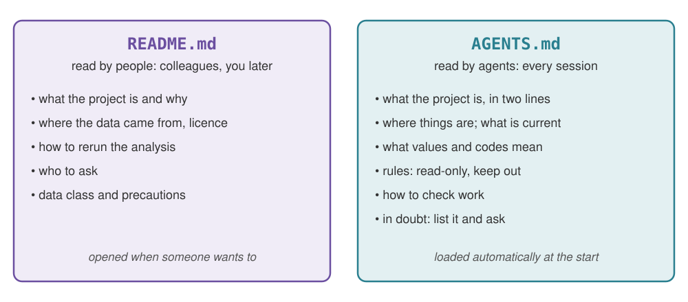{width="85%" fig-align="center"}

::: notes
We write for two readers. People read the README: what the project is, where the data came from, how to rerun it, who to ask. You already have a README from *Privacy, ethics and safety*. Agents read a second file, AGENTS.md, at the start of every session, automatically. It holds the same facts plus the working rules: which folders are read-only, how to check a result, what to do in case of doubt. The two overlap, and that is fine. They are short, and each is written for its reader. AGENTS.md is an open convention that many coding agents read, not a product of one company.
:::

## Claude Code reads CLAUDE.md; Codex reads AGENTS.md {.smaller}

| | Claude Code | Codex |
|---|---|---|
| Its own instruction file | `CLAUDE.md` | `AGENTS.md` |
| Reads the other one? | Recent versions read `AGENTS.md`, but **only if there is no `CLAUDE.md`** in the folder or above it | No, not by default |
| Can include another file | Yes: a line `@AGENTS.md` in `CLAUDE.md` imports it | No |
| Where it looks | The folder you start in, and the folders above it | From the project root (the git root) down to the folder you start in; outside git, only the folder you start in |
| Draft one for you | `/init` writes a `CLAUDE.md` | `/init` writes an `AGENTS.md` |

Checked against the documentation in November 2026. Details change; the recipe on the next slide works either way.

::: notes
Here are the facts, as of now. Claude Code's own file is CLAUDE.md. Codex's is AGENTS.md. Recent versions of Claude Code also read AGENTS.md, but only when there is no CLAUDE.md in the folder or anywhere above it, which is easy to break by accident. Codex does not read CLAUDE.md unless you configure it to. Claude Code can import one file into another with an at-sign line. Both tools look in the folder where you start them; Codex starts at the git root, and before your project is a git repository it only reads the folder you start in. So always start the agent in the project folder itself. These details change between versions, which is why we use a recipe that does not depend on them.
:::

## One recipe serves both: AGENTS.md, plus a one-line CLAUDE.md

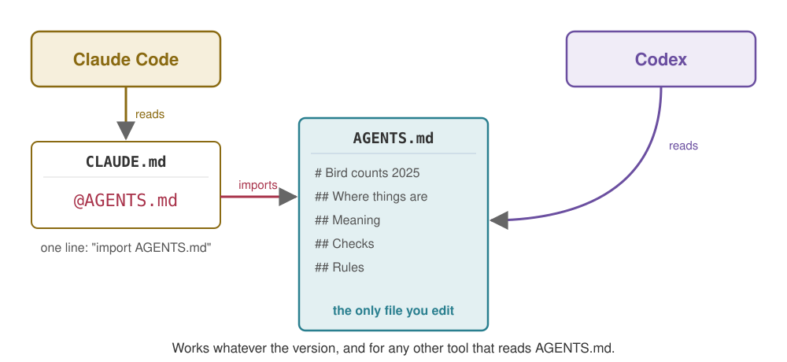{width="80%" fig-align="center"}

::: notes
The recipe is this. Write everything in AGENTS.md. Next to it, put a CLAUDE.md that contains a single line: at-sign AGENTS.md. Codex reads AGENTS.md directly. Claude Code reads CLAUDE.md, and the import line pulls in AGENTS.md. Anthropic's documentation describes exactly this setup for sharing one file between tools, and confirms that keeping the import never makes Claude read the file twice. You edit one file, and both agents, and any colleague using a third tool, get the same instructions. If you only ever use one tool, you could skip the extra file, but it costs nothing and makes the project work for whoever picks it up next.
:::

## What goes into AGENTS.md: what a new colleague would ask on day one {.smaller}

- **What this project is**, in two sentences, and who it is for.
- **Where things are**: a short map, one line per folder, and which file is current.
- **Rules**: `data/raw` is read-only; never open the files listed under "keep out".
- **Meaning**: blanks, codes, units, exclusions and why.
- **How to check work**: the commands to rerun, the numbers that must come out.
- **How to work**: start each session by reading `notes/plan.md`; log decisions in `notes/decisions.md`.
- **In doubt**: list it and ask; do not guess.

Not: every file, long explanations, things the agent can see by opening a file.

::: notes
What goes in? Think of what a new colleague would ask on their first day. What is this, and for whom? Where are things, and which version counts? What must I never do? What do the odd values mean? How do I know if I broke something? How do you like to work? And what should I do when unsure? Leave out what the agent can see for itself: a list of every file, or a description of every column, only makes the file longer. Both Anthropic and OpenAI give the same advice in their guides: short, specific, and about what the agent cannot discover.
:::

## An AGENTS.md for the bird project {.smaller}

```markdown
# Bird counts 2025
Volunteer bird counts at six sites (A-F), spring and autumn 2025, for a
report to the municipality (due 15 Dec). See README.md for background.

## Where things are
- data/raw/       original counts and site list. READ-ONLY: never edit.
- data/processed/ made by scripts only. counts_clean.csv is current.
- scripts/        01_clean.py, then 02_plot_sites.py. Run from the project folder.
- results/        figures and tables, made by scripts.
- notes/          plan.md (read first), decisions.md, ai-log.md

## Meaning
- Blank count = site not visited. 0 = visited, none seen. Never treat blank as 0.
- Site F is excluded in autumn (flooded); see notes/decisions.md.

## Checks
- After 01_clean.py: 160 rows, 750 birds. After 02: six bars, A to F.

## Rules
- Volunteer contact details and API keys are kept outside this folder.
- If something is unclear, list it and ask. Log each decision in notes/decisions.md.
```

::: notes
Here is a complete AGENTS.md for the bird project. It fits on one screen. Two sentences on what it is. A map of five folders, with the one important fact for each: raw is read-only, processed is made by scripts, the scripts run in order. The meaning of blanks and the site F exclusion, the two facts a new session would most likely get wrong. A check with numbers, so that any session can confirm it has not broken anything. And the rules. You will write one like this for the bird project in the exercise, and then one for your own project.
:::

## Keep AGENTS.md short; add a line when you correct the same thing twice

- It is read at the start of **every** session. Every line costs a little attention on every task.
- Aim for one screen; well under 200 lines.
- Write rules plainly. Capitals and "IMPORTANT" do not help.
- Add a line when you find yourself **correcting the same thing twice**.
- Remove lines that are no longer true. A wrong instruction is worse than none.

::: notes
How long should it be? Short. Anthropic suggests keeping CLAUDE.md under 200 lines, and says longer files reduce how well the instructions are followed. OpenAI says a short, accurate AGENTS.md beats a long one full of vague rules. The best way to grow it is the rule both vendors give: when you correct the agent for the same thing a second time, that correction belongs in the file. And remove what is no longer true. If AGENTS.md still says counts_clean_OLD.csv is current, every session will believe it.
:::

## AGENTS.md is advice, not a lock

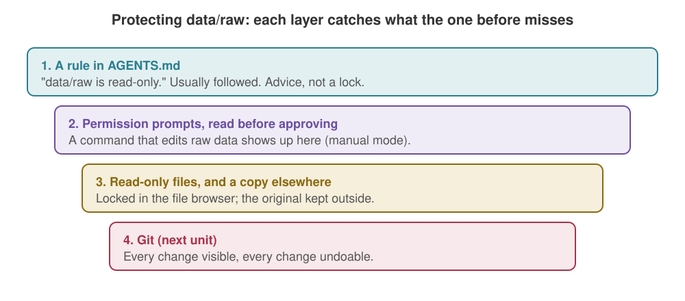{width="80%" fig-align="center"}

::: notes
One important limit. AGENTS.md is read as context. The agent will usually follow it, but nothing forces it to. Anthropic's documentation says this plainly: these files are context, not enforced configuration. A long session, a confusing request or plain bad luck can lead the agent to edit a file you said was read-only. So protect what really matters with things that do not depend on the agent's good behaviour: keep a copy of raw data somewhere else, make the raw files read-only in your file browser, read the permission prompts, and, from next unit, use git, which lets you undo any change. The rule in AGENTS.md prevents most accidents; the other layers catch the rest.
:::

## A layout that works for most projects

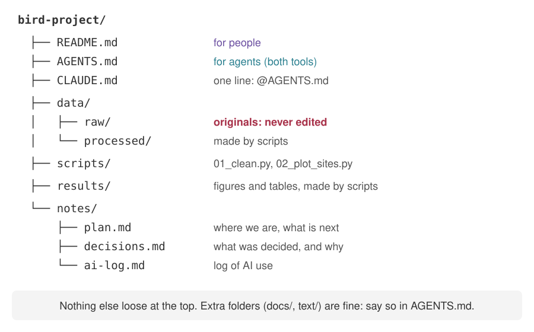{width="70%" fig-align="center"}

::: notes
Here is the layout we use for every own project in this course. At the top, the three instruction files and nothing else loose. A data folder with raw and processed. A scripts folder. A results folder for figures and tables. A notes folder for the plan, the decisions and the AI-use log. It is deliberately boring. It is close to what many research groups and data-management guides recommend, and the agent will recognise it immediately. Your project may need one more folder, for example docs for a website or text for a manuscript. That is fine. Write it in AGENTS.md.
:::

## data/raw is never edited; everything else can be remade from it

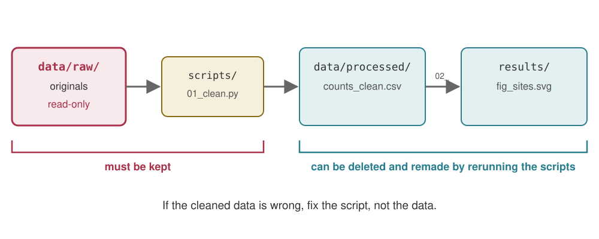{width="88%" fig-align="center"}

::: notes
The single most useful rule in the layout: raw data is never edited. Not by you, not by the agent. Everything downstream, cleaned data, tables, figures, is made from raw data by a script. This has two consequences. First, if the cleaned data turns out to be wrong, the original is still there, and you fix the script, not the data. Second, everything outside raw and scripts can be deleted and remade. That is a powerful check: if you delete processed and results, rerun the scripts and get the same numbers, the project is reproducible. We come back to this in *Reproducible figures*.
:::

## Protect raw data in three layers

| Layer | How | Catches |
|---|---|---|
| A rule in `AGENTS.md` | "`data/raw/` is read-only: never edit, move or delete." | most accidents |
| Read-only files | Mac: Get Info › **Locked**. Windows: Properties › **Read-only**. | an agent that ignores the rule |
| A copy elsewhere | the original download, the instrument's export, a backup drive | everything else |

From the next unit, git adds a fourth: every change can be seen and undone.

::: notes
Here is how to make raw data really read-only. The rule in AGENTS.md is the first layer. The second is to mark the files read-only in your file browser: on a Mac, Get Info and tick Locked; on Windows, Properties and tick Read-only. An agent would first have to run a command to unlock them, and in manual mode that shows up as a permission prompt, which is your signal to say no. The third layer is that the original also exists somewhere else: where you downloaded it, the instrument computer, a backup. With these three, losing raw data takes a lot of bad luck.
:::

## notes/ carries the project from one session to the next

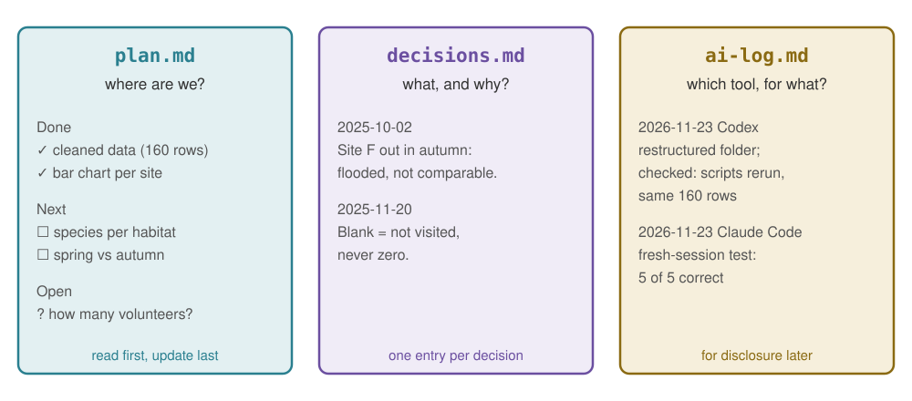{width="85%" fig-align="center"}

::: notes
The notes folder holds three files, each with one job. plan.md says where the project stands: what is done, what is next, what is open. Each session starts by reading it and ends by updating it. decisions.md is a dated list of decisions and their reasons: why site F was dropped, why blanks are not zeros. ai-log.md is the log of AI use you started in your README: which tool, when, for what. Your first brief from *Delegating well* fits here too. These are plain text files. You can read and edit them yourself, and so can the agent.
:::

## plan.md lets a fresh session pick up where the last one stopped

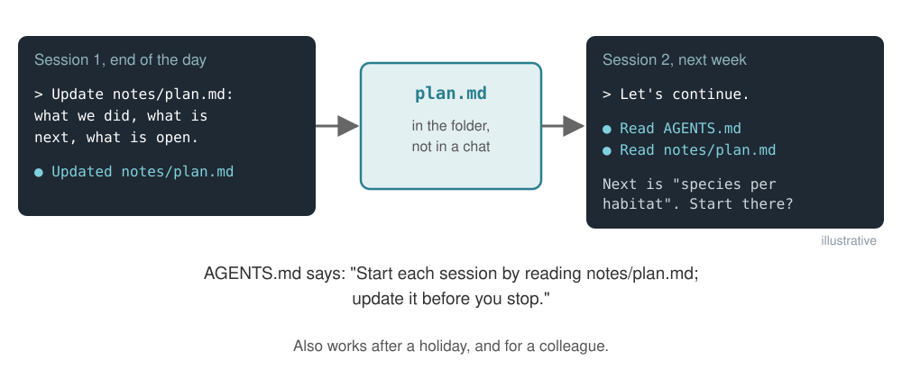{width="85%" fig-align="center"}

::: notes
Here is how plan.md works in practice. At the end of a session, before you close it, ask the agent to update the plan: what was done, what is next, what is still open. At the start of the next session, the first thing the agent does, because AGENTS.md tells it to, is read the plan. It then knows where you stopped, without you retyping anything, and without a long old conversation weighing on it. This is the habit from *Delegating well*, "write what we learnt to a file before you clear", made permanent. It also makes it much easier to come back after a holiday.
:::

## decisions.md records why, not only what {.smaller}

```markdown
# Decisions

## 2025-10-02  Site F excluded in autumn
The meadow was flooded in September and October; counts are not
comparable with spring. Agreed with the group. clean.py drops F/autumn.

## 2025-10-14  Species names lower-cased
Names were typed by hand ("Great tit", "great tit", "Great Tit").
clean.py lower-cases them; the raw files are unchanged.

## 2025-11-20  Blank counts are "not visited", never zero
Confirmed with the volunteers. A blank row is dropped, not counted as 0.
```

One entry per decision: date, what, why, where it is implemented.

::: notes
The decision log is the file people most often skip and most often wish they had. Each entry has a date, the decision, the reason, and where in the project it is implemented. When a reviewer asks why site F has no autumn data, the answer is here. When the agent is about to "fix" the missing autumn data for site F, the answer is here too, and AGENTS.md tells it to look. You do not have to write these by hand: tell the agent "log this decision in notes/decisions.md" whenever you make one in a session.
:::

## The log of AI use is your record for disclosure {.smaller}

```markdown
# Log of AI use

| Date       | Tool        | What for               | Checked how          |
|------------|-------------|------------------------|----------------------|
| 2026-11-20 | Claude Code | first brief            | read, edited by me   |
| 2026-11-23 | Codex       | restructured folder    | scripts rerun: same  |
| 2026-11-23 | Claude Code | test of AGENTS.md      | 5 of 5 correct       |
```

- Journals, funders and universities increasingly ask how AI was used. This answers it.
- It records **what you checked**, which is the part that counts.

::: notes
The third notes file is the log of AI use. You started it in your README in *Privacy, ethics and safety*; now it gets its own file. One line per session or per task: date, tool, what it was used for, and how you checked the result. When a journal, a funder, a thesis committee or your own university asks how generative AI was used, you will have the answer instead of a vague memory. The last column is the important one. "Used AI to clean data" is a confession; "used AI to clean data, checked row counts and totals against the original" is a method.
:::

## Names that sort, search and survive {.smaller}

| Instead of | Use | Why |
|---|---|---|
| `Final data v2 (Kim's edits).xlsx` | `2025-10-14_counts-clean.csv` | no spaces; dates sort; one version |
| `fig_sites_v2.svg`, `fig_sites_NEW.svg` | `results/fig_sites.svg` | git keeps old versions (next unit) |
| `clean.py`, `Copy of clean.py` | `scripts/01_clean.py` | numbers say the order to run |
| `notes.txt`, `TODO.txt`, `misc.docx` | `notes/decisions.md`, `notes/plan.md` | the name says what is inside |
| `data.csv` | `counts_raw_spring.csv` | specific enough to search for |

Lower case, hyphens or underscores, no spaces. Dates as `YYYY-MM-DD`.

::: notes
A few naming conventions make a project much easier to navigate, for agents and people. No spaces, because spaces in file names cause trouble in scripts and terminals. Dates in the international format, year first, so that sorting by name sorts by time. Numbered scripts, so the order is visible. Names that say what is inside. And no version words in names: "final", "v2", "new", "old". Those are a sign that you need version control, which is the next unit. Once the project is in git, there is one file called fig_sites.svg, and every earlier version is in the history.
:::

## What does not go in the folder

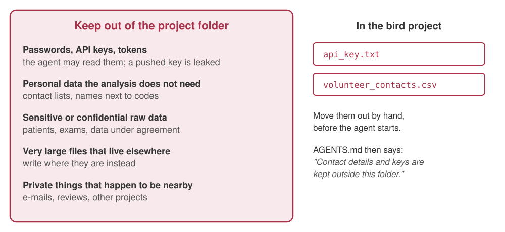{width="85%" fig-align="center"}

::: notes
Some things must never be in the project folder, because the agent reads the folder, and soon the folder will be on GitHub. Passwords, API keys and tokens: an agent may read them into its context, and a pushed key is a leaked key. Personal data that the analysis does not need, like the volunteers' phone numbers. Sensitive raw data, which per *Privacy, ethics and safety* should not go to the agent at all. Large files that live somewhere else, like a 40-gigabyte image set: write where they are instead. And private things that happen to be nearby. In the bird project, two files fail this test: the contact list and the API key. In the exercise, you will remove them before the agent starts.
:::

## Sensitive data stays outside; the folder says where it is

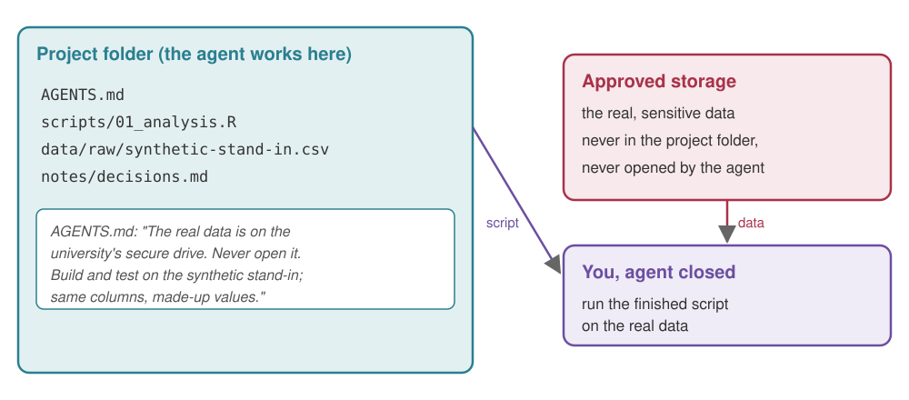{width="85%" fig-align="center"}

::: notes
What if your project does need data that must not go to the agent? Then the data lives outside the project folder, in the place your university approves, and the project contains everything else: the scripts, a synthetic stand-in with the same columns for the agent to build and test on, and a line in AGENTS.md and the README that says where the real data lives and that the agent must not open it. You then run the finished script on the real data yourself, without the agent. This is the workflow from *Privacy, ethics and safety*, built into the folder.
:::

## Both tools also have a memory of their own {.smaller}

| | Claude Code: auto memory | Codex: memories |
|---|---|---|
| On by default? | **Yes**, in local sessions | **No**, you switch it on |
| What it stores | notes Claude takes itself: your preferences, corrections, project facts | context extracted from earlier chats |
| Where | on your computer, under `~/.claude/projects/…/memory/` | on your computer, under `~/.codex/` |
| See or change it | `/memory` (lists files, toggles auto memory) | `/memories` (per chat), settings for global |
| Shared with a colleague? | **No** | **No** |

Both vendors say the same: rules that must always apply go in the instruction file, not in memory.

::: notes
Both tools have a memory feature on top of the instruction files. Claude Code's auto memory is on by default: Claude writes short notes for itself, for example after you correct it, and reads them at the start of the next session. They are stored on your computer, outside the project, and you can see and edit them with slash memory. Codex has memories too, but they are off by default; you switch them on in the settings, and slash memories controls them per chat. Both are useful conveniences. But both live on your machine only, a colleague never sees them, and they are not in the folder you share. Both vendors' documentation says to keep rules that must always apply in AGENTS.md or CLAUDE.md, and to treat memory as a recall aid.
:::

## Memory is personal; the project's knowledge belongs in the folder

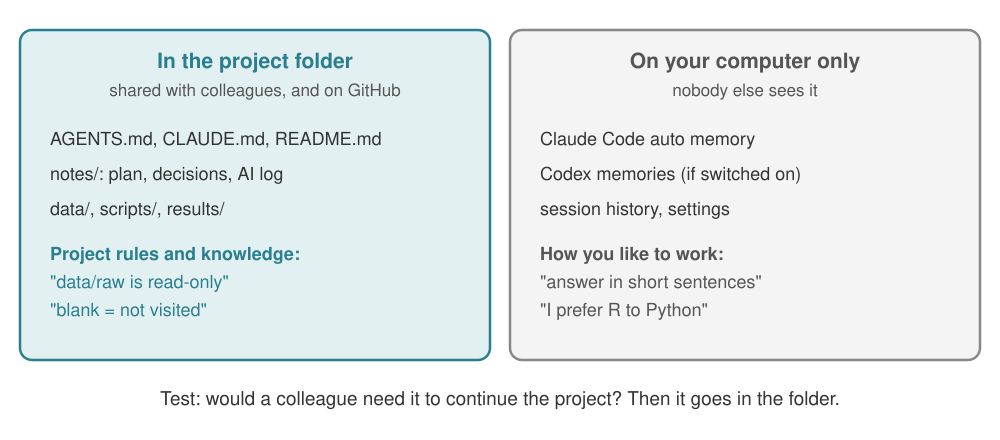{width="85%" fig-align="center"}

::: notes
Here is the division of labour. In the project folder, and therefore shared with colleagues and on GitHub: AGENTS.md, the README, the notes, the data and scripts. On your computer only: the agent's own memory, your personal preferences, your session history. The test is simple. If a colleague would need to know it to continue the project, it belongs in the folder. If it is only how you like to work, such as "answer in short sentences", it can live in memory or in your personal instruction file. Never rely on the agent's memory for a project rule: when someone else, or another tool, opens the project, the rule is gone.
:::

## /init drafts the instruction file; you finish it {.smaller}

| | Claude Code | Codex |
|---|---|---|
| Command | `/init` | `/init` |
| Writes | `CLAUDE.md` | `AGENTS.md` |
| For our recipe | Ask by prompt instead (exercise), or run `/init` and then ask it to move the content to `AGENTS.md` and leave `@AGENTS.md` in `CLAUDE.md` | Use as is; then add the one-line `CLAUDE.md` |
| Then | Read it. Delete what the agent could have seen anyway. Add meaning, rules and checks. | the same |

`/init` is written for software projects: expect lines about "build commands" you do not need.

::: notes
You do not have to write AGENTS.md from scratch. Both tools have an init command that looks at the folder and drafts an instruction file. Codex's writes AGENTS.md, which is exactly what we want. Claude Code's writes CLAUDE.md, so for our recipe it is easier to ask by prompt, which the exercise does, or to run init and then ask Claude to move the content. Either way, the draft is a start. The init commands were designed for software projects, so the draft may talk about build and test commands. What it cannot know is exactly what matters most: the meaning of your data, the decisions, the rules. You add those.
:::

## Test it: a fresh session and five questions

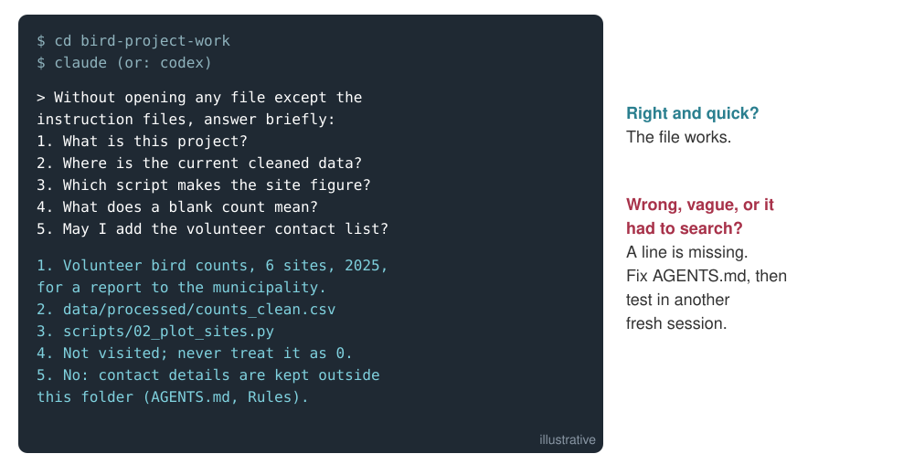{width="82%" fig-align="center"}

::: notes
How do you know your AGENTS.md works? Test it the way you would test a colleague's understanding. Start a completely fresh session in the project folder and ask a few questions whose answers you know. What is this project? Where is the current cleaned data? Which script makes the site figure? What does a blank count mean? May I put the volunteer contact list in here? If the answers are right and quick, the file works. If the agent has to search through every file, or gets one wrong, a line is missing or unclear. Fix it and test again with another fresh session. This takes five minutes and is the most useful check in this unit.
:::

## Large projects stay navigable with maps, not with memory

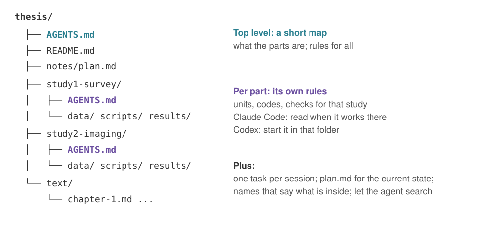{width="80%" fig-align="center"}

::: notes
What about a large project: a thesis, a multi-year study, a course with fifty files of material? The same ideas scale. Keep the top level small, with a handful of folders. Keep AGENTS.md a short map, and put an AGENTS.md in a subfolder when that part has its own rules. Claude Code picks up a subfolder's instruction file when it works on files there; Codex reads the instruction files on the path from the project root to the folder you start it in, so start it in the subfolder when you work on that part. Use plan.md as the current state and keep finished work out of it. Work one task per session, starting in the project folder. And let the agent search: it is good at finding things in a large folder, as long as the map tells it where to start and the names say what files contain.
:::

## A shareable project passes the colleague test

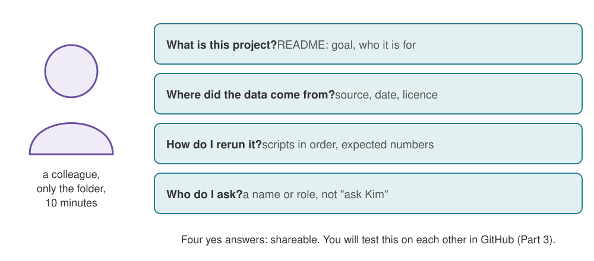{width="82%" fig-align="center"}

::: notes
The final test of organisation is a person. Could a colleague, given only the folder, answer four questions in ten minutes: what is this project, where did the data come from, how do I rerun the analysis, and who do I ask? If yes, the project is shareable. If they would need to call you, something is missing from the README. In *GitHub*, Part 3, you will swap projects with another participant and do exactly this, with your agents helping. Organising now is what makes that exercise go well.
:::

## Restructuring an existing folder is a delegation like any other {.smaller}

```text
Reorganise this folder into the layout below. Do not delete anything.

data/raw/  data/processed/  scripts/  results/  notes/  archive/

- Raw data goes to data/raw. Old versions and copies go to archive/.
- Rename scripts to say the order they run in (01_, 02_) and update
  the paths inside them so they still run from the project folder.
- Write move-log.csv: old path, new path, reason.
- Done when: every file is accounted for in move-log.csv; the scripts
  run and produce the same numbers as before.
Show me your plan first.
```

::: notes
How do you get from the messy folder to the tidy one? It is a delegation, and everything from *First delegations* and *Delegating well* applies. Work in a copy. Use plan mode. Describe the result, not the steps. Ask for a move log, so every move can be checked and undone. And give an acceptance criterion that tests the most likely failure: when files move, scripts that refer to them break. "The scripts run and produce the same numbers as before" catches that. Old versions go to an archive folder for now; after the next unit, git keeps them instead, and the archive folder can go.
:::

## Where this goes wrong {.smaller}

- **AGENTS.md becomes a novel.** Long files are followed less well. One screen.
- **AGENTS.md goes stale.** It still points to the old file; every session believes it.
- **A CLAUDE.md elsewhere hides AGENTS.md.** Use the one-line `@AGENTS.md` recipe.
- **Starting the agent in the wrong folder.** It reads that folder's instructions, or none. Start in the project folder.
- **Trusting the rule alone.** "Read-only" in a text file is advice. Keep copies; use git.
- **Secrets in the folder.** A key that an agent has read, or that is pushed, is a leaked key.
- **Rules in memory only.** Your colleague, and your other tool, never see them.
- **Restructuring without a check.** Moved files break scripts silently. Rerun them.

::: notes
Here is what goes wrong. The instruction file grows until nobody, human or agent, reads it properly, or it goes stale and confidently points to an old file. A CLAUDE.md somewhere above the project, for example in your home folder or course folder, can stop Claude Code from reading AGENTS.md; the one-line import avoids that. Starting the agent in the wrong folder means it reads the wrong instructions. And three that are about safety: a rule is not a lock, a secret in the folder is a secret at risk, and a rule that lives only in the agent's memory disappears the moment someone else opens the project.
:::

## Summary {.smaller}

| Concept | Key fact |
|---|---|
| Blank slate | each session starts empty; the folder must say what files cannot |
| `AGENTS.md` | for agents: what, where, meaning, checks, rules; one screen |
| One file for both tools | `AGENTS.md` + a `CLAUDE.md` containing `@AGENTS.md` |
| `README.md` | for people: what, data source, how to rerun, who to ask |
| Layout | `data/raw` (read-only), `data/processed`, `scripts`, `results`, `notes` |
| Notes | `plan.md` (read first), `decisions.md` (why), `ai-log.md` (disclosure) |
| Keep out | secrets, unneeded personal data, sensitive raw data, huge files |
| Memory | on your machine only; project rules go in `AGENTS.md` |
| Test | fresh session, five questions with known answers |

**Next (Git as undo button and lab notebook):** turn the project folder into a git repository, so that every change the agent makes can be seen, explained and undone.

::: notes
To sum up. Every session starts from a blank slate, so the project folder has to carry the knowledge: AGENTS.md for agents, with a one-line CLAUDE.md so both tools read it, and a README for people. A fixed layout with read-only raw data. Notes files for the plan, the decisions and the AI-use log. Secrets and sensitive data stay out. The agent's memory is a personal convenience, not the place for project rules. And you test the whole thing with a fresh session and a few questions. In the next unit, we add the safety net that makes heavier editing safe: git, which records every change and lets you undo any of them.
:::
