## About this lecture

A figure made by clicking in a spreadsheet cannot be remade: not on new data, not in the journal's style, not by the next student. A figure made by a **script** can. Writing the script used to need a programmer. Now you describe the figure, the agent writes the script, and you check the figure.

- **Script, not clicks.** The script reads the data and writes the figure, the same way every time.
- **Describe the figure**: what is plotted, n per group, units, size in mm, file formats.
- **Check it against the data**: one mean by hand, n per group, labels and units.
- **Rerun on new data** in one sentence, and check again: new data brings new surprises.
- **Pin the versions** (renv, `requirements.txt`) and **commit** script, figure and versions together.

This is a **hands-on** unit. We use R and ggplot2, with a Python variant. Publishing the figure on a web page comes in *A course or project page*.

::: notes
This unit is about one of the clearest wins of a coding agent for researchers and teachers: figures that can be remade. Most of us have a figure somewhere that was made by clicking, and that nobody can make again. A script is a recipe that turns data into a figure, and it can be rerun at any time. Until now, writing that recipe meant learning R or Python. Now the agent writes it, and our job is the part that needs a domain expert: saying what the figure should show, and checking that it shows the data correctly. We use R and ggplot2 for the worked example, because ggplot2 is the standard in many fields, and Python with matplotlib as a variant. You do not need to know either language. At the end, the figure and its script go into your git history from the previous unit.
:::

## Figure 2 was made by clicking, and nobody can make it again

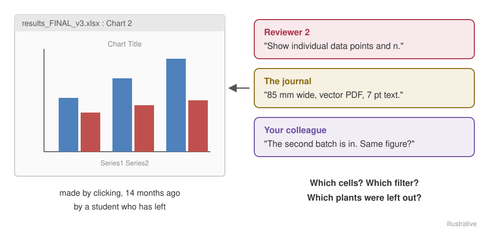{width="88%" fig-align="center"}

::: notes
Here is the situation. Figure 2 of a manuscript was made in a spreadsheet, a year ago, by a student who has since left. Now three requests arrive. Reviewer 2 wants individual data points and the number of plants per group. The journal wants it 85 millimetres wide, as a vector PDF, with 7 point text. And a colleague has the second batch of the experiment and wants the same figure for it. Each request means redoing the figure by hand, and before that, working out which cells were used, which filter was applied, and whether any plants were left out. The spreadsheet does not tell you. That is the problem this unit solves.
:::

## A script is a recipe: the same data gives the same figure, every time

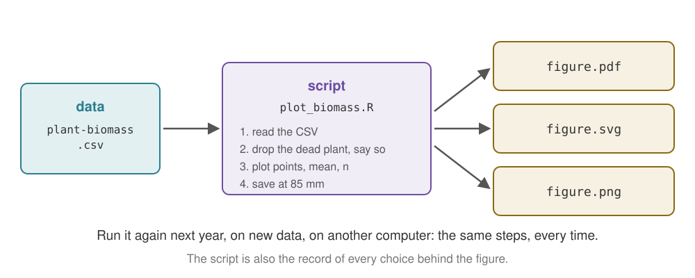{width="88%" fig-align="center"}

::: notes
A script is a short program, here in R, that does four things in order: read the data file, make any choices such as leaving out the plant that died, draw the plot, and save it in the formats you need. Three things follow. You can run it again next year and get the same figure. You can run it on a new data file with the same columns and get the matching figure. And the script is a written record of every choice: if a reviewer asks whether the dead plant was excluded, the answer is in the script, in one line, and the agent can point you to it. This is the same idea as the cleaning script in First delegations, applied to figures.
:::

## The agent writes the script; you decide what the figure shows and check it

| You | The agent |
|---|---|
| say what the figure must show, and for whom | reads the data and proposes a plot |
| give the details: units, n, size, formats, style | writes the script and runs it |
| check the figure against the data | installs R or packages when needed (asks first) |
| decide what is a correct and honest figure | explains any line you ask about |
| commit script, figure and versions | records the package versions |

You do not need to read ggplot2 code. You need to read the figure.

::: notes
This is the division of labour. The agent is very good at the mechanics: reading a CSV file, writing ggplot2 or matplotlib code, getting the file sizes right, and fixing its own errors when the script fails. It is not responsible for whether the figure is right. Only you know that eight plants per group was the design, that biomass should be in milligrams, that the error bars should be standard deviations because that is what your field expects. So the skill is the same as in every unit: describe the result precisely, and check it. The difference is that the result is a picture, and pictures are persuasive. A wrong figure looks just as professional as a right one.
:::

## Our example: a two-factor experiment in a tidy CSV file

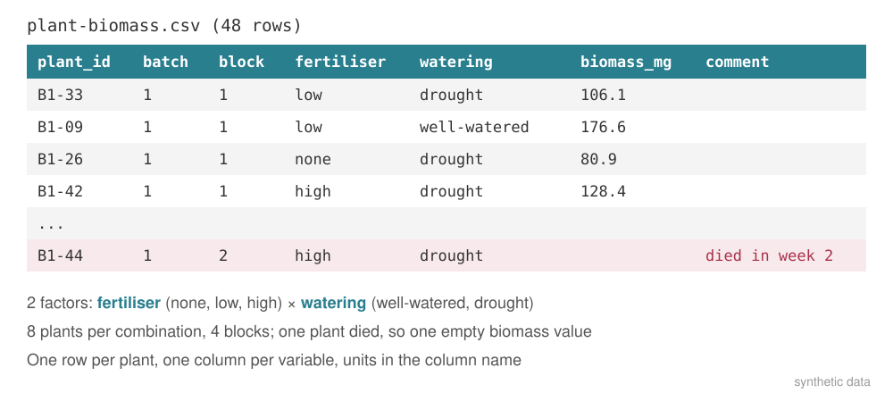{width="88%" fig-align="center"}

::: notes
Here is the example data for the exercise. It is synthetic: a made-up experiment with seedlings, three fertiliser levels and two watering regimes, eight plants per combination, so 48 plants in total. One plant died in week two, so its biomass is empty and the comment says why. The file is tidy: one row per plant, one column per variable, and the unit is in the column name. That shape makes the script simple and the checks easy. Notice the dead plant. It is exactly the kind of detail that a figure should handle correctly and openly: the figure should show seven plants in that group, not eight, and not a zero.
:::

## Tidy data, one row per value, makes plotting simple

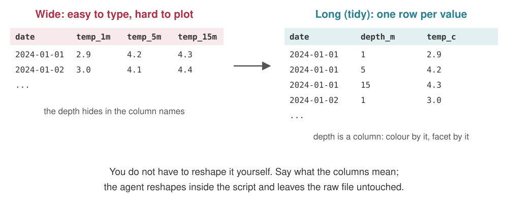{width="85%" fig-align="center"}

::: notes
A word on data shape, because your own data may not look like our example. Many spreadsheets are wide: one column per depth, or per time point, or per patient. That is convenient for typing, but for plotting, the depth is hidden in the column names. The long, or tidy, form has one row per measured value, and the depth becomes a column of its own, which you can colour by or split into panels. You do not have to reshape your files yourself. Tell the agent what the columns mean, and ask it to do any reshaping inside the script, so that the raw file stays as it is. We use the long form for the lake temperature data in the Python variant.
:::

## R or Python? Both are fine; choose what your colleagues use

| | R with ggplot2 | Python with matplotlib |
|---|---|---|
| Common in | biology, medicine, ecology, statistics, social science | physics, engineering, image analysis, machine learning |
| Strength | grouped data and statistics plots in few lines | full control; same language as much analysis code |
| Version pinning | `renv` (a lock file) | `requirements.txt` (or similar) |
| In this unit | worked example | variant (lake temperatures) |

The agent writes both well. The deciding question: **who will run this script after you?**

::: notes
Which language should the script be in? For our purposes the answer matters little, because the agent writes both well. ggplot2 in R is the standard for grouped data and statistical graphics in much of biology and medicine. matplotlib in Python is common in physics and engineering and in image analysis. Both make publication-quality figures. The best guide is who will run the script after you: your students, your lab, your co-authors. If they use R, choose R. If you have no preference, the worked example uses R, and the Python variant shows that the steps are the same. Tell the agent which language you want; otherwise it will choose for you.
:::

## If R or a package is missing, the agent installs it with your approval

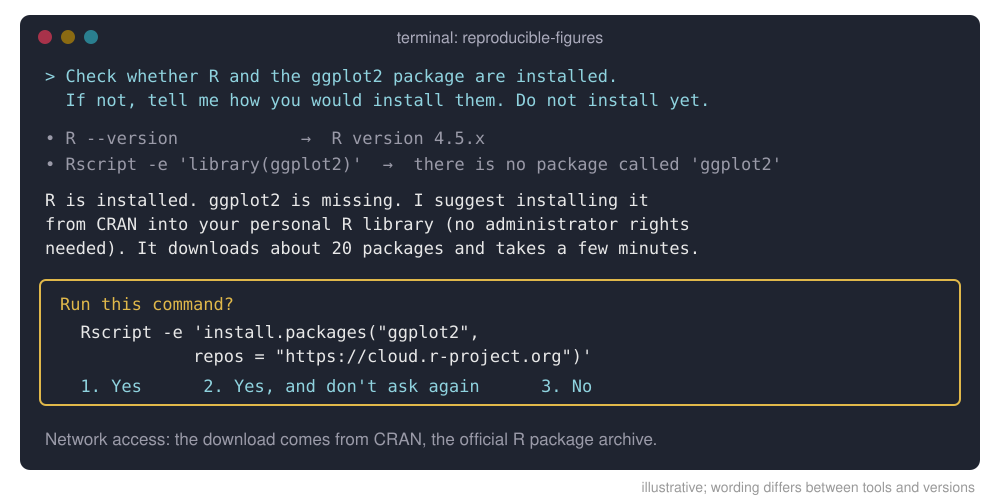{width="78%" fig-align="center"}

::: notes
R or the plotting package may not be installed yet. As in the Terminal survival kit, ask the agent to check first, and to propose an installation without doing it. R itself is installed from the official CRAN site or a package manager, and may need an administrator password or the university software centre. Packages like ggplot2 then come from CRAN, the official R package archive, into your personal library, which does not need administrator rights. Notice that installing a package downloads code from the internet; the permission request shows where from. CRAN for R and PyPI for Python are the standard sources. If the agent proposes a source you do not recognise, ask.
:::

## The first prompt describes the figure, not the code

```text
plant-biomass.csv holds dry biomass (mg) of 48 seedlings: fertiliser
(none, low, high) x watering (well-watered, drought), 8 plants each.
Write an R script with ggplot2 that makes a figure for a journal:

- x axis: fertiliser, in the order none, low, high; colour: watering
- show every plant as a point, plus the mean and standard deviation
- show n per group on the figure
- y axis "Dry biomass (mg)", starting at zero
- colours that work for colour-blind readers
- 85 mm wide, text about 7-8 pt; save as PDF, SVG and PNG (300 dpi)
- leave out plants with no biomass, and print which ones and why
- also write a small table with n, mean and SD per group

Run it and tell me what you did and any choices you made.
```

::: notes
Here is the prompt for the worked example. It follows the pattern from First delegations: what is there, what the result should look like, what to do with the odd case. Nothing is said about how to write ggplot2 code. Everything is said about the figure: what goes on each axis, in which order, what the points and the summaries are, what the label says, the size, the formats. Two lines are there for checking. Printing which plants were left out makes the exclusion visible instead of silent. And the small summary table gives you numbers you can compare with the data. Ask for these two in every figure prompt.
:::

## A publication figure has a short list of must-haves

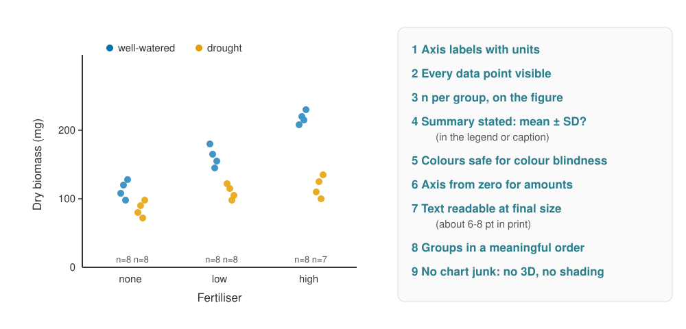{width="88%" fig-align="center"}

::: notes
What makes a figure publication quality? Not polish. Here is a short list that most journals and reviewers agree on. Axis labels that say what is measured and in which unit. Every data point visible when the groups are small. The number of observations per group. A clear statement of what the summary is, mean and standard deviation or something else, in the legend or caption. Colours that colour-blind readers can tell apart; about one in twelve men has some form of colour vision deficiency. An axis from zero when you plot amounts. Text you can read at the printed size. Groups in a meaningful order, not alphabetical. And no 3D effects or shading. Each of these is one line in a prompt.
:::

## A bar with an error bar can hide very different data

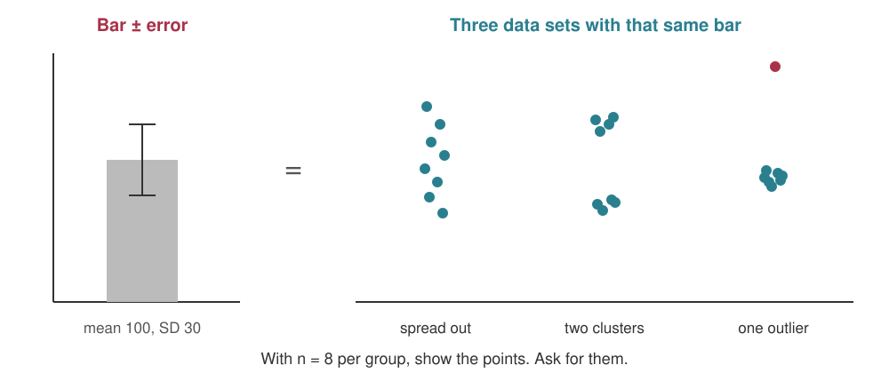{width="85%" fig-align="center"}

::: notes
One point deserves its own slide, because spreadsheet defaults push us the wrong way. A bar with an error bar shows two numbers. Very different data sets give the same two numbers: values spread evenly, two separate clusters, or one outlier pulling the mean. With eight plants per group, there is no reason to hide them: show the points, and put the mean and spread on top. Many journals now ask for this. With the agent, it costs nothing: it is one line in the prompt. If you do prefer bars for your field, ask for the points on top of the bars, as we will see in the style change.
:::

## The worked figure: every plant, mean ± SD, and n per group

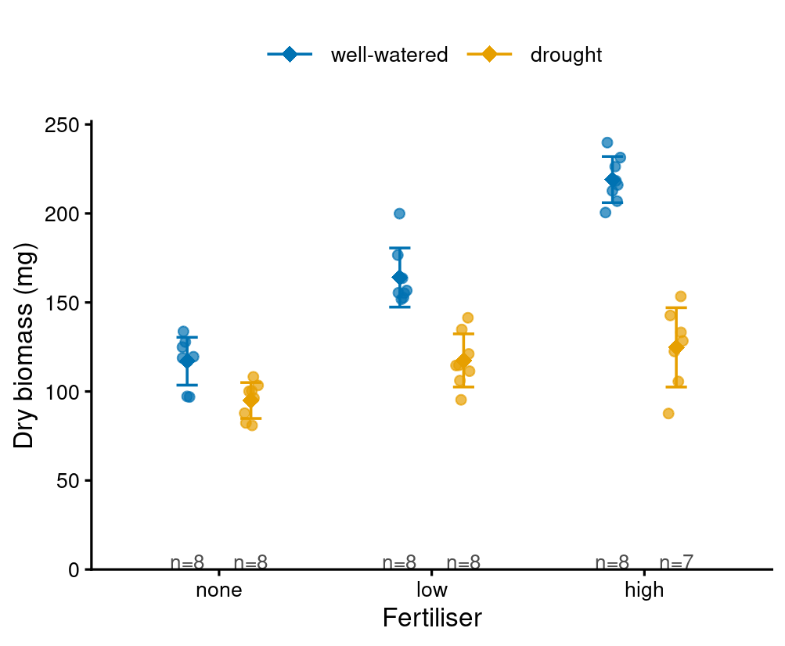{width="52%" fig-align="center"}

::: notes
Here is one result of that prompt, made by our reference script. Every plant is a point; the diamond is the mean and the bars are one standard deviation. Drought plants are orange, well-watered blue, from a colour-blind-safe palette. The n per group is printed at the bottom, and you can see the seven in the high-fertiliser drought group. Your agent will produce something different in the details: another shade, another position for n, perhaps a different jitter. That is fine. What must be the same are the numbers: the means, the n, the axis and the units. The next slides show how to check them.
:::

## Check one group by hand against the data

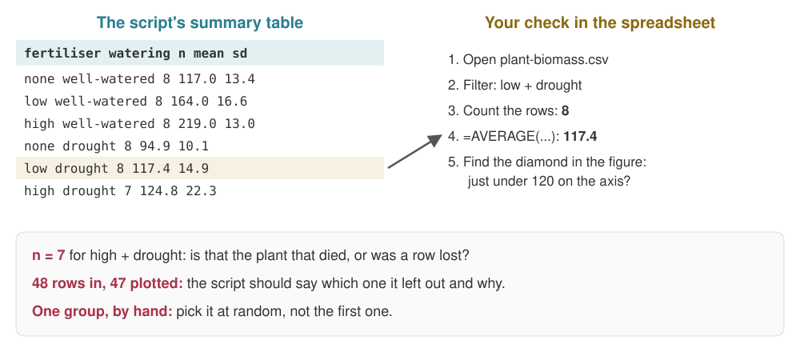{width="85%" fig-align="center"}

::: notes
Checking a figure works like checking a table: compare it with the source. Pick one group, at random, not the first one. Open the CSV in a spreadsheet, filter to that group, count the rows and compute the mean. Compare with the summary table the script wrote, and then with the figure itself: is the mean marker where it should be on the axis? In our example, low fertiliser under drought has 8 plants with a mean of 117.4 milligrams. Then look at the counts: 48 rows went in, 47 were plotted, and the script should name the plant it left out. If n is seven in a group where you expected eight, find out why before you trust anything else.
:::

## Check labels, units and what the error bars mean

- **Units.** Is it milligrams, as in the data? An agent may "helpfully" convert to grams, or label mg data as g.
- **Error bars.** SD, standard error or confidence interval? They differ by a factor of about 3 for n = 8. Ask which, and put it in the caption.
- **Order and colours.** none, low, high, not alphabetical. The same colour means the same thing in every figure.
- **Axis range.** Starting at zero for amounts; nothing cut off at the top.
- **Size.** Open the PDF at 100 %: is the text readable at 85 mm?
- **Ask the agent to describe the figure in words.** Compare its description with what you see.

::: notes
Beyond the numbers, a few things are worth a deliberate look. Units are the classic error: the agent may convert units or mislabel them. Error bars are the second: standard deviation and standard error look alike but differ by the square root of n, almost a factor of three here, and a reader cannot tell which unless you say so. Order and colour matter for honest reading. Check that nothing is cut off. Open the PDF at its real size, not zoomed to fill your screen, to see whether the text is readable. A useful trick: ask the agent to describe the figure in words, axis by axis. If its description does not match what you see, one of you is wrong.
:::

## Changing the style is one sentence, not an afternoon

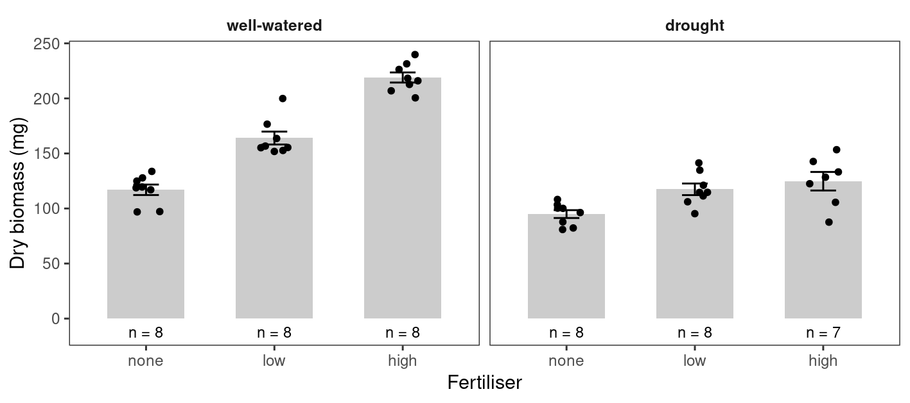{width="66%" fig-align="center"}

```text
Change the style: grey bars for the means with standard error bars, the
points on top in black, one panel per watering treatment, 180 mm wide.
Keep everything else.
```

::: notes
Here is what a script gives you that a spreadsheet does not: style changes are cheap. Suppose your supervisor prefers bars, or the journal wants the figure across both columns. One sentence, and the figure is redone, with every other choice kept. Notice two things in the prompt. "Keep everything else" protects against the agent redesigning the whole figure. And the change from standard deviation to standard error is a real change in meaning, not just style, so the caption must say so. After a style change, run the same checks again: the n and the means must not have changed. They are the same here: n equals 7 in the last panel.
:::

## A house style keeps every figure in a paper consistent

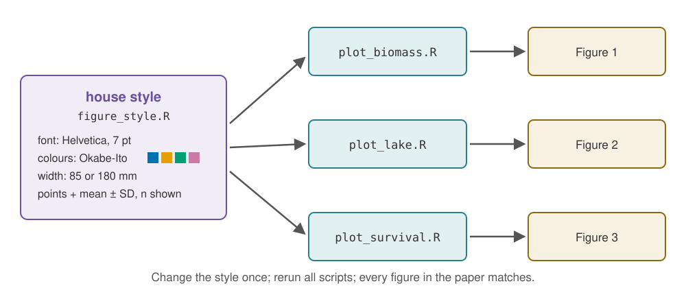{width="85%" fig-align="center"}

::: notes
When you have several figures, ask the agent to put the style in one place: a small file with the font, the size, the colour palette and your preferences, that every figure script uses. Then all figures in a paper or thesis match, and a change of journal means changing one file and rerunning all scripts. This is also a good thing to describe in your project's CLAUDE.md or AGENTS.md file, from Organising a project for an agent, so that the agent uses the house style without being told every time. In the unit Making the agent yours, we turn such a house style into a reusable skill.
:::

## Journals ask for sizes in millimetres, not pixels

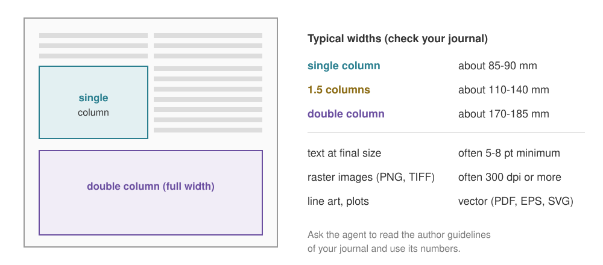{width="88%" fig-align="center"}

::: notes
Journals specify figure sizes by the column: single column about 85 to 90 millimetres, double column about 170 to 185, with some in between. They also specify a minimum text size at the printed size, often between 5 and 8 points, and a resolution for images, often 300 dots per inch or more. These numbers vary by journal, so do not trust the ones on this slide for your submission. Ask the agent to read your journal's author guidelines page and use its numbers; then check them yourself on the page. The important habit is to make the figure at its final size. A figure made large and shrunk afterwards has tiny unreadable text; a figure made at 85 millimetres with 7 point text is right from the start.
:::

## Vector formats stay sharp; raster formats are pixels

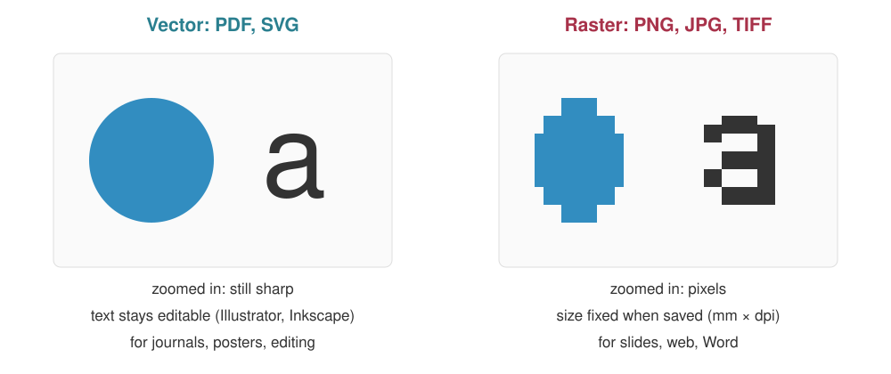{width="56%" fig-align="center"}

| Format | Use it for |
|---|---|
| **PDF** | journal submission, LaTeX, printing |
| **SVG** | editing in Inkscape or Illustrator, web pages |
| **PNG** (300 dpi) | slides, Word documents, quick sharing |

::: notes
Ask for three formats from the same script, because they serve different purposes. PDF and SVG are vector formats: they store lines and text, not pixels, so they stay sharp at any zoom and the text can still be edited. PDF is what most journals want for plots; SVG is the one to open in Inkscape or Illustrator, or to put on a web page. PNG is a raster format: a grid of pixels, fixed when you save it. It is the safest choice for slides and Word documents. Its resolution is set by the size in millimetres and the dots per inch, so ask for 300 dpi at the final size. For R, saving SVG may need one extra package, which the agent will install with your approval.
:::

## New data arrives: rerun the script instead of redoing the figure

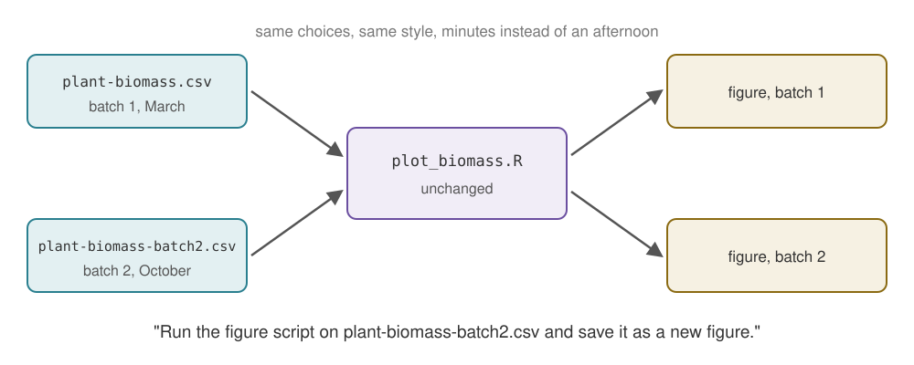{width="85%" fig-align="center"}

::: notes
Now the payoff. The second batch of the experiment arrives, in a file with the same columns. With a spreadsheet figure, this is an afternoon's work. With a script, it is one sentence: run the figure script on the new file and save the result under a new name. Same choices, same style, same size. The agent may suggest a small change so that the script takes the file name as an input; that is a good change, because then rerunning needs no editing at all. Then commit the new figure, with a message saying which data it was made from.
:::

## A rerun can go quietly wrong: "High" is not "high"

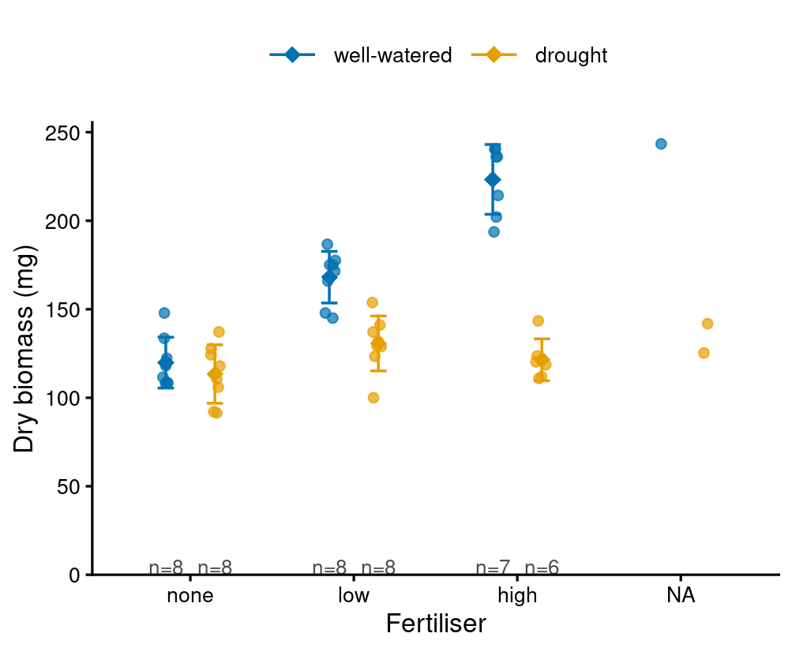{width="50%" fig-align="center"}

::: notes
Here is why "rerun" must always be followed by "check". This is the figure from a script that did not check its input, run on the second batch. Three plants in that file have "High" with a capital H instead of "high". To a computer, that is a different word. The script only knew none, low and high, so those three plants ended up in a group called NA, which means missing, at the right of the plot. The n labels reveal it: seven and six instead of eight and eight. Other scripts would have dropped those plants silently, or made a fourth group called "High". New data from a different person, a different month or a different instrument brings new surprises. The checks from the first run, n per group and one group by hand, must be repeated.
:::

## Ask the script to refuse data it does not expect

```text
Make the script stricter, so that a rerun on new data cannot go wrong
quietly:
- stop with a clear message if fertiliser or watering has a value other
  than the ones we know
- print the number of rows read, plotted and left out, and n per group
- do not change any values in the data file; if a fix is needed, tell me
```

Then fix the data on purpose and record it: "In batch 2, 'High' means 'high'. Handle that in the script, say so in a comment, and rerun."

::: notes
The best defence is a script that refuses surprises. Ask the agent to make the script stop with a clear message when it meets an unknown group label, and to print the counts every time it runs. Then a rerun either works and tells you n per group, or stops and tells you why. When the script stops, you decide what the fix is. Here the decision is easy, capital High means high, but it is still a decision about your data, so make it explicitly: in the script, with a comment, and in the commit message. Do not let the agent edit the raw data file to make the problem go away. That is the same rule as in the git unit: raw data never changes.
:::

## Your figure also depends on the software under the script

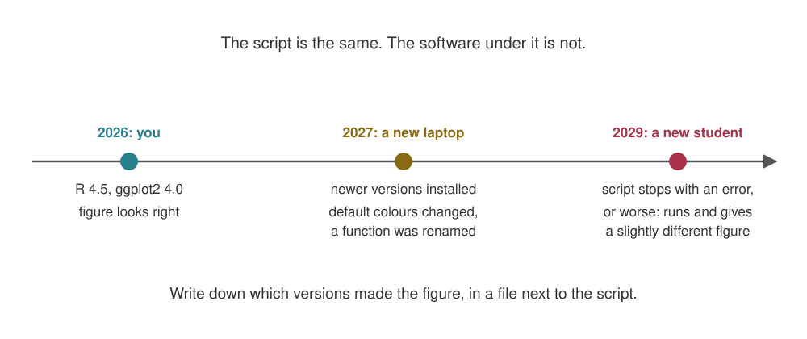{width="88%" fig-align="center"}

::: notes
There is a second way a figure can stop being reproducible, even if nobody touches the script: the software underneath changes. R, ggplot2 and their dozens of helper packages are updated several times a year. Most updates are harmless, but some change defaults, rename functions or fix bugs that your figure relied on. Two years from now, on a new laptop or in a new student's hands, the same script may stop with an error, or, worse, run and produce a slightly different figure. The fix is simple at our level: write down which versions made the figure, in a file the computer can read, next to the script.
:::

## renv and `requirements.txt` record the versions

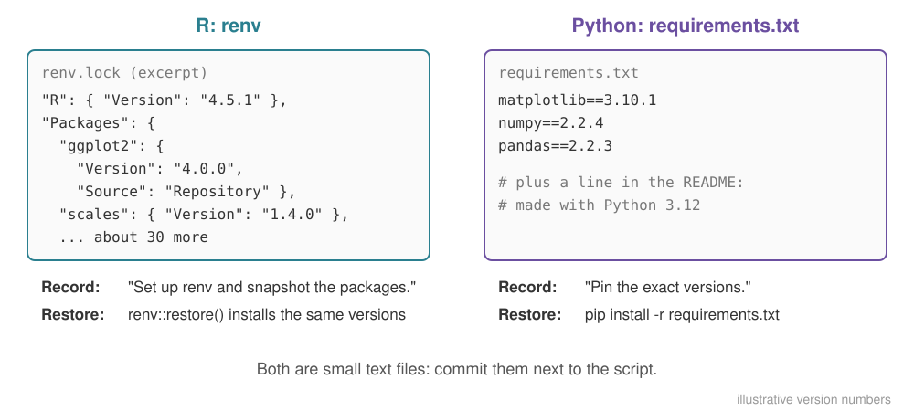{width="88%" fig-align="center"}

::: notes
For R, the standard tool is renv. The agent sets it up for the project with one instruction; it records R's version and every package's version in a file called renv.lock. Later, anyone can run renv restore and get exactly those versions installed for this project, without touching other projects. For Python, the simplest form is a file called requirements.txt that lists each package with an exact version number, plus a note of the Python version in the README; pip install with that file installs the same versions. Both files are small text files that belong in git, next to the script. That is enough for this course. More thorough approaches, such as containers, exist when a result must be reproducible for many years.
:::

## Commit the script, the figure and the versions together

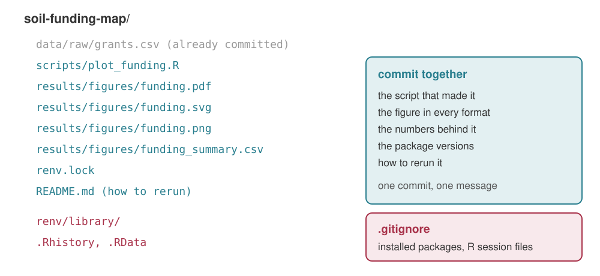{width="85%" fig-align="center"}

::: notes
Now the git unit pays off. When the figure is checked, commit together: the script, the figure in all formats, the summary table with the numbers behind it, the lock file and a line in the README saying how to rerun it. One commit, with a message such as "Figure 1: biomass by fertiliser and watering, batch 1, n = 47". The installed packages themselves do not go into git: renv puts them in a library folder that it keeps out of git for you, and the agent should check that the gitignore covers it. Months later, the history tells you exactly which script and which data made the figure in the submitted manuscript, and you can remake it.
:::

## The Python variant follows the same steps

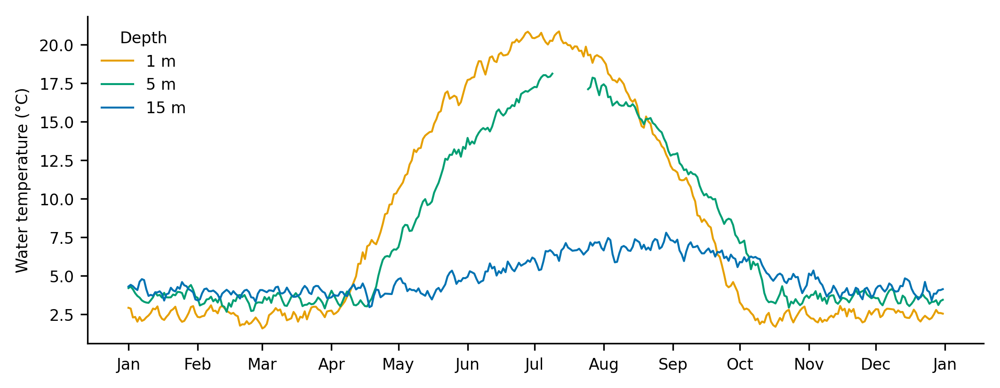{width="72%" fig-align="center"}

```text
lake-temperature.csv holds daily water temperature (°C) at 1, 5 and 15 m
in 2024. With Python and matplotlib: one line per depth, months on the x
axis, 180 mm wide; PDF, SVG, PNG. Leave gaps in the data as gaps.
```

::: notes
The Python variant uses a second data set: daily lake water temperature at three depths for a year, also synthetic. The prompt is the same shape: what the data is, what the figure shows, the size and formats. One new instruction: leave gaps as gaps. The 5 metre sensor has a two-week gap in July. A careless script draws a straight line across it, which invents data, or drops the whole series. The correct figure shows a break, as here. Checking works the same way: the number of days per depth, the highest temperature and its date, compared with the CSV. And the version file for Python is requirements.txt instead of renv.lock.
:::

## Your session will look different from this lecture

- The same prompt gives another script, other colours, another jitter. That is normal.
- What must match: **n per group, means, units, labels, what was left out.**
- If your figure and the reference differ in a number, find out which one is right: yours, the reference, or the data.
- Scripts sometimes fail on the first run. The agent reads the error and fixes it. Check the result anyway.

::: notes
A reminder, as in every hands-on unit. Your agent will write a different script from ours and make a figure that looks different in the details. Compare numbers, not appearances. If a number differs, do not assume the reference is right: go back to the data. Scripts often fail the first time, because a package is missing or a column name is spelled differently. The agent reads the error message and fixes the script, usually without your help. That is fine, but a script that runs is not a script that is right. "It ran without errors" never counts as checked.
:::

## Where this goes wrong

- **Silently dropped rows.** Missing values, odd labels or a filter: fewer points than you think. Count.
- **The wrong summary.** SE labelled as SD, a median called a mean, a log scale nobody mentions.
- **Unit mix-ups.** mg labelled g, °F as °C, a conversion the agent added on its own.
- **Invented smoothness.** Lines drawn across gaps; a trend line nobody asked for.
- **Raw data edited** to make the script run. Never: fix it in the script and say so.
- **A figure that only works at screen size.** Check at the final width.
- **Unpinned versions.** Works today, fails or differs in two years.
- **Figure not committed with its script.** Then nobody knows which script made it.

::: notes
Here are the typical failures. Silently dropped rows are the most common and the hardest to see in a nice-looking figure; counting catches them. A mislabelled summary changes the reader's impression of the effect size. Unit errors happen when the agent tries to be helpful. Lines across gaps and unrequested trend lines show more than the data contains. Editing the raw data to make an error go away destroys the link between data and figure. A figure that looks good on a large screen may be unreadable in a printed column. And without pinned versions and a commit that ties script and figure together, the figure is reproducible only today. Each of these has a check on the next slide.
:::

## A checklist for every figure

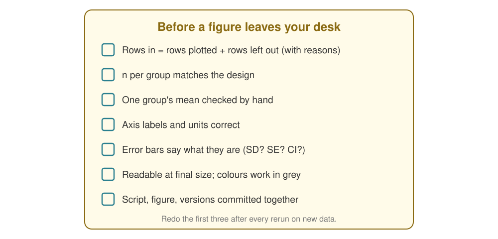{width="65%" fig-align="center"}

::: notes
Here is the checklist to use for every figure from now on, in the exercise and in your own work. Rows in equals rows plotted plus rows left out, with reasons. The number per group matches the design. One group's mean checked by hand. Labels and units correct. Error bars say what they are. Readable at the final size, and the colours still work when printed in grey. And script, figure and versions committed together. The first three must be redone after every rerun on new data, because that is where new data brings surprises.
:::

## Summary

| Concept | Key fact |
|---|---|
| Script, not clicks | the script turns data into the figure, the same way every time |
| Describe the figure | axes, order, points + summary, n, units, size in mm, formats |
| Check against the data | rows in = plotted + left out; n per group; one mean by hand |
| Error bars | say whether SD, SE or CI; they differ a lot |
| Sizes and formats | single column ~85-90 mm; PDF/SVG (vector) and PNG at 300 dpi |
| House style | one style file used by every figure script |
| Rerun on new data | one sentence; then redo the checks; let the script refuse surprises |
| Pinned versions | `renv.lock` for R, `requirements.txt` for Python |
| Commit | script, figure, summary table and versions in one commit |

**Next (GitHub):** the project's history goes online, so colleagues can see, run and review your scripts and figures.

::: notes
Here is the summary. A figure made by a script can be remade, restyled and rerun on new data. You describe the figure, the agent writes the script, and you check the figure against the data: counts, n per group, one mean by hand, labels and units, and what the error bars mean. Make the figure at its final size in millimetres and save it as vector and raster. Keep a house style so that all figures match. After every rerun, redo the checks, and make the script refuse data it does not expect. Record the package versions and commit everything together. In the next unit, GitHub, the project goes online, and in A course or project page, these figures become the first content of your page.
:::
