## About this lecture

Research software is often slow, hard to install, or both. A Python script that needs the right packages, a pipeline that only runs inside Docker, a tool that will not run on Windows. Agents can now translate such code into **Rust**, a fast, compiled, memory-safe language, and give you one file that simply runs. But only if you prove that the translation **gives the same answers**.

- **Why Rust:** speed, one self-contained program, no Conda or Docker, and possibly fewer security holes.
- **How:** reference outputs first, static analysis to guide the agent, one function in and one function out, bottom-up.
- **Proof:** identical outputs on many inputs, then an honest benchmark.
- **Judgement:** when translating is not worth it, and what the licence of the original allows.

A **workflow** unit that builds directly on *Reading other people's code*. It draws on a 2026 study by the author of this course.

::: notes
This unit takes the recipe from Reading other people's code one step further. There we ported old MATLAB to R or Python so that the group could keep using it. Here the target is different: Rust, a language most of you will never write yourself, but which an agent can write very well. Why would a teacher or a biologist care? Because the result is a single program that runs on any student laptop, on Windows, on the cluster, without installing Python, Conda or Docker, and usually much faster. The unit leans on a preprint from 2026 by the author of this course, who translated about 35 bioinformatics and imaging tools to Rust with agents. I will present its claims as claims, with their caveats, and you will try the method yourself on a small tool in the exercise.
:::

## The QC script works, but half the class cannot run it

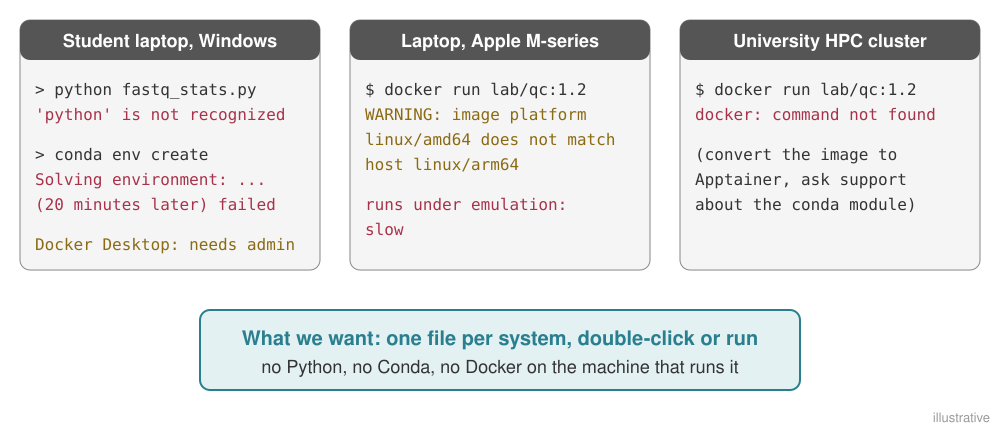{width="80%" fig-align="center" fig-alt="Three machines. A Windows laptop where python is not recognised, conda fails to solve the environment and Docker Desktop needs admin rights. An Apple laptop where a Docker image for another processor runs under slow emulation. An HPC cluster where docker is not available. Below: what we want, one file per system that runs without Python, Conda or Docker."}

The same script also takes hours on a full sequencing run.

::: notes
Here is the concrete problem. A colleague wrote a small Python tool that computes quality numbers for sequencing reads. It works on their computer. In a course, a third of the students are on Windows and Python is not installed; Conda takes twenty minutes and then fails; Docker Desktop needs administrator rights that university laptops do not give. The Apple laptops run the Docker image under emulation, slowly. The cluster does not have Docker at all; you have to convert the image to Apptainer and ask support about modules. And when it does run, it takes hours on a whole sequencing run. Every teacher who has run a computer practical recognises the first hour of the first lab. What we want is one file per operating system that you download and run.
:::

## Containers and Conda solve installation by shipping a whole computer

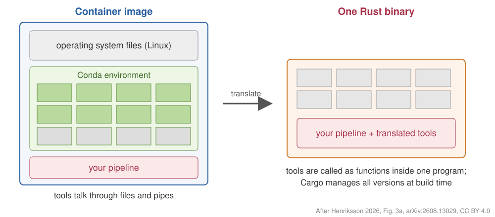{width="78%" fig-align="center" fig-alt="Left, a container image holding operating system files, a Conda environment with many tools, and your pipeline; the tools talk through files and pipes. Right, after translation, one Rust binary holding your pipeline and the translated tools, called as functions; Cargo manages versions at build time."}

::: notes
The usual answer to installation trouble is to ship everything: an operating system, a Conda environment with every tool and every library at the right version, and your pipeline on top, packed into a Docker or Apptainer image. That works, but it is heavy: images of several gigabytes, one image per processor type, and a container runtime that someone must be allowed to install. Conda itself can fail to find a combination of versions that fits, or take very long trying. The paper describes exactly this: the group failed to deliver its single-cell pipeline that way, and the four reasons were the complexity of the pipeline, Conda failing to resolve packages, Conda taking too long, and the many container variants needed for different systems. The picture on the right is what translation made possible: one program, with the former tools inside it as functions.
:::

## Rust is a compiled language: you build once, then run one file

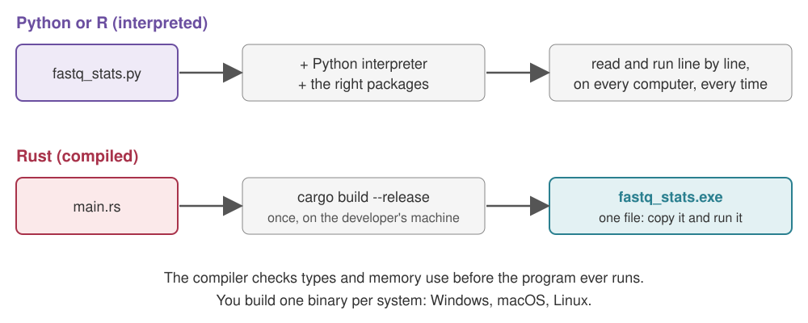{width="80%" fig-align="center" fig-alt="Top: a Python script needs the interpreter and packages on every computer and runs line by line. Bottom: main.rs is built once with cargo build --release into fastq_stats.exe, one file to copy and run. The compiler checks types and memory use before the program runs; one binary per system."}

::: notes
What is Rust, in plain words? Python and R are interpreted: every computer that runs your script needs the interpreter and the right packages, and the script is read and executed line by line each time. Rust is compiled, like C: a program called the compiler translates the source code once into a binary, a file of machine instructions for one type of computer. That binary is all the user needs. Rust started at Mozilla, the makers of Firefox, to get the speed of C without its typical memory errors. It is now used in the Linux kernel and by companies such as Cloudflare, Discord and Dropbox. Its tool Cargo builds the program and fetches the libraries it needs, called crates. You will not need to read Rust in this course. The agent writes it, the compiler checks it, and you check the outputs.
:::

## One binary per system makes teaching and sharing simpler

- **Student laptops:** download one file and run it. No Python, Conda or Docker, no admin rights.
- **Windows:** a native `.exe`, not a Linux tool inside WSL or a container.
- **Apple and Linux:** one binary each; Cargo can build for other systems and processors (cross-compiling).
- **HPC clusters:** copy the binary into your home folder. No container runtime, no modules.
- **Archiving:** the binary and its source, with exact library versions in `Cargo.lock`, rebuild the same program years later.

::: notes
For teachers this is the main attraction. A practical that starts with "download this file" instead of "install these twelve packages" saves the first hour and the frustration of the students whose laptops are different. Windows matters more than many developers admit: in most classrooms and many labs, Windows is what people have. On a cluster, a single binary in your home folder just works, without asking support to install anything. For reproducibility, the source plus the lock file that Cargo writes records the exact version of every library, so you can rebuild the same program later. One honest caveat: on Linux a Rust binary still uses the system's basic C library, so a binary built on a very new Linux may not run on a very old one; there are ways around this, and the agent knows them.
:::

## Cargo lets two versions of a library live side by side

- In Python or R, one environment holds **one version** of each package. Two tools that need different versions conflict, so you make separate environments.
- Cargo builds each program with exactly the versions it asks for, and can include **two versions of the same library** in one program.
- The paper's claim: after translating Bascet's upstream tools, *"version management is now solely managed by the Rust package manager Cargo"*, removing the need for Conda.

::: notes
A short but important technical point. Most of the pain with Conda and with R or Python packages comes from conflicts: tool A wants version 1 of a library, tool B wants version 2, and one environment can only hold one. The usual workaround is one environment, or one container, per tool. Cargo is designed differently: when it builds a program, each part gets the version it asked for, even if that means two versions of the same library inside one program. That is why the paper can say that, after translation, Cargo alone handles all versions for their pipeline and Conda is no longer needed. This is a property of the Rust ecosystem, not of the translation, but translation is what lets you use it for old tools.
:::

## Compiled languages use far less time and energy on the same task

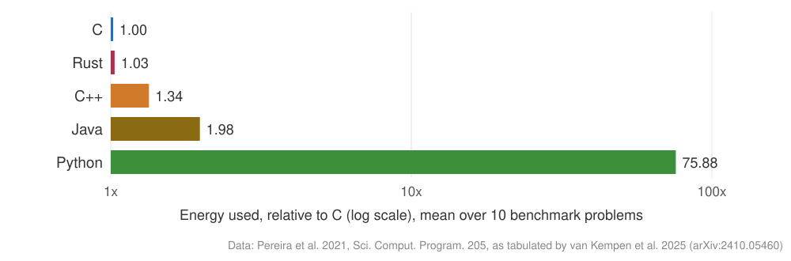{width="78%" fig-align="center" fig-alt="Bar chart, log scale. Energy relative to C: C 1.00, Rust 1.03, C++ 1.34, Java 1.98, Python 75.88."}

A later analysis (van Kempen et al. 2025): power draw is similar across languages, so **energy mostly follows run time**.

::: notes
How much faster is compiled code? The most quoted study is by Pereira and colleagues, published in 2021 in Science of Computer Programming. They ran the same ten benchmark problems in many languages and measured energy. Normalised to C, Rust used 1.03 times the energy, C++ 1.34, Java 1.98 and Python almost 76 times as much. Their times show the same pattern. A later paper by van Kempen and colleagues criticised how this is often read: it is the implementations and the run time that matter, not the language as such, and once you control for things like the number of cores used, energy simply follows run time. That is the useful message: a program that finishes 20 times sooner uses roughly 20 times less energy. The Rust paper cites a similar result: R, Python and MATLAB use more than 50 times more energy than compiled languages for certain workloads.
:::

## The paper's case: legacy code costs money, energy and hardware

- **Maintenance (technical debt):** tools without maintainers, outdated libraries, hard to combine R and Python.
- **Energy:** R, Python and MATLAB can use *">50x more energy than compiler or semi-compiled languages for certain workloads"*.
- **Hardware:** computers are becoming scarce, and new hardware needs software rewritten anyway.
- **Safety:** legacy code *"may also have security or safety problems that make it unsuited for use in clinical settings"*.
- **People:** a bioinformatician is expected to know R, Python, JavaScript and C or C++. One language for the *"full stack"* would help.

::: notes
These are the paper's motivations, in its own words where quoted. Research software has particularly high technical debt: it is written fast by people who then leave, and nobody is paid to maintain it. Dynamically typed languages like R and Python cost energy and do not use modern hardware well. Hardware is getting scarcer, and new kinds of processors will need software to be rewritten anyway. For clinical use, code that can corrupt memory is a liability. And the burden on people is real: to cover the field you are expected to learn several languages. The paper's bold claim is that agents plus static analysis make it possible to rewrite much of bioinformatics in one modern language, Rust. You do not have to agree with the whole vision to use the method on one slow tool.
:::

## Rust rules out a class of memory bugs, not wrong science

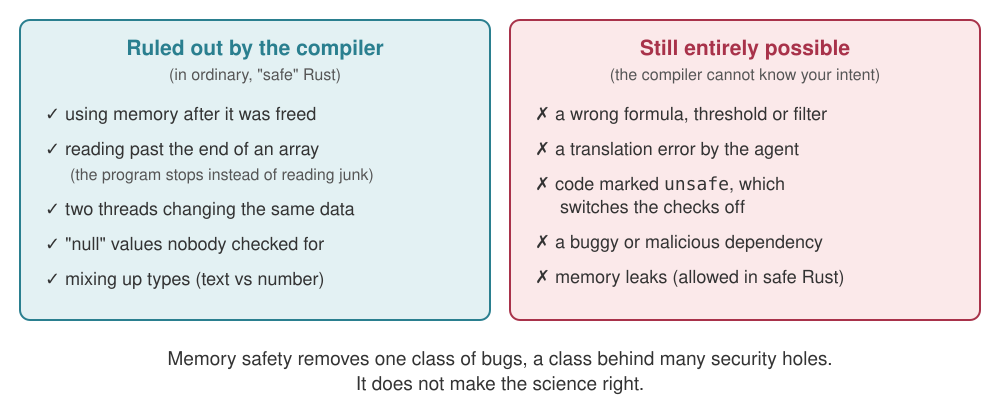{width="80%" fig-align="center" fig-alt="Left, ruled out by the compiler in safe Rust: use after free, reading past the end of an array (the program stops), data races between threads, unchecked null values, type mix-ups. Right, still possible: wrong formula or threshold, translation errors, code marked unsafe, buggy or malicious dependencies, memory leaks."}

::: notes
Now the security argument, and I want to be careful not to oversell it. In C and C++, a program can read memory it already gave back, or read past the end of an array, and get junk or let an attacker in. Such memory errors are behind many serious security holes. Rust's compiler refuses to build programs that could do this, as long as the code stays in ordinary, safe Rust. Reading past the end of an array stops the program with an error instead of silently reading junk. But look at the right side. A wrong formula compiles perfectly. An agent's translation error compiles perfectly. Code marked unsafe switches the checks off, and a translation from C tends to be full of it at first. Every crate you depend on is code from someone else. And memory leaks are allowed: the paper notes that both agents sometimes added code that deliberately "forgets" memory. So: possibly higher security, never automatic correctness.
:::

## Fewer dependencies is also a security gain, until updates are automated

- A container image carries an operating system and hundreds of packages, each a possible way in.
- The paper's group counted roughly 2,000 to 3,500 transitive packages behind the 61 microbial tools they surveyed (a qualitative estimate made with Codex).
- A Rust binary contains only the crates it was built with, listed with versions in `Cargo.lock`; `cargo audit` checks them against known vulnerabilities.
- But: auto-updating many translations with agents would invite **supply-chain attacks**, as seen in the JavaScript ecosystem. The paper suggests *"a more conservative approach to updating"*.

::: notes
Security is also about what else comes along. Every package in an environment is code that someone could compromise. The paper gives a feel for the scale: Codex estimated that the 61 microbial tools they looked at pull in two to three and a half thousand packages in total; the paper itself says to read these numbers qualitatively. A Rust binary is built from a known list of crates, recorded with exact versions, and there are tools that check that list against databases of known vulnerabilities. But crates are dependencies too. The paper also warns against the obvious next step: if agents can update translations in an hour, it is tempting to let them update everything automatically, and that is exactly how supply-chain attacks spread in the JavaScript world. Update deliberately, and review.
:::

## A 2026 study translated about 35 research tools with agents

- **Henriksson J.** *Static analysis-guided agentic AI translation enables Rust as a full stack bioinformatics language.* arXiv:2608.13029 (2026), CC BY 4.0.
- About **40 attempts, 35 packages** in sequencing (NGS), imaging and file-format libraries, *"tested, benchmarked, and ready for use by early adopters"*. Translation bugs are still expected.
- **11 weeks**, Claude Code and Codex on three subscriptions, using up to about 90 % of their limits.
- From days to weeks per tool: jpegxr (31,000 lines of C++) in under 20 hours; BWA-MEM2 took weeks.
- Code, prompts and tools: one GitHub repository per tool; updates at `github.com/henriksson-lab/rustification`.

::: notes
Here is the study the rest of the lecture draws on. Full disclosure: it is by the author of this course, so read it with the same critical eye as any other paper. It is a preprint, not yet peer reviewed. About 40 translations were attempted; 35 reached a state where they were tested against the original, benchmarked, and used in production by the group, with the explicit warning that translation bugs are still expected. The work took eleven weeks with one Claude Max subscription and two Codex Pro subscriptions, used close to their limits. Effort varied a lot: one 31,000-line C++ image library took under 20 hours with the final prompts, while the BWA-MEM2 aligner took weeks, mostly spent on validation and optimisation. The prompts are in the paper's supplement, and the rustification repository collects the latest advice and links to every translated tool.
:::

## Naive prompts gave code that compiled, ran, and was wrong

The paper lists errors that agents made again and again:

- swapped expressions (`a<b` became `b>a`) or reordered branches
- wrong number types, causing overflows
- changed order of operations, so decimals came out different
- clever algorithms **replaced with naive ones**
- the wrong one of several similar functions called
- new "helper" functions that bent the design out of shape
- speed tricks (SIMD) left out

Asking more firmly did not fix it: such prompts were *"ineffective for Claude, and mostly insufficient for Codex"*.

::: notes
The paper is honest about what happens if you just say "translate this to Rust". The result lacked most features, and what was there had bugs or grossly simplified algorithms. The list on the slide is the paper's own. Some are subtle: turning a less-than into a greater-than with swapped sides is harmless, until it is not. Wrong number types overflow on big data only. Reordering arithmetic changes the last digits, which matters more than you think, as we will see. The worst are the quiet simplifications: a sophisticated algorithm replaced by a brute-force one that gives the same answer on small test data. Telling the agent more firmly to be faithful helped little. The author's conclusion was that agents do not track the structure of a large program precisely enough, while classic algorithms do that very well. That led to static analysis.
:::

## Rule one: one original function becomes one Rust function

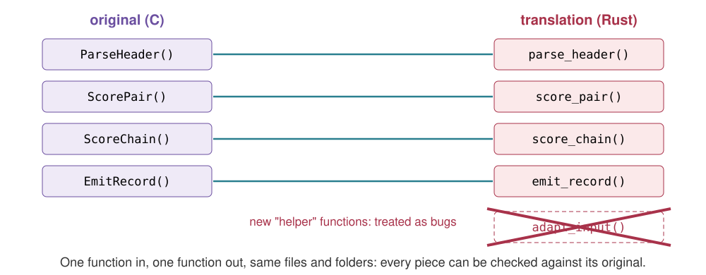{width="78%" fig-align="center" fig-alt="Four original C functions such as ParseHeader map one to one to Rust functions such as parse_header. A new helper function adapt_input on the Rust side is crossed out: treated as a bug."}

Same files and folders as the original; stubs for every function are written **first**.

::: notes
The core principles from the paper are simple to state. Each original function becomes exactly one Rust function, with the name converted systematically to Rust's style, lower case with underscores. No new functions. The logic of each function is kept inside its counterpart. The file and folder structure follows the original. And before any real translation, the agent writes empty stubs for all functions and data structures, so the shape of the program is fixed from day one. Why so strict? Because then every Rust function can be checked against exactly one original function, by a person, by another agent, or by a program. The supplement even says: treat helper functions as bugs. It sounds pedantic, but it is what makes a translation auditable, and it limits the agent's urge to be creative.
:::

## Static analysis gives the agent a map: translate from the bottom up

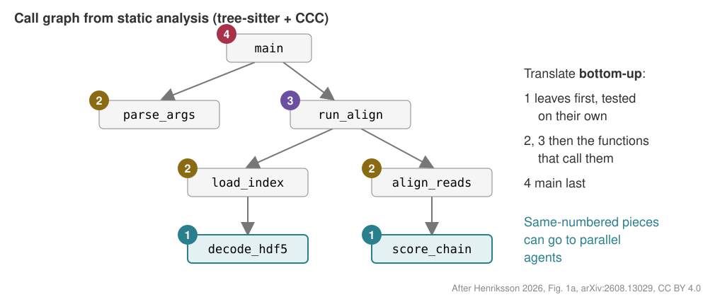{width="78%" fig-align="center" fig-alt="Call graph: main calls parse_args and run_align; run_align calls load_index and align_reads; these call decode_hdf5 and score_chain. Numbers show translation order: leaves 1, then 2, then run_align 3, main 4. Same-numbered pieces can go to parallel agents."}

::: notes
Static analysis means analysing code without running it. The paper uses tree-sitter, a widely used parser, to turn the original source code into a tree structure that a program can analyse. From that, the group's tool CCC computes the call graph: which function calls which. That gives a translation order. Start with the leaves, functions that call nothing else, and test them on their own. Then the functions that use them, and so on up to main. Bottom-up means that when you translate a function, everything it depends on already exists and has been checked. It also gives parallelism for free: functions at the same level do not depend on each other, so several agents can work on them at once. The paper notes that parallel agents also found errors faster, because they searched more broadly instead of fixating on one hot spot.
:::

## Three tools check the translation function by function

- **CCC (code complexity comparator):** compares call graphs and, per function, the types, numbers, strings, branches and logic. A function with fewer `*` or fewer branches than its original has probably lost something.
- **tracehash:** records a fingerprint of every function's inputs and outputs in both programs and finds the first call that differs.
- **gdbtv:** runs original and translation side by side in two debuggers and stops where they part ways. Neither agent reached for it on its own.

All three were "vibe coded" with Claude, and the agents learn to use them from instructions in their repositories.

::: notes
On top of the call graph, the paper built three checking tools. CCC compares each Rust function with its original: does it use the same kinds of numbers and strings, the same number of branches, the same logical expressions? If the original multiplies five times and the translation three, some maths has gone missing. tracehash adds instrumentation: it records a short fingerprint of what goes in and out of each function call, in both programs, so you can find the first call where they differ. gdbtv runs both programs in parallel debuggers, step by step, which is the most thorough comparison but, interestingly, one that neither agent ever chose to use unprompted. These tools were themselves written with Claude, and you simply tell the agent where they are; it reads the instructions and uses them.
:::

## A fingerprint of every function call shows where the translation goes wrong

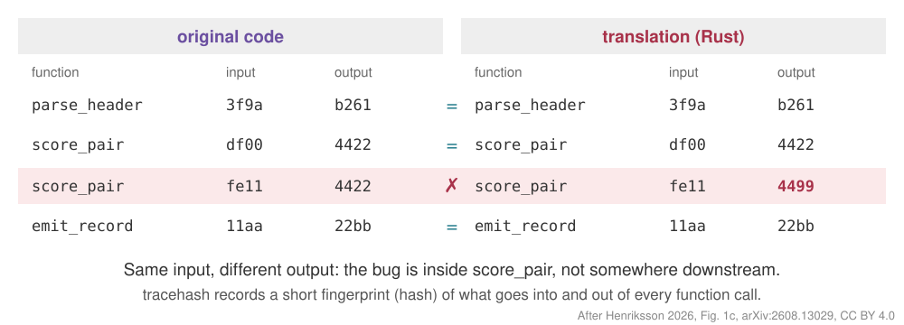{width="80%" fig-align="center" fig-alt="Table of function calls with input and output hashes for original and Rust. Three calls match. The second score_pair call has the same input hash fe11 but output 4422 in the original and 4499 in Rust: the bug is inside score_pair."}

::: notes
Here is the idea of tracehash in one picture. Both programs run on the same input and write one line per function call: the function name, a fingerprint of its input and a fingerprint of its output. Compare the two lists. The first call where the inputs agree but the outputs differ points to the function that is wrong. That beats staring at a final output that is off and guessing where the error started. Without such a tool, the paper says, agents tended to focus on one suspicious function while the real error was elsewhere, causing a cascade of problems. In your own work you will not need tracehash for a hundred-line script; the simple version is to compare intermediate results, which is what we did in the last unit, piece by piece.
:::

## The paper's workflow: correctness first, speed later

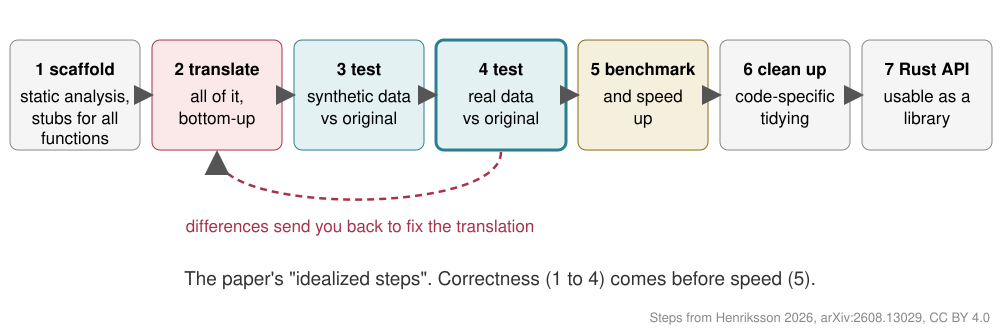{width="88%" fig-align="center" fig-alt="Seven steps: 1 scaffold with static analysis and stubs, 2 translate all of it bottom-up, 3 test on synthetic data versus original, 4 test on real data versus original, 5 benchmark and speed up, 6 clean up, 7 add a Rust API. Differences in testing send you back to step 2."}

::: notes
These are the seven idealised steps from the paper. Scaffold with static analysis, translate everything bottom-up including all logic in the first pass, test against the original on synthetic data and then on real data, and only then benchmark and speed up. Cleaning up and adding a nice interface for other Rust programs come last. Two lessons stand out. First, conservative translation at the start pays off enormously: the paper says early mistranslations compound into the whole design, and restarting can be faster than repairing. Second, real data is essential. The supplement puts it bluntly: if the agent takes the real data and repeats it ten times, that is a bad test. And a translation that is suddenly much faster than the original is treated as a warning sign: maybe it does not do all the work.
:::

## Equivalence is tested on outputs, on real data, many times over

- Compare the translation's output with the original's on **many varied real datasets**. The paper: tests written by the agents themselves were *"largely insufficient"*.
- Audit **file by file**: every file listed in `TOAUDIT.md` must pass **two consecutive audits** without complaints.
- Even then: systematic audits *"did not remove all errors, as revealed by testing on real data"*.
- Bonus: the translation found **at least 3 bugs in the originals** (an outdated broken dependency, a use-after-free, an unhandled corner case).

::: notes
How do you know the translation is equivalent? Not by reading it, and not by the agent's own unit tests: the paper found those largely insufficient, because agents test what they expect to work. What worked was comparing outputs with the original on many varied real datasets, plus systematic audits. The audit prompt in the paper is worth copying: list all files with check boxes in a file, and each file must pass two audits in a row without complaints. Agents miss things in one pass, so the second pass matters. Even so, real data kept finding errors that audits missed. And the comparison works both ways: three bugs in the original tools came to light, including a use-after-free, the classic memory error that Rust rules out.
:::

## Decimal numbers depend on the order of operations

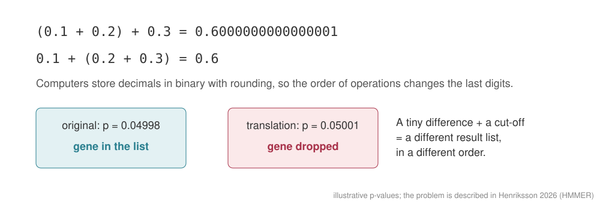{width="78%" fig-align="center" fig-alt="(0.1 + 0.2) + 0.3 equals 0.6000000000000001 while 0.1 + (0.2 + 0.3) equals 0.6. Illustrative example: the original gives p = 0.04998 and the gene is in the list; the translation gives p = 0.05001 and the gene is dropped."}

The paper: agents *"frequently did not respect order of operations"*; translating HMMER was hard for this reason.

::: notes
This is the trap that surprises most people. In school, a plus b plus c is the same whichever pair you add first. In a computer, decimal numbers are stored in binary with rounding, so the order changes the last digits: try the top line in any language. An agent that rewrites a formula into a "nicer" order changes those digits. Usually nobody cares. But a p-value that moves from just below 0.05 to just above it moves a gene out of your list, and the order of results changes too. The paper had exactly this problem with HMMER, the protein-domain search tool. It also means some speed tricks, like SIMD instructions that compute several numbers at once in a different order, cannot be used if you want identical results; the paper suggests offering them as an option with a warning. Its broader advice: rely less on hard p-value cut-offs.
:::

## Most translations matched or beat the original's speed

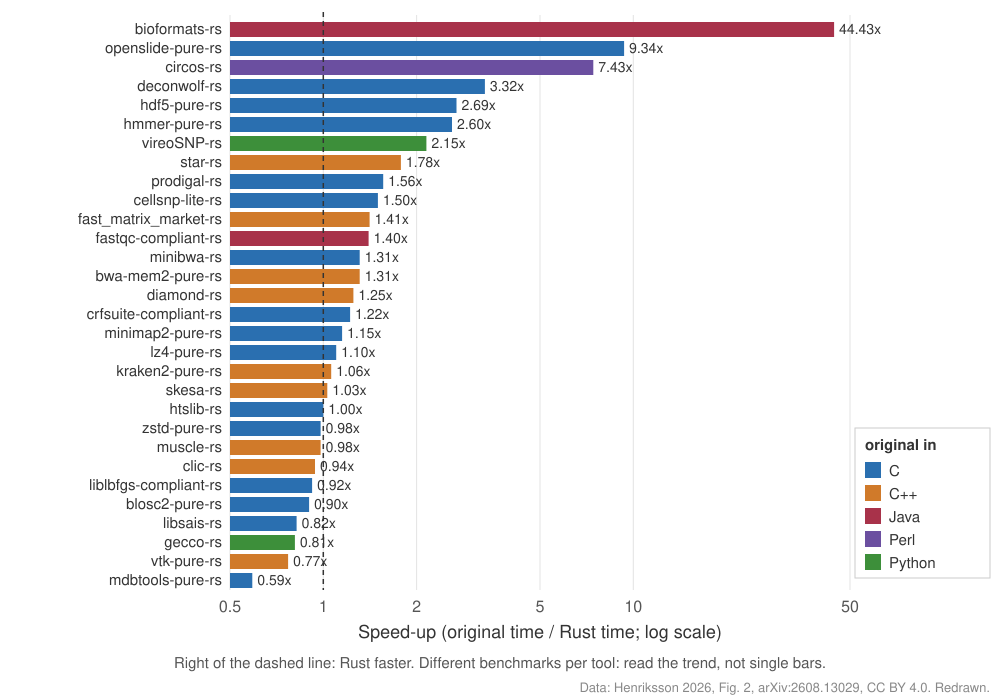{width="58%" fig-align="center" fig-alt="Bar chart of speed-up for 30 translated tools on a log scale. Largest: bioformats-rs 44.43x (Java), openslide-pure-rs 9.34x, circos-rs 7.43x (Perl), deconwolf-rs 3.32x. Many C and C++ tools between 0.9x and 1.8x. Slowest: vtk-pure-rs 0.77x and mdbtools-pure-rs 0.59x."}

::: notes
These are the paper's speed results, redrawn from its Figure 2. Each bar is one translated tool, coloured by the original language, and the dashed line is "as fast as the original". The paper calls these best-effort estimates and says to read them qualitatively, because each tool was benchmarked differently. The largest gains: bioformats, the microscopy file reader written in Java, came out 44 times faster, though the paper warns that Java is hard to benchmark fairly; openslide, a C library for pathology slides, 9 times; circos, a Perl plotting tool, 7 times. Tools already written in C or C++ mostly ended up around the same speed, sometimes a bit slower, and reaching parity took by far the most work. The two Python tools show the other lesson: vireoSNP became twice as fast, gecco a bit slower. The paper notes that Python and R packages often have C or C++ code inside them already, so the gain depends on the case. "Rust is faster" is a tendency, not a guarantee.
:::

## Memory use went down for most tools, and up for some

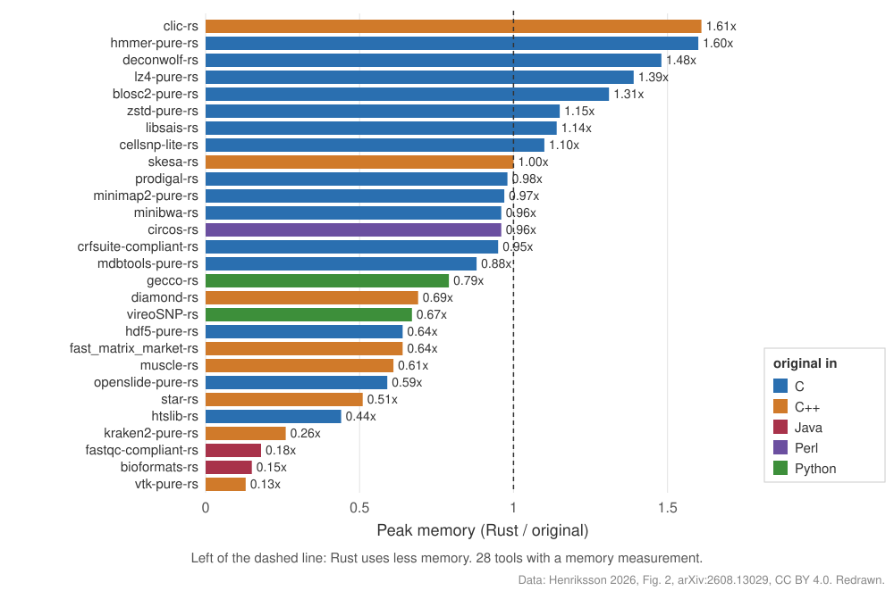{width="58%" fig-align="center" fig-alt="Bar chart of peak memory, Rust divided by original, for 28 tools. Highest: clic-rs 1.61, hmmer-pure-rs 1.60, deconwolf-rs 1.48. Lowest: fastqc-compliant-rs 0.18, bioformats-rs 0.15, vtk-pure-rs 0.13."}

::: notes
And memory. Here less than one means the Rust version needs less memory at its peak. The Java tools needed far less, because Java reserves memory for its virtual machine. But several C tools needed more memory in Rust, up to about 1.6 times. The paper explains why it did not push further: reducing memory more would have meant giving up the one-to-one translation, using raw pointers, or complicated multi-threading buffers. Those would cost faithfulness or safety, so the author chose not to. That is a nice example of an honest trade-off: the paper reports the cases where Rust lost, instead of only the impressive bars. When you translate, you will see the same: copying data around is the most common reason a first Rust translation is slow and memory-hungry.
:::

## Bascet: one binary instead of a container, and native Windows

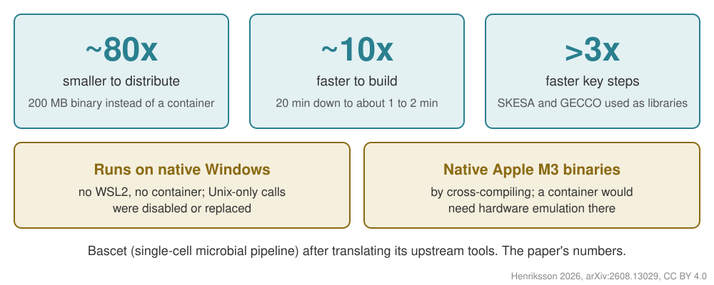{width="80%" fig-align="center" fig-alt="Bascet results: about 80 times smaller to distribute (200 MB binary instead of a container), about 10 times faster to build (20 minutes down to 1 to 2 minutes), more than 3 times faster key steps (SKESA and GECCO used as libraries), runs on native Windows without WSL2 or container, native Apple M3 binaries by cross-compiling."}

The paper: *"the only single-cell pipeline able to run on native Windows, without a container"*.

::: notes
This is the showcase. Bascet is the group's pipeline for single-cell microbial metagenomics, and it depended on many upstream tools. After translating them, everything became one Rust program. The binary is about 200 megabytes, around 80 times smaller than the container it replaced. Building it takes one to two minutes instead of twenty. Key steps, the assembler SKESA and the gene-cluster finder GECCO, run more than three times faster inside Bascet; the paper notes those benchmarks are part of a manuscript in preparation. Unix-specific calls were disabled or replaced during translation, which made Bascet run on native Windows, without the Linux subsystem WSL2. And cross-compiling gave native binaries for Apple's M3 processors, where a container would need emulation. For a course, the Windows point alone is decisive.
:::

## The big speed-up comes from using tools as libraries, not commands

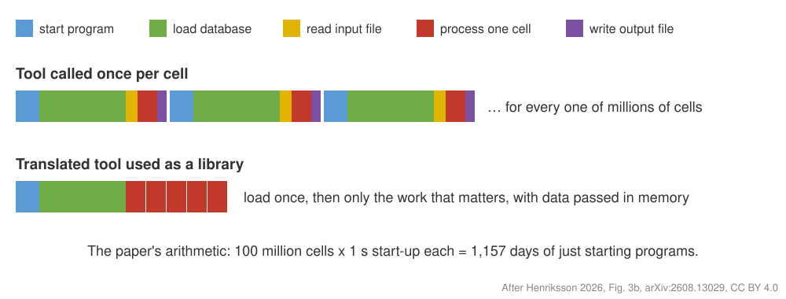{width="80%" fig-align="center" fig-alt="Top: a tool called once per cell repeats start program, load database, read input, process, write output for every cell. Bottom: a translated tool used as a library loads once, then only processes cells, with data passed in memory. 100 million cells times 1 second start-up equals 1,157 days."}

::: notes
Why were those steps three times faster, when we just saw that C tools translate to roughly the same speed? Because of how they are used. A pipeline normally calls each tool as a separate command, once per input: start the program, load its database, read a file, do the work, write a file. For one genome that overhead is nothing. For single-cell data it is everything: the paper's arithmetic is that 100 million cells at one second of start-up each is 1,157 days of just starting programs. Once the tool is a Rust library inside your program, you load the database once and pass data in memory, without files in between. The rustification README says the same thing plainly: if you want speed, use the crate as a library, and do not expect a plain command-line replacement to be faster.
:::

## Not everything could be translated

- **BLAST failed twice.** Code that generates code (build-time generation, C++ templates, heavy preprocessor use) breaks the one-function-in, one-function-out idea.
- **C translates to unsafe Rust first:** pointers and manual memory management, so no safety guarantees until a separate clean-up pass.
- **Memory sometimes went up**, and reducing it would cost faithfulness or safety.
- **Speed tricks that reorder arithmetic** (SIMD) could not be used without changing results.
- **Graphical interfaces** were translated loosely, from screenshots, not faithfully.

::: notes
The paper also reports failures. BLAST, the sequence search tool everyone knows, could not be translated in two attempts: much of its code is generated during the build or by the C++ preprocessor and templates, and the idea of mapping one function to one function stops working. Translating C works, but the first result is Rust that looks like C, full of pointers and unsafe code, and it has none of Rust's guarantees until another pass rewrites it into ordinary Rust; the paper gives the prompt it used for that. We saw the memory trade-off. SIMD optimisations reorder floating-point maths, so they had to wait. And graphical interfaces cannot be compared byte by byte, so they were redone loosely with screenshots of the original as a guide.
:::

## The paper's own caveats

- Benchmarks are *"best-effort estimates"*, chosen by the agents with some steering, and differ per tool.
- The prompts may work less well for others: the agents *"picked up implicit assumptions based on our workspaces"*. *"Further independent testing is needed."*
- Translations are for **early adopters**; new bugs are introduced as well as old ones fixed.
- Agent-written tests were largely insufficient; real data had to do the work.
- It is a single-author preprint, with models that changed during the study. It is *not* a comparison of models.

::: notes
Before we take the method home, here are the limitations the paper states itself, and you should hold it to them. The benchmarks were chosen by the agents, with steering, and were meant mainly for catching regressions, so individual bars should not be over-read. The prompts were developed in one person's setting, and the agents may rely on things in that environment, so they may work less well for you. Translation introduces bugs as well as removing some; the paper's hope that the balance becomes positive is a hope, not a result. Agent-written tests did not catch enough. And the models were updated during the eleven weeks, so this is not a fair comparison of Claude and Codex. I find these caveats reassuring: they are exactly what you would want an author to say.
:::

## In the author's experience, Codex translated more conservatively

- **Codex** (GPT-5.4 and 5.5) for the first translation: *"more conservative"* in translating functions verbatim and in following instructions.
- **Claude** (Opus 4.7) for difficult bugs that Codex could not find, for optimisation ideas, and for all graphical interfaces.
- For benchmarks Codex was used, because Claude *"frequently generated biased benchmarks"*.
- Claude starts parallel subagents on its own when the work suits it; Codex needed explicit prompting.

One person's experience with one generation of models. Test on your own task (*Choosing a model*).

::: notes
Since this course uses both tools, here is what the paper reports about them, with the strong warning that it is one person's experience with the model versions of mid 2026. The project started with Claude Code, then moved to Codex for the early translation work, because Codex followed the strict one-to-one instructions more conservatively, and early mistakes are the expensive ones. Claude was kept for the hard bugs, where a fresh perspective helps, for finding optimisations, and for graphical interfaces from screenshots. The supplement is blunter than the paper: it says the author could not make Claude follow the long prompt list. On benchmarks, the README describes Claude comparing eight Rust threads against one C thread and similar tricks. These are exactly the kinds of differences that change with every release, which is the topic of the next unit.
:::

## A benchmark is only fair if both programs do the same work

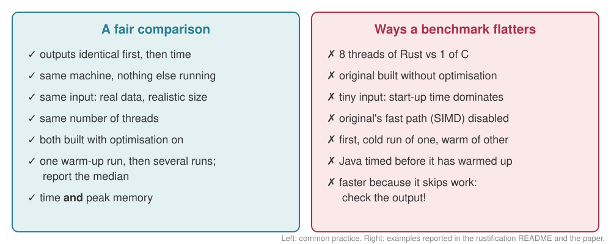{width="80%" fig-align="center" fig-alt="Left, a fair comparison: identical outputs first, same machine, same real input of realistic size, same thread count, both optimised, warm-up then several runs with the median, time and peak memory. Right, ways a benchmark flatters: 8 Rust threads versus 1 C thread, original without optimisation, tiny input, SIMD disabled, cold versus warm runs, Java not warmed up, faster because it skips work."}

::: notes
Every agent will happily tell you its translation is ten times faster. Be sceptical, as the paper was. A fair benchmark first checks that both programs give identical output on the input you time. Then the same machine with nothing else heavy running, the same realistic input, the same number of threads, both programs built with optimisation, one warm-up run so that files are in the disk cache, then several runs and the median. Measure time and peak memory, which the paper calls RSS. The right-hand column lists what the rustification README reports agents actually doing: comparing eight threads with one, building the original without optimisation, picking tiny inputs where start-up time dominates, disabling the original's fast paths. And "faster because it skips work" is why the comparison of outputs comes first.
:::

## The workflow with your agent extends the recipe from the last unit

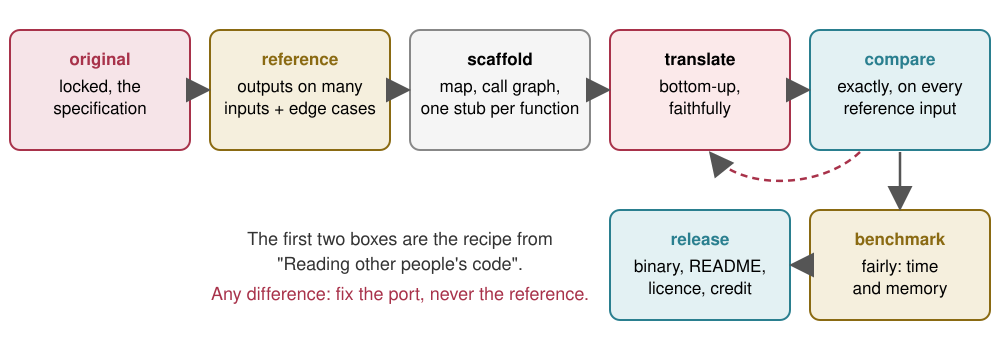{width="82%" fig-align="center" fig-alt="Workflow: original locked as the specification, reference outputs on many inputs and edge cases, scaffold with map, call graph and one stub per function, translate bottom-up faithfully, compare exactly on every reference input (differences go back to translate), benchmark fairly for time and memory, release binary with README, licence and credit."}

::: notes
Here is the workflow you will use, and most of it you already know. The original stays locked in its own folder and is the specification: when in doubt, the original's behaviour is right by definition. Reference outputs come first, now on many inputs, including deliberately awkward ones. Then a scaffold: the map from the last unit plus a call graph and one stub per function. Translate bottom-up, faithfully. Compare exactly, and when something differs, fix the translation, never the reference. Only then benchmark, fairly. Finally build a release binary, with a README that says it is a translation, the licence of the original, and credit to its authors. The difference from the last unit is mainly in the comparison: between Python and Rust we can usually demand byte-identical output.
:::

## Golden files and property tests catch what a single example misses

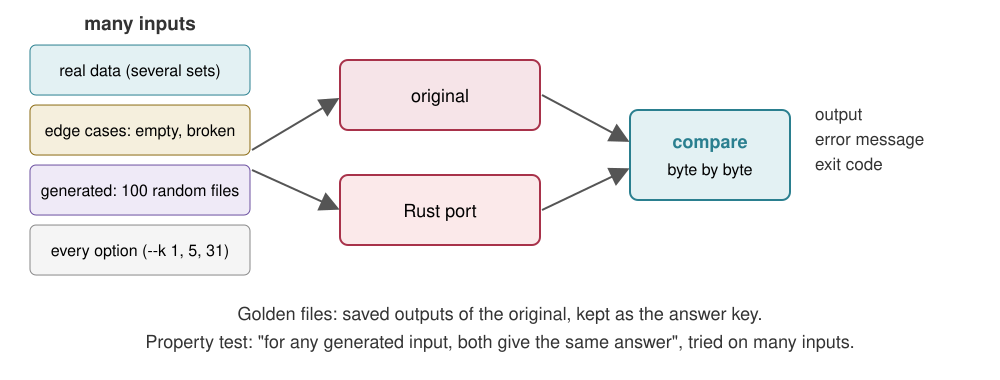{width="80%" fig-align="center" fig-alt="Many inputs, real data, edge cases, 100 generated random files and every option, go into both the original and the Rust port; the outputs, error messages and exit codes are compared byte by byte. Golden files are saved outputs of the original; a property test checks that for any generated input both give the same answer."}

::: notes
Two terms you will see in the agent's work. Golden files are saved outputs of the original, kept as the answer key, exactly like the reference folder in the last unit. A property test states a rule that must hold for any input, here "both programs give the same output", and checks it on many generated inputs, say a hundred random files of different sizes. Include the awkward cases on purpose: an empty file, a broken file, unusual characters, Windows line endings, every option of the program. And compare not just the output but also the error messages and the exit code, the number a program returns to say whether it succeeded. In the exercise, two of the edge cases catch typical translation slips.
:::

## Translate when it pays off, and when you can prove it is the same

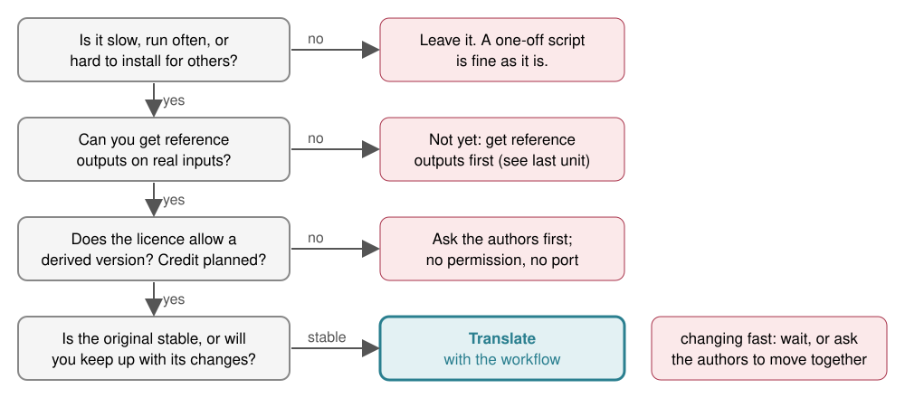{width="80%" fig-align="center" fig-alt="Decision chart. Is it slow, run often, or hard to install for others? If no, leave it. Can you get reference outputs on real inputs? If no, get them first. Does the licence allow a derived version, with credit planned? If no, ask the authors first. Is the original stable? If stable, translate with the workflow; if changing fast, wait or ask the authors to move together."}

::: notes
When should you not translate? A small script you run once a month in a second does not need Rust; leave it. Code you cannot test, because you have no reference outputs and no example data, cannot be translated safely: get reference outputs first, as in the last unit. Code whose licence does not allow derived works, or code without any licence, needs permission. And a tool that is actively developed upstream is a moving target: the translation falls behind with every release, unless you commit to tracking it, or better, talk to the authors. The rustification README adds a practical rule: avoid translating code bases that are being updated rapidly, and check when the last commit was made. When all four answers are yes, the workflow is worth it.
:::

## A translation is a derived work: respect the licence and give credit

- **Licence:** keep the original's licence file and terms. No licence means all rights reserved: ask first.
- **Credit:** cite the original authors and paper in the README, with the exact version (git hash) translated.
- **Say what it is:** a different name (the paper adds `-rs`), a clear note that it is an AI-assisted translation, version `0.x`.
- **Courtesy:** tell the original authors; send bug reports about the translation to your repository, not to theirs.
- **Reproducibility:** faithful means keeping the original's logic bugs, so results stay comparable across studies.

::: notes
In law, a translation of code is usually a derivative work of the original, just as a translation of a book is. So the original's licence applies. Open-source licences allow derived versions, but with conditions: keep the licence, keep the copyright notice, sometimes publish your changes under the same licence. Code without a licence is not free to translate and publish. The rustification README describes the practice the group follows, and it is a good model: add -rs to the name, say clearly at the top that this is an LLM-mediated translation and not the original, keep version numbers below 1.0, copy the licence, cite the authors, record the exact version translated. Tell the original authors, and never send them bug reports about your translation. The README even offers authors ownership of the translation if they want to move to Rust. Copyright, memorisation and credit, in Part 6, returns to this.
:::

## A faithful translation can follow its original's updates

- The paper updated two translations (openslide, minibwa) to newer upstream versions in **under an hour** each, because one-to-one translation keeps every change in a known place.
- *"Every line of code is a liability"*: maintaining a translation adds less than writing a competing new tool.
- Translation also clarifies **provenance**: every Rust function points back to an original one, unlike code an agent writes from scratch out of unknown sources.

::: notes
A question people ask: once you have translated a tool, are you stuck maintaining a fork forever? The paper's answer is: less than you think, if the translation is one-to-one. When openslide and minibwa released new versions, the corresponding changes in the Rust code were in well-defined places, and updating took less than an hour each. The paper also makes an argument about ethics and copyright: asking an agent to write a new aligner from scratch produces code of unknown origin that may copy someone without credit. A faithful translation has a clear origin, credits the authors, and does not compete with them for citations. That is the stance of the rustification README too: think of the translation like a distribution package of the original software.
:::

## In our test run of the exercise, the port was identical and about 19 times faster

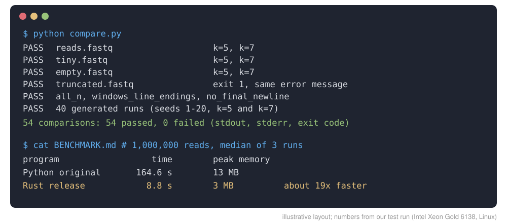{width="80%" fig-align="center" fig-alt="Terminal session, illustrative. Comparison of Python and Rust outputs on reads.fastq, tiny.fastq and five edge cases: all identical, including error message and exit code. Benchmark on 1 million synthetic reads: Python about 165 seconds and 13 MB, Rust about 9 seconds and 3 MB."}

::: notes
Here is what the exercise looks like when it has gone well, from our own test run. The tool is a small Python script that computes quality statistics and the most common k-mers in a FASTQ file of sequencing reads. The agent installed Rust, translated it, and compared the outputs on the example file, a tiny hand-checkable file and five deliberately awkward files: an empty one, a broken one, one with only N bases, one with Windows line endings and one without a final newline. All identical, including the error message and the exit code. Then a benchmark on a million generated reads: on our test machine the Rust version took about 9 seconds instead of about 165, roughly 19 times faster, with less memory. That machine happens to have the same processor as the paper's benchmarks. Your numbers will differ with your computer; the comparison first, then the timing, is the point.
:::

## What the agent does and does not do here

:::: {.columns}
::: {.column width="50%"}
**It does well**

- writes Rust you could not write yourself
- installs Rust and builds release binaries
- writes comparison scripts and generates test inputs
- finds and fixes differences, if pointed at them
- runs benchmarks, when told what fair means
:::
::: {.column width="50%"}
**It does not**

- stay faithful without constant reminders
- choose real, varied test data on its own
- benchmark fairly without being asked
- know whether the licence allows the port
- decide whether the port is worth maintaining
:::
::::

::: notes
To sum up the division of labour. The agent does the part that used to make this impossible for most of us: it writes the Rust, sets up the tooling, builds the binary, writes the comparison and the test files, and chases down differences. What it does not do reliably is stay faithful: both the paper and the README describe agents drifting toward helpers, simplifications and heuristics that only work on the test data, so you keep reminding it and you keep the comparison running. It does not pick realistic, varied data unless you insist, and its benchmarks flatter its own work unless you define fairness. The licence question and the maintenance decision are yours. And in this unit as in the last: you trust what was compared, not what looks right.
:::

## Summary

| Concept | Key fact |
|---|---|
| Rust | compiled, about as fast as C, memory-safe in ordinary code; Cargo builds and manages libraries |
| One binary | no Python, Conda or Docker on the machine that runs it; native Windows, macOS, Linux, clusters |
| Security | removes memory bugs, not logic bugs; `unsafe` code and dependencies still matter |
| Energy | roughly follows run time; interpreted code can need tens of times more |
| Faithful translation | one function in, one function out, no helpers, stubs first, bottom-up from the call graph |

::: notes
The summary in two parts. Rust gives speed and a single program that runs anywhere, without the installation layers we usually need. Its safety is real but limited to memory errors. Energy savings come mainly from shorter run times. And the agent can only translate reliably if you hold it to a strict, faithful, one-to-one, bottom-up structure, ideally guided by static analysis that knows the call graph.
:::

## Summary (continued)

| Concept | Key fact |
|---|---|
| Equivalence | identical outputs, error messages and exit codes on real data, edge cases and generated inputs |
| Benchmark | outputs identical first; same machine, input and threads; warm-up, several runs, median; time and memory |
| The paper | ~35 tools; Bascet ~80x smaller, ~10x faster build, >3x faster key steps, native Windows; read as the paper's claims |
| When not to | one-off scripts, code you cannot test, fast-moving upstream, licence that does not allow it |
| Credit | a translation is a derived work: keep the licence, cite the authors, name it clearly |

**Next (Using agents to train AI: curated and simulated data):** how agents audit labelled data and write simulators that make training data with exact labels, and why a small real test set decides whether any of it works.

::: notes
Equivalence is proven on outputs, many of them, including the awkward cases. Benchmarks are fair only when both programs do the same work under the same conditions. The paper shows what is possible at scale, with honest caveats. Do not translate what you cannot test or may not translate, and give credit when you do. The next unit stays with agents writing serious code, but for a different goal: training your own image-analysis networks. The agent audits the labelled data you have and writes simulators that make more, and, as here, the proof is a comparison against real data.
:::
