## About this lecture

A dataset that people care about gets the same small questions again and again: "only this site", "only last year", "can I have the numbers?". A **Shiny app** answers them without you: a web page with filters, a plot and a table, built from an R (or Python) script. The agent writes the script. You decide which questions the app should answer, check its numbers against the data, and decide **where it may run, because publishing an app can mean publishing the data**.

- **An app is a script with inputs and outputs.** Change a filter, and the plot and the table update.
- **Run it on your own computer first** and check one number by hand.
- **Shinylive** runs the whole app inside the visitor's browser, from static files next to your course page.
- **With Shinylive, the data ships to every visitor**, including rows and columns the app never shows.
- **A server** (hosted or at the university) when the data must not leave, or the app needs more.

A **hands-on** unit. It builds on *Reproducible figures* (the plotting script) and *A course or project page* (where the app is published). After this, Part 4 starts with *Literature review*.

::: notes
In the previous unit we made demos that explain a model. Today we turn to data. A Shiny app is an interactive page for exploring a dataset: you tick a few boxes, choose a date range, and the plot and table follow. It is one of the most useful things you can build for a research group or a course, and agents are good at writing them. As always, the agent does the typing and you do the judging. There is one new question in this unit that we have not had before: when you publish an app, what happens to the data? The answer depends on how you publish it, and for the most convenient option, the answer is that everyone gets a copy of the data. Keep that in mind throughout.
:::

## The same data gets the same small questions every week

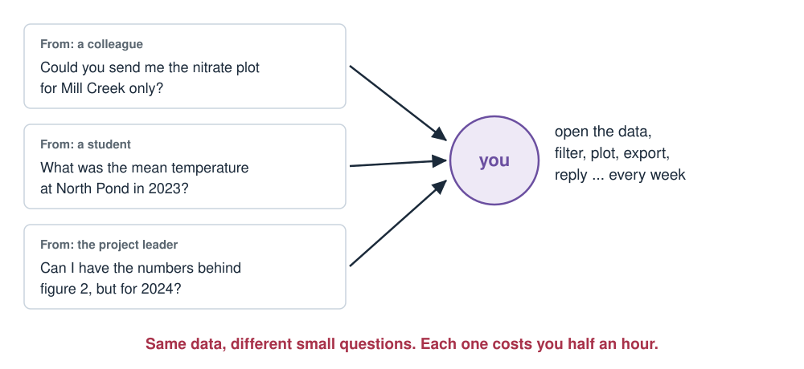{width="78%" fig-align="center"}

::: notes
Here is the concrete problem. You have a dataset that other people want to look at: water samples from a field station, plate reader runs, course results per year, survey responses. Every week someone asks a small question. Could I see only this site? What was the mean last year? Can I have the numbers behind that figure? Each question takes half an hour: open the data, filter, plot, export, write an email. None of them is hard, and none of them needs you, except that you are the one who knows how to work the data. An app moves that half hour to the person who asks.
:::

## An app lets people ask the small questions themselves

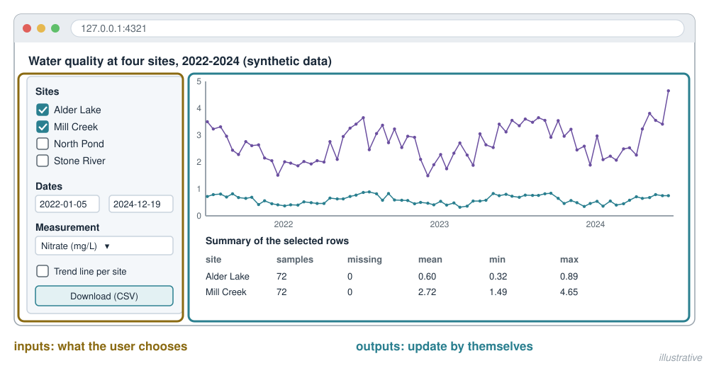{width="85%" fig-align="center"}

::: notes
This is the example app from today's exercise. On the left are the inputs: which sites, which dates, which measurement, and a button to download the selected rows. On the right are the outputs: a plot over time and a summary table. The person who wanted Mill Creek only ticks Mill Creek. The person who wanted last year's mean sets the dates and reads the table. Nobody emails you. The app itself is about a hundred lines of R, which the agent writes in a minute or two. The data is synthetic: invented water samples from four invented sites.
:::

## A demo explains a model; an app explores data

| | Interactive demo (previous unit) | Shiny app (this unit) |
|---|---|---|
| Purpose | teach one concept | answer questions about a dataset |
| Inside | a model: a formula or rules | your data, plus filters, plots and tables |
| Language | HTML and JavaScript, one file | R or Python script, plus a data file |
| Runs | in any browser, from the file | needs R or Python: on your computer, on a server, or in the browser via Shinylive |
| Check | a known case of the model | a number computed by hand from the data |
| Privacy | usually no data at all | **the data is the point**: who may see it? |

::: notes
How does this differ from the demo of the previous unit? A demo contains a model and usually no data. Its check is a known case from theory. An app contains your data, and its check is a number you compute yourself from the data, for example a mean in a spreadsheet. A demo runs anywhere because it is plain web code. An app is written in R or Python, so it needs R or Python to run. That is where the publishing question comes from, and why this unit spends a third of its time on it. The two can be combined, but keep them apart in your head: models in demos, data in apps.
:::

## A Shiny app is a script with inputs and outputs

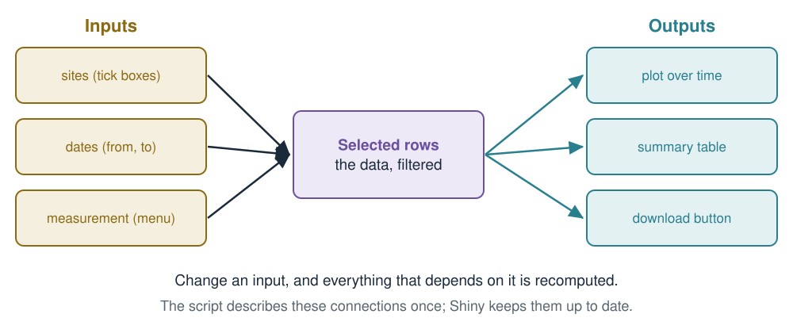{width="85%" fig-align="center"}

::: notes
Here is the whole idea of Shiny in one picture. The script lists inputs, such as tick boxes, a date range and a menu. It describes how to get the selected rows from the data, given the inputs. And it describes the outputs: a plot of the selected rows, a summary table, a download. Shiny then keeps everything up to date: when you untick a site, the selected rows change, and the plot, the table and the download all follow by themselves. You do not need to write or read this logic. But it helps to know the shape, because it tells you what to check: if the plot and the table disagree, they are probably not using the same selected rows.
:::

## Shiny exists for R and for Python; use the one your figures use

| | R Shiny | Shiny for Python |
|---|---|---|
| The app file | `app.R` | `app.py` |
| Install (the agent does it) | the R package `shiny` | the Python package `shiny` |
| Run locally | `shiny::runApp()` in R | `shiny run app.py` in a terminal |
| Plots | ggplot2, as in *Reproducible figures* | matplotlib, plotnine, ... |
| Export to Shinylive | R package `shinylive` | Python package `shinylive` |
| Docs | [shiny.posit.co/r](https://shiny.posit.co/r/) | [shiny.posit.co/py](https://shiny.posit.co/py/) |

Both come from the same company (Posit) and work the same way. If your plotting script from *Reproducible figures* is in R, choose R.

::: notes
Shiny started in R, and there is now an equivalent for Python with almost the same ideas. Use the language you already have a script in. If your reproducible figure from Part 2 is an R script with ggplot2, the app can reuse that plotting code almost unchanged, and you already know how to check it. If you used Python, use Shiny for Python. The commands in this table are what the agent will run; you do not need to remember them. The exercise is written for R, with notes for Python where they differ. Both are free and open source.
:::

## The example: three years of water samples from four sites

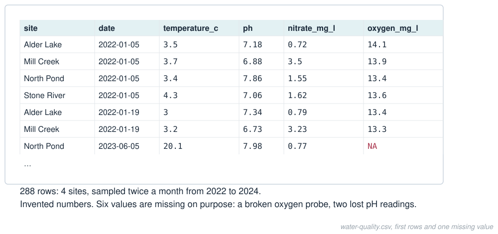{width="82%" fig-align="center"}

::: notes
Our example data is a single CSV file: invented water samples from four invented sites, taken twice a month for three years. Each row has a site, a date and four measurements: water temperature, pH, nitrate and dissolved oxygen. 288 rows in total. Six values are missing on purpose, as in real field data: an oxygen probe broke for a few weeks, and two pH readings were lost. Missing values are a good test for an app, because a careless app either crashes or silently drops them. The file is small and synthetic, so it is safe to publish. Your own data may not be, and we come back to that.
:::

## The prompt lists the questions the app should answer

```text
water-quality.csv has water samples from four sites (one row per sample:
site, date, temperature_c, ph, nitrate_mg_l, oxygen_mg_l). Some values are NA.

Make a Shiny app in app.R so that colleagues can answer questions like
"how did nitrate at Mill Creek change in 2023?" without asking me.

Inputs: tick boxes for the sites (all ticked at start), a date range, a menu
for the measurement (with readable names and units), an option for a trend line.
Outputs: a plot of the measurement over time, one colour per site; a table
per site with the number of samples, the number missing, mean, min and max;
the first 20 selected rows; a button to download the selected rows as CSV.

If no site is ticked or no rows match, say so in plain words. Count missing
values; never drop them silently. Use only shiny and ggplot2.
Tell me how to start the app, and one number I can check by hand.
```

::: notes
Here is the prompt for the example. Notice that it starts from the questions the app should answer, not from widgets, just as the demo prompt started from the discovery. Then it lists inputs and outputs in plain words. Two sentences deal with the cases that usually go wrong: nothing selected, and missing values. One sentence keeps the packages to a minimum: shiny and ggplot2. That matters later, because fewer packages means a faster and more reliable Shinylive app. And the last sentence asks for a number to check, as always. You could write a much shorter prompt and get an app. You would then spend the time fixing it instead.
:::

## The agent writes app.R and asks to install shiny

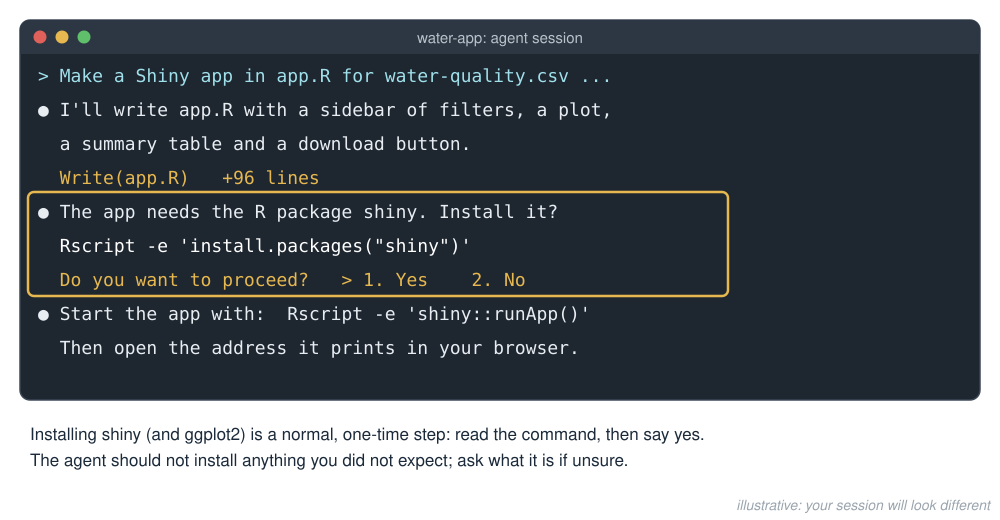{width="80%" fig-align="center"}

::: notes
This is roughly what you will see. The agent writes app.R, about a hundred lines. If the shiny package is not installed yet, it asks permission to install it. That is a normal, one-time step; read the command and approve it. You met this in the Terminal survival kit. Then the agent tells you how to start the app. Your session will look different: it may write a different layout, it may use another package for tables, or it may want to start the app itself. If it wants to add packages you did not ask for, ask why, and whether it can do without.
:::

## The app runs on your own computer first

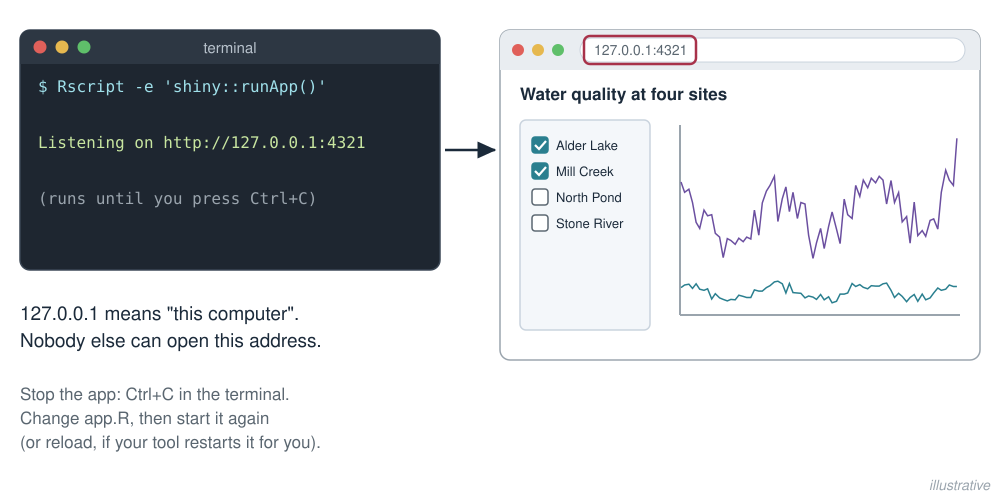{width="82%" fig-align="center"}

::: notes
To run the app, the agent or you starts it with one command. The terminal then shows an address like http colon slash slash 127.0.0.1 colon and a number. Open that address in your browser. 127.0.0.1 is a special address that means "this computer": the app is running on your machine, and nobody else can reach it. That makes this the safe place to try things with real data. The app keeps running until you press Control C in the terminal. In RStudio there is also a Run App button that does the same. If the agent started the app for you inside its own session, ask it to stop it when you are done.
:::

## Check the app against the data with one number you compute yourself

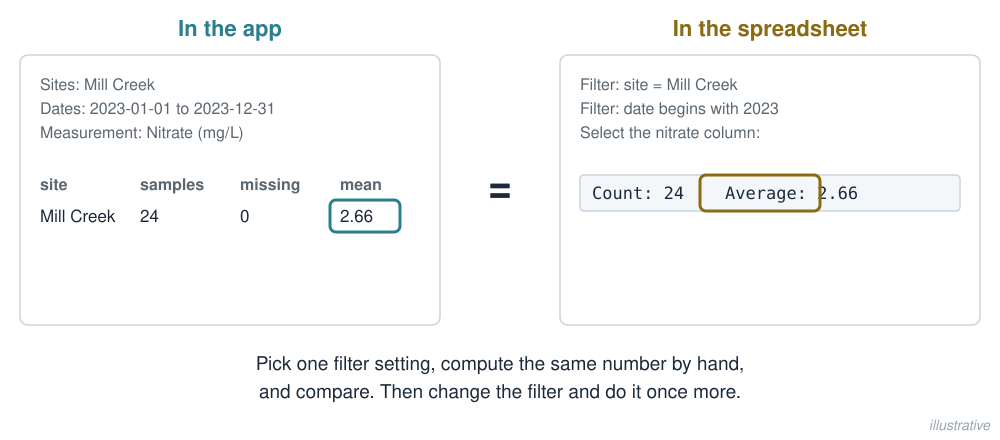{width="82%" fig-align="center"}

::: notes
Now the check. Choose one setting of the filters: Mill Creek, the year 2023, nitrate. Read the number of samples and the mean in the app: 24 samples, mean 2.66. Then compute the same thing yourself in a spreadsheet: open the CSV, filter on site and year, select the nitrate column and read the count and average in the status bar. They must agree. Then change one filter and do it again, because an app can be right for one setting and wrong for another, for example if the date filter excludes the last day. This takes five minutes and is the only way to know that the app shows the data correctly.
:::

## Try to break the app on purpose

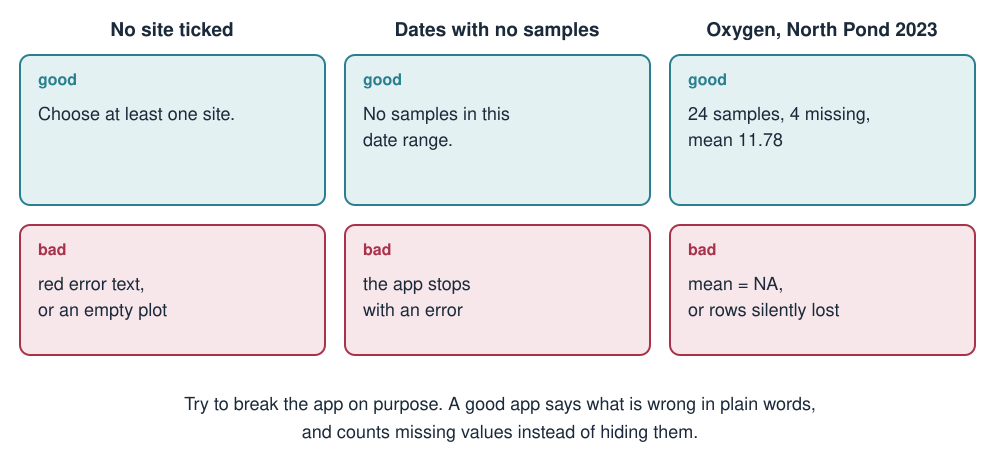{width="82%" fig-align="center"}

::: notes
Next, try to break it. Untick every site. Choose a date range with no samples. Choose oxygen at North Pond in 2023, where four values are missing. A good app says what is wrong in plain words, and counts missing values instead of hiding them. A bad app shows a red error message that means nothing to a colleague, an empty plot without explanation, or a mean of NA. The worst case is an app that silently drops the rows with missing values and reports a mean as if nothing happened. Your colleagues will try all of these by accident, so you should try them on purpose first.
:::

## Change one thing at a time, and check again

Good requests describe what a user sees:

```text
When I untick all sites, the plot area shows a red error. Show a short
message instead: "Choose at least one site."
```

```text
The table shows 7 decimals. Round means to 2 decimals and add units to
the column names.
```

```text
Add a second tab "About the data" with where the data comes from, what
each column means, and the licence. Use the text in README.md.
```

After each change: restart the app, do the number check again, commit.

::: notes
Improving the app works like improving the demo. Describe what a user sees and what you would like instead. Change one thing at a time. After each change, restart the app and repeat the number check: a change to the layout can break a filter. And commit each good version, so you can go back. The third example is worth doing in any real app: a short tab that says where the data comes from, what each column means, and what licence it has. People who find your app later will need it, and so will you in a year.
:::

## There are three ways to publish an app

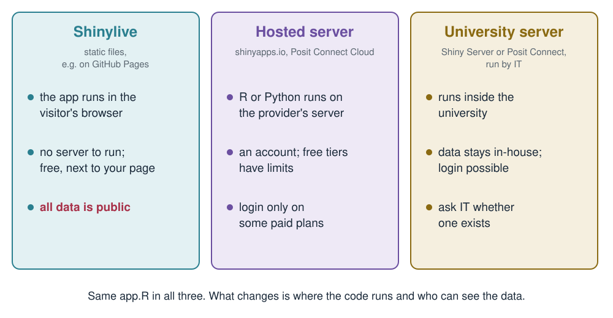{width="82%" fig-align="center"}

::: notes
Now publishing. The same app.R can be published in three ways. With Shinylive, the app becomes a set of static files that you put next to your course page on GitHub Pages; the app then runs inside each visitor's browser. No server, free, simple, but everything in the app, including the data, is public. With a hosted server such as shinyapps.io or Posit Connect Cloud, R runs on the provider's computers; you need an account, the free tiers have limits, and password protection comes with some paid plans. With a university server, R runs inside your university, the data can stay in-house, and a login is often possible. Ask your IT department whether such a server exists. The rest of this lecture is mostly about the first option, because it fits next to your course page, and about when not to use it.
:::

## Shinylive runs the whole app inside the visitor's browser

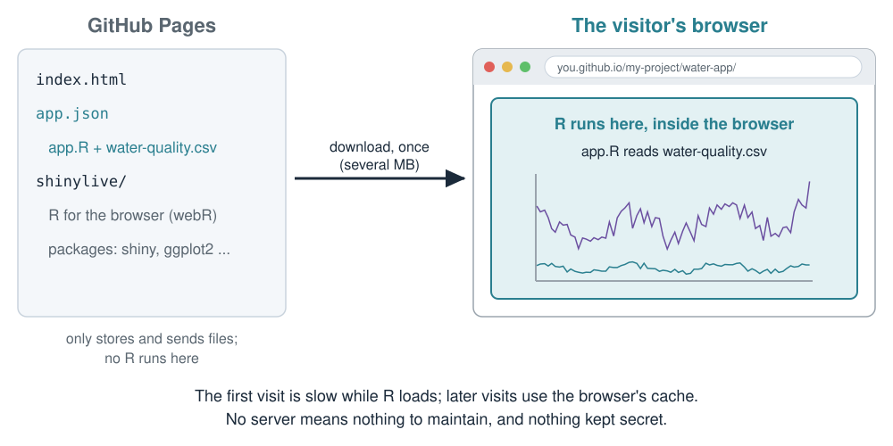{width="82%" fig-align="center"}

::: notes
Here is how Shinylive works. A normal Shiny app needs a computer running R somewhere, a server. Shinylive avoids that: there is a version of R, called webR, and a version of Python, called Pyodide, that run inside a web browser. When someone opens your app, their browser downloads R, the packages, your app.R and your data, and then runs the app on their own computer. GitHub Pages only stores the files and sends them out; it runs nothing. This is why Shinylive is free and needs no maintenance. The price is a slow first visit, because several megabytes must be downloaded, and, more importantly, that the visitor's browser now holds your data.
:::

## With Shinylive, the data ships to every visitor

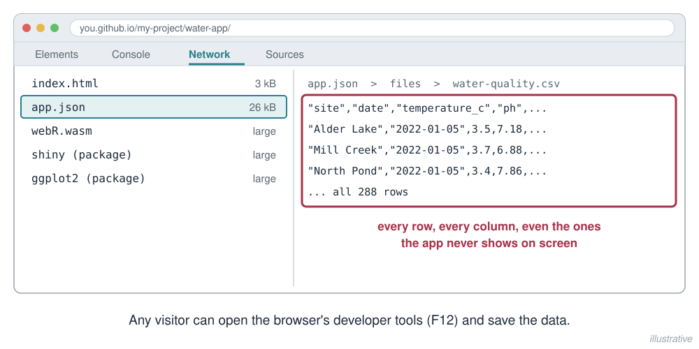{width="80%" fig-align="center"}

::: notes
This is the most important slide of the unit. The Shinylive documentation says it plainly: the code and data of the application are sent to the browser, so they cannot be kept secret from the user. Every visitor's browser downloads the complete data file, all rows and all columns, even the columns your app never shows and the rows your filters hide. Anyone can open the browser's developer tools, which take one key press, and save the file. In practice, publishing a Shinylive app means publishing its data. If the data is public anyway, that is fine and even useful. If it is not, Shinylive is the wrong tool.
:::

## Hiding something in the app does not hide it in the data

- A filter that only shows **2024** still ships 2022 and 2023.
- A table that drops the **name** column still ships the names.
- A plot of **group means** still ships every individual value, if the file has them.
- A **password box** in a Shinylive app protects nothing: the password check runs in the visitor's browser, which also holds the data.
- An API key or database password in `app.R` is published too.

**What ships is what is in the app folder.** If only aggregated data may be public, aggregate first, save that as the file, and put only that file in the app folder.

::: notes
People get this wrong in predictable ways. They think that filtering the data in the app protects the rest. It does not: the filter runs in the visitor's browser, on the complete file. They drop a column from the display and think it is gone. It is not. They show only means and think the individual values are hidden. They are not, if the file has them. Some even build a password box into the app; with Shinylive, that check runs in the visitor's browser and can be bypassed. And any key or password written in the app's code is published with it. The rule is simple: whatever is in the app folder is published. If only an aggregated table may be public, make that table first, and give the app only that table.
:::

## What may go into a static app depends on the data class

| Data class (from *Privacy, ethics and safety*) | Shinylive on GitHub Pages? |
|---|---|
| **Public**: open data, published results, synthetic data | yes, with a licence and a source note |
| **Internal**: unpublished lab measurements, no people in them | only if the data owner agrees to publish it; otherwise a server with login |
| **Personal**: anything about identifiable people, incl. course results per student | no; aggregate and check that no small groups remain, or use an approved university server |
| **Sensitive** or **given in confidence**: health, ethnicity, survey answers given under promise | no; not on any public app |

When in doubt, ask the data owner or your data protection officer **before** you publish. Removing data from the internet later is not reliable: copies may already exist.

::: notes
Here is the decision as a table, using the data classes from the privacy unit in Part 1. Public data, including synthetic data, is fine in a static app; add a licence and a note on the source. Internal data, such as unpublished measurements without people in them, may only go public if the owner, often your group leader or a collaborator, agrees, because publishing the app publishes the data. Otherwise use a server with a login. Personal data never goes into a Shinylive app. Even aggregated tables can identify people when groups are small: a course with three students in one category reveals their grades. Sensitive data does not belong in a public app at all. And remember that once something has been on the internet, it may have been copied.
:::

## Exporting is one command, which the agent runs

| | R | Python |
|---|---|---|
| Install once | R package `shinylive` | Python package `shinylive` |
| Export the app folder to a site folder | `shinylive::export("water-app", "water-app-site")` | `shinylive export water-app water-app-site` |
| Preview the site locally | `httpuv::runStaticServer("water-app-site")` | `python3 -m http.server --directory water-app-site 8008` |

```text
Export the app in water-app/ as a static Shinylive site into the folder
water-app-site/. Then start a local preview server and tell me the address.
List every file from water-app/ that ends up in the export.
```

The exported folder holds a copy of your data. Read the list of files before you publish.

::: notes
Turning the app into a static site is one command, which the agent runs: export the app folder into a new site folder. The R and Python versions differ only in spelling. The last line of the prompt is the important one: ask the agent which of your files ended up in the export. Shinylive includes the files in the app folder, so if you left a raw data file, a draft or a notes file with names in it there, it is now in the site. Read the list. The preview command starts a small local web server, because an exported Shinylive app cannot be opened by double-clicking. This is a difference from the demo: the demo was one file; this is a folder that must be served.
:::

## An exported app must be served, not double-clicked

- Double-clicking `index.html` in the export gives a blank page or an error. The browser needs a web server to load R.
- **Locally:** the preview command from the previous slide. Open the address it prints. Stop it with Ctrl+C.
- **Online:** GitHub Pages is a web server. Once the folder is part of your site, it works there.
- The **first** load takes a while: the browser downloads R and the packages (several MB). Later visits are faster, because the browser keeps a copy.
- Test it on a phone, too. A slow phone on a mobile network is the worst case.

::: notes
A practical point that confuses people. The demo from the previous unit opened with a double-click. A Shinylive export does not: browsers refuse to load the R engine from files on disk, so you see a blank page or an error. You need a web server, which can be a tiny local one for preview, or GitHub Pages once it is published. The first visit is slow, sometimes ten seconds or more, because R and the packages are downloaded. Tell your users to wait, or put a sentence on the page. And try it on your phone over the mobile network, because that is how some of your users will meet it.
:::

## The source stays in the project; only the export goes to the page

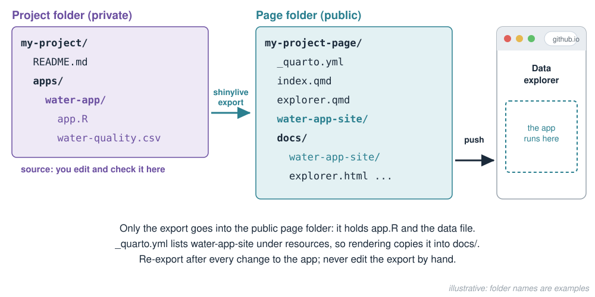{width="82%" fig-align="center"}

::: notes
Where do the files go? In A course or project page, your page got its own folder and public repository, separate from the project, which may stay private. That fits apps well. The source, app.R and its data, lives in the project folder, where you edit and check it. The export, made by the shinylive command, goes into the page folder, and you never edit it by hand: you make it again after every change to the app. As with the demo, Quarto must copy the exported folder into docs when it renders, so the agent lists it under resources in the project file, next to the .nojekyll file. A page on your site then links to it, or embeds it with an iframe like the demo. Quarto also has a Shinylive extension that puts an app directly inside a page; the agent can set that up instead, but a separate folder is easier to check.
:::

## Shinylive has limits

- **Everything is public**: code, data, any keys (see the previous slides).
- **Packages**: only packages that have been built for the browser. shiny and ggplot2 work; some others do not. Ask the agent to check before relying on one.
- **Size**: the data travels to every visitor. A few MB is fine; hundreds of MB is not.
- **First load**: several seconds or more, while R or Python downloads.
- **No writing back**: the app cannot save to your files or a shared database. Each visitor's app is a separate copy.
- **Network**: the browser limits what the app may fetch from other websites.
- **Versions**: an export bundles one version of Shinylive. Re-export now and then, and test again.

When one of these bites, use a server.

::: notes
Shinylive is excellent for small, public datasets, and it has limits. Everything is public, which we covered. Not every package is available in the browser; the common ones are, but a specialised package may not be, and the agent should check before building on it. The data travels to every visitor, so large datasets make the app slow or impossible. The first load is slow. The app cannot write anything back: if you want people to submit data or leave comments, you need a server. Fetching data from other websites is limited by the browser. And the export is a snapshot of Shinylive at that time, so re-export now and then, especially if something stops working.
:::

## A server keeps the data off the visitor's computer, but not out of sight

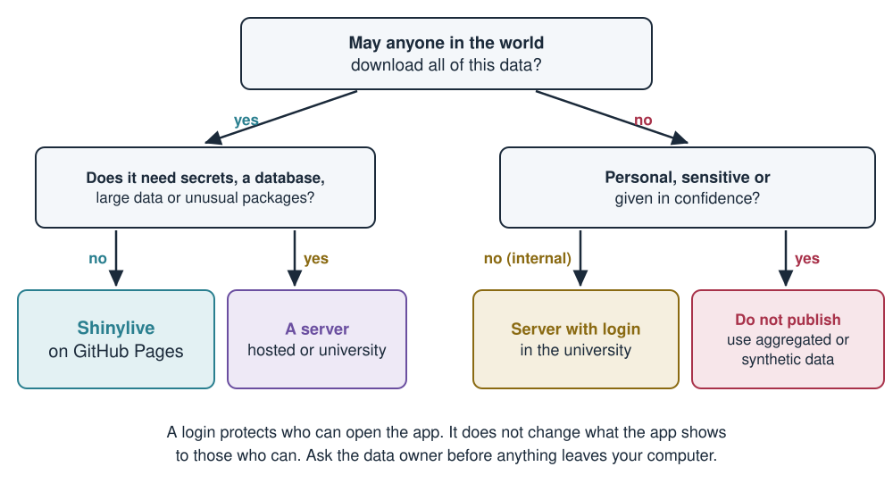{width="78%" fig-align="center"}

::: notes
Here is the whole decision as a flowchart. First question: may anyone in the world download all of this data? If yes, and the app needs nothing special, Shinylive on GitHub Pages is the simplest. If it needs secrets, a database or large data, use a server. If the data is not public, Shinylive is out. For internal data, a server with a login, preferably at the university, is the usual answer. For personal or sensitive data, do not publish an app at all; use aggregated or synthetic data instead, or talk to your data protection officer about an approved setup. Notice the sentence at the bottom. A server keeps the raw file off the visitor's computer, and a login limits who gets in. But whatever the app shows on screen, and whatever its download button offers, those people can still see and save.
:::

## Hosted and university servers: what to know before you choose

- **shinyapps.io** and **Posit Connect Cloud** (both from Posit) host R and Python apps. Free tiers exist, with limits on the number of apps and on running time. Password protection comes with some paid plans. Check the current plans on their pages; they change.
- Deploying to them uses an account and a token. The agent can do the steps, but **you** create the account and keep the token out of your git repository.
- A hosted service is a company outside your university. For anything but public data, check with your university whether you may use it (*Privacy, ethics and safety*).
- **University servers** (Posit Connect or the free Shiny Server, run by IT) keep data in-house and can use your university login. Many universities have one; ask.
- A server app needs looking after: packages update, free accounts expire, and an app nobody maintains breaks quietly.

::: notes
If you need a server, there are two routes. Posit, the company behind Shiny, runs shinyapps.io and Posit Connect Cloud. Both have free tiers with limits, and both change their plans, so check the pages rather than relying on this slide. To deploy, you create an account and get a token, a kind of password for the agent's deploy command. Keep that token out of git: a token in a public repository is a published password. A hosted service is an external company, so the same rules apply as for the AI tools themselves: for anything but public data, check with your university first. The alternative is a university server, which many universities run. And finally, a server app needs looking after, unlike a static export, which keeps working as long as the files are there.
:::

## Where this goes wrong

- **Publishing data by accident.** A Shinylive export of personal or unpublished data. The single most serious mistake in this unit.
- **Extra files in the app folder.** A raw data file, a draft, a notes file with names: all exported with the app.
- **Numbers that are not checked.** A wrong date filter or silently dropped missing values give a plausible, wrong table.
- **A token in the repository.** Deploy credentials committed to git and pushed to a public repository.
- **Too many packages.** Each one makes the app slower to load in Shinylive, and some do not work there at all.
- **An app without documentation.** Nobody knows where the data comes from, what the columns mean, or how old it is.
- **An app nobody maintains.** Server apps break when packages update; static exports can fall behind.

::: notes
Let us collect what goes wrong. The worst is publishing data you should not, which Shinylive makes easy because it looks like publishing an app. Close to it is publishing extra files that happened to sit in the app folder. Then the ordinary errors: numbers that nobody checked, a filter that is off by one day, missing values dropped without a word. Tokens in the repository are a classic: once pushed to a public repository, consider the token stolen and make a new one. Too many packages make a slow, fragile app. An app without an "about the data" note confuses its users. And apps that nobody maintains break. None of these needs programming skill to prevent, only the habits from this course.
:::

## What the agent does and does not do here

| The agent does | You do |
|---|---|
| writes `app.R` (or `app.py`) and installs packages | decide which questions the app should answer |
| starts the app locally, exports it with Shinylive | check one number by hand; try to break it |
| copies the export into your site, writes the link | decide whether the data may be public |
| lists the files that end up in the export | read that list before you publish |
| sets up a server deployment when asked | create accounts, keep tokens secret, ask IT and the data owner |

::: notes
To sum up the division of labour. The agent writes the app, installs packages, starts it, exports it and wires it into your site. It can even list the files in the export, which you asked for. You decide what the app is for, check its numbers, try to break it, and above all decide whether the data may be published at all, which is not a technical question but a question of ownership, consent and law. No agent can answer that for you, and it is not the agent's account or name on the published page.
:::

## Summary

| Concept | Key fact |
|---|---|
| Shiny app | an R or Python script with inputs and outputs; outputs update by themselves |
| Prompt | start from the questions the app should answer; say how to handle empty selections and missing values |
| Run locally | `127.0.0.1` means this computer only; stop with Ctrl+C |
| Check | one number by hand in a spreadsheet; then try to break the app |
| Shinylive | the app runs in the visitor's browser, from static files on GitHub Pages |
| Data in Shinylive | **every visitor gets the whole data file**; hiding it in the app protects nothing |
| Server | shinyapps.io, Posit Connect Cloud, or a university server, when data must stay private or the app needs more |
| Publishing | source in the project, export in the page folder, listed under resources; read the file list first |

**Next (*Literature review*):** Part 4 starts. A structured, verified literature table for a set of genes or topics, published on your page.

::: notes
Here is the summary. A Shiny app is a script with inputs and outputs. Write the prompt from the questions it should answer. Run it locally, check a number by hand, and try to break it. Publish it with Shinylive when the data may be public, remembering that every visitor gets the whole data file. Use a server when it may not, or when the app needs more than a browser can give. This ends Part 3: you now have a project page with figures, a demo and an app. In Part 4 we turn to literature and documents, starting with a literature review, where the main risk is not publishing too much, but trusting references that do not exist.
:::
