## About this lecture

A coding agent lives in the **terminal**, and it tells you what it wants to do in terminal language. If you cannot read that language, every "Do you want to proceed?" is a guess. This unit teaches you to **read** the terminal, not to become a command-line user.

- The terminal is a **text window onto the same files** you see in your file browser.
- Files sit in a **tree of folders**; a **path** is an address in that tree, and the terminal always stands in one **current folder**.
- **Five commands** (`pwd`, `ls`, `cd`, `cd ..`, `mkdir`) are enough to get around and to start the agent in the right place.
- **Where you start the agent is what it can work on.** One course folder, never your home folder.
- A **permission request** says what will run, where, and for how long you allow it. When in doubt: **say no and ask the agent to explain**.

This is a **practical** unit. Delegating real tasks comes next in *First delegations*; how the agent decides what to run comes in *How LLMs and agents work*; keeping an undo history comes in *Git as undo button*.

::: notes
Set expectations straight away: nobody has to become a command-line expert today. The agent types the commands. Our job is to understand enough to judge what it proposes. That needs a small, stable mental model: a tree of folders, a current position in that tree, and a handful of words. By the end of the hour everyone should be able to open a terminal, make a course folder, start Claude Code or Codex inside it, and answer a permission request with confidence, including the most important answer of all: "no, explain that first". Mention that the slides show macOS-style screens but every step has a Windows equivalent, and the exercise page has a tab for each system.
:::

## On Monday the agent asks you to approve this. Should you?

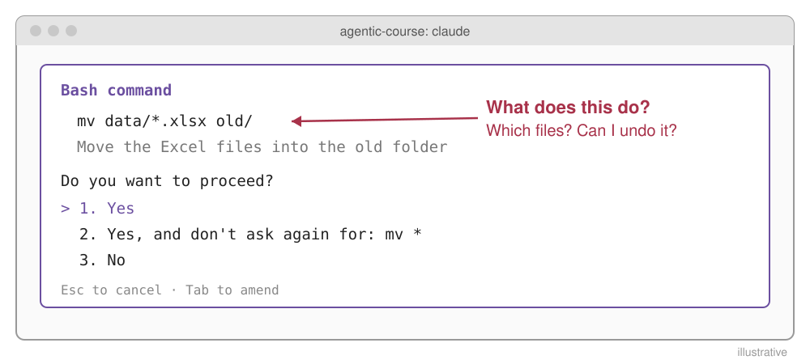{width="62%" fig-align="center"}

- You asked the agent to "tidy up the project folder". It now wants to run a command.
- To answer, you need to know: **what** `mv` does, **which** files `data/*.xlsx` means, **where** `old/` is, and **whether it can be undone**.
- By the end of this lecture you can answer each of those, or know how to get the agent to answer them for you.

::: notes
This is the situation every participant will meet in their first real session. The agent is polite and gives a one-line reason, "move the Excel files into the old folder", but the decision is yours, and the command is the part that will actually run. Read it aloud: m-v, data slash star dot x-l-s-x, old slash. Ask the room who would press 1 now. Most people would, because the explanation sounds harmless. That is often fine. But we want people to press 1 because they understood it, not because it sounded reasonable. Come back to this slide at the end of the lecture; by then everyone should be able to say what the command does and what could go wrong (if old already contains a file with the same name, it is overwritten).
:::

## A terminal is a text conversation with your computer

:::: {.columns}
::: {.column width="62%"}
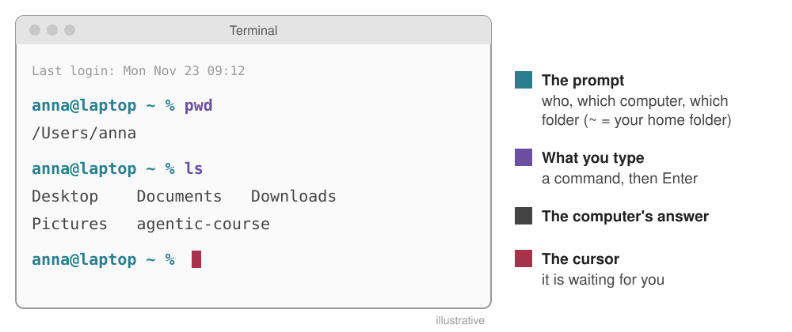{width="100%"}
:::
::: {.column width="38%"}
- You type a **command** and press Enter; the computer **answers** in text.
- The **prompt** at the start of each line tells you who you are and **which folder** you are in.
- When the prompt comes back, the computer is ready for the next command.
- Nothing happens until you press Enter.
:::
::::

::: notes
Demystify the window. It is a chat, just a very terse one. The computer waits at the prompt, you type, you press Enter, it answers, and the prompt comes back. The prompt is worth reading because it shows the current folder: here a tilde, which means the home folder. On Windows the prompt looks like PS C:\Users\anna> and shows the full path. Emphasise that nothing runs until Enter. You can type, look, change your mind and delete. Also: silence is often success. Many commands print nothing when they work.
:::

## The terminal and the file browser show the same files

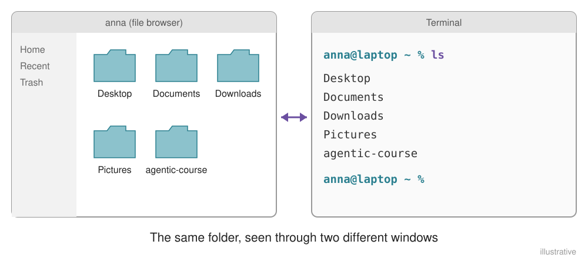{width="64%" fig-align="center"}

- Finder (macOS), File Explorer (Windows) and Files (Linux) are **one window** onto your files. The terminal is **another**.
- A file the agent creates in the terminal **appears in the file browser**, and the other way round.
- Keep both open while you work with an agent: the terminal to talk, the file browser to **look**.

::: notes
This is the key reassurance for people who live in the file browser. There is no separate "terminal world". The folder called agentic-course in Finder is the same folder that ls lists. When the agent writes notes.md, you can double-click it in the file browser a second later. In the exercise we make this concrete by opening the course folder in the file browser before starting the agent, and watching files appear. Many participants find that keeping the file browser open side by side removes most of the anxiety about what the agent is doing.
:::

## Your files form a tree, with your home folder near the top

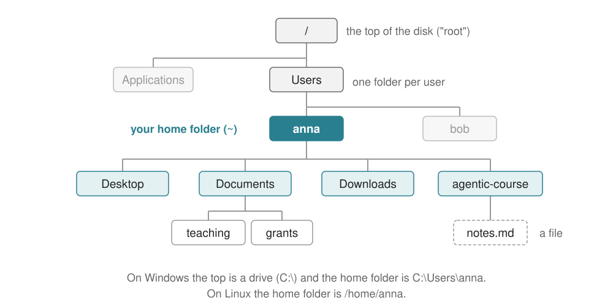{width="56%" fig-align="center"}

- Every folder sits **inside** another folder, up to the top of the disk.
- Each user has a **home folder**. Desktop, Documents and Downloads are folders inside it.
- The terminal writes the home folder as **`~`** (tilde).

::: notes
Draw the tree on the board if you can. People know folders inside folders from the file browser, but rarely think of the whole disk as one tree. At the top is the root, written as a single slash on macOS and Linux, or a drive letter like C:\ on Windows. Under Users there is one folder per person, and yours is your home folder. Everything personal lives under it: Desktop, Documents, Downloads, and soon the course folder. The tilde is just a short name for "my home folder", so ~/agentic-course means the agentic-course folder inside my home folder.
:::

## The terminal always stands in one folder: the current folder

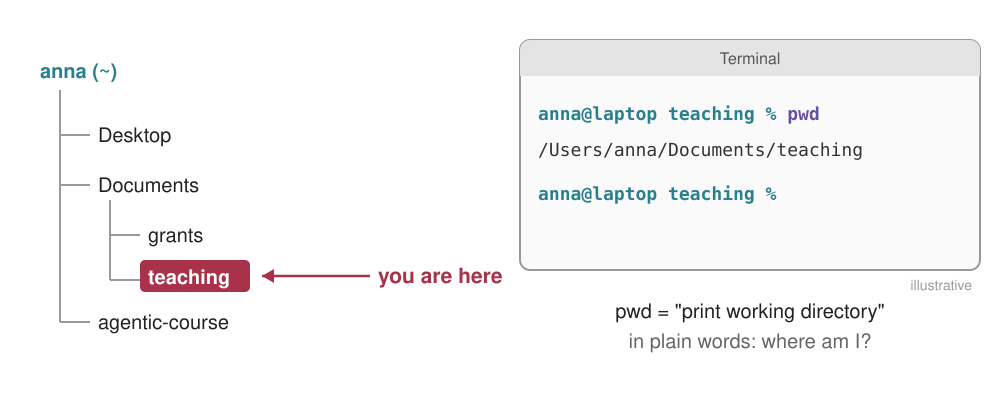{width="70%" fig-align="center"}

- Every command runs **in the current folder** unless you say otherwise.
- `pwd` prints where you are. The prompt usually shows the last part of it.
- A new terminal window starts in your **home folder**.

::: notes
The idea of a current folder, also called the working directory, is the one that trips people up most. In the file browser you see where you are because the window shows it. In the terminal you have to ask, and pwd is how you ask. The same idea applies to the agent: when you start it, it takes the current folder as its working folder. That is why we will spend real time on starting in the right place. Show that the prompt says teaching, and pwd gives the full address, /Users/anna/Documents/teaching.
:::

## A path is an address in the tree; it can start at the top or where you stand

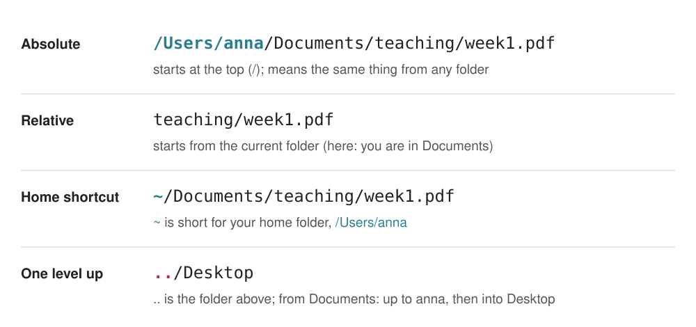{width="56%" fig-align="center"}

- **Absolute** paths start at the top (`/` or `C:\`) and mean the same thing wherever you are.
- **Relative** paths start from the current folder. The agent uses them a lot: `data/survey.csv` means "the data folder **here**".
- `~` is your home folder; `..` is the folder **one level up**; `.` is **this** folder.

::: notes
Paths are how the agent tells you which file it means, so this slide pays off on every permission request. An absolute path starts with a slash, or a drive letter on Windows, and is unambiguous. A relative path has no leading slash and is read from wherever you are standing, so the same relative path can mean different files in different folders. That is another reason the starting folder matters. Then the three shorthands: tilde for home, two dots for "up one level", one dot for "here". When the agent writes ./results or ../data, you now know what it means: results inside this folder, and data next to this folder.
:::

## Windows and macOS/Linux write the same idea differently

:::: {.columns}
::: {.column width="55%"}
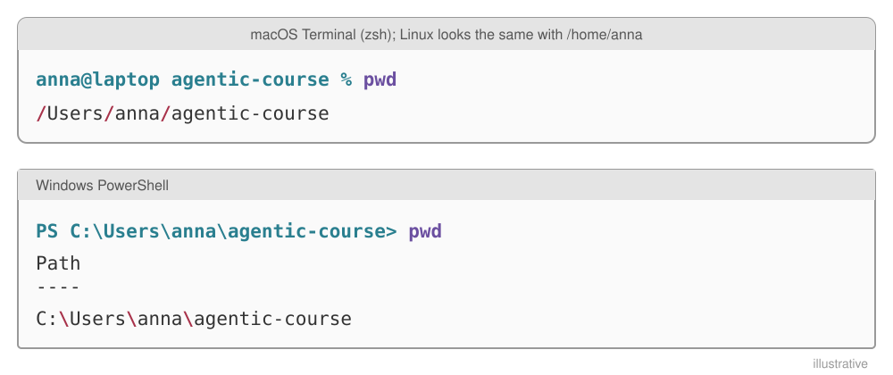{width="100%"}
:::
::: {.column width="45%"}
| | macOS / Linux | Windows |
|---|---|---|
| Terminal app | Terminal | PowerShell (in Windows Terminal) |
| Language | zsh or bash | PowerShell |
| Separator | `/` | `\` |
| Home folder | `/Users/anna`, `/home/anna` | `C:\Users\anna` |
| Top of the disk | `/` | `C:\` |
| List files | `ls` | `ls` or `dir` |
:::
::::

- `pwd`, `ls`, `cd`, `cd ..` and `mkdir` work in **PowerShell too**. `~` works there as well.
- On Windows the agent may run PowerShell or bash-style commands, so you may see either.

::: notes
Most of what we teach works the same on all three systems, which is a relief. The visible differences are the slash direction, the drive letter, and the way the prompt and some outputs look. PowerShell's pwd prints a small table with a heading called Path; that is normal. PowerShell accepts ls as a short name for its own listing command and also understands dir. On Windows, Claude Code and Codex may run commands through PowerShell or through a bash-like shell that came with Git, so you may see either style in permission requests. When you see a command name you do not know, the rule is the same: ask the agent what it does.
:::

## Names with spaces need quotes, so prefer names without them

- The terminal splits a command at spaces. `cd My Documents` is read as two names.
- Quotes keep a name together: `cd "My Documents"`.
- **Tab completion** adds the quotes or backslashes for you (next slides).
- For anything the agent will work on, use names like `agentic-course`, `survey_2025.csv`: **no spaces, no å/ä/ö**, lower case.

::: notes
This is a small point that causes a disproportionate number of errors. To the terminal a space separates one word from the next, so a folder called Course Notes looks like two things. Quotes fix it, and Tab completion will escape the space for you automatically, which is one more reason to use Tab. But the better habit is to avoid the problem: give the folders and files the agent works on short names with hyphens or underscores. Swedish letters usually work on modern systems but can still break older scripts and tools, so keep them out of file names in agent projects. Your existing folders can stay as they are; this is about new ones.
:::

## Five commands cover almost everything you will type yourself

| Command | Read it as | What you see |
|---|---|---|
| `pwd` | "where am I?" | the full path of the current folder |
| `ls` (Windows also `dir`) | "what is in here?" | the names of files and folders |
| `cd agentic-course` | "go into agentic-course" | nothing; the prompt changes |
| `cd ..` | "go up one level" | nothing; the prompt changes |
| `mkdir agentic-course` | "make a folder called agentic-course" | nothing (silence means it worked) |

Two more for convenience:

- `cd` on its own (macOS/Linux) or `cd ~` (all systems) takes you **home**.
- `open .` / `explorer .` / `xdg-open .` opens the current folder in the file browser.

::: notes
This is the whole command-line vocabulary participants need to type themselves in this course. Everything else, the agent types. Read each as a plain-English sentence; that is the habit we want for all commands. Point out the column "what you see": cd and mkdir print nothing when they work. Silence is success, and an error message is the only sign of a problem. The two extras are about getting home if you are lost, and getting from the terminal to the familiar file browser.
:::

## Watch how the commands move you through the tree

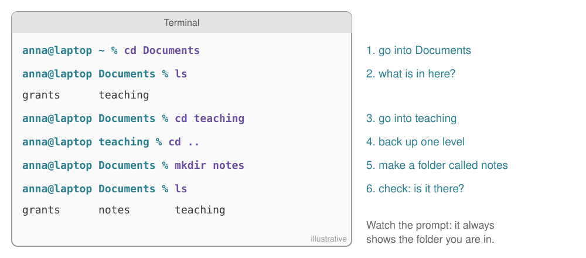{width="70%" fig-align="center"}

- `cd` moves you; `ls` looks around; `mkdir` adds a folder **where you stand**.
- The prompt is your "you are here" sign. Check it before you do anything that matters.

::: notes
Walk through the session line by line, pointing at the folder name in the prompt as it changes: home, then Documents, then teaching, then back to Documents with cd dot dot. The mkdir creates notes inside Documents because that is where we are standing at that moment; had we still been in teaching, it would have been created there instead. That is the single most common surprise: things happen in the current folder. The last ls is a check, and checking is a habit we will repeat in every unit, with the agent as well as by hand.
:::

## You can jump from the terminal to the file browser with one command

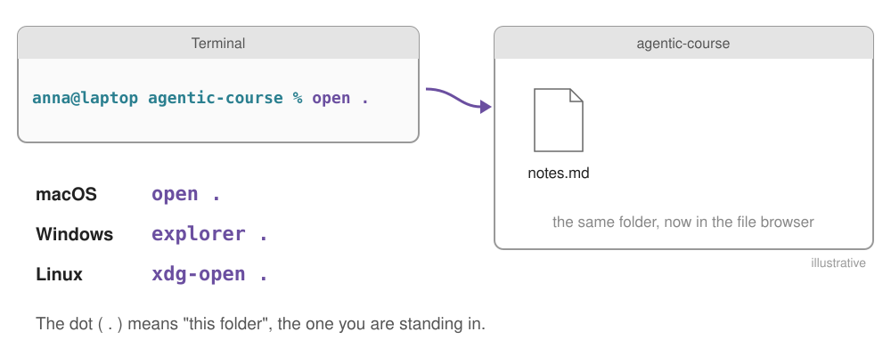{width="78%" fig-align="center"}

- Use it as a habit: **make or enter a folder, then open it** in the file browser.
- From now on, watch new files appear there while the agent works.

::: notes
This tiny command builds a bridge between the two worlds. Open dot on a Mac, explorer dot on Windows, xdg-open dot on most Linux desktops. The dot means "this folder", the current folder. In the exercise you will make the course folder, cd into it, and open it in the file browser before starting the agent. Then you have a window where you can see the agent's work as it happens, double-click files to open them in the usual programs, and spot anything that should not be there.
:::

## Tab and the up arrow save most of the typing

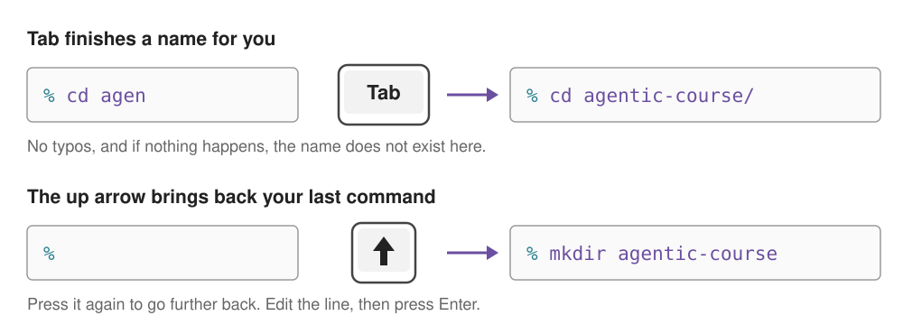{width="74%" fig-align="center"}

- **Tab** completes file and folder names. If nothing happens, the name does not exist where you are.
- **Up arrow** recalls earlier commands. Inside Claude Code and Codex it recalls your earlier prompts.

::: notes
These two keys make the terminal far less error-prone. Type the first few letters of a name and press Tab: the terminal fills in the rest, correctly spelled, with spaces escaped. If it does nothing, that is information too: there is no such name in the current folder, so you are probably in the wrong place. Pressing Tab twice can list the options. The up arrow walks back through what you typed before, so you never retype a long command. Inside the agents, the up arrow recalls your earlier prompts in the same way.
:::

## Error messages are short and usually say exactly what is wrong

| You see | It means | Try |
|---|---|---|
| `No such file or directory` / `Cannot find path` | the name is not in the current folder | `pwd`, `ls`, then Tab to complete |
| `command not found` / `is not recognized` | the program is not installed, or a typo | check spelling; ask whether it is installed |
| `File exists` / `already exists` | `mkdir` found a folder with that name | nothing; the folder is already there |
| `Permission denied` / `Access is denied` | your account may not touch that place | you are probably in the wrong folder |

- Nothing is broken when you see an error. Read it, then `pwd` and `ls`.
- In an agent session, you can paste the error and ask: **"What does this error mean?"**

::: notes
Participants often freeze at the first red line. Show that terminal errors are blunt but precise. The first two account for most beginner errors: the wrong folder, and a program that is not installed. The other two are harmless or point to the same cause. The universal first move is pwd and ls: where am I, and what is here? And once the agent is running, it is very good at explaining error messages, including its own. Make it normal to paste an error and ask what it means.
:::

## The folder where you start the agent is the folder it works on

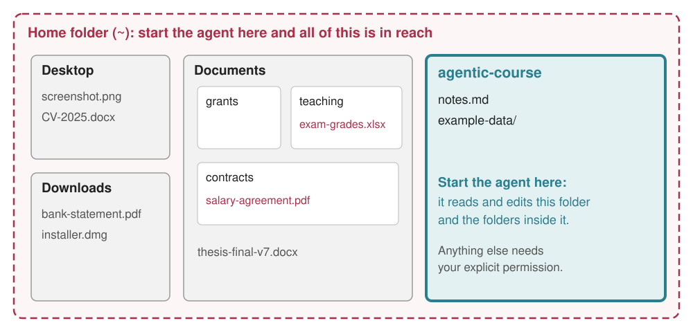{width="65%" fig-align="center"}

- You start the agent by typing `claude` or `codex` **in the current folder**. That folder becomes its **working folder**.
- It reads and edits there without leaving it; going **outside** needs your permission.

::: notes
This is the most important slide of the unit. When you type claude or codex, the agent takes the folder you are standing in as its workspace. In both tools, reading and editing inside that folder is normal, and anything outside triggers a permission request. Codex enforces this with an operating-system sandbox by default; Claude Code asks before its file tools go outside the folder. So the starting folder is a boundary you draw. Draw it around one course folder, and private material like grades, contracts and bank statements is simply not in the picture. Note the fine print: a command you approve can still reach further, which is why we read commands before approving them.
:::

## Never start the agent in your home folder or on the Desktop

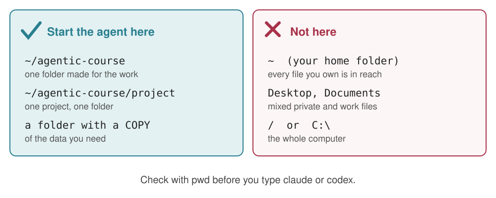{width="70%" fig-align="center"}

- Home, Desktop and Documents mix **work, private and confidential files**. The agent does not know which is which.
- Make **one folder per piece of work**. Run `pwd` before you type `claude` or `codex`.

::: notes
A new terminal opens in the home folder, so the easiest mistake is to type claude straight away. Then the agent's workspace is everything you own. Claude Code even treats this case specially: if you start it in your home folder, it does not remember that you trusted the folder and asks again every time, as a nudge to start somewhere else. The habit is: open terminal, cd into the project folder, pwd to check, then start the agent. The privacy unit later in Part 1 returns to this with the rules for what data may be sent to a cloud model at all.
:::

## Make one course folder and start the agent there

:::: {.columns}
::: {.column width="50%"}
**macOS / Linux** (Terminal)

```bash
cd ~
mkdir agentic-course
cd agentic-course
pwd
open .          # Linux: xdg-open .
claude          # or: codex
```
:::
::: {.column width="50%"}
**Windows** (PowerShell)

```powershell
cd ~
mkdir agentic-course
cd agentic-course
pwd
explorer .
claude          # or: codex
```
:::
::::

- Text after `#` is a comment; you do not need to type it.
- We use `~/agentic-course` rather than Desktop or Documents. Those are often synced to iCloud or OneDrive, and macOS asks extra permission questions for them.
- **Next time:** open a terminal, `cd agentic-course`, then start the agent.

::: notes
This is the exercise in miniature. Six lines, the same on every system apart from the command that opens the file browser. We put the course folder directly in the home folder because it gives a short, predictable path, and because it avoids two common nuisances: cloud sync of Desktop and Documents, which can fight with an agent writing many files, and macOS privacy dialogs that ask whether the Terminal may access the Documents folder. If your institution requires work files to live somewhere else, that is fine: make the course folder there instead, and use cd with that path. Stress the last bullet: every later session starts with cd agentic-course.
:::

## On first start, the agent asks whether you trust the folder

- Claude Code asks, the first time in a folder, whether you trust it. Codex may ask a similar question, depending on version and setup.
- **Yes** for your own course folder. **Think twice** for a folder you downloaded or received: trusting it lets settings stored in that folder take effect.
- Codex also chooses a starting **permission level** for the folder. Check it with `/status` and change it with `/permissions`.
- Claude Code shows its mode **below the prompt box**. Press **Shift+Tab** to change it (next slides).

::: notes
The first-start dialog differs a little between the tools and between versions, so do not memorise the wording. The question is always: is this folder yours, and do you want the agent to work here? For an empty folder you just made, the answer is yes. The reason the question exists is that a project folder can carry its own settings for the agent, and a folder from someone else could carry settings you would not choose. Codex picks a starting level from the folder: read-only for an ordinary folder, its Auto level for a folder under version control, or it asks you. You can always check where you are with /status.
:::

## Inside the agent, you type plain language into a prompt box

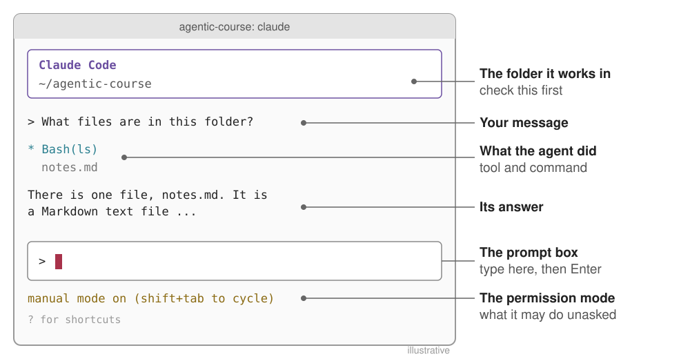{width="60%" fig-align="center"}

- You are now **talking to the agent**, not to the terminal. Write in plain English (or Swedish).
- The agent's work appears as **tool calls** (`Bash(ls)`, `Write(notes.md)`) followed by its answer.

::: notes
Once claude or codex is running, the window changes character. The prompt box at the bottom takes ordinary sentences. The agent replies, and every action it takes is listed: which tool, which command, which file. Learn to look at three places on this screen: the folder at the top, the actions in the middle, and the mode line at the bottom. Typing ls in the prompt box sends the word "ls" to the agent as a message, which is harmless but confusing; if you want a terminal command, exit first or ask the agent. Your session will look different from this mock-up: the tools change their look often.
:::

## A few keys and slash commands control the session

| You want to | Claude Code | Codex |
|---|---|---|
| See the commands | `/help`, or type `/` | type `/` |
| Stop the agent mid-task | **Esc** | **Esc** (see the hint on screen) |
| Start a fresh conversation | `/clear` | `/new` (or `/clear`, which also clears the screen) |
| See the current settings | `/status` (version, model, account) | `/status` (model, permissions, folders) |
| Change what it may do unasked | **Shift+Tab** (cycles modes) | `/permissions` |
| Exit | `/exit`, or Ctrl+C twice | `/exit` or `/quit`, or Ctrl+C |

- Esc **stops**; it does not undo. Work already done stays done.
- After exit you are back in the terminal, in the **same folder**.

::: notes
Everything in this table was checked against the official Claude Code and Codex documentation in November 2026, but these tools change monthly, so the exercise asks you to look at the list yourself with slash. Esc is the emergency brake: it stops the current response or command so you can redirect, and the agent keeps the work done so far. That is an important point: stopping does not roll anything back. A fresh conversation with /clear or /new is useful when a session has gone off in a wrong direction; the files stay, only the conversation is reset. Exit returns you to the ordinary terminal prompt in the folder you started in.
:::

## Everything the agent does is a read, an edit or a command

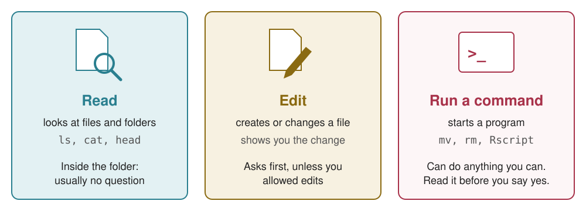{width="78%" fig-align="center"}

- **Reads** inside the folder usually run without asking.
- **Edits** show you the change. **Commands** can do anything your user account can do.

::: notes
A simple classification helps people decide how carefully to look. Reading is the least risky: inside the working folder both tools read without asking, and simple read-only commands such as ls and cat also run without a prompt in Claude Code. Edits create or change files, and you see a preview of the change. Commands are the category that needs attention, because a command runs with your rights: it can move, delete, install, or send data over the network. That is why commands are where permission requests mostly appear, and why the rest of this lecture is about reading them.
:::

## Permission modes decide what the agent may do without asking

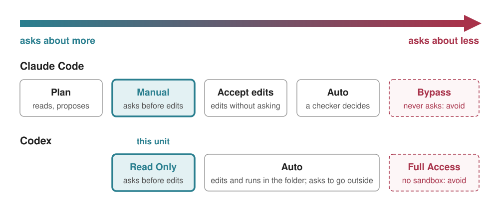{width="54%" fig-align="center"}

- **Claude Code:** **Shift+Tab** cycles the modes; the current one is shown below the prompt box. Recent versions **start in Auto**.
- **Codex:** `/permissions` switches levels; `/status` shows the current one.
- **In this unit:** Manual or Read Only, so that you see and practise reading requests.

::: notes
Both tools have a dial between "ask me about everything" and "ask me about nothing". In Claude Code, Manual asks before edits and commands; Accept edits lets it change files in the folder freely; Plan lets it read and propose a plan without changing anything; Auto lets a separate checker model approve or block actions on your behalf. Recent Claude Code versions start in Auto, so pressing Shift+Tab once to reach Manual is part of today's exercise. In Codex, Read Only asks before any change, and Auto lets it edit and run commands inside the folder while asking to go outside or use the network. The bypass and full-access settings remove the safety net and are not used in this course. We start strict because the goal today is to see requests. In Part 2, under Delegating well, we loosen the dial on purpose once there is an undo button.
:::

## A permission request says what will run, why, where, and for how long

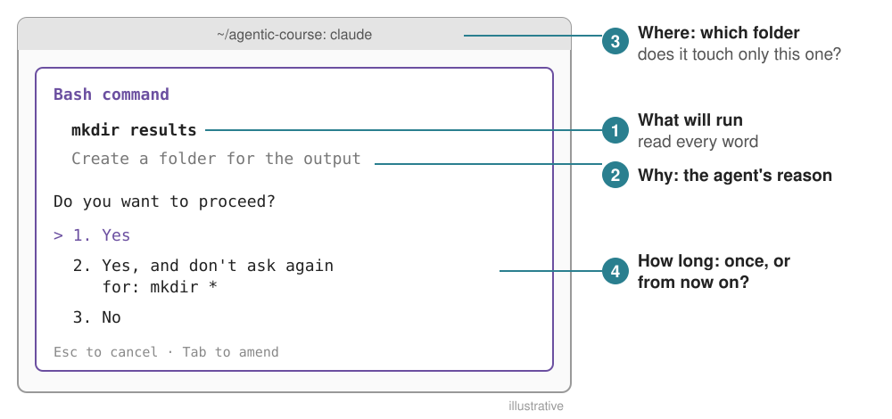{width="66%" fig-align="center"}

- Read the **command** itself, not only the agent's reason. The command is what runs.
- Check the **folder**: everything should stay inside your project folder.

::: notes
Teach a fixed reading order. One: the command or file, read every word, including the paths. Two: the reason, which is the agent's summary and can be wrong or incomplete. Three: where, which you see from the window title, the paths in the command and the folder you started in; relative paths are relative to that folder. Four: the scope of your answer, once or from now on. Most requests take five seconds to read once you have the habit. If any of the four is unclear, that is the signal to use the escape hatch on the next slides.
:::

## You have three answers: yes once, yes from now on, or no and say what instead

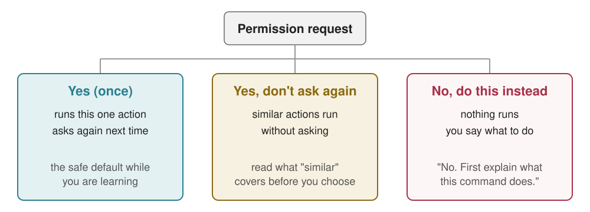{width="76%" fig-align="center"}

- **Claude Code:** Yes / Yes, and don't ask again for … / No. Press **Tab** to add a note to your answer; **Esc** means No.
- **Codex:** similar choices: approve once, approve similar commands for the session, or decline and **tell Codex what to do differently**.

::: notes
The middle option needs care. In Claude Code, "don't ask again" for a command is saved for this project folder, and it names the pattern it will allow, for example mkdir followed by anything. Read the pattern: allowing "mv star" means every future move in this project runs without asking. In Codex, the equivalent lasts for the session. While you are learning, prefer plain yes. The third option is the most underused. "No" is not a failure; it is how you steer. In Claude Code, highlight No and press Tab to type what you want instead; in Codex, the decline option invites you to say what to do differently. The exact wording of these options changes between versions, so read the screen rather than relying on muscle memory.
:::

## When in doubt, say no and ask the agent to explain the command

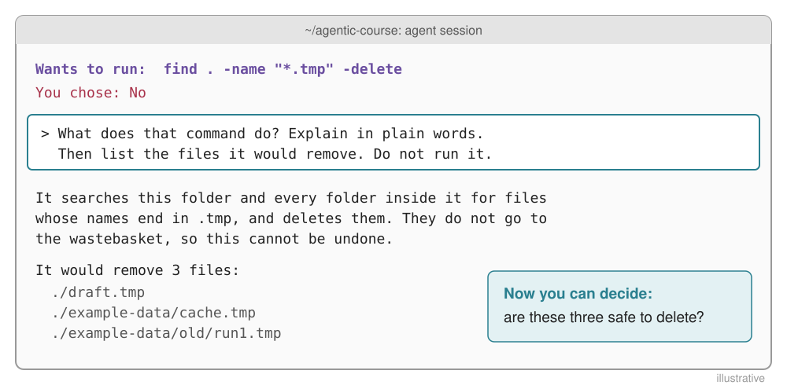{width="64%" fig-align="center"}

- "**What does this command do? Explain in plain words. Do not run it.**" works for **any** command.
- Ask for the **consequences**: which files, can it be undone, does it use the network?

::: notes
This is the universal escape hatch and the one sentence to remember from today. You do not need to know find, sed, rm, or any other command. You need to know that you can stop and ask. The agent is very good at explaining commands, including showing exactly which files would be affected, as here, where a harmless-looking find command turns out to delete three files permanently. Then you decide with real information. Two cautions: the explanation can occasionally be wrong, so for anything destructive ask for a dry run, such as listing the files first; and asking costs a few seconds, while a wrong yes can cost a day.
:::

## You will see the agent run a small set of commands again and again

| Command | Plain English | Risk |
|---|---|---|
| `ls`, `pwd` | list files; show the current folder | none: only looks |
| `cat file`, `head file` | show a file; show its first lines | none: only looks |
| `mkdir name` | make a folder | low |
| `cp a b` | copy a to b | low, but can **overwrite** b |
| `mv a b` | move or rename a to b | **medium: overwrites b without warning** |
| `rm file`, `rm -r folder` | delete; delete a folder and all inside | **high: no wastebasket, no undo** |
| `Rscript x.R`, `python x.py` | run an R or Python script | depends on the script: ask what it does |
| `git status`, `git log` | show what changed; show history | none: only looks |
| `git add`, `git commit` | save a snapshot | low (see *Git as undo button*) |
| `curl`, `pip install`, `install.packages` | fetch from or install from the internet | ask: what, and from where? |

::: notes
This table is a reference card; the exercise page has it too. The point is not to memorise it but to recognise the shape of the risk. Anything that only looks is safe. Anything that creates is low risk. Anything that moves, overwrites or deletes deserves a slow read. Running a script is as safe as the script, so ask what it does. Installing and fetching use the internet and change your computer, so ask what and from where. On Windows you may also see PowerShell names such as Get-ChildItem, Copy-Item, Move-Item and Remove-Item; they mean list, copy, move and delete.
:::

## `rm` and `mv` deserve a slow read every time

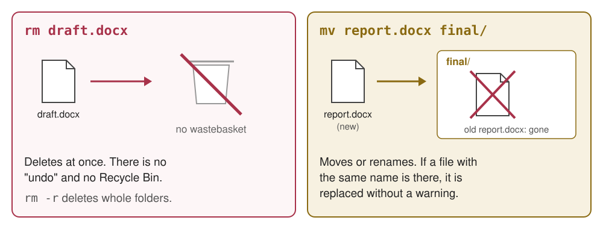{width="76%" fig-align="center"}

- Before you approve `rm` or `mv`, ask yourself: **is there a copy?** If not, ask the agent to **list** the files first.
- Until you have git (*Git as undo button*), make a **copy** of anything precious before the agent touches it.

::: notes
These two commands cause almost all of the real accidents. rm deletes immediately; files do not pass through the wastebasket or Recycle Bin, and rm with -r removes a folder and everything inside it. mv moves or renames, and on macOS and Linux it silently replaces a file of the same name at the destination. Neither is wrong to use: tidying up a folder needs both. The habit is to pause, check whether a copy exists, and for anything with a wildcard such as star dot xlsx ask the agent to list the matching files first. Return to the Monday slide: mv data/*.xlsx old/ moves every Excel file in data, and replaces any file of the same name already in old.
:::

## The agent can install software for you, one approved step at a time

- Later units need **R**, **Python** and **git**. Ask: "**Which of R, Python and git are installed on this computer? Only check, do not install anything.**"
- If something is missing, ask for a **plan first**: which installer, from where, which commands. Approve each step after reading it.
- Some steps need **your password** or a system dialog. The agent cannot do those; you do them, then tell it you are done.
- On a university-managed computer, check with **IT** before installing anything.

::: notes
The terminal skills from today are exactly what you need to let the agent install software safely. The checking part is harmless: it runs commands like R --version or git --version and reports. Installing is a real change to your computer, so we ask for the plan first, read it, and approve step by step. Typical installers are the official download pages, Homebrew on a Mac, and winget on Windows. Some steps will ask for an administrator password or show a system dialog, and those you do yourself. Many university computers are managed centrally; there, the right move is often a ticket to IT or a software centre, not a terminal command. The exercise includes the harmless checking step only.
:::

## Where this goes wrong

- **Wrong folder.** The agent was started in home or Desktop, or a relative path points somewhere you did not expect. Check `pwd` first.
- **Approval fatigue.** After the tenth "yes" people stop reading. If you are pressing yes without reading, slow down or narrow the task.
- **"Don't ask again" for too much.** Allowing `rm *` or `mv *` for a project removes your last check. Prefer plain yes.
- **Trusting the summary over the command.** The one-line reason can be incomplete; the command is what runs.
- **Esc is not undo.** Stopping keeps what was done. Real undo comes with git, in Part 2.
- **The screens change.** Option names and modes change between versions. Read what is on your screen; ask the agent or `/help` when in doubt.

::: notes
This is the limits slide. The terminal skills here are a safety net with holes, and participants should know where the holes are. The commonest problem by far is the wrong starting folder, and the fix is one command. The most insidious is approval fatigue: the permission system only protects you while you read the requests. If a task produces a flood of requests, that is a sign to split it into smaller steps or to plan first, not to approve everything. Saving "don't ask again" rules for destructive commands is the fastest way to lose the protection. And Esc stops but does not undo; for real undo we need git, which comes early in Part 2 before the agent edits your own files at scale.
:::

## Summary

| Concept | Key fact |
|---|---|
| Terminal | a text window onto the same files as the file browser |
| Folder tree, home `~` | files sit in nested folders; your home folder holds Desktop, Documents, ... |
| Current folder | where commands run; `pwd` shows it, the prompt hints at it |
| Paths | absolute from the top (`/`, `C:\`); relative from where you stand; `..` = up one |
| Five commands | `pwd`, `ls`, `cd`, `cd ..`, `mkdir`; plus `open .` / `explorer .` |
| Starting folder | the agent works in the folder you start it in: one course folder, never home |

::: notes
Recap the mental model in one breath: one tree of folders, one current folder, the agent works in the folder you start it in, and every request tells you what, why, where and for how long. If you remember only one sentence, make it the escape hatch: no, explain that command first. In First delegations we use exactly this setup for real work on example data: you will start the agent in the course folder, give it three small jobs, and read the requests it makes along the way. Everyone should leave today with a working course folder and at least one agent that starts inside it.
:::

## Summary (continued)

| Concept | Key fact |
|---|---|
| Session control | Esc stops; `/help` or `/`; `/clear` or `/new`; `/exit` |
| Permission modes | Claude Code: Shift+Tab (Manual for now); Codex: `/permissions` (Read Only for now) |
| Permission request | what, why, where, how long; yes once / yes always / no and say what |
| Escape hatch | "What does this command do? Do not run it." |
| `rm`, `mv` | no wastebasket; silent overwrite. Is there a copy? |

**Next (First delegations):** three small jobs in your course folder (organise a messy folder, clean an Excel file, summarise a few PDFs into a table), reading and approving each step as you go.

::: notes
The rest of the summary table, and where we go next.
:::
