## About this lecture

An instrument that only works with closed vendor software can often be given an open driver: you record how the software talks to the instrument, work out the protocol, and write your own code. This used to take a specialist weeks. With an agent, much of it takes hours, but you still decide what is lawful and safe, and you still sit at the hardware for the tests.

- Two routes: **record the traffic** (black box) or **decompile** the vendor program, for example with Ghidra.
- Tools: a USB sniffer (**USBPcap**), the open **reveng-recorder**, or a hardware analyser (**Cynthion**).
- The agent turns recordings into **helper code, a protocol spec, a driver and tests**.
- **Name the tools, state the lawful purpose, make a plan, record too much.**
- **Test safely:** replay first, read-only next, harmless settings before real samples.

This is a **hands-on** lecture for those who will do it. The legal background is in *Open control of lab instruments: why, and is it legal?*; read that first.

::: notes
This is the practical half of the track. It is for those of you who have an instrument with closed software and want to free it, or who support people who do. The work has changed a lot in the last year. Agents can now install the tools, sort thousands of recorded packets, find the patterns and write a driver, much faster than a person. What they cannot do is decide whether it is lawful, choose what is safe to send to a shared instrument, or stand next to the instrument and see whether it actually did what the driver claims. The lecture follows the work in order: check, record, decode, test, and where to put the result. Everything is illustrated with fictional instruments; the exercise has a full synthetic recording you can decode without any hardware.
:::

## The problem: a good plate reader, tied to a PC nobody wants

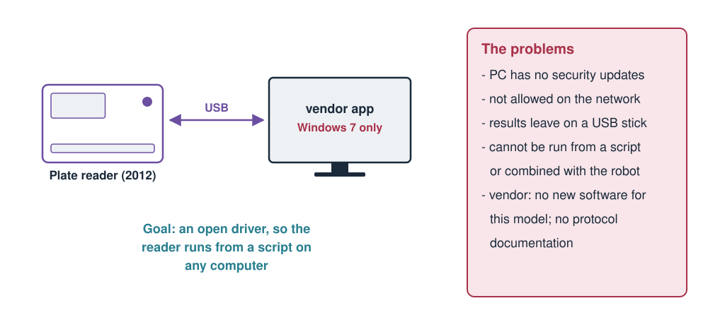{width="76%" fig-align="center"}

::: notes
Here is a typical case. A plate reader bought in 2012, still optically excellent, but its software runs only on Windows 7. The PC has no security updates, so IT has taken it off the network, and results leave on a USB stick. You cannot run the reader from a script, or combine it with the pipetting robot next to it. The vendor sells a new model and does not plan new software for this one; asked for the protocol, they said no. The goal is an open driver: a small library that sends the same commands as the vendor software, so the reader can run from a script on any computer. That is what we build up to in this lecture.
:::

## Before you record anything: ask, check, write it down

- **Ask the vendor** for the protocol or an SDK, in writing. Keep the answer.
- **Check you are a lawful user:** the university owns or leases the instrument and has a licence for the software.
- **Read the licence and the purchase contract.** Note any reverse-engineering clause; bring it to your **legal office**.
- **Write down the purpose:** interoperability, an independent driver. No copying of vendor code.
- **Agree with the instrument's owner** (core facility, colleague) when you may use it, and what you may send to it.

::: notes
Before you plug in a sniffer, do the paperwork. It takes an afternoon and it is what makes the rest defensible. Ask the vendor first, in writing; if they provide documentation or an SDK, you may not need to reverse engineer at all, and if they refuse, you have shown the information was not readily available. Check that the university is a lawful user of the instrument and the software. Read the licence and the purchase contract, and take them to your legal office if they say anything about reverse engineering. Write one paragraph on the purpose: an independent driver for interoperability, no vendor code copied. And agree with whoever is responsible for the instrument, often a core facility, when you may use it and what you may send to it. You will paste that purpose paragraph into your prompts later.
:::

## There are two routes, and you will often use both

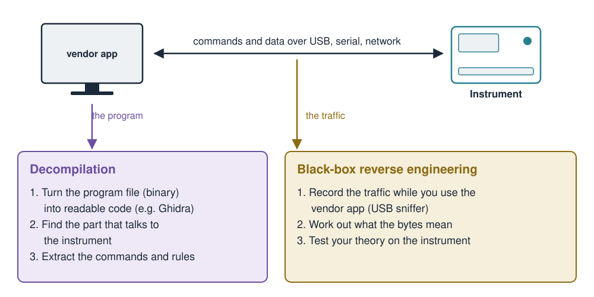{width="72%" fig-align="center"}

::: notes
A recap from the previous lecture. Decompilation turns the vendor program into readable code and looks for the part that talks to the instrument. Black-box reverse engineering leaves the program alone and records the traffic while you use it. In practice, black-box recording is the easier and the legally simpler start: you only use the software as intended and observe what it does. Decompilation helps when the traffic is hard to interpret, for example when there is a checksum or an encoding you cannot guess, or when a command is rarely used. You may well end up using both: the recording tells you what is sent, the decompiled code tells you why.
:::

## Agents now do most of the tedious work

- Reverse engineers report a big change in speed: a video cited in the course author's talk shows an agent working out how to control a computer monitor in **about 15 minutes**.
- Hobbyists use coding agents to decompile whole **classic video games**: MindStudio (October 2026) describes an N64 game decompiled in **under three months**, work that used to take years.
- What the agent is good at: installing tools, reading **thousands of packets**, writing throwaway **helper code**, trying many hypotheses quickly.
- What it is bad at: knowing what the instrument **physically did**, and noticing it has fooled itself. That is your job.

::: notes
How much faster is it with an agent? Two examples. In a video that the course author cited in a talk, an agent worked out how to control a computer monitor over its cable in about a quarter of an hour, a job that used to take a specialist much longer. And in the hobby world of classic video games, people now use coding agents to decompile whole games: MindStudio wrote in October 2026 about a Nintendo 64 game decompiled in under three months, where similar projects used to take years of volunteer work. Treat the numbers as anecdotes, not benchmarks. The pattern is what matters: the agent is very good at the tedious parts, installing tools, reading thousands of packets, writing small scripts to test a hypothesis. It is bad at knowing what the instrument actually did, and it can convince itself of a pattern that is not there. That is where you come in.
:::

## You and the agent split the work

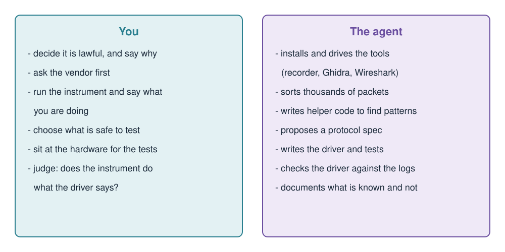{width="72%" fig-align="center"}

::: notes
Here is the division of labour that works. You decide that the work is lawful and say why. You ask the vendor. You run the instrument during the recording and tell the agent what you are doing, step by step. You decide what is safe to test, and you are physically there for the tests, because only you can see whether the plate moved, the lamp came on, the temperature rose. And you judge the result. The agent installs and drives the tools, sorts the packets, writes helper code to find patterns, proposes a specification of the protocol, writes the driver and its tests, checks the driver against the recordings, and documents what is known and what is still a guess. In this course's terms: the agent types, you judge.
:::

## The easiest start: record the traffic together with what you clicked

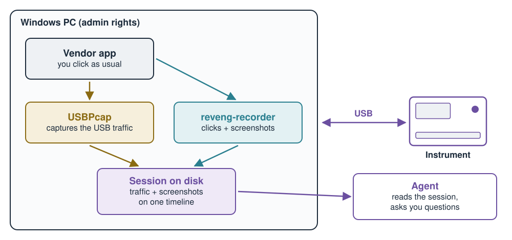{width="70%" fig-align="center"}

::: notes
The simplest setup, if you have administrator rights on the vendor PC, is a software USB sniffer. On Windows that is USBPcap, a free capture driver; installing it needs administrator rights and one reboot. On its own, USBPcap gives you a long list of packets. The course author's open-source tool, reveng-recorder, adds the missing half: it records your mouse clicks and key presses and takes a screenshot at every click, all on the same timeline as the USB traffic. The result is a session on disk that the agent can read and query. Note that reveng-recorder is Windows-first and still under development; read its README for the current state. It also tells you, at the top, to read up on the law before you start.
:::

## The recorder ties each click to the bytes it sent

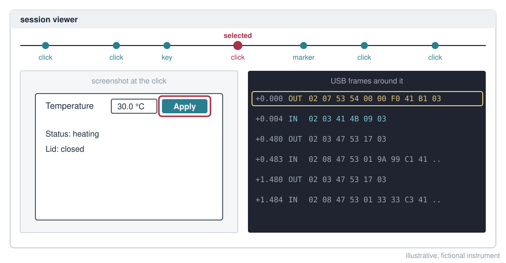{width="76%" fig-align="center"}

::: notes
This is the idea behind the recorder, shown with a fictional heated stage. On top, a timeline of checkpoints: clicks, key presses, and periodic markers. Select one, and you see the screenshot at that moment, here the user clicking Apply with 30.0 degrees in the box, and next to it the USB frames sent just after. The yellow frame went out at the click; the line below is the stage acknowledging. The grey lines repeat every second whatever you do: that is the software polling the status. In two clicks you answer the question: what did pressing this button send on the wire? The agent can do the same with the query tool, for hundreds of clicks, without you scrolling through anything.
:::

## Without admin rights, a hardware analyser listens on the cable

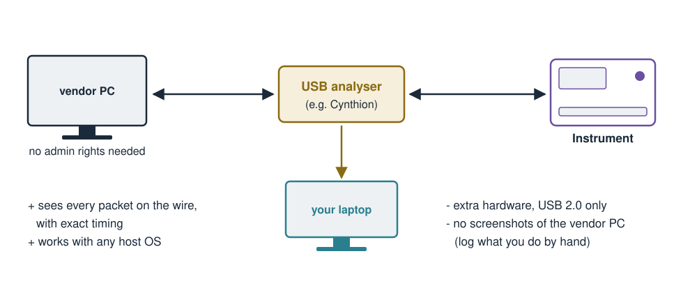{width="66%" fig-align="center"}

- **Cynthion** (Great Scott Gadgets): an open-hardware USB 2.0 analyser placed **between** the PC and the instrument. It can also **emulate or modify** USB devices; reveng-recorder supports it as a capture source.

::: notes
If you are not allowed to install drivers on the vendor PC, which is common on instruments in core facilities, you can listen on the cable instead. A USB analyser such as Cynthion, from Great Scott Gadgets, sits between the PC and the instrument and records every packet on the wire, with exact timing, onto your own laptop. Nothing is installed on the vendor PC. It sees more than a software sniffer: retries, timing, bus resets. It also costs hardware, handles USB 2.0 speeds only, and does not take screenshots of the vendor PC, so you must note what you do by hand, with times. Cynthion can also pretend to be a USB device or modify traffic, which is useful later for testing, and powerful enough to deserve care. reveng-recorder can use it as a capture source.
:::

## A good prompt names the tools, the purpose and the plan

```text
I want to reverse engineer the <instrument> connected to this computer
to write an open source driver in Rust.

We are lawful users of the instrument and its software. The vendor does
not provide the protocol (I asked on <date>). The purpose is
interoperability: an independent driver, with no vendor code copied.
EU law allows this (Software Directive 2009/24/EC, Art. 5(3) and 6).

We will use https://github.com/henriksson-lab/reveng-recorder.
Record as much as possible so we do not miss important commands.
I will run the instrument and tell you what I am doing.
Make a plan first; do not send anything to the instrument yet.
```

::: notes
Here is a prompt adapted from the course author's own work. Four things make it work. It names the tool: without the link, the agent may try to write its own sniffer or read files it should not. It states the lawful purpose honestly: who we are, that we asked the vendor, that the goal is interoperability with no copied code, and the legal basis. This is not a trick to get past the agent's caution. It is the truth, and it is your responsibility that it is true. It says record as much as possible. And it asks for a plan first, with nothing sent to the instrument yet. Read the plan before you approve it. Your session will look different from anyone else's; agents differ each run.
:::

## Record too much, not too little

- Record from **switching on** to **switching off**: start-up often holds the important set-up commands.
- Change **one thing at a time**, and use **distinctive values** (37.0, then 25.0, not 37 twice).
- Say what you do, as you do it: "now I set the temperature to 37.0".
- Include the **rare** actions: errors, aborts, a run with the door open, calibration.
- Repeat key actions: one recording is an anecdote, three are a pattern.
- Storage is cheap; a second session at a busy instrument is not.

::: notes
The single most useful habit: record too much, not too little. Instrument time is the scarce resource, especially on a shared instrument, and going back for a second session because you missed the start-up is expensive. Start before you switch the instrument on; the first seconds often contain the configuration that everything else depends on. Change one thing at a time, and choose values you will recognise in the bytes: 37.0 and then 25.0, not the same value twice. Narrate what you do, so the agent can link the bytes to your words. Include the rare things: an error, an aborted run, calibration. And repeat the important actions, so the agent can tell a pattern from a coincidence.
:::

## A command is a few bytes with a fixed structure

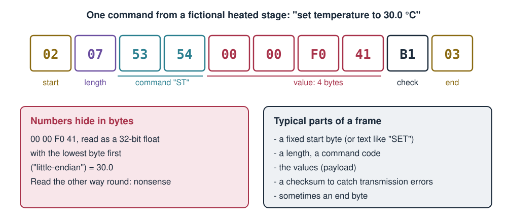{width="76%" fig-align="center"}

::: notes
What will the agent find in the recording? Usually frames like this one, from a fictional heated stage. A start byte. A length. A command code, here two letters, S T. The value, here four bytes. A check byte, so the instrument can detect transmission errors. And sometimes an end byte. The trickiest part for humans is numbers. The four bytes 00 00 F0 41, read as a 32-bit floating-point number with the lowest byte first, which is called little-endian, are exactly 30.0, the value typed in the screenshot. Read the other way round, they are nonsense. This is where distinctive values pay off: the agent searches for 30.0 in every possible encoding and finds where it lives. The exercise asks you to find exactly these kinds of structures in a recording.
:::

## Decoding is a loop: log, extract, helpers, spec, tests

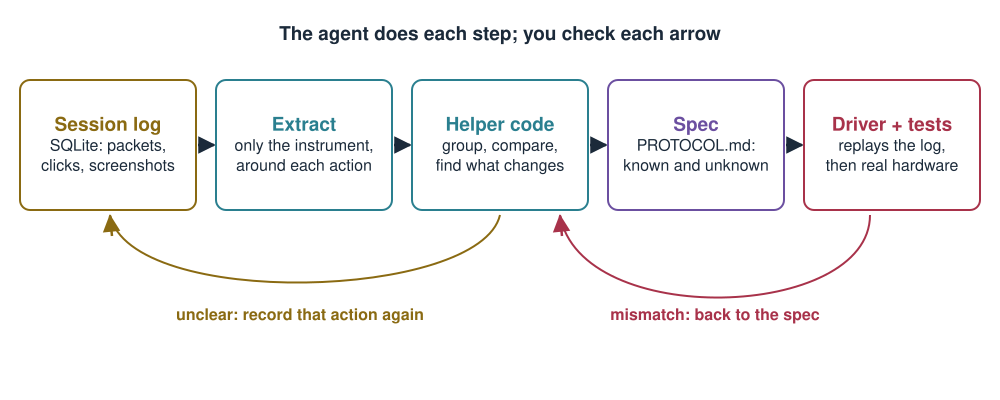{width="78%" fig-align="center"}

::: notes
The decoding itself goes in a loop. The session log holds the packets and your clicks and screenshots. The agent first extracts only what matters: the traffic to and from the instrument, around each action. It writes helper code to group frames, compare them, and find what changes when you change one setting. From that it proposes a specification: a PROTOCOL.md that lists commands, byte layouts and the checksum, and marks clearly what is known and what is a guess. Then the driver and its tests. The first test needs no hardware: the driver must reproduce every exchange in the recording. When something does not match, back to the specification. When something is unclear, record that action again. You check every arrow.
:::

## Helper code finds the patterns; you check them against what you did

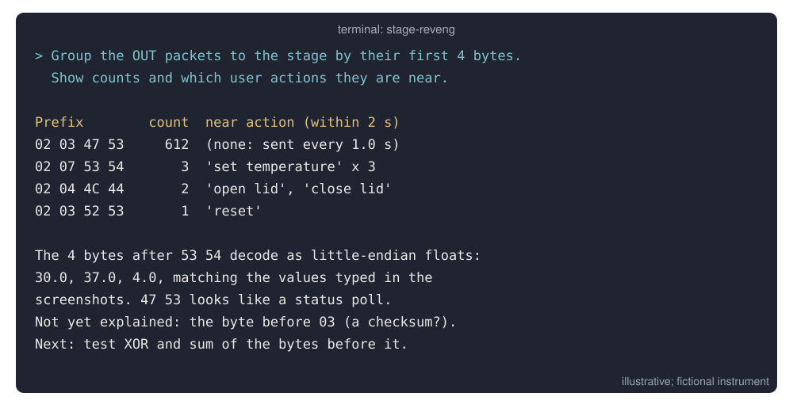{width="74%" fig-align="center"}

::: notes
This is what a helper step looks like, again with the fictional stage. The prompt asks the agent to group the outgoing frames by their first bytes, count them, and say which user action they are near. One group appears 612 times, every second, near nothing: a status poll. One appears three times, each time near "set temperature". The agent decodes the four bytes after the command as little-endian floats and finds 30.0, 37.0 and 4.0, the values in the screenshots. And it says honestly what it has not explained yet: the byte before the end, probably a checksum, with a plan to test the usual candidates on every frame. Your job here is the cross-check: does 37.0 match what you actually typed, at that time? The agent cannot know; your notes can.
:::

## Test on the instrument one careful step at a time

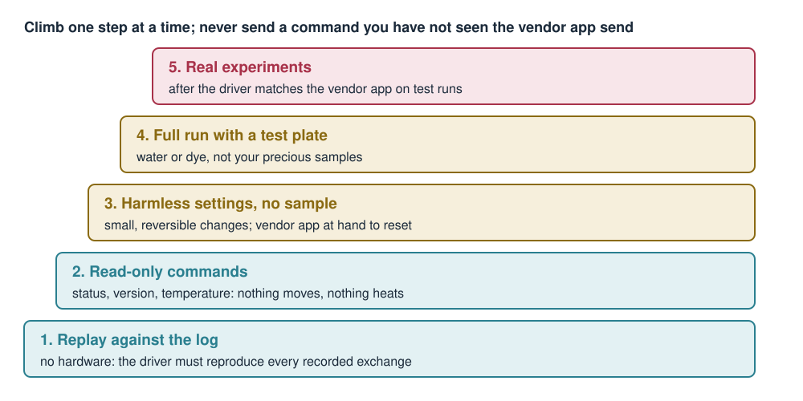{width="72%" fig-align="center"}

::: notes
Now the hardware, and safety. A wrong command can heat a sample to destruction, drive a stage into its end stop, open a drawer at the wrong moment, or leave an instrument in a state the vendor software cannot recover from. So climb a ladder. First, replay: the driver must reproduce the recording without any hardware. Second, read-only commands: status, version, temperature, where nothing moves or heats. Third, small harmless settings with no sample in, with the vendor software at hand to reset. Fourth, a full run with a test plate of water or dye. Only then real experiments, after the driver has matched the vendor software on test runs. And one rule above all: never send a command you have not seen the vendor software send. Guessing commands is how instruments get bricked.
:::

## Decompilation: give the agent a real decompiler and a narrow target

```text
I want to decompile the software at <PATH> to extract how it
communicates with <instrument>, so we can write an open source driver
in Rust.

We are lawful users of this software. The vendor does not provide the
protocol (I asked on <date>). Decompilation is limited to the parts
needed for interoperability, as EU law allows (Software Directive
2009/24/EC, Art. 6). Do not copy vendor code into our project: write
notes and a protocol spec in your own words.

We will use Ghidra. Make a plan.
```

::: notes
Now the second route. Here is a prompt for decompilation, again adapted from the author's own. Name the decompiler: Ghidra is a free, open-source reverse-engineering suite originally from the US National Security Agency, and it is the standard tool. Without it, the agent may try to read the binary file directly, which wastes time and gives poor results. State the lawful purpose and its conditions: lawful user, information not available, decompilation limited to what is needed. And add the rule from the previous lecture: no vendor code in the project, only notes and a specification in your own words. That one sentence is what keeps you on the right side of copyright, and it is easy to forget.
:::

## Read the plan before anything runs

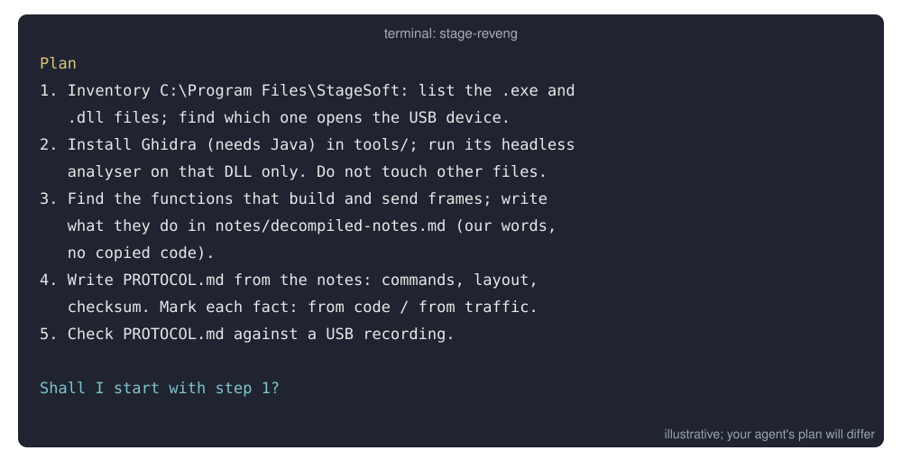{width="72%" fig-align="center"}

::: notes
Here is the kind of plan you should expect, and what to look for in it. It starts with an inventory: which program file opens the USB device. It installs Ghidra in a project folder, not system-wide, and runs it only on the one DLL that matters, which keeps the decompilation confined to the parts needed. It writes notes in its own words, explicitly without copied code. It builds the specification from those notes, marking each fact by its source: from code, or from traffic. And it checks the specification against a recording. If the plan instead says "decompile everything" or "port the vendor's functions to Rust", stop it and correct it. That would be translation, which is copying.
:::

## You are responsible for legality, and the agent may hesitate

- Agents are trained to be careful with **"get around a protection"** and **"decompile someone else's software"**. They may ask questions, add warnings, or refuse part of the task (see *Guardrails and safety levels*).
- Give **honest context**, not tricks: lawful user, vendor asked, interoperability, no copying. Do not write "legal concerns are out of scope".
- The agent cannot check your claims. If they are not true, the responsibility is yours, not the agent's.
- If the agent still declines a step, take that as a signal to **check with your legal office**, not to rephrase until it gives in.

::: notes
A word on the agent's own caution. Decompiling someone else's software and getting around protections are exactly the areas where models are trained to be careful, as we saw in Guardrails and safety levels. You may get questions, warnings, or a refusal of part of the task. The right response is honest context: who you are, that you asked the vendor, that the goal is interoperability, that nothing will be copied. An earlier version of the author's own prompt said "legal concerns are out of scope". Do not do that. It is not true, and it hands the agent a reason to doubt you. The agent cannot verify any of what you say, so the responsibility is entirely yours. And if the agent still declines a step after honest context, treat it as a prompt to check with your legal office, not as a puzzle to rephrase around.
:::

## Stop at encryption, licence checks and copy protection

- If you meet **encryption**, a **licence or dongle check**, **signed firmware** or a **copy protection** scheme: stop.
- Getting around technical protections is regulated **separately** from reverse engineering, and the exceptions are **narrow**.
- Do **not** ask the agent to remove a licence check, crack a key or bypass a signature "to make testing easier".
- Ask your legal office before going further. Often there is another way: the vendor, the Data Act, or a different interface on the instrument.

::: notes
Some instruments protect their software or their protocol: an encrypted link, a licence check or a hardware dongle, firmware that must be signed. This is where you stop and think. Getting around a technical protection measure is regulated separately from reverse engineering, in the EU and in the US, and the exceptions for interoperability are narrow. Never ask the agent to remove a licence check or crack a key to make testing easier: that is likely unlawful, it is what the guardrails are there for, and it is not needed for interoperability. Ask your legal office. Often there is another route: the vendor may open up when asked again with the Data Act in hand, or the instrument may have a second, simpler interface, such as a serial port for service.
:::

## Firmware is a harder problem: the instrument's chip is not your computer

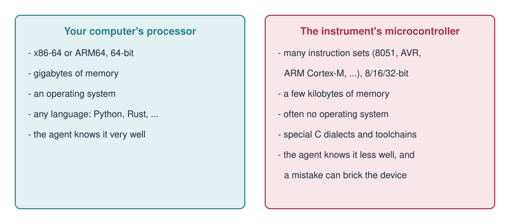{width="72%" fig-align="center"}

::: notes
Sometimes you need to go further and deal with firmware, for example when the vendor driver uploads firmware at start-up, so an open driver needs its own. That is a much harder problem. The chip in the instrument is not like your computer's processor. It may use one of many instruction sets, eight, sixteen or thirty-two bit, with a few kilobytes of memory and no operating system, programmed in special dialects of C with vendor toolchains. Agents know these far less well than they know Python or Rust, and a mistake can make the device unusable. Extracting the vendor firmware to analyse it is possible, but writing new firmware that does not copy it is a project in its own right. For most of you: avoid instruments that need this, or work with someone who has done it before.
:::

## Claude and Codex behave differently in this work

| | Claude Code | Codex |
|---|---|---|
| Speed | fast | slower |
| Style | takes shortcuts, tries things | precise, careful, sometimes too conservative |
| Works well when | you have a good **testing strategy** | you need a **final check** of spec and code |
| Watch out for | a pattern claimed before it is tested | stalling on caution about the legal side |

This is the **course author's experience** on a few instruments, not a benchmark. Models change every few months.

::: notes
Which agent? This slide is the course author's own experience from reverse engineering several instruments, not a benchmark, and models change every few months, so treat it as a starting point. Claude Code was fast, partly because it takes shortcuts: it will propose a pattern early and move on. That works well if you have a good testing strategy, but here testing means hours at the hardware, so shortcuts have a real cost. Codex was more precise but slower, and sometimes overly conservative, especially about the legal side. It worked well as the second opinion: checking the specification against the recordings and reviewing the driver code at the end. Using both, as in Parallel workers, is a good pattern here: one explores, the other checks.
:::

## Long analysis runs can go unattended; hardware tests cannot

- Both tools have **`/goal`**: you state an end condition, and the agent keeps working, turn after turn, until it is met.
  - **Claude Code:** `/goal <condition>`; `/goal` shows status, `/goal clear` stops. Runs unattended only in auto mode.
  - **Codex:** `/goal <objective>` sets a persistent goal (in some versions it must first be enabled; see its docs).
- A good condition is **checkable**: "the decoder reproduces every frame in sessions 1 to 3, and PROTOCOL.md lists every command seen, or stop after 30 turns".
- Use it for **analysis and replay tests**. Do **not** leave an agent unattended with a live instrument.

::: notes
Decoding a large recording can take hours, and you can let the agent work over lunch or overnight. Both tools now have a goal command. In Claude Code, slash goal followed by a condition keeps Claude working until a separate model judges the condition met; slash goal on its own shows progress and slash goal clear stops it. It only runs without prompts in auto mode, so set it up carefully. In Codex, slash goal sets a persistent objective with a stopping condition; depending on your version, you may need to enable the feature first. Write the condition so it can be checked from the agent's own output, and give it a limit. And the important line: use this for analysis and for replay tests against the recordings. Never leave an agent alone with permission to send commands to a live instrument.
:::

## Rust is a good fit for drivers, and agents write it well

- **Memory-safe:** a whole class of crashes and security holes that plague C drivers cannot happen.
- **Fast** and runs on Windows, macOS and Linux, and on small computers next to the instrument.
- The **compiler is strict**, which helps with agents: many mistakes fail at build time, not at the instrument.
- Agents write Rust well in our experience. You do not need to read it; you judge the tests and the instrument's behaviour.
- Python is fine for exploring and for the exercise; Rust for drivers others will rely on.

::: notes
The course author writes drivers in Rust, and the prompts on these slides say so. Rust is memory-safe, which removes a whole class of crashes and security holes that are common in drivers written in C. It is fast and runs on every major operating system, including small computers that sit next to an instrument. Its compiler is strict, which turns out to suit agents well: many mistakes are caught when the code is built, rather than when a command reaches the instrument. In our experience agents write Rust well. You do not need to read it; you judge the tests and what the instrument does. For exploring a protocol, and for this track's exercise, Python is fine. For a driver that colleagues will rely on, Rust is a good choice.
:::

## Open drivers need a home: nu-manager collects them

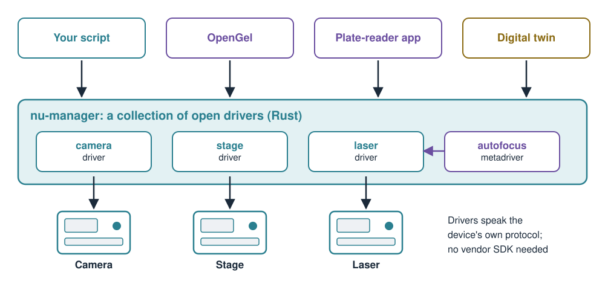{width="72%" fig-align="center"}

::: notes
Once you have a driver, where does it go? The course author's group develops nu-manager, an open-source driver collection in Rust, meant as a successor to the widely used Micro-Manager for microscopes but for all kinds of lab hardware. It is deliberately just a collection of drivers, with no single user interface. Drivers can be stacked: a metadriver such as autofocus uses a camera and a stage driver underneath. The drivers speak each device's own protocol, and the project avoids vendor SDKs, partly for the copyright and security reasons from the previous lecture. Applications sit on top: your own script, a plate-reader application, a gel-imaging application, a digital twin. The project is under development, and its device pages say honestly which drivers have been tested on real hardware.
:::

## An example application: OpenGel images and quantifies gels

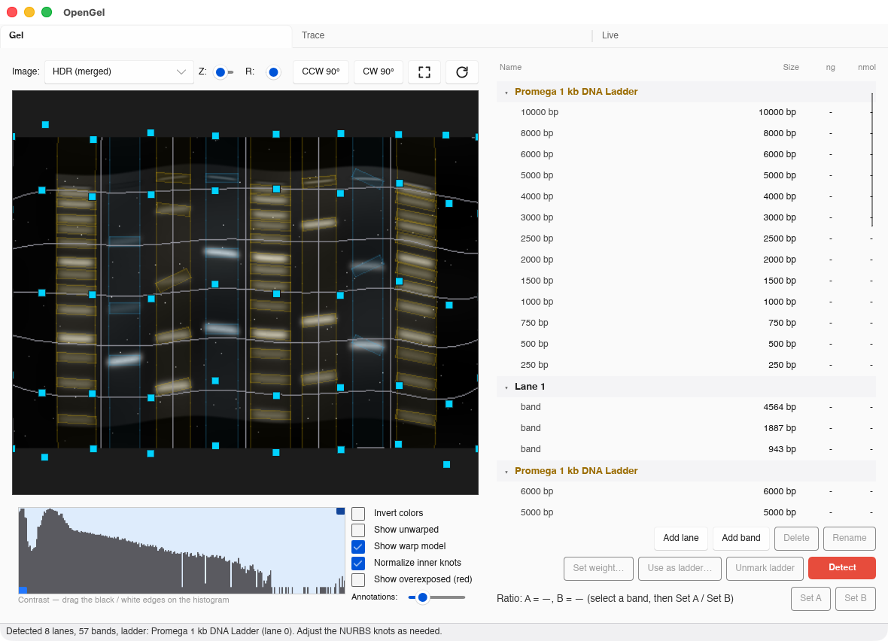{width="56%" fig-align="center"}

[github.com/henriksson-lab/opengel](https://github.com/henriksson-lab/opengel): band detection, quantification, reads Bio-Rad Image Lab scans, cameras through nu-manager.

::: notes
Here is one application built on top: OpenGel, from the same group. It captures gel images from cameras that nu-manager supports, detects lanes and bands, fits the warping of the gel, and quantifies bands against a ladder. It also reads the scan files of a widely used commercial gel imaging software, so old data stays usable. It is open source under the MIT licence, and its README says that the code was written with agentic AI and should be reviewed before anyone copies parts of it. A plate-reader application from the group is in preparation. Look at these projects for the shape of a finished result: a driver, an application, documentation of the protocol, and an honest test status.
:::

## Write down what you know, how you know it, and what you tested

- **PROTOCOL.md:** every command, its bytes, its reply; marked **seen in traffic** / **seen in code** / **guessed**.
- **TEST_PLAN.md:** which commands are tested by replay, which on hardware, which not at all.
- **CAPTURE_PLAN.md:** what to record next time, and in what order.
- **README:** how the protocol was obtained, that no vendor code is included, the licence, the tested instrument and firmware version.
- Keep the recordings and the vendor correspondence (privately, if they hold anything sensitive).

::: notes
The last practical step is documentation, and it is worth as much as the code. A protocol specification where each fact says where it came from: seen in traffic, seen in code, or guessed. A test plan that says honestly what has been tested, and how. A capture plan, so the next person, or you in a year, knows what to record. A README that says how the protocol was obtained and that no vendor code is included, with the licence and the exact instrument and firmware version you tested. The course author's own projects use exactly these files. And keep your evidence: the recordings and the correspondence with the vendor. Screenshots in recordings can show patient data or user names, so store them privately.
:::

## Where this goes wrong

- **Skipping the paperwork:** no request to the vendor, no check of the contract.
- **Too little recorded:** no start-up, the same value twice, rare actions missing.
- **A pattern from one example**, never tested against the rest of the recording.
- **Vendor code in the driver:** decompiled functions translated into Rust.
- **Guessed commands sent** to a live instrument; an agent left alone with hardware.
- **Screenshots with sensitive data** (patient IDs, user names) sent to the cloud.
- **No test status:** colleagues trust a driver nobody tried on the instrument.

::: notes
Here is where this work goes wrong. Skipping the paperwork, which makes everything after it harder to defend. Recording too little. Believing a pattern after one example, without testing it against every frame. Letting decompiled code slip into the driver, translated but still copied. Sending guessed commands to a live instrument, or leaving an agent alone with one. Forgetting that the screenshots in a recording can show patient IDs or user names, and sending them to a cloud agent; check, crop or blur them first, following Privacy, ethics and safety. And publishing a driver without saying what was tested, so that colleagues use it on precious samples. Every one of these has a simple habit on the earlier slides.
:::

## Summary

| Concept | Key fact |
|---|---|
| First | ask the vendor, check the licence and contract, write down the purpose |
| Two routes | record the traffic (USBPcap, reveng-recorder, Cynthion) or decompile (Ghidra) |
| Prompt | name the tools, state the lawful purpose honestly, plan first |
| Recording | from switch-on to switch-off, one change at a time, distinctive values |
| Decoding | helper code, PROTOCOL.md with sources, driver tested against the log |

::: notes
To summarise. First the paperwork: ask the vendor, check the licence and the contract, and write down the purpose. Then choose a route: record the traffic with USBPcap and reveng-recorder, or with a hardware analyser such as Cynthion; or decompile with Ghidra; or both. In the prompt, name the tools, state the lawful purpose honestly, and ask for a plan first. Record generously, one change at a time, with values you will recognise. Then decode in a loop: helper code, a specification that says where each fact came from, and a driver tested against the recording.
:::

## Summary (continued)

| Concept | Key fact |
|---|---|
| Hardware tests | replay, then read-only, then harmless, then test samples; only commands you have seen |
| Limits | stop at encryption, licence checks and copy protection; firmware is hard |
| Agents | Claude fast with shortcuts, Codex careful and slow (author's experience); `/goal` for analysis only |
| Result | a Rust driver in a shared collection such as nu-manager, documented and with a test status |

**Next (your own instrument):** this is the last unit of the course. Do the exercise, then apply the inventory in its last section to an instrument in your own lab.

::: notes
Test on hardware in careful steps, and only send commands you have seen the vendor software send. Stop at encryption, licence checks and copy protection, and be wary of instruments whose firmware you would have to replace. Use the agents' differences: one to explore, one to check, and long unattended runs only for analysis. The result to aim for is a driver in a shared collection, documented, with an honest test status. This is the last unit of the course. The exercise lets you decode a complete synthetic recording without any hardware, and ends with an inventory of an instrument in your own lab. Thank you for following the course.
:::
