## About this lecture

Most lab instruments are controlled by closed vendor software, often on an old Windows PC, writing files only that software can read. Agents have made it much cheaper to work out how an instrument talks, and so to write open drivers. That raises two questions for researchers and for the people who run departments: why would we want to, and are we allowed to?

- **The dream:** one open control layer, open file formats, instruments combined in one experiment, protocols you can publish.
- **Why it matters now:** lock-in, data protection, the US CLOUD Act, dependence on foreign services, closed formats, security.
- **The law (EU and Sweden):** studying a product you lawfully own is allowed; decompiling for **interoperability** is allowed under conditions, and a licence **cannot forbid it**.
- **The pitfalls:** copyright still applies, firmware, patents. **This is not legal advice.**
- **For leaders:** what a university can require when it buys instruments.

This is a **concept** lecture for everyone, including heads of department and infrastructure managers. The hands-on part is *Reverse engineering instruments with agents*.

::: notes
This is the last module of the course, and it is a little different. Only some of you will reverse engineer an instrument yourselves. But all of you work in departments that buy instruments for millions, and many of you decide how they are bought and run. The first half is about why open control of instruments matters, and why it matters more now than five years ago. The second half is about the law. We go through it carefully, with the actual articles, because the folklore on this topic is mostly wrong in both directions: some people think reverse engineering is always illegal, others think anything goes. Neither is true. I am not a lawyer, and nothing here is legal advice; the slides show you where the law is, so that you can have an informed conversation with your university's legal office.
:::

## A typical lab: three instruments, three closed islands

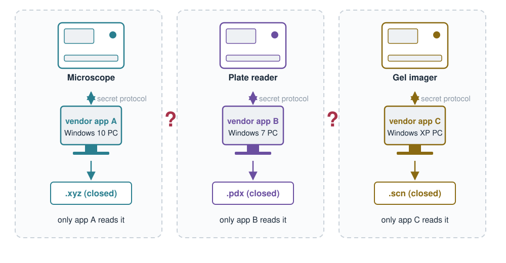{width="72%" fig-align="center"}

::: notes
Here is a typical lab. A microscope, a plate reader, a gel imager. Each comes with its own vendor application, on its own PC, often with an operating system that no longer gets security updates, because the vendor software does not run on anything newer. Each writes its own file format, which only that application reads fully. The instrument and its PC talk through a protocol that is not documented. Now try to do something the vendors did not plan for: image the wells the plate reader flagged, run the instruments from one script overnight, or open ten-year-old data after the vendor has gone. You are stuck. Not because it is technically hard, but because the information you need is kept from you.
:::

## The dream is one open control layer for every instrument

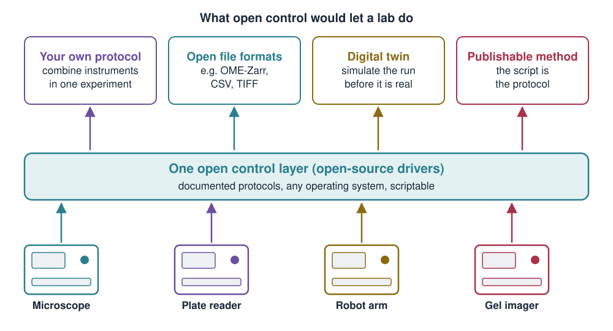{width="78%" fig-align="center"}

::: notes
Here is the alternative. Below, the instruments. In the middle, one open control layer: drivers whose protocols are documented and that run on any operating system. On top, what this makes possible. Your own protocols that combine instruments, such as running a set of sensors and then imaging, in one experiment. Open file formats, so the data outlives the software. Digital twins: a simulated instrument that runs the same script, so you can test a protocol before you use real samples. And publishable methods: the script that ran the experiment is the method section, and someone else can run it. None of this is science fiction; groups around the world do this for individual instruments. The obstacle is the closed protocol.
:::

## Vendors earn most when the whole chain is theirs

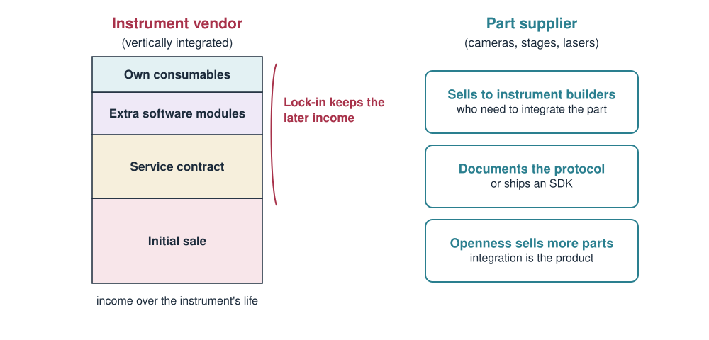{width="74%" fig-align="center"}

::: notes
Why don't vendors simply publish their protocols? Look at it from their side. Many instrument makers are vertically integrated: they own the whole chain from the hardware to the analysis software. Income does not stop with the sale. There is the service contract, the extra software modules, sometimes their own consumables. If the protocol were open, a competitor or a university could replace the software, and part of that later income would go. Lock-in protects it. Part suppliers are in a different position. A company that sells cameras, motorised stages or lasers sells to instrument builders, who need to integrate the part, so these suppliers usually document their protocols or ship a software development kit. Openness is what sells their product. In practice you find the closed protocols at the level of complete instruments.
:::

## "Default no" is often a legal habit, not a business decision

- Ask for the protocol and the request goes to legal, and the safe answer is **no**. Nobody gains by saying yes.
- Sometimes the vendor no longer has the knowledge: the model is old, the developer has left.
- Some vendors **will** share under a non-disclosure agreement, or sell an SDK. Ask first, in writing, and keep the answer.
- A written no, or no answer, is also useful later: it shows the information was **not readily available**, which matters legally (later in this lecture).

::: notes
It is worth knowing how a request for a protocol is handled inside a company. It usually ends up with someone in legal, and from where they sit, saying yes has only risks. So the default answer is no, even when the business would not mind. Sometimes nobody at the company even knows the protocol any more. Still, always ask first. Some vendors share documentation under a non-disclosure agreement, or sell a development kit that is good enough. Ask in writing and keep the reply. If the answer is no, or there is no answer, that is also worth having: we will see that the EU rules on decompilation apply when the information is not readily available to you, and a documented request is good evidence of that.
:::

## Software on the instrument PC decides where your data goes

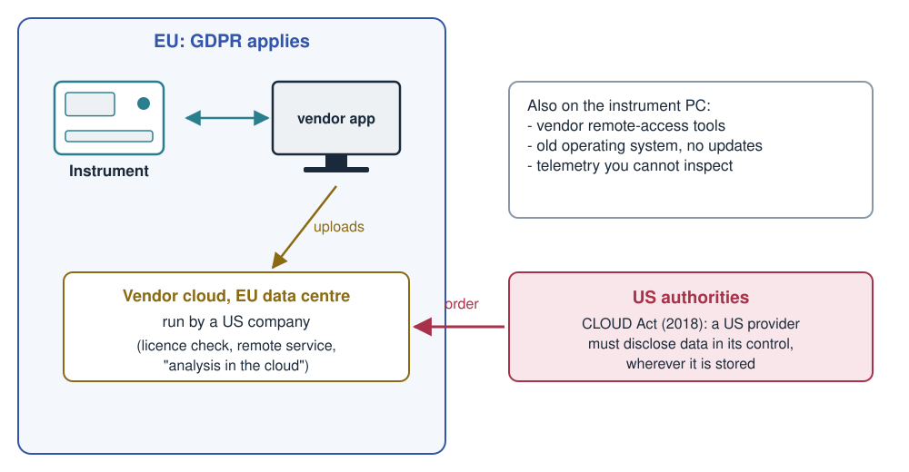{width="74%" fig-align="center"}

::: notes
The second reason is data. More and more instrument software wants an account, a licence check over the internet, a remote service tool, or offers analysis in the vendor's cloud. Once data leaves for a vendor's cloud, the GDPR applies if it holds personal data, for example patient samples, and you need a legal basis and an agreement for that transfer. And if the provider is a US company, there is the US CLOUD Act from 2018: it lets US authorities require a US provider to hand over data in its control, wherever in the world it is stored. An EU data centre run by a US company does not change that. On the PC itself there are often remote-access tools, an outdated operating system, and telemetry you cannot inspect. None of this is hypothetical for a university; it is what IT security and data protection officers already worry about.
:::

## Providers say plainly that they cannot promise EU data stays out of US hands

- **June 2025, French Senate:** asked under oath whether Microsoft could guarantee that data on French citizens would never be handed to US authorities without French consent, Microsoft France's director of legal affairs answered **"No, I cannot guarantee that"**, adding that it had never happened so far.
- The CLOUD Act binds the **provider**, not the data centre. Location in the EU is not enough.
- Universities hold research data with patient information, unpublished results and data under export control.
- For instruments, the safe default is: **no cloud dependency for control or for raw data**.

::: notes
This is not only a theoretical reading of the law. In June 2025, in a French Senate inquiry, Microsoft France's director of public and legal affairs was asked under oath whether he could guarantee that data on French citizens would never be transmitted to US authorities without the French government's agreement. He said no, he could not guarantee that, though he added it had never happened so far. That answer is honest, and it is the point: the obligation is on the provider, wherever the data sits. For a university that holds patient data, unpublished results, and sometimes data under export control, the conclusion for instruments is simple. Control of the instrument and the raw data should not depend on a cloud service you do not control.
:::

## A foreign service can be switched off by its own government overnight

- **12–14 June 2026 (Reuters, Al Jazeera and others):** after a US export-control order on national-security grounds, Anthropic disabled its two newest models, Fable 5 and Mythos 5, **for all customers worldwide**, days after their release. Older models stayed available.
- Customers had no say and no notice. The cause was a government decision, not a technical fault.
- The same can happen to instrument software that needs an online licence check, a cloud account or a vendor update server.
- **Open drivers and open formats are a form of resilience:** the instrument keeps working whatever happens to the vendor or its country.

::: notes
The third reason is dependence. In June 2026, the US Commerce Department ordered Anthropic, the company behind Claude, to block access by foreign nationals to its two newest models on national-security grounds. Anthropic said it had no way to do that selectively at short notice and disabled both models for everyone, days after release, while saying it disagreed with the order. Whatever you think of the reasons, the lesson for us is general: a service from another country can disappear because of a decision in that country, and its customers have no say. The models we use in this course were not affected, but the risk is the same for instrument software that phones home for a licence, needs a cloud account, or must be updated from the vendor's server. An instrument with an open driver and open data formats keeps working whatever happens to the vendor, the vendor's country, or your relations with it.
:::

## Closed file formats lock in your data, not only your instrument

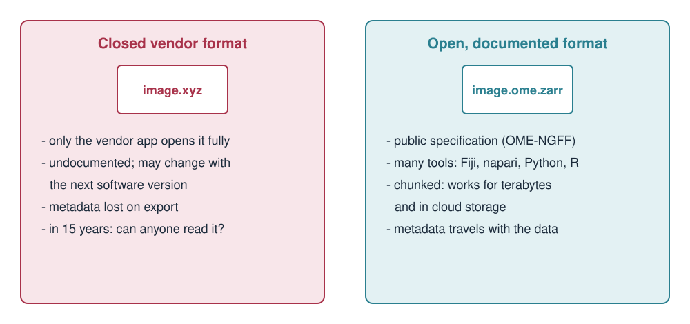{width="70%" fig-align="center"}

::: notes
The fourth reason is file formats. Many instruments write a proprietary format whose layout is undocumented and may change with the next software version. Exports to TIFF or CSV often lose metadata: pixel size, channel names, acquisition settings. In fifteen years, when the vendor has changed owners twice, can anyone still read your data? Compare an open format such as OME-Zarr, from the Open Microscopy Environment community: the specification is public, many tools read it, it is chunked so that it works for terabyte-sized images and in cloud storage, and the metadata travels with the data. Funders increasingly expect FAIR data, and FAIR is very hard with a closed format. An open driver can write an open format directly, at the source.
:::

## Closed software on a lab PC is also a security risk

- Vendor PCs often run an **operating system without security updates**, because the vendor software needs it.
- Every closed program on the network is a black box: **bugs** that let attackers in, and occasionally deliberate **backdoors** (for example remote-support tools, or SDKs that phone home).
- A university cannot inspect closed code; it can only isolate the PC, which makes the instrument harder to use.
- Open drivers can be reviewed, patched and run on an up-to-date system.
- Not a cure-all: open code also has bugs. It is just possible to find and fix them.

::: notes
The last reason is security. The PC next to an expensive instrument is often the weakest machine in the building: an old Windows version, no updates, because the vendor software does not run on anything newer. Closed software on it is a black box. It may contain bugs that let attackers in, and sometimes things that behave like backdoors: remote support tools that are always on, or SDKs that contact the vendor. IT departments usually respond by isolating such PCs from the network, which is sensible but means results leave on USB sticks. Open drivers do not remove all risk, since open code has bugs too, but they can be reviewed, patched and run on a maintained system. That is a real difference.
:::

## There are two ways to learn how an instrument talks

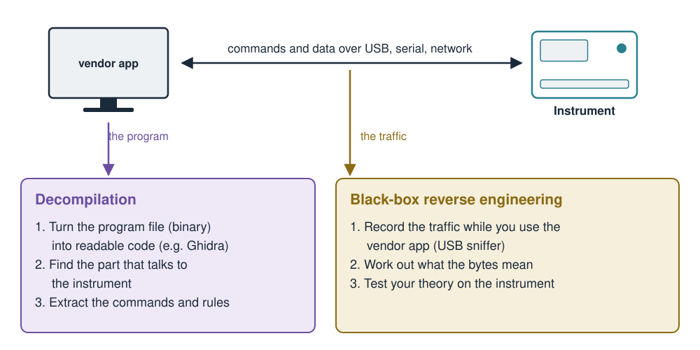{width="76%" fig-align="center"}

::: notes
So suppose you want an open driver and the vendor will not share the protocol. There are two ways to work it out. The first is decompilation: you take the vendor's program file, turn the machine code back into something readable with a tool such as Ghidra, find the part that talks to the instrument, and extract the commands. The second is black-box reverse engineering: you never look inside the program. You record the traffic between the PC and the instrument while you use the vendor software normally, work out what the bytes mean, and test your theory on the instrument. In practice people often combine the two. The distinction matters for the law, because the rules for the two are different. That is the rest of this lecture.
:::

## This is not legal advice: ask your university's legal office

- What follows is a **map of where the law is**, checked against the legal texts in November 2026.
- Real cases depend on details: your contract, the licence, the country, what exactly you copy or publish.
- Before you start on a real instrument: talk to your **legal office** (in Sweden often *juridiska avdelningen* or the university's legal counsel) and, for procurement contracts, the **procurement office**.
- Bring them the facts: the instrument, how it was bought, the licence text, what you plan to do, why (interoperability), and what you will publish.

::: notes
Before the law: I am not a lawyer, this is not legal advice, and you should not act on these slides alone. What I can give you is a map: which laws apply, what they say, and which questions to ask. Real cases turn on details. What does your purchase contract say? What does the software licence say? What exactly will you copy, and what will you publish? Every Swedish university has legal counsel; use them. The best way to get a useful answer is to come with the facts written down: the instrument, how it was bought, the licence text, the plan, the purpose, and what you intend to publish. Then the conversation takes an hour instead of a month.
:::

## Lawmakers allow reverse engineering on purpose, to keep markets open

- Without interoperability, the maker of a product controls everything that connects to it. That blocks **competition** and **repair**, and makes customers **captive**.
- EU law therefore protects software and trade secrets, but **deliberately leaves room** to study products and to make independent programs work with them.
- The aim is not to let you copy a product. It is to let you **connect** to it, and to let others compete on the parts around it.
- Standards (USB, Ethernet, file formats) exist for the same reason.

::: notes
Why would the law allow reverse engineering at all? Because lawmakers saw the same problem we just did. If only the maker of a product can make things that work with it, the maker controls the whole market around it: accessories, software, repair. That is bad for competition and bad for customers. So the EU, when it protected computer programs and trade secrets, deliberately built in exceptions: you may study a product you have lawfully acquired, and you may do what is needed to make an independent program work with it. The boundary is copying. You may learn how to connect to something; you may not copy it. Keep that distinction in mind: it explains almost every rule that follows.
:::

## Sweden reads written law; the US and UK lean on court cases

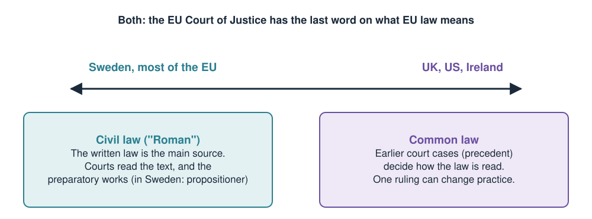{width="70%" fig-align="center"}

::: notes
One piece of background. Sweden, like most of continental Europe, has a civil-law tradition, sometimes called Roman law: the written law is the main source, and courts interpret the text with the help of the preparatory works, in Sweden the government bills, propositioner. The UK, Ireland and the US have common law: earlier court decisions, precedent, largely decide how the law is read, and a single ruling can change practice. For EU law, there is a layer on top: the Court of Justice of the European Union has the final word on what a directive means, and national courts must follow it. In practice: for Sweden, you can read the law and the bill and get quite far; for the US, the case law matters as much as the statute.
:::

## EU trade secret law: studying a product you lawfully have is lawful

**Directive (EU) 2016/943 (Trade Secrets Directive), Article 3(1)(b):** acquiring a trade secret is lawful when it is obtained by

> "observation, study, disassembly or testing of a product or object that has been made available to the public or that is lawfully in the possession of the acquirer of the information who is free from any legally valid duty to limit the acquisition of the trade secret"

**Recital 16:**

> "Reverse engineering of a lawfully acquired product should be considered as a lawful means of acquiring information, except when otherwise contractually agreed. The freedom to enter into such contractual arrangements can, however, be limited by law."

::: notes
The first law is about trade secrets. A protocol that a vendor keeps secret can be a trade secret. The Trade Secrets Directive from 2016 says, in Article 3, that you acquire a trade secret lawfully if you get it by observing, studying, taking apart or testing a product that is on the market or that you lawfully own, as long as you are not under a valid duty to refrain. Recital 16 uses the words reverse engineering directly: reverse engineering a lawfully acquired product is a lawful way to acquire information, unless you have agreed otherwise in a contract. Note that last part. For trade secrets as such, a contract can forbid reverse engineering. But the recital adds that the law can limit that freedom of contract, and for software, as we see next, it does.
:::

## EU software law: observing a program, and decompiling it to interoperate

**Directive 2009/24/EC (Software Directive)**

- **Art. 5(3):** a person with the right to use a program may, without permission, **observe, study or test** how it works, while loading, running or storing it as they are entitled to. Recording its USB traffic while you use it normally is generally seen as this kind of study.
- **Art. 6:** **decompilation** (reproducing and translating the code) is allowed without permission when it is **indispensable** to obtain the information needed for **interoperability** of an independently created program, if:
  - (a) it is done by a **licensee** or another person with a right to use the program (or someone acting for them),
  - (b) the information has **not** already been **readily available** to them,
  - (c) it is **confined to the parts** of the program needed for interoperability.

::: notes
The second law is the Software Directive. It protects computer programs by copyright, and it has two exceptions that matter to us. Article 5, paragraph 3: if you have the right to use a program, you may observe, study and test how it works, to find the ideas and principles behind it, as long as you do it while running the program in ways you are allowed to anyway. Recording the traffic while you use the vendor software normally falls under this. Article 6 goes further: you may decompile, that is reproduce and translate the code, when that is indispensable to get the information you need to make an independently created program interoperate with it. Three conditions: you are a lawful user, the information was not already readily available to you, and you only decompile the parts you need. That second condition is why you ask the vendor first.
:::

## What you learn by decompiling has strict limits, and a licence cannot take the right away

- **Art. 6(2):** the information may **not** be
  - used for anything other than the interoperability you needed,
  - given to others unless that is necessary for the interoperability,
  - used to make a program **substantially similar in its expression**, or for anything else that infringes copyright.
- **Art. 8, second paragraph:**

> "Any contractual provisions contrary to Article 6 or to the exceptions provided for in Article 5(2) and (3) shall be null and void."

- So a licence term "you may not reverse engineer" has **no effect** against Art. 5(3) or Art. 6 in the EU.

::: notes
Article 6 has a second paragraph with limits. What you learn may only be used for the interoperability you needed. You may not pass it on, unless that is necessary for the interoperability, which publishing an open driver arguably is, since the driver must exist for others to interoperate; this is one of the points to discuss with your legal office. And you may not use it to make a program that is substantially similar in its expression, or for anything else that infringes copyright. Then Article 8, which is the key to everything: contract terms contrary to Article 6, or to the exceptions in Article 5 paragraphs 2 and 3, are null and void. Article 5(2) is the backup copy. So in the EU, a licence that says you may not reverse engineer cannot take away your right to observe and test the program, or to decompile it for interoperability under the conditions.
:::

## Put together: what EU law lets a lawful user do

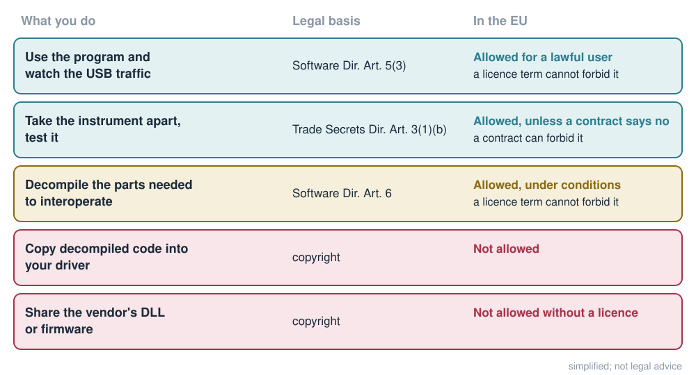{width="74%" fig-align="center"}

::: notes
Here is the whole picture in one table, simplified. Using the vendor program normally and recording the USB traffic is observing and testing the program, Article 5(3), and a licence term cannot forbid it. Taking the instrument apart and testing it is covered by the Trade Secrets Directive, but there a contract can forbid it, so check your purchase contract. Decompiling the parts of the program needed for interoperability is allowed under the Article 6 conditions, and again a licence cannot forbid it. What is not allowed is copying: putting decompiled code into your driver, or sharing the vendor's DLL or firmware without a licence. Learning is allowed; copying is not. When you are unsure which row you are in, that is the question to take to your legal office.
:::

## Licences often forbid reverse engineering; in the EU, parts of that clause are void

> "You may not, and you agree not to or enable others to, copy (...), decompile, reverse engineer, disassemble, attempt to derive the source code of, decrypt, modify, or create derivative works of the Apple Software (...) **(except as and only to the extent any foregoing restriction is prohibited by applicable law** (...))."
>
> (Apple software licence, section "No Reverse Engineering")

- The bracket is there because of laws like EU **Art. 8**: the clause applies only where the law allows it.
- In the US, courts have enforced such clauses (for example *Bowers v. Baystate*, 2003).
- Read your instrument software's licence. Note what it forbids, and bring it to your legal office.

::: notes
Here is what a typical licence looks like, from Apple. It forbids decompiling, reverse engineering, disassembling, and much more. But look at the bracket: except as and only to the extent any foregoing restriction is prohibited by applicable law. Large vendors write this because of laws like the EU's Article 8. In the EU, the clause cannot stop you from observing and testing the program, or from decompiling it for interoperability under the Article 6 conditions. In the US the picture is different: there, courts have enforced licence terms that forbid reverse engineering, a well-known example being Bowers versus Baystate from 2003. This is exactly the difference between the two legal systems: in the US, a court decision on a contract set the practice. For your own instrument: find the licence, read what it says, and bring it to the conversation with your legal office.
:::

## The EU rules apply in Sweden through Swedish law

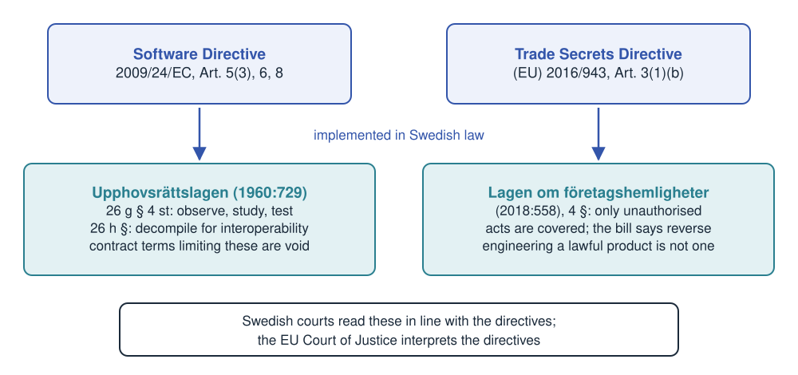{width="72%" fig-align="center"}

::: notes
How does this reach a Swedish university? Sweden is bound by EU law through the accession act, lagen 1994:1500, section 3, with its basis in the constitution, Regeringsformen chapter 10, section 6. Directives are implemented in Swedish law. The Software Directive is in the copyright act, upphovsrättslagen. Section 26 g, fourth paragraph, says that whoever has the right to use a program may observe, examine or test its function, and its sixth paragraph makes contract terms that limit this invalid. Section 26 h allows decompilation for interoperability under the same three conditions as the directive, and its last paragraph also makes limiting contract terms invalid. The Trade Secrets Directive was implemented by lagen om företagshemligheter from 2018. That act only covers unauthorised attacks on trade secrets, in section 4, and the government bill, proposition 2017/18:200, says that someone who obtains a trade secret by reverse engineering a lawfully marketed product may freely use it. Swedish courts read all of this in line with the directives.
:::

## US law also allows reverse engineering, with its own conditions

- **Trade secrets, 18 U.S.C. § 1839(6)(B)** (Defend Trade Secrets Act): "improper means" **"does not include reverse engineering, independent derivation, or any other lawful means of acquisition"**.
- **DMCA, 17 U.S.C. § 1201(f):** a person who has lawfully obtained the right to use a program may get around a technical protection measure **for the sole purpose** of identifying the parts needed for **interoperability** of an independently created program, if that information was not readily available and the acts do not infringe copyright.
- **DMCA exemptions:** every three years the Librarian of Congress grants further exemptions to the ban on getting around protections (most recently in 2024).
- Contracts weigh more in the US: a "no reverse engineering" licence may be enforced.

::: notes
For those who collaborate with US groups or publish code that US users run, a short look at US law. The Defend Trade Secrets Act defines improper means of acquiring a trade secret, and says explicitly that this does not include reverse engineering or independent derivation. The Digital Millennium Copyright Act forbids getting around technical protection measures, but section 1201(f) makes an exception for interoperability, with conditions much like the EU's: lawful user, sole purpose of interoperability, information not readily available, no infringement. In addition, every three years the Librarian of Congress grants exemptions to the anti-circumvention rule for specific uses; the last round was in 2024. The big difference from the EU is contracts: in the US, a licence that forbids reverse engineering may well be enforced.
:::

## Copyright still applies: you may learn the protocol, not copy the code

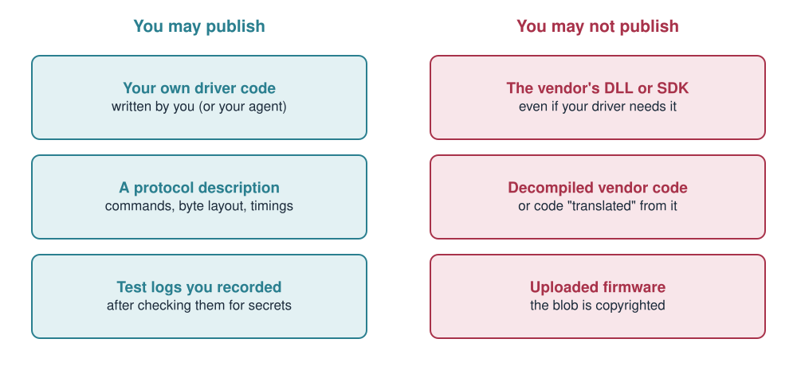{width="70%" fig-align="center"}

::: notes
Now the pitfalls, and the first is the most common. The right to reverse engineer is a right to learn and to interoperate. It is not a right to copy. Three cases. First: you get an instrument working by calling the vendor's DLL from your own program. Fine for yourself, perhaps, but you may not give that DLL away with your code; it is the vendor's copyrighted work. Second: if you decompile the vendor's program, the decompiled code is still the vendor's code, translated. You may not paste it into your driver, even if the agent rewrites the variable names. Third: firmware that must be uploaded to the device, which we come back to. What you may publish is your own code, and a description of the protocol: which bytes mean what. Facts about how to talk to a device are not protected by copyright; the vendor's expression of them is.
:::

## Vendors can plant tells, so keep decompiled code out of your driver

- A vendor can put **odd details** in its code: an unused command, a strange constant, a deliberate quirk in a checksum.
- If your driver reproduces the same oddity, that is **evidence** in court that you copied rather than worked out the protocol independently.
- Agents make this risk larger: asked to "write the driver from the decompiled code", an agent may **translate** the vendor's code line by line.
- Keep a clear trail: **notes and a protocol spec in your own words**, the driver written from the spec, every fact marked "seen in traffic" or "seen in code".

::: notes
There is a trap specific to decompilation. A vendor can deliberately put tells into its code: a command that is never used, a strange constant, a quirk in a checksum that the hardware does not need. If your driver contains the same oddity, that is evidence that you copied the code instead of working out the protocol independently, and it could be used against you in court. Agents make this risk larger, not smaller. If you tell an agent to write a driver from decompiled code, it may well translate the vendor's code line by line into Rust or Python. That is a copy in a different language. The defence is method: notes and a protocol specification in your own words, a driver written from the specification, and a record of where each fact came from.
:::

## Clean-room reverse engineering separates who looks from who writes

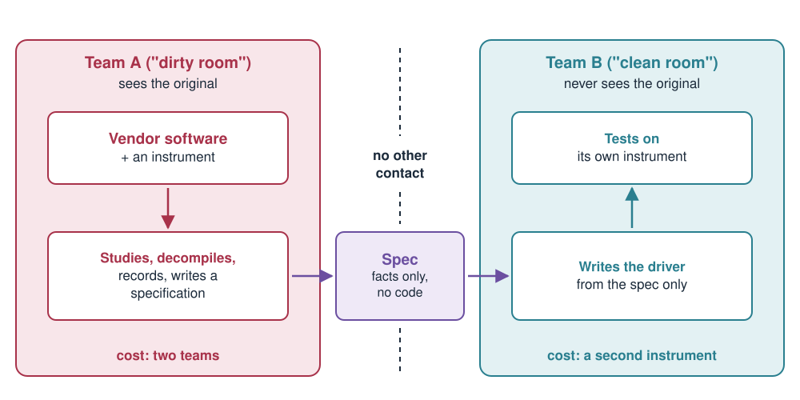{width="72%" fig-align="center"}

::: notes
The classic way to stay clear of copying is clean-room reverse engineering. Team A, the dirty room, studies the original: they decompile, record and test, and write a specification that contains facts only, no code. Team B, the clean room, never sees the original. They write the driver from the specification alone, and test it on their own instrument. The two teams do not talk except through the specification. If the vendor sues, you can show that Team B could not have copied. It is the strongest defence, but it has costs: you need two competent teams, and both need access to the hardware, which for an expensive instrument may mean two instruments. With agents, one could imagine one agent session as the dirty room and a fresh one as the clean room; that helps keep code out of the driver, but a court would still look at what the humans saw and did.
:::

## Firmware is software too, and uploaded firmware is a copyright problem

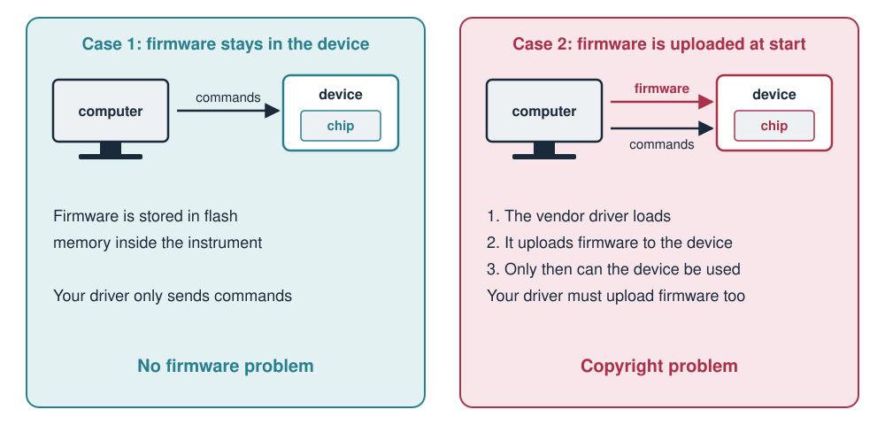{width="74%" fig-align="center"}

::: notes
Many instruments have their own small computer inside, running firmware. In the first case, the firmware is stored permanently in the device. Your driver only sends commands, and you never need to touch the firmware. Good. In the second case, the device forgets its firmware when switched off, and the vendor's driver uploads it every time it starts. Many USB cameras work like this. Now your open driver must upload firmware too, and that firmware is the vendor's copyrighted program. You cannot simply include it in your open-source project. The options are: have the driver load the firmware from the user's own installation of the vendor software, so you never distribute it; or write new firmware yourself, which is hard, as the practice lecture explains. Ask your legal office which applies.
:::

## Patents are a separate question: check the claims, and design around them

- Copyright protects **code**; a patent can protect a **method**, however it is coded. Clean code does not help against a patent.
- A patent that exists is **not necessarily valid**: validity is only settled if it is challenged, and many are narrowed or revoked.
- What a patent covers is in its **claims**. Read them, or have someone read them: often your method is simply different.
- Best answer: **design around** the claim, which often makes better code anyway.
- Practical risk: how likely is the holder to sue a university over a research driver? A question for your legal office, not for guessing.

::: notes
Patents are a different body of law. Copyright protects a particular piece of code; a patent can protect a method, regardless of how you write it. So clean-room work does not protect you against a patent. Two things to know. First, a granted patent is not automatically valid; validity is only tested when someone challenges it, and many patents are narrowed or revoked. Second, what a patent covers is defined by its claims, the numbered sentences at the end, not by the title or the abstract. Often your method turns out to be different from what is claimed. The best response is to design around the claim, which often gives better code anyway. And there is the practical question of risk: how likely is the patent holder to sue a university over a research driver? That is a judgement for your legal office.
:::

## Your own driver needs a licence, and the agent's code needs checking

- Choose an **open-source licence** for your driver and protocol notes (for example MIT or Apache-2.0; GPL if you want changes shared). Ask your university about ownership of the code.
- Code written by an agent can contain **memorised fragments** of other people's code; check before you publish (see *Copyright, memorisation and credit*).
- Say in the README **how the protocol was obtained** (traffic recording, decompilation for interoperability) and that no vendor code is included.
- Keep the **evidence**: the request to the vendor, your notes, the spec, the recordings.

::: notes
Two more things for the code you produce. It needs a licence, otherwise nobody else may legally use it. Common choices are MIT or Apache 2.0, which let anyone use the code, and the GPL if you want improvements to stay open. At a university, check who owns code written in your job; local policies differ, so ask. Code written by an agent can contain fragments it memorised from other projects, which we covered in Copyright, memorisation and credit; check before you publish. And write in the README how the protocol was obtained, and that no vendor code is included. Keep the evidence: the vendor correspondence, your notes, the specification and the recordings. If anyone ever asks, you have the answer on file.
:::

## The EU Data Act gives users a right to their instrument's data

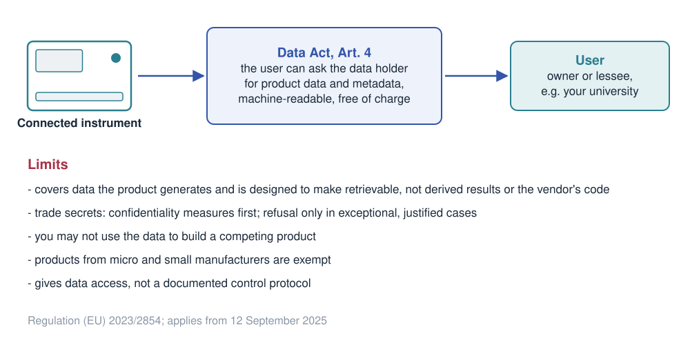{width="72%" fig-align="center"}

::: notes
There is also newer EU law on the users' side. The Data Act, Regulation 2023/2854, has applied since 12 September 2025. It gives the user of a connected product, meaning the owner, or someone who rents or leases it, which can be a university, a right to access the data the product generates, together with the metadata needed to interpret it: easily, securely, free of charge, in a structured, machine-readable format, and where relevant continuously and in real time. Products placed on the market after 12 September 2026 must be designed so that users can access this data directly. Many networked lab instruments are probably connected products in this sense. But note the limits on the slide. It covers data the product generates and is designed to make retrievable, not results derived by the vendor's software. Trade secrets are protected with confidentiality measures. You may not use the data to build a competing product. Small manufacturers are exempt. And it gives you data, not a documented control protocol. Whether a given instrument and a given data stream are covered is exactly the kind of question for your legal office.
:::

## The right-to-repair directive helps consumers, not labs, for now

- **Directive (EU) 2024/1799** on promoting the repair of goods: obligations to repair for **consumer** products such as washing machines and phones, to be applied by member states from mid-2026.
- It does **not** cover lab instruments bought by a university.
- It shows the **direction** of EU policy: products that can be repaired, maintained and connected by others than the maker.
- For instruments, the practical levers are **procurement** and the **Data Act**.

::: notes
You may have heard of the EU right to repair. The directive from 2024 obliges manufacturers to offer repair for certain consumer products, such as washing machines, dishwashers and phones, and member states must apply it from the summer of 2026. It is about consumers, so it does not help with a microscope bought by a university. I mention it because it shows where EU policy is going: towards products that others than the maker can maintain, repair and connect to. For instruments, the levers you actually have today are the Data Act, and above all procurement, which is the next slide.
:::

## Universities can ask for openness when they buy instruments

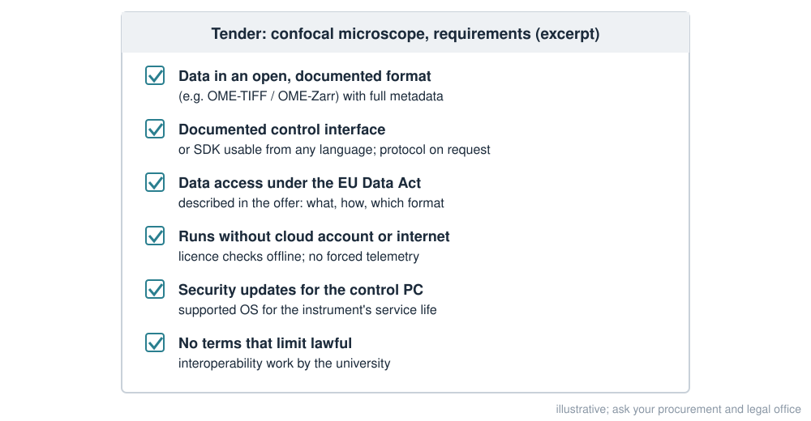{width="64%" fig-align="center"}

Also: support **open-source driver projects**, and agree a **route** with the legal office before someone needs it.

::: notes
This slide is for heads of department, infrastructure managers and anyone who sits on a procurement group. The most effective time to get openness is before you buy. In a public tender, requirements count; wishes do not. You can require data in an open, documented format with full metadata; a documented control interface or a usable SDK; a description of how the Data Act access will work; operation without a cloud account; security updates for the control PC for the life of the instrument; and no contract terms that limit lawful interoperability work. Talk to your procurement office about how to phrase these. Beyond buying: support the people who write open drivers, with time, test hardware and credit. And agree with your legal office on a route for this kind of work, so a researcher does not have to start from scratch with every instrument.
:::

## Where this goes wrong

- **No request to the vendor:** the information may have been readily available, and Art. 6 does not apply.
- **Copying instead of learning:** decompiled code, the vendor DLL or the firmware ends up in your published project.
- **Breaking a protection** (encryption, licence checks, copy protection) beyond what the law allows: a separate rule (EU: Directive 2001/29/EC Art. 6, and Software Directive Art. 7 for programs; US: the DMCA).
- **A contract you did not read:** a service or research agreement can add duties the licence did not.
- **Assuming US rules in the EU, or EU rules in the US.**
- **Damaging the instrument:** untested commands on a shared, expensive machine.

::: notes
Here is where things go wrong in practice. Not asking the vendor first: then you cannot show that the information was not readily available. Copying instead of learning: decompiled code, the DLL or the firmware ends up in the published project. Breaking a protection: encryption, licence checks, copy protection. Getting around technical protection measures is regulated separately, in the EU by the copyright rules on technical measures and in the US by the DMCA, and the interoperability exceptions are narrow. If you meet encryption or a licence check, stop and ask. A contract you did not read: a service agreement or a research collaboration can add obligations. Assuming that what is true in one jurisdiction is true in another. And finally, the practical one: damaging a shared, expensive instrument with untested commands. The practice lecture covers how to avoid that.
:::

## Summary

| Concept | Key fact |
|---|---|
| The dream | one open control layer, open formats, combined instruments, publishable protocols |
| Why vendors close | vertical integration and lock-in; part suppliers are often open |
| Why now | GDPR, CLOUD Act, services switched off by governments, closed formats, security |
| Two ways | black-box recording of traffic, or decompilation of the program |
| Not legal advice | bring the facts to your university's legal office |

::: notes
To summarise the first half. The goal is open control: one layer of documented drivers, open formats, instruments that can be combined, protocols you can publish. Vendors keep protocols closed mainly for business reasons, while part suppliers tend to be open. The reasons to care have grown: data protection, the CLOUD Act, the risk that a foreign service is switched off by its own government, closed formats, and security. There are two ways to learn a protocol: record the traffic, or decompile the program. And none of this is legal advice.
:::

## Summary (continued)

| Concept | Key fact |
|---|---|
| EU trade secrets | studying a lawfully acquired product is lawful, unless a contract says otherwise (2016/943 Art. 3) |
| EU software | observe and test (Art. 5(3)); decompile for interoperability (Art. 6); a licence cannot forbid either (Art. 8) |
| Sweden | upphovsrättslagen 26 g § and 26 h §; lagen om företagshemligheter (2018:558) |
| Pitfalls | copyright on code, DLLs and firmware; patents; protections; your own licence |
| Leaders | require openness in procurement; use the Data Act; agree a route with legal |

**Next (Reverse engineering instruments with agents):** how to record, decode and test an instrument protocol with an agent, safely and lawfully.

::: notes
And the legal half. EU trade secret law makes studying a lawfully acquired product lawful, unless you have agreed otherwise. EU software law lets a lawful user observe and test a program, and decompile it for interoperability under conditions, and a licence cannot forbid either. In Sweden these rules are in the copyright act, sections 26 g and 26 h, and in the trade secrets act. The pitfalls are copyright on code, DLLs and firmware, patents, technical protections, and the licence of your own work. For leaders: put openness into procurement, use the Data Act, and agree a route with your legal office. The next lecture is the hands-on part, for those who will actually do it.
:::
