## About this lecture

Counting and measuring objects in images is a chore in many fields: nuclei in microscopy, colonies on plates, grains in a material. By hand it takes days and nobody counts the same way twice. A short **Python script** does it in seconds, the same way every time. In this track **the agent writes the script and you check what it found**.

- **An image is a table of numbers.** Never edit the original; the script reads it and writes results elsewhere.
- **Pixels are not micrometres.** Find the pixel size and convert, or every area is wrong.
- **Threshold, label, measure.** Three steps turn an image into a table with one row per object.
- **Look at the outlines.** Overlay what was found on the image, and count a few images by hand.
- **A count can be right for the wrong reasons.** Merged and missed nuclei can cancel out.

This is a **track** and the course's gentle introduction to **Python**: you read results, not code. The worked example uses real, annotated images, so you have a known answer.

::: notes
This track is about one of the most common image tasks in research: find the objects, count them, and measure them. We use nuclei in fluorescence microscopy as the worked example, because there is an excellent public dataset where people have outlined every nucleus by hand, so we know the right answer. But the same steps work for bacterial colonies on a plate, for particles in a materials image, for cells in a histology slide. It is also the course's gentle introduction to Python. You will not learn to program. You will learn enough to read what the agent did: what a virtual environment is, what a threshold is, what is in the results table. Most of your time goes into checking: drawing the outlines on the images, counting a few by hand, and comparing the script with the known answer.
:::

## Two hundred fields of nuclei: count them and measure them

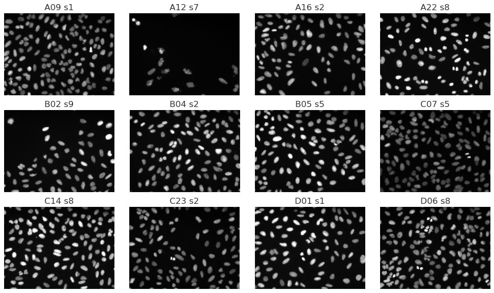{width="88%" fig-align="center"}

::: notes
Here is the material for the worked example: twelve of the two hundred images in a public dataset called BBBC039, from the Broad Bioimage Benchmark Collection. Each image is one field of view from a chemical screen: human U2OS cells, each well treated with a different compound, with the DNA stained by a dye called Hoechst so that the nuclei light up. Some fields are crowded, some sparse; some nuclei are large and round, others small, bright and fragmented, depending on the compound. The task: how many nuclei are in each image, and how large are they? Counting 23 000 nuclei by hand is out of the question. Counting them with a script is easy. Knowing whether the script counted correctly is the real work, and that is what this track is about.
:::

## The same steps count colonies, particles and cells

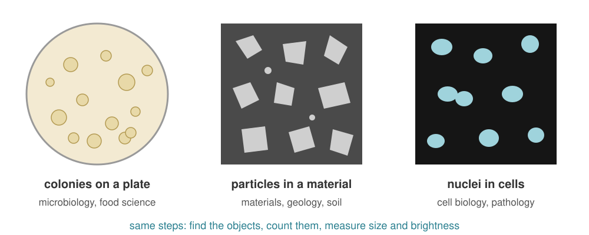{width="85%" fig-align="center"}

::: notes
Before we go into nuclei: the same method works across many fields. A microbiologist counts colonies on an agar plate and measures their size. A materials scientist measures the size distribution of grains or particles in a micrograph. A soil scientist counts pores. A pathologist counts cells in a tissue section. In all of them, the steps are the same: separate the objects from the background, separate touching objects from each other, count them, and measure each one. And in all of them the same things go wrong: objects that touch, uneven lighting, debris, objects cut off by the edge of the image, and confusion between pixels and real units. If your own images are not nuclei, keep your own case in mind throughout. The exercise has an option for it.
:::

## Python, just enough to read what the agent did

| Word | What it means here |
|---|---|
| **Python** | a programming language; installed once on your computer |
| **script** | a text file ending in `.py` with the steps; run it again and you get the same result |
| **package** | a ready-made toolbox: **scikit-image** (image analysis), **numpy** (numbers), **pandas** (tables), **matplotlib** (plots) |
| **virtual environment** | a folder (`.venv`) in your project holding the packages for this project only |
| **notebook** | an alternative to a script, mixing code and output; we use scripts |

You will not write Python. You will read file names, settings at the top of a script, tables and pictures, and you will ask the agent what a line does when it matters.

::: notes
This is the only programming vocabulary you need for this track. Python is a programming language that is widely used in science. A script is a plain text file with the steps of the analysis; the point of a script is that you can run it again, next month, on new images, and get the same treatment. Packages are toolboxes other people wrote. scikit-image does the image analysis, numpy handles the arrays of numbers that images are, pandas makes tables, and matplotlib makes plots. A virtual environment is just a folder where this project's packages live, so that installing something for another project cannot break this one. You may have heard of notebooks, which mix code and output in one document. They are fine, but a script is easier to rerun from scratch, so we use scripts. When you want to know what a line of the script does, ask the agent. It is good at explaining its own code.
:::

## The pipeline: from an image to a table and a picture to check

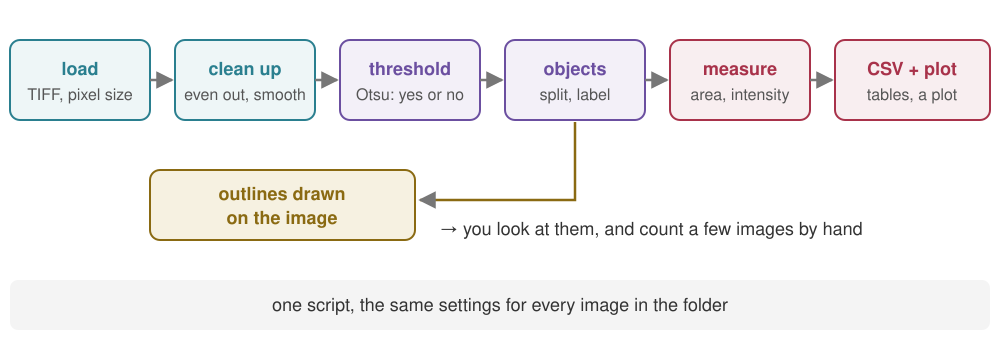{width="95%" fig-align="center"}

::: notes
Here is the whole analysis. Load the image, and find out its pixel size. Clean it up: smooth it lightly against noise, and even out the background if it is uneven. Threshold: decide, for each pixel, whether it belongs to a nucleus or to the background. Turn the yes-or-no pixels into objects: split nuclei that touch, give each object a number, and drop things that are too small to be nuclei. Measure each object: its area, its brightness, its position. Save the measurements as tables and make a plot. And the branch at the bottom is the part that makes it trustworthy: draw the outline of every object the script found on top of the image, and look at it. Then count a few images by hand. All of this is one script, with the same settings for every image.
:::

## The agent sets up a virtual environment; you only need to know it exists

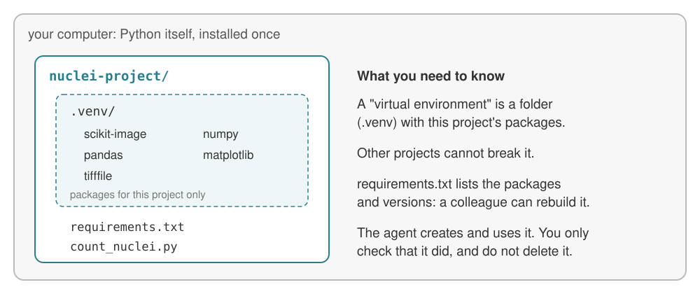{width="85%" fig-align="center"}

::: notes
Before the agent can run anything, Python and the packages must be installed. Python itself may already be on your computer; you checked in the Terminal survival kit. The packages go into a virtual environment: a folder, usually called .venv, inside your project. The agent creates it with a command like python -m venv, or with a newer tool called uv; either is fine. It also writes a file called requirements.txt, which lists the packages and their versions, so that a colleague can rebuild the same environment on their computer. Your part is small. Ask the agent to use a virtual environment in the project folder, not to install packages for the whole computer. Read the install commands before you approve them. And do not delete the .venv folder, or put it in git: it is large, and it can always be rebuilt from requirements.txt.
:::

## A grey image is a table of numbers

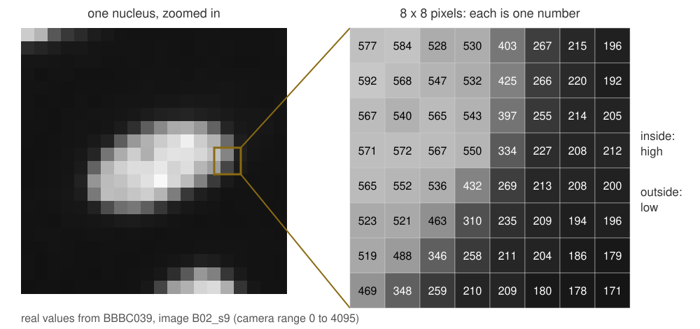{width="88%" fig-align="center"}

::: notes
To a computer, a greyscale image is a table of numbers, one per pixel. Here is one nucleus from the dataset, enlarged until you see the pixels, and an eight by eight block of them with their actual values. Inside the nucleus the numbers are high, outside they are low, and at the edge they fall off gradually. Everything the script does is arithmetic on these numbers: compare them with a threshold, add them up, count them. This has a consequence you should hold on to: the numbers are your data. Any program that changes them, by brightening, sharpening or converting the image, changes your measurements. The camera here stores values from 0 to 4095. That is a 12-bit camera, saved in a 16-bit file.
:::

## A 16-bit image can look black and still be perfect

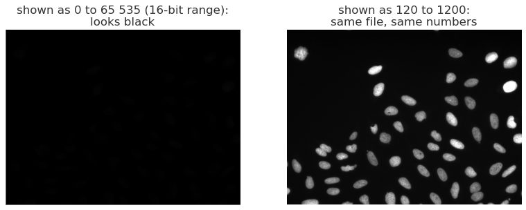{width="80%" fig-align="center"}

- Many viewers show 16-bit files on a 0 to 65 535 scale. Values up to 4095 then look almost black.
- **Brighten the display, not the file.** Use [Fiji](https://fiji.sc) or ask the agent for a contrast-stretched preview copy.

::: notes
A practical surprise. When you open one of these TIFF files in an ordinary image viewer, it may look completely black. Nothing is wrong. The file can hold values up to 65 535, but this camera only goes to 4095, so on the full scale every pixel is dark. On the right is the same file, with the display set from 120 to 1200: now you see the nuclei. Only the display changed; the numbers in the file did not. Fiji, a free image program widely used in biology, does this automatically and lets you adjust it. The mistake to avoid is to fix the darkness by saving a brightened copy and then analysing that copy. Brightening can clip the brightest values and changes every intensity measurement. If you want previews, ask the agent to write them to a separate folder, clearly named as previews.
:::

## File formats: keep the original, know what is in it

| Format | What it is | Watch out for |
|---|---|---|
| **TIFF** (`.tif`) | the common lossless format for microscopy; 8 or 16 bits | can hold several channels or a stack; metadata may or may not include pixel size |
| **Vendor formats** (`.czi` Zeiss, `.nd2` Nikon, `.lif` Leica) | the microscope's own format, with full metadata | need an extra reader (Bio-Formats in Fiji, or a Python package the agent installs); check that channels come out in the right order |
| **PNG** | lossless, usually 8 bits | 16-bit data squeezed into 8 bits loses detail; fine for previews and masks |
| **JPEG** | lossy compression | **never for analysis**: it changes pixel values, worst at edges |

Ask the agent to report the shape, bit depth and value range of the first image before anything else.

::: notes
Microscopy images come in many formats. TIFF is the common denominator: lossless, and it can hold 16-bit values. But a TIFF can also hold several channels or a z-stack, and whether it contains the pixel size depends on the software that wrote it. Vendor formats such as Zeiss CZI, Nikon ND2 or Leica LIF keep all the metadata, including the pixel size, but need a reader: Bio-Formats in Fiji, or a Python package that the agent can install. A common error with multi-channel files is that the channels come out in a different order than you think, so the script measures the wrong stain. PNG is fine for masks and previews. JPEG should never be used for analysis, because its compression changes pixel values, especially at edges, which is exactly where segmentation happens. The simplest check of all: ask the agent to report the shape, bit depth and value range of the first image before doing anything else.
:::

## Never edit the raw images: the script reads, results go elsewhere

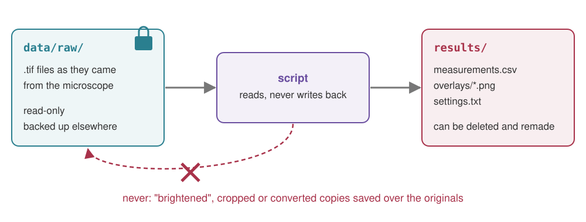{width="85%" fig-align="center"}

::: notes
This is the same rule as in Organising a project for an agent, and it matters even more for images. The raw images go in data/raw and are never changed, by you, by the agent, or by a script. Keep a backup elsewhere. The script reads them and writes everything it makes to a results folder: the measurement tables, the overlay pictures, and a small file with the settings it used. Anything in results can be deleted and remade by running the script again. The arrow that must never happen is the dashed one: a brightened, cropped or converted copy saved over the original. Some image editors do this silently when you press save. Write the rule into CLAUDE.md or AGENTS.md, so the agent reads it at the start of every session.
:::

## Pixels are not micrometres: find the pixel size and convert

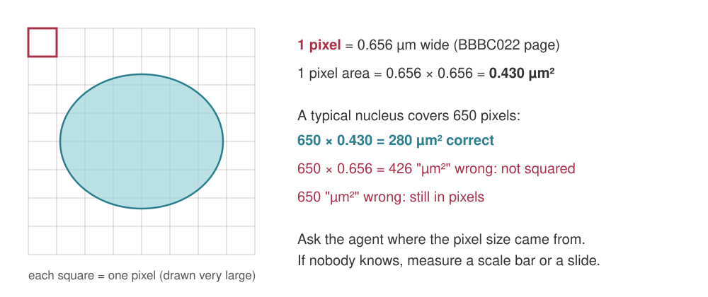{width="85%" fig-align="center"}

::: notes
The script measures everything in pixels. To report areas in square micrometres you need the pixel size: how wide one pixel is in the sample. For our dataset it is 0.656 micrometres, and, typically, it is not on the BBBC039 page itself. It is on the page of the parent dataset, BBBC022, which says the images were taken at 20 times magnification. Finding the pixel size is often detective work like this: the microscope metadata, the lab's notes, or a scale bar or a calibration slide imaged with the same settings. Then convert, and convert correctly: an area is a length times a length, so you multiply by the pixel size squared. A typical nucleus here covers about 650 pixels, which is 280 square micrometres, not 426 and not 650. Ask the agent where its pixel size came from. If it says "a typical value", it guessed.
:::

## The known answer: people outlined every nucleus by hand

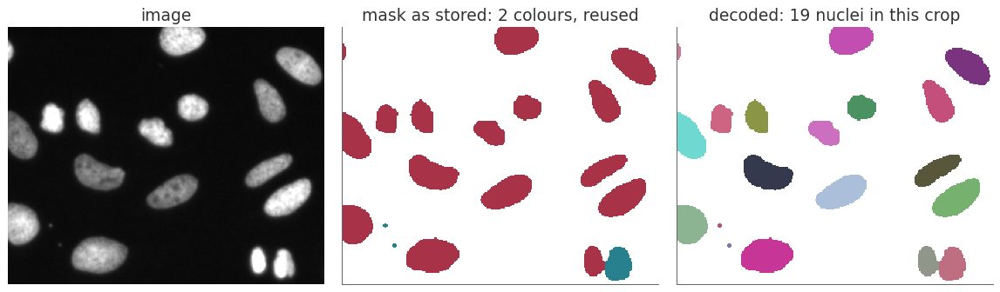{width="92%" fig-align="center"}

- BBBC039: 200 images, about 23 000 nuclei outlined by people. Licence **CC0** (no restrictions); please cite it.
- The masks use a few colours, reused: **one colour is not one nucleus**. Decoding them is a step you check too.

::: notes
What makes this dataset so useful for learning is the ground truth: for every image, people outlined every nucleus by hand. The outlines are stored as a mask image, one per field, in which each nucleus is painted in a colour. The colours are reused: in the image shown, just two colours cover 95 nuclei, because only nuclei that touch need different colours. So you cannot count nuclei by counting colours. The agent has to split each colour into connected pieces, and the number of pieces is the true count. That decoding is itself a small script, and it can be wrong too, so you check it: overlay the decoded outlines on the image and look, for one or two images. The dataset is released under CC0, which means no restrictions, but the authors ask to be cited, and the exercise gives the citation.
:::

## First prompt: have the agent describe the images back to you

```text
data/raw/ holds microscopy images (images/*.tif) and hand-drawn ground
truth masks (masks/*.png) from the public dataset BBBC039. Do not
analyse anything yet. Set up a Python virtual environment in this
folder with scikit-image, numpy, pandas and matplotlib, and record the
packages in requirements.txt.

Then tell me: how many images and masks there are, and whether every
image has a mask with the same name; the size, bit depth and value range
of the first image; and how the masks encode the nuclei. Make
contrast-stretched preview PNGs of the first 3 images in results/previews/.
Do not change anything in data/raw.
```

**What you check:** 200 images and 200 masks with matching names (and no stray `__MACOSX` files counted as images), 520 x 696 pixels, 16-bit, values up to 4095.

::: notes
As in every track, the first prompt does no analysis. The agent sets up the environment and describes the material back to you. You learn several things you can check in a minute. The counts: two hundred images, two hundred masks, matching names. A small trap: the zip files were made on a Mac and contain a hidden folder called __MACOSX full of small junk files with the same names. A careless script counts them as images and crashes or, worse, carries on. The image size and bit depth: 520 by 696 pixels, 16-bit, values up to 4095. And how the masks are encoded: a good agent looks at the mask files and finds that colours are reused. The previews let you see the images without opening Fiji. Keep them in results, never in data.
:::

## A threshold splits pixels into nucleus and background

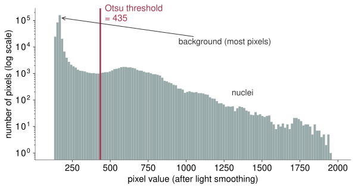{width="80%" fig-align="center"}

- **Otsu's method** picks the cut that best separates the two humps of the histogram. One number per image, chosen by the data.
- It assumes two kinds of pixel. Very uneven background or very dim nuclei break that assumption.

::: notes
The heart of the analysis is the threshold. Here is the histogram of pixel values for one image, on a log scale. The big hump on the left is the background: most pixels. The long tail to the right is the nuclei. A threshold is a cut: everything to the right is called nucleus, everything to the left background. Where to cut? Otsu's method, from 1979 and still the default in most tools, picks the value that best separates the two groups. It is computed from the image itself, so a brighter image gets a higher threshold. That is usually what you want, but it assumes the picture really has two kinds of pixel. If the background is much brighter in one corner, or some nuclei are much dimmer than the rest, one global threshold misses them. There are fixes, such as background subtraction and local thresholds, and the overlay will tell you whether you need them.
:::

## Threshold, then label: every connected blob gets a number

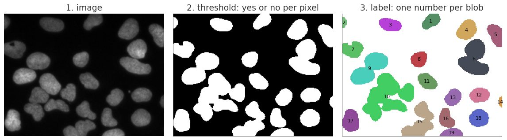{width="92%" fig-align="center"}

::: notes
After the threshold, each pixel is yes or no: the middle panel. A program still does not know how many nuclei there are. The next step is labelling: every connected group of yes pixels gets its own number, shown here in its own colour. The count is simply the highest number. Here you can already see the main problem. Where two nuclei touch, the threshold joins them, and labelling gives the joined blob one number. That is one nucleus too few, and one area twice too large. Splitting touching objects is a separate step, usually done with a method called watershed, which looks for the narrow waist between two round shapes. It works well for round nuclei and poorly for odd shapes, so it is another thing you check in the overlay.
:::

## Each object becomes one row in a table

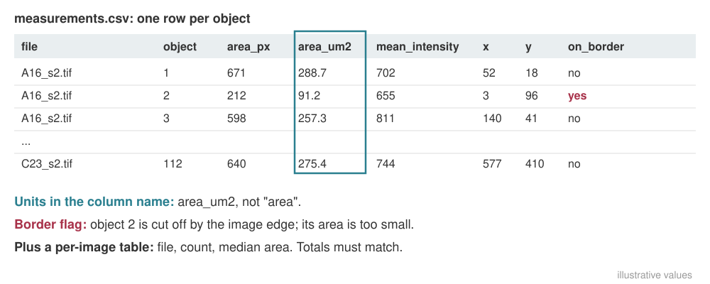{width="88%" fig-align="center"}

::: notes
Once every object has a number, measuring is easy: for each object, count its pixels for the area, average the pixel values for the mean intensity, and record its position. scikit-image does this with one function, regionprops, which can measure dozens of properties. The result is a table with one row per object, and this is the table you analyse further, in Python, R or Excel. Two details make it much safer. Put the unit in the column name: area_um2, not area, so nobody has to guess. And flag objects that touch the image border: they are cut off, so their area is too small. Also ask for a second table, one row per image, with the count and the median area. Then you can check that the two tables agree: the number of rows per image in the first must equal the count in the second.
:::

## The overlay shows what the script found

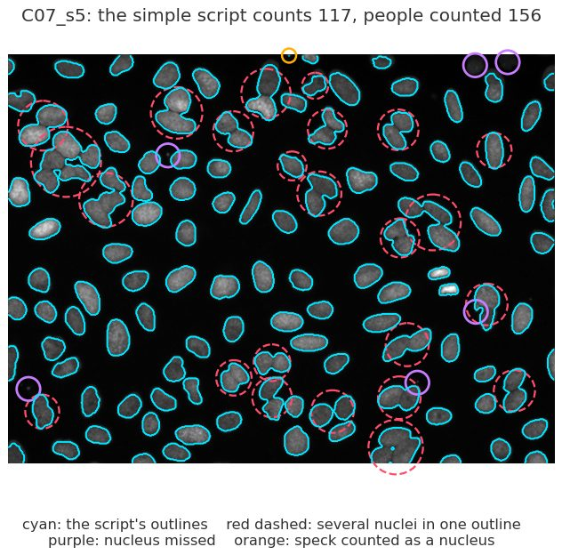{width="62%" fig-align="center"}

::: notes
This is the most important picture in the track. The script's outlines, in cyan, drawn on top of the image. You can check it in a minute, and you do not need to read any code. Look for three things. Several nuclei inside one outline, marked with red dashed circles: the script counted them as one. In this crowded image, 34 nuclei disappear into merged outlines. Nuclei with no outline at all, marked in purple: missed, six here. And small specks with an outline, in orange: debris counted as nuclei. The result: 117 instead of 156. Every analysis has some of each. The question is how many, and whether it matters for your question. Ask the agent to save one overlay per image, as PNG, in the results folder, and look at a random sample of them yourself. Agents cannot judge these pictures reliably for you. Your eyes and your knowledge of what a nucleus looks like are the check.
:::

## Touching nuclei merge; a watershed split separates most of them

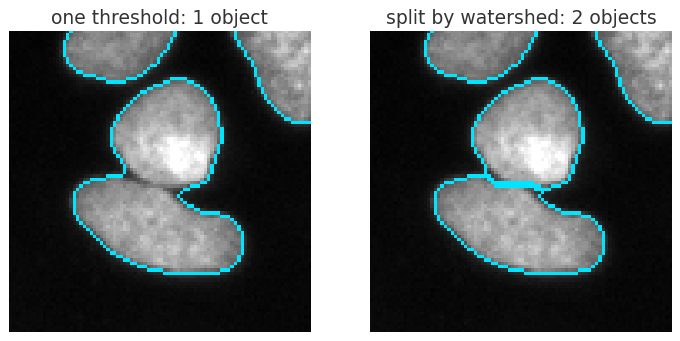{width="80%" fig-align="center"}

::: notes
Here is a closer look at the most common error. On the left, two nuclei that touch, found as one object by a plain threshold. On the right, the same pair after a watershed split: the algorithm measures how far each pixel is from the background, finds the two centres, and draws the border along the waist between them. Two objects. Splitting is not free: if the settings are too eager, a single large or oddly shaped nucleus is cut in two. So there is a trade-off between merging and over-splitting, and the right setting depends on your cells. That is why you look at the overlay before and after, and why you check against hand counts. In this dataset, crowded images with many touching nuclei are where a simple script loses most.
:::

## What counts as one nucleus is a definition, not a detail

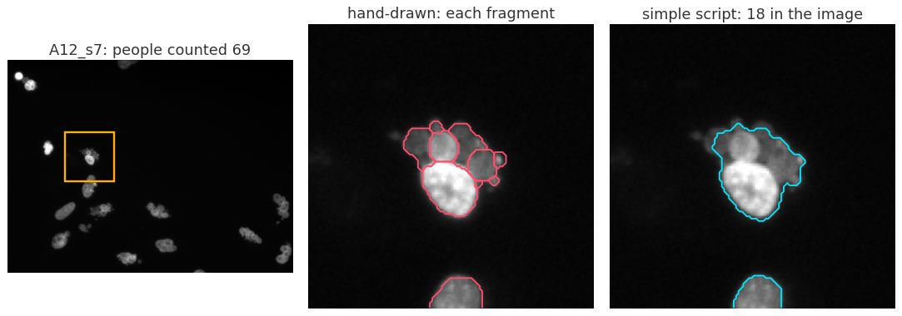{width="90%" fig-align="center"}

- In A12_s7 the compound fragmented many nuclei. The people who drew the masks outlined **each fragment**: 69 objects. A simple script finds 18.
- Neither is "wrong". Decide what you count, write it down, and check that the script and the truth use the same rule.

::: notes
Here is a case where the script and the ground truth disagree for a reason that has nothing to do with thresholds. In image A12_s7, the compound has broken many nuclei into fragments, as happens in dying cells. The people who drew the masks outlined each fragment as a separate object, so the true count is 69, and many of those objects are tiny. A simple script sees each cluster of fragments as one blob and counts 18. Even the careful script finds only 22. Which number is right depends on your question. If you are counting cells, a fragmented nucleus is one cell. If you are counting nuclear fragments as a sign of cell death, each fragment counts. So before comparing with any truth, make sure you and the truth use the same definition. And when you write up, state the definition. This one image accounts for most of the careful script's error in the exercise.
:::

## Uneven lighting and dim nuclei need more than one global threshold

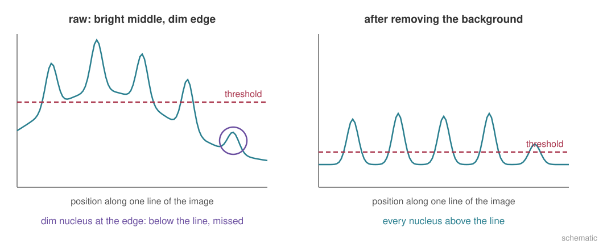{width="80%" fig-align="center"}

- One global threshold is one number for the whole image. Nuclei in a dim corner fall below it, and bright background can rise above it.
- Fixes: **remove the background** first (an "opening" or "top-hat" filter), or a **local threshold**. Check either on the overlay.

::: notes
The BBBC039 images are evenly lit, but many microscopes are not: the centre of the field is often brighter than the edges, and nuclei differ in brightness. This schematic shows one line through an image. On the left, the raw values sit on a background that is bright in the middle and dim at the edge. With one threshold, the dim nucleus at the edge is missed, and in the bright middle even the background between nuclei rises above the line, so neighbours merge into one blob. On the right, the slowly varying background has been estimated and subtracted first, and now every nucleus stands clear of the same line. That is what the careful script in the exercise does. A local threshold, computed separately for each neighbourhood, is the other common fix. Both have settings that can go wrong, for example by cutting the dim edge of a large nucleus into pieces, so the overlay remains the check.
:::

## Debris and border objects are decisions, not details

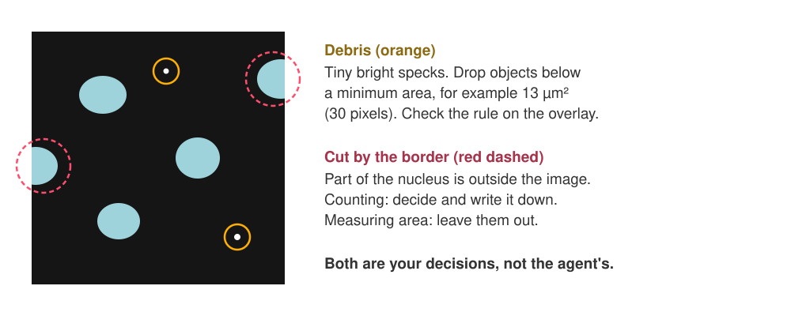{width="85%" fig-align="center"}

::: notes
Two more decisions that every counting script makes, and that you should make instead. Debris: tiny bright specks that pass the threshold. The usual fix is a minimum size, below which objects are dropped. The right minimum depends on your objects: check it on the overlay, and make sure it does not drop small real nuclei, such as fragmented nuclei of dying cells. Border objects: nuclei cut off by the edge of the image. For counting, there are conventions, such as counting only objects touching two of the four edges. For measuring area, leave them out, because their area is too small. Neither rule is right in general. Decide, write the decision in your README, and make sure the script does what you decided.
:::

## A count can be right for the wrong reasons

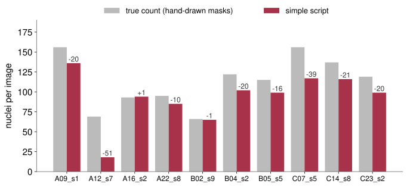{width="88%" fig-align="center"}

- A16_s2: 94 found, 93 true. But 11 of the 94 are specks of debris, and merged pairs hide about as many real nuclei.
- Most images: 10 to 40 too few, because crowded nuclei merge. A12_s7: fragments (previous slides).

::: notes
Here is why "the count looks about right" is not enough. For the ten test images in the exercise, the grey bars are the true counts from the hand-drawn masks, and the red bars the counts from the simple script: one threshold, no splitting, no size filter. In most images the script is 10 to 40 nuclei short, because crowded nuclei merge. But two images look almost perfect: A16_s2, one too many, and B02_s9, one too few. Look closer at A16_s2: eleven of the objects the script counted are tiny specks, smaller than 30 pixels. So about as many real nuclei must be hidden in merged outlines. Two opposite errors cancel, and the total looks right. That matters as soon as you measure anything else: the areas are wrong, and in the next image the errors will not cancel. The check is never only the count. It is the count and the overlay.
:::

## Compare with hand counts on images the script was not tuned on

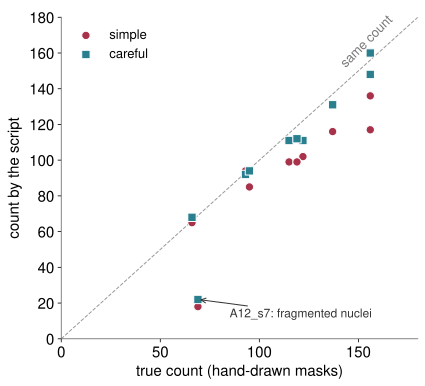{width="58%" fig-align="center"}

- Points on the diagonal: same count as the people who drew the masks.
- **Tune** the settings on a few images, **check** on others. BBBC039 has a ready-made split: training, validation, test.

::: notes
The core check: the script's count against the true count, for each image. On the diagonal, the script agrees with the people who drew the masks. Red circles are the simple script, teal squares a more careful one with background removal, a size filter and a watershed split. Over the ten images the simple script is off by 199 nuclei in total, the careful one by 91, most of that in the fragmented image A12_s7. The careful script is closer, but not perfect: crowded images still lose a few nuclei. Now an important habit from machine learning that applies here too. If you adjust the settings until the script matches the truth on these very images, you have learned nothing about how it does on new images. So adjust the settings on a few images, and check on others. BBBC039 comes with lists of images for training, validation and test; we use the test list for the final check. With your own images, the hand counts are the truth: count five images yourself before you look at the script's numbers.
:::

## One script processes the whole folder with the same settings

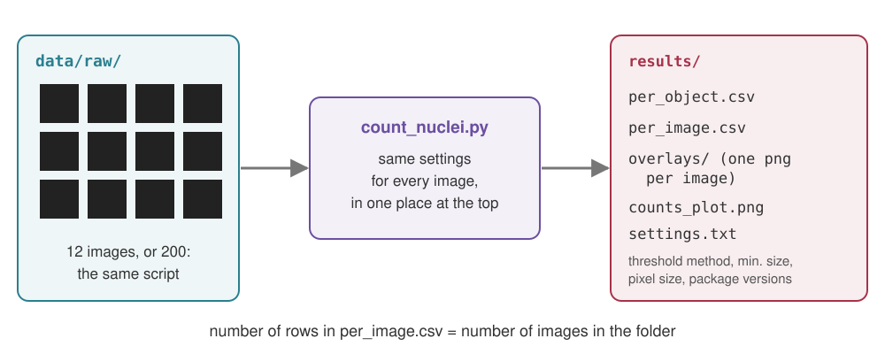{width="88%" fig-align="center"}

::: notes
Once the settings work on your tuning images, the script processes the whole folder, every image with exactly the same settings. That is the point of a script: no image is treated differently because someone was tired or adjusted the threshold by eye. Put the settings in one place at the top of the script, and have the script write them into a settings file in the results folder, along with the package versions. The outputs: a table per object, a table per image, an overlay per image and a plot. A quick check: the per-image table must have exactly as many rows as there are images in the folder. If it has fewer, an image failed or was skipped, and the script should say which. Never let the agent tune the threshold per image to make each one look good. That makes the conditions incomparable.
:::

## Plot the distribution, and compare it with the truth

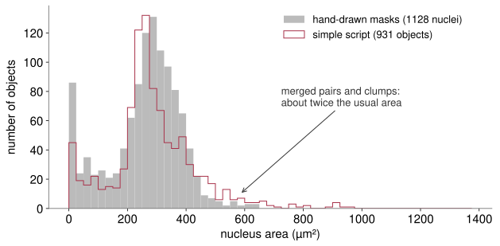{width="80%" fig-align="center"}

::: notes
The last step is a plot. Here is the distribution of nucleus areas, in square micrometres, over the ten test images: from the hand-drawn masks in grey, and from the simple script in red. Most nuclei are between 200 and 400 square micrometres, and there the two agree. But the simple script has a tail of large objects, from about twice the typical area upwards: 42 objects against 12 in the truth. Those are merged pairs and clumps. At the small end, both have objects: tiny specks in the script, and the fragments of A12_s7 in the truth. A plot like this is both a result and a check. If you compare two conditions and one of them has more crowded fields, merged pairs will make its nuclei look larger, an artefact that could easily end up in a paper. Plot the raw distribution before you summarise it as a mean.
:::

## Your own images: what you may send, and what to keep

- **Cell lines, model organisms, plates, materials:** usually fine as internal research data.
- **Images of patient tissue or people:** personal data, sometimes health data. Histology slides, fundus images, photos with faces.
- **Metadata leaks:** file names, TIFF tags and vendor files can hold patient IDs, user names and dates. Check before sharing.
- **Size:** the agent does not need to read every image. It needs a few examples and a script that runs locally on all of them.
- When in doubt, develop on a **public look-alike** (BBBC has many) and run the script yourself on the real images.

::: notes
Before you point the agent at your own images, the privacy check from Privacy, ethics and safety. Images of cell lines, bacteria, plants or materials are usually fine. Images from patients are personal data and often health data, even without a name: a histology slide, a retinal image, and of course anything with a face. Metadata is the hidden part. File names often contain patient or sample IDs, and TIFF tags and vendor files can contain the user name, the date and sometimes clinical identifiers. Note also that the agent does not need to see all the images. When it runs a script, the script reads the images on your computer; the agent sees what the script prints and any image you ask it to look at. Still, assume anything in the folder may be read. When in doubt, develop the script on a public look-alike dataset, then run it yourself on the real data.
:::

## Where this goes wrong

- **Edited originals.** A brightened or converted copy saved over the raw image. Every intensity changes.
- **JPEG or 8-bit copies analysed** instead of the 16-bit original.
- **Pixels reported as micrometres**, or the pixel size not squared for areas.
- **Merged nuclei.** Undercount and doubled areas, worst in crowded images.
- **Missed dim nuclei.** One global threshold on an uneven image.
- **Debris counted, border objects measured.** Size and border rules not decided.
- **Errors that cancel.** The count looks right; the overlay shows it is not.
- **Tuned on the test images**, or tuned per image. Results that will not hold on new data.
- **Hidden junk files** (`__MACOSX`, `Thumbs.db`) read as images.

::: notes
Here are the ways image counting goes wrong, in one place. The first three are about the data and the units: editing originals, analysing lossy or squeezed copies, and pixel-micrometre confusion. The next three are segmentation errors: merges, misses, debris and border objects. The last three are about how you check: a count that looks right because errors cancel, settings tuned on the very images used to judge them, and junk files that get counted as images. None of these produces an error message. All of them are caught by the habits in this track: a read-only raw folder, the pixel size with its source, overlays, hand counts on images you did not tune on, and a check that the number of rows matches the number of images.
:::

## Summary

| Concept | Key fact |
|---|---|
| Python, just enough | script, packages, a virtual environment the agent sets up |
| An image is numbers | 16-bit values; brighten the display, never the file |
| Raw images | read-only; results written elsewhere, remade by the script |
| Pixel size | find it and its source; areas use the pixel size squared |
| Threshold, label, measure | Otsu splits pixels; labels make objects; one row per object |
| Overlay | outlines on the image: merges, misses and debris at a glance |
| Touching, dim, fragmented | watershed split; background removal; a stated definition |
| Known answer | hand-drawn masks (decoded and checked) or your own hand counts |
| Tune and test | adjust on some images, check on others |
| Batch | one script, same settings, rows = images |

**Next (Track D: Survey and tabular data, or any other track):** the same habits on another kind of data. Or apply this track to your own images.

::: notes
Here is the summary. Python is a tool the agent uses; you need the words, not the syntax. An image is a table of numbers, and the raw numbers are your data, so the originals stay untouched. Know your pixel size and where it came from. Threshold, label, measure turns an image into a table. The overlay is your main check, together with a known answer: hand-drawn masks here, your own hand counts on your images. Adjust settings on some images and check on others. And process the whole folder with one script and the same settings. If you continue with another track, the pattern is the same: a known answer first, then real data, with checks at every step.
:::
