## About this lecture

A list of changed genes is not yet a result. The next questions are always the same: **what is known about the top genes, and what could explain them all?** An agent can search the literature for every gene, infer which regulators were active, and draft a mechanism. It can also write a convincing story that is not true.

- **"Top genes" is a choice.** Write the ranking rule yourself, and include the down genes.
- **Search each gene with your experiment's context**, aliases included; verify every PMID.
- **Regulators leave footprints.** TF and pathway activity is inferred from many targets at once.
- **Every arrow in a mechanism gets a label:** measured, cited, inferred or speculation.
- **A mechanism is worth something when it says what would refute it.**

The second deck of the **RNA-seq track**. It uses the DESeq2 results from the first deck and the verified-table method from *Literature review*.

::: notes
In the first deck of this track we went from counts to a checked list of changed genes. This deck is about what most of us do next. First, a literature review of the top genes: for each one, what is already known, in this kind of experiment. This is an everyday job in many labs, and the agent is very good at the searching part. Second, the step from a list to a mechanism: which regulator could have caused these changes, through which steps, and what experiment would show that we are wrong. Agents are fluent at writing mechanisms, which is exactly the danger. So the whole deck is built around labelling evidence and making predictions that can fail. We use the same two datasets as before: the synthetic pilot, where we planted the regulators and therefore know the answer, and airway, where dexamethasone acts through a receptor whose biology is well known.
:::

## Your list has 4 000 genes; the question is why they changed

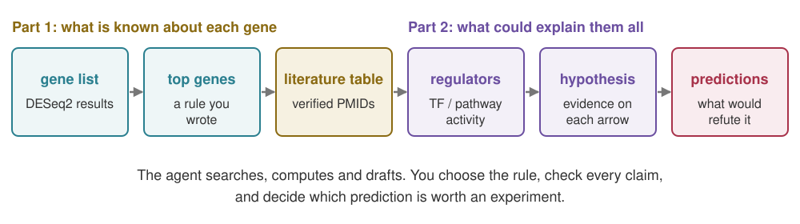{width="92%" fig-align="center"}

Part 1 is a literature table for the top genes. Part 2 turns the list into a mechanism and predictions.

::: notes
Here is the concrete situation. You have run DESeq2 on airway and about 4 000 genes changed with dexamethasone. A collaborator, a reviewer or your own curiosity asks: what does this mean, and why? The path has six steps. You choose the top genes with a rule you wrote. You build a literature table for them, with verified references, exactly as in Literature review. Then you ask which regulators could explain the pattern, assemble the steps into a chain from stimulus to phenotype, and turn the chain into predictions that an experiment could refute. The agent does a lot here: it searches, it runs the inference tools, it drafts the diagram. You choose the rules, you check every claim, and you decide which prediction is worth a week in the lab.
:::

## "Top genes" is a choice, and the choice changes the list

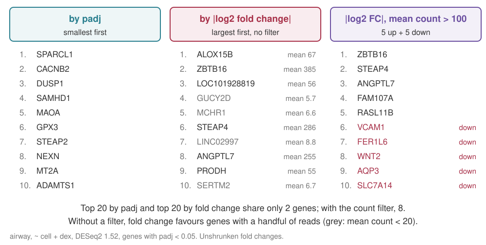{width="80%" fig-align="center"}

::: notes
The first decision is what top means, and it matters more than people expect. These are three top-ten lists from the same airway results. On the left, ranked by adjusted p-value: genes we are most sure about. In the middle, ranked by the size of the fold change, with no filter: the list fills up with genes that have a handful of reads, like GUCY2D with a mean count of about six, and with unnamed transcripts. Large fold changes from tiny counts are noisy. On the right, fold change among genes with a mean count above 100, taking five up and five down. The overlap is small: the top 20 by padj and the top 20 by fold change share only two genes. With the count filter, eight. None of these lists is wrong. But if you let the agent choose silently, your literature review is about whatever its default happened to be.
:::

## A fair top list combines certainty, size and expression, and includes the down genes

- **Certainty:** padj below a threshold, say 0.01.
- **Size:** a fold-change cut-off, or DESeq2's shrunken fold changes (`lfcShrink`), which tame low-count genes.
- **Expression:** a minimum mean count, so the gene can be measured again by qPCR.
- **Both directions:** in airway, 2 196 genes go up and 1 797 down. Ranking by padj alone gives 16 up genes in the top 20.
- **Write the rule in the README** before you look at the list, and keep the full ranked table.

The rule is yours. The agent applies it, reports how many genes pass each filter, and saves the list.

::: notes
A fair top list uses three things at once. Certainty: a padj threshold, often stricter than 0.05 for this purpose. Size: a fold-change cut-off, or better, the shrunken fold changes that DESeq2 provides with lfcShrink, which pull noisy low-count estimates towards zero. Expression: a minimum count, partly to avoid noise and partly because you will want to check the gene by qPCR later, and a gene with six reads is hard to measure. And both directions. Down-regulated genes are as much a part of the response as up-regulated ones, but ranking by padj tends to favour one side; in airway, 16 of the top 20 by padj go up. Write the rule down before you look at the list. Otherwise it is very easy to tune the rule until your favourite gene is in.
:::

## Prompt: you state the ranking rule, the agent applies it

```text
From results/tables/deseq2_all_genes.csv, make results/tables/top_genes.csv
with the top 15 UP and top 15 DOWN genes, using this rule:
padj < 0.01, mean count (baseMean) > 100, ranked by the absolute
shrunken log2 fold change (DESeq2 lfcShrink, type "apeglm" or
"ashr"; tell me which you used and why).
Report how many genes pass each filter, in order. Then show me how the
list would change if I ranked by padj instead: which genes enter and
which leave. Write the rule into README.md under "Top genes".
```

**What you check:** the filter counts are plausible, both directions are present, and the rule in the README is the one you gave.

::: notes
Here is the prompt. Notice that the prompt contains the rule, not a request to "pick the most interesting genes". The agent applies it and reports how many genes pass at each step, so you can see where the list shrinks. Asking for the comparison with a padj ranking is a cheap robustness check: if the two lists are very different, you know your conclusions depend on the rule, and you can say so. The shrinkage method needs an extra package; let the agent check which one is installed and tell you. Finally, the rule goes into the README, so that a year from now you know how these thirty genes were chosen.
:::

## Search each gene with the experiment's context, not the gene alone

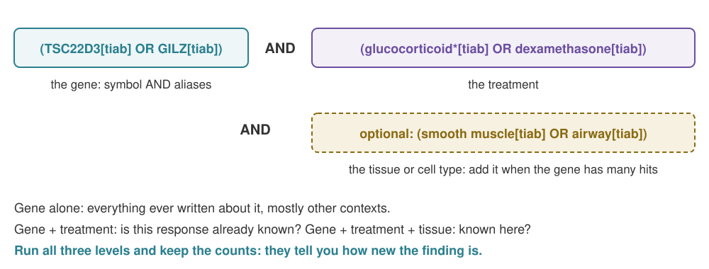{width="80%" fig-align="center"}

::: notes
Now the literature search. The method is exactly the one from Literature review: a search plan, a script that calls PubMed or Europe PMC through the API, raw downloads kept, a table built only from what came back. What is new is the query. A gene alone returns everything ever written about it, mostly in other tissues and other contexts. So we add the treatment: glucocorticoid or dexamethasone. And for genes with many hits, the tissue or cell type. Running all three levels and keeping the counts is useful in itself. A gene with thousands of papers overall, dozens with glucocorticoids and several in airway smooth muscle is a known responder. A gene with papers overall but none with glucocorticoids is a candidate for something new.
:::

## Aliases can hide most of the literature

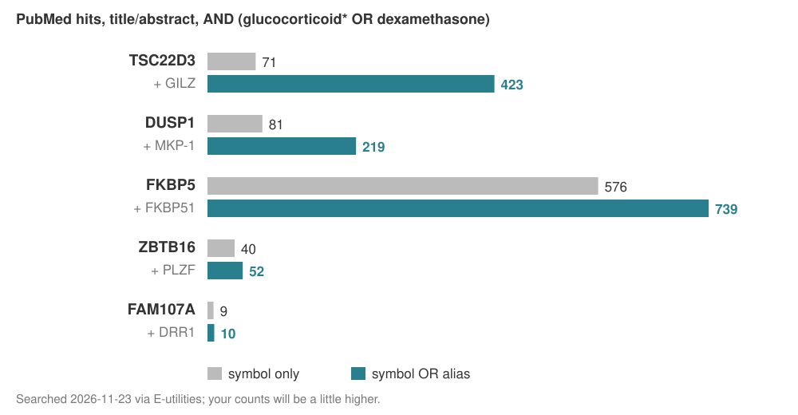{width="72%" fig-align="center"}

Ask the agent to look up aliases in NCBI Gene or HGNC, by script, not from memory.

::: notes
Gene symbols change, and the literature keeps the old names. TSC22D3 is the official symbol, but most papers call it GILZ, glucocorticoid-induced leucine zipper. Searching the symbol alone finds 71 papers with glucocorticoids; adding the alias finds 423. DUSP1 is often called MKP-1. FKBP5 is often written FKBP51. For some genes, like FAM107A here, the alias adds little. These counts are from PubMed on the day we searched; yours will be a little higher. The lesson for the prompt: ask the agent to fetch the aliases from NCBI Gene or HGNC with a script, and to show them to you before searching. Aliases also cause the opposite problem, which you met in Literature review: a short alias can mean something else entirely, so read the hits.
:::

## The table: one row per gene and claim, with a verified PMID

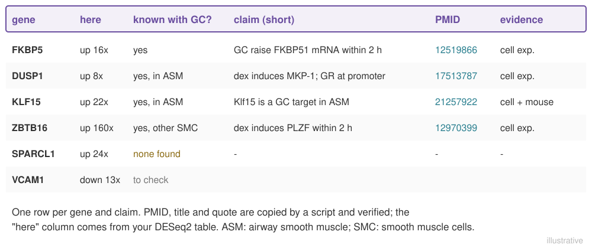{width="82%" fig-align="center"}

::: notes
The table has the same columns as in Literature review, plus two that link it to your experiment. The column "here" comes from your DESeq2 results: direction and size of the change. The column "known with glucocorticoids" says whether the response is already described, and in which cells. Then the claim, the PMID, the evidence type and the quote, all copied from the records by a script. These rows are real: the FKBP51 paper describes induction within two hours in a lymphoblastoid cell line; the DUSP1 paper shows dexamethasone inducing MKP-1 in airway smooth muscle, with the receptor bound to its promoter; the KLF15 paper identifies it as a glucocorticoid target in airway smooth muscle. SPARCL1, one of the strongest genes, has no paper with glucocorticoids at all.
:::

## Reuse the verification from *Literature review*, and add one check

- **Script:** every PMID resolves, titles match, quotes are found in the abstract.
- **Planted errors:** the verifier must catch a fake PMID, swapped titles and an edited quote.
- **You:** five random rows read against the abstract.
- **New: the context check.** Does the paper describe the **same direction**, a similar **cell type** and a similar **treatment**? "FKBP5 is induced by glucocorticoids" from blood cells supports "known elsewhere", not "known in airway smooth muscle".

::: notes
Verification is exactly what you built in Literature review: a separate script that resolves every identifier and checks titles and quotes, a test with planted errors to show that the checker can fail, and five random rows read by you. Reuse your verify script; it does not care what the genes are. There is one new check for this kind of table, and it is the one agents get wrong most often: the context. A real paper with a real quote can still be about a different cell type, a different species or the opposite direction. The agent tends to round this up to "known". Ask it to fill in the cell type and the direction from the abstract, and check them in your five random rows.
:::

## Sort every gene into known here, known elsewhere, or nothing found

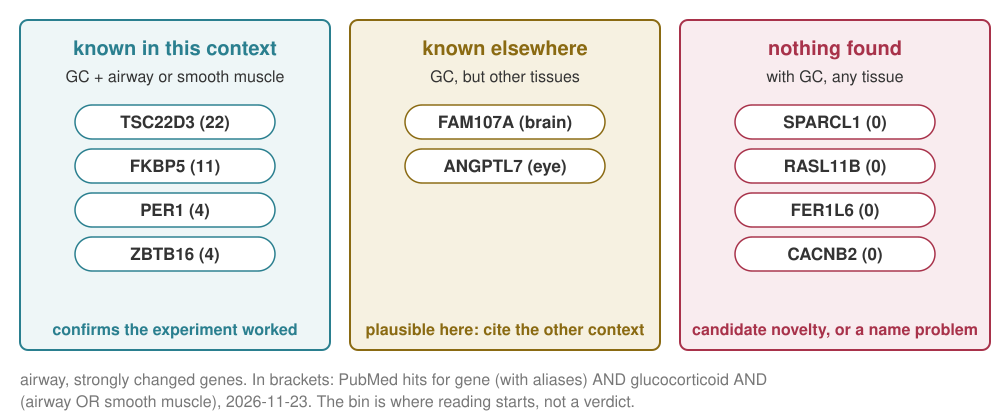{width="80%" fig-align="center"}

::: notes
A useful summary of the table is three bins. Known in this context: the response is described in airway or smooth muscle cells. These genes do not make a paper, but they show that the experiment worked, much like the positive control in the first deck. Known elsewhere: the response is described, but in another tissue. FAM107A, also called DRR1, is a stress- and glucocorticoid-regulated gene studied mostly in the mouse brain; ANGPTL7 mostly in the eye. Plausible here, and worth citing with the other context. And nothing found: SPARCL1, RASL11B, FER1L6 and CACNB2 have strong changes and no paper with glucocorticoids. That bin is where new findings might be. It is also where mistakes collect, as the next slide shows.
:::

## Little literature can mean new biology, or a name problem

Before you call a gene "novel", rule out the boring explanations:

- **An alias** you did not search (the official symbol is often the newest name).
- **An ID mapping error:** the Ensembl ID maps to another symbol, or to none (`LOC...`, `LINC...`).
- **Too few reads:** a large fold change on a mean count of 6 is weak evidence.
- **A gene family:** papers about the paralog, or about "SPARC-like" proteins in general.
- **Only abstracts searched:** try Europe PMC full text, which finds mentions in tables and results.

SPARCL1 survives these checks in airway: mean normalised count about 1 000, up 24-fold, alias *hevin* added, no paper with glucocorticoids in PubMed.

::: notes
When a strongly changed gene has no literature, there are two kinds of explanation. The exciting one is new biology. The boring ones are more common: an alias you did not search, a mapping error between Ensembl IDs and symbols, a gene with so few reads that the change is noise, a gene family whose papers use another name, or a search that only looked at abstracts. Europe PMC can search full text, which finds genes mentioned in results sections and supplementary tables. Ask the agent to run these checks for every gene in the nothing-found bin and to report them in a table. SPARCL1 passes: it is well expressed, strongly induced, and even with its alias hevin there is no PubMed paper linking it to glucocorticoids. The authors of the airway paper themselves described some of their genes as "less investigated". That is a candidate, not a discovery.
:::

## Enrichment names the themes; a mechanism says what caused them

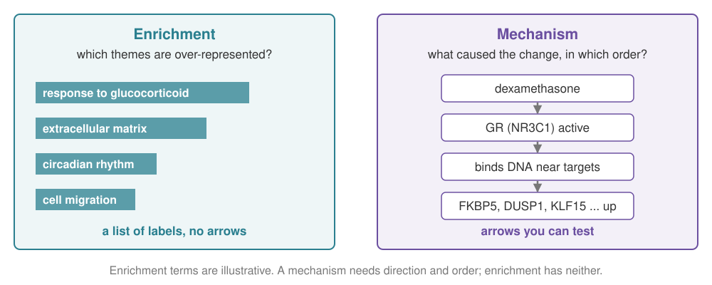{width="84%" fig-align="center"}

::: notes
Part 2. In the first deck, enrichment told us which themes are over-represented in the list: response to glucocorticoid, extracellular matrix and so on. That is useful, but it is a list of labels. It has no direction and no order: it does not say what happened first, what caused what, or what you could change to stop it. A mechanism is a chain of arrows: the drug activates a receptor, the receptor binds DNA near certain genes, those genes go up, and their products do something to the cell. Each arrow is a claim that can be tested. The rest of this deck is about building such a chain with the agent, and being honest about which arrows are supported.
:::

## Regulators leave footprints: their targets move together

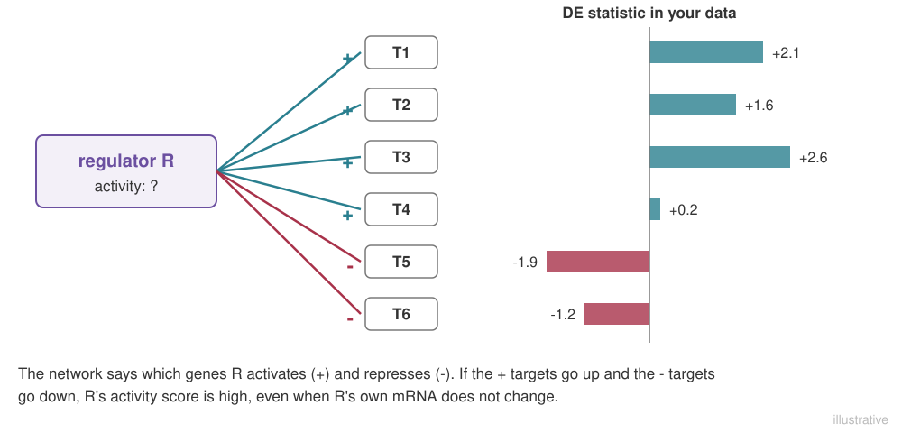{width="74%" fig-align="center"}

::: notes
The first tool for getting from a list to a mechanism is inference of regulator activity. The idea is simple. A transcription factor controls a set of target genes; a curated network says which targets, and whether the factor activates or represses each one. If the activated targets go up and the repressed ones go down, together and more than other genes, the factor was probably more active. This is called a footprint: we do not see the regulator act, we see its traces. Two consequences. First, it uses many genes at once, so it is more robust than looking at single genes. Second, the activity can rise even when the regulator's own messenger RNA does not change, because most regulators are switched on by a signal, not by making more of them.
:::

## decoupler with CollecTRI and PROGENy does this in R and Python

| | R (Bioconductor) | Python |
|---|---|---|
| Package | `decoupleR` | `decoupler` (version 2) |
| TF regulons (CollecTRI) | `get_collectri(organism = "human")` | `dc.op.collectri(organism="human")` |
| Pathways (PROGENy) | `get_progeny(organism = "human", top = 500)` | `dc.op.progeny(organism="human", top=500)` |
| Activity per regulator | `run_ulm(mat, net, .mor = "mor")` | `dc.mt.ulm(data, net)` |

Input: one statistic per gene, such as the DESeq2 `stat` column. CollecTRI: signed regulons for about 1 200 TFs (PMID 37843125). PROGENy: footprints of 14 pathways (PMID 29295995).

::: notes
The standard tool for this is decoupler, from the Saez-Rodriguez group, with versions for R and Python. We checked these function names on decoupleR 2.17 and decoupler 2.3; the Python package changed its interface in version 2, so older tutorials and the agent's memory may show different names. Let the agent read the current documentation first. The networks are downloaded from OmniPath: CollecTRI, a collection of signed regulons for about 1 200 transcription factors, and PROGENy, footprints of 14 signalling pathways derived from perturbation experiments. The simplest method, ulm, fits a linear model per regulator: does the gene's statistic depend on whether it is a target? The input is one number per gene; DESeq2's Wald statistic works well because it has a sign and accounts for uncertainty. Check the licence terms if you work in a company: some network resources are for academic use only.
:::

## Prompt: infer regulator activity from the DE statistics

```text
Using results/tables/deseq2_all_genes.csv, infer transcription factor
activities with decoupleR (R) and the CollecTRI network, method ulm,
on the DESeq2 stat column (gene symbols; drop duplicates and NAs).
Check the current decoupleR documentation first and tell me the
package version. Save the full table to results/tables/tf_activity.csv.
Show me the top 15 TFs by p-value, with score, number of targets
measured, and the 5 targets that contribute most to each score.
Then do the same for PROGENy pathways (top 500 genes, method mlm).
Do not interpret anything yet.
```

**What you check:** the version, the number of targets per TF, and the driver genes behind each top hit.

::: notes
Here is the prompt for airway. It names the package, the network, the method and the input column, because each choice changes the result. It asks for the version, so you can report it. It asks for the number of targets measured per regulator: a factor with five measured targets is a much weaker call than one with two hundred. And it asks for the genes that drive each score, which is the single most useful check, as you will see on the next slides. The last line keeps interpretation for later. If you let the agent interpret straight away, it will write a story about the top hits before you have checked whether they make sense.
:::

## Synthetic data: the planted regulators come out on top

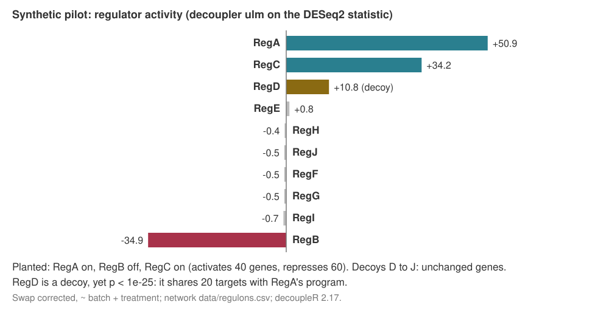{width="70%" fig-align="center"}

::: notes
We start with the synthetic pilot, because there we know the answer. The 400 planted genes were generated by three fictional regulators: RegA switched on, RegB switched off, and RegC switched on, activating some targets and repressing others. The network file, regulons.csv, lists most of their targets, some targets that do not respond in this experiment, and seven decoy regulators. With the swap corrected, decoupler finds exactly the three planted regulators, with the right signs, far ahead of everything else. RegC is positive even though 60 of its 100 targets go down, because the network says it represses them. But look at RegD: it is a decoy, its own targets do not change, and yet its p-value is below ten to the minus 25.
:::

## A decoy can look significant because it shares targets

- RegD's network entry includes **20 genes from RegA's program**, 16 of them also listed under RegA.
- Those 16 drive RegD's score. **Without them: score 1.9, p = 0.06.**
- In real networks, regulators that bind similar DNA or work together share many targets.
- **Ask for the driver genes of every top hit**, and whether they are shared with a stronger hit.
- A multivariate method (`mlm`) fitted on all regulators at once shrinks RegD's score from 10.8 to 4.8, but does not remove it.

::: notes
How can a regulator whose own targets do not change look highly significant? Because it shares targets with a regulator that is truly active. RegD's entry includes twenty genes from RegA's program. Take out the sixteen that are also listed under RegA and RegD drops to a score of 1.9 with a p-value of 0.06: nothing. This is not a quirk of synthetic data. In real networks, factors of the same family or factors that work together share many targets, and the inference cannot tell them apart from expression alone. Two defences. Look at the genes that drive each top hit and ask whether they overlap with a stronger hit. And a multivariate model that considers all regulators at once helps, but here it only halves RegD's score. You will see this problem again in a moment, with real data.
:::

## airway: GR comes second, after a receptor the cells barely express

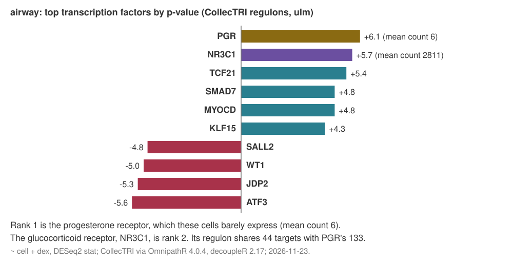{width="70%" fig-align="center"}

::: notes
Now airway. Dexamethasone is a glucocorticoid; it acts through the glucocorticoid receptor, gene name NR3C1. And indeed NR3C1 is near the top, at rank two of the 730 factors with at least five measured targets. KLF15, itself a known glucocorticoid target, is also active. But rank one is PGR, the progesterone receptor. These cells barely express it: a mean count of six, against nearly 3 000 for NR3C1. Why does it come out on top? The steroid receptors recognise very similar DNA elements; a review of DNA recognition by the androgen receptor states that the androgen, glucocorticoid, progesterone and mineralocorticoid receptors all recognise the same classical response elements, PMID 20304998. In CollecTRI, PGR's regulon shares 44 of its 133 targets with NR3C1. It is the RegD problem, in real data.
:::

## Check every top hit against what the cells express and what was done

- **Is the regulator expressed?** PGR: mean count 6. NR3C1: 2 811. AR: 1 330, unchanged.
- **Was it stimulated?** Dexamethasone is a glucocorticoid, not a progestin or an androgen.
- **Which genes drive the score?** For PGR, largely targets it shares with NR3C1.
- **Activity is not expression.** NR3C1 mRNA goes **down** 2-fold while its activity goes up; glucocorticoids lower the receptor's own mRNA (PMID 3216865, rat liver and hepatoma cells).

The tool ranks; you decide which hit is biology. Here the known pharmacology picks NR3C1.

::: notes
These are the checks to run on every top regulator, and you can ask the agent to make a table of them. Is the regulator expressed in these cells at all? PGR barely. Was it stimulated? The experiment added a glucocorticoid. Which genes drive the score? For PGR, largely the ones shared with the glucocorticoid receptor. Note one trap: do not use the regulator's own messenger RNA as evidence of activity. NR3C1 mRNA goes down by half with dexamethasone, even though its activity is clearly up. That is known biology: ligand-induced down-regulation of the receptor's own mRNA was described in the 1980s, in rat liver and hepatoma cells. An agent that reasons "NR3C1 went down, so glucocorticoid signalling is reduced" has it backwards.
:::

## A pathway tool finds only the pathways it contains

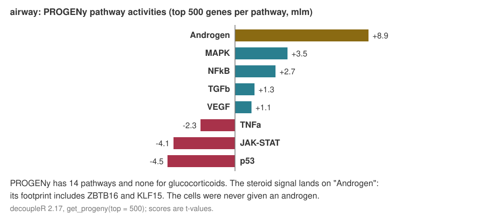{width="70%" fig-align="center"}

::: notes
The pathway tool shows the same limit from another side. PROGENy has footprints for 14 pathways. None of them is glucocorticoid signalling. So the strong steroid response has to land somewhere, and it lands on Androgen, the pathway whose footprint is closest; that footprint includes ZBTB16 and KLF15, both strongly induced here. The cells were never given an androgen, and the androgen receptor's own expression does not change. If you ask an agent to interpret this table without the context, it may well write a paragraph about androgen signalling in airway smooth muscle. The networks behind these tools were built mostly from cancer cell lines and well-studied factors; what is not in the network cannot be found, and what is close to it will be found instead.
:::

## A hypothesis chain links stimulus to phenotype, one labelled arrow at a time

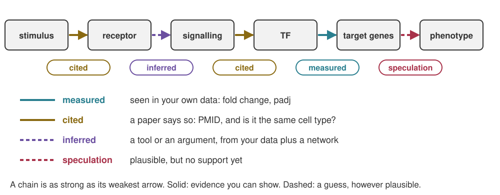{width="80%" fig-align="center"}

::: notes
Now we assemble a mechanism. The usual shape is a chain: a stimulus, a receptor, a signalling step, a transcription factor, target genes, and a phenotype. The important part is the label on each arrow. Measured: you saw it in your own data. Cited: a paper says so, and you have checked the PMID and whether it is the same cell type. Inferred: a tool or an argument suggests it, for example the TF activity score. Speculation: it is plausible, but nothing supports it yet. In a typical RNA-seq study only the middle arrow, from TF to target genes, is measured. Everything else is borrowed or guessed. The labels make that visible, to you and to your reader. The chain is as strong as its weakest arrow.
:::

## Prompt: the agent drafts the chain, with a label and a source on every arrow

```text
Draft a mechanism for the dexamethasone response in results/mechanism.md:
a chain from stimulus to phenotype, as a Mermaid diagram plus a table
with one row per arrow: from, to, evidence type (measured / cited /
inferred / speculation), the source (a file and number from this
project, or a PMID from results/literature_table.csv), and a one-line
reason. Only cite PMIDs that are already in the verified table; if an
arrow needs a paper we do not have, label it speculation and list it
under "to search". Use dashed arrows for inferred and speculation.
```

**What you check:** every "cited" PMID is in your verified table, and every "measured" arrow points to a number you can find.

::: notes
The prompt asks for two things: a diagram and a table behind it. Mermaid is a text format for diagrams that renders on GitHub and in Quarto, so the diagram lives in your repository and can be edited. The crucial rule is that the agent may only cite papers that are already in your verified table. That closes the door to the invented reference, which is otherwise very likely here: a mechanism paragraph is exactly the kind of text a model has seen thousands of times, with plausible citations attached. Anything that needs a paper you do not have is labelled speculation and goes onto a list for the next search. Then you check: every cited PMID in your table, every measured arrow pointing to a real number.
:::

## airway: the chain the agent should arrive at

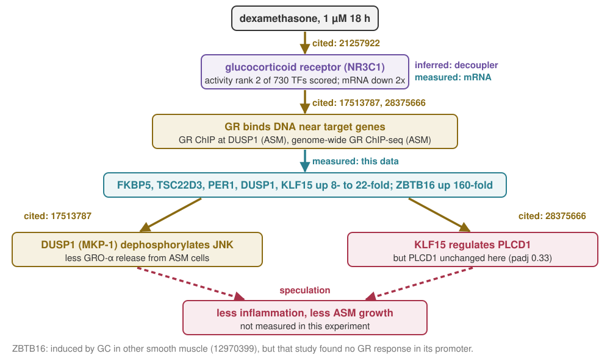{width="80%" fig-align="center"}

::: notes
This is roughly the chain a careful session produces for airway, with every PMID checked. Dexamethasone activates the glucocorticoid receptor, cited from an airway smooth muscle paper. The receptor's activity is inferred by decoupler, and its mRNA is measured, going down. Binding to DNA near targets is cited: chromatin immunoprecipitation at DUSP1 in airway smooth muscle cells, and a genome-wide study in the same cell type. The targets going up is measured, in our data. Then two branches, both cited. DUSP1, also called MKP-1, dephosphorylates the kinase JNK and reduces release of a chemokine. KLF15 regulates PLCD1, a repressor of smooth muscle hypertrophy. The last step, less inflammation and less growth, is speculation for this dataset: nobody measured it here. And note the red box: PLCD1 does not change in our data.
:::

## One cited arrow does not hold in this dataset

- The paper: KLF15 is directly induced by glucocorticoids in airway smooth muscle and regulates **PLCD1** (PMID 28375666).
- Our data: KLF15 up 22-fold; PLCD1 log2 fold change 0.19, **padj 0.33**.
- Possible reasons: **timing** (18 h may be too early for a secondary target), the paper's link came from **KLF15 overexpression**, or a different context.
- That is not a contradiction to hide. It is the **first prediction**: a later time point, or KLF15 overexpression in these cells, should move PLCD1.

::: notes
Here is a useful moment. The literature says KLF15 regulates PLCD1 in airway smooth muscle. In our data KLF15 is strongly up, but PLCD1 does not move. An agent asked to "explain the results" will tend to keep the arrow because it is cited, and move on. Your job is to notice that a cited arrow and your own measurement disagree, and to think about why. KLF15 is a transcription factor, so its effect on PLCD1 needs KLF15 protein first, which takes time; the samples were taken at 18 hours. The paper found the link partly through overexpressing KLF15. Or the link does not hold in these cells. Each of these is testable, and that turns a disagreement into a prediction.
:::

## A mechanism becomes science when it says what would prove it wrong

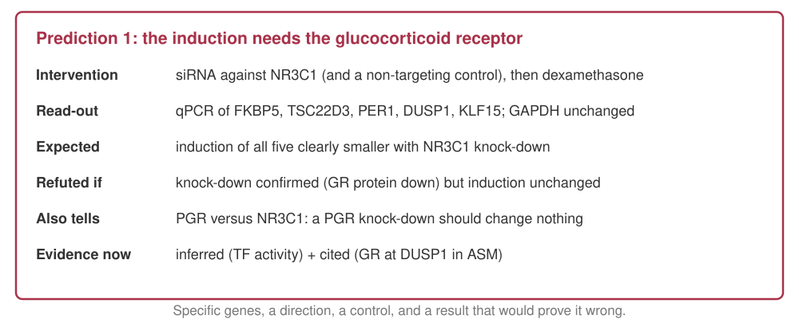{width="78%" fig-align="center"}

::: notes
A mechanism that cannot fail is a story. To make it science, each prediction needs five things: an intervention, a read-out with named genes, the expected direction, a control, and a result that would refute it. Here is one for airway. Knock down the glucocorticoid receptor with siRNA, then add dexamethasone, and measure five targets by qPCR. If the mechanism is right, their induction is clearly smaller. If the knock-down worked, confirmed at the protein level, and the induction is unchanged, the mechanism is wrong for these genes. This prediction also separates the two top hits from decoupler: a knock-down of PGR should change nothing. Ask the agent to write every prediction in this format; it is good at it once the format is fixed.
:::

## Three predictions for airway, each with a refutation

| Prediction | Expected | Refuted if |
|---|---|---|
| **GR is needed:** siRNA NR3C1, then dexamethasone | FKBP5, TSC22D3, PER1, DUSP1, KLF15 induction much smaller | GR protein down, induction unchanged |
| **Primary targets are early:** 0, 1, 2, 4, 8, 18 h | the five targets up by 2 h, also with cycloheximide | they rise only after 4 h, or not with cycloheximide |
| **KLF15 acts later:** same time course | PLCD1 up after 18 h, not before KLF15 | PLCD1 flat at all times, despite KLF15 protein up |

Precedent for the second row: FKBP51 mRNA rose within 2 h, and tests with a GR antagonist and cycloheximide pointed to direct induction by GR (PMID 12519866, lymphoblastoid cells).

::: notes
Three predictions, each with a refutation. The first tests the receptor. The second is a time course: if these genes are direct targets of the receptor, they should rise within an hour or two, and they should still rise when protein synthesis is blocked with cycloheximide, because no new protein is needed. There is a precedent: in a lymphoblastoid cell line, FKBP51 mRNA rose within two hours, and experiments with a receptor antagonist and with cycloheximide led the authors to conclude that the receptor induces it directly. The third follows from the PLCD1 puzzle: if KLF15 regulates PLCD1 here, PLCD1 should rise later than KLF15. A mifepristone experiment is the obvious first idea for the receptor, and the next slide shows why it is weaker than it looks.
:::

## A small model turns "early" and "late" into numbers

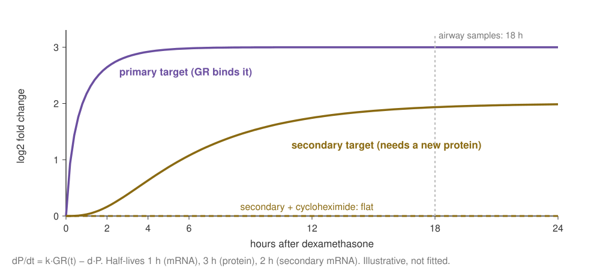{width="72%" fig-align="center"}

Optional: an ODE per gene. See *Track B: Simulation* for building and checking models with an agent.

::: notes
If you want the time-course prediction to be quantitative, a very small model is enough. Each target's mRNA is made at a rate set by receptor activity and degraded with its half-life. A secondary target needs a new protein first, so it lags. With half-lives of a few hours, the primary target is near its maximum by two to four hours, the secondary target is still rising at eighteen, and with cycloheximide the secondary target stays flat. The numbers here are illustrative, not fitted. The value of the model is that it makes the prediction sharp: which time points separate the two hypotheses, and by how much. Track B on simulation covers how to build such a model with an agent and how to check it.
:::

## Ask for rival mechanisms and what would tell them apart

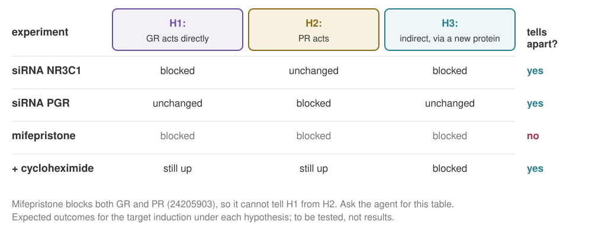{width="76%" fig-align="center"}

::: notes
The agent tends to agree with you. If you ask it to explain your results with the glucocorticoid receptor, it will, fluently. The defence, from How LLMs work, is to ask for rivals. Here are three hypotheses: the receptor acts directly, the progesterone receptor acts, or the response is indirect, through a new protein such as KLF15. Then ask which experiment gives a different outcome under each. Mifepristone is a classic tool, but it blocks both the glucocorticoid and the progesterone receptor, according to a review of its pharmacology, so it cannot tell the first two apart. A knock-down of each receptor can, and cycloheximide separates direct from indirect. A table like this is a very good thing to ask an agent for, and to check.
:::

## Prompt: make the agent argue against its own mechanism

```text
Read results/mechanism.md. Now argue against it.
1. Give three alternative mechanisms that could produce the same
   gene changes, including at least one that does not involve the
   regulator ranked first.
2. For each, the evidence in this project that supports or weakens it.
3. A table of experiments with the expected outcome under each
   mechanism, marking which experiments give different outcomes.
Do not tell me which mechanism you prefer.
```

**What you check:** at least one alternative you had not thought of, and that each claimed piece of evidence points to a file or a verified PMID.

::: notes
This is the prompt behind the previous slide. Asking the agent to argue against its own draft works much better than asking "are you sure?", which tends to produce either agreement or a sudden collapse. Asking for evidence from the project keeps it grounded, and asking for a table of experiments makes the comparison concrete. The last line matters: if it tells you which mechanism it prefers, it will usually prefer the one you seemed to like. The check is whether you learned something: an alternative you had not considered, or an experiment that is cheaper than the one you planned.
:::

## Correlation in, hypothesis out: the data cannot prove the arrows

- **RNA-seq measures correlation.** A gene going up with treatment does not show which gene caused which.
- **Activity inference is indirect.** It depends on a curated network that favours well-studied factors and cancer cell lines.
- **Shared targets confuse regulators** of the same family; only an experiment separates them.
- **Missing pathways are invisible.** A tool without a glucocorticoid pathway reports the nearest one.
- **Literature is context-bound.** A cited arrow from another cell type is a hypothesis here.

Everything after "measured" is a hypothesis until an experiment tests it.

::: notes
Some limits, in one place. A bulk RNA-seq experiment measures how expression changes with a treatment. It does not show causation between genes; it does not even show that the changes happen in the same cells. Activity inference is only as good as the network, and networks are biased towards factors and cell types that have been studied a lot. Related regulators share targets, and the data alone cannot separate them. A tool can only report pathways it contains. And the literature is about other cells, other doses and other times. None of this makes the analysis useless. It means the output is a set of hypotheses, ranked and labelled, which is exactly what an experiment needs.
:::

## An LLM's mechanism story is plausible, not true

- **Likely, not new** (*How LLMs work*): the model writes the mechanism most often described for genes like these.
- **Hallucination:** a fluent paragraph with an arrow nobody has shown, or a PMID that is real but about something else.
- **Confirmation bias:** it adopts your favourite hypothesis and finds support for it. Ask for rivals.
- **Rounding up:** "associated" becomes "regulates", "in mice" disappears, "cited" becomes "known".
- **Defences:** labels on every arrow, PMIDs only from the verified table, the context check, and a prediction that can fail.

::: notes
Why be so careful with the agent here in particular? Because a mechanism is exactly the kind of text a language model produces well. From How LLMs work: by default the model gives the likely answer, not the new one, so it writes the mechanism most often described for genes like these, which for glucocorticoids is mostly right and for your novel genes is mostly borrowed. It can hallucinate an arrow or attach a real paper to a claim the paper does not make. It agrees with you. And it rounds up: an association becomes regulation, a mouse result becomes a general fact. The defences are the ones we have used throughout: labels, verified PMIDs only, the context check, and predictions that can fail.
:::

## Mechanisms of pathogens and toxins can hit guardrails

- Most mechanism work, like this one, never meets a guardrail.
- Questions about **how a pathogen or toxin causes harm**, and how to make that worse, sit close to the topics providers restrict.
- A legitimate host-response study may get a refusal, a vaguer answer, or a stopped session.
- **What to do:** give honest context, keep the analysis on your own data, and talk to your biosafety officer if it keeps happening.

See *Limits of AI for biological research* for the forms a block takes and the access programmes.

::: notes
A brief note on safety. For most RNA-seq projects, including this one, the guardrails of AI providers never come up. But if your experiment is about infection, for example the host response to a virus, mechanism questions can drift towards how a pathogen causes harm or how it could be made more harmful, which is close to the topics providers restrict. You may get a refusal, a vaguer answer that is easy to miss, or a stopped session. The unit Limits of AI for biological research explains these forms, what honest context does, and the access programmes some providers run for verified research. Keep the analysis on your own data, and involve your biosafety officer if blocks keep happening.
:::

## Where this goes wrong

- **The agent picks "top"** by its own default; low-count genes and one direction dominate.
- **Gene-only searches** without context; **aliases missed**, so known genes look novel.
- **Context rounded up:** a paper on blood cells cited as "known in airway".
- **The top TF taken at face value:** not expressed, not stimulated, driven by shared targets.
- **A pathway tool interpreted beyond its menu** ("androgen signalling").
- **Arrows without labels**, PMIDs from memory, a story that cannot fail.
- **Only your hypothesis tested:** no rivals, no refutation criteria.

::: notes
The ways this goes wrong, collected. The top list chosen by default. Searches without context and without aliases, which make well-known genes look new. Literature from another cell type rounded up to "known here". The top hit of an inference tool taken as the answer, even when the cells do not express it. A pathway tool read beyond what it contains. A mechanism without labels and with references from memory. And only one hypothesis, with no way to fail. Each item has a check in this deck, and most of them are a single line in a prompt.
:::

## Summary

| Concept | Key fact |
|---|---|
| Top genes | your rule: padj, size (shrunken), expression; up and down |
| Literature query | gene and aliases AND treatment (AND tissue); counts kept |
| Verification | as in *Literature review*, plus same direction and context |
| Known / elsewhere / none | "none" is a candidate, or an alias or ID problem |
| TF and pathway activity | decoupler + CollecTRI / PROGENy on the DESeq2 statistic |

::: notes
The summary. You choose the top genes with a written rule. You search each gene with its aliases and the experiment's context, and verify every reference, including whether it is about the same direction and cell type. You sort genes into known here, known elsewhere and nothing found, and treat the last bin with suspicion before excitement. And you infer regulator activity with decoupler, on the DESeq2 statistic.
:::

## Summary (continued)

| Concept | Key fact |
|---|---|
| Top hits | check expression, stimulus and driver genes; shared targets mislead |
| Hypothesis chain | every arrow: measured, cited, inferred or speculation |
| Predictions | intervention, genes, direction, control, refutation |
| Rivals | ask for alternatives and the experiment that separates them |
| Known answer | the synthetic pilot: RegA up, RegB down, RegC up; RegD is a decoy |

**Next (Track C: Image analysis in Python, or any other track):** the same habits on another kind of data. Or apply this deck to your own gene list.

::: notes
Top hits of the inference tools are checked against expression, the stimulus and their driver genes. Every arrow in the chain has a label. Every prediction says what would refute it. You ask for rival mechanisms. And the synthetic pilot gives you a known answer to practise on: three planted regulators and a decoy. In the exercise you do all of this on airway and on the pilot, and then on your own gene list if you have one. After that, continue with another track, or take this into your own project.
:::
