## About this lecture

A sequencing facility sends you a table of read counts and asks nothing more. Turning it into a list of changed genes, and that list into biology, is a standard analysis with well-known pitfalls. In this track **you do the whole analysis by prompting**: the agent installs R and DESeq2, writes and runs the scripts, and you judge every step.

- **The sample sheet decides everything.** A wrong label or a wrong match gives a confident, wrong answer.
- **Look before you test.** Library sizes, PCA and sample correlations show swaps, outliers and batches.
- **The design formula is a sentence.** "Compare treated with control within each day" is `~ batch + treatment`.
- **Check with what you know.** A known answer, known genes, padj instead of p, a rerun from scratch.
- **The agent reports; you decide.** It must never drop or relabel a sample on its own.

This is a **track**: the agent skills from Parts 1 to 4 on RNA-seq data. Statistics only as deep as needed to judge the result. It builds on the table from *Literature review*.

::: notes
This track is for those of you who work with gene expression, or who will receive RNA-seq data from a collaborator or a core facility. The analysis itself is standard: almost every RNA-seq paper does the same steps, and the tools are mature. That is exactly why it is a good job for an agent: the agent knows the standard workflow well. What it does not know is your experiment: which sample is which, which tubes may have been swapped, what was done on which day. And it will not stop by itself when something looks odd. So the skills are the same as in the rest of the course: describe the task, give the context, check the result. You will not write R code. You will read plots, a sample sheet and a design formula, and those you must understand. The track builds on the literature table from the Literature review unit: at the end, we put the genes we find next to what is already known.
:::

## A count table arrives with one question: which genes changed?

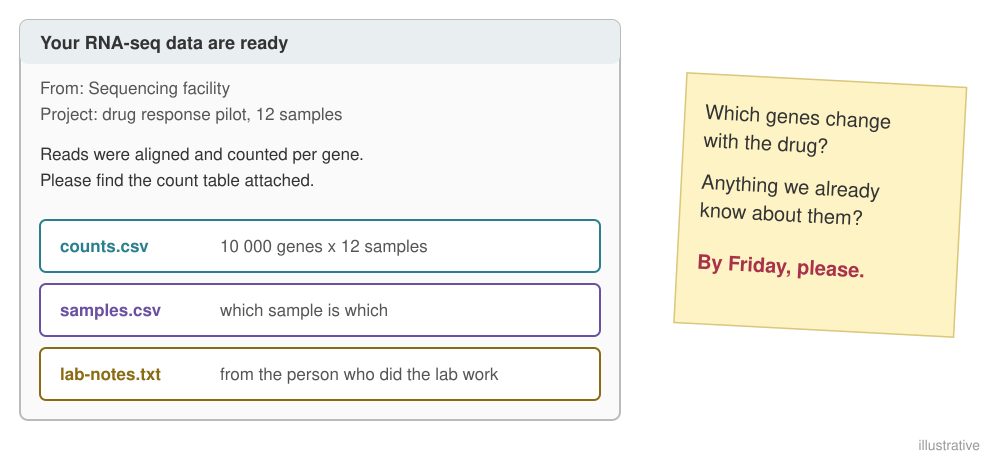{width="85%" fig-align="center"}

::: notes
Here is the situation this track starts from. The facility has done the hard computing: reads were aligned to the genome and counted per gene. You receive a table with one row per gene and one column per sample, a sample sheet that says which sample is which, and perhaps a few notes from the person who did the lab work. Your group leader wants to know which genes change with the drug, and whether any of them are already known. Many biologists would now send the table to a bioinformatician and wait. With an agent, you can do the standard analysis yourself, in an afternoon, provided you know what to check. That is what this track teaches. The picture is illustrative, but this is a realistic delivery: the files in the exercise look exactly like this.
:::

## You decide and check; the agent types and runs

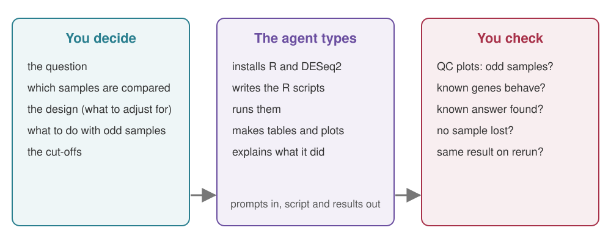{width="85%" fig-align="center"}

- You never write R. You **do** read the sample sheet, the design formula and the plots.
- Every decision about samples and cut-offs is yours, written down in `decisions.md`.

::: notes
This is the division of labour for the whole track. On the left, the decisions only you can make: what the question is, which samples are compared, what the experiment design was, what to do with an odd sample, and which cut-offs to use. In the middle, everything the agent does well: installing R and the DESeq2 package, writing scripts, running them, making plots. On the right, your checks. The checks are not about the code. They are about the results: do the QC plots look like the experiment you did, do genes you know behave as expected, does the analysis find a planted answer, has every sample made it through, and does a rerun give the same numbers. If you only take one thing from this slide: the agent should never make a decision from the left column on its own. When it finds something odd, it reports and you decide.
:::

## The analysis is a pipeline with a check at every step

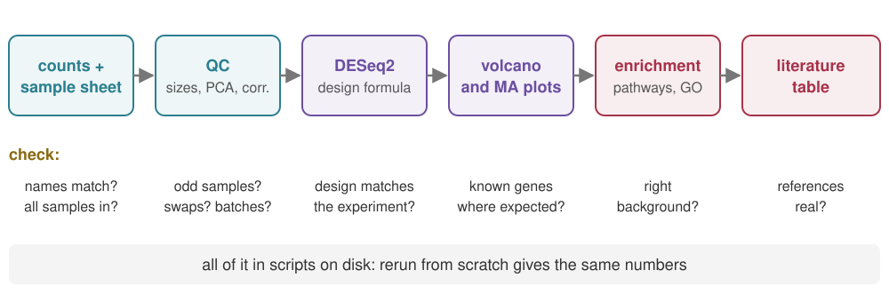{width="95%" fig-align="center"}

::: notes
Here is the whole analysis on one line. Counts and the sample sheet go in. Quality control comes first: how many reads each sample has, how the samples group in a PCA plot, how well they correlate with each other. Then DESeq2 tests every gene, using a design formula that describes the experiment. The results are shown as a volcano plot. Enrichment analysis asks which pathways or functions are over-represented among the changed genes. Finally, the genes are linked to what is already known, using your literature table. Under each step is the check that belongs to it. Most of the time in this track is spent on these checks, not on the analysis itself, which the agent runs in seconds. At the bottom: everything lives in scripts on disk, so that you can rerun the whole thing from scratch and get the same numbers.
:::

## We use two datasets: one with a known answer, one real

| | Synthetic pilot | airway (real, public) |
|---|---|---|
| What | made-up drug experiment, 10 000 genes | human airway smooth-muscle cells, dexamethasone vs untreated |
| Samples | 12: 6 control, 6 treated, two extraction days | 8: four cell lines, each untreated and treated |
| Source | `synthetic-rnaseq.zip` on the exercise page | the Bioconductor package [airway](https://bioconductor.org/packages/airway/) (Himes et al. 2014, GEO GSE52778) |
| Known answer | **400 planted genes**, a planted problem in the sample sheet | **known glucocorticoid-response genes** (FKBP5, TSC22D3, PER1 ...) |
| Used for | QC, the sample sheet, the design, multiple testing | volcano, MA, enrichment, the literature link |

Start with the synthetic data. Only there can you check the agent against the truth.

::: notes
We use two datasets. The first is synthetic: we generated it with a script, so we know exactly which 400 of the 10 000 genes really change, and we planted a problem that a careful analysis has to catch. That makes it the best place to learn checking, because there is an answer key. The second is a real, public and widely used dataset called airway, which comes as an R package from Bioconductor. Four cell lines from human airway smooth muscle were each left untreated or treated with dexamethasone, a glucocorticoid drug used for asthma. Here we do not know the full truth, but we know some genes that glucocorticoids switch on in almost every cell type, which gives us sanity checks. And airway is good for enrichment and for linking to the literature, because the genes have real names and real biology.
:::

## A count table holds whole numbers: reads per gene per sample

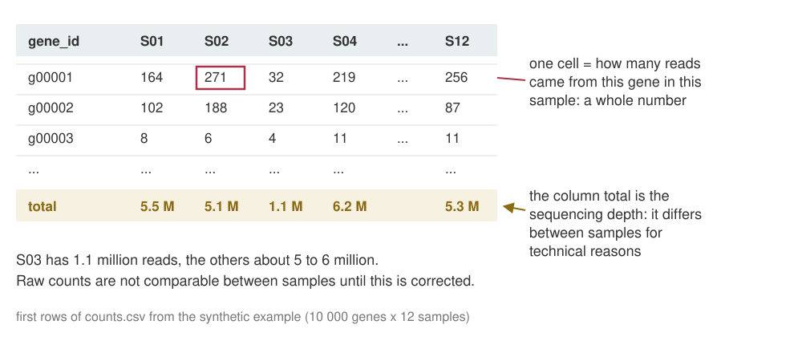{width="82%" fig-align="center"}

::: notes
Let us look at what a count table is. Each cell is a whole number: how many sequencing reads were assigned to this gene in this sample. Each column adds up to the total number of reads for that sample, the sequencing depth. Depth varies between samples for purely technical reasons, such as how much RNA went in and how the sequencing run was loaded. Here, sample S03 has about 1.1 million reads, the others 5 to 6 million. So a gene with 32 reads in S03 and 164 in S01 may be expressed at exactly the same level. DESeq2 corrects for this itself, and it needs the raw whole numbers to do so. One check therefore is that the agent gives DESeq2 the raw counts, not numbers that were already normalised or log-transformed somewhere along the way.
:::

## The sample sheet must be matched by name, never by position

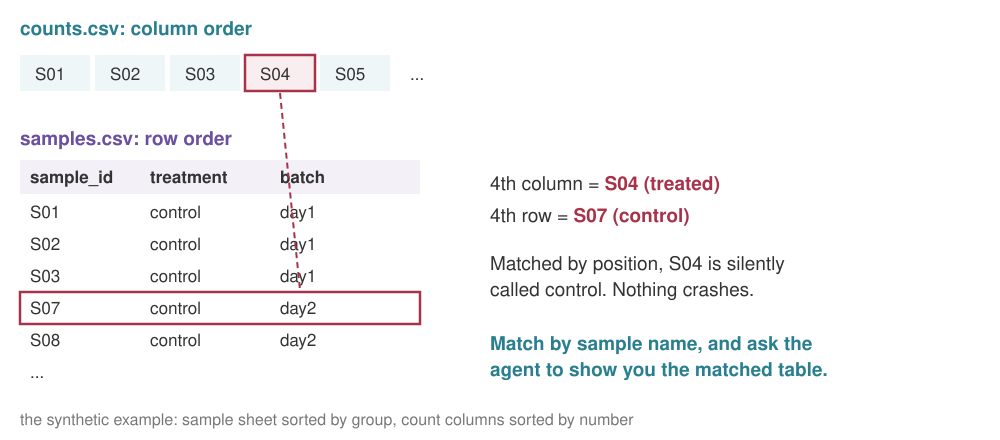{width="82%" fig-align="center"}

::: notes
This is the most important slide of the QC part. The count table has its columns in one order, the sample sheet has its rows in another. Here the sheet is sorted by group, which is how people often make them, and the count columns are sorted by sample number. If a script simply puts the fourth sample sheet row next to the fourth count column, sample S04, which was treated, is called control. Nothing crashes. You get a result, just a wrong one, with fewer genes and some of them nonsense. The fix is easy: match by sample name and check. Ask the agent to print the matched table, one line per sample: the column name in the count table, and the sample name and group from the sheet, side by side. You read twelve lines. That takes one minute and removes the most common silent error in RNA-seq analysis.
:::

## First prompt: make the agent describe the data back to you

```text
This folder holds an RNA-seq experiment: data/raw/counts.csv (raw counts,
genes x samples), data/raw/samples.csv (the sample sheet) and
data/raw/lab-notes.txt. Do not analyse anything yet.

Read the three files and tell me:
- how many genes and samples there are, and whether all values are
  whole numbers
- each sample with its group and batch, matched BY NAME between the
  count table and the sample sheet, as a table
- any sample that is in one file but not the other
- anything in the lab notes that could affect the analysis
Do not change any file in data/raw.
```

**What you check:** 12 samples in both files, 6 per group, the matched table agrees with the sheet, and the agent mentions the note about S08 and S11.

::: notes
The first prompt does no analysis at all. It makes the agent read the data and tell you what it sees. This is the same habit as in First delegations: before any work, check that the agent understood the material. You get three things back that you can check in a minute. The numbers: 10 000 genes, 12 samples. The matched table: each sample with its group and day, matched by name. And whatever is in the lab notes. In the synthetic data, the lab notes say that two tubes may have been swapped. A good agent mentions this. If yours does not, that is worth noting in your log: it read the file, but did not think it mattered. You now know something the analysis will have to deal with.
:::

## The project folder keeps raw data, scripts and results apart

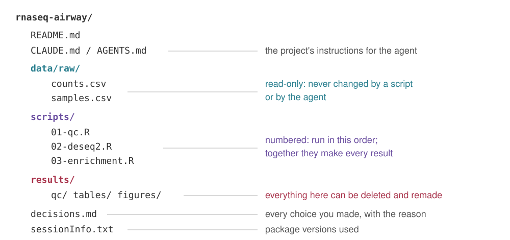{width="78%" fig-align="center"}

- The agent installs R (if needed) and the Bioconductor package **DESeq2**. It asks before it installs; this can take a while.

::: notes
This is the folder layout from Organising a project for an agent, applied to RNA-seq. Raw data in data/raw, never changed. Numbered scripts: one for QC, one for DESeq2, one for enrichment, run in order. Results in their own folder, which can always be deleted and remade by running the scripts. A decisions file where every choice about samples and cut-offs is written down with the reason. And a record of the package versions, which R writes with one command called sessionInfo. If R or DESeq2 is not installed, the agent will install them. DESeq2 comes from Bioconductor, a repository of R packages for biology, and installing it can take ten minutes or more the first time. Read what the agent wants to run before you approve, as in the Terminal survival kit. In Codex, installing needs internet access, which the default sandbox does not allow, so Codex asks you for permission to run the install command.
:::

## QC 1: library sizes show how deeply each sample was sequenced

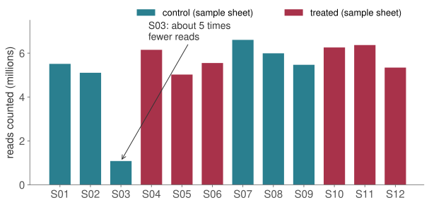{width="80%" fig-align="center"}

- S03 has about 5 times fewer reads. Low depth alone is **not** a reason to remove a sample: DESeq2 corrects for depth.
- Ask what else is odd about it. Here, nothing: it groups with its controls (next slides).

::: notes
The first QC plot is a bar chart of the total number of reads per sample. In our synthetic experiment, S03 stands out: about a fifth of the reads of the others. The lab notes explain why: low input RNA. What should happen to S03? An agent that wants a tidy result may quietly drop it. That would be wrong. DESeq2 corrects for sequencing depth with what it calls size factors, so a shallow sample still contributes, just with less precision. A sample should be removed only if it is bad for a biological or technical reason you can name, such as degraded RNA or a failed library, and only by your decision. Here, S03 behaves like its group in the PCA and the correlations. So it stays, and the decision goes in decisions.md.
:::

## QC 2: in the PCA, two samples sit with the wrong group

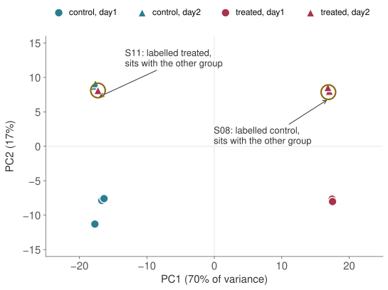{width="72%" fig-align="center"}

::: notes
The second QC plot is a PCA plot. PCA squeezes the expression of thousands of genes into two numbers per sample, so that similar samples sit close together. Each dot is a sample, coloured by the group in the sample sheet and shaped by the extraction day. The first axis, with 70 percent of the variation, separates control from treated: the drug has a strong effect. The second axis separates the two days: that is the batch effect, smaller but clear. And two samples are in the wrong place. S08 is labelled control but sits with the treated samples of day 2. S11 is labelled treated but sits with the controls. Together with the lab note, this strongly suggests a tube swap. Note that the plot does not prove it: it shows that the labels and the data disagree. What happened is a question for the lab.
:::

## QC 3: sample correlations tell the same story

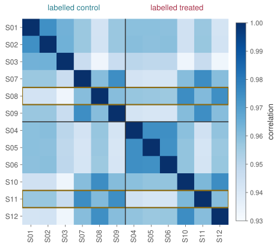{width="58%" fig-align="center"}

::: notes
The third QC plot is a heatmap of correlations between samples, here sorted by the group in the sample sheet. Within a group, samples should correlate more strongly with each other than with the other group. Look at the two rows with ochre boxes. S08, labelled control, correlates most strongly with the treated samples of day 2. S11, labelled treated, correlates best with the controls of day 2. Two independent views agree. Also note S03: its correlations are a bit lower overall, because with fewer reads its values are noisier. That is the depth effect, not a problem with the sample. You do not need all three plots every time, but each catches different problems, and the agent makes them in seconds.
:::

## The agent must report odd samples, never fix them on its own

The prompt for the QC step says so explicitly:

```text
Write scripts/01-qc.R that makes, in results/qc/: a bar chart of library
sizes, a PCA plot coloured by treatment and shaped by batch, and a
heatmap of sample correlations. Run it and show me the plots.

Then tell me which samples, if any, look unusual and why. Do NOT remove,
relabel or reweight any sample. I will decide. List what you would
recommend and what I could check in the lab to settle it.
```

- Agents tend to "solve" problems: drop the outlier, swap the labels, mention it in passing.
- A silently dropped or relabelled sample is a **changed experiment** that nobody reviewed.

::: notes
Here is the prompt for QC, and the important part is the second paragraph. Agents are built to finish tasks. When they meet an odd sample, a common reaction is to fix it: remove it as an outlier, swap the labels because the PCA suggests it, or exclude it because its depth is low. Sometimes they say so in one line in a long answer; sometimes they do not say so at all. Each of these is a change to your experiment. Removing a sample changes n. Swapping labels changes the data. These are scientific decisions with consequences for your paper, and they belong to you, after checking with the lab. So the prompt says it plainly: report, recommend, do not act. And afterwards, check that the number of samples in the analysis is still twelve.
:::

## You decide about the swap, and write the decision down

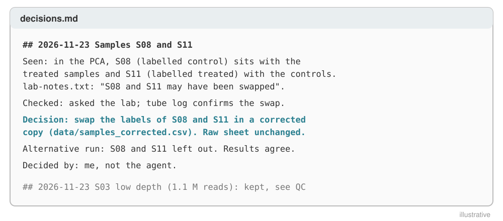{width="80%" fig-align="center"}

::: notes
Here is what the decision looks like once it is made. You saw the problem in two QC plots and in the lab notes. You checked with the lab: in our story, the tube log confirms the swap. So you decide to correct the labels, in a corrected copy of the sample sheet, leaving the raw sheet untouched. You also ask the agent to run the analysis with the two samples left out, as a sensitivity check, and the results agree. And you write down who decided. If the lab cannot confirm the swap, the honest options are to leave both samples out or to report the problem. What you never do is relabel samples because the data look better that way, without independent evidence. That would be fitting the labels to the result. The file is illustrative; yours will read differently.
:::

## The design formula says what is compared, in one line

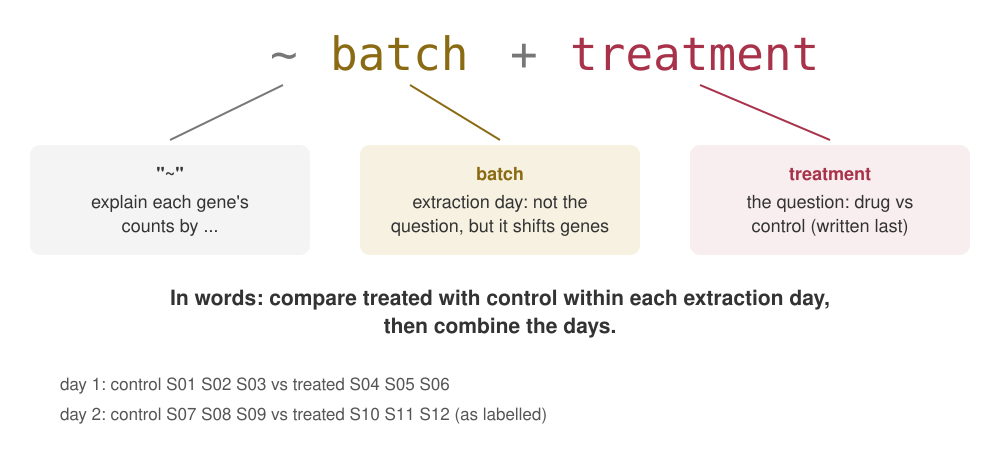{width="82%" fig-align="center"}

::: notes
Now DESeq2. It needs a design formula, and this is the one piece of notation you should be able to read. The tilde means: explain each gene's counts by the following. Then the things that affect expression. Batch, here the extraction day: we are not interested in it, but it shifts many genes, as the PCA showed. Treatment: the thing we want to test. The last term is the one you ask about by default, so it goes last. In plain words: compare treated with control within each extraction day, and then combine the two days. Ask the agent to say the design in words like this, and check that the sentence describes your experiment. For airway, the design is tilde cell plus dex: compare treated with untreated within each cell line, which makes it a paired design.
:::

## Ask the agent to explain the design in words before it runs

```text
Before running DESeq2, tell me in plain words:
- the design formula you will use, and what each term means for
  this experiment
- which group is the reference, so that a positive log2 fold change
  means "higher in treated"
- how many samples are in each group after any changes I approved
- whether anything about the design worries you (batch, pairing,
  too few replicates)
Then write scripts/02-deseq2.R, run it, and save the full results table.
```

| Check | Synthetic pilot | airway |
|---|---|---|
| Design | `~ batch + treatment` | `~ cell + dex` |
| Reference | control | untreated (`untrt`); R sorts `trt` first unless told otherwise |
| n per group | 6 and 6 | 4 and 4, paired by cell line |

::: notes
This prompt makes the agent state the design before it runs anything. Four things to check. The formula, in words. The reference level: which group is the baseline. This matters more than it seems: in airway the groups are called trt and untrt, and R sorts them alphabetically, so unless the script says otherwise, trt becomes the reference and every fold change has the wrong sign. Genes switched on by dexamethasone would appear switched off. The number of samples per group, after any changes you approved: if it says five and six, a sample has gone missing. And any worry about the design. If the agent cannot name one, that is fine. If it never mentions the batch in the synthetic data, ask why.
:::

## Replicates are the samples you count, and you need several

- **n per group** is the number of independent biological replicates: separate animals, patients, cultures.
- Two wells from one culture, or one library sequenced twice, are **one** replicate.
- With 1 sample per group there is no way to estimate noise. DESeq2 results are then not meaningful.
- **3 per group** is a common minimum; more gives more power. airway: 4 pairs. Synthetic: 6 per group.
- The agent cannot know how your samples were made. Tell it, in the README or the prompt.

::: notes
A short word on replicates, because this is where many small RNA-seq studies go wrong, and where the agent cannot help you unless you tell it. The statistics compare the difference between groups with the variation within groups. To estimate that variation you need several independent samples per group: separate animals, separate patients, separate cultures grown on different days. Technical repeats, such as two wells of the same culture or the same library sequenced twice, do not count as separate replicates, because they share almost everything. With one sample per group the analysis cannot estimate the noise, and any gene list it produces is close to meaningless. Three per group is a common minimum. The agent sees only column names. If two columns are technical repeats, it will treat them as independent unless you say so.
:::

## DESeq2 does three things in one command

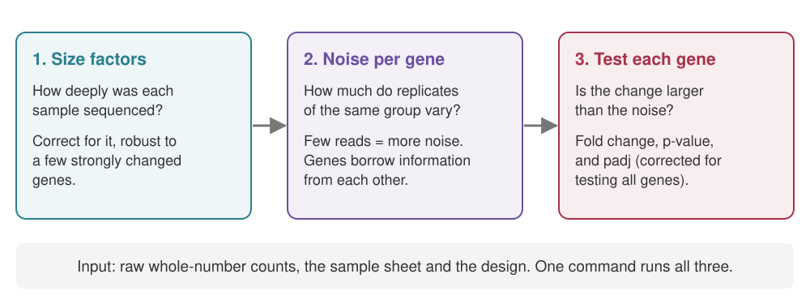{width="88%" fig-align="center"}

::: notes
What does DESeq2 actually do? Three things, all in one command. First, size factors: it estimates how deeply each sample was sequenced, in a way that is not fooled by a few genes that change a lot, and corrects for it. Second, the noise for each gene: how much replicates of the same group vary. Genes with few reads are noisier, and genes borrow information from each other, which makes the estimates stable even with few samples. Third, a test for each gene: is the difference between groups larger than the noise would explain? The output is a fold change, a p-value and an adjusted p-value for each gene. You do not need the maths. You do need to know that the input must be raw counts, and that the test is only as good as the design and the sample sheet you give it.
:::

## The results table has one row per gene

| Column | Plain meaning | What to check |
|---|---|---|
| `baseMean` | average normalised count over all samples | very low: little information |
| `log2FoldChange` | change between groups: 1 = 2-fold up, -1 = 2-fold down, 3 = 8-fold up | sign matches the reference you chose |
| `lfcSE` | how uncertain that fold change is | large for genes with few reads |
| `pvalue` | evidence against "no change", for this gene alone | **do not** use it to pick genes |
| `padj` | p-value adjusted for testing all genes | use this; `NA` = not tested (too few reads) |

Ask the agent to save the **full** table (every gene), not only the significant ones. A gene missing from a list can be "not changed" or "not tested".

::: notes
Here is how to read the results table. baseMean is how much the gene is expressed on average. log2FoldChange is the size of the change on a log2 scale: plus one means doubled, minus one means halved, plus three means eight times higher. The sign depends on the reference level, which is why we checked it. lfcSE is the uncertainty of that fold change. pvalue is the evidence for this one gene on its own, and padj is the same after correction for testing thousands of genes. Use padj, as the next slide shows. An NA in padj means DESeq2 did not test the gene, usually because it has too few reads. Ask for the full table, not just the significant genes, so that later, when someone asks about gene X, you can tell whether it was unchanged or simply not measurable.
:::

## Testing 10 000 genes at p < 0.05 gives hundreds of false hits

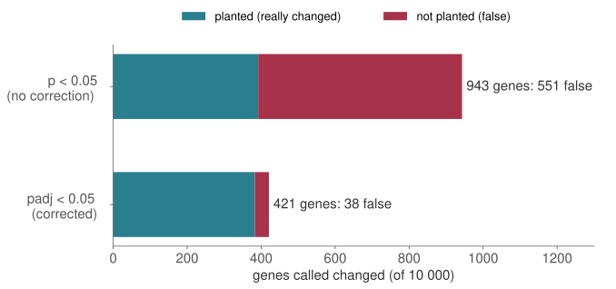{width="80%" fig-align="center"}

- At p < 0.05, about 1 in 20 unchanged genes passes **by chance**: here 551 of them.
- padj < 0.05 keeps the share of false hits small: here 38 of 421. Small, not zero.

::: notes
This is the multiple-testing problem, shown on our synthetic data where we know the truth. We corrected the swap and ran DESeq2. If we pick genes with an ordinary p-value below 0.05, we get 943 genes, but 551 of them are genes we did not plant: false hits. That is what p below 0.05 means: one in twenty genes with no real change passes by chance, and with almost ten thousand unchanged genes that is about five hundred. The adjusted p-value corrects for this. At padj below 0.05 we get 421 genes, 383 of them planted and 38 not. The target is that only a small share of the list is false; it is an approximate target, and here it is close to one in ten. So: always padj, and expect a few false genes in any list. If an agent filters on pvalue, correct it.
:::

## The known answer shows what the swap would have cost

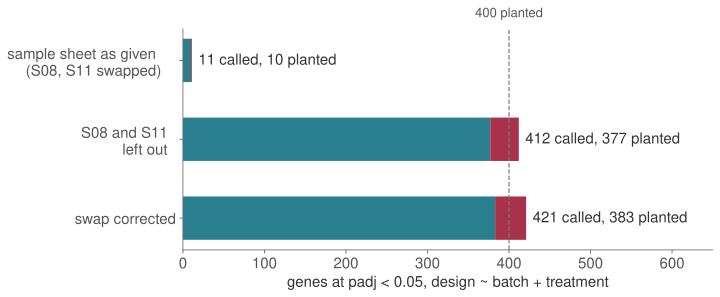{width="82%" fig-align="center"}

::: notes
Here is why the sample sheet matters so much. Same data, same design, three different sample sheets. With the sheet as given, with S08 and S11 swapped, DESeq2 finds only 11 genes. The swap puts one treated sample among the controls and one control among the treated, which makes both groups look noisy, and almost nothing passes. You would conclude that the drug does almost nothing. With the swap corrected, it finds 421 genes, 383 of them planted. Leaving the two doubtful samples out also works: 412 genes, 377 planted. The lesson: a single labelling problem can turn a strong effect into no effect, and no error message warns you. Only the QC plots and the lab notes do. In real data, without an answer key, you would never know what you missed.
:::

## The volcano plot shows size and certainty of every change

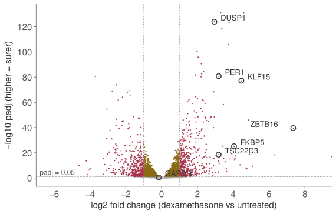{width="70%" fig-align="center"}

::: notes
Now the real dataset, airway. A volcano plot has one dot per gene. Across: the log2 fold change, how large the change is. Up: minus log10 of padj, how sure we are. Higher means more certain; the dashed line is padj 0.05. Red dots are significant and more than two-fold changed, ochre are significant but smaller changes. With dexamethasone, about 4000 of 16 000 tested genes are significant, about 940 of them more than two-fold. The circled genes are classic glucocorticoid targets: DUSP1, PER1, KLF15, ZBTB16, FKBP5, TSC22D3. All are up, as expected, and all are among the strongest. GAPDH, a gene that should not change, sits at the bottom middle. This is what a good sanity check looks like: you knew where these genes should be before you saw the plot.
:::

## Genes you already know are the quickest sanity check

| Gene | Expected with a glucocorticoid | airway result (our run) |
|---|---|---|
| FKBP5 | up, classic marker | log2FC 4.0 (16-fold up), padj 7e-26 |
| TSC22D3 (GILZ) | up | log2FC 3.2, padj 3e-19 |
| PER1 | up | log2FC 3.2, padj 2e-81 |
| DUSP1 | up | log2FC 2.9, padj 1e-124 |
| KLF15 | up | log2FC 4.5, padj 8e-78 |
| GAPDH | no change (housekeeping) | log2FC -0.2, padj 0.38 |

If FKBP5 came out **down**, the reference level is wrong. If nothing you know shows up, check the sample sheet before the biology.

::: notes
Before you look at a single new gene, look at the genes you know. In every field there are positive controls: genes that must respond to the treatment, and genes that should not move. For glucocorticoids, FKBP5, TSC22D3, also called GILZ, PER1, DUSP1 and KLF15 are switched on in most cell types. GAPDH, a metabolic housekeeping gene, should not change. In our airway run, all five go up strongly and GAPDH does not change. If FKBP5 came out down, the most likely cause is not biology but a reversed reference level. If none of the known genes showed up, suspect the sample sheet first. Prepare your own list of expected genes before the analysis, from your literature table or your experience. That is your known answer when no answer key exists. Your numbers may differ slightly with other filtering or versions.
:::

## Enrichment asks whether a pathway is over-represented in your list

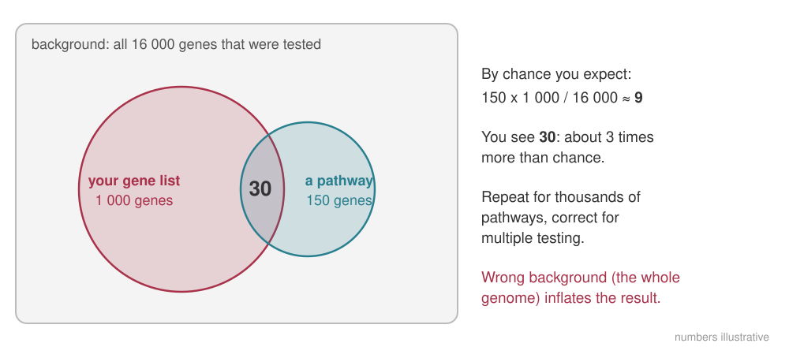{width="80%" fig-align="center"}

::: notes
A list of a thousand genes is hard to read. Enrichment analysis summarises it: which pathways, processes or functions appear in the list more often than chance would predict? The idea is simple counting. If a pathway has 150 genes, and your list has 1000 out of 16 000 tested genes, you would expect about 9 of the pathway's genes in your list by chance. If you see 30, the pathway is over-represented. This is repeated for thousands of pathways and Gene Ontology terms, with correction for multiple testing. The numbers in the picture are illustrative. The important detail is the background: the genes that could have been found, which is the genes that were tested, not the whole genome. Many genes are not expressed in your cells at all, and using the whole genome as background makes almost any tissue-typical pathway look enriched.
:::

## Enrichment tools differ in what you give them

| Tool | How | What to give it | Watch out for |
|---|---|---|---|
| [g:Profiler](https://biit.cs.ut.ee/gprofiler/) (web, or the R package gprofiler2) | paste a list, or the agent calls it | significant genes, and the tested genes as a **custom background** | default background is all known genes |
| [clusterProfiler](https://bioconductor.org/packages/clusterProfiler/) (R) | over-representation or ranked tests | gene list + background, or all genes ranked | gene IDs converted correctly (Ensembl ↔ symbol); genes lost in conversion |
| [fgsea](https://bioconductor.org/packages/fgsea/) (R) | ranked: no cut-off needed | every tested gene with a score (e.g. the test statistic) | which gene sets, which version |

Ask how many genes went in and how many were lost in ID conversion. Many "enriched" terms are the same few themes; enriched does not mean causal.

::: notes
There are many enrichment tools; three common ones are on this slide. g:Profiler is a web service: you can paste a gene list in the browser, which is fine for public data like airway, or the agent can use its R package. clusterProfiler and fgsea are R packages from Bioconductor. Two approaches exist: over-representation takes a list cut at some threshold and counts, as on the previous slide; ranked methods such as fgsea use all genes ordered by their test result and need no cut-off. Whichever you use, check three things. The background: the tested genes. The gene identifiers: airway uses Ensembl IDs, and converting them to gene symbols loses some genes, so ask how many. And redundancy: Gene Ontology has many overlapping terms, so the same theme appears many times. For airway, expect themes around glucocorticoid response, and more general terms around development and cell adhesion.
:::

## Link the gene list to what is already known

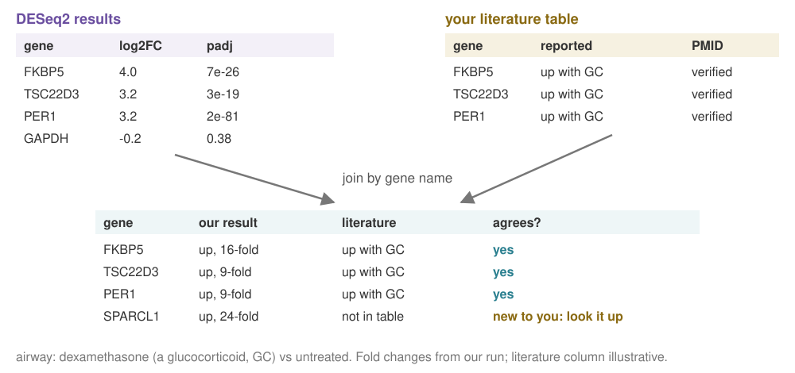{width="84%" fig-align="center"}

::: notes
The last step connects this track to Part 4. In Literature review you built a table of genes with verified references. Now the agent joins it to the DESeq2 results by gene name. For each gene in both, you get your result next to what the literature reports, and a column that says whether they agree. Agreement is reassuring; disagreement is interesting and worth a closer look, for example a different cell type or a different dose. Genes high in your list but not in your table are candidates for new reading. The same verification rules apply as in Literature review: every reference must exist and say what the table claims. The agent can extend the table for the new genes, but each new reference is checked against PubMed by you, not taken from the agent's memory. The literature column here is illustrative.
:::

## A rerun from scratch proves the result lives in the scripts

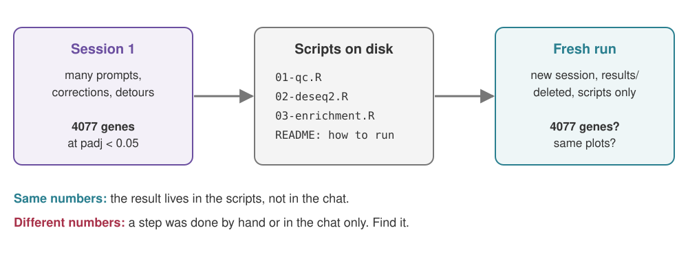{width="82%" fig-align="center"}

::: notes
The final check. A real analysis session is messy: you corrected the agent, asked for changes, maybe ran a step by hand. Did all of that end up in the scripts? The test is simple: start a fresh session, delete the results folder, and ask the agent to run the scripts in order according to the README, and nothing else. Then compare the key numbers: the number of significant genes, the fold change of FKBP5, the top ten genes, the plots. If they match, the analysis is reproducible, and you can hand it to a colleague or a reviewer. If they do not, some step happened only in the chat or by hand. That is very common, and much better found now than when a reviewer asks for the analysis to be redone. Commit the scripts with git once the rerun matches.
:::

## The checklist before you believe a gene list

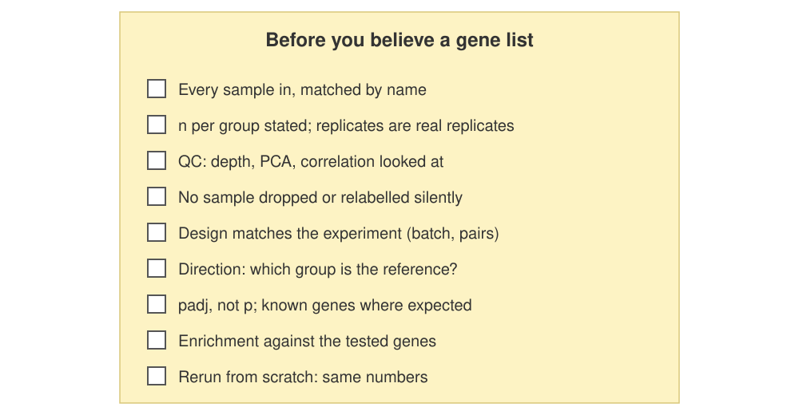{width="60%" fig-align="center"}

::: notes
Here are all the verification points of the track on one note. Every sample in, matched by name. The number of real replicates per group known and stated. The three QC plots looked at by you. No sample dropped or relabelled without your decision. The design matches the experiment, including batch or pairing. The reference level, so that up means up. padj, not p, and the genes you know where you expect them. Enrichment against the tested genes. And a rerun from scratch that gives the same numbers. None of these needs programming. All of them need you to know your experiment. Keep this list next to you when you analyse your own data.
:::

## Your own RNA-seq data: check what you may send

- **Counts from cell lines, animals, plants, microbes:** usually fine as internal research data. Check unpublished-data rules with your group.
- **Counts from human participants:** personal data under GDPR, even with codes instead of names. Expression can reveal sex, ancestry and disease.
- **Raw reads (FASTQ, BAM) from humans:** genetic data, a special category. Never into a cloud agent without explicit approval.
- **The sample sheet** often holds the most sensitive part: age, sex, diagnosis, dates. Send only the columns the analysis needs.
- When in doubt: a **synthetic stand-in** with the same structure, as in *Privacy, ethics and safety*.

::: notes
Before you use this on your own data, a privacy check, using the rules from Privacy, ethics and safety. Expression data from cell lines, mice, plants or bacteria is usually fine to analyse with a cloud agent, though unpublished data may have its own rules in your group. Data from human participants is different. Counts from patient samples are personal data under GDPR even when samples have codes, because expression reveals things like sex and disease state, and because the key exists somewhere. Raw sequencing reads contain the genome itself and are genetic data, a special category. Often the most sensitive file is the sample sheet, with ages, diagnoses and dates. Keep those columns out of the agent's folder unless the analysis needs them and your approvals allow it. When in doubt, build a synthetic stand-in with the same structure, develop the scripts on it, and run them on the real data in an approved environment.
:::

## Where this goes wrong

- **Matching by position.** Sample sheet and count columns in different orders: a wrong answer with no error.
- **Silent sample changes.** An outlier dropped, a swap "fixed", a low-depth sample excluded, mentioned in passing or not at all.
- **Wrong reference level.** Every fold change has the wrong sign; known genes go "down".
- **Normalised data into DESeq2.** It needs raw counts. CPM, TPM or log values give wrong tests.
- **p instead of padj.** Hundreds of false hits that look like real ones.
- **Technical repeats counted as replicates.** Too many significant genes and false confidence.
- **Whole-genome background** in enrichment: tissue-typical pathways look "enriched".
- **Invented biology.** A fluent paragraph about what the genes "do", with references nobody checked.
- **Different numbers on rerun.** A step lived only in the chat.

::: notes
Here are the ways this analysis goes wrong, collected in one place. The first two are about samples: matching by position, and the agent changing which samples are in the analysis without your decision. Then the reference level, which flips everything. Then the input: DESeq2 expects raw whole-number counts, and an agent that helpfully normalises first breaks the statistics. Then p versus padj, and technical repeats counted as biological replicates, both of which make lists too long. Enrichment against the wrong background. Invented biology: agents write convincing interpretations, and the references in them must be checked like any other. And finally, a result you cannot reproduce. Every item here was handled by one of the checks in this track. None of them produces an error message, which is why you check.
:::

## Summary

| Concept | Key fact |
|---|---|
| Division of labour | you decide and check; the agent installs, writes and runs R |
| Count table | raw whole numbers, genes x samples; column totals = depth |
| Sample sheet | match by name; print the matched table; never trust position |
| QC | library sizes, PCA, correlations: swaps, outliers, batches |
| Odd samples | the agent reports and recommends; you decide; `decisions.md` |
| Design formula | `~ batch + treatment` = compare within each batch; say it in words |

::: notes
Here is the summary. You decide and check, the agent types. Raw counts and a sample sheet matched by name. Three QC plots that show swaps, outliers and batches. Odd samples are reported, and you decide, in writing. The design formula is a sentence you can say aloud, and the reference level decides whether up means up. Replicates must be real. padj, not p. Enrichment against the right background, read as a summary, not as proof. Your genes next to your verified literature. And a rerun from scratch. The next deck in this track takes the gene list further: what is known about the top genes, which regulators could explain them, and which predictions an experiment could test.
:::

## Summary (continued)

| Concept | Key fact |
|---|---|
| Reference level | decides the sign; check with a known gene |
| Replicates | independent biological samples; 3 per group is a common minimum |
| padj | use it, not p; expect a few false hits even so |
| Enrichment | against the tested genes; check ID conversion; enriched is not causal |
| Literature link | join with your verified table; new genes, new references checked |
| Rerun | fresh session, scripts only, same numbers |

**Next (From gene lists to mechanisms):** the second deck of this track: a literature review of your top genes, the regulators behind them, and a mechanism with testable predictions.

::: notes
The rest of the summary table, and where we go next.
:::
