## About this lecture

A simulation answers "what if" questions that are slow, costly or impossible to answer by experiment: how long a drug stays effective, how an infection spreads through a school, how hot a plate gets. An agent can now write a working simulation in minutes. **The hard part is knowing whether its answer is right**, because a wrong simulation produces a plot that looks just as good as a right one.

- You do not need the equations. You need a **picture of the model**: boxes and arrows, a shape cut into pieces, or many individuals.
- **Write down every number with its unit**, and say what happens at the start and at the edges.
- **Check against answers you already know** before you trust anything new.
- **Refine until the answer stops changing**: smaller time steps, a finer mesh, more runs.
- **Never trust a pretty plot.** A smooth curve says nothing about whether it is correct.

This is a **track**: a hands-on unit on one kind of data, using the skills from Parts 1 to 4. It builds on *Reproducible figures* (scripts, pinned versions) and *Delegating well* (describing the result). Parallel agents and reusable skills come in Part 5.

::: notes
Welcome to the simulation track. Most of you will not write equations for a living, and that is fine. This track is about something else: describing a model clearly enough that an agent can build it, and then checking the result well enough that you would put your name on it. Agents are very good at writing simulation code. They are also very good at producing nice-looking plots from code that has a wrong unit, a wrong edge condition or a time step that is too large. So the five ideas on this slide are all about specification and checking. We use three kinds of model as examples, a drug in the blood, an epidemic and heat in a metal plate or a bent beam, and a fourth, many random walkers, to show how individual-based models fit in. You choose one for the exercise.
:::

## Three questions where an experiment is slow, costly or not allowed

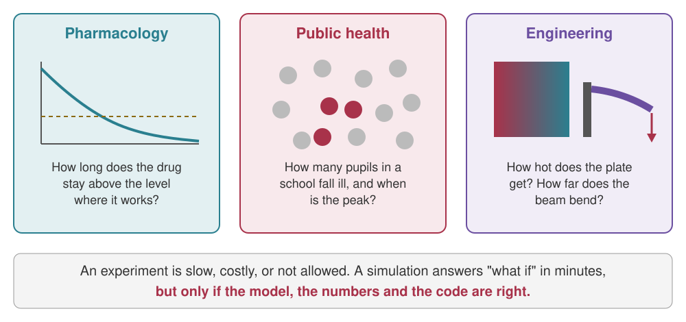{width="88%" fig-align="center"}

::: notes
Here are three typical questions. A pharmacologist wants to know how long a drug stays above the concentration where it works, so they can choose a dosing interval. A public health researcher or a school nurse wants to know how many pupils will fall ill and when the peak comes, under different assumptions. An engineer wants to know how hot a plate gets, or how far a beam bends under load, before building it. In each case, the experiment is slow, expensive, unethical or impossible. A simulation can answer in minutes, and you can change an assumption and rerun it. That is the promise. The catch is in the bottom line: only if the model, the numbers and the code are all right. This lecture is about how you, with an agent, make sure of that.
:::

## A simulation is rules, numbers and a start, stepped forward many times

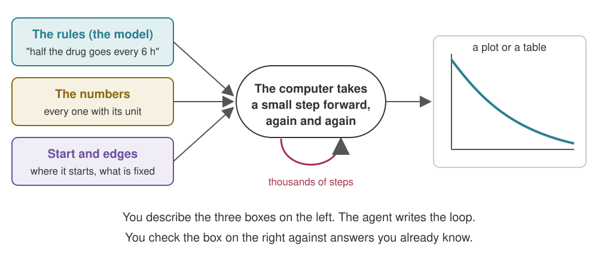{width="85%" fig-align="center"}

::: notes
Every simulation in this track has the same shape. There are rules: the model, written in words, such as "half the drug is removed every six hours". There are numbers, the parameters, and every one of them has a unit. And there is a start and a set of edges: where things begin, and what is held fixed. The computer then takes a small step forward in time, applies the rules, and repeats, thousands of times. At the end you get a plot or a table. The division of labour in this track is simple. You describe the three boxes on the left, in plain language and with units. The agent writes the loop. And you check the result on the right against answers you already know. That last part is what this lecture is mostly about.
:::

## Most models are one of three pictures

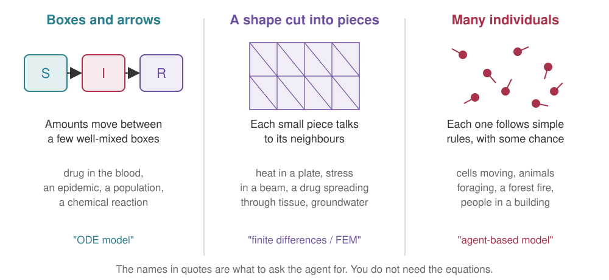{width="90%" fig-align="center"}

::: notes
Nearly every simulation you will meet in biology, medicine or engineering is one of three pictures. First, boxes and arrows: a few well-mixed compartments, with amounts flowing between them. A drug in the blood, an epidemic, a population, a chemical reaction. Mathematicians call these ordinary differential equation models, or ODE models. Second, a shape cut into many small pieces, where each piece only talks to its neighbours: heat in a plate, stress in a beam, a substance spreading through tissue. These are solved with finite differences or the finite element method, FEM. Third, many individuals, each following simple rules with some chance involved: cells moving, animals foraging, a fire spreading. These are agent-based models. The names in quotes are useful words to give the agent. You do not need the equations behind them.
:::

## Boxes and arrows: a drug drains from the blood like water from a tank

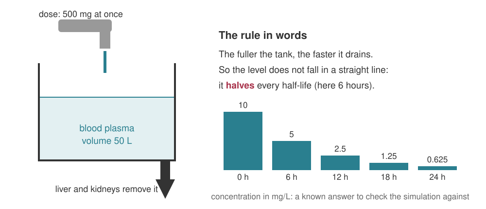{width="85%" fig-align="center"}

::: notes
Here is the simplest model in the track, in a picture. The blood plasma is a tank. A dose goes in at once, like a full bucket poured in. The liver and kidneys drain it, and the rule is that the fuller the tank, the faster it drains. That single rule means the level does not fall in a straight line. It halves every half-life. With a half-life of six hours, ten milligrams per litre becomes five after six hours, two and a half after twelve, and so on. This is called a one-compartment model, and it is a real tool in pharmacology. More important for us: it has a known answer. Those bars on the right are something you can check the agent's simulation against, to the third decimal.
:::

## Boxes and arrows: an epidemic is three boxes and two rates

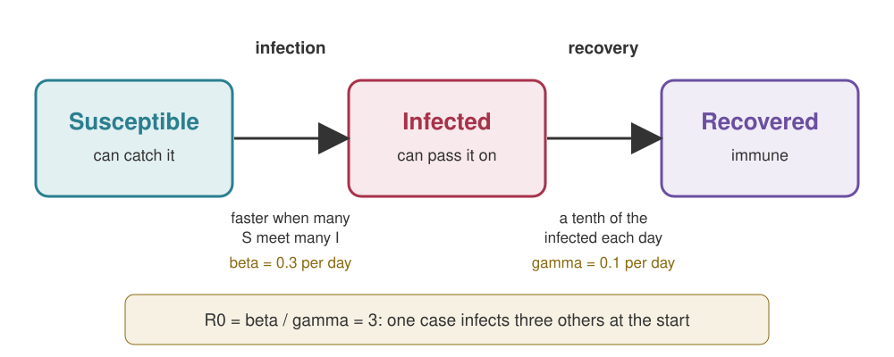{width="85%" fig-align="center"}

::: notes
The second boxes-and-arrows model is the classic SIR epidemic model. Everyone in a closed population is in one of three boxes: susceptible, infected or recovered. People move from susceptible to infected when they meet an infected person, so this flow is fastest when there are many of both. People move from infected to recovered at a steady rate: here, a tenth of the infected recover each day, which means people are infectious for ten days on average. The ratio of the two rates is R0, the number of people one infected person infects at the start. With R0 equal to three, the infection spreads. The model is crude: nobody is born, dies, travels or changes behaviour. But it is a standard teaching model, and it comes with several known answers we will use to check the agent's code.
:::

## A shape cut into pieces: each piece moves towards its neighbours

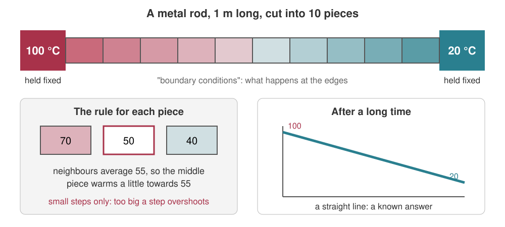{width="85%" fig-align="center"}

::: notes
The second picture is a shape cut into pieces. Start with a metal rod, one metre long, with one end held at 100 degrees and the other at 20. Cut it into ten pieces. The rule for heat is that each piece moves a little towards the average of its two neighbours, at each small time step. Repeat that thousands of times and heat flows from the hot end to the cold end. The ends are special: they are held fixed. What happens at the edges is called the boundary conditions, and getting them right is half of getting the model right. After a long time, the temperature along the rod settles into a straight line from 100 to 20. That straight line is another known answer. Note the red line in the box: the steps must be small. We will see what happens when they are not.
:::

## The finite element method does the same on any shape, with triangles

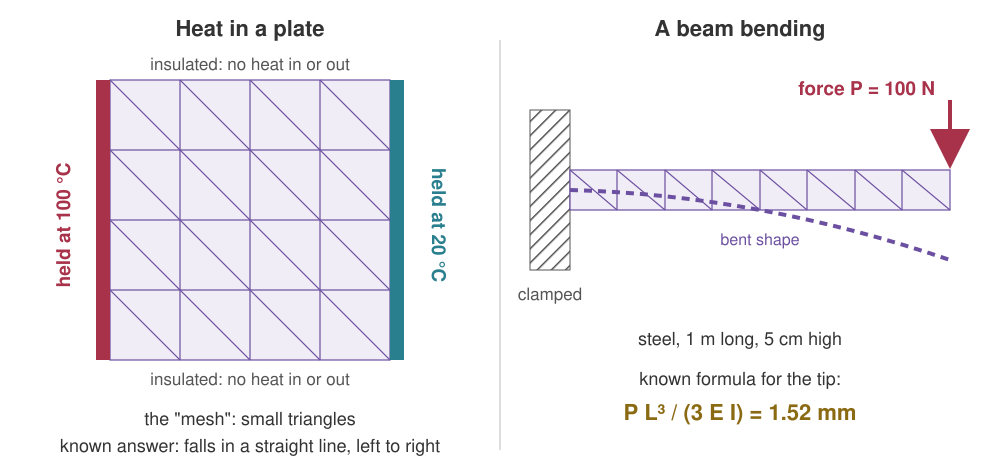{width="88%" fig-align="center"}

::: notes
For a plate or a beam, the pieces are usually small triangles, called the mesh, and the method is called the finite element method. The idea is the same as for the rod: each small piece is connected to its neighbours, and the edges have conditions. On the left is a square plate. The left edge is held at 100 degrees, the right edge at 20, and the top and bottom are insulated, which means no heat goes in or out there. Notice that "insulated" and "held at 20 degrees" are completely different conditions, and an agent that guesses will often pick the wrong one. On the right is a steel beam clamped at one end with a force at the other. For both there is a known answer: a straight line for the plate, and a textbook formula for the tip of the beam, 1.52 millimetres for these numbers. You do not need to derive the formula. You look it up, as you would in your own field.
:::

## Many individuals: random walkers spread out like heat

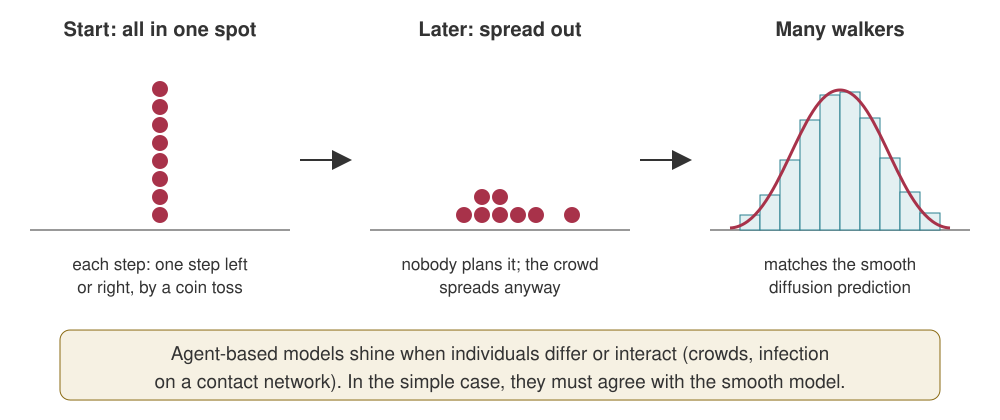{width="85%" fig-align="center"}

::: notes
The third picture is many individuals. Here each walker starts at the same spot and, at every step, moves left or right by the toss of a coin. Nobody coordinates anything. Yet the crowd spreads out, and with many walkers the shape of the crowd matches the smooth bell curve that the diffusion equation predicts. That is the same equation as for heat in the rod. Agent-based models become really useful when individuals differ or interact: people with different contacts, cells that stick together, animals that avoid each other. But in the simple case, they must agree with the smooth model. That agreement is a check you can ask the agent to run, and it is a good test of whether the agent-based code is correct before you add the interesting complications.
:::

## Pick the picture that matches your question

| Your question is about... | Picture | Ask the agent for | A known answer to check |
|---|---|---|---|
| amounts in a few places over time | boxes and arrows | an ODE model (Python `scipy`, R `deSolve`) | half-life, conservation, R0 below 1 |
| how something varies across a shape | shape in pieces | finite differences (1D) or FEM (`scikit-fem`) | straight line, textbook formula |
| individuals who differ, meet or choose | many individuals | an agent-based model with a fixed seed | the smooth model in the simple case |

When in doubt, start with the simplest picture that could answer your question. Add detail only when the simple model is checked and found too crude.

::: notes
This table helps you choose. If your question is about amounts in a few places over time, a drug, a population, a pollutant in a lake, use boxes and arrows. In Python the agent will usually use scipy; in R, the deSolve package. If your question is about how something varies across space, temperature across a plate, stress across a beam, concentration across tissue, use a shape cut into pieces: finite differences for a simple one-dimensional case, finite elements for real shapes. If individuals matter, because they differ or because who meets whom matters, use an agent-based model. The last column is the important one: for each kind there are known answers you can check against. A general rule: start simple. A simple model you have checked beats a complicated one you have not.
:::

## An agent writes the code in minutes; the risk is a plausible wrong answer

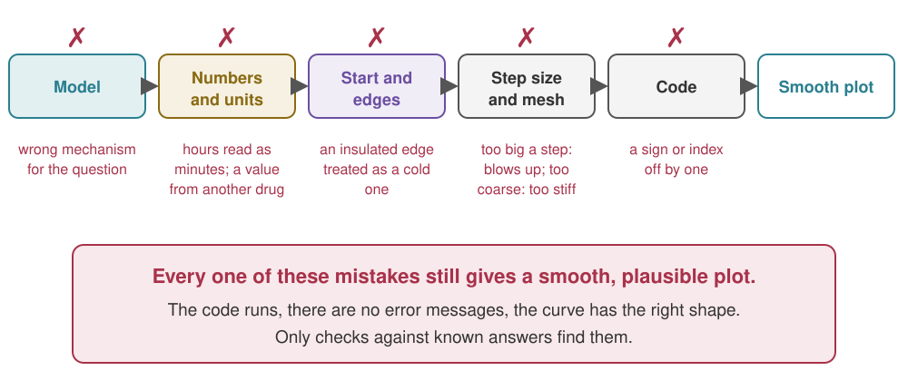{width="90%" fig-align="center"}

::: notes
Here is why this track exists. Every step from question to plot can go wrong, and none of the mistakes produce an error message. The model can be the wrong mechanism for the question. A number can be in the wrong unit, or taken from a different drug or material. An insulated edge can be treated as a cold edge. The time step can be too big, or the mesh too coarse. The code can have a sign or an index off by one. Each of these gives a smooth curve with the right general shape. Experts make these mistakes too, but an agent makes them faster and more confidently, and it fills every gap in your description with a guess. You cannot spot these errors by looking at the plot. You find them with checks against known answers. The rest of this lecture is about those checks.
:::

## Skill 1: write every number with its unit and where it came from

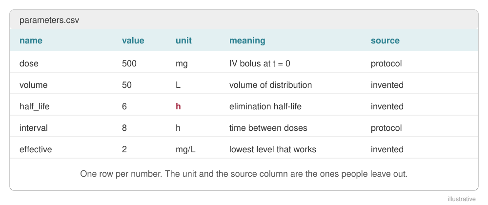{width="80%" fig-align="center"}

- Keep the numbers in a **parameter file**, not buried in the code. The script reads the file.
- Ask the agent to **print the units** next to every result.

::: notes
The first skill is to write the numbers down, every one with its unit and its source. The best way is a small table, a parameter file, that the script reads. Then the numbers are in one place, you can read them without reading code, and you can change one and rerun. The two columns people leave out are the unit and the source. The source column tells a colleague, or you in six months, whether a number came from a protocol, from a paper, or was simply invented for a test. The unit column prevents the most common simulation mistake of all, which is on the next slide. Ask the agent to print units next to every result too, so that you notice if hours have turned into minutes.
:::

## A unit read wrongly gives a smooth curve and a wrong answer

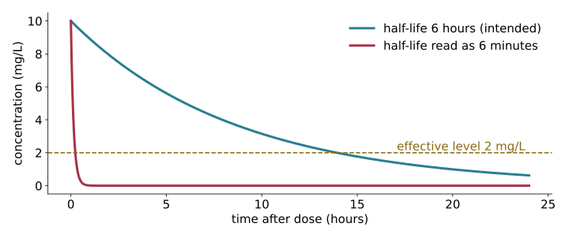{width="85%" fig-align="center"}

"Half-life 6" without a unit is an invitation to guess. Write "half-life 6 hours" and "report time in hours".

::: notes
Here is the most common mistake, made visible. Both curves come from the same correct model. The teal one uses a half-life of six hours. The red one used six minutes, because somewhere the time unit was taken as minutes. With six hours, the drug stays above the effective level of two milligrams per litre for about fourteen hours. With six minutes, it is gone within the first hour. Both curves are smooth, both have exactly the right shape, and the code ran without complaint. If the only thing you looked at was the shape, you would accept either. The fix is cheap: write the unit every time, in your prompt and in the parameter file, and ask for the unit in every output. Agents follow explicit units very reliably. They guess when units are missing.
:::

## Skill 2: check against answers you already know, before anything new

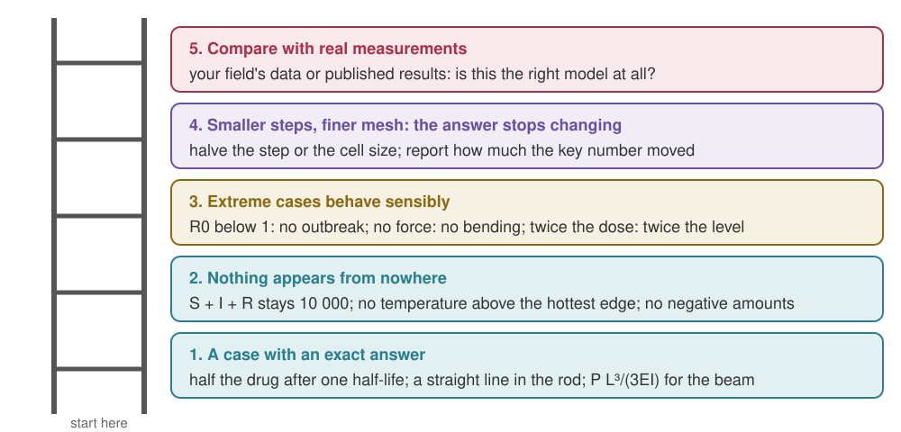{width="80%" fig-align="center"}

::: notes
The second skill is to check, and to check in a particular order, from the bottom of this ladder upwards. First, a case with an exact answer: one half-life, a straight line, the textbook formula. Second, nothing appears from nowhere: in the epidemic model the total number of people stays the same, temperatures never go above the hottest edge, amounts never go negative. Third, extreme cases behave sensibly: no outbreak when R0 is below one, no bending without a force, twice the dose gives twice the level in a linear model. Fourth, refine the steps or the mesh until the answer stops changing. Only then, at the top, compare with real measurements. You need no mathematics for any of these rungs. You need to know what answer to expect, which comes from your field, a textbook, or a simple case.
:::

## The drug model passes when it halves every half-life

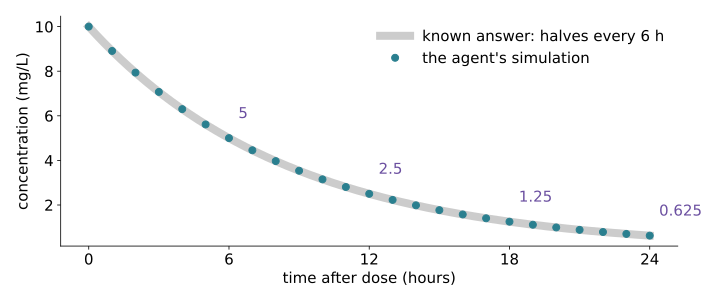{width="82%" fig-align="center"}

- Known answer: 10 → 5 → 2.5 → 1.25 → 0.625 mg/L at 0, 6, 12, 18, 24 h.
- Ask for the check as **numbers in a table**, not only as a plot. Lines on top of each other can hide a small difference.

::: notes
Here is the first rung in practice. The thick grey line is the known answer: the concentration halves every six hours. The teal dots are the simulation. They lie on the line, and the printed numbers match to three decimals. This check takes the agent a few seconds to add, and it catches unit mistakes, sign mistakes and a wrong formula at once. Notice the second bullet. Ask for the comparison as numbers, not only as a plot. Two lines on top of each other can hide a difference of a few per cent, and a plot at the wrong scale can hide much more. A small table with "expected", "got" and "OK" is much harder to misread.
:::

## The epidemic model passes three checks that need no maths

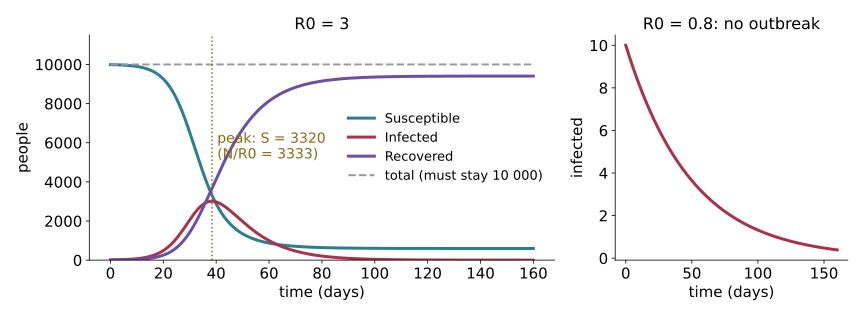{width="85%" fig-align="center"}

- **The total stays 10 000.** Nobody appears or disappears.
- **The peak comes when a third are still susceptible** (S = N/R0). A known property of this model.
- **With R0 below 1 there is no outbreak.** The number infected only falls.

::: notes
The epidemic model has several known answers, and you can state all of them in words. First, the total: susceptible plus infected plus recovered must stay at ten thousand, because the model has no births, deaths or travel. The grey dashed line shows it does. Second, a textbook property of this model is that the number of infected peaks exactly when the share still susceptible has fallen to one over R0, here one third. The simulation peaks at 3320 susceptible, very close to 3333; the small gap is because a few people were infected at the start. Third, with R0 below one there is no outbreak at all: the right panel shows the number infected only falls. If any of these failed, something would be wrong in the code, and you would not need to read the code to know it.
:::

## Skill 3: refine until the answer stops changing

| Cell size along the rod | Largest error (°C) | Error shrinks by |
|---|---|---|
| 10 cm | 0.152 | |
| 5 cm | 0.038 | 4.0 × |
| 2.5 cm | 0.0095 | 4.0 × |
| 1.25 cm | 0.0024 | 4.0 × |

- A simulation chops time and space into steps. **Smaller steps should change the answer less and less.**
- Ask the agent for this table for your **key number**: halve the step, rerun, report the change.
- If the answer is still moving, the result is not yet a result.

::: notes
The third skill is refinement. A simulation always chops time and space into small steps, so it is always an approximation. The question is whether the approximation is good enough. The test is simple: halve the step, rerun, and see how much the answer changes. Here is the heated rod again, compared with an exact answer. Each time the cells are made half as long, the error shrinks by a factor of four. You do not need to know why it is four; you only need to see that the error shrinks steadily as the cells get smaller. In your own simulations there is usually no exact answer, so you compare each run with the next finer one instead. Ask the agent for exactly this table, for the number you care about. If the answer is still moving at the finest level, you do not have a result yet.
:::

## Never trust a pretty plot (1): too big a time step

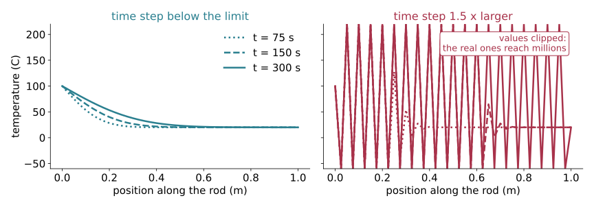{width="92%" fig-align="center"}

::: notes
Here is what happens when a time step is too large. Same rod, same model, same code. On the left, the time step is below a limit that depends on the size of the pieces; the heat spreads smoothly from the hot end. On the right, the step is one and a half times larger. At first, at 75 seconds, there is only a small wiggle near the front of the heat, which you might even mistake for something real. By 300 seconds the solution has exploded: the real values run into the millions, and we clipped them to fit the plot. This one is easy to spot. Milder versions are not: a slightly too large step can give a curve that is smooth but wrong by a few per cent. The cure is the refinement check from the last slide, and the "nothing appears from nowhere" rule: no point in the rod may be hotter than the hottest end.
:::

## Never trust a pretty plot (2): a beam that looks right and is 63 % wrong

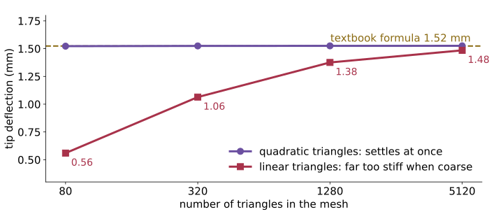{width="82%" fig-align="center"}

Both meshes give a picture of a nicely bent beam. Only the formula and the refinement table show that one is far too stiff.

::: notes
This is a more subtle example, from the finite element method. The beam from earlier, with two kinds of triangles. With quadratic triangles, the purple line, the tip deflection is right at the textbook value from the first, coarse mesh. With linear triangles, the red line, the coarse mesh gives a tip deflection of 0.56 millimetres, 63 per cent too small. The beam is far too stiff. Engineers call this locking. It slowly improves as the mesh gets finer, but even with five thousand triangles it is still a few per cent off. The point is not the name of the effect. The point is that the picture of the bent beam looks perfectly fine in both cases. You would only know something was wrong from the formula, or from the fact that the answer keeps changing as you refine. That is why refinement is not optional.
:::

## Agent-based models are noisy: compare many runs, not one

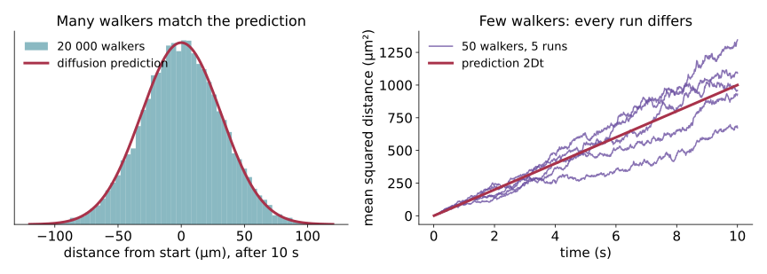{width="88%" fig-align="center"}

- With 20 000 walkers the crowd matches the diffusion prediction. With 50, a single run can be off by a third.
- Ask for a **fixed random seed** (so a run can be repeated) and **several seeds** (so you see the spread).

::: notes
Agent-based models have a check of their own. They involve chance, so every run is different. On the left, twenty thousand walkers match the diffusion prediction closely. On the right, five runs with only fifty walkers each: every run tells a different story, and one is thirty per cent below the prediction. If you had run only one small simulation, you could have reported any of these. Two habits fix this. First, ask the agent to set a fixed random seed, so that the same run can be repeated exactly, which matters for reproducibility. Second, run several different seeds and report the spread, not one run. The same holds for any model with chance in it, including stochastic epidemic models.
:::

## The prompt states the model, the numbers, the checks and the output

```text
Build a one-compartment pharmacokinetic model in Python (scipy).
The drug is given as an IV bolus; it is removed at a rate proportional
to the amount present.

Parameters, with units, are in parameters.csv. Read them from there.
Report time in hours and concentration in mg/L.

Before anything else, add checks and print them as a table
(check, expected, got, OK):
- concentration after one half-life is half the starting value
- at 24 h it is 1/16 of the starting value
- twice the dose gives twice the concentration
- halving the solver tolerance changes the 24 h value by < 0.1 %
Then plot concentration against time and report how long the level
stays above the effective level. Ask me if anything is unclear.
```

::: notes
Here is a prompt that puts the three skills together. It names the model in plain words, and also gives the technical term so the agent picks the standard approach. It points to the parameter file and fixes the units of the output. Then, before any results, it asks for the checks, with the expected answers written out, and for a table. Only after that does it ask for the plot and the actual question: how long the level stays above the effective level. The last line invites questions. A good agent will ask, for example, whether the effective level is in the parameter file, or whether you want repeated doses. Notice what the prompt does not contain: any equations or code. You describe; the agent writes.
:::

## Ask for a check table you can read in ten seconds

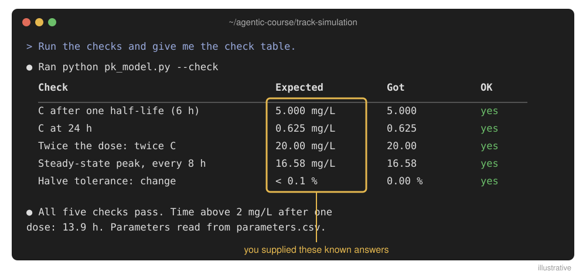{width="82%" fig-align="center"}

::: notes
This is the kind of output you want back. A table of checks, each with the expected value that you supplied, the value the simulation got, and whether they agree. Then, and only then, the answer to your question: here, the level stays above two milligrams per litre for about fourteen hours after one dose. You can read this in ten seconds, and you can paste it into your notes or your project's log. Make the checks part of the script, so they run every time, not a one-off conversation. Next month, when you change a parameter, the checks still run. If a check fails after a change, you know immediately. As always, your session will look different: the agent may lay out the table differently or choose other wording. What matters is that the expected values come from you.
:::

## For FEM, let the agent install scikit-fem in a project environment

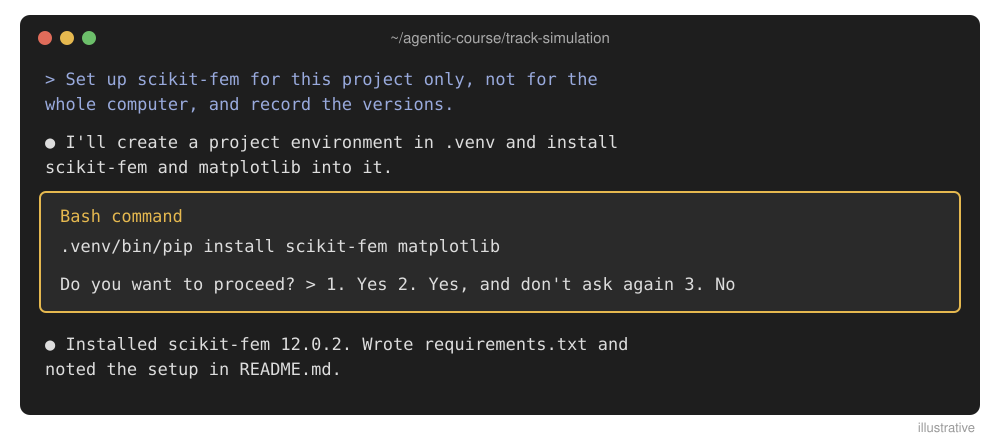{width="62%" fig-align="center"}

- `scikit-fem` is a small Python library (needs only numpy and scipy). Ask for it **in a project environment**, never system-wide.
- Record the versions (`requirements.txt`), as in *Reproducible figures*.
- Heavier alternatives exist: **FEniCSx** (more powerful, harder to install, usually via conda or Docker) or a commercial package your department licenses.

::: notes
If you choose the finite element option, the agent needs a library. We suggest scikit-fem, a small Python package that only needs numpy and scipy, which makes it easy to install. Ask the agent to install it for this project only, in what Python calls a virtual environment, a folder inside the project that holds its own copies of the packages. That way nothing else on your computer changes, and a colleague can recreate the same setup. The agent will ask permission to run the install command; read it as you learned in the Terminal survival kit, and check that it installs into the project folder. Ask it to record the versions, exactly as in Reproducible figures. If you need more power, FEniCSx is a widely used open-source alternative, but it is harder to install. If your department has a commercial package, the agent can often write input files for that too, but you need the licence.
:::

## Change one thing at a time, and keep every run

- **What if** the half-life is 4 h? 8 h? Change **one** parameter per run.
- Ask for a small **runs table**: run id, what changed, key result, all checks passed?
- Keep the parameter file and the script under git; commit when a run is worth keeping.
- A fixed seed and recorded versions mean anyone can repeat any run.

```text
Run the model for half-lives of 4, 6 and 8 hours, everything else as in
parameters.csv. Add one row per run to runs.csv: date, half_life_h,
hours_above_effective_level, all_checks_passed. Do not overwrite earlier rows.
```

::: notes
Once the model passes its checks, the fun starts: what-if questions. The habit to keep is to change one thing at a time, and to keep a record of every run. A small runs table does this: one row per run, with what changed, the key result, and whether all checks passed. Ask the agent to append rather than overwrite, so the history stays. Keep the parameter file, the script and the runs table under git, as you have done since Git as undo button and lab notebook, and commit when a run is worth keeping. With a fixed seed and recorded versions, anyone, including you in a year, can repeat any run exactly. This is the same discipline as in Reproducible figures, applied to simulation.
:::

## A verified model can still be the wrong model

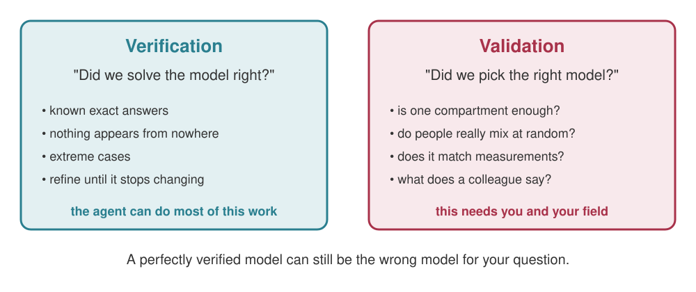{width="85%" fig-align="center"}

::: notes
Here is an important distinction. Everything so far has been verification: did we solve the model right? Known answers, conservation, extreme cases, refinement. The agent can do most of this work, as long as you supply the expected answers. Validation is a different question: did we pick the right model at all? Is one compartment enough for this drug, or does it move into tissue and back? Do pupils in a school really mix at random, or mostly within their class? Does the plate really have insulated edges? These questions need your field: measurements, literature, a colleague's opinion. A perfectly verified model can still be the wrong model for your question. The agent can suggest what might be missing, but it cannot tell you which simplifications are acceptable in your field.
:::

## Where this goes wrong

- **Missing units.** The agent guesses hours or minutes, metres or millimetres. Write them every time.
- **Wrong edges.** Insulated vs fixed temperature; clamped vs free. Draw a sketch and describe each edge.
- **No known-answer check.** "The plot looks reasonable" is not a check.
- **No refinement.** A result that still changes when you halve the step is not a result.
- **One run of a random model.** Report several seeds, not the luckiest one.
- **Parameters from nowhere.** The agent may fill in a "typical" value. Ask it to list every number it did not get from you.
- **Checks written after the results.** It is too easy to adjust the check to the answer. Write the expected values first.
- **Verified, but not validated.** The code is right; the model is too simple for the question.

::: notes
Here are the ways this goes wrong, collected in one place. Missing units and wrong edge conditions are the most common, and both are fixed by writing more in the prompt. Missing checks and missing refinement are the next, and both are fixed by asking for a check table every time. Random models need several runs. One item deserves special attention: parameters from nowhere. If you leave out a number, the agent will often fill in what it considers a typical value, and it may not say so. Ask it explicitly to list every number it used that you did not supply. Another: write the expected values before you see the result, otherwise it is tempting to adjust the check until it passes. And finally, remember the difference between verification and validation.
:::

## What the agent does and does not do here

| The agent does well | You do |
|---|---|
| write the model code in Python or R | describe the model in words, with a sketch |
| set up solvers, meshes, environments | supply every number, with its unit and source |
| add checks, tables, plots, a runs log | supply the expected answers for the checks |
| explain what the code does, line by line | judge whether the model fits the question |
| suggest standard models and known results | look up the known results in a trusted source |

::: notes
To sum up the division of labour. The agent is very good at the parts that used to require programming: writing the model, choosing a solver, setting up a mesh and installing libraries, adding checks and plots, and explaining what each part of the code does. It can also suggest standard models and known results, such as the textbook formula for a beam. But treat those suggestions like any other claim from a language model: look them up in a trusted source before you use them as a check. You supply the model in words, the numbers with units, the expected answers, and the judgement of whether the model fits your question. That last column is where your expertise matters, and it is what makes the result yours.
:::

## Summary

| Concept | Key fact |
|---|---|
| Three pictures | boxes and arrows (ODE), shape in pieces (finite differences, FEM), many individuals (agent-based) |
| Parameter file | every number with its unit and source, read by the script |
| Boundary conditions | what happens at the edges: fixed, insulated, clamped, free |
| Known-answer check | half-life, straight line, textbook formula, R0 below 1 |
| Nothing from nowhere | totals conserved, no value beyond its limits, no negative amounts |
| Refinement | halve the step or the cell size; the key number must settle |
| Seeds | fixed seed to repeat a run; several seeds to see the spread |
| Pretty plot | a smooth curve says nothing about correctness |
| Verification vs validation | solving the model right vs choosing the right model |

**Next (Parallel workers: Claude and Codex):** two agents at once, the same task given to both, and one agent checking the other's work. Or continue with another track.

::: notes
Here is the summary. Pick the picture that matches your question: boxes and arrows, a shape in pieces, or many individuals. Keep every number in a parameter file, with its unit and its source. Describe the edges. Check against known answers first, then conservation and extreme cases, then refine until the key number settles. For random models, use a fixed seed and several runs. Never trust a smooth curve on its own. And remember that verification, which the agent can do much of, is not the same as validation, which needs you. In Part 5, the first unit is Parallel workers, where two agents work at once and one checks the other. That is a natural next step for simulations too: give the same model description to both agents and compare the answers.
:::
