## About this lecture

Every course ends with an evaluation, and many research projects run a questionnaire. The export is messy, the programme board meets next week, and the free-text answers are the most useful part and the slowest to read. An agent can turn the export into a tidy table, plots and a short report in an afternoon. **The risks are quiet ones**: a reversed item read the wrong way, a group of three students made recognisable, a quote that nobody wrote.

- **Tidy first, with a codebook.** One row per respondent, every decision written down.
- **Show the whole distribution** of a Likert item, not only its mean: diverging stacked bars.
- **Compare groups plainly**, with the number of people behind every percentage, and few planned comparisons.
- **Never report groups smaller than five**, and check combinations too.
- **The agent may summarise free text, but every quote must exist word for word.**

This is a **track**: a hands-on unit on one kind of data, using the skills from Parts 1 to 4. It builds on *Privacy, ethics and safety* (synthetic stand-ins), *Reproducible figures* and *A course or project page* (Quarto).

::: notes
Welcome to the survey track. Almost everyone in this room handles survey data in some form: course evaluations, student or staff questionnaires, research surveys. The work is the same every time: clean the export, describe it, plot it, compare a few groups, read the comments, and write something short for a board or a report. An agent is very good at all of this. But survey data has risks that do not show up as errors: an item that is worded negatively and read the wrong way round, a small group of students who become identifiable, and above all, quotes that sound perfectly real and were never written. The five ideas on this slide are about those risks. The worked example uses a synthetic course evaluation, so nothing real goes to the cloud.
:::

## The export arrives two days before the programme board

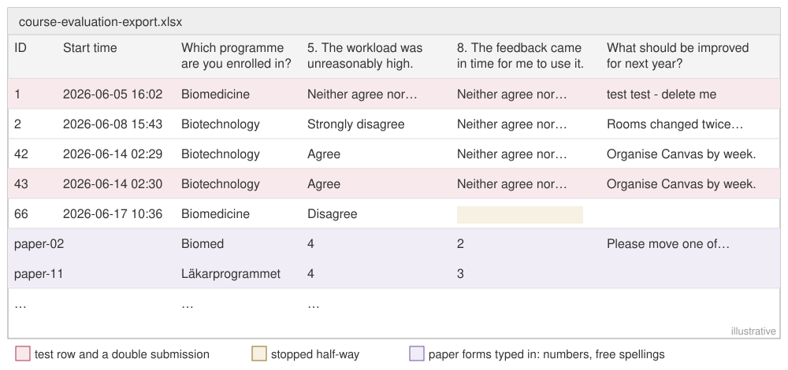{width="85%" fig-align="center"}

::: notes
Here is the concrete problem. The course evaluation closed, and the survey tool produced an Excel export. It looks fine at first glance. Then you notice things. Row one is the test response you made yourself before the survey opened. Two rows are identical, a minute apart: someone pressed submit twice. One student stopped halfway. And at the bottom, a teaching assistant typed in fifteen paper forms from the last lab session, with numbers instead of words and programme names spelled however the student wrote them, some in Swedish. This is not a badly run survey. This is what every real export looks like. The board meets in two days and wants a short, fair summary.
:::

## One script takes the export all the way to the report

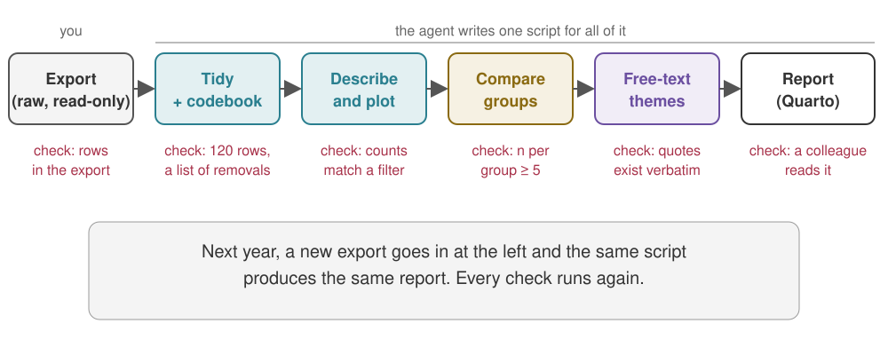{width="92%" fig-align="center"}

::: notes
Here is the whole pipeline. You keep the raw export untouched, as in First delegations. The agent writes one script that tidies it, describes and plots it, compares a few groups, sorts the free text into themes, and produces a short Quarto report. Each step has its own check, written in red under the boxes, and we will go through them one by one. The point of one script rather than a conversation is in the grey box: next year, a new export goes in at the left and the same report comes out at the right, with the same checks. You built the habit of scripts in Reproducible figures and Quarto pages in A course or project page. This track puts them together.
:::

## "Anonymous" survey answers can still identify a person

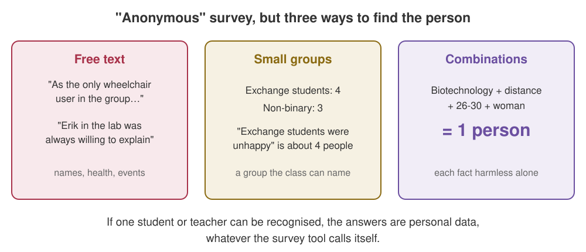{width="88%" fig-align="center"}

::: notes
Before we touch any data: privacy. Many survey tools have an "anonymous" setting, which only means they do not record the name or email. The answers can still point to a person in three ways. Free text: a student who writes "as the only wheelchair user in the group" has identified themselves, and has shared health information. A student who praises "Erik in the lab" has put a staff member's name into the data. Small groups: if four exchange students took the course, a sentence about exchange students is about four people the whole class can name. And combinations: each fact is harmless, but programme plus study mode plus age group plus gender can narrow a group down to one person. In our synthetic data, Biotechnology, distance, 26 to 30, woman is exactly one person. If anyone can be recognised, the answers are personal data under GDPR.
:::

## The safe route: build on a synthetic stand-in, run on the real file yourself

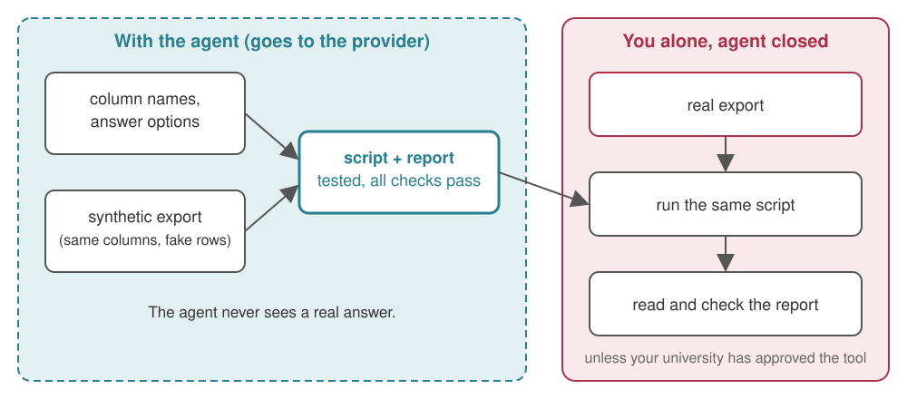{width="85%" fig-align="center"}

::: notes
This is the route from Privacy, ethics and safety, applied to surveys. The agent only ever sees the column names, the answer options and a synthetic export with the same columns and invented rows. It builds the script and the report on that, and you test until every check passes. Then you close the agent, and run the same script yourself on the real export. You read the report and check it. The agent never sees a real answer. This is the default for course evaluations, unless your university has approved the tool you use for this kind of data, and even then, the free text deserves extra care. Today's worked example is synthetic, so you can let the agent read everything.
:::

## Course evaluations come with their own rules

| Question | Short answer (check your own university's rules) |
|---|---|
| Are evaluations required? | In Sweden, yes: the Higher Education Ordinance (1:14) requires universities to offer them, compile the results and keep them available to students. |
| Personal data? | Yes, if anyone can be identified: through free text, small groups or combinations, even with an "anonymous" survey. |
| Who may see the raw answers? | Usually the course coordinator and a few named people. Not the whole programme board, not a cloud service without approval. |
| How long are they kept? | Your university's records and archiving rules decide. Do not keep private copies in your Downloads folder. |
| Public documents? | At Swedish public universities, submitted answers may be official documents. Ask your registrar. |
| Can I use them in research? | Not automatically: that is a new purpose, which may need ethics review and information to students. |

::: notes
Course evaluations have rules of their own, and they differ between countries and universities, so treat this table as a list of questions to ask locally rather than legal advice. In Sweden, the Higher Education Ordinance requires universities to offer course evaluations, compile them, inform students about the results and any actions, and keep the results available to students. Because answers can identify people, they are personal data, with the usual GDPR duties: a purpose, limited access, a retention period. Who may see the raw answers is usually a small group. At Swedish public universities, there is an extra twist: submitted answers may be official documents that anyone can request, which is another reason to be careful with what is collected. And using evaluations for a research paper is a different purpose that may need ethics review. Your data protection officer can tell you what applies.
:::

## Today: a synthetic course evaluation with known answers

- `course-evaluation-export.xlsx`: an invented course, *Cell Biology, spring 2026*. 164 students registered.
- 122 rows: 105 online answers, 15 paper forms typed in by hand, **1 test response**, **1 double submission**.
- 12 Likert items (Strongly disagree … Strongly agree). **Items 5 and 9 are negatively worded.** Item 3 has "Not applicable".
- Programme, study mode (campus or distance), age group and gender.
- Two free-text questions, a few answers in Swedish.
- Built in on purpose: blanks, a student who stopped halfway, groups of 2, 3 and 4 people, staff names and one identifying comment in the free text.

Because we made the data, we know the right answers: **120 respondents**, the counts for every item, two real group differences, and the theme of every comment.

::: notes
Here is the data for the exercise. It is entirely invented: the course, the students, the teachers and the comments. It looks like a typical export from Microsoft Forms or Google Forms, extended by hand with paper forms, which is common in practice. We built in every problem from the earlier slides on purpose, and we know the right answer for each. After cleaning there are 120 respondents. Distance students genuinely rate the recordings higher and the labs lower than campus students; nothing else differs much. And every free-text comment has a known theme. That means you can check the agent against a key, as you did in First delegations, before you do it on real data where there is no key.
:::

## Tidy data: one row per respondent, one column per question

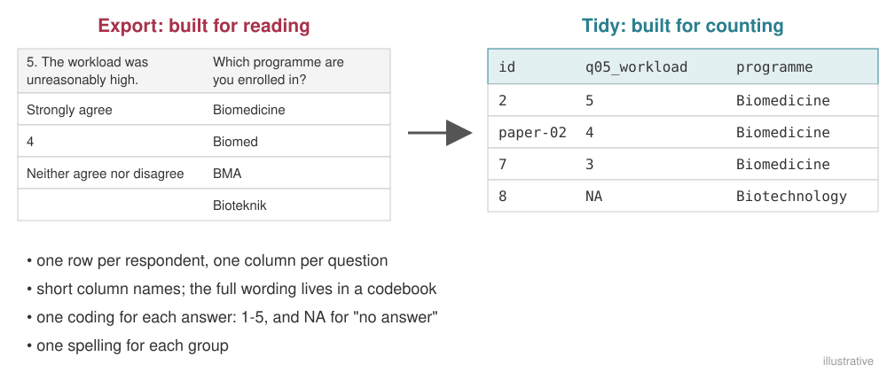{width="88%" fig-align="center"}

::: notes
The first step is always the same: make the data tidy. An export is built for reading by people: long question texts as headers, answers as words, the same group spelled four ways. A tidy table is built for counting: one row per respondent, one column per question, short column names, one coding for every answer, and one spelling for every group. Every later step, counting, plotting, comparing, becomes simple once the table is tidy, and very error-prone if it is not. You do not need to do this yourself, but you need to recognise a tidy table when you see one, so you can check the agent's result.
:::

## Every kind of mess needs a decision you can see

| Mess in the export | A decision someone has to make |
|---|---|
| a test row from before the survey opened | remove; say why |
| two identical rows a minute apart | probably one person twice; remove one, and list it |
| paper forms with numbers 1-5 | check that 1 means "Strongly disagree" on the paper form too |
| "Biomed", "BMA", "Bioteknik", "Läkarprogrammet" | map to the programme names; list the mapping |
| "Not applicable" on item 3 | not a scale value: count it separately |
| blank cells; one student stopped after item 6 | missing, not zero; keep the answers they gave |
| one student "Strongly agree" to all 12 items | flag it; decide whether to keep; report both ways if it matters |

As in *First delegations*: ask for a numbered **decisions list**, and read it.

::: notes
Each kind of mess needs a decision, and you want to see every one. Removing the test row is obvious. The double submission is probably one person pressing submit twice, but it is a judgement, so it goes in the list. The paper forms need a check that the agent cannot make on its own: did the paper form use 1 for "strongly disagree" as well, or the other way round? Only you can find out, by looking at the paper form. Programme names need a mapping, including Swedish ones. "Not applicable" is not a number on the scale. Blanks are missing, not zero. And one student agreed strongly with everything, including the two negative statements, which suggests they did not read the questions. Whether to remove them is a judgement, and the honest answer is often to report both ways if it changes anything.
:::

## The tidy step in one prompt

```text
course-evaluation-export.xlsx is a course evaluation export with paper
forms added at the bottom. Do not change it. Write a script that makes:

- survey_tidy.csv: one row per respondent, short column names
  (q01_outcomes ... q12_overall, programme, mode, age_group, gender,
  source = online/paper, plus the two free-text columns); Likert answers
  coded 1-5 as worded; blanks as NA; "Not applicable" as its own code
- codebook.csv: column, full question text, values, reversed (yes/no)
- decisions.md: a numbered list of every row removed and every value
  recoded, with the reason

Items 5 and 9 are negatively worded. Do not reverse them in
survey_tidy.csv; mark them in the codebook. If anything is unclear,
ask me rather than guess. Tell me how many respondents remain.
```

::: notes
Here is the prompt for the tidy step. As always, it describes the result, not the steps: three files, with their contents spelled out. It keeps the raw export untouched. It says how to code answers, blanks and "not applicable". It names the two negatively worded items, because the agent cannot reliably guess which items are reversed, and it says not to reverse them in the tidy file; we reverse them only where needed, later. And it asks the agent to ask rather than guess, and to report the number of respondents. You know that number should be 120, so this one line is already a check.
:::

## A codebook keeps the full question next to the short name

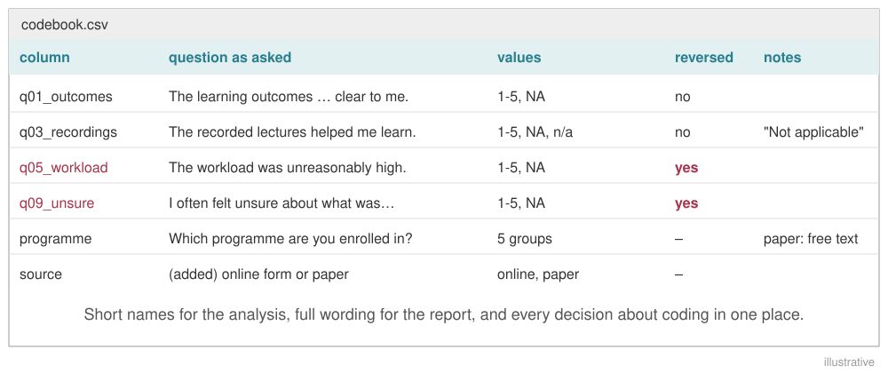{width="88%" fig-align="center"}

::: notes
The codebook is a small table that every survey analysis should have, and most do not. For each column in the tidy table, it holds the short name used in the analysis, the full question as the students saw it, the allowed values, whether the item is reversed, and any notes. It does three jobs. It lets the report use the full wording, so readers know exactly what was asked. It records the coding decisions in one place. And next year, when someone changes one question, the codebook shows that the comparison with this year is no longer like with like. Ask the agent to make it; check it against the questionnaire yourself.
:::

## Negatively worded items point the other way

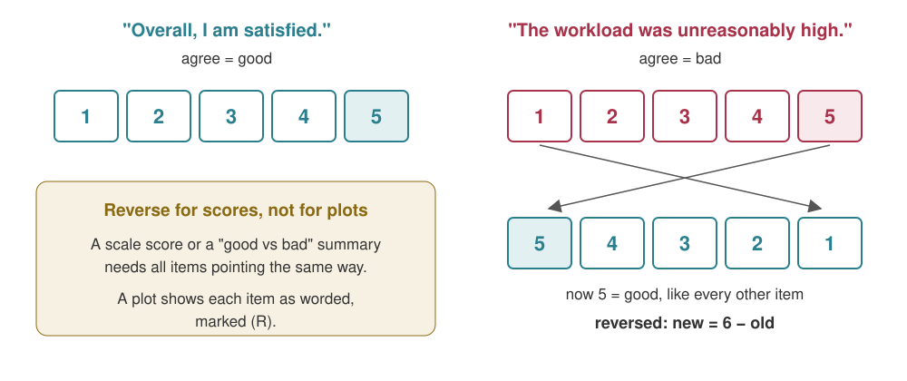{width="85%" fig-align="center"}

::: notes
Questionnaires often include a few negatively worded items, so that people have to read each question. "The workload was unreasonably high" is one: agreeing is bad, while for every other item agreeing is good. If you average all twelve items into a course score without turning these around, the negative items pull the score in the wrong direction. Reversing is simple: on a one-to-five scale, the new value is six minus the old one, so five becomes one and one becomes five. But only reverse for scores and summaries. In a plot of the individual items, show each item as it was worded, and mark the reversed ones, so that readers see what students actually answered.
:::

## A forgotten reversal shows up as an item that disagrees with all the others

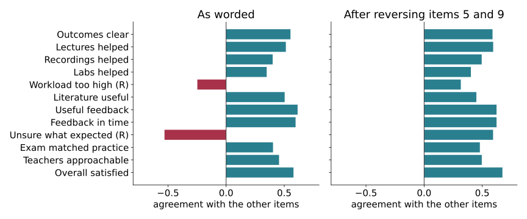{width="85%" fig-align="center"}

Cronbach's alpha for the 12 items: **0.85** with items 5 and 9 reversed, **0.67** without.

::: notes
How do you check that the reversal was done? There is a quick test you can ask the agent for, without any theory. For each item, how well does it agree with the average of all the others? On the left, as worded, two items go the other way: the workload item and the "unsure what was expected" item. Those are exactly the two negatively worded ones. On the right, after reversing them, every item points the same way. A summary number that people often report for a scale, Cronbach's alpha, tells the same story: 0.85 with the reversal, 0.67 without. You do not need to know how alpha is calculated. You need to know that a reversal error makes it drop, and that a negative bar in this plot is a signal to ask "is this item reversed?"
:::

## Four kinds of missing answers mean four different things

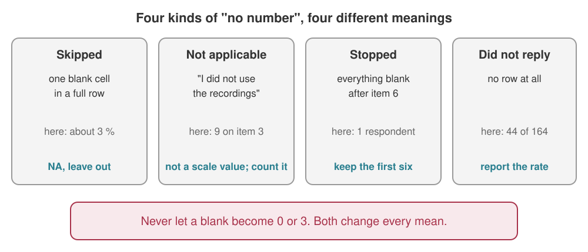{width="88%" fig-align="center"}

::: notes
Missing answers come in different kinds, and they should not be treated the same. A skipped question in an otherwise complete row is simply missing for that item. "Not applicable" is an answer, but not a point on the scale: nine students did not use the recordings, and that is worth reporting as a number, not hiding. A student who stopped after item six still gave six real answers; keep them. And the biggest group of all: 44 of 164 registered students did not reply. Report the response rate, because a report on 73 per cent of a course is different from one on 20 per cent. The one rule that always holds: a blank must never become a zero or a three. Both change every mean, and both are easy mistakes for a script to make.
:::

## A mean hides the shape of the answers

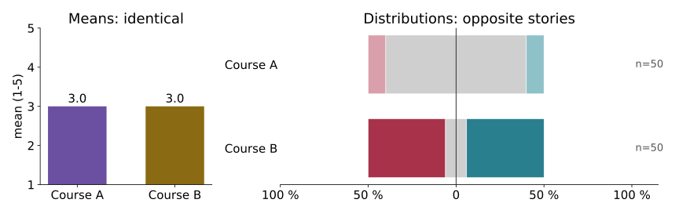{width="92%" fig-align="center"}

- Report for each item: **n**, **% agree** (4-5), **% disagree** (1-2), and the median.
- A mean of a Likert item is common and can be useful, but never on its own.

::: notes
Now describing the data. Likert answers are ordered categories, not measurements, and the mean hides a lot. Here are two invented courses with exactly the same mean of three. In course A, almost everyone is neutral. In course B, the students are split into two camps: half strongly disagree and half strongly agree. Those are opposite stories, and a programme board needs to hear the difference. So for each item, report the number of answers, the share who agree, the share who disagree, and the median. Many reports also give the mean, and that is fine as an extra, but not on its own. The plot on the right, a diverging stacked bar, shows the whole distribution at once, and that is the plot we use next.
:::

## Diverging stacked bars show every item at a glance

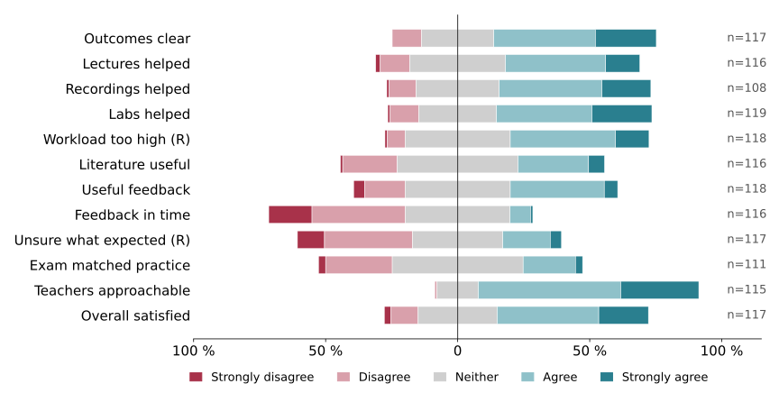{width="82%" fig-align="center"}

::: notes
Here are all twelve items of our synthetic evaluation as diverging stacked bars. Each bar is one item. Agreement goes to the right, disagreement to the left, and neutral sits across the middle line. The number of answers is on the right of each bar. You can see the story in seconds: teachers were approachable, the labs and the outcomes are fine, and the feedback on lab reports came too late to use: more than half disagree with "the feedback came in time". Two items are marked R: there, agreeing is bad, so "workload too high" with half agreeing is a problem, not a success. This is the one plot that belongs in almost every course evaluation report.
:::

## A good Likert plot follows a few fixed rules

- **Same colours, same order** for every item: disagree in one colour family, agree in the other, neutral in grey.
- **Neutral centred** on the zero line, so the eye compares left and right.
- **n on every bar.** Item 10 had 9 blanks; the reader should see that.
- **Reversed items marked** (R), or shown in a separate group.
- **Full question text** available: in the report's table or a footnote, from the codebook.
- **Colour-blind safe** and readable in black and white; no 3D, no pie charts.
- **Same scale** (0-100 %) for all items and all groups.

Ask the agent for these rules **once**, in the prompt or in your project's instructions file, so every plot follows them.

::: notes
A few rules make a Likert plot honest and readable, and they are worth giving to the agent explicitly, because its defaults vary. Use the same colours and order for every item. Centre the neutral category, so the comparison is between left and right. Put the number of answers on every bar, because a bar based on 30 answers deserves less trust than one based on 117. Mark reversed items. Make the full question available. Use colours that work for colour-blind readers, which rules out red against green, and avoid 3D and pie charts. Keep the same scale for every item and group. Put these rules in your project's CLAUDE.md or AGENTS.md, from Organising a project for an agent, and every plot will follow them without you asking again.
:::

## Comparing groups: put the same bars side by side, with n

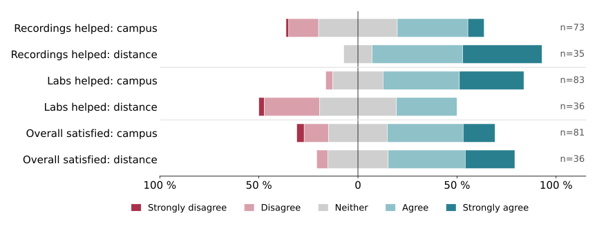{width="85%" fig-align="center"}

::: notes
Now group comparisons. The plainest way to compare groups is to put the same diverging bars side by side for each group, with the number of people in each. Here are campus and distance students on three items. The first two are the differences we built into the data: distance students value the recordings much more, 86 per cent agree against 44 per cent on campus, and they rate the labs much lower, 31 per cent against 71, because their lab week was compressed into a few days on campus. On overall satisfaction the two groups look similar. You can see all of this without any statistics. The statistics come in to answer one question: could a difference this size have appeared by chance?
:::

## A test answers one question: could this be chance?

| Item | Campus: % agree (n) | Distance: % agree (n) | Could it be chance? |
|---|---|---|---|
| 3 Recordings helped | 44 % (73) | 86 % (35) | very unlikely (p < 0.001) |
| 4 Labs helped | 71 % (83) | 31 % (36) | very unlikely (p < 0.001) |
| 12 Overall satisfied | 54 % (81) | 64 % (36) | quite possible (p = 0.14) |

- With **36 people**, a percentage is uncertain by about **±16 points**. A 10-point difference between small groups is usually noise.
- For ordered answers, ask for a **rank test** (Mann-Whitney) or a comparison of **% agree** with a confidence interval. Ask the agent to explain its choice in two sentences.
- Report the **size** of the difference in percentage points first; the p-value second.

::: notes
A statistical test answers one question: if the two groups really felt the same, how surprising would a difference this size be? For recordings and labs, very surprising: those differences are real. For overall satisfaction, a ten-point difference is quite possible by chance with groups this size. A useful rule of thumb: with 36 people, any percentage is uncertain by about plus or minus 16 points, so differences smaller than that between small groups are usually noise. For Likert answers, a rank test such as Mann-Whitney is a standard choice, or you can compare the share who agree. Ask the agent to say in two sentences why it chose its test. And report the size of the difference in plain numbers first. A board needs to know "31 against 71 per cent", not "p less than 0.001".
:::

## Many comparisons produce some "significant" results by chance

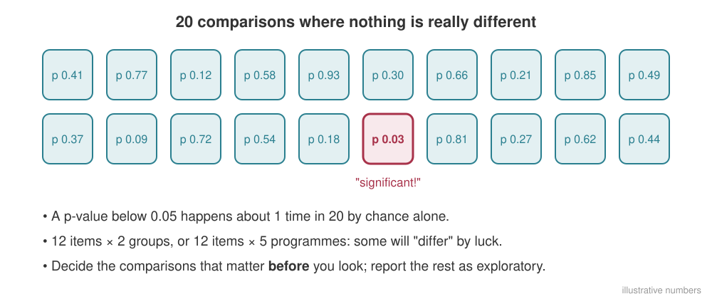{width="82%" fig-align="center"}

::: notes
Here is the trap with group comparisons in surveys. If you compare 12 items between two groups, that is 12 tests. Between five programmes, it is many more. Even when nothing is different, about one test in twenty comes out below 0.05 by chance alone. An agent asked to "find differences between groups" will dutifully run every comparison and report the ones that came out "significant", and some of those will be luck. The fix is old and simple: decide before you look which comparisons matter, for example campus against distance because the course changed for distance students this year. Report those. Treat everything else as exploratory, and say so in the report.
:::

## Never report a group smaller than five

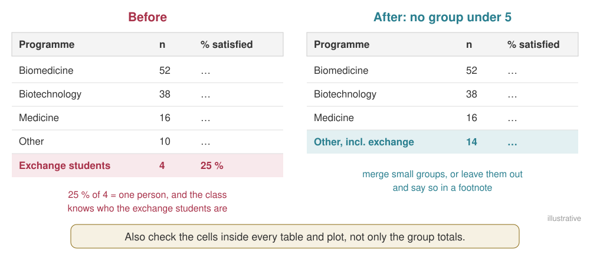{width="85%" fig-align="center"}

::: notes
Now the privacy rule for results. Never report a group smaller than about five people. On the left, the report says that 25 per cent of exchange students were satisfied. There were four exchange students, so 25 per cent is one person, and the rest of the class knows who the exchange students are. That is the same as quoting their answers by name. On the right, the small group is merged into a larger one, "other, including exchange", and a footnote says so. Leaving it out is also fine. The threshold of five is a common rule of thumb; some universities use a higher one, so check yours. And the rule applies to every cell in every table and plot, not only to the group totals at the top.
:::

## Combining groups splits them until one person is left

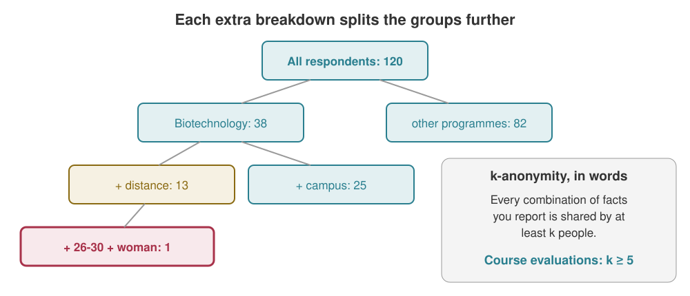{width="88%" fig-align="center"}

::: notes
This is why the rule has to apply to combinations, not only to single groups. Start with all 120 respondents. Biotechnology students: 38, fine. Biotechnology distance students: 13, still fine. Add an age group and a gender, and you are at exactly one person. Each step looked harmless. The name for the protection is k-anonymity: every combination of facts you report should be shared by at least k people, and for course evaluations k of at least five is a sensible rule. Ask the agent to check this for every table and plot it produces, and to list any cell below five. It is a mechanical check, exactly the kind of thing a script does better than a tired person the night before a board meeting.
:::

## The agent sorts free text into themes in minutes

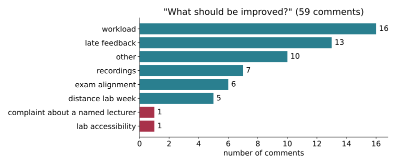{width="68%" fig-align="center"}

- Ask for a **theme list with a count**, and for every comment's **respondent id and theme** in a table you can check.
- Swedish and English comments in one list; the agent can translate, but **quotes stay in the original language**.

::: notes
Free-text answers are often the most useful part of an evaluation, and the slowest part to read. Here the agent can save real time. Give it the comments, ask for themes with counts, and ask for a table with every comment, its respondent id, and the theme it assigned. That table is what makes the themes checkable: you can read down it and disagree. In our synthetic data, the top themes for "what should be improved" are workload in the middle weeks and late feedback on lab reports, which matches the Likert items. Note the two red bars: one comment names a lecturer with a complaint, one identifies a student. These are not themes for a board report; we come back to them. Comments in Swedish can be translated for your reading, but a quote in a report stays in the language the student wrote.
:::

## Summarising is fine; an invented quote is fabricated evidence

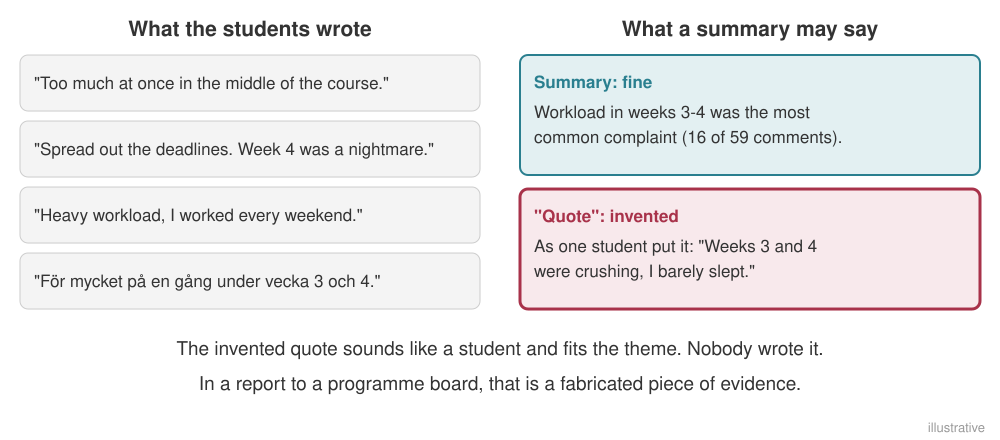{width="88%" fig-align="center"}

::: notes
Here is the biggest risk in this track. On the left, four real comments about workload. On the right, two things an agent might write. The first is a summary: workload in weeks three and four was the most common complaint, with a count. That is fine, and checkable. The second is presented as a quote: "Weeks 3 and 4 were crushing, I barely slept." It sounds exactly like a student. It fits the theme perfectly. Nobody wrote it. A language model produces what is plausible, and a plausible quote comes out of the same process as a real one, as we saw in How LLMs and agents work. In a report to a programme board, an invented quote is fabricated evidence, and it can end up in minutes and decisions. It must never happen.
:::

## Check every quote against the data, word for word

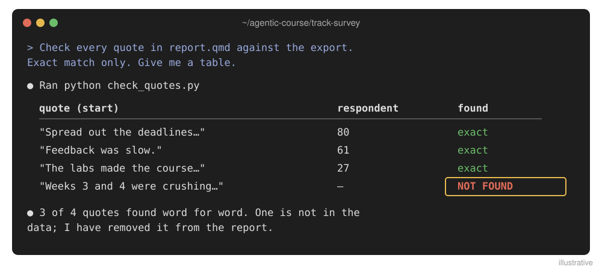{width="68%" fig-align="center"}

- A **script** compares each quote with the export: exact match, with respondent id. Not the agent's memory.
- Then **you** open the export and read three quotes in context.

::: notes
The fix is a check that does not rely on the agent's word. Ask the agent to write a small script that takes every quoted sentence in the report and searches for it, character for character, in the export, and prints a table with the respondent id and whether it was found. Here, three quotes are found and one is not. The one that is not found is the invented one, and it comes out of the report. Note the difference between this and asking "did you check the quotes?", which gets you a confident yes. The script checks the data. Then do your own spot check: open the export, find three quotes, and read them in context. Is the quote fair, or does the rest of the comment say something different?
:::

## Theme counts are judgement: check a sample yourself

- Two careful people **code the same comments differently** at the edges. So does an agent, between runs.
- **Code 15 comments yourself**, before you look at the agent's themes. Compare: where do you disagree, and why?
- Ask a **second agent** (or a fresh session) to code the same comments from the same theme list. Compare the counts.
- Report themes as **"about 15 comments"**, not "26.8 %". The precision is not there.
- Keep the table of comment, respondent id and theme with the analysis, not in the report.

```text
Here are the themes from the earlier session: [list]. Assign each comment
in survey_tidy.csv to one theme or "other". Output a table with
respondent id, theme and the comment. Do not create new themes.
```

::: notes
Sorting comments into themes is a judgement, not a measurement. Two careful people will disagree about some comments, and so will two runs of an agent. That is fine, as long as you know how large the disagreement is. Here are three ways to find out. Code fifteen comments yourself before you look at the agent's result, then compare. Give the same comments and the same theme list to a second agent or a fresh session, with the prompt shown here, and compare the counts. And report themes with the precision they have: "about fifteen comments mentioned workload", not "26.8 per cent". The full coding table belongs with the analysis files. It contains every comment and should not go into a report that others will read.
:::

## Some comments must not be quoted at all

| Comment contains | Example from the synthetic data | What to do |
|---|---|---|
| a staff member's name, positive | "Erik in the lab was always willing to explain again." | report the theme ("teaching assistants were helpful"), not the name |
| a named complaint about staff | "Lecturer Anna Berg was dismissive…" | not in the board report; follow your university's routine for complaints |
| health or disability | "As the only wheelchair user in the group…" | report the issue (lab benches in B214 too high), never the quote |
| something that identifies the writer | "the only", "my supervisor", a rare situation | paraphrase the issue without the identifying detail |
| insults or personal data about others | names of fellow students | leave out; tell the coordinator if action is needed |

Ask the agent to **flag** such comments for you to decide; do not let it decide alone.

::: notes
Some comments should never be quoted, even when they are real. A staff member's name, even in praise, is personal data about that person; report the theme instead. A complaint that names a lecturer is serious, and it belongs in your university's routine for such matters, not in a slide for the programme board. A comment that mentions health or disability, especially with "the only", identifies the student and reveals sensitive information; report the issue, here lab benches that are too high, without the quote. The general pattern is to report the issue and drop the detail that identifies anyone. Ask the agent to flag every comment that contains a name, health information or an identifying detail, and then decide yourself. This is exactly the kind of decision you should not delegate.
:::

## The report for the board is short, plain and generated from the script

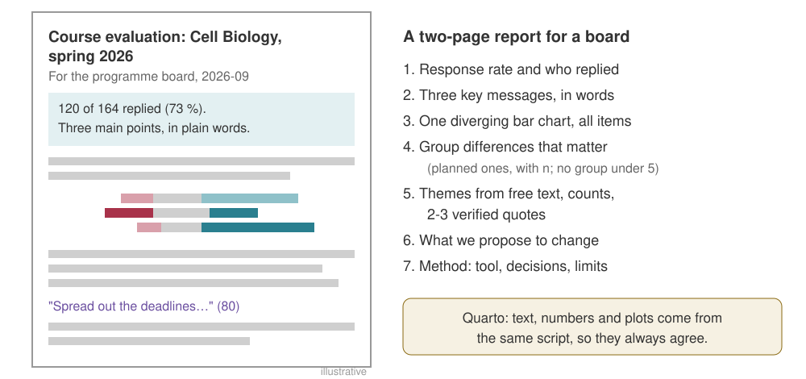{width="82%" fig-align="center"}

::: notes
Finally, the report. A programme board wants two pages, not twenty. Start with the response rate and who replied. Then three key messages in plain words, one diverging bar chart for all items, only the group differences you planned to look at, with the number of people and no group under five. Then the themes from the free text with rough counts and two or three verified quotes, what you propose to change, and a short method section that says how the analysis was done, including that an AI agent was used and how it was checked. Write it in Quarto, which you know from A course or project page. The big advantage: the numbers in the text, the tables and the plots all come from the same script, so they always agree, and next year the report rebuilds from the new export.
:::

## The report prompt names the audience, the content and the rules

```text
Write report.qmd, a Quarto report (HTML and PDF) for the programme
board: at most two pages. Use survey_tidy.csv and codebook.csv.

Content: response rate (164 registered); three key messages in plain
language; one diverging stacked bar chart of all 12 items (as worded,
reversed items marked R, n on every bar); campus vs distance for
items 3, 4 and 12 only, with n and % agree; free-text themes with
approximate counts and at most three short quotes; proposed actions
(leave a placeholder for me); a method section (tools, decisions
from decisions.md, use of an AI agent, how results were checked).

Rules: no group or table cell below 5 people; no names of students or
staff; no quote that identifies anyone; every quote copied exactly
from the data. Then run check_quotes.py on the report and show me
the table.
```

::: notes
Here is the prompt for the report. It names the audience and the length. It lists the content in order, including which group comparisons to make, which keeps the number of tests small. It asks for a placeholder for proposed actions, because those are your decision, not the agent's. It asks for a method section that discloses the use of the agent, as discussed in Privacy, ethics and safety. Then the rules: no small cells, no names, no identifying quotes, every quote exact. And it ends with the quote check, so the check is part of producing the report, not an afterthought. Rendering to PDF needs a LaTeX installation or Typst; if that fails, HTML is fine, and the agent can help install what is missing.
:::

## Where this goes wrong

- **Reversed items averaged as worded.** The course score is wrong; alpha drops. Check the item-agreement plot.
- **Blanks as 0 or 3.** Every mean shifts. Count NA per item and compare with the export.
- **Test rows and double submissions kept.** Count respondents: you know the expected number.
- **Means only.** A split class looks neutral. Show the distribution.
- **Every comparison tested.** Some "differences" are luck. Plan the comparisons.
- **Small groups and combinations.** Four exchange students are four people. k ≥ 5, everywhere.
- **Invented or altered quotes.** Check by script, word for word, then read three in context.
- **Real evaluation data in the cloud** without approval. Build on a synthetic stand-in.

::: notes
Here are the ways this goes wrong, in one place. The first three are cleaning mistakes, caught by counting and by the item-agreement plot. Means-only reporting and testing everything are analysis mistakes, caught by showing distributions and planning comparisons. Small groups and combinations are privacy mistakes, caught by a mechanical check of every cell. Invented quotes are the most damaging, because they look exactly like real evidence, and they are caught only by a word-for-word check against the data. And the last item is the first decision of all: real evaluation data does not go to a cloud agent unless your university has approved it. Build and test on a synthetic stand-in, then run the script yourself.
:::

## What the agent does and does not do here

| The agent does well | You do |
|---|---|
| read the messy export and write the tidy script | decide which rows to remove and how to code paper forms |
| make the codebook, decisions list and plots | check the codebook against the questionnaire |
| run tests and explain them in plain words | choose the few comparisons that matter |
| suggest themes and code comments fast | code a sample yourself; decide on sensitive comments |
| check quotes and cell sizes by script | read quotes in context; take responsibility for the report |
| draft the Quarto report | write the proposed actions; present it to the board |

::: notes
To sum up the division of labour. The agent is very good at the mechanical parts: reading a messy export, writing the script, making plots and codebooks, running and explaining tests, suggesting themes, and running checks for quotes and cell sizes. It drafts the report. You make the decisions that need knowledge of the course and the people: which rows to remove, which comparisons matter, what to do with sensitive comments, what actions to propose. And you take responsibility for the report that goes to the board. The quote check and the cell-size check are scripts, so they are reliable; reading three quotes in context and deciding about sensitive comments are yours.
:::

## Summary

| Concept | Key fact |
|---|---|
| Tidy data | one row per respondent, one column per question; raw export untouched |
| Codebook and decisions | full question, coding, reversed items; every removal listed |
| Reverse coding | 6 − answer, for scores only; a negative item-agreement bar means "check reversal" |
| Missing | blank, not applicable, stopped, no reply: four meanings; never 0 or 3 |
| Likert description | n, % agree, % disagree, median; diverging stacked bars |

::: notes
Here is the summary. Make the data tidy with a codebook and a decisions list. Reverse negatively worded items for scores, and check that you did with the item-agreement plot. Treat each kind of missing answer for what it is. Describe Likert items with counts and percentages, and show them as diverging stacked bars. Compare a few planned groups with the number of people visible, and report the size of a difference before its p-value. Never report a group or a cell below five. Let the agent find themes, but check a sample yourself, and check every quote by script, word for word. And keep real evaluations away from cloud agents unless your university says otherwise. In Part 5, Parallel workers shows how to give the same task to two agents and compare: a natural way to double-check theme coding.
:::

## Summary (continued)

| Concept | Key fact |
|---|---|
| Group comparison | side-by-side bars with n; plan few comparisons; size first, p-value second |
| Small cells | never a group or cell below 5; check combinations (k-anonymity) |
| Free text | themes with rough counts; code a sample yourself |
| Quotes | checked by script, word for word; no names, nothing identifying |
| Privacy | real evaluations: synthetic stand-in for the agent, run the script yourself |

**Next (Parallel workers: Claude and Codex):** two agents at once, the same task given to both, and one agent checking the other's work. Or continue with another track.

::: notes
The rest of the summary table, and where we go next.
:::
