## About this lecture

A course runs on material that has to be rewritten every year: quizzes, exercise sheets with new numbers, slides, rubrics. Most of it is structured, repetitive and easy to check, which makes it good work for an agent. **This track builds a small teaching pipeline: a question bank in a plain file, a Canvas quiz made from it, exercise variants with answer keys, and slides made from an outline.**

- **One plain source file, many outputs.** The questions live in one file; the Canvas quiz, the answer key and the student page are generated from it.
- **Every question has a key and a reason** for each wrong answer. The reasons are what students learn from.
- **Keys are computed, then checked by you.** For variants, a script computes the answers; you solve a sample by hand.
- **Accessibility from the start:** alt text, captions and contrast cost little when built in.
- **Student work, grades and unreleased exams stay out** (*Privacy, ethics and safety*).

This is a **track**: the same agent skills as the rest of the course, applied to teaching. It assumes Parts 1 to 4, especially *A course or project page*.

::: notes
Welcome to the teaching track. Every teacher knows the yearly cycle: the quiz from last year needs new questions, the exercise sheet needs new numbers because the old answers circulate, the slides need updating, and the rubric needs to be written down because a new teaching assistant joins. None of this is research, and all of it takes time. It is also structured, repetitive and easy to check, which is exactly the kind of work we have delegated throughout the course. In this track we build a small pipeline. The questions live in one plain text file. A script turns that file into a quiz you can import into Canvas, an answer key for you, and a page for students. Exercise variants come from a template with a computed key. Slides come from an outline, as Quarto reveal.js decks, like the ones in this course. And along the way we cover accessibility, rubrics, and what must never go to the agent.
:::

## A course with 150 students needs a lot of material every week

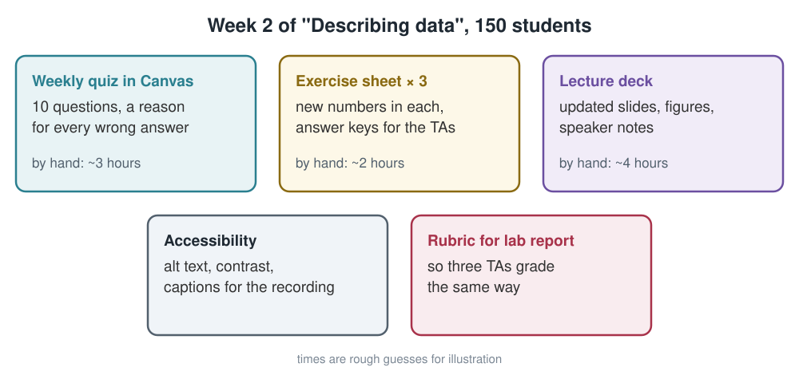{width="85%" fig-align="center" fig-alt="A week of course preparation: a weekly quiz of ten questions, three variants of an exercise sheet with answer keys, a slide deck with speaker notes, an accessibility check, and a rubric for the lab report."}

::: notes
Here is a realistic week in a first-year course with 150 students. A weekly quiz of ten questions in Canvas, with feedback, so students can check their understanding. An exercise sheet in three variants, so that neighbours in the computer room do not copy each other's numbers, each with an answer key for the teaching assistants. A lecture deck that needs updating, with speaker notes for the recording. Figures that need alt text and enough contrast, because some students use screen readers and the university has to meet accessibility rules. And a rubric for the lab report, so that three teaching assistants grade the same way. Each item is perhaps an hour or two. The agent can draft most of them in minutes. Your job moves from typing to deciding and checking.
:::

## The agent drafts and converts; you decide and check

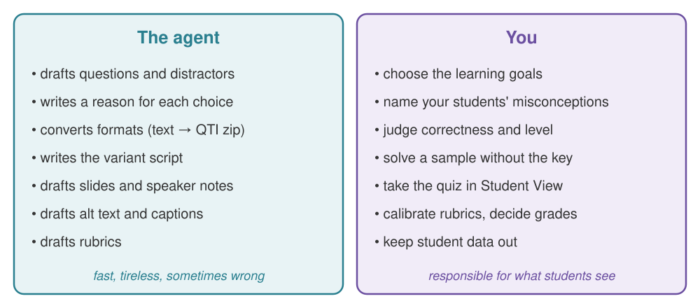{width="85%" fig-align="center" fig-alt="Two columns. The agent: drafts questions and distractors, writes reasons, converts formats, generates variants and keys, drafts slides, alt text and rubrics. You: choose learning goals, judge correctness and level, solve samples, test in Canvas as a student, decide grades, keep student data out."}

::: notes
Here is the division of labour we aim for. The agent is good at drafting: questions, plausible wrong answers, the reasons why they are wrong, slides from an outline, alt text, a first rubric. It is excellent at converting: from a plain text file into the XML format that Canvas imports, from an outline into a slide deck. And with a script, it is reliable at generating variants and computing their answers. You keep the parts that need a teacher. You choose what the students should learn. You judge whether a question is correct and at the right level, which no one else in the room can do. You solve a sample yourself. You look at the quiz as a student would. And you decide grades, and keep student data out of the agent entirely.
:::

## Keep the questions in one plain file and generate everything else

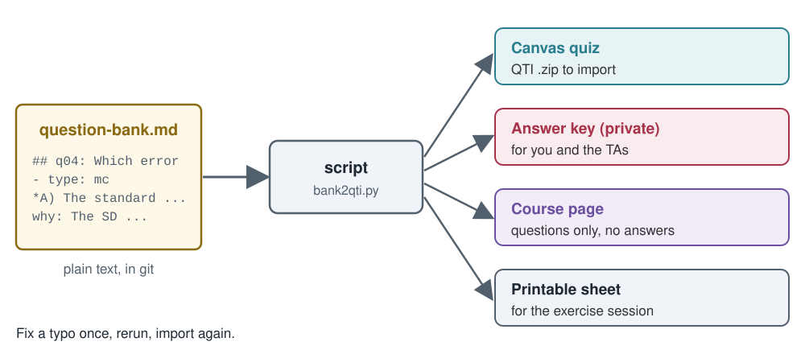{width="85%" fig-align="center" fig-alt="One file, question-bank.md, feeds a script that produces four outputs: a Canvas QTI zip, a private answer key, a public page with questions only, and a printable version."}

::: notes
The most important design decision in this track is where the questions live. Not in Canvas. Canvas is where students take the quiz, but it is a bad place to keep questions: hard to search, hard to reuse next year, hard to review with a colleague, and impossible to put under version control. Instead, keep the questions in one plain text file in your project folder, in git. A script turns that file into whatever you need: a zip file Canvas can import, an answer key for you and the teaching assistants, a page with the questions only for the course website, a printable version. When you fix a typo, you fix it once, rerun the script and import again. This is the same idea as Reproducible figures: the source is the truth, and every output can be regenerated.
:::

## One good question has seven parts

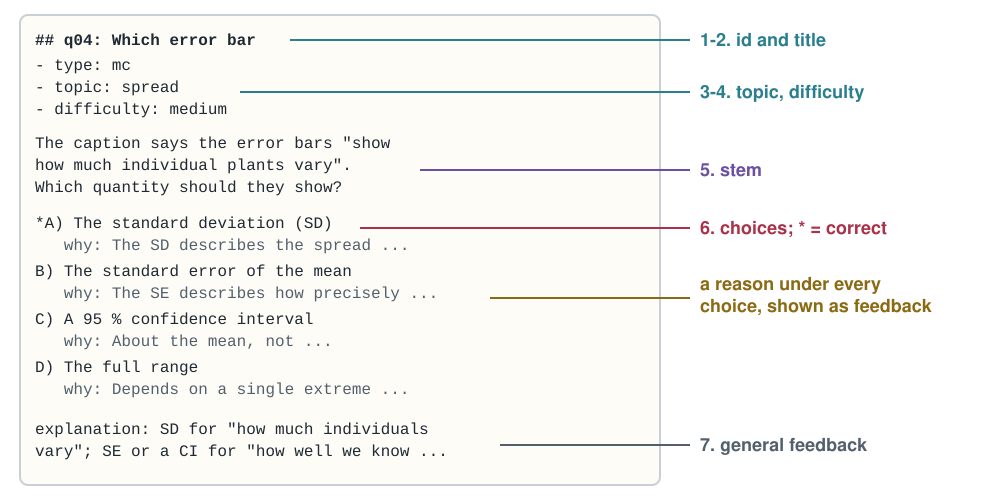{width="88%" fig-align="center" fig-alt="An annotated multiple-choice question about error bars, showing its id, title, topic and difficulty, the stem, four choices with the correct one starred, a reason under each choice, and general feedback."}

::: notes
Here is one question from the example bank, with its parts labelled. An identifier, so the question can be found and tracked across years. A short title. A topic and a difficulty, so you can pick a balanced quiz later. The stem, which is the question itself. The choices, with exactly one marked correct. Under each choice, one line saying why it is right or wrong; Canvas shows this to the student who picked it. And a general explanation shown after the attempt. The reasons are the part most question banks lack, and the part that turns a quiz into teaching. They are also the part an agent is good at drafting, because explaining a misconception is a writing task. The format is deliberately plain: a teacher can read and edit it without any tools.
:::

## Good distractors come from real mistakes, each with its reason {.smaller}

**Stem:** *The caption says the error bars "show how much individual plants vary". Which quantity should they show?*

| Choice | Why a student picks it | Feedback shown |
|---|---|---|
| **The standard deviation** (correct) | | Describes the spread of individual values. |
| The standard error of the mean | SE bars look tidier, and many papers use them | Describes how precisely the **mean** is known; shrinks with more plants. |
| A 95 % confidence interval | sounds the most rigorous | About the mean, not about individual plants. |
| The full range | the most literal reading of "vary" | Depends on one extreme plant and grows with sample size. |

Tell the agent which misconceptions you see in your students. It cannot know them; you do.

::: notes
A distractor, a wrong answer, is only useful if a student who has not understood would actually choose it. "The colour blue" is not a distractor for a statistics question. The best distractors are the mistakes you see every year in your own students. Here, mixing up standard deviation and standard error is a classic, and many published papers do it too. Each distractor has a reason a student might pick it, and a short explanation that tells them what they got wrong. The agent knows the common textbook misconceptions, and will propose decent distractors on its own. But you know your students. Telling the agent "my students often confuse SD and SE, and they think more data means a smaller spread" gives much better questions than "write ten questions on statistics".
:::

## The prompt for a question bank names goals, format and checks

```text
Write 10 questions for week 2 of my first-year course "Describing data".
Learning goals: choose mean or median; SD vs SE; read box plots and log
axes; correlation is not cause. My students often confuse SD and SE and
read r as "percentage explained".

Use exactly the format of question-bank.md in this folder: 6 multiple
choice (4 choices, exactly one correct, a "why:" line under every
choice) and 4 numeric (answer and margin). Mix easy, medium and hard.
Put the correct answer in a different position from question to
question. Numbers must be realistic for biology or medicine.
Write to week2-bank.md. Then solve every question yourself, as a
student would, and list any question where you are unsure of the key.
```

::: notes
Here is a prompt that works, and it is the first prompt in the exercise. It follows everything from Delegating well. It names the learning goals, so the questions test what you teach rather than trivia. It names the misconceptions you see. It points to an existing file for the format, which is far more precise than describing it. It sets constraints that are easy to forget: exactly one correct answer, a reason for every choice, a spread of difficulty, the correct answer not always in the same position, realistic numbers. And it asks the agent to solve its own questions afterwards and flag doubts. That self-check is not a replacement for yours, but it catches the worst errors before you see them.
:::

## Generated questions fail in predictable ways {.smaller}

| Failure | Example | How to catch it |
|---|---|---|
| **Wrong key** | the "correct" answer to a numeric question is off by a factor of 10 | solve a sample yourself, without looking at the key |
| **Two defensible answers** | "best plot" where two choices are both fine | read each distractor and ask: could I defend this? |
| **Cues in the wording** | the correct answer is the longest, or the only one with "may" | read the choices without the stem |
| **Key always in the same place** | five of six correct answers are B | the script prints the positions |
| **Trivia instead of goals** | "who introduced the box plot?" | check each question against a learning goal |
| **Invented facts** | a "classic study" or a constant that does not exist | look up every fact you did not already know |

::: notes
Questions written by an agent go wrong in a small number of ways, and once you know them, checking is quick. The worst is a wrong key, because students who are right get marked wrong, and they will tell you. Solve a sample yourself, without looking at the key first. Next, two defensible answers: the agent writes one correct answer and three wrong ones, but sometimes a "wrong" one is also right in some reading. Then cues: the correct answer is often the longest and most careful one, and test-wise students exploit that. Key position: people and models both tend to put the correct answer in the same position. Trivia: questions that are easy to write but test nothing you teach. And invented facts, which you know from How LLMs and agents work: an agent will happily invent a famous study to make a question more interesting.
:::

## Check a bank the way you would check a colleague's

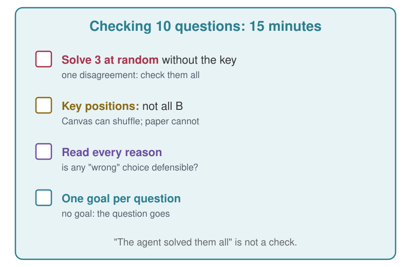{width="68%" fig-align="center" fig-alt="Four checks for a question bank: solve three random questions blind and compare with the key; look at the positions of the correct answers; read every reason under every choice; match each question to a learning goal."}

::: notes
Here is the routine, which takes about fifteen minutes for ten questions. First, pick three questions at random and solve them without looking at the key, then compare. Any disagreement means you check all of them. Second, look at where the correct answers sit; if they cluster, ask the agent to move them, or rely on Canvas shuffling the choices, but remember the printed version is not shuffled. Third, read every reason under every choice. This is where you find the distractors that are actually correct, and the reasons that are wrong or condescending. Fourth, for each question, name the learning goal it tests. Questions you cannot match to a goal go. This is the same as reviewing a colleague's exam: you would not publish theirs unchecked either.
:::

## A converter script refuses a bank with mistakes

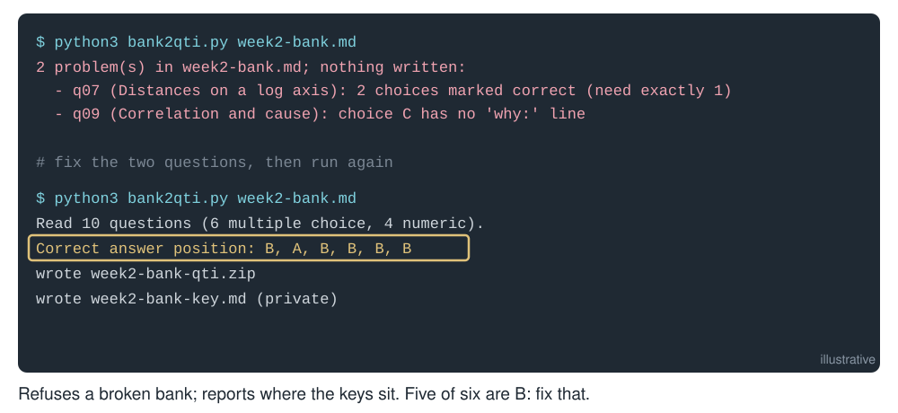{width="85%" fig-align="center" fig-alt="A terminal running bank2qti.py twice. First run: two problems found, nothing written: a question with two choices marked correct, and a choice without a reason. Second run after fixing: 10 questions read, correct answer positions B, A, B, B, B, B, zip file and key written."}

::: notes
The example folder for this track includes a converter script, bank2qti.py. It uses only the Python standard library, so there is nothing to install. Before it writes anything, it checks the bank: exactly one correct choice per multiple-choice question, a reason under every choice, a number for every numeric answer, no duplicate identifiers. If anything is wrong it stops and lists the problems, and writes nothing. That is a design choice you should ask for in any script of this kind: a script that silently produces a broken quiz is worse than one that refuses. When the bank is fine, it prints a summary, including where the correct answers sit. Look at the example output: five of six correct answers are B. That is a real flaw in the example bank, left in on purpose for the exercise.
:::

## Canvas imports quizzes as a QTI zip file

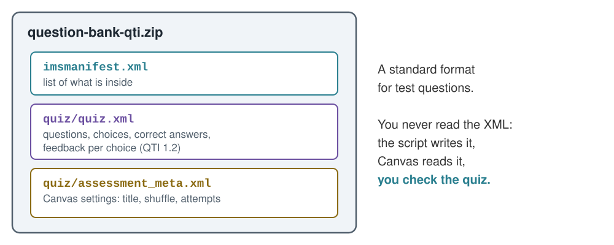{width="80%" fig-align="center" fig-alt="Contents of the zip file: imsmanifest.xml listing the resources, a folder with the questions in QTI XML, and assessment_meta.xml with the quiz settings such as title, shuffling and attempts."}

- **QTI** is a standard format for test questions. Canvas reads QTI 1.2 and 2.1 packages.
- You never need to read the XML. The agent writes the converter; you check the result in Canvas.

::: notes
How does a plain text file become a Canvas quiz? Through a standard called QTI, short for Question and Test Interoperability. Learning platforms use it to exchange quizzes. A QTI package is a zip file with three parts: a manifest that lists what is inside, an XML file with the questions, answers and feedback, and, for Canvas, a small file with quiz settings such as the title and whether to shuffle answers. You do not need to read any of this. The point is that the format is documented and stable, so an agent can write a converter for it reliably, and Canvas can import the result. Our converter follows the layout Canvas itself uses when it exports a quiz, which is the safest route.
:::

## Import in Canvas: Settings, Import Course Content, QTI .zip file

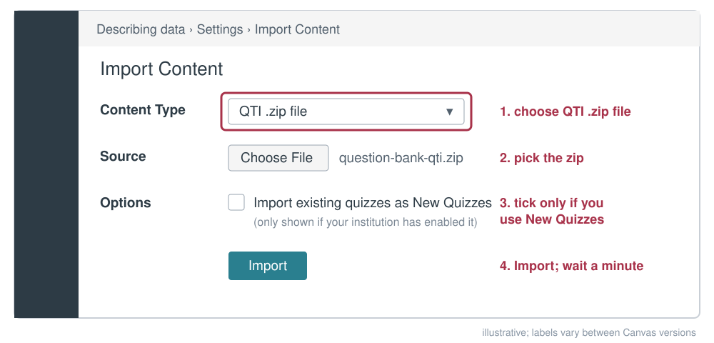{width="82%" fig-align="center" fig-alt="Mock-up of the Canvas Import Content page: Content Type set to QTI .zip file, a file chooser with question-bank-qti.zip, an option to import as New Quizzes, and an Import button."}

::: notes
In Canvas, the import is a few clicks. Go to your course, then Settings, then Import Course Content. Some universities label the link slightly differently. Choose QTI .zip file as the content type, choose your zip file, and click Import. Canvas processes it in the background, and after a minute the quiz appears under Quizzes, unpublished. If your institution has enabled New Quizzes, there may be a checkbox to import the quiz as a New Quiz; more on that on the next slide. Use a sandbox course for your first import if your university gives you one, or an unpublished course. This picture is a mock-up; your Canvas may look a little different.
:::

## Classic Quizzes and New Quizzes import differently {.smaller}

| | Classic Quizzes | New Quizzes |
|---|---|---|
| Import route | Settings › Import Course Content › QTI .zip file | the same route, with the box **"Import existing quizzes as New Quizzes"** ticked, if your institution has enabled it |
| What you get | a new, unpublished quiz | a new, unpublished New Quiz |
| Question banks | optionally into a question bank | item banks work differently; the default question bank option is not available with this box |
| Updating | an import always creates a **new** quiz; it does not update an existing one | the same |
| Future | Instructure is moving everyone to New Quizzes; universities set their own dates | the long-term default |

Ask your Canvas support which quiz engine your university uses this term.

::: notes
Canvas has two quiz engines, and this matters for imports. Classic Quizzes is the old one; New Quizzes is the new one. Instructure, the company behind Canvas, is moving everyone to New Quizzes, but each university sets its own timeline: some have already switched off the creation of Classic Quizzes, others still allow them for another year or more. The import route is the same. If New Quizzes is enabled, a checkbox converts the imported quiz into a New Quiz. Two practical points. First, an import always creates a new quiz; it never updates an existing one. So if you fix a question after import, either fix it in Canvas by hand or delete the quiz and import again. Second, check after import that the feedback for each choice came through, since conversions are not always perfect. Your university's Canvas support knows the local settings.
:::

## Always take the quiz as a student before you publish it

- Open the quiz in **Student View** (Canvas: Settings › Student View) and take it.
- **Check:** every question shows; numbers and symbols display correctly; the right answers score; the **feedback for each wrong choice** appears; the quiz settings (attempts, time, when answers show) are what you want.
- Answer one question wrong on purpose and read the feedback as a student would.
- Then set the dates and publish.

::: notes
This is the step people skip, and it is where you find the problems. Canvas has a Student View, which lets you see the course as a test student. Take the quiz there. Look at each question as it renders: are the numbers right, are units and symbols displayed properly, does a paragraph break where it should? Then answer some questions right and some wrong on purpose. Does the right answer score full points? For numeric questions, is the margin sensible, so that 2.0 and 2 both count? Does the feedback for the wrong choice appear and make sense? Finally check the quiz settings: number of attempts, time limit, and when students see the correct answers. Only then set dates and publish. This takes ten minutes and saves you a hundred emails.
:::

## The sister course runs this pipeline every week

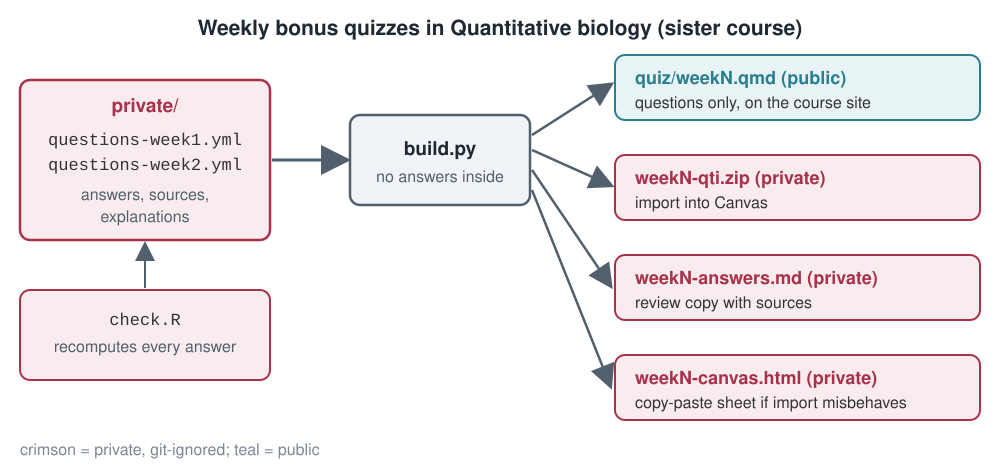{width="88%" fig-align="center" fig-alt="The pipeline of the course Quantitative biology: private question files with answers go through build.py, which writes a public quiz page without answers, a QTI zip for Canvas, a private answer review file and a private copy-paste sheet for building the quiz by hand."}

::: notes
This is not a toy. The sister course to this one, Quantitative biology, uses exactly this pipeline for its weekly bonus quizzes. The questions, with answers, sources and explanations, live in private files, one per week. A build script, written with an agent, produces four things: a public page on the course website with the questions only, so students can see them next to the course material; a QTI zip for Canvas; a review copy with the answers and sources, for the teachers; and a copy-paste sheet for building the quiz by hand in Canvas, for the times an import does not behave. A separate script recomputes every numeric answer in R, so the key is checked by computation, not by trust. Our example in the exercise is a simplified version of the same idea.
:::

## Answers live in a private folder that never reaches GitHub

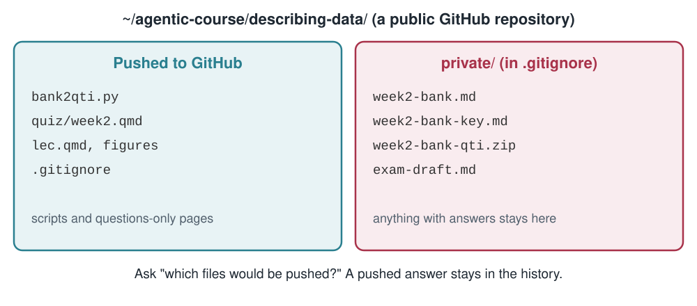{width="85%" fig-align="center" fig-alt="A project folder split in two. Public, pushed to GitHub: the build script and the questions-only page. Private, listed in .gitignore: question files with answers, the answer key, the QTI zip. A note says the course repository is public, so answers must never be committed."}

::: notes
If your course page lives in a public GitHub repository, as it does since A course or project page, you have to think about where the answers are. The sister course solves it with a private folder inside the project that is listed in .gitignore, the file that tells git to leave certain files out. The script, which contains no answers, and the public questions page are in the repository. The question files with answers, the answer key and the zip file are not. Ask the agent to set this up and then check it: ask "which files would be pushed?" and look for anything with answers. A public repository is public for good: deleting a file later does not remove it from the history, as we said in GitHub. The same caution applies to the agent: a personal plan with training on is not the place for next week's exam.
:::

## Exercise variants: a template, a seed and a computed key

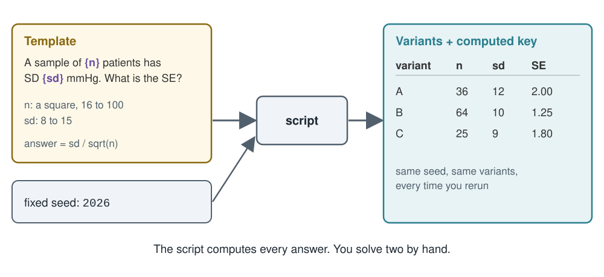{width="88%" fig-align="center" fig-alt="A question template with placeholders for standard deviation and sample size, plus a fixed random seed, goes into a script that writes three variants with different numbers and an answer key computed by the script."}

::: notes
Now variants. When students sit next to each other, or when last year's answers circulate, you want the same question with different numbers. The robust way is a template: the question text with placeholders, rules for the numbers, for example a standard deviation between 8 and 15 and a sample size that is a perfect square so the arithmetic stays simple, and a formula for the answer. A script draws the numbers, fills in the template, and computes the answer. A fixed random seed means the script produces the same variants every time you run it, so you can regenerate them and get the same sheet. Never let the agent write the variants and their answers as free text: then each answer is a separate chance for an arithmetic slip. The script computes; you check.
:::

## The key is computed, then checked by hand {.smaller}

```text
Make a script that writes 3 variants of each question in
variant-templates.md, using a fixed random seed. For each variant,
compute the answer in the script; never type an answer by hand.
Numbers must be realistic: blood pressure SD 8-15 mmHg, n a perfect
square between 16 and 100. Write the variants in the format of
question-bank.md, so bank2qti.py can convert them.
Then print a table: variant, numbers used, answer.
```

- **Solve two variants by hand** and compare with the table.
- **Look at the extremes:** the smallest and largest numbers drawn. Is the question still sensible, and still the same difficulty?
- **Check rounding and units** against what the question asks for.

::: notes
Here is the prompt, from the exercise. It asks for a script with a fixed seed, insists that the answer is computed and never typed, gives realistic ranges, and asks for the output in the same format as the question bank, so the same converter turns the variants into a Canvas quiz. The table at the end is what you check. Solve two variants by hand. Then look at the extremes, because templates break at the edges: a sample size of 1, a negative concentration, a percentage above 100, or a variant whose numbers make it much easier than the others. And check rounding: if the question says two decimals, the key must be rounded the same way, and the margin in Canvas must allow for it.
:::

## In Canvas, variants go in a question group or an item bank

- **Classic Quizzes:** put the variants in a **question group** that picks one at random for each student.
- **New Quizzes:** put them in an **item bank** and let the quiz draw from it.
- Both engines also have **formula questions**, where Canvas itself draws numbers. Fine for one formula; a script is easier to check and reuse outside Canvas.
- For paper exercise sheets: the same script writes one sheet per variant and a key for the teaching assistants.

::: notes
Once you have variants, Canvas can hand one to each student. In Classic Quizzes, you make a question group and set it to pick one question from the group. In New Quizzes, the equivalent is an item bank, from which a quiz draws questions at random. Both engines also have formula questions, where you write a formula and Canvas draws the numbers itself. That works for simple cases, but the formula editor is fiddly, the questions live only in Canvas, and you cannot easily check every variant. The script approach keeps the questions in your project, works for paper sheets too, and gives you a table you can check. Choose whichever suits the task; the checks are the same.
:::

## Slides from an outline: Quarto and reveal.js, like this course

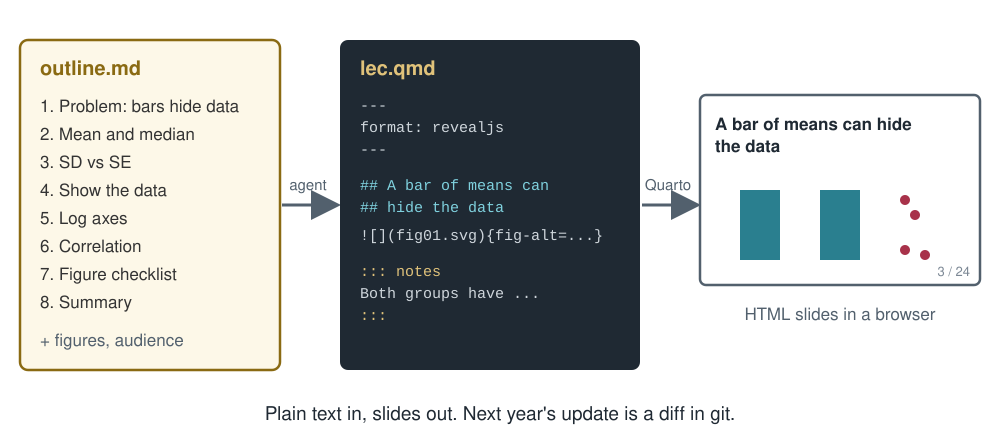{width="88%" fig-align="center" fig-alt="An outline in plain text with eight numbered points becomes a Quarto file, lec.qmd, with one section per slide and speaker notes, which Quarto renders into an HTML slide deck with slide numbers and a figure."}

::: notes
Now slides. You already know Quarto from A course or project page. The same tool makes slide decks: every deck in this course is a Quarto file rendered as a reveal.js presentation, which is a web page that behaves like slides. The workflow is: you write an outline, the points you want to make in the order you want to make them, with the figures you would like and the audience. The agent turns the outline into a Quarto file: one slide per point, with a claim as the title, the content, and speaker notes. Quarto renders it into HTML, which you can present from a browser, put on your course page, or print to PDF. Because the source is plain text, it goes into git like everything else, and next year's update is a diff, not a new PowerPoint.
:::

## A deck source is plain text: a header, then one section per slide {.smaller}

````text
---
title: "Describing data before you test it"
format:
  revealjs:
    slide-number: true
---

## A bar of means can hide two very different datasets

{fig-alt="Two identical bars of means.
Below each, the eight data points: one group tightly clustered, the
other split into two clusters far apart."}

::: notes
Both groups have the same mean and the same bar. Only the points show
that the second group is really two groups. ...
:::
````

Render with `quarto render lec.qmd`, or ask the agent to. Press **S** in the browser for the speaker view.

::: notes
Here is what the source of a deck looks like. A header says it is a reveal.js presentation, with a title and a few options. Then each slide starts with two hash signs and its title. A figure is one line, and the part in curly braces is the alternative text, which screen readers read aloud, so the slide is accessible. Speaker notes go in a block called notes. They do not show on the slide, but they appear in the speaker view, which you open by pressing S in the browser, and they make the deck usable by someone else, or by you next year. You never need to write this by hand; the agent does. But you should be able to read it, because that is how you check and fix a slide in seconds.
:::

## Speaker notes make a deck usable without you

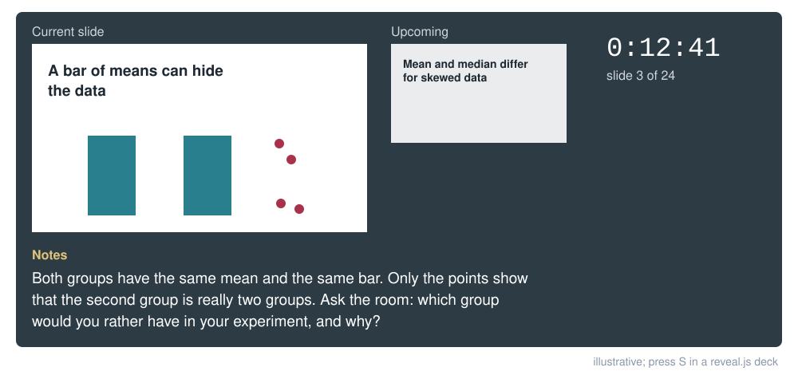{width="85%" fig-align="center" fig-alt="Mock-up of the reveal.js speaker view: the current slide, the next slide, a timer and the speaker notes for the current slide in a large font."}

::: notes
This is the speaker view, which opens in a second window when you press S. It shows the current slide, the next slide, a clock and the notes. Every deck in this course has notes on every slide, and there is a reason. Notes are what would be said aloud, so a deck with notes works when it is read instead of presented, when a colleague teaches it, when you record it, and when you come back to it a year later and have forgotten why a slide is there. Writing notes is tedious, which is why most decks have none, and it is exactly the kind of tedious writing an agent does well. Ask for four to six sentences per slide, then read them and change them into your own voice. Notes the agent invents can contain claims you would not make; they are text you present as yours.
:::

## Ask for SVG figures, then look at every one

- Ask for **simple concept figures as SVG**: flat, two or three colours, large text. They scale on a projector and can be edited.
- For data figures, use a **script**, as in *Reproducible figures*.
- **Look at each figure** at full size: text overlapping, labels cut off, arrows pointing at the wrong thing, numbers that do not match the text.
- Ask for **a style once**, in your project's instruction file: colours, font, text size. Every later figure follows it (*Making the agent yours*).

::: notes
Figures are where slides go wrong most visibly. For concept figures, a diagram, a flow, a comparison, ask the agent for SVG: a text-based vector format that stays sharp on a projector, and that you or the agent can edit later. Keep the style simple. For data figures, use a script that reads the data, as you learned in Reproducible figures, so the figure can be regenerated. Then look at every figure at full size. Agents cannot always see what they draw, and typical faults are text that overlaps, labels cut off at the edge, and arrows pointing at the wrong box. If you want a consistent look, put the style into your CLAUDE.md or AGENTS.md once, as in Making the agent yours: colours, font, minimum text size. This course's own figures were made this way.
:::

## Accessible material is part of the job, and for public universities part of the law

- The EU **Web Accessibility Directive** applies to public-sector websites and apps, including universities and their course pages. In Sweden it is in the law on accessibility of digital public services, supervised by DIGG.
- The usual yardstick is **WCAG 2.1, level AA**: alt text, enough contrast, captions, structure, keyboard use.
- Your university has guidelines and usually a contact person. Canvas has a built-in **accessibility checker** in its editor.
- An agent makes the basics cheap: alt text for every figure, captions checked, contrast tested, headings in order.

::: notes
Accessibility is easy to postpone and expensive to retrofit. It matters for students with visual impairments, hearing impairments, dyslexia or colour blindness, and for everyone watching a recording on a phone. For public universities in the EU it is also a legal requirement. The Web Accessibility Directive covers public-sector websites, and in Sweden it is implemented in the law on accessibility of digital public services, with the agency DIGG as supervisor. The standard everyone points to is WCAG, the Web Content Accessibility Guidelines, at level AA. Your university has its own guidelines and someone who knows them. The good news is that the basics are exactly the kind of systematic, tedious work an agent does well, as long as you check the result.
:::

## Alt text says what the figure shows, not what it is called {.smaller}

| Figure | Poor alt text | Good alt text |
|---|---|---|
| bar chart vs dot plot | "Figure 1" | "Two identical bars of means. Below each, the data points: one group tightly clustered, the other split into two clusters far apart." |
| box plot, labelled | "Box plot" | "A box plot with its parts labelled: the box spans the first to third quartile, the line inside is the median, whiskers extend to the most extreme points within 1.5 box lengths." |
| decorative photo | "Photo of a lab" | empty alt text: it adds nothing, so screen readers should skip it |
| course logo | "logo.png" | "Course logo: Describing data" |

Ask the agent for alt text with the **point of the figure** in it. Then read it next to the figure: is it true?

::: notes
Alt text is the text a screen reader reads instead of the image. The most common mistake is alt text that names the figure instead of describing it. "Figure 1" or "bar chart" tells a blind student nothing. Good alt text says what a sighted reader would take away from the figure, in one to three sentences. For a decorative image, the right alt text is empty, so the screen reader skips it. The agent writes good alt text quickly, especially for figures it made itself, because it knows what they were meant to show. But check each one against the figure: alt text that describes the intended figure, not the one that was actually drawn, is a real failure mode. And for a complex data figure, the surrounding text should also say the main result in words.
:::

## Contrast and colour: never let colour carry the meaning alone

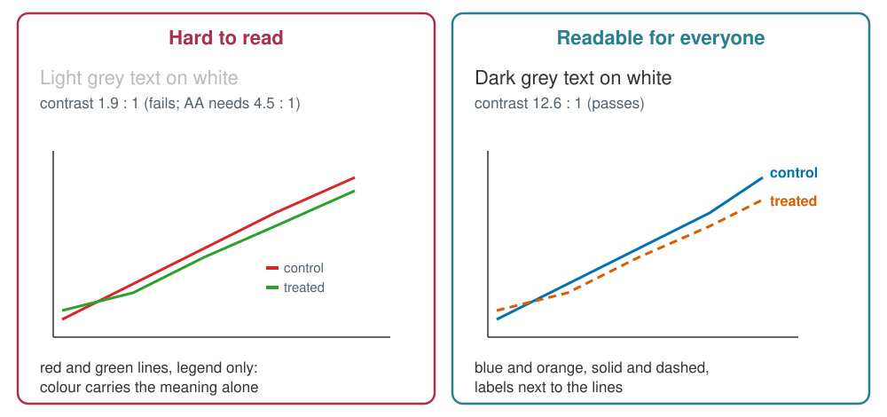{width="85%" fig-align="center" fig-alt="Left: light grey text on white and a red-green line chart, both marked as hard to read. Right: dark text on white with contrast ratio 12.6 to 1, and the same chart with blue and orange lines that also differ in line style and have direct labels."}

::: notes
Two rules about colour. First, contrast: text needs enough contrast against its background. WCAG level AA asks for a ratio of at least 4.5 to 1 for normal text and 3 to 1 for large text. Light grey on white, a popular look, often fails. The agent can compute contrast ratios for every colour pair in your slides and flag the failures; ask it to. Second, never let colour be the only way to tell things apart. About one in twelve men has some form of colour vision deficiency, most often red-green. A chart with a red and a green line is unreadable to them. Use a colour-blind-safe palette, and add a second cue: line style, marker shape, or a label written directly next to each line instead of a legend.
:::

## Recordings need captions, and automatic captions need checking

- Most video platforms make **automatic captions**. They are good at ordinary speech and bad at **your field's terms**: "Michaelis–Menten", "p-value", Swedish place names, people's names.
- The agent can **compare captions with your speaker notes** and the slide text, and list likely errors with timestamps.
- It can then write a **corrected caption file** (WebVTT or SRT) for you to upload.
- Check the flagged lines by listening. The agent did not hear the recording.

::: notes
If you record lectures, captions are needed for deaf and hard-of-hearing students, and they help everyone else too: second-language speakers, students in noisy places, students searching for a term. Your video platform probably makes automatic captions. They are surprisingly good for ordinary speech and reliably bad at technical terms, names and mixed languages. This is a task for the agent: give it the caption file and your speaker notes and slides, and ask it to find words in the captions that look like mangled versions of terms in your notes, with timestamps. It writes a corrected file in the standard format, which you upload. But listen to each flagged line yourself, because the agent is guessing from text, not hearing the audio. And the caption file of a lecture is your material; a recording of students asking questions is not, and stays out.
:::

## A rubric is a table of criteria and levels

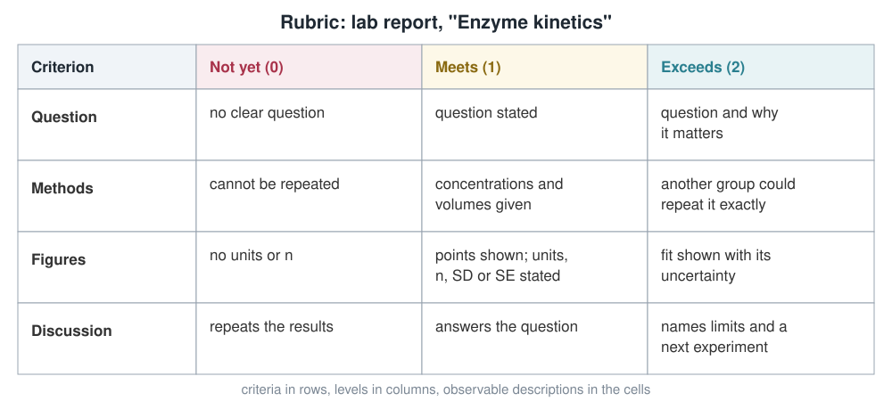{width="85%" fig-align="center" fig-alt="A rubric for a lab report as a grid: rows for research question, methods, results and figures, and discussion; columns for three levels, with a short description in each cell and points per level."}

::: notes
Rubrics are the last kind of material in this track. A rubric is a table: the rows are the criteria you assess, the columns are levels of performance, and each cell says what that level looks like for that criterion. A good rubric makes grading consistent between teaching assistants, tells students in advance what you value, and makes feedback faster. Canvas has a rubric tool that attaches a rubric to an assignment. Writing a rubric from scratch is slow, because you have to put tacit judgement into words for every cell. An agent drafts it quickly from your learning goals and the assignment text, and it is good at writing parallel descriptions across levels. What it cannot know is your standard: what a "good" discussion looks like in your course.
:::

## The agent drafts the rubric; it does not grade

- **Draft from the goals:** give the agent the assignment text and the learning goals, ask for 4 to 5 criteria and 3 levels with observable descriptions.
- **Calibrate with people:** two teachers grade the same three reports with the draft rubric, compare, and sharpen the cells where they disagreed. Use your own model answers or published examples, not student work.
- **Never upload student work for grading.** It is personal data; and AI used to evaluate learning outcomes is a **high-risk** use under the EU AI Act (*Privacy, ethics and safety*).

::: notes
Here is how to use the agent for rubrics without crossing a line. Give it the assignment and the learning goals, and ask for observable descriptions: "the figure shows all data points and states the error bar type" rather than "good figure". Then calibrate with people, not with the agent: two teachers grade the same few reports with the draft rubric, see where they disagree, and fix those cells. Use your own model answers, last year's published example, or a report you write yourself for the purpose. What you must not do is upload student reports to the agent and ask it to grade them. Student work is personal data. And the EU AI Act lists AI systems that evaluate learning outcomes as high-risk, with strict requirements that a personal agent setup does not meet. Grades stay with you.
:::

## What never goes to the agent, and what needs care

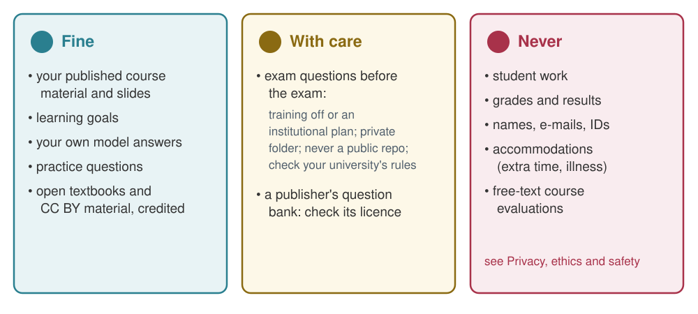{width="85%" fig-align="center" fig-alt="Three columns. Fine: your own published course material, learning goals, your own model answers, practice questions, openly licensed material with credit. With care: exam questions before the exam, only with training off or an institutional plan and never in a public repository; a publisher's question bank only if its licence allows. Never: student work, grades, names, emails, accommodations, course evaluation free text."}

::: notes
Here is the summary of the privacy rules for teaching, from Privacy, ethics and safety. Your own published material, your learning goals, your own model answers: fine. Exam questions before the exam: not forbidden, but they need precautions. Training off or an institutional plan, a private folder, never a public repository, and many universities have their own rules, so check yours. If in doubt, let the agent help with the practice bank, and pick and adapt the exam questions yourself, outside the agent. Never: student work, grades, names, email addresses, information about accommodations such as extra time, and free-text course evaluations, which often identify people. If you want statistics on your results, build the script on synthetic data and run it yourself, as in the privacy exercise.
:::

## Where this goes wrong {.smaller}

- **Publishing a quiz without solving a sample.** One wrong key costs more time than the whole check.
- **Distractors that are also correct.** Read each one and ask whether you could defend it.
- **Answers in a public repository.** Check what git would push; deleting later does not remove it from history.
- **Variants written as free text**, each with its own arithmetic slip. Compute keys in a script.
- **Editing the quiz in Canvas only.** Next year the fix is lost. Fix the source file and reimport.
- **Skipping Student View.** Missing feedback and broken symbols show up only there.
- **Alt text that describes the figure the agent meant to draw**, not the one it drew.
- **Uploading student work, grades or names** to get a report or a grade.

::: notes
Here are the ways this track goes wrong, collected. Most are about checking: the key, the distractors, the rendering in Canvas, the alt text. Two are about where things live: answers in a public repository, and fixes made in Canvas but not in the source file, which means you lose them next year. One is about method: variants written by hand or by the agent as free text instead of computed. And the last is the privacy line, which does not move: no student work, grades or names. If you keep these in mind, the agent will save you many hours a term, and the material will be better than what you had time to write by hand.
:::

## Summary {.smaller}

| Concept | Key fact |
|---|---|
| One source file | questions in plain text, in git; quiz, key and pages generated |
| A good question | stem, one correct choice, a reason under every choice, feedback |
| Checking a bank | solve three blind, key positions, read every reason, match goals |
| Canvas import | QTI .zip: Settings › Import Course Content; creates a new quiz |
| Student View | take the quiz as a student before publishing |
| Private answers | private folder in `.gitignore`; never in a public repo |
| Variants | template + seed + computed key; solve two by hand; check extremes |
| Slides | outline → Quarto reveal.js; speaker notes on every slide; press S |
| Accessibility | alt text with the point; contrast 4.5:1; captions checked |
| Rubrics | the agent drafts, teachers calibrate, nobody uploads student work |

**Next:** this is the last unit of the teaching track. Return to the [course overview](../index.qmd) for the other tracks (RNA-seq, simulation, image analysis, survey data), or to any earlier unit you want to apply to your teaching.

::: notes
To sum up the teaching track. Keep questions in one plain file and generate everything else from it. Write every question with a reason under every choice, and check a bank by solving a sample, looking at key positions and reading every reason. Import into Canvas as a QTI zip, and always take the quiz in Student View before you publish. Keep answers out of public repositories. Make variants from a template with a computed key, and check the extremes. Make slides from an outline with Quarto, with speaker notes on every slide. Build accessibility in from the start. And let the agent draft rubrics but never grade. That is the end of this track. From here, go back to the course overview and pick another track, or return to any unit you would like to apply to your own teaching.
:::
