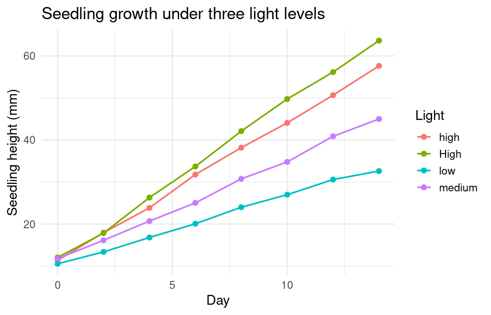
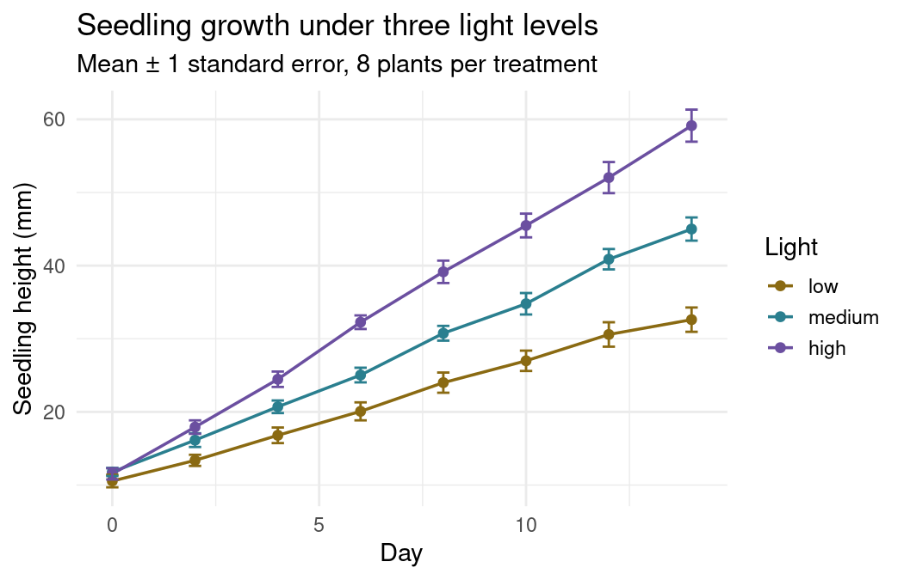

<!--
  Annotated agent session used in exercise.qmd (included, not rendered on its own:
  files starting with "_" are skipped by Quarto).
  Written by the course team in the style of a Claude Code terminal session.
  The data, the final script and both plots are real: see data/make-data.R.
-->

::: {.callout-note appearance="simple"}
**How to read this.** Lines starting with `>` are what the person typed. Lines starting with `●` are the agent: either something it says, or a tool it uses (`Read`, `Write`, `Update`, `Bash`). Lines starting with `⎿` show the result of that tool. The numbers in the margin (**[1]**, **[2]**, ...) are there so you can refer to steps in your answers.
:::

### [1] The person gives the task

The folder `seedling-project` contains one file, `seedlings.csv`. The person starts the agent in that folder and types:

```text
> Make a line plot of mean seedling height per light treatment over time,
  with error bars. There are three treatments. Use an R script so I can
  rerun it, and save the figure as growth_plot.png.
```

### [2] The agent looks at the data

```text
● I'll start by looking at the data file.

● Read(seedlings.csv)
  ⎿ Read 193 lines
    "plant_id","treatment","day","height_mm"
    "l01","low",0,12.2
    "l01","low",2,13.2
    "l01","low",4,20.1
    "l01","low",6,22.3
    "l01","low",8,26
    … +187 lines

● The file is in long format: one row per plant per day, with columns
  plant_id, treatment, day (0 to 14, every second day) and height_mm.
  Plan:
    1. Write plot_growth.R: read the CSV, compute mean and standard error
       of height per treatment and day, draw one line per treatment.
    2. Run it and look at the figure.
```

### [3] The agent writes a script

```text
● Write(plot_growth.R)
  ⎿ Wrote 19 lines to plot_growth.R
     1 library(ggplot2)
     2
     3 d <- read.csv("seedlings.csv")
     4
     5 summ <- aggregate(height_mm ~ treatment + day, data = d,
     6   FUN = function(x) c(mean = mean(x), se = sd(x) / sqrt(length(x))))
     7 summ <- do.call(data.frame, summ)
     8 names(summ) <- c("treatment", "day", "mean", "se")
     9
    10 p <- ggplot(summ, aes(day, mean, colour = treatment)) +
    11   geom_line(linewidth = 0.8) +
    12   geom_point(size = 2) +
    13   geom_errorbar(aes(ymin = mean - se, ymax = mean + se), width = 0.3) +
    14   labs(x = "Day", y = "Seedling height (mm)", colour = "Light",
    15        title = "Seedling growth under three light levels") +
    16   theme_minimal(base_size = 14)
    17
    18 ggsave("growth_plot.png", p, width = 7, height = 4.5, dpi = 150)
    19
```

### [4] The agent asks for permission to run it

```text
● Bash(Rscript plot_growth.R)

  ╭─────────────────────────────────────────────────────────────────╮
  │ Bash command                                                    │
  │                                                                 │
  │   Rscript plot_growth.R                                         │
  │   Run the plotting script to create growth_plot.png             │
  │                                                                 │
  │ Do you want to proceed?                                         │
  │ ❯ 1. Yes                                                        │
  │   2. Yes, and don't ask again for Rscript commands in this      │
  │      folder                                                     │
  │   3. No, and tell Claude what to do differently (esc)           │
  ╰─────────────────────────────────────────────────────────────────╯
```

The person reads the command, sees that it only runs the script that was just written, and chooses **2**.

```text
  ⎿ (no output)
```

### [5] The agent looks at its own result and notices a problem

```text
● The script ran without errors. Let me check the figure.

● Read(growth_plot.png)
  ⎿ Read image (63 KB)
```

{width="70%"}

```text
● The legend shows four groups: "high", "High", "low" and "medium". You
  said there are three treatments, so "High" and "high" are probably the
  same treatment typed two ways. Let me count the labels and check for
  missing values before changing anything.

● Bash(Rscript -e 'd <- read.csv("seedlings.csv"); print(table(d$treatment));
       print(d[is.na(d$height_mm), ]); print(unique(d$plant_id[d$treatment == "High"]))')
  ⎿
      high   High    low medium
        48     16     64     64
       plant_id treatment day height_mm
    86      m03    medium  10        NA
    [1] "h07" "h08"

● Findings:
  - 16 rows (plants h07 and h08) are labelled "High"; the other high-light
    plants use "high". Their plant IDs start with h like the others, so
    they look like the same treatment.
  - One height value is missing (plant m03, day 10).
  - The first script did not say anything about the missing value:
    aggregate() silently drops it.
  I'll make the labels lower case, report the missing value explicitly,
  and put the treatments in a sensible order (low, medium, high).
```

### [6] The agent fixes the script

```text
● Update(plot_growth.R)
  ⎿ Updated plot_growth.R with 11 additions
     3   d <- read.csv("seedlings.csv")
     4 +
     5 + # Treatment labels were typed inconsistently ("High" and "high"):
     6 + # make them lower case so they form one group.
     7 + d$treatment <- tolower(trimws(d$treatment))
     8 + d$treatment <- factor(d$treatment, levels = c("low", "medium", "high"))
     9 +
    10 + # One measurement is missing; leave it out of the means.
    11 + n_missing <- sum(is.na(d$height_mm))
    12 + d <- d[!is.na(d$height_mm), ]
    13 + message("Rows with missing height removed: ", n_missing)
    14
```

(The agent also added a line that prints how many plants there are per treatment, a subtitle, and fixed colours. The final script is in [`data/plot_growth.R`](data/plot_growth.R).)

### [7] The agent runs it again and checks again

```text
● Bash(Rscript plot_growth.R)
  ⎿ Rows with missing height removed: 1
    Plants per treatment: low 8, medium 8, high 8

● Read(growth_plot.png)
  ⎿ Read image (62 KB)
```

{width="70%"}

### [8] The agent reports back

```text
● Done. growth_plot.png now shows three treatments (low, medium, high),
  mean height ± 1 standard error, 8 plants per treatment.

  Files:
  - plot_growth.R: the script (rerun with: Rscript plot_growth.R)
  - growth_plot.png: the figure

  Decisions I made that you should check:
  1. I treated "High" (plants h07, h08) as the same treatment as "high".
     If they were a separate condition, tell me and I'll plot them apart.
  2. One missing height (plant m03, day 10) was left out, so that point
     is the mean of 7 plants, not 8.
  3. Error bars are standard errors, not standard deviations.
```
