## About this lecture

Teachers and researchers spend a large part of every week on chores that are not their real work: cleaning spreadsheets, redrawing figures, reading through stacks of PDFs, building course pages. A **coding agent** is a language model that can work in a folder on your computer: it reads your files, runs commands, checks its own output and leaves files you keep. This lecture shows what that looks like and why it changes what you can get done.

- A **chat window** gives you text to copy and paste. An **agent** works on your actual files.
- Every agent runs the same **loop**: goal, plan, act with tools, look at the result, repeat.
- **Claude Code** (Anthropic) and **Codex** (OpenAI) are two tools built on this idea. The course teaches both.
- Your role changes: you **describe the task and judge the result**. Your field knowledge matters more, not less.

This is a **motivation** unit: no installation yet. Installing comes in *Accounts and installation*; how the model works inside comes in *How LLMs and agents work, and how they fail*.

::: notes
Welcome to the course. Before we install anything, I want to show you why it is worth the trouble. The installation in the next unit is the least fun part of the course, and it is easier to sit through once you have seen what you get at the end of it. The one idea to take away today is the difference between a chat window, which hands you text, and an agent, which works in a folder on your computer and leaves you files. Everything else in the lecture hangs off that. We will keep the inner workings at a very high level today; there is a whole unit later on how these models work and how they fail, and it will make more sense once you have used one.
:::

## You already have a pile of chores that are not "write a paragraph"

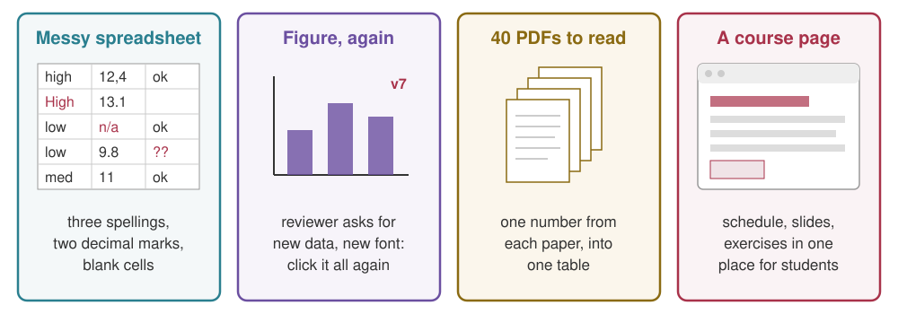{width="85%" fig-align="center"}

- A spreadsheet from three students, typed three ways. A figure you rebuild by hand for each revision.
- Forty PDFs, each holding one number you need. A course page that never gets made.

::: notes
Start with your own week, not with the technology. Most of us have chores like these. A spreadsheet where three people typed the same treatment three different ways, with commas and points as decimal marks. A figure that you have rebuilt by hand seven times because the reviewer wanted new data or a different font. Forty papers, and you need the sample size from each one. A course page that you know students would like, but that never gets made because nobody has the afternoon. None of these is "write me a paragraph", which is what most people use ChatGPT for. They are about files: reading them, changing them, making new ones. That is exactly where an agent helps, and where a chat window does not.
:::

## A chat window gives you text; an agent leaves you files

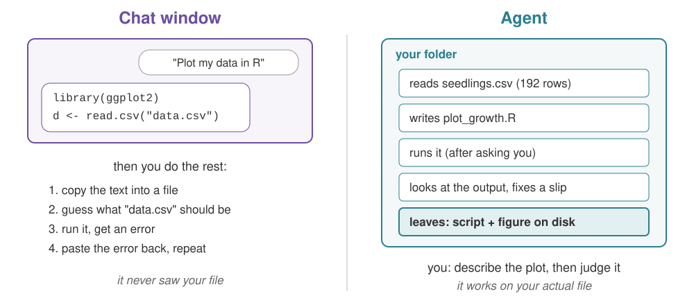{width="85%" fig-align="center"}

::: notes
Here is the key contrast. On the left, a chat window. You ask for a plot in R. You get a block of code. The model never saw your file, so it guesses the file name and the column names. You copy the code into a file, run it, get an error, paste the error back, and go round several times. You are the one moving text between the chat and your computer. On the right, an agent. It works in your folder. It opens the actual CSV, sees the real column names, writes the script to disk, asks you before it runs it, looks at what came out, notices a problem and fixes it. At the end there is a script and a figure in your folder. Your job is the first and the last step: say what you want, and judge what you got.
:::

## An agent is a language model that can act in a folder on your computer

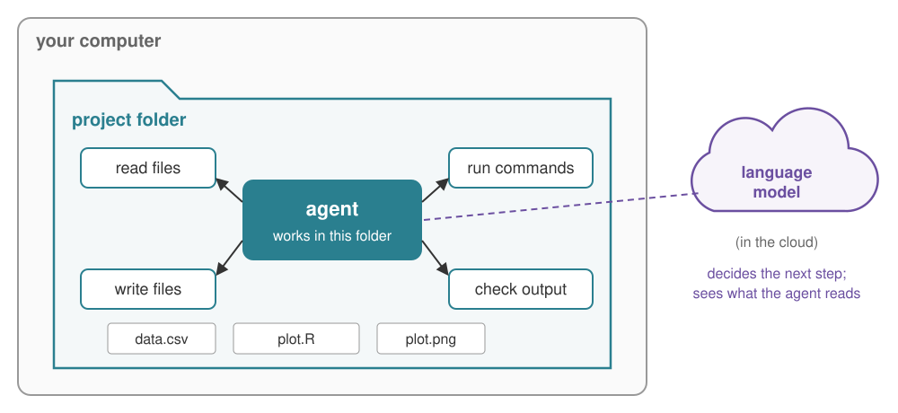{width="75%" fig-align="center"}

- The **model** (in the cloud) decides the next step. The **agent program** (on your computer) carries it out.
- It has a small set of **tools**: read files, write files, run commands, look at the output.

::: notes
What is an agent, concretely? Two pieces. The language model, the same kind of model as behind ChatGPT or Claude.ai, runs on the company's servers and decides what to do next. The agent program runs on your computer, in a folder you choose, and carries out those decisions with a small set of tools: read a file, write a file, run a command, look at what happened. Note the dashed line to the cloud: whatever the agent reads is sent to the model. That matters for privacy, and we come back to it at the end of the lecture and in a whole unit. For now, the picture is: a model that can act, limited to a folder, with you watching.
:::

## The difference is where the work happens and what is left afterwards

|  | Chat window | Coding agent |
|---|---|---|
| Sees your files | Only what you paste in | Reads them in your folder |
| Runs things | No (or in a hidden sandbox) | Runs commands on your computer, within limits you set |
| Checks its own output | Only if you paste it back | Looks at errors, outputs and files itself |
| What you get | Text in a browser tab | Files on disk: scripts, figures, tables, pages |
| Rerun next month | Ask again, get a different answer | Run the same script again |
| Your job | Copy, paste, run, debug | Describe the task, approve steps, judge the result |

::: notes
This table says the same thing in more detail. The rows I would underline are the last three. What you get: a chat gives you text in a tab that you then have to turn into something; an agent gives you files on disk. Rerun next month: if you ask a chat again, you get a slightly different answer; if the agent wrote a script, you just run that script on the new data. That reproducibility is one of the main reasons researchers should care. And your job: with a chat, you are the glue between the model and the computer. With an agent, you move to the two ends of the task, where your expertise is.
:::

## The live build starts from a folder with one CSV file

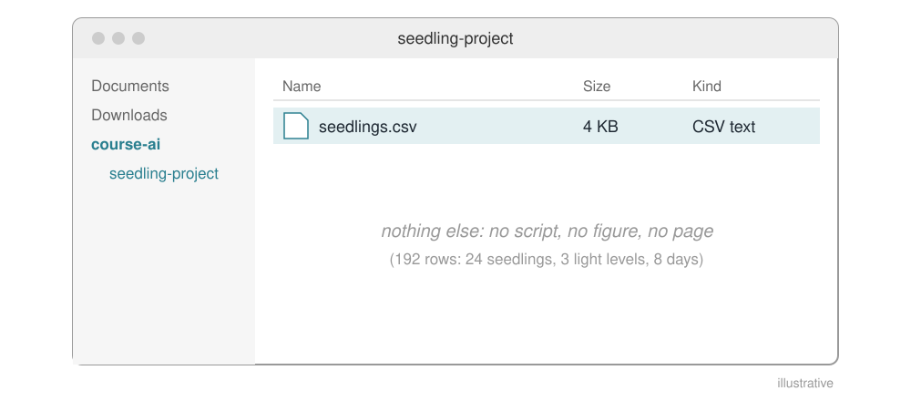{width="72%" fig-align="center"}

- Synthetic data: 24 pea seedlings, three light levels, height measured every second day.
- Goal: a **plot**, then a small **web page**, then a **literature table**. Three prompts.

::: notes
Now a walkthrough. If this lecture is given live, I do this on screen; if you are reading the slides, the next few slides show what happens. We start with a folder that holds one file, seedlings.csv. It is made-up data from a typical teaching lab: 24 pea seedlings under low, medium and high light, height measured every second day for two weeks. The same file is used in today's exercise. No script, no figure, nothing else. In three prompts we will turn it into a plot made by a script, a small web page that shows the plot, and a table of related literature. Watch what the agent does on its own, where it asks, and where I have to check.
:::

## You describe the result in plain words; the agent looks at the file first

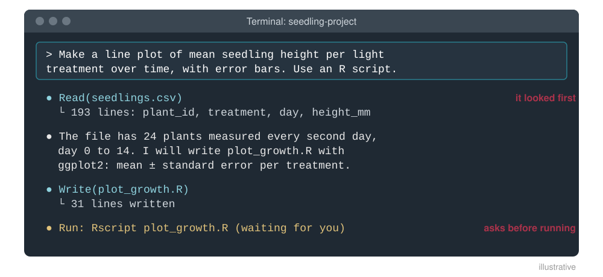{width="78%" fig-align="center"}

::: notes
The first prompt is a plain sentence: make a line plot of mean seedling height per treatment over time, with error bars, use an R script. I did not name any columns or say how the file is laid out. The first thing the agent does is read the file. It reports what it found: 193 lines, that is a header and 192 rows, and four columns. It tells me its plan in one or two sentences. Then it writes a script, plot_growth.R, to the folder. And then it stops, because running a command on my computer needs my permission. The screenshots on these slides are illustrative mock-ups; your own sessions will look a bit different depending on the tool and the version.
:::

## The agent asks before it runs anything, and you can say no

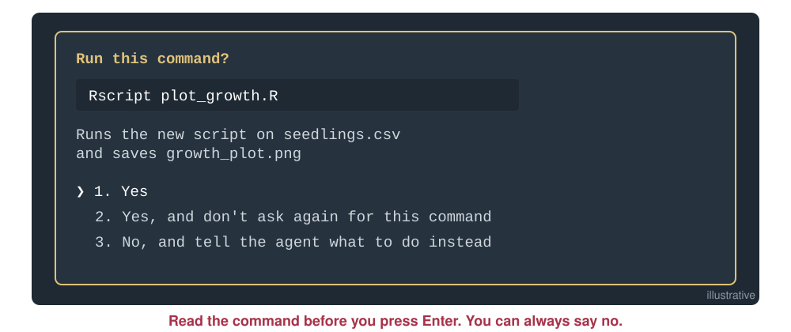{width="78%" fig-align="center"}

- **You set the limits; the agent asks at the edge of them.** Claude Code asks before commands like this by default. Codex by default works freely inside the project folder and asks before going outside it (other folders, the internet).
- **Read the command first.** *Terminal survival kit* teaches you to read these and to set the limits.

::: notes
This is a permission prompt. The agent wants to run Rscript plot_growth.R, which runs the script it just wrote. You get a choice: yes, yes and do not ask again for this kind of command, or no and tell it what to do instead. The exact wording and the options differ between Claude Code and Codex, and between versions, so do not learn this screen by heart. The two tools also draw the line in different places by default. Claude Code asks before running a command like this one. Codex, in its usual mode, runs commands inside the project folder in a protected sandbox without asking, and asks when it wants to go outside the folder or use the internet. In both, you can make the limits tighter or looser. Learn the habit: read what it wants to run before you press Enter. Here it is harmless: it runs a script in this folder. If it wanted to delete files, install something system-wide or touch a folder outside the project, that is when you say no or ask why. In the Terminal survival kit unit we practise reading these commands, and the agent can always explain a command it proposes.
:::

## Step 1 gives you a script and a figure, both on disk

:::: {.columns}
::: {.column width="58%"}
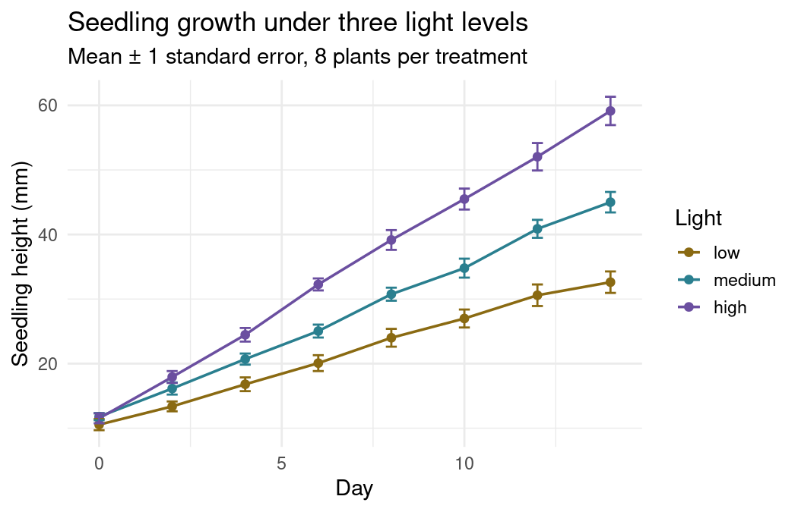{width="100%"}
:::
::: {.column width="42%"}
- `plot_growth.R`: about 30 lines you can open, read and rerun.
- `growth_plot.png`: made by the script, not drawn by hand.
- The agent reported: *"16 rows used the label High instead of high; I merged them. One measurement (m03, day 10) is missing and was left out."*
:::
::::

::: notes
This is a real plot, made by the script from the synthetic data. Three lines, one per light level, with standard errors. Two things to notice. First, what is in the folder: a script and an image. Neither lives in a chat history. Second, what the agent reported back. It found that some rows said "High" with a capital H, so its first plot had four groups instead of three; it merged them and told me. It also found a missing value and left it out. Those are exactly the decisions you want to hear about, because only you know whether they are right. Maybe "High" was a different lamp. We return to this in the exercise, where you read the full session.
:::

## When the data change, you rerun the script, not the conversation

```text
> The students added day 16. Update the plot.
```

- The agent reruns `plot_growth.R` on the new file. Same code, same style, new figure.
- Next year's class: copy the folder, swap the CSV, rerun.
- This is the difference between a **result** and a **reproducible result**. *Reproducible figures* (Part 2) builds on it.

::: notes
Here is why the script matters more than the picture. When the data change, and in research they always change, you do not start a new conversation and hope it draws the same figure. The script is already there. You, or the agent, rerun it. The colours, axes and error bars stay the same. Next year's class has new data: copy the folder, replace the CSV, rerun. Reviewers ask for one more condition: rerun. That is what reproducible means in practice, and it is something a chat window cannot give you because it leaves nothing behind. There is a full unit on this in Part 2, called Reproducible figures.
:::

## Step 2: the same folder becomes a small web page

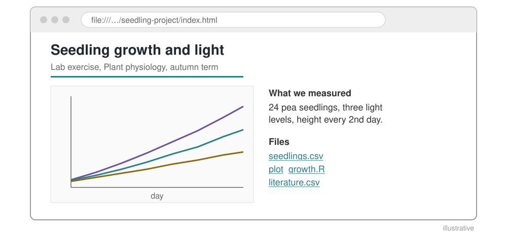{width="75%" fig-align="center"}

```text
> Make a simple one-page website (index.html) that shows the plot,
  explains the experiment in three sentences, and links to the files.
```

::: notes
The second prompt asks for a web page. One file, index.html, that shows the plot, says what was measured in a few sentences, and links to the data and the script. The agent writes the HTML; I open the file in my browser and look at it. I do not need to know HTML to judge it: is the text correct, is the figure the right one, do the links work? This is a mock-up, but the real thing looks much like it. In Part 3 the same idea becomes a full course or project page published on the web, with interactive demos and apps. Today it just shows that the agent is not limited to R scripts: it works with whatever files the task needs.
:::

## Step 3: a literature table is fast to make and slow to trust

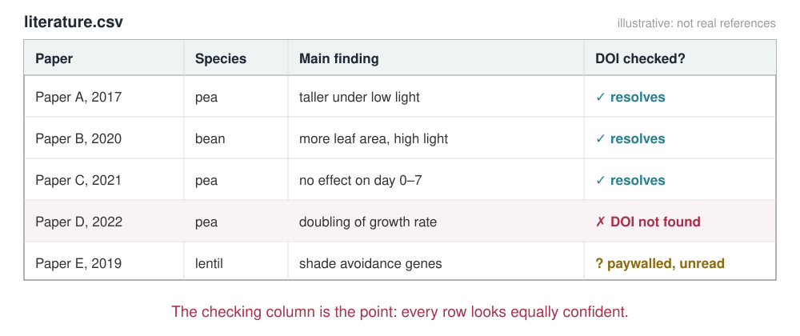{width="80%" fig-align="center"}

```text
> Find five papers on light intensity and seedling growth in legumes.
  Make literature.csv with paper, species, main finding and DOI. Check that each DOI exists.
```

::: notes
The third prompt is the riskiest one. I ask for five papers on light and seedling growth, as a table, and I ask the agent to check that each DOI exists. The table on the slide is an illustrative mock-up, not real references, but it shows a realistic outcome. Most rows check out. One DOI does not resolve: the paper may not exist at all, which language models are known to produce. One is behind a paywall, so nobody has actually read the claim. Every row is written in the same confident tone. The point is the last column. A literature table is the fastest thing in this demo to make, and the slowest to trust. Part 4 has a full unit on doing this properly, with every reference checked against PubMed or a DOI lookup.
:::

## After a few prompts the folder holds files you can keep

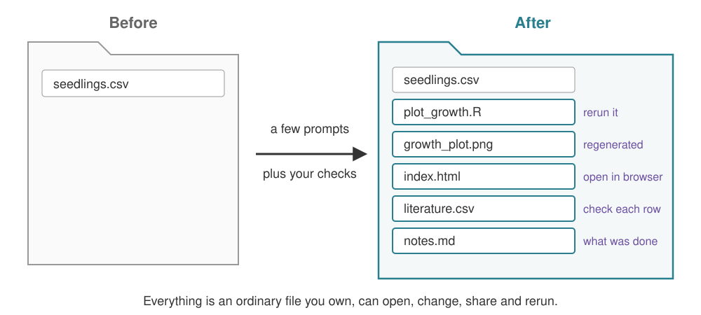{width="78%" fig-align="center"}

::: notes
Let us look at the folder again. Before: one CSV. After: the data, a script, the figure the script makes, a web page, a literature table, and a short notes file where the agent wrote down what it did and what it assumed. I asked for that notes file as part of the last prompt; it is a good habit and we make it standard in Organising a project for an agent. All of these are ordinary files. You can open them without any AI, email them to a colleague, put them on a USB stick, or archive them with a paper. Nothing is locked inside a chat or a company's website. The checking column on the right is yours: each file needs a different kind of check.
:::

## Your own session will look different, and that is normal

- Agents are **not deterministic**: the same prompt gives a slightly different script, wording or order of steps each time.
- Tools change monthly: screens, menus and options move.
- What stays the same: the agent **reads, plans, acts, checks, reports**, and **you judge**.
- So we teach **habits** (describe, approve, check), not keystrokes.

::: notes
A word of warning before you try any of this. When you run the same prompt, you will not get the same session as on these slides. The model makes slightly different choices each time: a different variable name, a different order of steps, a different colour. The tools themselves also change quickly; a menu that exists today may be renamed next month. Do not be alarmed if your screen does not match ours. What does not change is the shape of the work: the agent reads, plans, acts, checks and reports, and you decide whether the result is right. That is why this course teaches habits rather than exact buttons.
:::

## Every agent runs the same loop: goal, plan, act, look, repeat

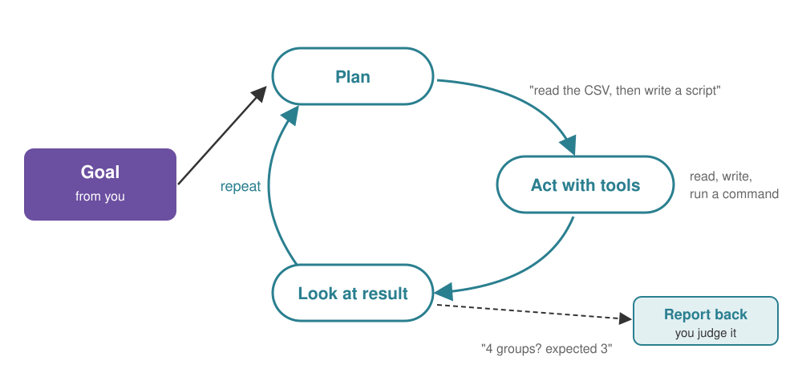{width="78%" fig-align="center"}

::: notes
Here is the loop at the highest level. You give a goal. The agent makes a short plan: for example, read the CSV, then write a script. It acts with one of its tools: reads a file, writes a file, runs a command. It looks at the result: did the command fail, does the output look as expected. Then it goes round again, with what it just learned, until it thinks the goal is met. Then it reports back to you, and you judge. That is all you need for now. How the model decides the next step, what it can and cannot remember, and why it sometimes goes confidently wrong, is the subject of the unit How LLMs and agents work, after you have used one yourself.
:::

## The loop lets the agent catch some of its own mistakes

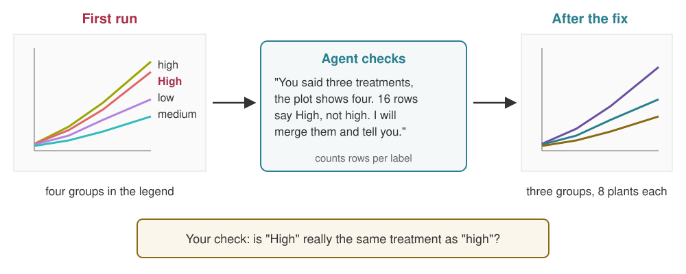{width="85%" fig-align="center"}

::: notes
This is the loop in action, from the seedling session. The agent's first script produced a plot with four groups. It looked at the result, compared it with the task, which said three treatments, counted rows per label, found sixteen rows labelled "High" with a capital H, merged them and reran. A chat window cannot do this, because it never sees the plot. But note the box at the bottom. The agent fixed what it saw as a typo. It could be right. It could also be that "High" was a second high-light lamp in another room, and merging them hides a real difference. The loop catches mechanical mistakes; it does not know your experiment. That check stays with you.
:::

## The tools are ordinary actions you could do yourself, only faster

| Tool | What it does | Seedling example |
|---|---|---|
| Read | Opens a file and looks at its contents | Reads `seedlings.csv`, sees four columns |
| Write / edit | Creates or changes a file | Writes `plot_growth.R`, later fixes one line |
| Run a command | Runs a program in the folder | `Rscript plot_growth.R` |
| Search | Finds files, or searches the web if allowed | Looks up DOIs for the literature table |
| Ask you | Stops for permission or a question | "Run this command?" |

There is no magic step: every action is visible on screen and most can be undone.

::: notes
It helps to demystify the word tool. Each tool is an ordinary action that you could do yourself with a file browser and a terminal: open a file, save a file, run a program, search. The agent does them faster and in the right order, and it shows each one on screen as it goes. Nothing happens behind a curtain. That is good news for checking: you can scroll back and see exactly which files it read and which commands it ran. In the exercise today you will do just that with a written-out session. And because the actions are ordinary file operations, most of them can be undone, especially once we add git in Part 2 as an undo button.
:::

## In teaching, agents take over the file work around a course

- Turn last year's slides and notes into a **course page** with schedule and reading list.
- Make **exercise variants** with answer keys from one template, and check each key by running it.
- Clean and merge **lab report data** from a whole class into one table and one class figure.
- Build a small **interactive demo** that shows one concept from your field.
- Collect **course evaluation** answers into a summary with the original quotes attached.

You still decide what students should learn and whether the material is correct.

::: notes
Some examples from teaching. These come up again and again when we ask teachers what eats their time. A course page built from slides you already have. Several versions of an exercise, each with an answer key, where the agent can actually run each version to check that the key is right. Lab data from 120 students in one tidy table. An interactive demo of a concept that students always struggle with. A summary of course evaluations with the original quotes kept, so you can check that the summary is fair. In every case, the pedagogical decisions stay with you. The agent saves the hours of file work around them.
:::

## The same pattern shows up in every faculty

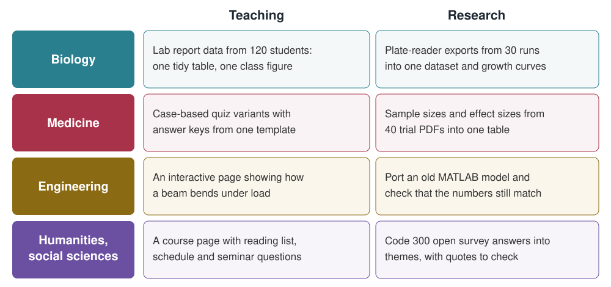{width="85%" fig-align="center"}

::: notes
And examples from several faculties, for teaching and research. In biology, plate reader exports from thirty runs merged into one dataset. In medicine, sample sizes and effect sizes extracted from forty trial PDFs. In engineering, an old MATLAB model ported to Python or R, with a check that the numbers still match. In the humanities and social sciences, a course page with reading lists, or three hundred open survey answers sorted into themes, with the quotes kept so you can verify the coding. The common thread is files: many of them, tedious to handle, but with a result you can check. The course examples lean towards biology, medicine and technology, but every exercise has a part on your own project, in your own field.
:::

## Some chores are poor candidates for an agent, and that is fine

- **The judgement is the job.** Grading a thesis, deciding a hiring case, reviewing a manuscript.
- **You cannot check the result.** If you could not tell a right answer from a wrong one, neither can anyone else in the room.
- **The data may not leave your institution.** Patient records, student grades, personnel files.
- **It is quicker by hand.** Fixing one typo does not need an agent.

::: notes
It is equally important to know where not to use this. Where the judgement is the work itself, like grading or reviewing, the agent can help with logistics but should not make the call. Where you have no way to check the result, you are not saving time, you are taking a risk you cannot see. Where the data are sensitive, such as patient data, grades or personnel matters, they may not be sent to a cloud service at all; the privacy unit goes through the rules. And some things are simply faster by hand. A good rule: the best first jobs for an agent are tedious, file-based, and easy to check.
:::

## Choose chores by two questions: can I check it, and may I share the data?

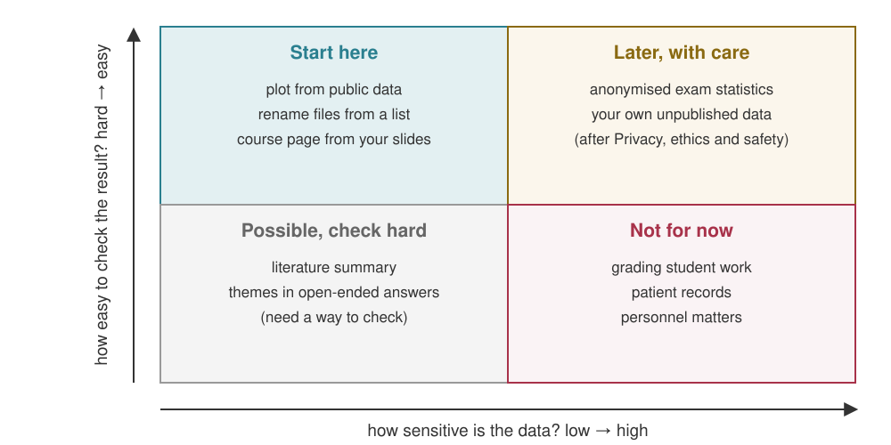{width="72%" fig-align="center"}

::: notes
Here is a simple way to sort your own chores, which you will use in today's exercise. Two questions. How easy is it to check the result? A plot from data you know well is easy; a literature summary is hard. And how sensitive is the data? Public or synthetic data is fine; patient records are not. Top left is where to start: easy to check, nothing sensitive. Top right waits until after the privacy unit, when you know the rules. Bottom left is possible but you need a checking plan first. Bottom right is not for this course. At the end of Part 1 you choose your own project, and this grid is how you will choose it.
:::

## Claude Code and Codex are two versions of the same idea

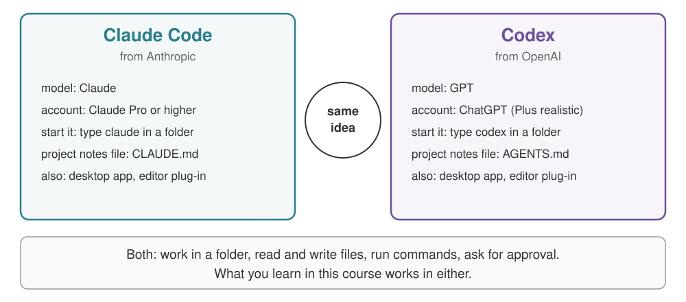{width="80%" fig-align="center"}

::: notes
The course uses two tools. Claude Code, from Anthropic, uses the Claude models. Codex, from OpenAI, uses OpenAI's GPT models. They are strikingly similar. Both run in a terminal, started by typing one word in a folder: claude or codex. Both also exist as desktop apps and as plug-ins for code editors, but in this course we use the terminal because it works the same everywhere. Both read a notes file in the project folder: CLAUDE.md for Claude Code and AGENTS.md for Codex. Both need an account: Claude Code needs a paid Claude plan, Pro or higher, while Codex works with any ChatGPT account, though the free one has low limits. The next unit goes through accounts and installation step by step.
:::

## The course teaches both, and what you learn transfers

| | Claude Code | Codex |
|---|---|---|
| Made by | Anthropic | OpenAI |
| Start it in a folder | `claude` | `codex` |
| Project notes file | `CLAUDE.md` | `AGENTS.md` |
| Account | Claude Pro or higher (or API billing) | Any ChatGPT plan; Plus or higher is realistic |

- You can do almost the whole course with **one** of them. Where they differ, every exercise has a column for each.
- Having both helps later: the same task to two agents, or one checking the other (*Parallel workers*, Part 5).
- Skills transfer: describing a task, approving steps, checking results, organising a folder.

::: notes
Which one should you use? Either. Almost every exercise works with both, and where the steps differ, the exercise gives you two columns or two tabs. Pick the one your institution supports, or the one whose account you already have. Having both is useful later in the course, when we give the same task to two agents and compare, or let one review the other's work. More importantly, the skills are not tied to a product. Describing a task clearly, reading a permission prompt, checking a result, keeping a project folder in order: all of that works in both tools, and it will keep working when these tools have new names in a few years.
:::

## Your role shifts from doing every step to describing and judging

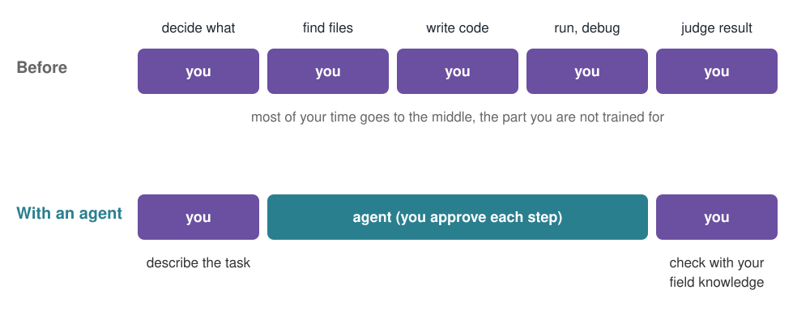{width="82%" fig-align="center"}

::: notes
What changes for you? Before, you did every step yourself: decide what you want, find the files, write the code or click through the menus, debug, and finally judge the result. Most of the time went into the middle steps, which are often the ones you were never trained for. With an agent, the middle moves to the agent, with you approving each step at first. You keep the two ends: describing the task well, and judging whether the result is right. Those two ends are where your training is. That is why this course is not a programming course. You will read some code, but only as much as you need to judge it.
:::

## Domain expertise matters more, not less

The agent can tell that a script **ran**. Only you can tell whether the result is **right**.

| The agent says | What only a domain expert notices |
|---|---|
| "Merged *High* into *high*." | Those plants were under a different lamp. |
| "Removed 3 outliers above 3 SD." | The outliers are the responders, the interesting ones. |
| "Plotted mean expression per group." | This assay needs a log scale; the mean hides everything. |
| "Summarised the survey: students liked the course." | The question was worded so that most answered yes. |
| "Converted all doses to mg." | Two papers report mg/kg; the conversion is wrong. |

::: notes
Here is the counter-intuitive part. You might expect that an agent makes expertise less important. In practice it is the opposite. The agent is good at making things run. It has no idea whether a result makes sense in your field. Look at the table. Each statement on the left is a reasonable, well-executed step. Each one on the right is something only a person who knows the field would catch: the different lamp, the outliers that are the actual finding, the scale that hides the effect, the leading survey question, the unit that does not convert. Your expertise used to go partly into doing the work. Now it goes almost entirely into checking it. That makes it more valuable, not less.
:::

## Describing the task well is a skill you can learn

```text
Vague:   > Make a nice plot of my data.
```

```text
Better:  > Plot mean seedling height (mm) per light treatment over days,
           with ± 1 standard error. Use R and ggplot2, save the script as
           plot_growth.R. There should be exactly three treatments. If the
           data disagree, stop and tell me before changing anything.
```

- The better prompt says **what**, **how**, **what the result should look like**, and **when to stop and ask**.
- *First delegations* gives you practice; *Delegating well* (Part 2) makes it systematic.

::: notes
The first of your two ends is describing the task. Compare the two prompts. The vague one will produce something, but the agent has to guess the measurement, the grouping, the tool and the style, and it will guess confidently. The better one says what to plot, how, where to save it, what the result should look like, and, importantly, when to stop and ask instead of fixing things silently. That last sentence would have made the agent ask about "High" instead of merging it. You do not have to write like this from day one. You will practise in First delegations, and Delegating well in Part 2 gives you a structure for it.
:::

## Where this goes wrong

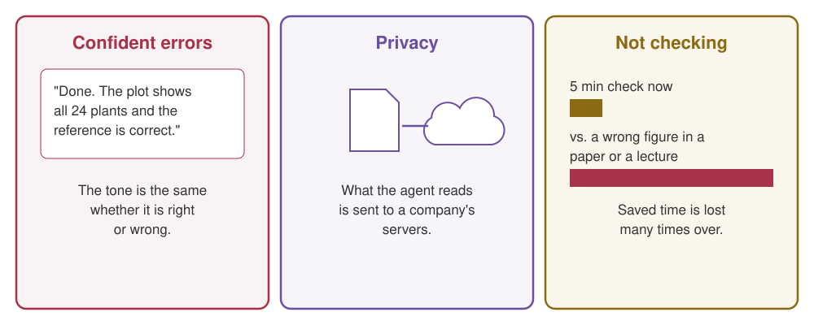{width="82%" fig-align="center"}

- **Confident errors:** invented references, silent shortcuts, a "Done" when it is not done.
- **Privacy:** whatever the agent reads goes to the provider's servers.
- **Cost of not checking:** a wrong figure in a lecture or a paper costs far more than the minutes you saved.

::: notes
Now the honest limits. First, confident errors. Agents write "Done, everything works" in the same tone whether it is true or not. They can invent a reference that looks real, quietly skip the hard part of a task, or change your data to make a script run. Second, privacy. Every file the agent reads is sent to Anthropic's or OpenAI's servers to be processed. That is fine for synthetic data, and not fine for patient records or student grades. Third, the cost of not checking. The agent saves you hours, but if a wrong number ends up in a lecture or a paper, you lose much more than you saved. None of these is a reason not to use agents. They are reasons to check, and every exercise in this course tells you how.
:::

## Until the privacy unit, use only example data

- Everything in Part 1 uses **synthetic or public example data**, supplied by the course.
- Do not point an agent at your **home folder**, your email, or a folder with student or patient data.
- Work in a **dedicated project folder**, ideally on a copy of the files.
- *Privacy, ethics and safety* (end of Part 1) covers what may be sent, GDPR, university rules and AI disclosure. Only then do you choose your own project.

::: notes
A practical rule for the next few weeks. Until we have done the privacy unit, use only the example data we give you. It is synthetic or public, so nothing can go wrong. Do not start the agent in your home folder, where it could read everything, and do not let it near folders with student or patient data. Always work in a folder made for the task, and on a copy if the files matter. The privacy unit at the end of Part 1 goes through what may and may not be sent to these services, what GDPR and your university say, and how to disclose AI use in papers and theses. It ends with choosing your own project, so that nobody's first session with their own data is a privacy mistake.
:::

## The course has five parts and one project that runs through them

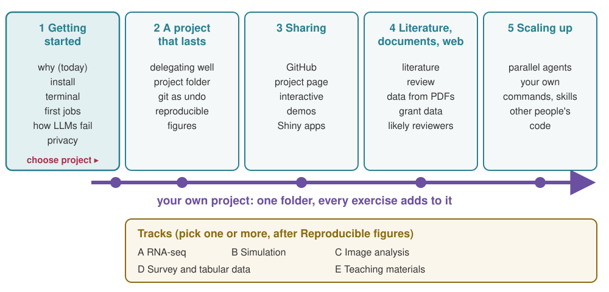{width="85%" fig-align="center"}

::: notes
Here is the map of the course. Part 1, Getting started: today, installation, the terminal, your first small jobs, how the models work and fail, and privacy. Part 2, A project that lasts: how to delegate well, how to organise a project folder so the agent and your colleagues can find their way, git as an undo button, and reproducible figures. Part 3, Sharing: GitHub, a course or project page, interactive demos and Shiny apps. Part 4, Literature, documents and the web: a verified literature review, data extracted from PDFs, grant data, and preparing for grant reviewers. Part 5, Scaling up: several agents in parallel, your own commands and skills, and reading other people's code. Tracks for RNA-seq, simulation, image analysis, survey data and teaching materials can be added after Reproducible figures.
:::

## You choose your own project at the end of Part 1

- There is **no capstone**. Instead, one **own project** runs through every exercise from Part 2 on.
- Each exercise has a **worked example** on shared data and an **on your own project** part.
- Good projects: a course page, a reproducible analysis, a literature map, a cleaned dataset for deposit.
- No idea yet? There is a list of example projects. You may also switch later.

Today's second exercise task, sorting your own chores, is the first step towards choosing.

::: notes
The purple line on the map is your own project. There is no separate final assignment. Instead, at the end of Part 1 you choose one project from your own job, and from then on every exercise has two parts: a worked example that everyone does on the same data, so you have something to compare with, and the same skill applied to your project. By the end of the course, that project folder holds a portfolio of things you made and kept: scripts, figures, a page, a literature table. If you have no idea yet, that is fine; we have a list of example projects, and you can change your mind later. Today's exercise has you list chores from your own job, which is the raw material for choosing.
:::

## Today's exercise: watch an agent work, then sort your own chores

1. **Read an annotated agent session** (no installation needed). The agent turns `seedlings.csv` into a plot, makes a mistake, notices it and asks for permission. Answer: where did it read files, where did it ask, what did it check, and what would *you* check?
2. **List five chores from your own job** and place them on the grid: how easy is the result to check, and how sensitive is the data?

You keep: your annotated answers and your chore grid. You need the grid at the end of Part 1.

::: notes
The exercise has two tasks, and neither needs any software. First, you read a written-out session of an agent working on the seedling data, the same one you saw in the live build, but in full. It reads the file, writes a script, asks permission to run it, makes a mistake, notices it, fixes it, and reports. You answer four questions about it. The last one, what would you check, is the most important. Second, you write down five chores from your own job and place them on the two-question grid from earlier. Keep both. The grid is your starting point when you choose your own project at the end of Part 1.
:::

## Summary

| Concept | Key fact |
|---|---|
| Chat window | Gives you text; you copy, paste, run and debug. It never sees your files. |
| Coding agent | A language model that works in a folder on your computer: reads, writes, runs, checks. |
| What you get | Ordinary files you keep: scripts, figures, tables, pages. Rerun instead of re-ask. |
| The loop | Goal → plan → act with tools → look at the result → repeat → report. |
| Permission prompts | The agent asks before steps outside the limits you set. Read them; you can say no. |

::: notes
To sum up. A chat window gives you text; an agent works in a folder and leaves you files. It does this by running a loop: plan, act with tools, look at the result, repeat, report. It asks before steps outside the limits you set, and reading those prompts is your first safety habit. Claude Code and Codex are two versions of the same idea, and the course teaches both. Your role moves to the two ends of the task, describing and judging, which is where your expertise is. Be clear about the limits: confident errors, privacy and the cost of not checking. In the next unit, Accounts and installation, we get you an account and install the tools, step by step, on Windows and Mac.
:::

## Summary (continued)

| Concept | Key fact |
|---|---|
| Claude Code / Codex | Two similar tools (Anthropic / OpenAI). The course teaches both; skills transfer. |
| Your role | Describe the task, judge the result. Domain expertise matters more, not less. |
| Limits | Confident errors, privacy, and the cost of not checking. Example data only until the privacy unit. |
| Own project | Chosen at the end of Part 1; runs through every later exercise. |

**Next (Accounts and installation):** get a Claude or ChatGPT account that includes the agent, install Claude Code and/or Codex, and say hello to it in a terminal.

::: notes
The rest of the summary table, and where we go next.
:::
